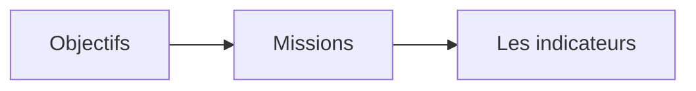

# Module 07 — Amélioration continue des services

Les parties ci-dessous reprennent le cours original, dans le même ordre. Les encadrés et les schémas répètent ses formulations.

## Parcours de lecture

1. Support · Module 07 - Support de cours · 3 pages transcrites

SOURCE DRIVE · TRANSCRIPTION DU SUPPORT

Le contenu des documents du dossier TSSR est transcrit ci-dessous, page par page. Les textes et tableaux sont intégrés à la page Web. Aucun fichier PDF, aucune diapositive entière ni aucune reproduction de page n’est affiché. Seuls des croquis ou visuels isolés et vérifiés peuvent accompagner la transcription. Les versions et les consignes restent celles des supports de formation. Les compléments IA sont conservés dans leur onglet distinct.

## Support · Module 07 - Support de cours · 3 pages transcrites

!!! note "À retenir"
    Texte, tableaux et illustrations utiles retranscrits du support ; numéros de diapositives, bandeaux répétitifs, éléments de marque et décorations exclus.

Texte, tableaux et illustrations utiles retranscrits du support ; numéros de diapositives, bandeaux répétitifs, éléments de marque et décorations exclus. Les formulations historiques sont conservées ; les précisions sont placées dans le cours optimisé.

### Page 1

#### Sensibilisation ITIL

!!! note "À retenir"
    Module 07 – Les publications centrales « Amélioration continue des services »

Module 07 – Les publications centrales « Amélioration continue des services »

#### Objectifs

!!! note "À retenir"
    Définir le rôle de l’amélioration continue des services Connaitre la roue de Deming

- Définir le rôle de l’amélioration continue des services
- Connaitre la roue de Deming

### Page 2

#### L’amélioration continue des services

**Visuel externe**

- Objectifs
  - Analyser les résultats des différents contrats (SLA, OLA, UC)
  - Identifier et mettre en œuvre toutes les actions conduisant à l’amélioration des services
  - Améliorer la rentabilité sans diminuer la qualité : l’efficience
  - Améliorer la relation client
  - S’assurer que les méthodes de gestion sont efficaces
- Missions
  - Analyser les évolutions et les tendances
  - Conduire les enquêtes de satisfaction et les audits internes
  - Émettre des préconisations d’amélioration
  - Conduire les revues de l’amélioration continue des services

- Les indicateurs
  - Les Key Performance Indicators
  - Les Critical Success Factor
  - Les bases de référence
  - La mesure des services
    - Métriques techniques (ne pas communiquer au client)
    - Métriques de processus
    - Métriques de services (à communiquer au client)

### Page 3

!!! note "À retenir"
    L’amélioration continue des services La roue de DEMING Référence du document : 14QP2Ryukv3t8SMfbYUUCyw6wG6CaUYar · SHA-256 efbc2f102cb14155…

L’amélioration continue des services

- La roue de DEMING

| Cycle de la roue de Deming |
| --- |
| PLAN → DO → CHECK → ACT → PLAN |

Référence du document : 14QP2Ryukv3t8SMfbYUUCyw6wG6CaUYar · SHA-256 efbc2f102cb14155…

## Fiche de synthèse

Les lignes reprennent les titres du cours et la première phrase de chaque partie.

| Partie | Repère du cours |
| --- | --- |
| Support · Module 07 - Support de cours · 3 pages transcrites | Texte, tableaux et illustrations utiles retranscrits du support ; numéros de diapositives, bandeaux répétitifs, éléments de marque et décorations exclus. |
