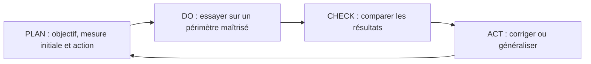

# Module 07 — Amélioration continue des services

## Objectifs

- Définir un objectif d’amélioration et une mesure de départ.
- Utiliser les quatre étapes de la roue de Deming pour tester une action.
- Comparer les résultats et décider d’étendre, d’ajuster ou d’arrêter l’action.

## Améliorer à partir des résultats réels

L’amélioration continue analyse les résultats des engagements (SLA, OLA, UC), les tendances, la satisfaction et les audits. Elle identifie, priorise et suit les actions pour améliorer qualité, fiabilité, relation client et efficacité des méthodes de gestion. Une amélioration doit avoir un objectif et une façon de vérifier son effet.

| Repère du support | Usage |
|---|---|
| KPI — Key Performance Indicator | Mesurer une performance liée à un objectif. |
| CSF — Critical Success Factor | Identifier une condition essentielle de réussite. |
| Base de référence | Comparer l’évolution à une situation initiale documentée. |
| Mesure technique | Observer le fonctionnement des composants. |
| Mesure de processus | Observer délais, qualité et exécution des activités. |
| Mesure de service | Rendre compte du résultat utile au client. |

**Précision externe :** toutes les métriques techniques ne doivent pas être envoyées brutes au client, mais elles peuvent soutenir l’explication d’un résultat de service. Adapter le niveau de détail au besoin du destinataire.

## La roue de Deming en pratique

**Cas externe :** de nombreux tickets de connexion sont mal renseignés. Mesurer d’abord la proportion de tickets complets et les retours nécessaires. Tester un formulaire guidé sur un service, comparer qualité et délai, puis ajuster avant généralisation. Le nombre de formulaires créés est une activité ; la baisse des échanges inutiles et l’amélioration du délai sont des résultats à vérifier.

Prévoir un responsable, une échéance, les ressources, les risques et les critères de succès. Conserver les résultats de l’essai et les limites de la comparaison : une baisse de charge peut provenir d’une période creuse plutôt que de l’action testée.

## Notions détaillées pour approfondir

Les notions détaillées ci-dessous conservent le périmètre et les exemples du support historique, avec une mise en page réparée. Les réserves et corrections exposées plus haut s’appliquent à cette relecture. Pour la formulation source exacte, utiliser **Cours Original**. Les captures sont des illustrations isolées du support, pas des schémas générés.

### Objectifs et suivi

<section>
<h4>Sensibilisation ITIL</h4>

Module 07 – Les publications centrales « Amélioration continue des services »

<h4>Objectifs</h4>
<ul><li>Définir le rôle de l’amélioration continue des services</li><li>Connaitre la roue de Deming</li></ul>
</section>

<section>

L’amélioration continue des services

<ul><li>Objectifs<ul><li>Analyser les résultats des différents contrats (SLA, OLA, UC)</li><li>Identifier et mettre en œuvre toutes les actions conduisant à l’amélioration des services</li><li>Améliorer la rentabilité sans diminuer la qualité : l’efficience</li><li>Améliorer la relation client</li><li>S’assurer que les méthodes de gestion sont efficaces</li></ul></li><li>Missions<ul><li>Analyser les évolutions et les tendances</li><li>Conduire les enquêtes de satisfaction et les audits internes</li><li>Émettre des préconisations d’amélioration</li><li>Conduire les revues de l’amélioration continue des services</li></ul></li></ul>

L’amélioration continue des services

<ul><li>Les indicateurs<ul><li>Les Key Performance Indicators</li><li>Les Critical Success Factor</li><li>Les bases de référence</li><li>La mesure des services<ul><li>Métriques techniques (ne pas communiquer au client)</li><li>Métriques de processus</li><li>Métriques de services (à communiquer au client)</li></ul></li></ul></li></ul>
</section>

### Roue de Deming

<section>

L’amélioration continue des services

<ul><li>La roue de DEMING</li></ul>
<table><caption>Roue de DEMING — transcription des libellés et du sens du cycle</caption><thead><tr><th scope="col">Cycle de la roue de Deming</th></tr></thead><tbody><tr><td>PLAN → DO → CHECK → ACT → PLAN</td></tr></tbody></table>
</section>

## Vérifier en pratique

| Point de contrôle | Résultat attendu |
| --- | --- |
| Avant l’essai | Fixer le périmètre, la période, l’indicateur et la valeur de départ. |
| Après l’essai | Comparer des mesures calculées de la même façon, puis vérifier que le résultat est utile pour les utilisateurs. |

## Mini-quiz — 5 questions

1. Pourquoi conserver une référence initiale ?
2. Que signifie CHECK ?
3. Plus d’articles dans la base prouve-t-il une amélioration ?
4. Les délais semblent meilleurs, mais le second relevé ne couvre que les demandes simples. Peut-on conclure ?
5. Que faire si l’action réduit le délai mais augmente les réouvertures ?

??? success "Réponses commentées"
    1. Pour comparer l’avant et l’après sur des critères cohérents.

    2. Vérifier les résultats par rapport aux objectifs et mesures prévus.

    3. Non : mesurer aussi usage, fiabilité et effet sur le service.

    4. Comparer d’abord des populations et périodes équivalentes, ou expliquer l’effet du changement de périmètre.

    5. Vérifier le compromis entre délai et qualité, puis ajuster l’action avant de l’étendre.

## Pratiquer et réviser

- [Fiche de révision du module](../../revision/itil/module-07-amelioration-continue-des-services.md)
- [Retour à la séquence](index.md)
