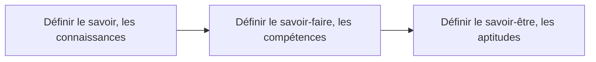
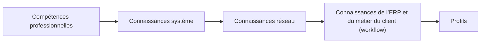

```mermaid
flowchart LR
    N1["Régler les incidents et les problèmes rencontrés par les utilisateurs"]
    N2["Diagnostiquer un incident"]
    N3["Effectuer une réparation matérielle"]
    N4["Proposer une solution de contournement"]
    N5["Commander et changer des matériels défectueux"]
    N6["Installer du nouveau matériel (intégrer et gérer un réseau)"]
    N7["Surveiller la sécurité"]
    N8["Former les utilisateurs"]
    N1 --> N2
    N2 --> N3
    N3 --> N4
    N4 --> N5
    N5 --> N6
    N6 --> N7
    N7 --> N8
```

# Module 08 — Savoir, savoir-faire, savoir-être

Les parties ci-dessous reprennent le cours original, dans le même ordre. Les encadrés et les schémas répètent ses formulations.

## Parcours de lecture

1. Support · Module 08 - Support de cours · 23 pages transcrites

SOURCE DRIVE · TRANSCRIPTION DU SUPPORT

Le contenu des documents du dossier TSSR est transcrit ci-dessous, page par page. Les textes et tableaux sont intégrés à la page Web. Aucun fichier PDF, aucune diapositive entière ni aucune reproduction de page n’est affiché. Seuls des croquis ou visuels isolés et vérifiés peuvent accompagner la transcription. Les versions et les consignes restent celles des supports de formation. Les compléments IA sont conservés dans leur onglet distinct.

## Support · Module 08 - Support de cours · 23 pages transcrites

!!! note "À retenir"
    Texte, tableaux et illustrations utiles retranscrits du support ; numéros de diapositives, bandeaux répétitifs, éléments de marque et décorations exclus.

Texte, tableaux et illustrations utiles retranscrits du support ; numéros de diapositives, bandeaux répétitifs, éléments de marque et décorations exclus. Les formulations historiques sont conservées ; les précisions sont placées dans le cours optimisé.

### Page 1

#### Sensibilisation ITIL

!!! note "À retenir"
    Module 08 – Savoir, Savoir-faire, Savoir-être

Module 08 – Savoir, Savoir-faire, Savoir-être

#### Objectifs

!!! note "À retenir"
    Définir le savoir, les connaissances Définir le savoir-faire, les compétences Définir le savoir-être, les aptitudes

**Visuel externe**

- Définir le savoir, les connaissances
- Définir le savoir-faire, les compétences
- Définir le savoir-être, les aptitudes

### Page 2

!!! note "À retenir"
    Quel est le rôle du technicien support ?

**Visuel externe**

Quel est le rôle du technicien support ?

- Régler les incidents et les problèmes rencontrés par les utilisateurs
- Diagnostiquer un incident
- Effectuer une réparation matérielle
- Proposer une solution de contournement

- Commander et changer des matériels défectueux
- Installer du nouveau matériel (intégrer et gérer un réseau)

- Surveiller la sécurité

- Former les utilisateurs

Quelles sont les compétences requises ?

- Le savoir – connaissance
  - Définition : faculté mentale produisant une assimilation par l’esprit d’un contenu objectif préalablement traduit en signes et en idées.
- Le savoir-faire – compétence
  - Définition : compétence acquise par l’expérience dans les problèmes pratiques, dans l’exercice d’un métier.
- Le savoir-être – aptitude
  - Définition : correspond à la capacité de produire des actions et des réactions adaptées à l’environnement humain et écologique

Source Wikipédia

### Page 3

!!! note "À retenir"
    Compétences et profils Compétences professionnelles Connaissances système Connaissances réseau Connaissances de l’ERP et du métier du client (workflow) Profils - Sens de l’écoute - Calme - Qualités relationnelles - Efficacité - Organisation - Veille technologique

**Visuel externe**

Compétences et profils

- Compétences professionnelles
- Connaissances système
- Connaissances réseau
- Connaissances de l’ERP et du métier du client (workflow)
- Profils
  - Sens de l’écoute
  - Calme
  - Qualités relationnelles
  - Efficacité
  - Organisation
  - Veille technologique

#### Savoirs - Connaissances

### Page 4

#### Le savoir

!!! note "À retenir"
    - « J’ai déjà eu ce problème, mais je ne sais plus comment j’ai fait pour le régler.

**Visuel externe**

- Vous êtes vous déjà dit ?
  - « J’ai déjà eu ce problème, mais je ne sais plus comment j’ai fait pour le régler. »
- Il faut une bonne base de connaissance
  - Wiki
  - Logiciel interne
  - Site intranet
  - Logiciel de gestion de parc (GLPI)
- Il faut une bonne veille technologique

- Documentez les bonnes pratiques
- Partagez les solutions pour les incidents communs
- Permettez aux utilisateurs finaux de résoudre par eux-mêmes leurs incidents
- Facilitez les recherches en rendant visible les articles qu’aux personnes nécessaires
- Partagez vos idées, vos expériences, votre veille technologique

### Page 5

!!! note "À retenir"
    Le savoir Avantages - Solutions pour les utilisateurs finaux 24/7 par un navigateur web - Réduit la charge de travail du service helpdesk - Améliore la productivité générale et donc l’efficience - Facilité d’utilisation et de partage - Réduction des temps de résolution qui permet de respecter les SLA

Le savoir

- Avantages
  - Solutions pour les utilisateurs finaux 24/7 par un navigateur web
  - Réduit la charge de travail du service helpdesk
  - Améliore la productivité générale et donc l’efficience
  - Facilité d’utilisation et de partage
  - Réduction des temps de résolution qui permet de respecter les SLA

#### Savoir-faire - Compétences

### Page 6

La compétence

- La compétence désigne la mobilisation d’un ensemble de ressources en vue de résoudre une situation complexe

La communication

Entre ce que je pense,

Ce que je veux dire,

Ce que je crois dire,

Ce que je dis réellement,

Ce que vous voulez entendre,

Ce que vous entendez,

Ce que vous croyez comprendre,

Et ce que vous comprenez réellement,

Il y a au moins 10 possibilités

De ne pas se comprendre

Nouvelle encyclopédie du savoir relatif et absolu

Bernard WERBER

Mais essayons quand même

### Page 7

La communication externe

- La communication externe tente de répondre à l’un des objectifs suivants :

- Faire passer une information, une connaissance ou une émotion
- Créer un langage commun pour faciliter la compréhension (ITIL)
- Créer une relation pour être connu et ainsi fidélisé
- Créer une influence pour inciter l’autre

La communication interne

- La communication interne permet
  - Implication
  - Adaptation au changement
  - Bonne ambiance
  - Disparition des rumeurs

### Page 8

Le verbal

- L’émission des signaux ne signifie pas forcément leur bonne réception par le(s) récepteur(s)
- Une bonne communication nécessite la réception et la compréhension de l’information par le(s) destinataire(s)

- Vous êtes tour à tour émetteur et récepteur
  - Émetteur : soyez clair, précis et compréhensible
  - Récepteur : soyez disponible et sachez écouter (donc, vous taire)

Le non verbal

- Gestes naturels : mouvements d’instinct ou réflexes (haussement d’épaules)

- Gestes sociaux : mouvements volontaires, liés à la culture, à l’origine sociale

- Regard : sa direction est une indication du degré d’intérêt porté à l’autre

- Expression du visage : disponibilité d’esprit, degré de sympathie

- Posture et mouvement : degré d’assurance, de disponibilité

- Vêtements : statut social, style de vie, mais aussi mise en valeur de l’autre…

### Page 9

#### Le non verbal

| Franchise | Sourire chaleureux | Bras décroisés | Jambes décroisées | Buste en avant | Corps détendu | Regard direct, pupilles dilatées | Décontracté, veste retirée (pour les hommes) |  |
| --- | --- | --- | --- | --- | --- | --- | --- | --- |
| Agressivité | Plisser les sourcils | Regard soutenu, pupilles contractées | Poings serrés | Bras allongés pendant que les mains saisissent le bord de table | Froncer les sourcils | Index pointé | Mains sur les hanches en se tenant debout | Se déplacer dans l’espace personnel de l’autre |
| Attitude défensive | Peu de regard | Corps rigide | Mains serrées | Bras fermement croisés | Tête basse | Jambes et chevilles fermement croisées |  |  |
| Ennui ou indifférence | Regard fixe sans expression | Les yeux ne clignent pas | Tête dans la paume de la main | Tapoter avec ses doigts ou donner des petits coups de pied | Peu de regards | Les yeux vers le bas | Les jambes croisées | Distrait |

| Franchise | Regard franc | Assis, se penchant en avant, les mains sur les cuisses ou sur les genoux | Expression faciale vivante | Debout la veste ouverte, les mains reculées sur les hanches | Proximité de l’interlocuteur | Assis sur le bord de la chaise | Exprimer son accord |  |
| --- | --- | --- | --- | --- | --- | --- | --- | --- |
| Agressivité | Regard fixe dans le vide | Passe les mains dans les cheveux | Courtes inspirations et expirations | Se tordant les mains | Lèvres fermées | Profondes respirations | Mains fermement serrées |  |
| Attitude défensive | Mains jointes | Pencher en arrière, mains jointes derrière la tête | Fier, se tenant droit avec les mains jointent derrière le dos | Tête haute | Jambes étirées | Se dominant physiquement | Pencher en arrière sur sa chaise | Regard continu |
| Ennui ou indifférence | Faible poignée de main, main molle | S’éclaircir le fond de la gorge souvent | Peu de regard | Rire nerveux | Tapoter ses doigts sur la table | Soupirer | Croiser les bras et les jambes | Tripoter |

### Page 10

!!! note "À retenir"
    La technique Questionnement (découverte des besoins) Écoute (analyse des besoins) Reformulation (finalisation et obtention de oui) Questionnement Questionnement ouvert : favorise la généralisation - En quoi est-ce important ?

La technique

- Questionnement (découverte des besoins)
- Écoute (analyse des besoins)
- Reformulation (finalisation et obtention de oui)

Questionnement

- Questionnement ouvert : favorise la généralisation
  - En quoi est-ce important ?
  - Quel est votre avis ?
  - Qu’est-ce que cela représente pour vous ?
- Questionnement fermé : favorise la spécification
  - Quand ?
  - Combien de fois ?
  - Avec qui ?
  - Êtes-vous d’accord ?

### Page 11

L’écoute

- Être ouvert à l’autre
- Lire entre les lignes du discours
- Percevoir l’environnement
- Écouter le message
- Objectifs
  - Obtenir de l’information
  - Rester ouvert aux perceptions de l’autre
  - Comprendre le degré de motivation

La reformulation

- Redire avec d’autres mots ce que votre client vient d’exprimer
- Objectifs
  - Montrer que l’on a écouté
  - Vérifier que l’on a compris
  - Éventuellement, faire préciser votre client
- Exemples
  - Ainsi selon vous …
  - Si j’ai bien compris …
  - Vous voulez dire …
  - En somme, vous trouvez que …

### Page 12

La reformulation

- Trois méthodes de reformulation
  - De reflet
  - De résumé
  - De clarification
- La reformulation
  - Met en confiance
  - Relance le débat
  - Clarifie le débat
  - Met en mots le ressenti

La communication écrite

- Communication écrite
  - Elle permet de véhiculer l’image de son auteur
- L’écrit est indispensable dans la vie professionnelle
- On adapte son écrit en fonction de son interlocuteur
  - Choix du vocabulaire
  - Texte concis
  - Document de synthèse pour les décideurs

### Page 13

#### La communication écrite

- Texte

- Paragraphe

- Ponctuation

- Phrase

- Mot

##### Les mots

- Préférez les mots courts
- Évitez les mots savants et pompeux
- N’imposez pas votre jargon
- Employez des mots concrets
- Évitez le franglais
- Méfiez-vous des sigles

- Employez des verbes précis

### Page 14

#### La communication écrite

##### Les phrases

- Pensez au vocabulaire clair et précis
- Évitez de faire du Proust
- Accompagnez les schémas et les explications : légendez !
- Privilégiez les phrases courtes dans un rapport
- N’oubliez pas les introductions de chapitre

##### La ponctuation

- La ponctuation comme une respiration
- La ponctuation des listes : énumération de substantifs ou de phrases
- Respectez les règles de typographie

### Page 15

#### La communication écrite

##### Les paragraphes

- Pensez à laisser des espaces
- Jouez avec Word pour la justification
- Travaillez en mode tableau ou colonne pour mettre en valeur des arguments
- Faites un peu de mise en page !

##### Le texte

- Revenez à l’objectif
- Demandez les consignes
- Respectez les règles
- Choisissez la maquette en fonction de la cible
- Relisez-vous trois fois !
- Faites relire pour l’orthographe

### Page 16

#### La communication écrite

##### Utiliser la messagerie

- Une communication rapide, instantanée
- Écrite
- Asynchrone
- Vers un ou plusieurs interlocuteurs
- Dotée de mémoire externe
- Synthétique, percutante

- Permet l’échange

##### Problèmes posés par la messagerie

- Stress
- Surcharge
- Urgence
- Interruption
- Dépersonnalisation de la relation
- Aplatissement des structures hiérarchiques

- À ne pas confondre avec le chat
- Mauvaise interprétation
- Attention à la gestion de la confidentialité

### Page 17

#### Savoir-être - Aptitudes

Les aptitudes

- Sang froid
- Disponibilité
- Rapidité d'adaptation
- Facilité de parole
- Rapidité d'analyse
- Écoute

### Page 18

#### Gestion des conflits

- Client agressif

- Client stressé

- Client malhabile

##### Client agressif

- De mauvaise foi
- Ne reconnaissant surtout pas son erreur
- Suffisant
- Désagréable

- Ne pas insister, il ne s'agit pas d'avoir le dernier mot

- Si cela lui fait plaisir, lui laisser croire à sa supériorité

### Page 19

#### Gestion des conflits

##### Client agressif

- Colérique

- Ne pas le laisser aller trop loin, il faut aussi se faire respecter
- Ne pas entrer dans son jeu en se mettant en colère aussi
- Garder son calme pour désamorcer le conflit, à s'énerver tout seul, il finira par se sentir ridicule

##### Client stressé

- Évaluer le niveau du blocage
  - Blocage partiel
  - Blocage total
- Rassurer l'utilisateur et montrer que :
  - Vous prenez les choses en main
  - Vous prenez en compte son urgence

### Page 20

#### Gestion des conflits

##### Client malhabile

- Débutant sur son logiciel
  - Se mettre à sa place
  - Le déculpabiliser
- Réfractaire à l'informatique
  - Jouer la complicité avec humour
  - L'encourager à persévérer si possible

##### Phrases à proscrire

- Ne pas dire
  - Je ne sais pas
- Dire
  - Je vais me renseigner
  - Votre problème est relativement complexe
  - Fixer un délai

### Page 21

#### Gestion des conflits

##### Phrases à proscrire

- Ne pas dire
  - Je ne comprends pas ce qu’il se passe
- Dire
  - Il y a sûrement une explication

##### Phrases à proscrire

- Ne pas dire
  - Vous avez commis une erreur
- Dire
  - Ce programme est complexe à utiliser
  - Le déculpabiliser sans remettre en cause la qualité du logiciel

### Page 22

#### Gestion des conflits

##### Phrases à proscrire

- Ne pas dire
  - On m’a répondu …
  - Un collègue m’a dit …
- Dire
  - J’ai trouvé la solution

##### Phrases à proscrire

- Ne pas dire
  - Ce logiciel est nul
- Dire
  - Ne pas décourager l’utilisateur / le client, mais plutôt le stimuler en lui laissant entrevoir toutes les capacités du logiciel une fois qu’il le maîtrisera

### Page 23

Gestion des conflits

##### Phrases à proscrire

- Ne pas dire
  - Je ne comprends pas ce que vous dîtes
- Dire
  - Essayer de reformuler ce que le client a pu vous dire
  - Si ce n’est pas possible
    - Lui laisser entendre que son problème n’est pas simple
    - Éviter les questions trop larges
    - Essayer de définir avec lui le problème étape par étape en reformulant ce que vous avez compris à chaque étape de son explication

Référence du document : 1y43DjS67RZCmK58PI6QIm3Jp-aDLx1nG · SHA-256 3258e72e6d270520…

## Fiche de synthèse

Les lignes reprennent les titres du cours et la première phrase de chaque partie.

| Partie | Repère du cours |
| --- | --- |
| Support · Module 08 - Support de cours · 23 pages transcrites | Texte, tableaux et illustrations utiles retranscrits du support ; numéros de diapositives, bandeaux répétitifs, éléments de marque et décorations exclus. |
