# Module 09 — Assistance avec GLPI

## Objectifs

- Expliquer les entrées du ticket et distinguer attribution, traitement, validation et clôture.
- Tester l’accès à une fiche ou à un article avec les rôles concernés.
- Réaliser les sept étapes du TP d’exploitation, de la demande au contrôle de clôture.

## Le ticket assure la continuité du traitement

GLPI centralise incidents et demandes, assure le suivi des échanges et relie les interventions au parc et à la connaissance. Un ticket apporte **traçabilité, communication, répartition du travail et détection des récurrences**. Il doit contenir assez d’informations pour qu’un autre technicien puisse reprendre le dossier.

| Information à recueillir | Utilité |
|---|---|
| Demandeur, coordonnées et entité | Identifier la personne et le périmètre autorisé. |
| Type, catégorie, titre et description | Distinguer demande et incident, puis comprendre le besoin. |
| Symptômes, date, étendue et conséquences | Qualifier l’impact et l’urgence. |
| Équipement ou CI concerné | Relier le dossier au parc et aux dépendances. |
| Actions, résultats et pièces utiles | Éviter de recommencer les mêmes essais. |
| Affectation, échéances et suivi | Rendre la prise en charge vérifiable. |

Les entrées du support sont le portail GLPI (interface anonyme si configurée, simplifiée ou standard), un collecteur de courriels et le téléphone avec saisie par le technicien. Ces canaux doivent aboutir à un enregistrement cohérent ; un appel seul ne conserve pas tout l’historique.

## Lire les états sans confondre affectation et résolution

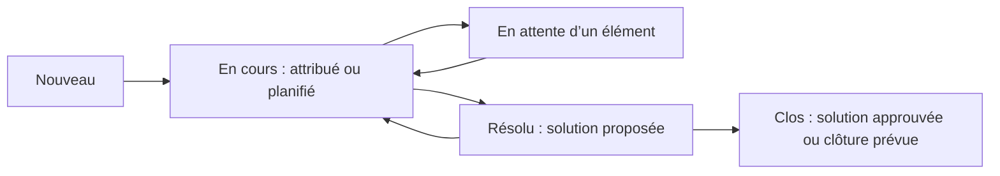

Ce schéma est une **aide externe** ; la matrice des transitions dépend du profil et de la configuration. « Résolu » signifie qu’une solution a été proposée ; « Clos » signifie que le traitement est finalisé selon le circuit prévu. Les règles peuvent prévoir une fermeture automatique après un délai. Vérifier les autorisations réelles avant d’affirmer qu’un acteur peut changer un statut.

## Attribution, observateurs, validations et engagements

L’**attribution** désigne l’utilisateur, le groupe ou le fournisseur chargé du traitement. Les **observateurs** suivent les informations sans prendre nécessairement en charge l’intervention. Une escalade technique doit transmettre un diagnostic exploitable. La validation répond à une autorisation prévue ; elle se distingue de l’approbation finale de la solution.

Le **SLA** encadre les engagements convenus ; les échéances de prise en charge et de résolution doivent être comprises et suivies. Selon le paramétrage, une échéance dépassée déclenche des actions ou une escalade ; elle ne supprime pas le ticket. Impact, urgence et priorité sont distincts et la matrice de calcul est configurable.

| Trace dans le traitement | Contenu utile |
|---|---|
| Suivi | Échanges, informations et comptes rendus de progression. |
| Tâche | Action réalisée ou planifiée, intervenant et résultat. |
| Document | Pièce nécessaire, lisible et correctement protégée. |
| Solution | Diagnostic retenu, correction ou contournement, tests et limites. |

La clôture suit l’approbation ou les règles de traitement prévues. Si la solution est refusée, recueillir le motif et poursuivre l’analyse. Relier le CI concerné aide les statistiques et le diagnostic ; la qualité de cette relation dépend d’une CMDB entretenue.

## Capitaliser dans la base de connaissances

Le support décrit création d’article, cibles, visibilité publique ou non, révisions, restrictions temporelles, liens avec tickets et CI, catégories et FAQ. **Un article sans cible peut rester non publié** dans le fonctionnement montré : vérifier le résultat avec le profil destinataire. Distinguer visibilité d’édition, visibilité de consultation et exposition éventuelle d’une FAQ ; protéger les données personnelles et les informations d’accès.

## TP — exploitation des services

Le sujet et sa correction de **17 pages** sont fournis. Le cas relie la demande d’arrivée d’un salarié, ses équipements, les relations et ports du parc, puis la clôture du ticket. Réaliser le sujet dans le laboratoire, conserver les identifiants et preuves attendus, puis comparer avec la correction originale. Les captures correspondent à la version du laboratoire ; retrouver la fonction équivalente si les menus diffèrent.

### Suivre les sept étapes du ticket d’arrivée

| Étape du corrigé | Action | Contrôle dans le dossier |
| --- | --- | --- |
| 1 | Le responsable du service crée le ticket. | Le demandeur et le besoin sont renseignés. |
| 2 | Le support de niveau 1 traite et oriente le ticket. | L’affectation et les premières actions figurent dans l’historique. |
| 3 | Le matériel est vérifié et sorti du stock. | Les éléments correspondent au besoin du salarié. |
| 4 | L’administrateur Active Directory crée les comptes. | Les accès requis sont préparés et tracés. |
| 5 | Le matériel est préparé et rapproché des fiches du parc. | Les composants, relations et ports attendus sont vérifiables. |
| 6 | Le matériel est livré et installé. | Conserver le résultat du test et les références des équipements. |
| 7 | Le responsable du service clôture le ticket dans le scénario. | La solution est approuvée selon le circuit décrit et la trace est conservée. |

[Ouvrir l’énoncé et les contrôles du TP](../../tp/itil/module-09/index.md).

## Notions détaillées pour approfondir

Les notions détaillées ci-dessous conservent le périmètre et les exemples du support historique, avec une mise en page réparée. Les réserves et corrections exposées plus haut s’appliquent à cette relecture. Pour la formulation source exacte, utiliser **Cours Original**. Les captures sont des illustrations isolées du support, pas des schémas générés.

### Ticket, flux d’entrée et traitement

<section>
<h4>Sensibilisation ITIL</h4>

Module 09 – Assistance avec GLPI

<h4>Objectifs</h4>
<ul><li>Découvrir la création d’un ticket</li></ul>
<ul><li>Découvrir le traitement d’un ticket</li><li>Appréhender la base de connaissance</li></ul>
</section>

<section>

Le ticket

<ul><li>Dans le monde de l’informatique, tout fonctionne à base de ticket</li><li>Cela va permettre de solliciter la DSI</li><li>Un ticket passera par plusieurs statuts : cycle de vie du ticket</li><li>Peut-être de type incident ou demande</li><li>Doit compter un minimum d’informations</li><li>De nombreux avantages</li></ul>

Traçabilité Détection des

Répartition des

tâches Communication

problèmes

Utilisation d’un outil de gestion de ticket

L’assistance sous GLPI

<ul><li>Système de gestion de tickets / outil de ticketing</li><li>Conforme aux bonnes pratiques ITIL</li><li>Recueil des sollicitations utilisateur pour une gestion centralisée</li><li>Différents canaux de communication possibles</li><li>Saisie, suivi et traitement du ticket</li></ul>
<ul><li>Cycle de vie des tickets</li><li>Statistiques possibles</li></ul>
</section>

<section>

Flux d’entrée

Trois grandes façons de créer un ticket

<ul><li>Interface d’ouverture de tickets anonymes</li><li>Interface simplifiée</li><li>Interface standard Depuis GLPI</li></ul>
<ul><li>Envoi d’un mail dans une boîte mail support</li><li>Configuration d’un collecteur Mail</li></ul>
<ul><li>Création du ticket par téléphone</li><li>Utilisation de l’interface standard par le technicien Téléphone</li></ul>

Cycle de vie d’un ticket

<ul><li>Ni groupes et utilisateurs sur le ticket Nouveau</li></ul>
<ul><li>En attente d’éléments =&gt; Modification manuelle En attente</li></ul>
<ul><li>Au moins un utilisateur/groupe est attribué En cours attribué</li></ul>
<ul><li>Une tâche vient d’être planifiée En cours planifié</li></ul>
<ul><li>Une solution vient d’être apportée au ticket Résolu</li></ul>
<ul><li>La solution est approuvée par le demandeur Clos</li></ul>
</section>

<section>

Traitement d’un ticket : aperçu

<figure>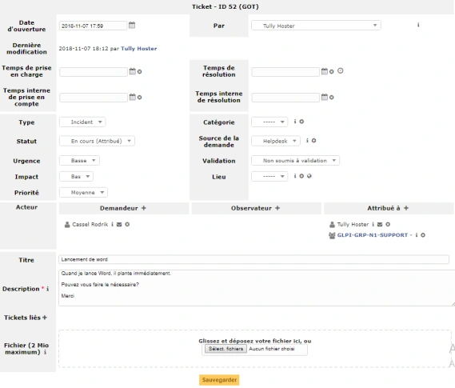<figcaption>Interface GLPI présentée dans le support — illustration isolée du support, page 4.</figcaption></figure>

Traitement d’un ticket : attribution

<ul><li>Utilisateurs, groupes ou fournisseurs</li><li>Représente les techniciens ou groupes de compétence en charge du ticket</li><li>Utilisé lors des escalades fonctionnelles</li><li>Raccourci pour s’attribuer nominativement le ticket</li></ul>
<ul><li>Peut être automatisé en fonction de critères à la création du ticket</li><li>Ticket visible pour traitement par les groupes et utilisateurs attribués</li></ul>
<figure>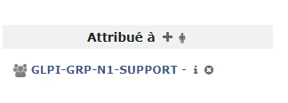<figcaption>Interface GLPI présentée dans le support — illustration isolée du support, page 4.</figcaption></figure>
<figure>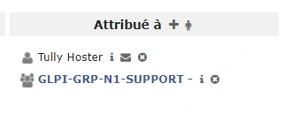<figcaption>Interface GLPI présentée dans le support — illustration isolée du support, page 4.</figcaption></figure>

Attribution

</section>

### Observateurs, validations et clôture

<section>

Traitement d’un ticket : observateurs

<ul><li>Utilisé lors des escalades hiérarchiques</li><li>Utilisateurs et groupes</li><li>Notifications sans traitement possible du ticket</li><li>Va permettre de suivre l’évolution d’un ticket</li><li>Peuvent être ajoutés automatiquement à la création en fonction de critères</li></ul>
<figure>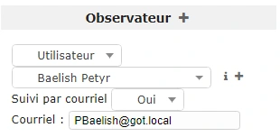<figcaption>Interface GLPI présentée dans le support — illustration isolée du support, page 5.</figcaption></figure>
<figure>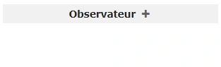<figcaption>Interface GLPI présentée dans le support — illustration isolée du support, page 5.</figcaption></figure>

Ajout

Traitement d’un ticket : SLA

<ul><li>Doivent être facilement identifiables</li><li>Le type : temps de résolution</li><li>La durée maximum de résolution souhaitée</li><li>Possibilité de créer des niveaux d’escalade</li></ul>
<figure>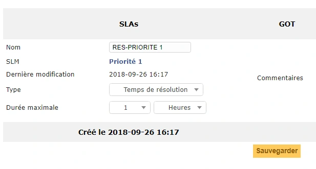<figcaption>Interface GLPI présentée dans le support — illustration isolée du support, page 5.</figcaption></figure>

Dépasser la date butoir de résolution n’est pas bloquant, juste informatif

</section>

<section>

Traitement d’un ticket : validation

<ul><li>Un ticket peut nécessiter une validation hiérarchique</li><li>Manuelle ou automatique à la création</li><li>Non bloquant pour le traitement du ticket</li><li>Droits spécifiques pour pouvoir être « valideur »</li><li>Demandes multiples possibles</li></ul>
<figure>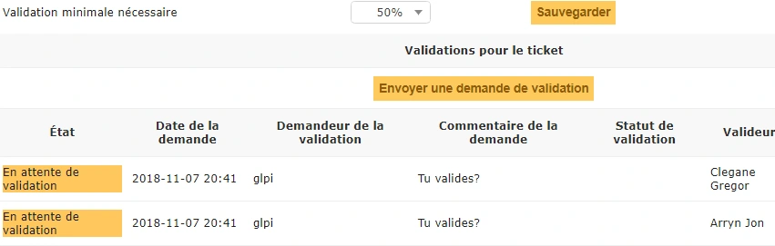<figcaption>Interface GLPI présentée dans le support — illustration isolée du support, page 6.</figcaption></figure>
<figure>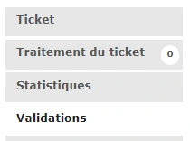<figcaption>Interface GLPI présentée dans le support — illustration isolée du support, page 6.</figcaption></figure>

Traitement d’un ticket : validation

<ul><li>Les valideurs reçoivent une notification de validation</li><li>Ils approuvent ou refusent en accédant au ticket à valider. Comment ?</li></ul>
<figure><figcaption>Interface GLPI présentée dans le support — illustration isolée du support, page 6.</figcaption></figure>

Liste de ses tickets à valider

<figure>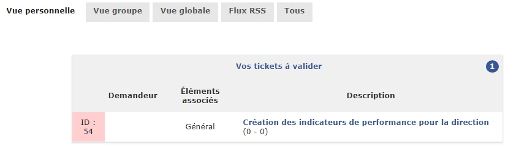<figcaption>Interface GLPI présentée dans le support — illustration isolée du support, page 6.</figcaption></figure>

Depuis notre vue personnelle

</section>

<section>

Traitement d’un ticket : validation

<figure>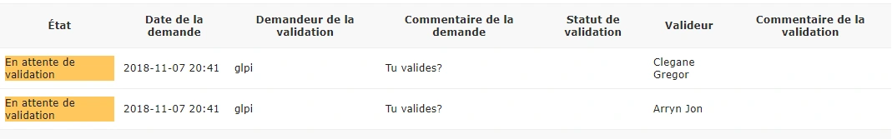<figcaption>Interface GLPI présentée dans le support — illustration isolée du support, page 7.</figcaption></figure>
<figure>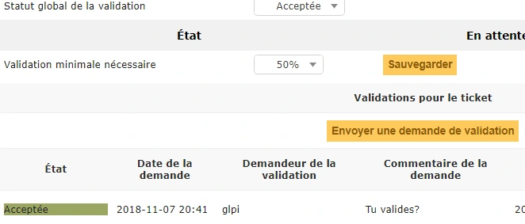<figcaption>Interface GLPI présentée dans le support — illustration isolée du support, page 7.</figcaption></figure>

Traitement d’un ticket : traitement

<ul><li>Onglet Traitement du ticket</li><li>Quatre possibilités<ul><li>Suivi</li><li>Tâche</li><li>Solution</li><li>Document</li></ul></li></ul>
<figure>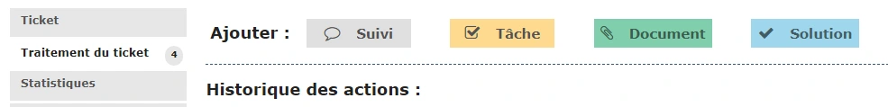<figcaption>Interface GLPI présentée dans le support — illustration isolée du support, page 7.</figcaption></figure>
</section>

<section>

Traitement d’un ticket : clôture

<ul><li>La clôture du ticket s’effectue à l’approbation de la solution</li><li>Peut être effectuée par le demandeur ou le rédacteur (ticket par téléphone)</li><li>Accessible par le mail de validation ou le menu ticket de l’interface simplifiée</li><li>Commentaire obligatoire en cas de refus</li></ul>
<ul><li>Possibilité de planifier ou rendre la clôture immédiate à la résolution</li></ul>
<figure>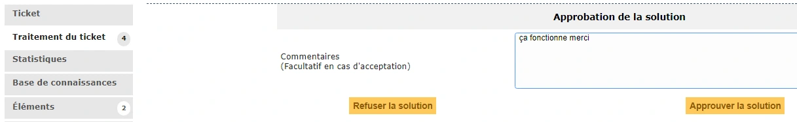<figcaption>Interface GLPI présentée dans le support — illustration isolée du support, page 8.</figcaption></figure>

Ticket : éléments liés

<ul><li>Liaison de CI possible à la création d’un ticket</li><li>Utile pour le diagnostic</li><li>Utile pour les statistiques</li><li>Nécessite une CMDB à jour et bien renseignée</li></ul>
<figure>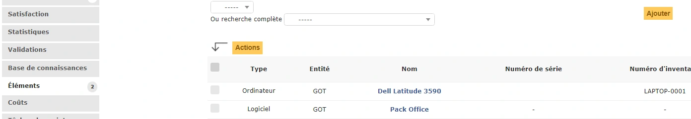<figcaption>Interface GLPI présentée dans le support — illustration isolée du support, page 8.</figcaption></figure>
</section>

### Base de connaissances et atelier

<section>

Base de connaissances : article

<ul><li>Objectifs<ul><li>Centraliser des connaissances internes aux différents techniciens</li><li>Mettre à disposition des utilisateurs des informations (FAQ)</li></ul></li><li>Accessible depuis Outils =&gt; Base de connaissances</li><li>Restriction à un nombre d’acteurs</li><li>Validation de publications d’articles</li></ul>
<ul><li>Gestion des révisions</li><li>Liaisons possibles avec les tickets et les éléments d’inventaire (CI)</li><li>FAQ : sous-partie de la base de connaissances à destination des utilisateurs</li><li>Organisation possible par catégories et restrictions temporelles</li></ul>

Base de connaissances : création

<figure>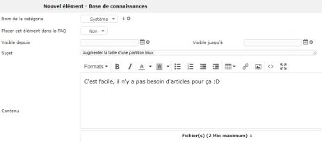<figcaption>Interface GLPI présentée dans le support — illustration isolée du support, page 9.</figcaption></figure>
<ul><li>Création d’un article</li><li>Ajout des cibles</li><li>Usage public ou non</li></ul>
<figure>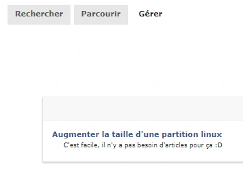<figcaption>Interface GLPI présentée dans le support — illustration isolée du support, page 9.</figcaption></figure>
<ul><li>Article sans cible = Article non publié</li><li>Apparaît dans Gérer</li><li>Visible que par son créateur</li></ul>
</section>

<section>

Base de connaissances : cibles

<ul><li>Vont permettre de publier l’article à différentes personnes</li><li>Entité – Profil – Groupe - Utilisateur</li></ul>
<figure>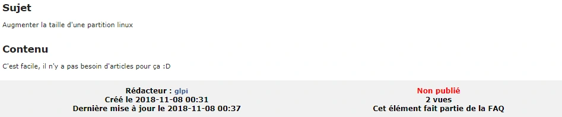<figcaption>Interface GLPI présentée dans le support — illustration isolée du support, page 10.</figcaption></figure>
<figure>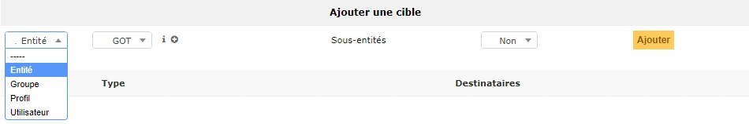<figcaption>Interface GLPI présentée dans le support — illustration isolée du support, page 10.</figcaption></figure>

Base de connaissances publiques

<ul><li>Éviter la création systématique d’un ticket</li><li>FAQ (Foire Aux Questions)</li><li>Accessible depuis l’interface simplifiée</li><li>Accès rapide ou par catégories</li></ul>
<figure><figcaption>Interface GLPI présentée dans le support — illustration isolée du support, page 10.</figcaption></figure>
</section>

<section>
<h4>Création et gestion</h4>
<h4>des tickets</h4>

Démo

<h4>TP L'exploitation des</h4>
<h4>services</h4>
</section>

## Vérifier en pratique

| Point de contrôle | Résultat attendu |
| --- | --- |
| Ticket | Vérifier la demande, le responsable du traitement, les étapes et l’historique. |
| Parc et droits | Vérifier les fiches du matériel, l’utilisateur associé et l’accès dans la bonne entité. |
| Clôture | Conserver le résultat de la livraison et la validation du responsable dans le scénario. |

## Mini-quiz — 5 questions

1. Attribué signifie-t-il résolu ?
2. Quelle différence entre observateur et technicien affecté ?
3. Une solution proposée clôture-t-elle toujours immédiatement ?
4. Pourquoi tester l’article avec un autre profil ?
5. Le ticket est attribué et les équipements sont visibles. Que faut-il vérifier pour clôturer ce cas ?

??? success "Réponses commentées"
    1. Non : le travail a un responsable, le résultat reste à obtenir.

    2. L’un suit l’information ; l’autre prend en charge le traitement.

    3. Non : approbation ou règle de clôture s’applique selon la configuration.

    4. Pour vérifier les droits et la visibilité réellement obtenus.

    5. L’installation et le test du matériel livré, la trace du résultat et la validation prévue par le scénario.

## Pratiquer et réviser

- [Travaux pratiques du module](../../tp/itil/module-09/index.md)
- [Fiche de révision du module](../../revision/itil/module-09-assistance-avec-glpi.md)
- [Retour à la séquence](index.md)

## Références externes vérifiées le 4 novembre 2026

- [GLPI — gestion des tickets](https://help.glpi-project.org/documentation/modules/assistance/tickets/ticketmanagement)
- [GLPI — questions fréquentes sur les tickets](https://help.glpi-project.org/faq/glpi/ticket)
