# Module 09 — Assistance avec GLPI

Les parties ci-dessous reprennent le cours original, dans le même ordre. Les encadrés et les schémas répètent ses formulations.

## Parcours de lecture

1. Support · Module 09 - Support de cours · 11 pages transcrites
2. Énoncé · M09 - S01 TP-L'exploitation des services · 1 pages transcrites
3. Correction · M09 - S01 TP-Corrigé_L'exploitation des services · 17 pages transcrites

**Visuel externe**

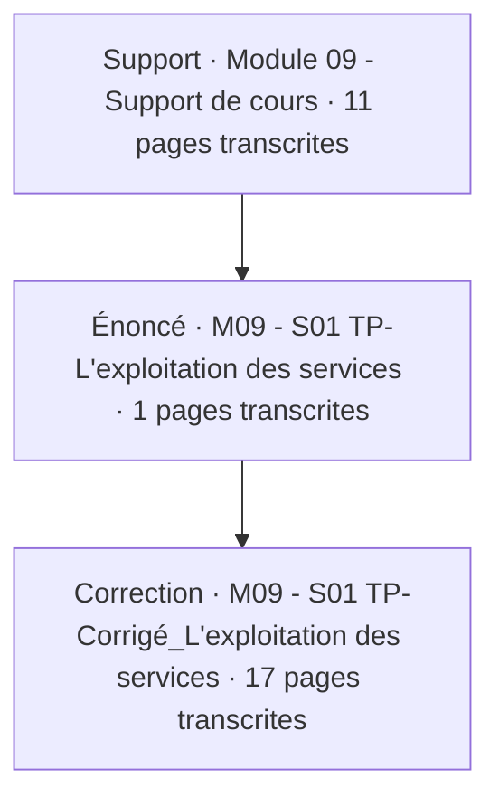

SOURCE DRIVE · TRANSCRIPTION DU SUPPORT

Le contenu des documents du dossier TSSR est transcrit ci-dessous, page par page. Les textes et tableaux sont intégrés à la page Web. Aucun fichier PDF, aucune diapositive entière ni aucune reproduction de page n’est affiché. Seuls des croquis ou visuels isolés et vérifiés peuvent accompagner la transcription. Les versions et les consignes restent celles des supports de formation. Les compléments IA sont conservés dans leur onglet distinct.

## Support · Module 09 - Support de cours · 11 pages transcrites

!!! note "À retenir"
    Texte, tableaux et illustrations utiles retranscrits du support ; numéros de diapositives, bandeaux répétitifs, éléments de marque et décorations exclus.

Texte, tableaux et illustrations utiles retranscrits du support ; numéros de diapositives, bandeaux répétitifs, éléments de marque et décorations exclus. Les formulations historiques sont conservées ; les précisions sont placées dans le cours optimisé.

### Page 1

#### Sensibilisation ITIL

Module 09 – Assistance avec GLPI

#### Objectifs

!!! note "À retenir"
    Découvrir la création d’un ticket Découvrir le traitement d’un ticket Appréhender la base de connaissance

**Visuel externe**

- Découvrir la création d’un ticket

- Découvrir le traitement d’un ticket
- Appréhender la base de connaissance

### Page 2

**Visuel externe**

```mermaid
flowchart LR
    N1["Dans le monde de l’informatique, tout fonctionne à base de ticket"]
    N2["Cela va permettre de solliciter la DSI"]
    N3["Un ticket passera par plusieurs statuts : cycle de vie du ticket"]
    N4["Peut-être de type incident ou demande"]
    N5["Doit compter un minimum d’informations"]
    N6["De nombreux avantages"]
    N7["Système de gestion de tickets / outil de ticketing"]
    N8["Conforme aux bonnes pratiques ITIL"]
    N1 --> N2
    N2 --> N3
    N3 --> N4
    N4 --> N5
    N5 --> N6
    N6 --> N7
    N7 --> N8
```

Le ticket

- Dans le monde de l’informatique, tout fonctionne à base de ticket
- Cela va permettre de solliciter la DSI
- Un ticket passera par plusieurs statuts : cycle de vie du ticket
- Peut-être de type incident ou demande
- Doit compter un minimum d’informations
- De nombreux avantages

Traçabilité Détection des

Répartition des

tâches Communication

problèmes

Utilisation d’un outil de gestion de ticket

L’assistance sous GLPI

- Système de gestion de tickets / outil de ticketing
- Conforme aux bonnes pratiques ITIL
- Recueil des sollicitations utilisateur pour une gestion centralisée
- Différents canaux de communication possibles
- Saisie, suivi et traitement du ticket

- Cycle de vie des tickets
- Statistiques possibles

### Page 3

**Visuel externe**

```mermaid
flowchart LR
    N1["Interface d’ouverture de tickets anonymes"]
    N2["Interface simplifiée"]
    N3["Interface standard Depuis GLPI"]
    N4["Envoi d’un mail dans une boîte mail support"]
    N5["Configuration d’un collecteur Mail"]
    N6["Création du ticket par téléphone"]
    N7["Utilisation de l’interface standard par le technicien Téléphone"]
    N8["Ni groupes et utilisateurs sur le ticket Nouveau"]
    N1 --> N2
    N2 --> N3
    N3 --> N4
    N4 --> N5
    N5 --> N6
    N6 --> N7
    N7 --> N8
```

Flux d’entrée

Trois grandes façons de créer un ticket

- Interface d’ouverture de tickets anonymes
- Interface simplifiée
- Interface standard Depuis GLPI

- Envoi d’un mail dans une boîte mail support
- Configuration d’un collecteur Mail

- Création du ticket par téléphone
- Utilisation de l’interface standard par le technicien Téléphone

Cycle de vie d’un ticket

- Ni groupes et utilisateurs sur le ticket Nouveau

- En attente d’éléments => Modification manuelle En attente

- Au moins un utilisateur/groupe est attribué En cours attribué

- Une tâche vient d’être planifiée En cours planifié

- Une solution vient d’être apportée au ticket Résolu

- La solution est approuvée par le demandeur Clos

### Page 4

!!! note "À retenir"
    Traitement d’un ticket : aperçu Interface GLPI présentée dans le support — illustration isolée du support, page 4.

**Visuel externe**

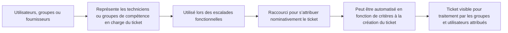

Traitement d’un ticket : aperçu

Interface GLPI présentée dans le support — illustration isolée du support, page 4.

Traitement d’un ticket : attribution

- Utilisateurs, groupes ou fournisseurs
- Représente les techniciens ou groupes de compétence en charge du ticket
- Utilisé lors des escalades fonctionnelles
- Raccourci pour s’attribuer nominativement le ticket

- Peut être automatisé en fonction de critères à la création du ticket
- Ticket visible pour traitement par les groupes et utilisateurs attribués

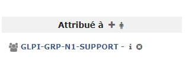

Interface GLPI présentée dans le support — illustration isolée du support, page 4.

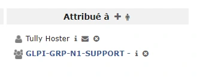

Interface GLPI présentée dans le support — illustration isolée du support, page 4.

Attribution

### Page 5

Traitement d’un ticket : observateurs

- Utilisé lors des escalades hiérarchiques
- Utilisateurs et groupes
- Notifications sans traitement possible du ticket
- Va permettre de suivre l’évolution d’un ticket
- Peuvent être ajoutés automatiquement à la création en fonction de critères

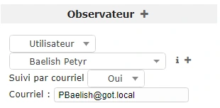

Interface GLPI présentée dans le support — illustration isolée du support, page 5.

Interface GLPI présentée dans le support — illustration isolée du support, page 5.

Ajout

Traitement d’un ticket : SLA

- Doivent être facilement identifiables
- Le type : temps de résolution
- La durée maximum de résolution souhaitée
- Possibilité de créer des niveaux d’escalade

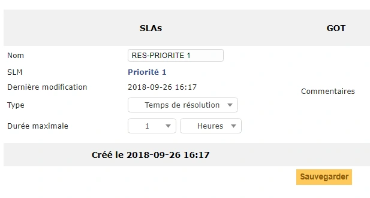

Interface GLPI présentée dans le support — illustration isolée du support, page 5.

Dépasser la date butoir de résolution n’est pas bloquant, juste informatif

### Page 6

#### Traitement d’un ticket : validation

!!! note "À retenir"
    Un ticket peut nécessiter une validation hiérarchique Manuelle ou automatique à la création Non bloquant pour le traitement du ticket Droits spécifiques pour pouvoir être « valideur » Demandes multiples possibles Interface GLPI présentée dans le support — illustration isolée du support, page 6.

- Un ticket peut nécessiter une validation hiérarchique
- Manuelle ou automatique à la création
- Non bloquant pour le traitement du ticket
- Droits spécifiques pour pouvoir être « valideur »
- Demandes multiples possibles

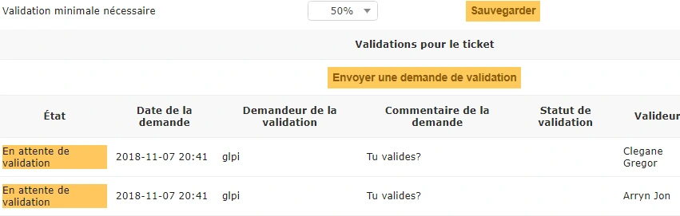

Interface GLPI présentée dans le support — illustration isolée du support, page 6.

Interface GLPI présentée dans le support — illustration isolée du support, page 6.

- Les valideurs reçoivent une notification de validation
- Ils approuvent ou refusent en accédant au ticket à valider. Comment ?

Interface GLPI présentée dans le support — illustration isolée du support, page 6.

Liste de ses tickets à valider

Interface GLPI présentée dans le support — illustration isolée du support, page 6.

Depuis notre vue personnelle

### Page 7

!!! note "À retenir"
    Traitement d’un ticket : validation Interface GLPI présentée dans le support — illustration isolée du support, page 7.

Traitement d’un ticket : validation

Interface GLPI présentée dans le support — illustration isolée du support, page 7.

Interface GLPI présentée dans le support — illustration isolée du support, page 7.

Traitement d’un ticket : traitement

- Onglet Traitement du ticket
- Quatre possibilités
  - Suivi
  - Tâche
  - Solution
  - Document

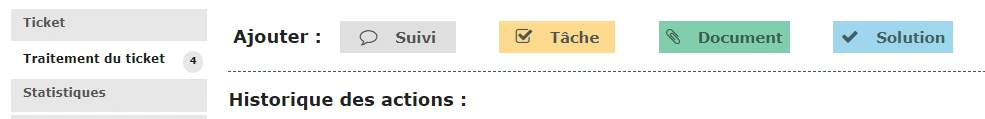

Interface GLPI présentée dans le support — illustration isolée du support, page 7.

### Page 8

Traitement d’un ticket : clôture

- La clôture du ticket s’effectue à l’approbation de la solution
- Peut être effectuée par le demandeur ou le rédacteur (ticket par téléphone)
- Accessible par le mail de validation ou le menu ticket de l’interface simplifiée
- Commentaire obligatoire en cas de refus

- Possibilité de planifier ou rendre la clôture immédiate à la résolution

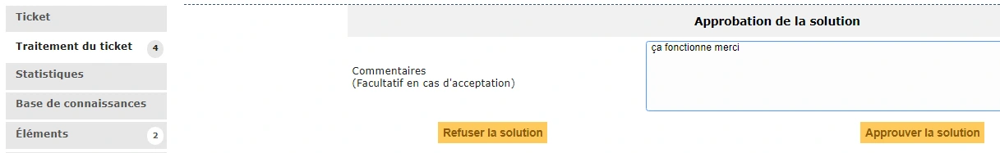

Interface GLPI présentée dans le support — illustration isolée du support, page 8.

Ticket : éléments liés

- Liaison de CI possible à la création d’un ticket
- Utile pour le diagnostic
- Utile pour les statistiques
- Nécessite une CMDB à jour et bien renseignée

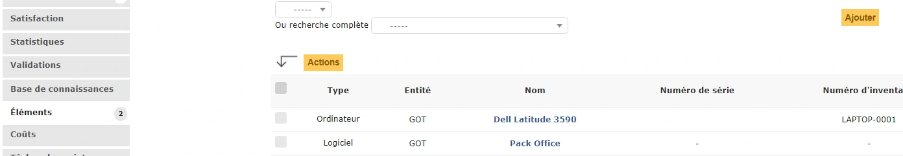

Interface GLPI présentée dans le support — illustration isolée du support, page 8.

### Page 9

Base de connaissances : article

- Objectifs
  - Centraliser des connaissances internes aux différents techniciens
  - Mettre à disposition des utilisateurs des informations (FAQ)
- Accessible depuis Outils => Base de connaissances
- Restriction à un nombre d’acteurs
- Validation de publications d’articles

- Gestion des révisions
- Liaisons possibles avec les tickets et les éléments d’inventaire (CI)
- FAQ : sous-partie de la base de connaissances à destination des utilisateurs
- Organisation possible par catégories et restrictions temporelles

Base de connaissances : création

Interface GLPI présentée dans le support — illustration isolée du support, page 9.

- Création d’un article
- Ajout des cibles
- Usage public ou non

Interface GLPI présentée dans le support — illustration isolée du support, page 9.

- Article sans cible = Article non publié
- Apparaît dans Gérer
- Visible que par son créateur

### Page 10

!!! note "À retenir"
    Base de connaissances : cibles Vont permettre de publier l’article à différentes personnes Entité – Profil – Groupe - Utilisateur Interface GLPI présentée dans le support — illustration isolée du support, page 10.

Base de connaissances : cibles

- Vont permettre de publier l’article à différentes personnes
- Entité – Profil – Groupe - Utilisateur

Interface GLPI présentée dans le support — illustration isolée du support, page 10.

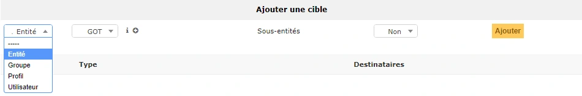

Interface GLPI présentée dans le support — illustration isolée du support, page 10.

Base de connaissances publiques

- Éviter la création systématique d’un ticket
- FAQ (Foire Aux Questions)
- Accessible depuis l’interface simplifiée
- Accès rapide ou par catégories

Interface GLPI présentée dans le support — illustration isolée du support, page 10.

### Page 11

#### Création et gestion

#### des tickets

Démo

#### TP L'exploitation des

#### services

!!! note "À retenir"
    Référence du document : 1nf0OyiQI-Q464T8fgaIOZz2t4TV0Jzom · SHA-256 2e927cb500d1515b…

Référence du document : 1nf0OyiQI-Q464T8fgaIOZz2t4TV0Jzom · SHA-256 2e927cb500d1515b…

## Énoncé · M09 - S01 TP-L'exploitation des services · 1 pages transcrites

!!! note "À retenir"
    Texte, tableaux et illustrations utiles retranscrits du support ; numéros de diapositives, bandeaux répétitifs, éléments de marque et décorations exclus.

Texte, tableaux et illustrations utiles retranscrits du support ; numéros de diapositives, bandeaux répétitifs, éléments de marque et décorations exclus. Les formulations historiques sont conservées ; les précisions sont placées dans le cours optimisé.

### Page 1

Sensibilisation à ITIL

#### ITIL - L'exploitation des services TP du Module 09 – Assistance avec GLPI

Avant de démarrer ce TP, il convient d’avoir suivi les vidéos des modules 1 à 9 et d’avoir réalisé les TP proposés.

Durée estimée

3 heures

#### Énoncé

On vous demande d'étudier un nouveau service :

o Accueil d'un nouveau salarié commercial

1. Stratégie des Services

o Vous avez défini les grandes lignes de ce nouveau service

2. Conception des Services

o Vous avez détaillé les différentes étapes du service

3. Transition des Services

o Vous avez défini les temps d'intervention et le rôle de chaque technicien pour

chaque étape

4. Exploitation des Services

o Maintenant, vous allez lier les informations théoriques et l'utilisation de GLPI

Référence du document : 1Uu8gtmvuVlvvhQvCmNfoVJ66Rsa6wPbQ · SHA-256 74146f1c688e5029…

## Correction · M09 - S01 TP-Corrigé_L'exploitation des services · 17 pages transcrites

Texte, tableaux et illustrations utiles retranscrits du support ; numéros de diapositives, bandeaux répétitifs, éléments de marque et décorations exclus. Les formulations historiques sont conservées ; les précisions sont placées dans le cours optimisé. Les valeurs de mot de passe du laboratoire sont masquées.

Correction originale : à consulter après avoir tenté l’exercice.

### Page 1

Sensibilisation à ITIL

#### ITIL - L'exploitation des services TP du Module 09 – Assistance avec GLPI

Avant de démarrer ce TP, il convient d’avoir suivi les vidéos des modules 1 à 9 et d’avoir réalisé les TP proposés.

Durée estimée

3 heures

#### Solution

#### Etape 1 - Création du ticket par le responsable du service

Vous ouvrez une session sur GLPI en tant que directeur commercial :

- Login : balon.grejoy

- Mot de passe : [valeur de laboratoire masquée]

Création du ticket

- Cliquer sur créer un ticket

- Type : demande

- Catégorie : Nouveau Poste Complet

- Lieu : Service Commercial

- Titre : rempli automatiquement (ne pas changer)

- Description : Compléter les informations concernant les salariés

Les informations du salarié

- Nom : Targaryan

- Prénom : Deanerys

- Fonction : Commercial Itinérant

- Service : Commercial

Vous fermez la session

Pour vérifier, vous pouvez vous connecter avec l’utilisateur « balon.grejoy » pour suivre l’évolution du ticket.

- Une fois que la session est ouverte

- Cliquer sur « Tickets »

- Sélectionner le ticket

### Page 2

Sensibilisation à ITIL

- Dans le menu de gauche, sélectionner « Traitement du ticket »

- Vous avez un aperçu de l’évolution du traitement du ticket

Vous fermez la session

### Page 3

Sensibilisation à ITIL

#### Etape 2 - Traitement du ticket par le support N1

Vous ouvrez une session sur GLPI en tant que technicien de support de niveau 1

- Login : hoster.tully

- Mot de passe : [valeur de laboratoire masquée]

Vous ouvrez le ticket et vous l’escaladez vers le groupe des techniciens parc :

- Cliquer sur « Assistance », puis « tickets »

- Dans la liste des tickets, cliquer sur le titre du ticket.

o « Nouveau poste pour un nouveau salarié »

Dans le menu de gauche, sélectionner « Ticket »

- Dans le corps du ticket,

- Dans la zone « Acteur »

- Dans la colonne « Attribué à »

- Supprimer le groupe « GLPI-GRP-Support » en cliquant sur

- Cliquer sur « + » à côté de « Attribué à »

- Sélectionner « Groupe »
- Sélectionner « GLPI-GRP-PARC », escalade fonctionnelle

- Sauvegarder le ticket

- Cliquer sur « + » à côté de « Attribué à »

- Sélectionner « utilisateur »
- Sélectionner « Tyrion Lannister »

- Sauvegarder le ticket

Dans le menu de gauche, sélectionner « Traitement du ticket »

- Cliquer sur « Suivi »

- Dans « nouvel élément – suivi »

o Saisir « Escalade vers le groupe techniciens parc et envoi à l’administrateur

AD pour la création des différents comptes »

o Cliquer sur « Ajouter »

Fermer la session du technicien de support.

- Pour fermer la session, il faut cliquer sur

### Page 4

Sensibilisation à ITIL

#### Etape 3 - Vérification et sortie du matériel du stock.

Vous ouvrez une session sur GLPI en tant que technicien de support Parc.

- Login : jorah.mormont

- Mot de passe : [valeur de laboratoire masquée]

Vous allez maintenant cliquer sur « Parc »

- Vous effectuez une recherche pour retrouver les éléments suivants :

| Matériel |  |  | Nom | N° Inventaire | Nouveau nom |
| --- | --- | --- | --- | --- | --- |
| Ordinateurs |  |  | Dell XPS 15 | LAPTOP-0013 | ITI-XPS15-006 |
|  | Périphériques |  | WD19DCS | Dock-00006 | ITI-WD19DCS-006 |
|  | (dock) |  |  |  |  |
| Moniteurs |  |  | Dell 24 SE2416H | Dell 24 SE2416H-00027 | ITI-Dell24-006 |
| Téléphones |  |  | Tel Cisco 7811 | TEL-0030 | ITI-Cisco7811-006 |
| Téléphones |  |  | IPhoneX | MOB-0006 | ITI-IphoneX-006 |

- Pour chaque élément trouvé :

- Vous le renommez avec le nouveau nom présent dans le tableau.
- Exemple pour renommer l’ordinateur à suivre.

Pour effectuer la rechercher de l’ordinateur :

- Vous cliquez sur « Parc » puis « Ordinateurs »

- Dans la zone de recherche, vous indiquez les éléments suivants :

Recherche dans le stock — critère « Éléments visualisés ».

- Vous récupérez tous les ordinateurs en stock

o Vous cliquez sur le nom de l’ordinateur « Dell XPS 15 » portant le numéro

d’inventaire « Laptop-0013 »

- La fiche de l’ordinateur s’ouvre.
- Vous renommez l’ordinateur avec son nouveau nom.

- Vous sauvegardez.

Vous procédez de la même façon avec les différents éléments.

### Page 5

Sensibilisation à ITIL

Maintenant que tous les éléments ont été renommés, vous allez les lier pour pouvoir effectuer les déplacements de façon global.

Vous allez ouvrir la fiche de l’ordinateur :

- Vous cliquez sur « Parc » puis « Ordinateurs »

- Dans la zone de recherche, vous indiquez les éléments suivants :

Filtre de recherche sur le stock d’ordinateurs.

- Vous récupérez tous les ordinateurs en stock

- Vous cliquez sur le nom de l’ordinateur « ITI-XPS15-006 » portant le numéro d’inventaire « Laptop-0013 »

- La fiche de l’ordinateur s’ouvre.

- Dans le menu de gauche, vous cliquez sur « Connexions ».

- Sous « Connecter un élément »
- Sélectionnez « Moniteur », puis dans le menu qui vient d’apparaître vous

cliquez sur la flèche à l’extrémité droite pour faire apparaître la liste des moniteurs disponible.

Choix d’un moniteur à associer.

o Vous sélectionnez le moniteur se nommant « ITI-Dell24-006 » puis vous cliquez

sur « connecter ».

o Vous avez la possibilité d’effectuer des recherches dans le menu déroulant

pour filtrer les éléments qui apparaissent dans la liste :

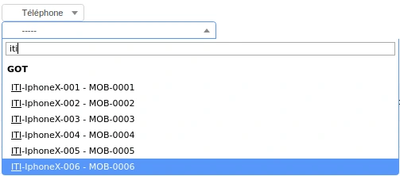

Sélection du téléphone mobile dans l’inventaire.

### Page 6

Sensibilisation à ITIL

- Procéder de la même façon pour les autres matériels.

- Vous devez obtenir :

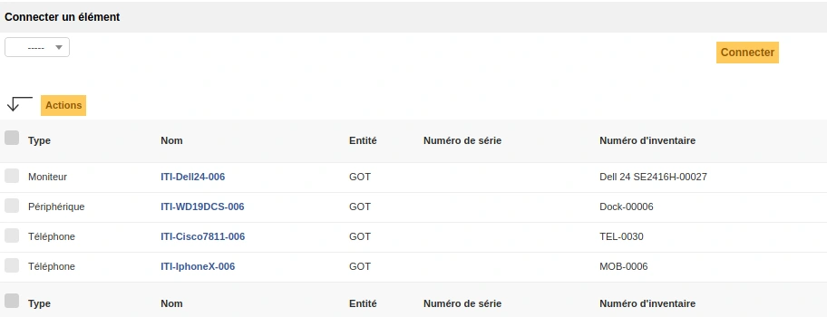

Matériels connectés à l’ordinateur avant l’ajout au ticket.

Vous déplacez l’ensemble du matériel pour qu’ils soient préparés.

- Dans le menu de gauche, sélectionnez l’onglet « Ordinateur »

- Vous changez la rubrique statut de « En stock » par « A préparer »
- Vous changez le lieu :

- De « …>Service Informatique>Stock »

- Par « …>Service Informatique>Stock>Matériels à préparer>A préparer1 »

- Sauvegarder

Vous vérifiez que tous les matériels sont dans le même lieu que l’ordinateur et vous allez changer leur statut

- A partir de la fiche de l’ordinateur, dans le menu de gauche, vous cliquez sur « Connexions », vous cliquez le nom du moniteur « ITI-Dell24-006 ».

- La fiche de moniteur s’ouvre :

- Dans le menu de gauche, cliquez sur « Moniteur ».
- Le lieu doit contenir « …>Service Informatique>Stock>Matériels à préparer>A

préparer 1 ».

o Modifier le statut en « A préparer ».

- Sauvegarder

- Dans le menu de gauche, cliquez sur « Connexions »

o Cliquer sur le nom de l’ordinateur « ITI-XPS-006 » pour retourner sur la fiche de

l’ordinateur.

- Vous procédez de la même façon avec les autres matériels.

- Ils doivent être tous dans le même lieu
- Ils doivent tous avoir le statut « A préparer »

### Page 7

Sensibilisation à ITIL

Vous allez modifier le ticket pour indiquer ce que vous avez fait. Vous ouvrez le ticket et vous allez sortir le matériel du stock.

- Cliquer sur « Assistance », puis « tickets »

- Dans la liste des tickets, cliquer sur le titre du ticket.

o « Nouveau poste pour un nouveau salarié »

Dans le menu de gauche, sélectionner « Ticket »

- Dans le corps du ticket,

- Dans la zone « Description »
- Vous remplissez les champs suivants :

- Matériel disponible : OK

- Dans la zone « Acteur »
- Vérifier qu’il y a le groupe « GLPI-GRP-PARC » et l’utilisateur « Tyrion Lannister »

de présent.

- Sauvegarder

Vous allez rajouter le matériel au ticket

- Dans le menu de gauche, sélectionner « Eléments »

- A partir de la « recherche complète », vous allez rajouter les éléments au ticket.

- Vous devez obtenir :

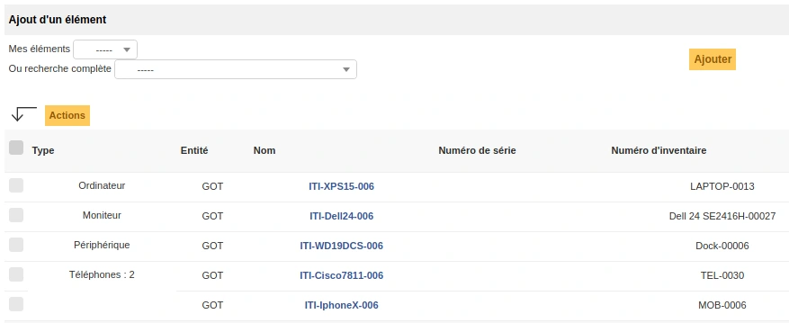

Ordinateur et matériels associés au ticket.

Dans le menu de gauche, sélectionner « Traitement du ticket »

- Cliquer sur « Suivi »

- Dans « nouvel élément – suivi »

- Saisir « Sortie du matériel du stock, prêt à être installé »
- Cliquer sur « Ajouter »

Fermer la session du technicien de parc.

### Page 8

Sensibilisation à ITIL

#### Etape 4 - Création des comptes par l’administrateur Active Directory.

- Vous ouvrez une session sur GLPI en tant que technicien de support de niveau 1.

- Login : tyrion.lannister

- Mot de passe : [valeur de laboratoire masquée]

Vous ouvrez le ticket pour gérer l’installation du système d’exploitation et des logiciels.

- Cliquer sur « Assistance », puis « tickets »

- Dans la liste des tickets, cliquer sur le titre du ticket.

o « Nouveau poste pour un nouveau salarié »

Dans le menu de gauche, sélectionner « Ticket ».

- Dans le corps du ticket,

- Dans la zone « Description »
- Vous remplissez les champs suivants :

- Compte GLPI créé : OK

- Compte Active Directory créé : OK

- Compte Office 365 créé : OK

- Badge créé : OK

o Dans la zone « Acteur »

- Supprimer l’utilisateur « Tyrion Lannister » pour qu’il ne reste que le groupe « GLPI-GRP-PARC ».

- Sauvegarder

Vous modifiez le suivi du ticket.

- Dans le menu de gauche, sélectionner « Traitement du ticket »

- Cliquer sur « Suivi »

- Dans « nouvel élément – suivi »

- Saisir « Création des différents comptes effectués »
- Cliquer sur « Ajouter »

Fermer la session de l’administrateur Active Directory.

### Page 9

Sensibilisation à ITIL

#### Etape 5 - Préparation du matériel

Vous considérez que le matériel a été testé et que le système d’exploitation ainsi que les logiciels ont été installés.

Vous allez gérer que les informations côté ticket et apporter des modifications à l’ordinateur.

Vous ouvrez une session sur GLPI en tant que technicien de support Parc.

- Login : barristan.selmy

- Mot de passe : [valeur de laboratoire masquée]

Vous ouvrez le ticket pour gérer l’installation du système d’exploitation et des logiciels.

- Cliquer sur « Assistance », puis « tickets »

- Dans la liste des tickets, cliquer sur le titre du ticket.

o « Nouveau poste pour un nouveau salarié »

Dans le menu de gauche, sélectionner « Eléments »

- Vous accédez à la liste des objets liés au ticket

- Cliquer sur le nom de l’ordinateur « ITI-XPS15-006 » pour accéder à la fiche.

Dans le menu de gauche, sélectionner « Systèmes d’exploitation »

- Vous remplissez les différents champs et vous sauvegardez pour obtenir :

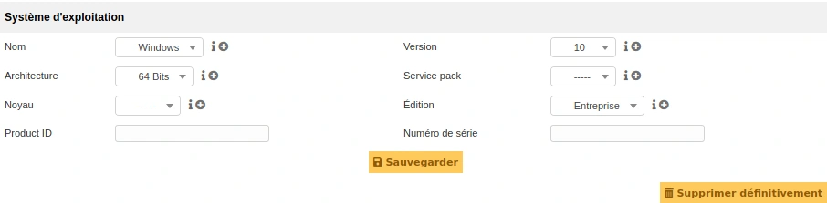

Version, architecture et édition du système d’exploitation.

- Vous venez de renseigner le système d’exploitation qui a été installé.

Dans le menu de gauche, sélectionner « Logiciels »

- Vous allez ajouter les logiciels installés sur l’ordinateur.

- Pour installer « 7Zip » :

- En haut de la fenêtre, dans "Logiciels", sélectionner « 7Zip 64bits »
- Dans le menu qui est apparu, sélectionner « 7Zip 21.06 – En stock »
- Cliquer sur « Installer », vous venez de lier un logiciel à l’ordinateur.
- Vous installez ensuite la licence.
- En bas de la fenêtre, dans "Licences", sélectionner « 7Zip64 bits »
- Dans le menu qui est apparu, sélectionner « 7Zip 21.06 »

### Page 10

Sensibilisation à ITIL

o Cliquer sur « Ajouter »

Vous procédez de la même façon pour installer les autres logiciels.

- Liste des logiciels à installer

| Logiciels |  |  | Licences |  |
| --- | --- | --- | --- | --- |
| 7Zip 64bits | 7Zip 21.06 – En utilisation | 7Zip 64bits |  | 7Zip 21.06 |
|  | Acrobat DC 2021.007 – |  |  |  |
| Acrobat Reader DC |  | Acrobat Reader DC |  | Acrobat DC 2021.007 |
|  | En utilisation |  |  |  |
|  | Chrome 96.0.4664.110 – |  |  |  |
| Chrome 64bits |  | Chrome 64bits |  | Chrome 96.0.4664.110 |
|  | En utilisation |  |  |  |
|  | Java 8 Update 311 – |  |  |  |
| Java 64bits |  | Java 64bits |  | Java 8 Update 311 |
|  | En utilisation |  |  |  |
|  | OpenVPN 2.5.5- |  |  |  |
| OpenVPN |  | OpenVPN |  | OpenVPN 2.5.5 |
|  | En utilisation |  |  |  |
|  | 2016 Standard – |  |  |  |
| Pack Office |  | Pack Office |  | 2016 Standard |
|  | En utilisation |  |  |  |

Dans le menu de gauche, sélectionner « Ordinateur »

- Vous modifiez le statut de l’ordinateur

o Vous remplacez « En stock > A préparer » par « En stock > A livrer »

- Vous modifiez le lieu

o Vous remplacez « >Matériels à préparer > A préparer 1 » par « >Matériels à

livrer > A livrer 1 »

- Vous sauvegardez

Vous faites les mêmes changements sur les autres éléments.

- Pour retrouver les éléments plus rapidement, passer par le ticket.

- Comme les éléments sont liés, le changement a dû être pris en compte

o Vérifier le lieu

- Modifier le statut

- Sauvegarder les modifications avant de changer de matériel.

### Page 11

Sensibilisation à ITIL

Vous modifiez le suivi du ticket.

- Cliquer sur « Assistance », puis « tickets »

- Dans la liste des tickets, cliquer sur le titre du ticket.

o « Nouveau poste pour un nouveau salarié »

Dans le menu de gauche, sélectionner « Ticket »

- Dans le corps du ticket,

- Dans la zone « Description »

o Vous remplissez les champs suivants :

- Prises électriques installées et créées : OK

- Prises réseaux installées et testées : OK

- Mobilier installé : OK

- Matériel installé : OK

o Dans la zone « Acteur »

- Vérifier qu’il y a le groupe « GLPI-GRP-PARC ».

- Sauvegarder

Dans le menu de gauche, sélectionner « Traitement du ticket »

- Cliquer sur « Suivi »

- Dans « nouvel élément – suivi »

o Saisir « Matériel vérifié et configuré, prêt à être livré »

- Cliquer sur « Ajouter »

#### Etape 6 - Livraison et installation du matériel

Vous ouvrez une session sur GLPI en tant que technicien de support Parc.

- Login : jorah.mormont

- Mot de passe : [valeur de laboratoire masquée]

Vous ouvrez le ticket pour gérer la livraison du matériel.

- Le matériel a été livré, installé et configuré, le technicien parc effectue les modifications nécessaires dans GLPI.

- Cliquer sur « Assistance », puis « tickets »

- Dans la liste des tickets, cliquer sur le titre du ticket.

o « Nouveau poste pour un nouveau salarié »

Dans le menu de gauche, sélectionner « Eléments »

- Vous accédez à la liste des objets liés au ticket

- Cliquer sur le nom de l’ordinateur « ITI-XPS15-006 » pour accéder à la fiche.

### Page 12

Sensibilisation à ITIL

Dans le menu de gauche, sélectionner « Ordinateur »

- Modifier le statut de l’ordinateur

o Remplacer « En stock > A livrer » par « En utilisation »

- Modifier le lieu

o Remplacer « >Matériels à livrer > A livrer 1 » par « Service Commercial »

- Modifier l’utilisateur

o Sélectionner l’utilisatrice « Deanerys Targaryan »

- Sauvegarder

- Tout le matériel est déplacé dans le nouveau lieu et l’utilisatrice est mise à jour sur toutes les fiches des matériels.

Dans le menu de gauche, sélectionner « Connexions ».

- Cliquer sur « ITI-Cisco-7811-006 », vous ouvrez la fiche du téléphone IP.

- Modifier le statut

- Remplacer « En stock > A livrer » par « En utilisation »
- Sauvegarder

Dans le menu de gauche, sélectionner « Ports réseau ».

- Cliquez sur le « 1 » en début de ligne.

- Dans la liste déroulante « Prise réseau », vous sélectionnez « S231-161 »
- Dans la liste déroulante « Connecté à », vous sélectionnez :

- « Matériel réseau »

- « Switch-Rezo-C2960L-Utilisateurs »

- « Switch-Rezo-C2960L-Utilisateurs - Le port eth26 »

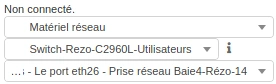

Sélection du port de commutateur et de la prise réseau.

o Vous sauvegardez

En faisant cette manipulation, vous venez d’indiquer sur quelle prise murale est branché le téléphone IP et vous avez indiqué sur quel port de quel switch est connectée la prise murale.

Pour revenir sur la fiche du téléphone.

- Cliquer sur le nom du téléphone en haut de la fiche.

### Page 13

Sensibilisation à ITIL

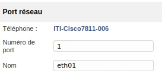

Port eth01 du téléphone IP.

Pour revenir sur la fiche de l’ordinateur.

- Dans le menu de gauche, sélectionner « Connexions ».

- Cliquer sur le nom de l’ordinateur « ITI-XPS15-006 ».

Sur la fiche de l’ordinateur.

- Dans le menu de gauche, sélectionner « Connexions » pour faire apparaître la liste du matériel.

- Cliquer sur le nom du moniteur « ITI-Dell24-006 » pour accéder à la fiche du moniteur.

Sur la fiche du moniteur

- Modifier le statut

- Remplacer « En stock > A livrer » par « En utilisation »
- Sauvegarder

Pour revenir sur la fiche de l’ordinateur.

- Dans le menu de gauche, sélectionner « Connexions ».

- Cliquer sur le nom de l’ordinateur « ITI-XPS15-006 ».

Sur la fiche de l’ordinateur.

- Dans le menu de gauche, sélectionner « Connexions » pour faire apparaître la liste du matériel.

- Cliquer sur le nom du périphérique « ITI-WDS19DCS-006 » pour accéder à la fiche du dock.

Sur la fiche du dock.

- Dans le menu de gauche, sélectionner « Périphérique ».

- Modifier le statut

- Remplacer « En stock > A livrer » par « En utilisation »
- Sauvegarder

Dans le menu de gauche, sélectionner « Ports réseau ».

- Cliquez sur le « 1 » en début de ligne.

o Dans la liste déroulante « Connecté à », vous sélectionnez :

- « Téléphone »

### Page 14

Sensibilisation à ITIL

- « ITI-Cisco7811-006 »

- « ITI-Cisco7811-006 – Le port eth02 – Prise réseau S331-031 »»

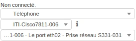

Connexion à un port du téléphone.

o Sauvegarder

Pour revenir sur la fiche du dock.

- Cliquer sur le nom du dock en haut de la fiche.

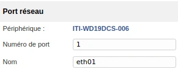

Port eth01 du dock.

En faisant cette manipulation, vous venez d’indiquer que le câble Ethernet du dock est connecté au micro switch du téléphone pour accéder au réseau de l’entreprise.

Pour revenir sur la fiche de l’ordinateur.

- Dans le menu de gauche, sélectionner « Connexions ».

- Cliquer sur le nom de l’ordinateur « ITI-XPS15-006 ».

Sur la fiche de l’ordinateur.

- Dans le menu de gauche, sélectionner « Connexions » pour faire apparaître la liste du matériel.

- Cliquer sur le nom du téléphone « ITI-IphoneX-006 » pour accéder à la fiche du téléphone.

Sur la fiche du téléphone.

- Dans le menu de gauche, sélectionner « Téléphone ».

- Modifier le statut

- Remplacer « En stock > A livrer » par « En utilisation »
- Sauvegarder

Pour revenir sur la fiche de l’ordinateur.

- Dans le menu de gauche, sélectionner « Connexions ».

- Cliquer sur le nom de l’ordinateur « ITI-XPS15-006 ».

### Page 15

Sensibilisation à ITIL

Sur la fiche de l’ordinateur.

- Dans le menu de gauche, vous cliquez sur « Connexions ».

- Sous « Connecter un élément »
- Sélectionner « Imprimantes »
- Sélectionner l’imprimante nommée « Com-Lex-MS310DN-001 – IMP-0005 »
- Cliquer sur « Connecter »

En faisant cette manipulation, vous venez d’indiquer quelle imprimante peut utiliser l’utilisateur de l’ordinateur.

Vous obtenez ceci.

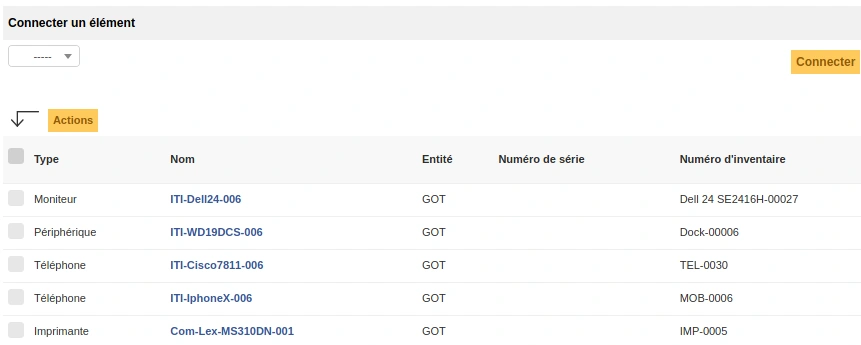

Matériels et imprimante connectés à l’ordinateur.

### Page 16

Sensibilisation à ITIL

Vous modifiez le suivi du ticket.

- Cliquer sur « Assistance », puis « tickets »

- Dans la liste des tickets, cliquer sur le titre du ticket.

o « Nouveau poste pour un nouveau salarié »

Dans le menu de gauche, sélectionner « Ticket »

- Dans le corps du ticket,

- Dans la zone « Description »

o Vous remplissez les champs suivants :

- Matériel livré : OK

o Sauvegarder

Dans le menu de gauche, sélectionner « Traitement du ticket »

- Cliquer sur « Suivi »

- Dans « nouvel élément – suivi »

- Saisir « Matériel livré et installé »
- Cliquer sur « Ajouter »

Dans le menu « Ajouter : », cliquer sur « Solution ».

- Gabarit de solution : Livraison de matériels

- Type de solution : Livraison

- Enregistrer et ajouter à la base de connaissances : NON

- Description : prérempli

- Ajouter

- Le statut du ticket passe à « Résolu »

Fermer la session.

### Page 17

Sensibilisation à ITIL

#### Etape 7 - Clôture du ticket par le responsable du service.

Vous ouvrez une session sur GLPI en tant que directeur commercial :

- Login : balon.grejoy

- Mot de passe : [valeur de laboratoire masquée]

Clôturer le ticket

- Cliquer sur « Tickets »

- Sélectionner le ticket

- Dans le menu de gauche, sélectionner « Traitement du ticket »

- Vous avez un aperçu de l’évolution du traitement du ticket.
- Cliquer sur « Approuver la solution » pour clôturer le ticket.

- Dans le menu de gauche, sélectionner « Ticket »

o Le statut de ticket est passé à « Clos ».

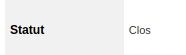

Statut final du ticket : Clos.

Fermer la session.

Référence du document : 1i035JKa6bXoX9kaLIH95ejMugk3WjpLI · SHA-256 25f6abc33502e1e8…

## Fiche de synthèse

Les lignes reprennent les titres du cours et la première phrase de chaque partie.

| Partie | Repère du cours |
| --- | --- |
| Support · Module 09 - Support de cours · 11 pages transcrites | Texte, tableaux et illustrations utiles retranscrits du support ; numéros de diapositives, bandeaux répétitifs, éléments de marque et décorations exclus. |
| Énoncé · M09 - S01 TP-L'exploitation des services · 1 pages transcrites | Texte, tableaux et illustrations utiles retranscrits du support ; numéros de diapositives, bandeaux répétitifs, éléments de marque et décorations exclus. |
| Correction · M09 - S01 TP-Corrigé_L'exploitation des services · 17 pages transcrites | Texte, tableaux et illustrations utiles retranscrits du support ; numéros de diapositives, bandeaux répétitifs, éléments de marque et décorations exclus. |
