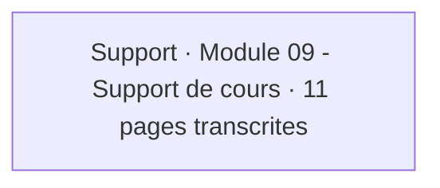
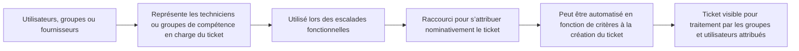
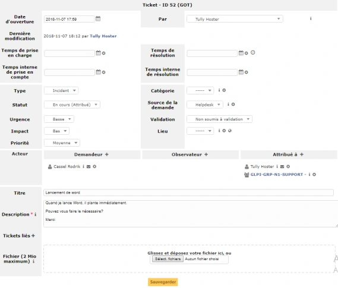
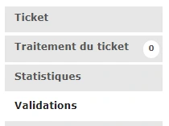
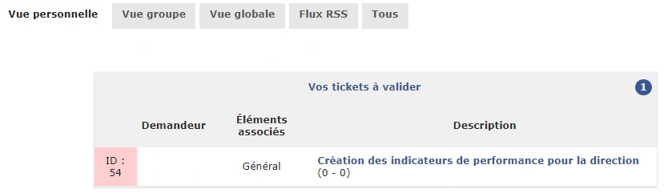
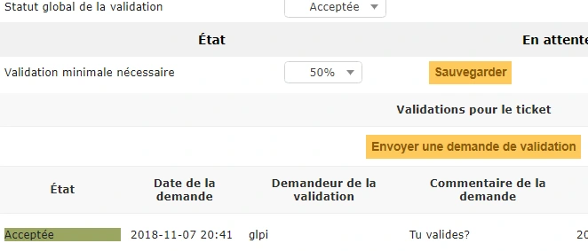
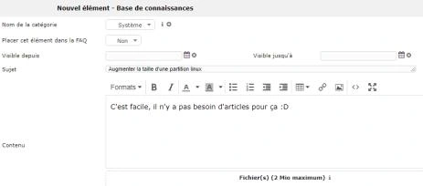
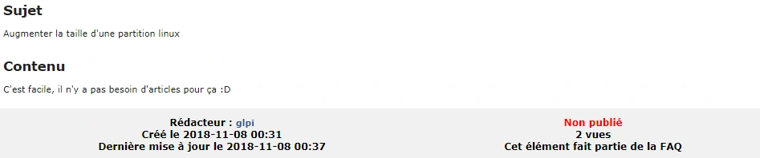

# Module 09 — Assistance avec GLPI

[Travaux pratiques](../../tp/itil/module-09/index.md)

Les parties ci-dessous reprennent le cours original, dans le même ordre. Les encadrés et les schémas répètent ses formulations.

## Parcours de lecture

1. Support · Module 09 - Support de cours · 11 pages transcrites

**Visuel externe**



SOURCE DRIVE · TRANSCRIPTION DU SUPPORT

Le contenu des documents du dossier TSSR est transcrit ci-dessous, page par page. Les textes et tableaux sont intégrés à la page Web. Aucun fichier PDF, aucune diapositive entière ni aucune reproduction de page n’est affiché. Seuls des croquis ou visuels isolés et vérifiés peuvent accompagner la transcription. Les versions et les consignes restent celles des supports de formation. Les compléments IA sont conservés dans leur onglet distinct.

## Support · Module 09 - Support de cours · 11 pages transcrites

!!! note "À retenir"
    Texte, tableaux et illustrations utiles retranscrits du support ; numéros de diapositives, bandeaux répétitifs, éléments de marque et décorations exclus.

Texte, tableaux et illustrations utiles retranscrits du support ; numéros de diapositives, bandeaux répétitifs, éléments de marque et décorations exclus. Les formulations historiques sont conservées ; les précisions sont placées dans le cours optimisé.

### Page 1

#### Sensibilisation ITIL

Module 09 – Assistance avec GLPI

#### Objectifs

!!! note "À retenir"
    Découvrir la création d’un ticket Découvrir le traitement d’un ticket Appréhender la base de connaissance

**Visuel externe**


- Découvrir la création d’un ticket

- Découvrir le traitement d’un ticket
- Appréhender la base de connaissance

### Page 2

**Visuel externe**



```mermaid
flowchart LR
    N1["Dans le monde de l’informatique, tout fonctionne à base de ticket"]
    N2["Cela va permettre de solliciter la DSI"]
    N3["Un ticket passera par plusieurs statuts : cycle de vie du ticket"]
    N4["Peut-être de type incident ou demande"]
    N5["Doit compter un minimum d’informations"]
    N6["De nombreux avantages"]
    N7["Système de gestion de tickets / outil de ticketing"]
    N8["Conforme aux bonnes pratiques ITIL"]
    N1 --> N2
    N2 --> N3
    N3 --> N4
    N4 --> N5
    N5 --> N6
    N6 --> N7
    N7 --> N8
```

Le ticket

- Dans le monde de l’informatique, tout fonctionne à base de ticket
- Cela va permettre de solliciter la DSI
- Un ticket passera par plusieurs statuts : cycle de vie du ticket
- Peut-être de type incident ou demande
- Doit compter un minimum d’informations
- De nombreux avantages

Traçabilité Détection des

Répartition des

tâches Communication

problèmes

Utilisation d’un outil de gestion de ticket

L’assistance sous GLPI

- Système de gestion de tickets / outil de ticketing
- Conforme aux bonnes pratiques ITIL
- Recueil des sollicitations utilisateur pour une gestion centralisée
- Différents canaux de communication possibles
- Saisie, suivi et traitement du ticket

- Cycle de vie des tickets
- Statistiques possibles

### Page 3

**Visuel externe**



```mermaid
flowchart LR
    N1["Interface d’ouverture de tickets anonymes"]
    N2["Interface simplifiée"]
    N3["Interface standard Depuis GLPI"]
    N4["Envoi d’un mail dans une boîte mail support"]
    N5["Configuration d’un collecteur Mail"]
    N6["Création du ticket par téléphone"]
    N7["Utilisation de l’interface standard par le technicien Téléphone"]
    N8["Ni groupes et utilisateurs sur le ticket Nouveau"]
    N1 --> N2
    N2 --> N3
    N3 --> N4
    N4 --> N5
    N5 --> N6
    N6 --> N7
    N7 --> N8
```

Flux d’entrée

Trois grandes façons de créer un ticket

- Interface d’ouverture de tickets anonymes
- Interface simplifiée
- Interface standard Depuis GLPI

- Envoi d’un mail dans une boîte mail support
- Configuration d’un collecteur Mail

- Création du ticket par téléphone
- Utilisation de l’interface standard par le technicien Téléphone

Cycle de vie d’un ticket

- Ni groupes et utilisateurs sur le ticket Nouveau

- En attente d’éléments => Modification manuelle En attente

- Au moins un utilisateur/groupe est attribué En cours attribué

- Une tâche vient d’être planifiée En cours planifié

- Une solution vient d’être apportée au ticket Résolu

- La solution est approuvée par le demandeur Clos

### Page 4

!!! note "À retenir"
    Traitement d’un ticket : aperçu Interface GLPI présentée dans le support — illustration isolée du support, page 4.

**Visuel externe**



Traitement d’un ticket : aperçu



Interface GLPI présentée dans le support — illustration isolée du support, page 4.

Traitement d’un ticket : attribution

- Utilisateurs, groupes ou fournisseurs
- Représente les techniciens ou groupes de compétence en charge du ticket
- Utilisé lors des escalades fonctionnelles
- Raccourci pour s’attribuer nominativement le ticket

- Peut être automatisé en fonction de critères à la création du ticket
- Ticket visible pour traitement par les groupes et utilisateurs attribués


Interface GLPI présentée dans le support — illustration isolée du support, page 4.


Interface GLPI présentée dans le support — illustration isolée du support, page 4.

Attribution

### Page 5

Traitement d’un ticket : observateurs

- Utilisé lors des escalades hiérarchiques
- Utilisateurs et groupes
- Notifications sans traitement possible du ticket
- Va permettre de suivre l’évolution d’un ticket
- Peuvent être ajoutés automatiquement à la création en fonction de critères


Interface GLPI présentée dans le support — illustration isolée du support, page 5.


Interface GLPI présentée dans le support — illustration isolée du support, page 5.

Ajout

Traitement d’un ticket : SLA

- Doivent être facilement identifiables
- Le type : temps de résolution
- La durée maximum de résolution souhaitée
- Possibilité de créer des niveaux d’escalade


Interface GLPI présentée dans le support — illustration isolée du support, page 5.

Dépasser la date butoir de résolution n’est pas bloquant, juste informatif

### Page 6

#### Traitement d’un ticket : validation

!!! note "À retenir"
    Un ticket peut nécessiter une validation hiérarchique Manuelle ou automatique à la création Non bloquant pour le traitement du ticket Droits spécifiques pour pouvoir être « valideur » Demandes multiples possibles Interface GLPI présentée dans le support — illustration isolée du support, page 6.

- Un ticket peut nécessiter une validation hiérarchique
- Manuelle ou automatique à la création
- Non bloquant pour le traitement du ticket
- Droits spécifiques pour pouvoir être « valideur »
- Demandes multiples possibles


Interface GLPI présentée dans le support — illustration isolée du support, page 6.



Interface GLPI présentée dans le support — illustration isolée du support, page 6.

- Les valideurs reçoivent une notification de validation
- Ils approuvent ou refusent en accédant au ticket à valider. Comment ?


Interface GLPI présentée dans le support — illustration isolée du support, page 6.

Liste de ses tickets à valider



Interface GLPI présentée dans le support — illustration isolée du support, page 6.

Depuis notre vue personnelle

### Page 7

!!! note "À retenir"
    Traitement d’un ticket : validation Interface GLPI présentée dans le support — illustration isolée du support, page 7.

Traitement d’un ticket : validation


Interface GLPI présentée dans le support — illustration isolée du support, page 7.



Interface GLPI présentée dans le support — illustration isolée du support, page 7.

Traitement d’un ticket : traitement

- Onglet Traitement du ticket
- Quatre possibilités
  - Suivi
  - Tâche
  - Solution
  - Document


Interface GLPI présentée dans le support — illustration isolée du support, page 7.

### Page 8

Traitement d’un ticket : clôture

- La clôture du ticket s’effectue à l’approbation de la solution
- Peut être effectuée par le demandeur ou le rédacteur (ticket par téléphone)
- Accessible par le mail de validation ou le menu ticket de l’interface simplifiée
- Commentaire obligatoire en cas de refus

- Possibilité de planifier ou rendre la clôture immédiate à la résolution


Interface GLPI présentée dans le support — illustration isolée du support, page 8.

Ticket : éléments liés

- Liaison de CI possible à la création d’un ticket
- Utile pour le diagnostic
- Utile pour les statistiques
- Nécessite une CMDB à jour et bien renseignée


Interface GLPI présentée dans le support — illustration isolée du support, page 8.

### Page 9

Base de connaissances : article

- Objectifs
  - Centraliser des connaissances internes aux différents techniciens
  - Mettre à disposition des utilisateurs des informations (FAQ)
- Accessible depuis Outils => Base de connaissances
- Restriction à un nombre d’acteurs
- Validation de publications d’articles

- Gestion des révisions
- Liaisons possibles avec les tickets et les éléments d’inventaire (CI)
- FAQ : sous-partie de la base de connaissances à destination des utilisateurs
- Organisation possible par catégories et restrictions temporelles

Base de connaissances : création



Interface GLPI présentée dans le support — illustration isolée du support, page 9.

- Création d’un article
- Ajout des cibles
- Usage public ou non


Interface GLPI présentée dans le support — illustration isolée du support, page 9.

- Article sans cible = Article non publié
- Apparaît dans Gérer
- Visible que par son créateur

### Page 10

!!! note "À retenir"
    Base de connaissances : cibles Vont permettre de publier l’article à différentes personnes Entité – Profil – Groupe - Utilisateur Interface GLPI présentée dans le support — illustration isolée du support, page 10.

Base de connaissances : cibles

- Vont permettre de publier l’article à différentes personnes
- Entité – Profil – Groupe - Utilisateur



Interface GLPI présentée dans le support — illustration isolée du support, page 10.


Interface GLPI présentée dans le support — illustration isolée du support, page 10.

Base de connaissances publiques

- Éviter la création systématique d’un ticket
- FAQ (Foire Aux Questions)
- Accessible depuis l’interface simplifiée
- Accès rapide ou par catégories


Interface GLPI présentée dans le support — illustration isolée du support, page 10.

### Page 11

#### Création et gestion

des tickets

Démo

#### TP L'exploitation des

```
services
```

!!! note "À retenir"
    Référence du document : 1nf0OyiQI-Q464T8fgaIOZz2t4TV0Jzom · SHA-256 2e927cb500d1515b…

Référence du document : 1nf0OyiQI-Q464T8fgaIOZz2t4TV0Jzom · SHA-256 2e927cb500d1515b…

| Support · Module 09 - Support de cours · 11 pages transcrites | Texte, tableaux et illustrations utiles retranscrits du support ; numéros de diapositives, bandeaux répétitifs, éléments de marque et décorations exclus. |
