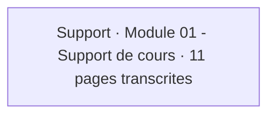
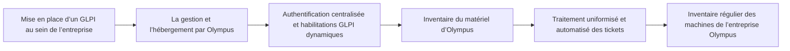
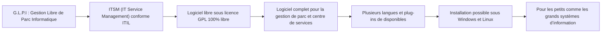
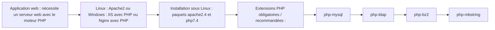
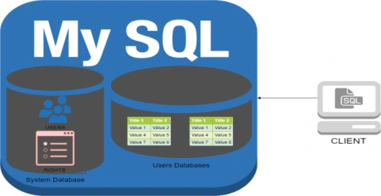
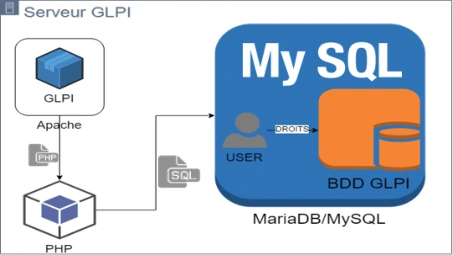
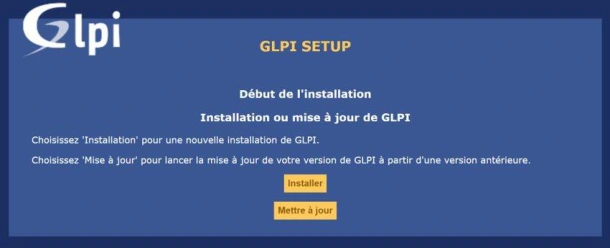

# Module 01 — Présenter l’environnement et installer GLPI

[Travaux pratiques](../../tp/glpi/module-01/index.md)

Les parties ci-dessous reprennent le cours original, dans le même ordre. Les encadrés et les schémas répètent ses formulations.

## Parcours de lecture

1. Support · Module 01 - Support de cours · 11 pages transcrites

**Visuel externe**



SOURCE DRIVE · TRANSCRIPTION DU SUPPORT

Le contenu des documents du dossier TSSR est transcrit ci-dessous, page par page. Les textes et tableaux sont intégrés à la page Web. Aucun fichier PDF, aucune diapositive entière ni aucune reproduction de page n’est affiché. Seuls des croquis ou visuels isolés et vérifiés peuvent accompagner la transcription. Les versions et les consignes restent celles des supports de formation. Les compléments IA sont conservés dans leur onglet distinct.

## Support · Module 01 - Support de cours · 11 pages transcrites

#### Administration GLPI

#### Module 01 – Présentation de l'environnement - Installation de GLPI

#### Objectifs

**Visuel externe**



```mermaid
flowchart LR
    N1["Présentation de l’environnement de formation"]
    N2["Présentation du projet GLPI par son site internet"]
    N3["Présentation des principaux composants logiciels nécessaires"]
    N4["Installation du service de base de données MySQL/MariaDB"]
    N5["Installation du service Web Apache2"]
    N6["Installation de l’interpréteur PHP et des modules requis par GLPI"]
    N7["Récupération du code de GLPI et lancement du paramétrage initial"]
    N1 --> N2
    N2 --> N3
    N3 --> N4
    N4 --> N5
    N5 --> N6
    N6 --> N7
```

- Présentation de l’environnement de formation
- Présentation du projet GLPI par son site internet

- Présentation des principaux composants logiciels nécessaires
- Installation du service de base de données MySQL/MariaDB
- Installation du service Web Apache2
- Installation de l’interpréteur PHP et des modules requis par GLPI
- Récupération du code de GLPI et lancement du paramétrage initial

#### Installation de GLPI

#### Environnement de la semaine

#### Réseau de salle

#### 192.168.1.254 DHCP

PFSENSE

VMNET 18

srv-glpi srv-CD01

#### 192.168.1.1 192.168.1.2

!!! note "À retenir"
    Croquis extrait du support Drive : réseau de formation GLPI.

Croquis extrait du support Drive : réseau de formation GLPI. Visuel isolé, sans diapositive, en-tête ni logo ; aucun ajout IA.

#### Contexte

**Visuel externe**



Administrateur système / bureautique

- Mise en place d’un GLPI au sein de l’entreprise
- La gestion et l’hébergement par Olympus
- Authentification centralisée et habilitations GLPI dynamiques

- Inventaire du matériel d’Olympus
- Traitement uniformisé et automatisé des tickets
- Inventaire régulier des machines de l’entreprise Olympus

#### Présentation de GLPI

#### Présentation de GLPI

**Visuel externe**



- G.L.P.I : Gestion Libre de Parc Informatique
- ITSM (IT Service Management) conforme ITIL
- Logiciel libre sous licence GPL 100% libre
- Logiciel complet pour la gestion de parc et centre de services

- Plusieurs langues et plug-ins de disponibles
- Installation possible sous Windows et Linux
- Pour les petits comme les grands systèmes d’information

#### Les composants de GLPI

#### Installation – Serveur Web

**Visuel externe**



- Application web : nécessite un serveur web avec le moteur PHP
- Linux : Apache2 ou Windows : IIS avec PHP ou Nginx avec PHP
- Installation sous Linux : paquets apache2.4 et php7.4
- Extensions PHP obligatoires / recommandées :

- php-mysql

- php-ldap

- php-bz2

- php-mbstring

- php-xmlrpc

- php-apcu-bc

- php-curl

- php-imap

- php-cas

- php-gd

- php-intl

- php-xml

- php-zip

#### Installation – Serveur de base de données

!!! note "À retenir"
    Installation – Serveur de base de données GLPI a besoin de stocker des informations en base de données et pour cela il utilise un SGBD (Système de Gestion de Base de Données) SGBD pris en charge par GLPI MySQL MariaDB Installation de MariaDB Paquet : mariadb-server Visuel isolé — Module 01 - Support de cours

Installation – Serveur de base de données

- GLPI a besoin de stocker des informations en base de données et pour cela il utilise un SGBD (Système de Gestion de Base de Données)

- SGBD pris en charge par GLPI

- MySQL

- MariaDB

- Installation de MariaDB

- Paquet : mariadb-server



Visuel isolé — Module 01 - Support de cours

#### Fonctionnement – Serveur de base de données

- Composants du serveur GLPI

#### Sécurisation - Serveur de bases de données

#### Sécurisation du serveur de base de données MariaDB

!!! note "À retenir"
    Visuel isolé — Module 01 - Support de cours

# apt install mariadb-server mariadb-client

# mysql_secure_installation Change the root password? [Y/n] n # mot de passe pour l’utilisateur root dans MySQL Remove anonymous users? [Y/n] Y # ne permettre l’accès à mariadb que pour root Disallow root login remotely? [Y/n] Y # empêcher un accès distant à mariadb Remove test database and access to it? [Y/n] Y # supprimer la base de données de test Reload privilege tables now? [Y/n] Y # recharger mariadb avec cette nouvelle configuration



Visuel isolé — Module 01 - Support de cours

#### Paramétrage - Serveur de bases de données

!!! note "À retenir"
    Sécurisation du serveur de base de données MariaDB Paramétrage du serveur de base de données MariaDB Connexion au Shell du SGBD MariaDB Création d’une base de données Affectation des droits à l’utilisateur root de mariadb Toutes les commandes MySQL doivent se terminer par un point-virgule.

Sécurisation du serveur de base de données MariaDB

- Paramétrage du serveur de base de données MariaDB
- Connexion au Shell du SGBD MariaDB

```
# mysql –u root –p
```

- Création d’une base de données

```
mysql>create database glpidata;
```

- Affectation des droits à l’utilisateur root de mariadb

```
mysql>grant all privileges on glpidata.* to root@localhost identified by '[mot de passe fourni par le formateur]';
```

Toutes les commandes MySQL doivent se terminer par un point-virgule.

#### Installation – Application GLPI

!!! note "À retenir"
    Récupération de l’archive GLPI sur le site de l’éditeur Décompression à la racine du serveur web (/var/www/) Accès à l’interface web de GLPI via l’URL «http://@ipSrvGLPI/glpi »*

- Récupération de l’archive GLPI sur le site de l’éditeur
- Décompression à la racine du serveur web (/var/www/)

- Accès à l’interface web de GLPI via l’URL «http://@ipSrvGLPI/glpi »*

#### * URL par défaut d’accès à l’application pouvant varier

#### Configuration – Application GLPI

- Post configuration - Language

#### Configuration – Application GLPI

!!! note "À retenir"
    Post configuration - Installation ou mise à jour Visuel isolé — Module 01 - Support de cours Visuel isolé — Module 01 - Support de cours

- Post configuration - Installation ou mise à jour


Visuel isolé — Module 01 - Support de cours



Visuel isolé — Module 01 - Support de cours

#### Configuration – Application GLPI

- Post configuration - Test des prérequis

#### Configuration – Application GLPI

!!! note "À retenir"
    Post configuration - Accès à la base de données

- Post configuration - Accès à la base de données

#### 127.0.0.1

```
root
```

#### Mot de passe de root mariadb

!!! note "À retenir"
    Visuel isolé — Module 01 - Support de cours Visuel isolé — Module 01 - Support de cours


Visuel isolé — Module 01 - Support de cours


Visuel isolé — Module 01 - Support de cours

#### Configuration – Application GLPI

- Post configuration - Initialisation d'une base de données

#### Configuration – Application GLPI

- Comptes par défauts
- glpi/[mot de passe fourni par le formateur] pour le compte administrateur
- tech/[mot de passe fourni par le formateur] pour le compte technicien
- normal/[mot de passe fourni par le formateur] pour le compte normal
- post-only/[mot de passe fourni par le formateur] pour le compte postonly
- Changement des mots de passe par défaut
- Désactivation du fichier « install/install.php »
- Définition d’un nom d’hôte d’accès à l’application


Visuel isolé — Module 01 - Support de cours

#### Configuration – Application GLPI


Visuel isolé — Module 01 - Support de cours

Référence du document : 1pwXhrHCaXYG7d_HVqe9ZwUPHpsFHn05z · SHA-256 df88c0f8aa505b17…
