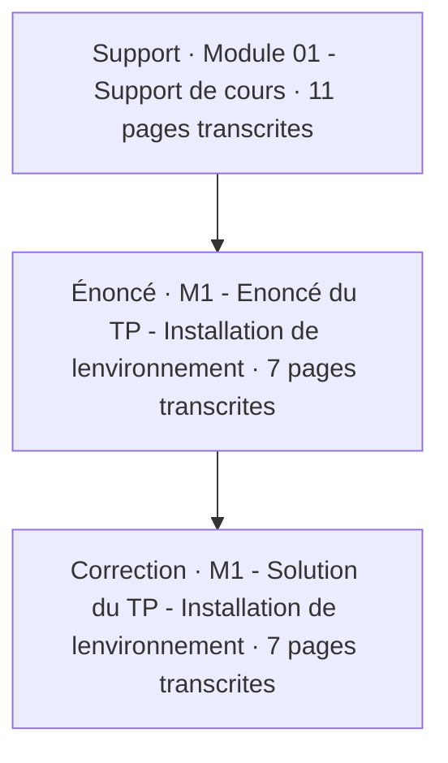
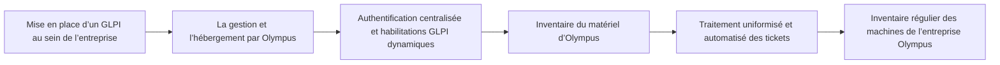
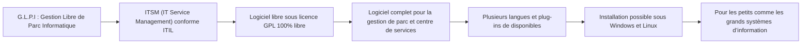
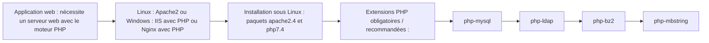
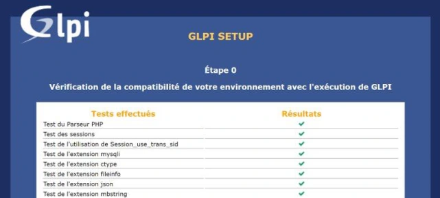
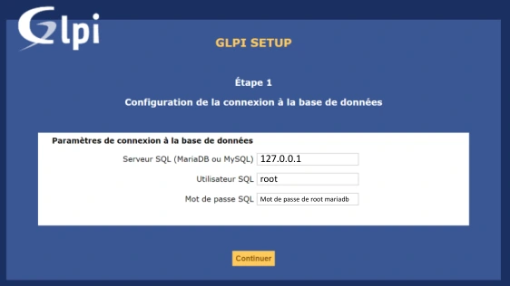
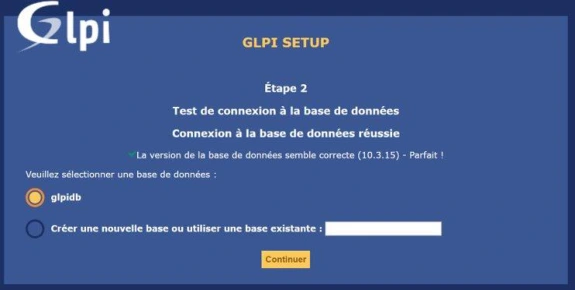
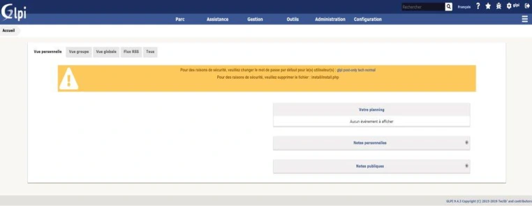

# Module 01 — Présenter l’environnement et installer GLPI

Les parties ci-dessous reprennent le cours original, dans le même ordre. Les encadrés et les schémas répètent ses formulations.

## Parcours de lecture

1. Support · Module 01 - Support de cours · 11 pages transcrites
2. Énoncé · M1 - Enoncé du TP - Installation de lenvironnement · 7 pages transcrites
3. Correction · M1 - Solution du TP - Installation de lenvironnement · 7 pages transcrites

**Visuel externe**



SOURCE DRIVE · TRANSCRIPTION DU SUPPORT

Le contenu des documents du dossier TSSR est transcrit ci-dessous, page par page. Les textes et tableaux sont intégrés à la page Web. Aucun fichier PDF, aucune diapositive entière ni aucune reproduction de page n’est affiché. Seuls des croquis ou visuels isolés et vérifiés peuvent accompagner la transcription. Les versions et les consignes restent celles des supports de formation. Les compléments IA sont conservés dans leur onglet distinct.

## Support · Module 01 - Support de cours · 11 pages transcrites

#### Administration GLPI

#### Module 01 – Présentation de l'environnement - Installation de GLPI

#### Objectifs

**Visuel externe**



```mermaid
flowchart LR
    N1["Présentation de l’environnement de formation"]
    N2["Présentation du projet GLPI par son site internet"]
    N3["Présentation des principaux composants logiciels nécessaires"]
    N4["Installation du service de base de données MySQL/MariaDB"]
    N5["Installation du service Web Apache2"]
    N6["Installation de l’interpréteur PHP et des modules requis par GLPI"]
    N7["Récupération du code de GLPI et lancement du paramétrage initial"]
    N1 --> N2
    N2 --> N3
    N3 --> N4
    N4 --> N5
    N5 --> N6
    N6 --> N7
```

- Présentation de l’environnement de formation
- Présentation du projet GLPI par son site internet

- Présentation des principaux composants logiciels nécessaires
- Installation du service de base de données MySQL/MariaDB
- Installation du service Web Apache2
- Installation de l’interpréteur PHP et des modules requis par GLPI
- Récupération du code de GLPI et lancement du paramétrage initial

#### Installation de GLPI

#### Environnement de la semaine

#### Réseau de salle

#### 192.168.1.254 DHCP

#### PFSENSE

#### VMNET 18

#### srv-glpi srv-CD01

#### 192.168.1.1 192.168.1.2

!!! note "À retenir"
    Croquis extrait du support Drive : réseau de formation GLPI.

Croquis extrait du support Drive : réseau de formation GLPI. Visuel isolé, sans diapositive, en-tête ni logo ; aucun ajout IA.

#### Contexte

**Visuel externe**



Administrateur système / bureautique

- Mise en place d’un GLPI au sein de l’entreprise
- La gestion et l’hébergement par Olympus
- Authentification centralisée et habilitations GLPI dynamiques

- Inventaire du matériel d’Olympus
- Traitement uniformisé et automatisé des tickets
- Inventaire régulier des machines de l’entreprise Olympus

#### Présentation de GLPI

#### Présentation de GLPI

**Visuel externe**



- G.L.P.I : Gestion Libre de Parc Informatique
- ITSM (IT Service Management) conforme ITIL
- Logiciel libre sous licence GPL 100% libre
- Logiciel complet pour la gestion de parc et centre de services

- Plusieurs langues et plug-ins de disponibles
- Installation possible sous Windows et Linux
- Pour les petits comme les grands systèmes d’information

#### Les composants de GLPI

#### Installation – Serveur Web

**Visuel externe**



- Application web : nécessite un serveur web avec le moteur PHP
- Linux : Apache2 ou Windows : IIS avec PHP ou Nginx avec PHP
- Installation sous Linux : paquets apache2.4 et php7.4
- Extensions PHP obligatoires / recommandées :

- php-mysql

- php-ldap

- php-bz2

- php-mbstring

- php-xmlrpc

- php-apcu-bc

- php-curl

- php-imap

- php-cas

- php-gd

- php-intl

- php-xml

- php-zip

#### Installation – Serveur de base de données

!!! note "À retenir"
    Installation – Serveur de base de données GLPI a besoin de stocker des informations en base de données et pour cela il utilise un SGBD (Système de Gestion de Base de Données) SGBD pris en charge par GLPI MySQL MariaDB Installation de MariaDB Paquet : mariadb-server Visuel isolé — Module 01 - Support de cours

Installation – Serveur de base de données

- GLPI a besoin de stocker des informations en base de données et pour cela il utilise un SGBD (Système de Gestion de Base de Données)

- SGBD pris en charge par GLPI

- MySQL

- MariaDB

- Installation de MariaDB

- Paquet : mariadb-server


Visuel isolé — Module 01 - Support de cours

#### Fonctionnement – Serveur de base de données

- Composants du serveur GLPI

#### Sécurisation - Serveur de bases de données

#### Sécurisation du serveur de base de données MariaDB

!!! note "À retenir"
    Visuel isolé — Module 01 - Support de cours

# apt install mariadb-server mariadb-client

# mysql_secure_installation Change the root password? [Y/n] n # mot de passe pour l’utilisateur root dans MySQL Remove anonymous users? [Y/n] Y # ne permettre l’accès à mariadb que pour root Disallow root login remotely? [Y/n] Y # empêcher un accès distant à mariadb Remove test database and access to it? [Y/n] Y # supprimer la base de données de test Reload privilege tables now? [Y/n] Y # recharger mariadb avec cette nouvelle configuration


Visuel isolé — Module 01 - Support de cours

#### Paramétrage - Serveur de bases de données

!!! note "À retenir"
    Sécurisation du serveur de base de données MariaDB Paramétrage du serveur de base de données MariaDB Connexion au Shell du SGBD MariaDB Création d’une base de données Affectation des droits à l’utilisateur root de mariadb Toutes les commandes MySQL doivent se terminer par un point-virgule.

Sécurisation du serveur de base de données MariaDB

- Paramétrage du serveur de base de données MariaDB
- Connexion au Shell du SGBD MariaDB

```
# mysql –u root –p
```

- Création d’une base de données

```
mysql>create database glpidata;
```

- Affectation des droits à l’utilisateur root de mariadb

```
mysql>grant all privileges on glpidata.* to root@localhost identified by '[mot de passe fourni par le formateur]';
```

Toutes les commandes MySQL doivent se terminer par un point-virgule.

#### Installation – Application GLPI

!!! note "À retenir"
    Récupération de l’archive GLPI sur le site de l’éditeur Décompression à la racine du serveur web (/var/www/) Accès à l’interface web de GLPI via l’URL «http://@ipSrvGLPI/glpi »*

- Récupération de l’archive GLPI sur le site de l’éditeur
- Décompression à la racine du serveur web (/var/www/)

- Accès à l’interface web de GLPI via l’URL «http://@ipSrvGLPI/glpi »*

#### * URL par défaut d’accès à l’application pouvant varier

#### Configuration – Application GLPI

- Post configuration - Language

#### Configuration – Application GLPI

!!! note "À retenir"
    Post configuration - Installation ou mise à jour Visuel isolé — Module 01 - Support de cours Visuel isolé — Module 01 - Support de cours

- Post configuration - Installation ou mise à jour


Visuel isolé — Module 01 - Support de cours


Visuel isolé — Module 01 - Support de cours

#### Configuration – Application GLPI

- Post configuration - Test des prérequis

#### Configuration – Application GLPI

!!! note "À retenir"
    Post configuration - Accès à la base de données

- Post configuration - Accès à la base de données

#### 127.0.0.1

#### root

#### Mot de passe de root mariadb

!!! note "À retenir"
    Visuel isolé — Module 01 - Support de cours Visuel isolé — Module 01 - Support de cours



Visuel isolé — Module 01 - Support de cours



Visuel isolé — Module 01 - Support de cours

#### Configuration – Application GLPI

- Post configuration - Initialisation d'une base de données

#### Configuration – Application GLPI

- Comptes par défauts
- glpi/[mot de passe fourni par le formateur] pour le compte administrateur
- tech/[mot de passe fourni par le formateur] pour le compte technicien
- normal/[mot de passe fourni par le formateur] pour le compte normal
- post-only/[mot de passe fourni par le formateur] pour le compte postonly
- Changement des mots de passe par défaut
- Désactivation du fichier « install/install.php »
- Définition d’un nom d’hôte d’accès à l’application



Visuel isolé — Module 01 - Support de cours

#### Configuration – Application GLPI



Visuel isolé — Module 01 - Support de cours

Référence du document : 1pwXhrHCaXYG7d_HVqe9ZwUPHpsFHn05z · SHA-256 df88c0f8aa505b17…

## Énoncé · M1 - Enoncé du TP - Installation de lenvironnement · 7 pages transcrites

#### Installation de l’environnement

#### TP du Module 1 – Présentation de l’environnement – Installation de GLPI

Avant de démarrer ce TP, il convient d’avoir suivi les vidéos du module 1.

#### Énoncé

#### Objectifs

- Installer un GLPI et un domaine Active Directory Prérequis

- VMware Workstation, ISO Debian10 NetInstall, Windows server 2019 graphique et pfSense Contexte

- La société Olympus vous demande d’installer l’application GLPI au sein de son domaine.

- L’application GLPI sera ensuite utilisée pour de la gestion de parc et de l’assistance utilisateur.

Adressage IP des VM :

- 192.168.1.0/24 + DHCP salle

#### .254

#### Réseau de salle

#### DHCP

#### 192.168.1.0/24

#### PFSENSE

#### VMNET 18

#### srv-glpi srv-CD1

#### .1 .2

#### Principales tâches à réaliser

#### Installation du serveur GLPI

- Installez une VM Debian 10 64b avec interface graphique

- 4Go RAM, 1CPU, bridge, 40Gb de disque dur.

- Utilisez l’ISO NetInstall de Debian 10 disponible sur distrib.

- Adressage réseau : DHCP en bridge pour l’installation.

- Puis faites la configuration réseau une fois installée (VMNet18).

- Serveur DNS : srv-CD01.

- Uniquement le serveur SSH et l’environnement graphique de bureau seront

installés avec les utilitaires usuels du système.

#### Installation du domaine ADDS

- Depuis l’image ISO Windows Server 2019 présente sur distrib, déployez le serveur pour le domaine Olympus.gr.

- Procédez au nommage et adressage réseau comme indiqué sur le schéma.

- Créez les domaines ADDS « Olympus.gr ».

- Ne créer ni OU, ni utilisateurs pour le moment.

#### Installation d’un client W10

- Depuis l’image SysPrep Windows 10 présente dans distrib, déployez un client.

- Procédez à la configuration réseau en vous basant sur le schéma.

- Ajoutez le client dans le domaine ADDS.

#### Installation du firewall pfSense

- Créez une nouvelle machine virtuelle avec les caractéristiques suivantes :

- OS : Other, FreeBSD 64-bit, 512 de RAM, 1 CPU, Disque 20G GB.

- Carte réseau n°1 : bridgée en DHCP

- Carte réseau n°2 : VMNet18

- Depuis l’ISO présente sur Distrib, installez un pfSense avec les réglages par défaut.

- Laissez la carte em0 en DHCP, configurez la carte em1 sur le LAN VMNET18 comme indiqué sur le schéma.

- Accédez à l’interface web du pfSense et effectuez-y la configuration préalable qui sera proposée.

- Créez une règle de filtrage sur toutes les interfaces qui autorise tout le trafic.

- Test de communication

- Depuis srv-Cd01, vous devez pouvoir résoudre ftp.fr.debian.org (pensez au

#### DNS)

- Depuis srv-glpi, ping vers ftp.fr.debian.org.

#### Installation de l’application GLPI

Le serveur Debian doit pouvoir, à travers le pfSense, accéder au réseau extérieur, dont les dépôts de l’Ecole. La mise à jour des dépôts ne doit pas provoquer d’erreurs. Inutile d’aller plus loin si cette étape n’est pas vérifiée.

- Installez les paquets suivants :

- Serveur WEB et le serveur de base de données : task-web-server et mariadb-

server.

- Extensions obligatoires PHP pour GLPI :

- Php7.3

- php7.3-mysql

- php7.3-mbstring

- php7.3-curl

- php7.3-gd

- php7.3-xml

- php7.3-ldap

- php7.3-xmlrpc

- php7.3-imap

- php7.3-intl

- php7.3-zip

- php7.3-bz2

- php-apcu-bc

- php-cas

- Redémarrez ensuite le serveur Apache

- Configuration de la base de données

#mysql_secure_installation

Change the root password? [Y/n] n Remove anonymous users? [Y/n] Y Disallow root login remotely? [Y/n] Y Remove test database and access to it? [Y/n] Y Reload privilege tables now? [Y/n] Y

- Connectez-vous au Shell mysql : mysql -u root -p

- Créez une base de données pour GLPI :

```
Mysql>create database glpidb;
```

Afin de vérifier si votre base de données a bien été créée :

```
Mysql>show databases ;
```

| Database |
| --- |
| glpidata |
| information_schema |
| mysql |
| performance |

- Créez un gestionnaire avec tous les droits sur cette base de données :

```
Mysql>grant all privileges on glpidata.* to root@localhost identified by '[mot de passe fourni par le formateur]';
```

Afin de vérifier si cela a bien fonctionné :

```
Mysql>show grants for root@localhost;
+-------------------------------------------------------------------------------------------------------
----------+
|  Grants for root@localhost
|
+-------------------------------------------------------------------------------------------------------
----------+
| GRANT ALL PRIVILEGES ON *.* TO ‘root’@’localhost’ IDENTIFIED BY PASSWORD
‘[empreinte masquée]’ WITH GRANT OPTION                |
```

- Installation de GLPI

- Récupérez l’archive de GLPI présente sur le partage formateur sur la machine

Debian avec Winscp disponible sur Distrib (attention, openssh-server doit être installé et le démon sshd empêche la connexion avec l’utilisateur root…).

- Copiez le fichier glpi-xxxx.tar.gz dans le dossier /var/www/

- Utilisez la commande tar pour désarchiver et décompressez dans /var/www

puis supprimez le fichier glpi-xxxx.tar.gz.

- Vérifiez que root est bien propriétaire et groupe propriétaire du répertoire, et

en récursif, GLPI, sinon faites le changement.

- Modification de l’emplacement des fichiers de configuration de GLPI.

- Créez un répertoire GLPI dans /etc.

- Créez le fichier local_define.php dans le répertoire /etc/glpi avec les

instructions suivantes :

```
<?php
define('GLPI_VAR_DIR', '/var/lib/glpi');
define('GLPI_DOC_DIR',
GLPI_VAR_DIR);
define('GLPI_CRON_DIR',
GLPI_VAR_DIR . '/_cron');
define('GLPI_DUMP_DIR',
GLPI_VAR_DIR . '/_dumps');
define('GLPI_GRAPH_DIR',
GLPI_VAR_DIR . '/_graphs');
define('GLPI_LOCK_DIR',
GLPI_VAR_DIR . '/_lock');
define('GLPI_PICTURE_DIR',
GLPI_VAR_DIR . '/_pictures');
define('GLPI_PLUGIN_DOC_DIR',
GLPI_VAR_DIR . '/_plugins');
define('GLPI_RSS_DIR',
GLPI_VAR_DIR . '/_rss');
define('GLPI_SESSION_DIR',
GLPI_VAR_DIR . '/_sessions');
define('GLPI_TMP_DIR',
GLPI_VAR_DIR . '/_tmp');
define('GLPI_UPLOAD_DIR',
GLPI_VAR_DIR . '/_uploads');
define('GLPI_CACHE_DIR',
GLPI_VAR_DIR . '/_cache');
define('GLPI_LOG_DIR', '/var/log/glpi');
?>
```

- Donnez les droits en récursif à l’utilisateur www-data sur /etc/glpi et sur /var/www/glpi/files.

- Créez un répertoire /var/lib/glpi.

- Copiez tout ce qui se trouve dans /var/ww/glpi/files vers /var/lib/glpi.

- Donnez les droits en récursif à l’utilisateur www-data sur /var/lib/glpi. Vérifiez.

```
# ls -l /var/lib/glpi
drwxr-xr-x 2 www-data root 4096 janv. 24 10:37 _cache
drwxr-xr-x 2 www-data root 4096 janv. 24 10:37 _cron
drwxr-xr-x 2 www-data root 4096 janv. 24 10:37 _dumps
drwxr-xr-x 2 www-data root 4096 janv. 24 10:37 _graphs
drwxr-xr-x 2 www-data root 4096 janv. 24 10:37 _locales
drwxr-xr-x 2 www-data root 4096 janv. 24 10:37 _lock
drwxr-xr-x 2 www-data root 4096 janv. 24 10:37 _log
drwxr-xr-x 2 www-data root 4096 janv. 24 10:37 _pictures
drwxr-xr-x 2 www-data root 4096 janv. 24 10:37 _plugins
drwxr-xr-x 2 www-data root 4096 janv. 24 10:37 _rss
drwxr-xr-x 2 www-data root 4096 janv. 24 10:37 _sessions
drwxr-xr-x 2 www-data root 4096 janv. 24 10:37 _tmp
drwxr xr x 2 www data root 4096 janv 24 10:37 uploads
```

- Créez un répertoire /var/log/glpi afin de gérer la journalisation de GLPI.

- Donnez les droits à l’utilisateur www-data sur /var/log/glpi.

- Vérifiez.

```
#ls -ld /var/log/glpi
drwxr-xr-x 2 www-data root 4096 janv. 24 10:33 glpi/
```

- Créez un fichier /var/www/glpi/inc/downstream.php.

```
<?php
define('GLPI_CONFIG_DIR', '/etc/glpi/');
if (file_exists(GLPI_CONFIG_DIR . '/local_define.php')) { require_once
GLPI_CONFIG_DIR . '/local_define.php';
}
?>
```

- Donnez les droits à l’utilisateur www-data sur /var/www/glpi/marketplace.

- Vérifiez.

```
#ls -ld marketplace
drwxr-xr-x 2 www-data root 4096 janv. 24 10:33 marketplace/
```

- Afin de publier le site web GLPI, il faut créer le fichier /etc/apache2/sites-available/glpi.domaine.tld.conf.

```
<VirtualHost *:80>
Documentroot /var/www/glpi
ServerName glpi.domaine.tld
<Directory /var/www/glpi>
AllowOverride none
Options Indexes FollowSymLinks Multiviews
Require all granted
</Directory>
</VirtualHost>
```

- Enfin, publiez le site internet.

- Rechargez la configuration du serveur Apache.

- Donnez un FQDN à votre serveur GLPI en olympus.gr.

- Créez l’enregistrement d’hôte pour votre serveur GLPI dans le DNS de CD01.

- Créez un enregistrement CNAME « glpi » pour l’enregistrement A créer ci-dessus.

- Pour la suite des TP, depuis le client W10, faites-en sorte de pouvoir y accéder depuis l’URL suivante : http://glpi.olympus.gr puis terminez la configuration.

#### Solution

Une solution est proposée pour ce TP sous la forme d'un PDF commenté, disponible dans les ressources à télécharger.

Référence du document : 1foBVV4Imb9lmfm50lM_R-5XxrZ3CkPik · SHA-256 e6da692355578977…

## Correction · M1 - Solution du TP - Installation de lenvironnement · 7 pages transcrites

Correction originale : à consulter après avoir tenté l’exercice.

#### Installation de l’environnement

#### TP du Module 1 – Présentation de l’environnement – Installation de GLPI

Avant de démarrer ce TP, il convient d’avoir suivi les vidéos du module 1.

#### Énoncé

#### Objectifs

- Installer un GLPI et un domaine Active Directory Prérequis

- VMware Workstation, ISO Debian10 NetInstall, Windows server 2019 graphique et pfSense Contexte

- La société Olympus vous demande d’installer l’application GLPI au sein de son domaine.

- L’application GLPI sera ensuite utilisée pour de la gestion de parc et de l’assistance utilisateur.

Adressage IP des VM :

- 192.168.1.0/24 + DHCP salle

#### .254

#### Réseau de salle

#### DHCP

#### 192.168.1.0/24

#### PFSENSE

#### VMNET 18

#### srv-glpi srv-CD1

#### .1 .2

#### Principales tâches à réaliser

#### Installation du serveur GLPI

- Installez une VM Debian 10 64b avec interface graphique

- 4Go RAM, 1CPU, bridge, 40Gb de disque dur.

- Utilisez l’ISO NetInstall de Debian 10 disponible sur distrib.

- Adressage réseau : DHCP en bridge pour l’installation.

- Puis faites la configuration réseau une fois installée (VMNet18).

- Serveur DNS : srv-CD01.

- Uniquement le serveur SSH et l’environnement graphique de bureau seront

installés avec les utilitaires usuels du système.

#### Installation du domaine ADDS

- Depuis l’image ISO Windows Server 2019 présente sur distrib, déployez le serveur pour le domaine Olympus.gr.

- Procédez au nommage et adressage réseau comme indiqué sur le schéma.

- Créez les domaines ADDS « Olympus.gr ».

- Ne créer ni OU, ni utilisateurs pour le moment.

#### Installation d’un client W10

- Depuis l’image SysPrep Windows 10 présente dans distrib, déployez un client.

- Procédez à la configuration réseau en vous basant sur le schéma.

- Ajoutez le client dans le domaine ADDS.

#### Installation du firewall pfSense

- Créez une nouvelle machine virtuelle avec les caractéristiques suivantes :

- OS : Other, FreeBSD 64-bit, 512 de RAM, 1 CPU, Disque 20G GB.

- Carte réseau n°1 : bridgée en DHCP

- Carte réseau n°2 : VMNet18

- Depuis l’ISO présente sur Distrib, installez un pfSense avec les réglages par défaut.

- Laissez la carte em0 en DHCP, configurez la carte em1 sur le LAN VMNET18 comme indiqué sur le schéma.

- Accédez à l’interface web du pfSense et effectuez-y la configuration préalable qui sera proposée.

- Créez une règle de filtrage sur toutes les interfaces qui autorise tout le trafic.

- Test de communication

- Depuis srv-Cd01, vous devez pouvoir résoudre ftp.fr.debian.org (pensez au

#### DNS)

#### Redirecteur inconditionnel vers le DNS du centre de formation

- Depuis srv-glpi, ping vers ftp.fr.debian.org.

#### Installation de l’application GLPI

#### Une procédure complète est disponible ici : [procédure interne fournie par le formateur]

Le serveur Debian doit pouvoir, à travers le pfSense, accéder au réseau extérieur, dont les dépôts de l’Ecole. La mise à jour des dépôts ne doit pas provoquer d’erreurs. Inutile d’aller plus loin si cette étape n’est pas vérifiée.

- Installez les paquets suivants :

- Serveur WEB et le serveur de base de données : task-web-server et mariadb-

server.

- Extensions obligatoires PHP pour GLPI :

- Php7.3

- php7.3-mysql

- php7.3-mbstring

- php7.3-curl

- php7.3-gd

- php7.3-xml

- php7.3-ldap

- php7.3-xmlrpc

- php7.3-imap

- php7.3-intl

- php7.3-zip

- php7.3-bz2

- php-apcu-bc

- php-cas

- Redémarrez ensuite le serveur Apache

- Configuration de la base de données

#mysql_secure_installation

Change the root password? [Y/n] n Remove anonymous users? [Y/n] Y Disallow root login remotely? [Y/n] Y Remove test database and access to it? [Y/n] Y Reload privilege tables now? [Y/n] Y

- Connectez-vous au Shell mysql : mysql -u root -p

- Créez une base de données pour GLPI :

```
Mysql>create database glpidb;
```

Afin de vérifier si votre base de données a bien été créée :

```
Mysql>show databases ;
```

| Database |
| --- |
| glpidata |
| information_schema |
| mysql |
| performance |

- Créez un gestionnaire avec tous les droits sur cette base de données :

```
Mysql>grant all privileges on glpidata.* to root@localhost identified by '[mot de passe fourni par le formateur]';
```

Afin de vérifier si cela a bien fonctionné :

```
Mysql>show grants for root@localhost;
+-------------------------------------------------------------------------------------------------------
----------+
|  Grants for root@localhost
|
+-------------------------------------------------------------------------------------------------------
----------+
| GRANT ALL PRIVILEGES ON *.* TO ‘root’@’localhost’ IDENTIFIED BY PASSWORD
‘[empreinte masquée]’ WITH GRANT OPTION                |
```

- Installation de GLPI

- Récupérez l’archive de GLPI présente sur le partage formateur sur la machine

Debian avec Winscp disponible sur Distrib (attention, openssh-server doit être installé et le démon sshd empêche la connexion avec l’utilisateur root…).

- Copiez le fichier glpi-xxxx.tar.gz dans le dossier /var/www/

- Utilisez la commande tar pour désarchiver et décompressez dans /var/www

puis supprimez le fichier glpi-xxxx.tar.gz.

```
tar xvzf /var/www/glpi-xxxx.tar.gz
```

#### Attention, vous devez être dans le répertoire /var/www ou utiliser l’option -C

```
rm glpi-xxxx.tar.gz
```

- Vérifiez que root est bien propriétaire et groupe propriétaire du répertoire, et

en récursif, GLPI, sinon faites le changement.

```
chown -R root glpi
```

#### (attention, vous devez être dans le répertoire /var/www ou utiliser le chemin absolu)

- Modification de l’emplacement des fichiers de configuration de GLPI.

- Créez un répertoire GLPI dans /etc.

```
# mkdir /etc/glpi
```

- Créez le fichier local_define.php dans le répertoire /etc/glpi avec les

instructions suivantes :

```
<?php
define('GLPI_VAR_DIR', '/var/lib/glpi');
define('GLPI_DOC_DIR',
GLPI_VAR_DIR);
define('GLPI_CRON_DIR',
GLPI_VAR_DIR . '/_cron');
define('GLPI_DUMP_DIR',
GLPI_VAR_DIR . '/_dumps');
define('GLPI_GRAPH_DIR',
GLPI_VAR_DIR . '/_graphs');
define('GLPI_LOCK_DIR',
GLPI_VAR_DIR . '/_lock');
define('GLPI_PICTURE_DIR',
GLPI_VAR_DIR . '/_pictures');
define('GLPI_PLUGIN_DOC_DIR',
GLPI_VAR_DIR . '/_plugins');
define('GLPI_RSS_DIR',
GLPI_VAR_DIR . '/_rss');
define('GLPI_SESSION_DIR',
GLPI_VAR_DIR . '/_sessions');
define('GLPI_TMP_DIR',
GLPI_VAR_DIR . '/_tmp');
define('GLPI_UPLOAD_DIR',
GLPI_VAR_DIR . '/_uploads');
define('GLPI_CACHE_DIR',
GLPI_VAR_DIR . '/_cache');
```

- Donnez les droits en récursif à l’utilisateur www-data sur /etc/glpi et sur /var/www/glpi/files.

```
# chown -R www-data /etc/glpi
```

```
# chown -R www-data /var/www/glpi/files
```

- Créez un répertoire /var/lib/glpi.

```
# mkdir /var/lib/glpi
```

- Copiez tout ce qui se trouve dans /var/ww/glpi/files vers /var/lib/glpi.

```
# cp -R /var/www/glpi/files/* /var/lib/glpi
```

- Donnez les droits en récursif à l’utilisateur www-data sur /var/lib/glpi. Vérifiez.

```
# chown -R www-data /var/lib/glpi
```

```
# ls -l /var/lib/glpi
drwxr-xr-x 2 www-data root 4096 janv. 24 10:37 _cache
drwxr-xr-x 2 www-data root 4096 janv. 24 10:37 _cron
drwxr-xr-x 2 www-data root 4096 janv. 24 10:37 _dumps
drwxr-xr-x 2 www-data root 4096 janv. 24 10:37 _graphs
drwxr-xr-x 2 www-data root 4096 janv. 24 10:37 _locales
drwxr-xr-x 2 www-data root 4096 janv. 24 10:37 _lock
drwxr-xr-x 2 www-data root 4096 janv. 24 10:37 _log
drwxr-xr-x 2 www-data root 4096 janv. 24 10:37 _pictures
drwxr-xr-x 2 www-data root 4096 janv. 24 10:37 _plugins
drwxr-xr-x 2 www-data root 4096 janv. 24 10:37 _rss
drwxr-xr-x 2 www-data root 4096 janv. 24 10:37 _sessions
drwxr-xr-x 2 www-data root 4096 janv. 24 10:37 _tmp
drwxr xr x 2 www data root 4096 janv 24 10:37 uploads
```

- Créez un répertoire /var/log/glpi afin de gérer la journalisation de GLPI.

```
#mkdir /var/log/glpi
```

- Donnez les droits à l’utilisateur www-data sur /var/log/glpi.

- Vérifiez.

```
#ls -ld /var/log/glpi
drwxr-xr-x 2 www-data root 4096 janv. 24 10:33 glpi/
```

- Créez un fichier /var/www/glpi/inc/downstream.php.

```
# vi /var/www/glpi/inc/downstream.php
```

```
<?php
define('GLPI_CONFIG_DIR', '/etc/glpi/');
if (file_exists(GLPI_CONFIG_DIR . '/local_define.php')) { require_once
GLPI_CONFIG_DIR . '/local_define.php';
}
?>
```

- Donnez les droits à l’utilisateur www-data sur /var/www/glpi/marketplace.

```
#chown -R www-data /var/ww/glpi/marketplace
```

- Vérifiez.

```
#ls -ld marketplace
drwxr-xr-x 2 www-data root 4096 janv. 24 10:33 marketplace/
```

- Afin de publier le site web GLPI, il faut créer le fichier /etc/apache2/sites-available/glpi.domaine.tld.conf.

```
#vi /etc/apache2/sites-available/glpi.domaine.tld.conf
```

```
<VirtualHost *:80>
Documentroot /var/www/glpi
ServerName glpi.domaine.tld
<Directory /var/www/glpi>
AllowOverride none
Options Indexes FollowSymLinks Multiviews
Require all granted
</Directory>
</VirtualHost>
```

- Enfin, publiez le site internet.

```
a2ensite glpi.domaine.tld.conf
```

```
• 
Rechargez la configuration du serveur Apache. 
systemctl reload apache2.service
```

- Donnez un FQDN à votre serveur GLPI en olympus.gr.

```
#hostname srv-glpi.olympus.gr
```

```
#vi /etc/hosts
```

```
127.0.1.1     srv-glpi      srv-glpi.olympus.gr
```

- Créez l’enregistrement d’hôte pour votre serveur GLPI dans le DNS de CD01.

#### Créez un enregistrement A

```
Debian A  
@IP
```

- Créez un enregistrement CNAME « glpi » pour l’enregistrement A créer ci-dessus.

```
glpi  
cname  
debian.domaine.tld
```

- Pour la suite des TP, depuis le client W10, faites-en sorte de pouvoir y accéder depuis l’URL suivante : http://glpi.olympus.gr puis terminez la configuration.

Référence du document : 1NogprwJvwtn2R5UIki31K945yq2s7rZQ · SHA-256 ccae2baf972a2a87…

## Fiche de synthèse

Les lignes reprennent les titres du cours et la première phrase de chaque partie.

| Partie | Repère du cours |
| --- | --- |
| Correction · M1 - Solution du TP - Installation de lenvironnement · 7 pages transcrites | Correction originale : à consulter après avoir tenté l’exercice. |
