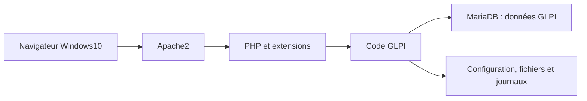

# Module 01 — Présenter l’environnement et installer GLPI

GLPI relie un inventaire informatique à un centre de services. Une panne peut ainsi être rattachée à un ordinateur, à son utilisateur, à ses logiciels et à son historique. Le support présente **Gestion Libre de Parc Informatique** comme une application ITSM, conforme aux pratiques ITIL, libre sous GPL, multilingue et extensible par des plug-ins. Elle peut servir un petit parc comme une organisation répartie sur plusieurs sites.

Le laboratoire de cette séquence reproduit les versions des supports : Debian 10, GLPI 9.5, PHP 7.3 dans le TP et PHP 7.4 dans le diaporama, Windows Server2019, Windows 10 et FusionInventory. Il faut utiliser un ensemble de versions cohérent fourni par le formateur. Voir le [périmètre du laboratoire](index.md).

## Comprendre la chaîne technique

Le navigateur affiche des pages produites par PHP. Apache sert l’application, PHP interprète son code, MariaDB conserve ses données. Apache et PHP doivent pouvoir lire le code, et le compte de connexion à la base doit disposer des droits nécessaires sur la base GLPI. Une page d’accueil Apache accessible ne prouve donc pas que GLPI peut se connecter à MariaDB.



Ce schéma est une aide pédagogique ajoutée au support. Les possibilités évoquées dans le cours sont Apache sous Linux, IIS avec PHP sous Windows, ou Nginx avec PHP. Le TP utilise Apache2.

## Préparer le réseau Olympus

| Élément | Rôle | Réseau de laboratoire |
|---|---|---|
| srv-CD01 | ADDS et DNS du domaine `Olympus.gr` | `192.168.1.1/24` |
| srv-glpi | Application et base de données | `192.168.1.2/24` |
| pfSense | Passerelle entre VMNet18 et réseau de salle | LAN `192.168.1.254/24`, WAN en DHCP |
| Client Windows 10 | Accès utilisateur et tests du domaine | VMNet18, DNS du domaine |

La VM Debian demandée a4 Go de  RAM,1 CPU et40 Go de disque. Elle s’installe d’abord en bridge/DHCP avec l’ISO NetInstall, puis rejoint VMNet18. Seuls le serveur SSH, le bureau graphique et les utilitaires usuels sont demandés. Le serveur Windows crée le domaine sans OU ni utilisateurs supplémentaires à ce stade. Le client Windows rejoint ensuite le domaine.

pfSense utilise FreeBSD64 bits,512 Mo de  RAM,1 CPU et20 Go de disque. Sa première interface reste bridgée/DHCP ; la deuxième rejoint VMNet18. La règle autorisant tous les flux est une consigne de ce laboratoire isolé. Le contrôle préalable porte sur la résolution de `ftp.fr.debian.org` depuis CD01 et son accessibilité depuis Debian. Une panne DNS, de passerelle ou de dépôts doit être réglée avant l’installation de GLPI.

## Installer les composants

Le TP demande `task-web-server`, `mariadb-server` et la série PHP 7.3. Le support théorique cite Apache2.4 et PHP 7.4. Les extensions sont : mysql, mbstring, curl, gd, xml, ldap, xmlrpc, imap, intl, zip, bz2, apcu-bc et cas. Le rôle de LDAP sera utilisé au module 02 ; mysql donne à PHP l’accès au SGBD ; zip/bz2 interviennent pour les archives ; les autres couvrent notamment textes, images, courriels et internationalisation.

Exemple de commande correspondant au TP, après vérification de la disponibilité des paquets dans son dépôt :

```bash
apt update
apt install task-web-server mariadb-server php7.3 php7.3-mysql php7.3-mbstring php7.3-curl php7.3-gd php7.3-xml php7.3-ldap php7.3-xmlrpc php7.3-imap php7.3-intl php7.3-zip php7.3-bz2 php-apcu-bc php-cas
systemctl restart apache2
```

L’assistant `mysql_secure_installation` du support retire les utilisateurs anonymes et la base de test, interdit la connexion distante du compte root et recharge les privilèges. La réponse au changement de mot de passe dépend de la configuration initiale du laboratoire. La suppression des comptes anonymes ne signifie pas que seul root peut exister : le commentaire du diaporama est trop restrictif.

```bash
mysql_secure_installation
mysql -u root -p
```

```sql
CREATE DATABASE glpidata;
SHOW DATABASES;
SHOW GRANTS FOR 'root'@'localhost';
```

Le TP alterne `glpidb` à la création et `glpidata` dans les vérifications. Choisir un nom unique et le reporter dans l’installateur. Le support historique attribue des droits à root ; un compte applicatif dédié est préférable pour distinguer l’administration du SGBD et l’usage de l’application. Son secret est fourni par le formateur et sa syntaxe de création dépend de la version MariaDB. Une commande SQL se termine par `;`.

## Déployer le code et séparer les données

L’archive fournie est transférée par SSH/WinSCP, puis extraite dans `/var/www`. Depuis ce répertoire :

```bash
cd /var/www
tar xvzf glpi-xxxx.tar.gz
rm glpi-xxxx.tar.gz
chown -R root:root /var/www/glpi
mkdir -p /etc/glpi /var/lib/glpi /var/log/glpi
cp -R /var/www/glpi/files/. /var/lib/glpi/
chown -R www-data /etc/glpi /var/www/glpi/files /var/lib/glpi /var/log/glpi /var/www/glpi/marketplace
```

`glpi-xxxx.tar.gz` désigne le nom réel de l’archive. `cp .../.` copie aussi les éventuels fichiers cachés. La solution source comporte `/var/ww` à certains endroits : le chemin visé dans cet environnement est `/var/www`.

Le fichier `/etc/glpi/local_define.php` positionne les données dans `/var/lib/glpi` et les journaux dans `/var/log/glpi`. Il déclare `GLPI_VAR_DIR`, `GLPI_DOC_DIR`, puis les sous-dossiers `_cron`, `_dumps`, `_graphs`, `_lock`, `_pictures`, `_plugins`, `_rss`, `_sessions`, `_tmp`, `_uploads` et `_cache` par leurs constantes respectives. Le fichier `/var/www/glpi/inc/downstream.php` charge cette configuration :

```php
<?php
define('GLPI_CONFIG_DIR', '/etc/glpi/');
if (file_exists(GLPI_CONFIG_DIR . '/local_define.php')) {
    require_once GLPI_CONFIG_DIR . '/local_define.php';
}
?>
```

Les fichiers PHP complets et les valeurs de chaque constante restent dans le TP. Vérifier propriétaire, existence des dossiers et accès en écriture de `www-data` avant de continuer.

## Publier le site du laboratoire et achever l’assistant

Le VirtualHost du support pointe `DocumentRoot` vers `/var/www/glpi`, déclare `ServerName glpi.domaine.tld` et autorise l’accès dans un bloc `Directory`. Adapter le nom au domaine Olympus, activer le site et recharger Apache. Créer dans le DNS du domaine un enregistrement A pour le serveur puis un alias CNAME `glpi` vers ce nom.

```bash
a2ensite glpi.domaine.tld.conf
apache2ctl configtest
systemctl reload apache2
```

Depuis Windows 10, ouvrir `http://glpi.olympus.gr`. Le support passe successivement par langue, installation/mise à jour, vérification des prérequis, serveur SQL `127.0.0.1`, compte SQL, choix/initialisation de la base et fin de l’installation. Les comptes initiaux cités sont `glpi`, `tech`, `normal` et `post-only` : leurs secrets ne sont pas publiés ici. Modifier les mots de passe initiaux, désactiver le fichier d’installation et vérifier le nom d’hôte d’accès.

## Vérifier et expliquer

On attend un nom DNS résolu vers le serveur, une page GLPI fonctionnelle, une base correctement choisie et des dossiers accessibles au service web. Si l’accès par IP fonctionne et celui par nom échoue, commencer par DNS. Si Apache répond mais affiche une erreur GLPI, regarder prérequis PHP, connexion SQL et journaux.

### Mini-quiz

1. Quel composant conserve les utilisateurs et tickets ?
2. Pourquoi tester DNS avant de déployer GLPI ?
3. Quelle incohérence de nom de base figure dans le TP ?

??? success "Réponses"
    1. MariaDB/MySQL conserve les données ; PHP produit les pages.
    2. La résolution conditionne l’accès aux dépôts et au nom du site.
    3. `glpidb` et `glpidata` sont mélangés. Un seul nom doit être retenu dans la réalisation.


## Appliquer ce module

- [Énoncé du TP](../../tp/glpi/module-01/enonces.md)
- [Correction expliquée](../../tp/glpi/module-01/corrections.md)
- [Fiche de révision](../../revision/glpi/module-01-presentation-de-l-environnement-installation-de-glpi.md)
