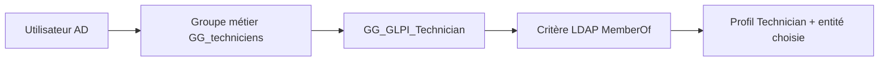

# Module 02 — Authentification AD et habilitations

L’authentification répond à « qui est cet utilisateur ? ». L’habilitation répond à « quels droits possède-t-il, dans quelle partie de l’organisation ? ». Une liaison LDAP qui fonctionne n’accorde donc pas, à elle seule, le bon profil GLPI.

## Objectifs

- Séparer l’entité, le lieu et le profil dans le modèle d’habilitation.
- Raccorder GLPI à LDAP, préparer les groupes et importer les identités du scénario.
- Vérifier les droits et les refus avec des comptes distincts.

## Entités, récursivité et lieux

Une entité segmente l’administration : par exemple une société, ses clients puis leurs filiales. Les objets d’une entité restent cloisonnés, sauf lorsqu’ils sont rendus récursifs. Un fournisseur commun peut être créé dans l’entité supérieure avec visibilité dans ses sous-entités. Un fournisseur local reste dans son entité sans récursivité.

Un lieu décrit une implantation géographique : site, bâtiment, salle. Il sert à positionner matériel et utilisateurs. Il ne remplace pas l’entité, qui règle la portée administrative. Les lieux sont arborescents et exigent une convention de nommage.

Les intitulés constituent le vocabulaire commun : lieux, statuts, fournisseurs, constructeurs, catégories de tickets, logiciels, prises réseau et calendriers. Ils peuvent être des listes plates ou des arbres. Les définir avant la saisie évite les doublons comme « Salle serveur », « salle serveurs » et « Serveur » pour un même lieu.

## Profils et interfaces

| Profil du support | Usage principal |
|---|---|
| Super-Admin | Tous les droits de configuration et d’administration |
| Admin | Administration de l’application |
| Technician | Inventaire et gestion des tickets selon ses droits |
| Hotliner | Saisie et suivi des tickets, avec restrictions d’attribution |
| Observer | Consultation |
| Self-Service | Utilisateur final en interface simplifiée |

L’interface simplifiée donne accès à la création et au suivi de ses tickets, aux réservations et à la FAQ. L’interface standard propose les modules autorisés par le profil et les vues personnelle, groupe et globale. Un profil détermine le type d’interface ainsi que les droits de lecture, mise à jour, création, suppression et purge dans Parc, Assistance, Cycles de vie, Gestion, Outils, Administration et Configuration.

Un même utilisateur peut posséder plusieurs habilitations. Chacune associe **un profil + une entité**, avec une éventuelle récursivité. Il peut être technicien dans une entité et simple demandeur dans une autre. Toujours vérifier le contexte actif lors d’un test. Conserver un compte local de secours avec les droits de configuration : le support avertit qu’un Super-Admin privé de l’interface adéquate peut perdre l’accès à la configuration.

## Connecter l’annuaire

GLPI possède une base de comptes interne. Il peut aussi interroger LDAP, LDAP Active Directory, des comptes POP/IMAP ou utiliser des certificats X509. L’annuaire externe permet une authentification centralisée et alimente les champs GLPI depuis les attributs AD.

Dans **Configuration → Authentification → Annuaires LDAP**, créer l’annuaire, choisir la préconfiguration ActiveDirectory, puis renseigner nom, serveur AD, BaseDN, DN du compte de liaison et secret fourni par le formateur. Les filtres préconfigurés excluent notamment les utilisateurs désactivés.

```text
Serveur : 192.168.1.1
Base DN : DC=olympus,DC=gr
Exemple de DN de liaison :
CN=Administrateur,OU=Administrateurs_AD,OU=Service_info,OU=Les_utilisateurs,OU=_Olympus,DC=olympus,DC=gr
```

Le DN est un chemin LDAP, à lire depuis l’objet vers le domaine. Le relever dans l’éditeur d’attributs AD plutôt que le deviner. Le compte du TP est Administrateur ; ce choix décrit le laboratoire. Un compte de liaison disposant seulement des lectures nécessaires permet de séparer ce rôle de l’administration du domaine. Le fait de fournir un secret ne justifie pas de le publier dans une procédure.

Tester la connexion LDAP, puis distinguer import manuel préalable et import automatique à la première connexion. Vérifier également l’état « actif » et l’annuaire par défaut, que la capture source signale comme non activés automatiquement.

## Construire les droits depuis les groupes AD

La gestion statique consiste à ajouter manuellement les habilitations à chaque utilisateur. Elle est simple pour un essai mais devient difficile à maintenir. Les règles dynamiques font correspondre une appartenance AD à un profil et une entité GLPI.

La méthode du support comporte cinq étapes : identifier les droits ; créer les groupes GLPI dans AD ; affecter les groupes métier/utilisateurs ; créer les règles d’affectation ; vérifier le profil et l’entité après import.



Ce schéma de synthèse est ajouté au support. Une règle d’habilitation possède au minimum les actions **profil** et **entité** ; la récursivité, le refus d’import et d’autres actions peuvent compléter le résultat. Le cours indique que toutes les règles sont lues à la connexion et qu’une règle correspond à une habilitation. Vérifier chaque combinaison et la logique ET/OU des critères.

La condition « contient » sur `(LDAP) MemberOf` est moins stricte qu’une égalité complète au DN. Elle peut aussi accepter des noms voisins : choisir un nom distinct et tester un utilisateur autorisé ainsi qu’un utilisateur qui ne doit pas recevoir le profil. L’imbrication des groupes AD et les attributs réellement remontés doivent être vérifiés dans le laboratoire ; une appartenance souhaitée ne prouve pas qu’elle est visible dans le critère LDAP.

## TP — Mettre en place les habilitations Olympus

1. Dans AD, organiser les utilisateurs, les matériels et les groupes dans les OU du scénario. Créer les groupes globaux de métier et les groupes GLPI, puis reporter les appartenances de l’annexe. Les douze identités ou fonctions sont Zeus, Hephaistos, Artemis, Hera, Hermes, Apollon, Aphrodite, Ares, Athena, le compte du stagiaire, Poseidon et Dionysos.
2. Dans GLPI, créer les lieux demandés et un administrateur local nominatif. Tester ce compte avant de désactiver les comptes d’exemple. Préparer une matrice avec le groupe AD, le profil GLPI, l’entité et le lieu attendus.
3. Dans **Configuration → Authentification → Annuaires LDAP**, déclarer le contrôleur et la base de recherche du laboratoire. Tester d’abord la connexion à l’annuaire, puis vérifier que l’utilisateur recherché est visible dans la bonne OU. Saisir le secret de liaison uniquement dans l’environnement prévu.
4. Créer les règles de profils Observer, Super-Admin, Technician et Hotliner selon l’annexe. Le critère s’appuie sur l’appartenance LDAP, puis les actions affectent le profil et l’entité. Les variantes de graphie du support se vérifient dans la liste des profils de la version installée.
5. Importer les utilisateurs et groupes, affecter les lieux, puis désactiver les comptes `normal`, `post-only` et `tech` comme demandé. Conserver l’accès administrateur local vérifié à l’étape 2.

| Essai | Vérification |
| --- | --- |
| Un utilisateur du groupe de techniciens | Le profil Technician et l’entité sont ceux de la règle. |
| Un utilisateur autorisé à consulter | Il voit les objets attendus et ne reçoit pas des actions de modification qui dépassent son profil. |
| Un utilisateur hors du groupe ciblé | La règle ne lui attribue pas le profil testé. |
| Administrateur local | L’accès de configuration fonctionne même si la liaison LDAP ne fonctionne plus. |

Noter le profil actif et une action réussie ou refusée pour chaque essai. Si l’import fonctionne mais le profil est incorrect, vérifier le DN réellement remonté, l’appartenance effective et le critère de règle avant de modifier le compte.

## À retenir

Le raccordement LDAP identifie l’utilisateur. Les règles déterminent le profil et l’entité. Le lieu renseigne la localisation. Une connexion réussie ne suffit pas à valider l’habilitation.

## Mini-quiz

1. Un lieu peut-il remplacer une entité pour isoler les droits ?
2. Quels sont les deux éléments indispensables d’une habilitation ?
3. Pourquoi garder un administrateur local ?
4. Quel test permet de repérer un critère `MemberOf` trop large ?
5. Quelles preuves ajouter après une connexion réussie ?

??? success "Réponses commentées"
    1. Non : lieu géographique et portée administrative ont des fonctions différentes.
    2. Un profil et une entité ; la récursivité est une option.
    3. Pour conserver un accès de configuration si l’annuaire ou les règles ne fonctionnent plus.
    4. Tester aussi un compte dont le groupe porte un nom voisin. Le profil ciblé doit être attribué uniquement au groupe prévu.
    5. Relever le profil et l’entité actifs, puis essayer au moins une action attendue et une action qui doit être refusée.

## Appliquer ce module

- [Énoncé du TP](../../tp/glpi/module-02/enonces.md)
- [Correction expliquée](../../tp/glpi/module-02/corrections.md)
- [Fiche de révision](../../revision/glpi/module-02-authentification-ad-habilitations.md)
