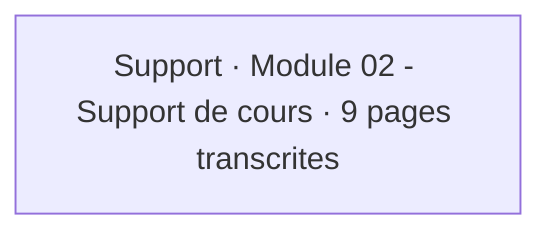
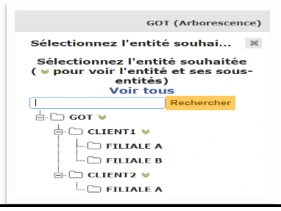
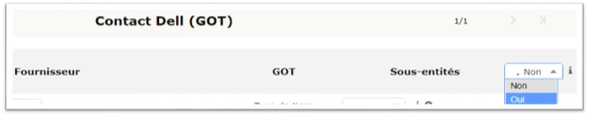
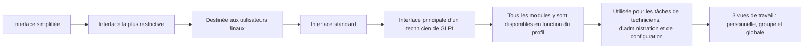
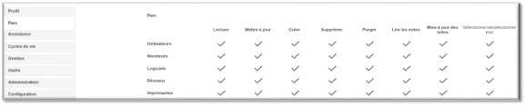
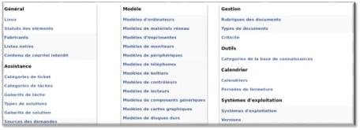
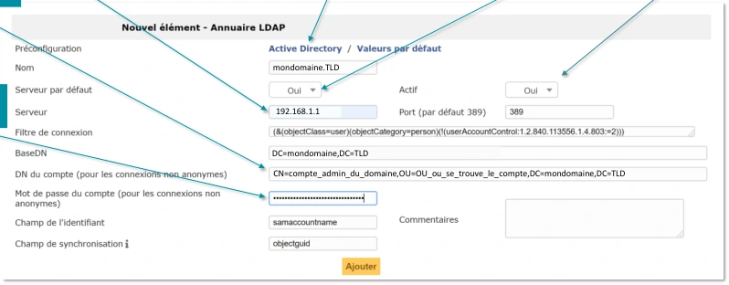
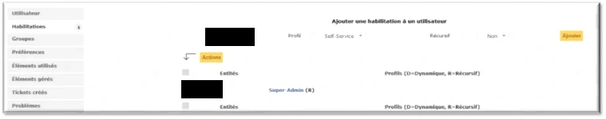

# Module 02 — Authentification AD et habilitations

[Travaux pratiques](../../tp/glpi/module-02/index.md)

Les parties ci-dessous reprennent le cours original, dans le même ordre. Les encadrés et les schémas répètent ses formulations.

## Parcours de lecture

1. Support · Module 02 - Support de cours · 9 pages transcrites

**Visuel externe**



SOURCE DRIVE · TRANSCRIPTION DU SUPPORT

Le contenu des documents du dossier TSSR est transcrit ci-dessous, page par page. Les textes et tableaux sont intégrés à la page Web. Aucun fichier PDF, aucune diapositive entière ni aucune reproduction de page n’est affiché. Seuls des croquis ou visuels isolés et vérifiés peuvent accompagner la transcription. Les versions et les consignes restent celles des supports de formation. Les compléments IA sont conservés dans leur onglet distinct.

## Support · Module 02 - Support de cours · 9 pages transcrites

#### Administration GLPI

#### Module 02 – Authentification AD - Habilitations

#### Objectifs

!!! note "À retenir"
    Les entités dans GLPI et la visibilité des items par récursivité Les interfaces de GLPI et les profils des utilisateurs Les intitulés et les lieux : la nomenclature de GLPI Création d’un compte local à GLPI Ajout d’une source externe d’identification (Active Directory) Gérer les habilitations des utilisateurs

**Visuel externe**


- Les entités dans GLPI et la visibilité des items par récursivité
- Les interfaces de GLPI et les profils des utilisateurs

- Les intitulés et les lieux : la nomenclature de GLPI
- Création d’un compte local à GLPI
- Ajout d’une source externe d’identification (Active Directory)
- Gérer les habilitations des utilisateurs

#### Les entités GLPI

!!! note "À retenir"
    Notion clé dans GLPI Permet de segmenter les domaines d’administration de l’application Intéressant pour une entreprise dont la gestion est hiérarchique Cloisonnement étanche entre les entités, sauf en cas de récursivité Cas d’une société gérant plusieurs clients avec filiales : une entité par client

**Visuel externe**


- Notion clé dans GLPI
- Permet de segmenter les domaines d’administration de l’application
- Intéressant pour une entreprise dont la gestion est hiérarchique
- Cloisonnement étanche entre les entités, sauf en cas de récursivité

- Cas d’une société gérant plusieurs clients avec filiales : une entité par client

#### Filiale A

#### Client1

#### Filiale B

#### Société

#### Client2 Filiale A

#### La récursivité

**Visuel externe**


- Consiste à rendre visible un objet dans les sous-entités
- Permet de traiter la problématique des objets globaux et locaux

- Exemple d’utilisation : un objet de type fournisseur
- Un fournisseur global à toutes les entités sera déclaré dans l’entité la plus haute avec l’option de récursivité
- Un fournisseur local ne sera déclaré que dans l’entité à laquelle il se rattache, sans option de récursivité



Visuel isolé — Module 02 - Support de cours



Visuel isolé — Module 02 - Support de cours

#### Les interfaces

**Visuel externe**



- Interface simplifiée
- Interface la plus restrictive
- Destinée aux utilisateurs finaux
- Permet de créer un ticket, suivre ses tickets, accéder aux réservations et à la FAQ
- Interface standard
- Interface principale d’un technicien de GLPI
- Tous les modules y sont disponibles en fonction du profil
- Utilisée pour les tâches de techniciens, d’administration et de configuration
- 3 vues de travail : personnelle, groupe et globale

#### Les profils GLPI

- Détermine le type d’interface (standard ou simplifiée)
- Détermine les droits sur l’application

- Propre à une entité : récursivité possible
- Plusieurs profils possibles pour un même utilisateur
- Plusieurs profils prédéfinis :
- Super-Admin : tous les droits sur GLPI (profil de l’utilisateur GLPI)
- Admin : tous les droits d’administration
- Technician : accès en lecture à l’inventaire et à la gestion de ticket
- Hotliner : saisi et suivi de ticket, mais pas d’en être attribué
- Observer : accès en lecture à l’inventaire et à la gestion
- Self-Service : profil par défaut, interface simplifiée, permet de créer un ticket, suivre ses tickets, accéder aux réservations et à la FAQ

Attention, si le profil super-admin est supprimé ou s’il est configuré avec l’interface simplifiée, vous ne pourrez plus configurer GLPI.

#### La création de profils dans GLPI

- On peut donner des droits sur différentes fonctionnalités :
- Parc – gestion de l’inventaire
- Assistance – gestion des tickets
- Cycles de vie – gestion du suivi des tickets
- Gestion – gestion des licences, fournisseurs, budgets…
- Outils – gestion des rapports, de la base de connaissance, des projets, des tâches…
- Administration – gestion des différentes règles d’automatisation, des entités, des groupes…
- Configuration – gestion de la configuration globale de GLPI, les lieux, les intitulés, les calendriers...

- Il existe différents droits :
- Lecture
- Mettre à jour
- Créer
- Supprimer
- Purger
- …

#### Les intitulés

- Deux formats :
- Liste de valeurs à plat
- Liste de valeurs arborescente : hiérarchie entre les intitulés
- Il existe une liste par défaut, mais beaucoup de listes propres à GLPI sont paramétrables :

- Les lieux
- Les statuts de matériels
- Les fournisseurs
- Les constructeurs
- Les catégories de tickets
- Les noms de logiciels
- Les prises réseau
- Les calendriers
- …



Visuel isolé — Module 02 - Support de cours



Visuel isolé — Module 02 - Support de cours

#### Les lieux

!!! note "À retenir"
    Ils permettent de placer géographiquement les différents éléments d’inventaire et les utilisateurs Liste de valeurs arborescente Une convention de nommage est OBLIGATOIRE

!!! warning "Attention"
    Ils permettent de placer géographiquement les différents éléments d’inventaire et les utilisateurs Liste de valeurs arborescente Une convention de nommage est OBLIGATOIRE

- Ils permettent de placer géographiquement les différents éléments d’inventaire et les utilisateurs
- Liste de valeurs arborescente
- Une convention de nommage est OBLIGATOIRE

#### Authentification AD

!!! note "À retenir"
    Attention, ne pas confondre les lieux et les entités.

!!! warning "Attention"
    Attention, ne pas confondre les lieux et les entités.

Attention, ne pas confondre les lieux et les entités.

Les noms de sites du centre de formation présents dans les captures ne sont pas reproduits ; leur fonction est d’illustrer une arborescence géographique.

#### Les utilisateurs – Base de comptes

- Base de comptes interne à GLPI : stockée dans la base de données

- Base de compte externe : authentification dynamique et centralisée

- LDAP
- LDAP Active Directory
- Messagerie : comptes pop/imap
- Certificats X509

- Base de compte externe : nécessite l’ajout d’un serveur d’authentification

- Import manuel possible des utilisateurs en amont

- Import automatique de l’utilisateur à la première connexion

- Champs utilisateur GLPI automatiquement alimentés depuis les attributs AD

#### Serveur d'authentification Active Directory

- Configuration => Authentification => Annuaires LDAP => +

- Choisir la préconfiguration ActiveDirectory

- Configuration automatique d’un filtre d’exclusion des utilisateurs désactivés

- Configuration obligatoire :

- Nom
- @ip du serveur AD
- Base DN : DistinguishedName du domaine au format :

- DC=mondomaine,DC=monTLD
- DN du compte : DistinguishedName du compte utilisé par GLPI auprès du contrôleur de domaine pour l’interroger (au minimum, un compte administrateur du domaine) au format :

- CN=administrateur,OU=administrateurs,OU,service_Active_Directory,OU=service_informatique,OU= les_utilisateurs,OU=_monentreprise,DC=mondomaine,DC=monTLD
- Mot de passe du compte précédemment renseigné

#### Authentification AD - Habilitations Serveur d'authentification Active Directory

#### Attention : Non

actif par défaut @IP du serveur

#### À cliquer pour avoir

#### ADDS

#### Attention : Non par défaut

les bons filtres

Info dans l’éditeur d’attribut ADDS du

```
compte
```

mondomaine.TLD

#### 192.168.1.1

#### Mot de passe de l’admin du domaine

#### DC=mondomaine,DC=TLD

#### CN=compte_admin_du_domaine,OU=OU_ou_se_trouve_le_compte,DC=mondomaine,DC=TLD

#### Les habilitations

- Vont déterminer les droits et leurs portées dont dispose un utilisateur
- Une habilitation est composée d’un profil (droits) et d’une entité

- Récursivité sur les entités enfants possible
- Plusieurs habilitations possibles pour un même utilisateur
- Se gèrent de manière statique ou dynamique à l’aide de règle d’habilitation



Visuel isolé — Module 02 - Support de cours

#### Les habilitations statiques

!!! note "À retenir"
    Ajout manuel depuis l’application GLPI Aucune centralisation de la gestion des droits Maintenance compliquée / risque d’erreurs accru S’ajoutent pour chaque utilisateur

- Ajout manuel depuis l’application GLPI
- Aucune centralisation de la gestion des droits
- Maintenance compliquée / risque d’erreurs accru
- S’ajoutent pour chaque utilisateur

#### Les habilitations dynamiques

- Attribution automatique d’habilitations
- Utilisation des « règles d’affectation d’habilitations à un utilisateur »

- Toutes les règles sont lues à chaque connexion d’un utilisateur
- L’ordre de création n’a pas d’importance
- Une règle pour une habilitation
- Les critères : globaux internes GLPI ou LDAP
- Les actions : un profil, une entité, récursivité, refus d’import, etc.



Visuel isolé — Module 02 - Support de cours

#### Les habilitations dynamiques - Critères - Actions

- Les critères :
- Gestion des droits GLPI centralisée dans l’Active Directory
- Utilisation d’appartenance à des groupes AD
- Critère « (LDAP) MemberOf »
- Utilisation de la condition « Contient », moins contraignante que « est »
- Les actions :
- Deux actions minimum pour constituer une habilitation
- Sont exécutées si le(s) critère(s) sont vérifiés
- Comportement en fonction de l’opérateur logique (ET/OU)

#### Les habilitations – Mise en œuvre

#### 4 Création des règles

#### 5 Vérification

Identification des différents droits des

d’affectation d’habilitations à un

Création des groupes AD pour les

utilisateurs.

utilisateur.

Exemple : vérifier le

habilitations.

#### Création des utilisateurs AD, assignation des groupes en fonction

du besoin.

Exemple : un technicien sur

Exemple : critère membre de

l’entité du client

#### GG_GLPI_technician

profil et l’entité des techniciens après import

#### Exemple : groupe global GG_GLPI_technician

pour le profil

dans GLPI

```
technician
```

#### Exemple : GG_technicien dans GG_GLPI_technician

action profil technician

entité client

!!! note "À retenir"
    Référence du document : 1cksNrO_IqX1i2ytZUujL-VyNtaXAM75Q · SHA-256 1b131977058f7c60…

Référence du document : 1cksNrO_IqX1i2ytZUujL-VyNtaXAM75Q · SHA-256 1b131977058f7c60…
