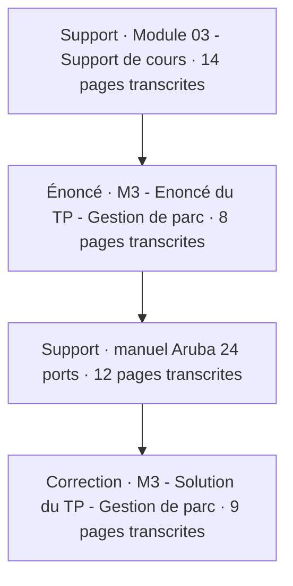
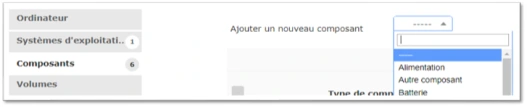
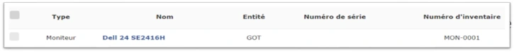
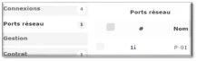
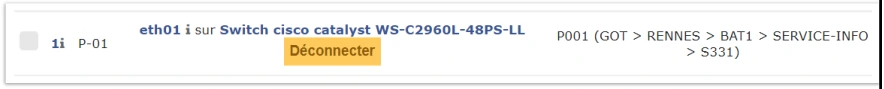
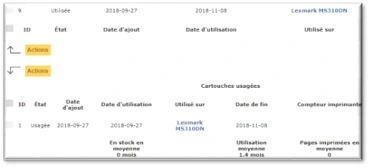
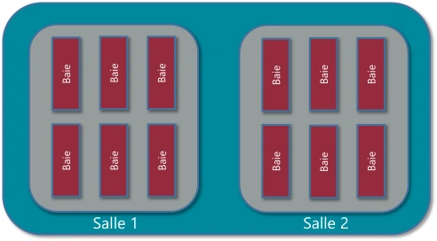
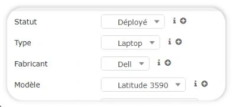

# Module 03 — Gestion de parc et inventaire informatique

Les parties ci-dessous reprennent le cours original, dans le même ordre. Les encadrés et les schémas répètent ses formulations.

## Parcours de lecture

1. Support · Module 03 - Support de cours · 14 pages transcrites
2. Énoncé · M3 - Enoncé du TP - Gestion de parc · 8 pages transcrites
3. Support · manuel Aruba 24 ports · 12 pages transcrites
4. Correction · M3 - Solution du TP - Gestion de parc · 9 pages transcrites

**Visuel externe**

SOURCE DRIVE · TRANSCRIPTION DU SUPPORT

Le contenu des documents du dossier TSSR est transcrit ci-dessous, page par page. Les textes et tableaux sont intégrés à la page Web. Aucun fichier PDF, aucune diapositive entière ni aucune reproduction de page n’est affiché. Seuls des croquis ou visuels isolés et vérifiés peuvent accompagner la transcription. Les versions et les consignes restent celles des supports de formation. Les compléments IA sont conservés dans leur onglet distinct.

## Support · Module 03 - Support de cours · 14 pages transcrites

#### Administration GLPI

#### Module 03 – Gestion de parc – Inventaire informatique

#### Objectifs

!!! note "À retenir"
    Découvrir la notion d’inventaire dans GLPI L’importance d’un plan de nommage L’ordinateur, un assemblage de composants Le logiciel, un item qui associe une licence Connecter un équipement au réseau Gérer les consommables avec GLPI Création d’un gabarit d’inventaire

**Visuel externe**

- Découvrir la notion d’inventaire dans GLPI
- L’importance d’un plan de nommage

- L’ordinateur, un assemblage de composants
- Le logiciel, un item qui associe une licence
- Connecter un équipement au réseau
- Gérer les consommables avec GLPI
- Création d’un gabarit d’inventaire

#### Les éléments d'inventaire

#### Fonctionnalités gestion de parc

#### Inventaire matériel

#### Composants internes

Vue détaillée, connexions, etc.

#### Composants et cartographie réseau

#### Historique sur les éléments

#### Cycle de vie des matériels

#### Systèmes d’exploitation

#### Réservation de matériel

#### Informations administratives et financières

#### Logiciels et licences

#### Élaborer un plan de nommage

!!! note "À retenir"
    Un plan de nommage est une nomenclature Définir l’information importante pour retrouver un item

- Un plan de nommage est une nomenclature
- Définir l’information importante pour retrouver un item

#### Date achat Index

#### Type Service Organisation

#### PC DIR 202203 012

#### Ordinateur fixe Direction Mars 2022 N° 012

#### Élément ordinateur

!!! note "À retenir"
    Se gèrent depuis le menu Parc => ordinateurs Utilisables pour les ordinateurs fixes, portables, serveurs, etc.

**Visuel externe**

- Se gèrent depuis le menu Parc => ordinateurs
- Utilisables pour les ordinateurs fixes, portables, serveurs, etc.

- Champ « type » très important pour les différencier
- Utilisation possible des gabarits
- Utilisation possible d’un outil d’inventaire automatique

| Type | Service Organisation | Date achat | Index |
| --- | --- | --- | --- |
| PC | DIR | 202203 | 012 |
| Ordinateur fixe | Direction | Mars 2022 | N° 012 |

#### Ordinateur : composants

!!! note "À retenir"
    Ne sont pas des intitulés Doivent être créés depuis configuration => composants Sont caractérisés par plusieurs champs qui eux sont des intitulés La liste des différents composants est fixe Peuvent être gérés dynamiquement par un outil d’inventaire Portée limitée à l’entité de création, récursivité possible

**Visuel externe**

- Ne sont pas des intitulés
- Doivent être créés depuis configuration => composants
- Sont caractérisés par plusieurs champs qui eux sont des intitulés
- La liste des différents composants est fixe

- Peuvent être gérés dynamiquement par un outil d’inventaire
- Portée limitée à l’entité de création, récursivité possible

#### Ordinateur : logiciels

**Visuel externe**

- Gérer quels sont les logiciels installés sur l’ordinateur
- Triés par catégories et caractérisés par un nom, leur version et le statut

- Possibilité de choisir la catégorie à afficher
- Possibilité de définir si une licence a été installée sur le poste

Visuel isolé — Module 03 - Support de cours

Visuel isolé — Module 03 - Support de cours

#### Ordinateur : logiciels

#### Créer une catégorie

#### À partir du logiciel,

Créer les licences.

de logiciel.

#### Créer le logiciel. Exemple : Office

créer la version.

#### Renseigner le nombre,

#### Associer ce logiciel

le logiciel et l’éditeur.

#### Exemple : bureautique

#### Exemple : 365 ProPlus

à un éditeur et à une catégorie.

#### Puis affecter la licence

#### Renseigner le système

à un ordinateur.

d’exploitation.

#### Ordinateur : connexion

!!! note "À retenir"
    Va permettre de gérer les connexions directes avec d’autres éléments Représentation de la liaison physique (USB, série, HDMI…) entre un ordinateur et un autre élément Connexion possible : imprimantes, périphériques, moniteurs et téléphones Visuel isolé — Module 03 - Support de cours

- Va permettre de gérer les connexions directes avec d’autres éléments
- Représentation de la liaison physique (USB, série, HDMI…) entre un ordinateur et un autre élément
- Connexion possible : imprimantes, périphériques, moniteurs et téléphones

Visuel isolé — Module 03 - Support de cours

#### Ordinateur : port réseau

!!! note "À retenir"
    Connexions réseau entre les différents éléments Modélisation de la sortie d’une interface réseau sur un élément matériel Plusieurs types : Ethernet, wifi, fibre, agrégation, etc.

- Connexions réseau entre les différents éléments
- Modélisation de la sortie d’une interface réseau sur un élément matériel
- Plusieurs types : Ethernet, wifi, fibre, agrégation, etc.
- L’ajout de plusieurs ports en même temps est possible
- Il est caractérisé par un nom et un numéro (convention de nommage)
- Peut être associé à un composant de type carte réseau
- Information réseau (@IP, domaine, nom et vlan)

#### Ordinateur : connexion d'un port réseau

- Connecter les ports réseau des éléments va permettre une représentation physique de tout son réseau
- Connexion réseau possible à tout autre élément disposant d’un port réseau
- Le raccordement préalable à une prise réseau pourra être renseigné
- Les intitulés « prises réseau » seront associés à un lieu

Le port réseau « 1 » de mon ordinateur est raccordé à la prise « p001 » en S331 qui ensuite est raccordée au port réseau « eth01 » d’un switch cisco

Visuel isolé — Module 03 - Support de cours

Visuel isolé — Module 03 - Support de cours

#### Ordinateur : les autres onglets Gestion de parc – Inventaire informatique

!!! note "À retenir"
    Système d’exploitation Contrats Volumes Virtualisation Antivirus Liens externes Certificats

- Système d’exploitation
- Contrats
- Volumes
- Virtualisation

- Antivirus
- Liens externes
- Certificats

#### Élément moniteur

!!! note "À retenir"
    Informations de gestion de l’élément (responsable, statut, lieu, etc.) Caractéristiques générales (fabricant, modèle, type, etc.) Usagers du moniteur (connu ou non, groupes, etc.) Spécifications techniques (taille, connectiques, etc.) Son type de gestion : globale ou unitaire

- Informations de gestion de l’élément (responsable, statut, lieu, etc.)
- Caractéristiques générales (fabricant, modèle, type, etc.)

- Usagers du moniteur (connu ou non, groupes, etc.)
- Spécifications techniques (taille, connectiques, etc.)
- Son type de gestion : globale ou unitaire

#### Élément matériel réseau

- Permettre la représentation de tout matériel qui gère, transmet et route le réseau entre plusieurs autres éléments matériels
- Ils devront être différenciables par l’intitulé type
- Switch, routeur, firewall, borne wifi, etc.
- Utilisation possible d’un gabarit
- Grand nombre de paramètres communs aux autres éléments
- Ports réseau importants pour les connexions réseau avec les autres éléments

#### Élément imprimante

- Représenter toutes les imprimantes présentes sur le parc informatique
- Utilisation possible d’un gabarit

- Champs : caractéristiques générales, gestion, usagers et spécifications
- Gestion unitaire ou globale
- Connexion directe ou réseau
- Gestion des cartouches installées

#### Élément cartouches et consommables

- Définitions des modèles
- Importation en masse
- Modèles d’imprimantes compatibles
- Installation sur les imprimantes

- Fin de vie des cartouches
- Seuils d’alerte (avec supervision)

Fiche GLPI de suivi des cartouches et consommables.

#### Gérer les cartouches

1. Créer un modèle d’imprimante. Exemple : imprimante USB HP
2. Créer un modèle de cartouche. Exemple : Cart-impr-HP.Puis associer le modèle de cartouche à votre modèle d’imprimante.
3. Ajouter des cartouches à votre modèle. Exemple : 50 cartouches neuves
4. Installer la ou les cartouches sur votre imprimante.L’imprimante doit être du même modèle d’imprimante que les cartouches.

de cartouche.

#### Ajouter des cartouches à votre

#### Installer la ou les cartouches sur votre

modèle.

imprimante.

Exemple : Cart-impr-HP.

#### Exemple : imprimante USB HP

#### L’imprimante doit

#### Exemple : 50 cartouches neuves

#### Puis associer le modèle de cartouche

#### être du même modèle d’imprimante

#### à votre modèle

que les cartouches.

d’imprimante.

#### Élément téléphones

- Fixe, portable, combiné
- Spécifications
- Usagers
- Gestion des composants

- Connexion directe et réseau
- Associable à un ticket

#### Élément périphérique

- Tout ce qui n’est pas implémenté nativement dans GLPI
- Connexion directe et réseau

- Réservation possible
- Usagers
- Associable à un ticket

#### Élément centre de données

#### Datacenter

- Représentation de ses centres de données (Datacenters)
- Salles serveur
- Baie
- Équipements

- Onduleurs (PDU)

Le datacenter comprend la salle 1 et la salle 2, chacune équipée de six baies.

#### Réservations

- Un grand nombre d’éléments peuvent être réservés

| Action | Effet |
| --- | --- |
| Autoriser les réservations | Rendre un élément réservable |
| Rendre indisponible | Plus de nouvelles réservations possibles |
| Rendre disponible | Rétablir la possibilité de réserver |
| Ne pas autoriser | Désactiver les réservations |

#### Les gabarits

#### Le gabarit

- Applicables à plusieurs éléments
- Définition d’un élément standard, généralement identifié par son modèle

- Pré-remplissage de certains champs communs à un même modèle d’élément
- Simplifie l’ajout de plusieurs éléments de même modèle

#### Le gabarit

- Certains champs peuvent bénéficier d’un système d’incrémentation

- Champs identifiables par une baguette

- Le champ est rempli automatiquement selon un format défini

- Format sous la forme <XXX####>

- < et > pour indiquer le début et la fin d’un format à interpréter
- X pour un caractère quelconque fixe
- # pour un numéro à incrémenter. Nombre de chiffres égaux au nombre de #
- \Y pour y inscrire l’année courante sur 4 chiffres
- \y pour l’année sur 2 chiffres
- \m pour le mois
- \d pour le jour

#### Champs récurrents

- Peu importe l’élément d’inventaire, plusieurs champs sont identiques

- Intitulés du champ à créer en amont ou « sur place »

- Liste des principaux

- Nom
- Lieu
- Statut
- Type
- Fabricant
- Modèle
- Numéro d’inventaire
- Responsable et groupe techniques
- Utilisateur et groupe
- Commentaire

#### Le permet l’ajout d’un intitulé sans quitter la fiche de l’élément

Visuel isolé — Module 03 - Support de cours

Visuel isolé — Module 03 - Support de cours

#### Les différentes étapes

#### Étapes de création d'un Datacenter

#### Créer un centre de

#### Créer le matériel avec

données.

#### Créer une salle serveur dans votre

#### Créer la baie dans votre salle serveur

#### datacenter

les images dans le modèle de matériel.

Exemple : Datacenter L.A.

#### Puis indiquer la taille

#### puis indiquer le nombre d’unités

#### de l’emplacement

pour la baie.

Exemple :

#### 42 U

#### Exemple : 2 colonnes 2 lignes

Référence du document : 1Ci7GWLBZUihaVY53DsWJsEjUMhxR4-pS · SHA-256 a55480ff5ee77200…

## Énoncé · M3 - Enoncé du TP - Gestion de parc · 8 pages transcrites

#### Gestion de parc

#### TP du Module 3 – Gestion de parc – Inventaire informatique

Avant de démarrer ce TP, il convient d’avoir suivi les vidéos des modules 1 à 3 et d’avoir réalisé les TP proposés.

#### Enoncé

#### Objectifs

- Inventorier son parc informatique Prérequis

- Application GLPI fonctionnelle Contexte

- Le centre de formation vient de recevoir un ensemble de matériel qu’on vous demande d’inventorier Principales tâches à réaliser

Pour toutes les demandes qui suivront, utiliser si possible des gabarits.

#### Création d’un centre de données (Datacenter)

- Datacenter dans « la salle des trésors » nommé « Olympus datacenter ».

- Créez la salle serveur avec deux emplacements de baies (1 ligne et 1 colonne) nommée « Salle serveur 1 ».

#### Création de 2 serveurs Proliant DL380 GEN

- Créez un gabarit nommé « GAB-Proliant-DL380-GEN »

- Nom « Proliant-DL380-GEN », mais avec incrémentation à quatre chiffres.

- Lieu : créez une « salle de stock »et une « salle serveur » dans la salle des

trésors puis affecter le gabarit dans cette salle.

- Créez un statut « en stock » pour ce gabarit.

- Créez un type « Rack » pour ce gabarit.

- Créez le fabricant « HP » pour ce gabarit.

- Créez le modèle « Proliant-DL380 » pour ce gabarit :

- 15 kilos.

- 2 Unités.

- 2 alimentations.

- Ajouter les images « HP DL 380 Gen avant.png » et « HP DL 380 Gen arrière.png » fournies par le formateur.

- Créez 1 port réseau :

- Numéro 0.

- Nom « Port- ».

- Type de port « RJ45 ».

- Vitesse 10 Gbit/s.

- Créez 8 ports réseau :

- Numéro 1 à 8.

- Nom « Port- ».

- Type de port « RJ45 ».

- Vitesse 1Gbit/s.

- Créez le système d’exploitation « HPE iLO » pour ce gabarit et Architecture 64 bits.

- Créez deux processeurs pour ce gabarit :

- Fabricant « Intel ».

- Fréquence à 3.9 GHz.

- 28 cœurs.

- Créez 6To (12 fois 512 Go) de mémoire pour ce gabarit :

- Fabricant « HP ».

- Fréquence « 2666 MHz ».

- Type « DDR4 ».

- Modèle « HPE ».

#### Création d’une baie

- Créez un gabarit nommé « GAB-Baie-HPE ».

- Nom « Baie-HPE-1 ».

- Lieu « salle serveur ».

- Salle serveur « Salle serveur 1 ».

- Orientation de la porte « Nord ».

- Nombre d’unités « 42U ».

- Fabricant « HP ».

- Modèle « G2 Enterprise Pallet Rack ».

- Type « 42U Rack ».

- Statut « En stock ».

- Largeur « 59.78cm ».

- Hauteur « 200.66 cm ».

- Profondeur « 112.52 cm ».

- Poids max « 1361 kg ».

- Couleur d’arrière-plan « noir ».

- Ajoutez la baie.

- Position « colonne A, ligne 1 ».

- Statut « en place ».

- Ajoutez les serveurs « Proliant-DL380-GEN-0001-0002 » dans la baie sur les U41-42 pour le 0001 et U16-17 pour le 0002.

#### Création d’un PDU

- Créez un gabarit nommé « GAB-PDU-HPE-G2-3.6kva ».

- Lieu « salle de stock ».

- Statut « En stock ».

- Type « HPE-G2-Horizontale ».

- Fabricant « HP ».

- Modèle « PDU-HPE-G2-3.6kVA ».

- Poids « 3.9kg ».

- Unités requises « 1 U ».

- Profondeur « 1 ».

- Connexions d’alimentation « 8 ».

- Puissance max. « 4 ».

- Commentaires « 3,6 kVA ».

- Ajoutez les images « PDU G2 Avant.png » et « PDU G2 Arriere.png »

fournies par le formateur.

- Créez 2 PDU « PDU-HPE-G2-3.6kva-1 et -2 ».

- Ajoutez les 2 PDU -1 en U30 et -2 en U15-42 dans la baie avec le statut « En place » et le lieu « salle serveur ».

#### Création des commutateurs

- Créez un gabarit nommé « GAB-JL356A-ARUBA-2540-48P » .

- Nom « JL356A-ARUBA-2540-48P », mais avec incrémentation à quatre

chiffres.

- Statut « En stock ».

- Type « Switch-48P ».

- Lieu « Salle de stock ».

- 4 ports 0 à 3.

- Nom « Port- ».

- Vitesse « 100 Gbit/s ».

- Type « RJ45 ».

- 44 ports 4 à 47.

- Nom « Port- ».

- Vitesse « 10 Gbit/s ».

- Type « RJ45 ».

- Modèle « Switch-JL356A-48P ».

- Nom « Switch-JL356A-aruba-48P ».

- Poids « 4 kg ».

- Unités requises « 1 ».

- Puissance consommée « 459 Watts ».

- Ajoutez l’image « JL356A-aruba-48P-Avant.png » fournie par le formateur.

- Créez 4 « JL356A-ARUBA-2540-48P-0001, 0002, 0003 et 0004 ».

- Ajoutez les Switchs 0001 en U40, 0002 en U29 et 0003 en U14 dans la baie avec le statut « En place » et le lieu « salle serveur ».

- Créez un gabarit nommé « GAB-JL356A-ARUBA-2540-24P » .

- Nom « JL356A-ARUBA-2540-24P », mais avec incrémentation à quatre

chiffres.

- Statut « En stock ».

- Type « Switch-24P ».

- Lieu « Salle de stock ».

- 4 ports 0 et 3.

- Nom « Port- ».

- Vitesse « 10 Gbit/s ».

- Type « RJ45 ».

- 20 ports 4 à 23.

- Nom « Port- ».

- Vitesse « 1 Gbit/s ».

- Type « RJ45 ».

- Modèle « Switch-JL356A-24P ».

- Nom « Switch-JL356A-aruba-24P ».

- Poids « 4 kg ».

- Unités requises « 1 ».

- Puissance consommée « 370 Watts ».

- Ajoutez l’image « JL356A-aruba-24P-Avant.png » fournie par le formateur.

- Ajoutez le fichier « manuel Aruba 24 ports.pdf » du manuel en document dans

la rubrique Manuel.

- Créez 6 « JL356A-ARUBA-2540-24P-0001 à 0006 ».

- Ajoutez le switch « JL356A-ARUBA-2540-24P-0001 » et le « JL356A-ARUBA-2540-24P- 0002 » dans le lieu « Temple de Zeus » avec le statut « En place ».

- Ajoutez le switch « JL356A-ARUBA-2540-24P-0003 » dans le lieu « Salle des trésors » avec le statut « En place ».

- Ajoutez le switch « JL356A-ARUBA-2540-24P-0004 » dans le lieu « Temple d’Héra » avec le statut « En place ».

- Ajoutez le switch « JL356A-ARUBA-2540-24P-0005 » dans le lieu « Hôtellerie » avec le statut « En place ».

- Connectez le port-0001 de « JL356A-ARUBA-2540-24P-0001 » et de « JL356A-ARUBA- 2540-24P-0002 » au port-0001 et port-0002 du switch « JL356A-ARUBA-2540-48P-0001 ».

- Connectez le port-0001 de « JL356A-ARUBA-2540-24P-0003 » et de « JL356A-ARUBA- 2540-24P-0004 » au port-0001 et port-0002 du switch « JL356A-ARUBA-2540-48P-0002 ».

- Connectez le port-0001 de « JL356A-ARUBA-2540-24P-0005 » au port-0001 du switch « JL356A-ARUBA-2540-48P-0003 ».

#### Création d’ordinateurs

- Créez un gabarit nommé « GAB-Alienware-M17 »

- Nom « Alienware-M17 », mais avec incrémentation à trois chiffres.

- Lieu « salle de stock ».

- Statut « en stock ».

- Créez un type « Portable » pour ce gabarit.

- Créez le fabricant « DELL » pour ce gabarit.

- Créez le modèle « Alienware-M17 » pour ce gabarit :

- 3 kilos.

- 250 Watts.

- Avec les composants :

- 1 processeur « I7-10750H » pour ce gabarit.

- Fabricant « Intel ».

- Fréquence par défaut « 2.6 MHz ».

- Fréquence « 5 GHz ».

- Six cœurs et douze threads.

- Modèle « 10750H ».

- 1 carte réseau « RJ45-Killer-E3000 » pour ce gabarit.

- Fabricant « Killer Networking ».

- Débit « 10/100/1000 ».

- Modèle « E3000 ».

- 1 carte réseau « Killer-WIFI-6-AX1650 ».

- Fabricant « Killer Networking ».

- Débit « 2.4 Gbit/s ».

- Modèle « AX1650 »

- 1 carte graphique « GeForce-RTX-2070 ».

- Fabricant « Nvidia ».

- Mémoire « 8096 Mio ».

- Interface « PCIe ».

- Modèle « RTX-2070 ».

- 2 disques durs « SSD-PCIe-M2 » et 1 volume pour la taille totale de chaque

disque C : et D :.

- Fabricant « Intel ».

- Capacité « 488281 Mio ».

- Interface « PCIe ».

- 2 barrettes de mémoires « Corsaire-8Go-2666 ».

- Fabricant « Corsair ».

- Taille « 7629Mio ».

- Fréquence « 2666 ».

- Type « DDR4 ».

- Créez 1 port réseau Ethernet pour ce gabarit.

- Numéro 0.

- Nom « Port- ».

- Type de port « RJ45 ».

- Vitesse 1 Gbit/s.

- Carte réseau « RJ45-Killer-E3000 ».

- Créez 1 port réseau WIFI pour ce gabarit.

- Numéro 0.

- Nom « Port- ».

- Carte réseau « Killer-WIFI-6-AX1650 ».

- Mode WIFI « Géré ».

- Version du protocole « a/b/g/n/y ».

- Créez le système d’exploitation « Windows 10 » pour ce gabarit.

- Architecture « 64 bits. ».

- Noyau « Hybride ».

- Version « 20H2 ».

- Edition « PRO ».

- Créez un logiciel « Office365-ProPlus ».

- Éditeur « Microsoft ».

- Catégorie « Bureautique ».

- Version « ProPlus ».

- Créez 60 licences « Office365-Proplus ».

- Éditeur « Microsoft ».

- Statut « attribué ».

- Type « volume ».

- Version utilisée « ProPlus – en stock ».

- Version d’achat « ProPlus – en stock ».

- Autorisez le dépassement de quota « non ».

- Installez le logiciel « Office365-ProPlus » et affectez une licence sur ce gabarit.

- Créez autant de prise réseau que d’utilisateur dans chaque lieu.

- Nom « Prise-1 », « Prise-2 », etc.

- Quatre en « salle des trésors ».

- Deux à « l’Hôtellerie ».

- Quatre au « Temple d’Héra ».

- Deux au « temple de Zeux ».

- Créez 12 Portables Alienware et affectez chaque ordinateur à un utilisateur d’Olympus.

- Connectez chaque Portable à un port de switch disponible dans le lieu où ils se trouvent

| ▪ | Nom « Port - » . |
| --- | --- |
| ▪ | Type de port« RJ45 » . |
| ▪ | Vitesse 1 Gbit/s . |
| ▪ | Carte réseau « RJ45 -Killer-E3000 » . |
| o Créez1 portréseau WIFI pour ce gabarit . |  |
| ▪ | Numéro0 . |
| ▪ | Nom « Port - » . |
| ▪ | Carte réseau « Killer-WIFI -6 -AX1650 » . |
| ▪ | Mode WIFI « Géré » . |
| ▪ | Version du protocole «a/b/g/n/y » . |
| o Créez lesystème d’exploitation « Windows 10 »pour ce gabarit . |  |
| ▪ | Architecture « 64 bits » . . |
| ▪ | Noyau « Hybride » . |
| ▪ | Version « 20H2 » . |
| ▪ | Edition « PRO » . |
| o Créez un logiciel « Office365 -ProPlus » . |  |
| ▪ | Éditeur «Microsoft » . |
| ▪ | Catégorie« Bureautique » . |
| ▪ | Version « ProPlus » . |
| o Créez 60 licences « Office365 -Proplus » . |  |
| ▪ | Éditeur «Microsoft » . |
| ▪ | Statut « attribué » . |
| ▪ | Type « volume» . |
| ▪ | Version utilisée « ProPlus – en stock » . |
| ▪ | Version d’achat « ProPlus – en stock » . |
| ▪ | Autorisezle dépassement de quota « non » . |
| o Installez le logiciel « Office365 -ProPlus » et affectez une licence sur ce gabarit . |  |
| • | Créezautantde prise réseau que d’utilisateur dans chaque lieu . |
| o Nom « Prise-1 » « Prise-2 » etc , , . |  |
| o Quatre en « salle des trésors » . |  |
| o Deux à « l’Hôtellerie » . |  |
| o Quatre au « Temple d’Héra » . |  |
| o Deux au « temple de Zeux » . |  |

par les prises situées dans ces lieux.

#### Réservation

- Créez deux Portables Alienware supplémentaires et les rendre réservables.

- En réserver un, pour un mois, au nom de Zeus pour ses virées nocturnes sur

terres.

#### Écrans

- Ajoutez deux écrans E 1913 S 19 et en lien un avec un optiplex et un en stock.

#### Imprimantes

- 5 imprimantes Aficio MP C5502AD avec les cartouches et le papier correspondant (1 dans le hall et les autres dans des salles au choix). Vous prévoirez 1 jeu de tonner supplémentaire pour spare ainsi que du papier d’avance.

#### Autre

- 1 BlackBerry Z30 assigné au directeur

- 1 webcam Logitech C920 assignée au Hall

#### Solution

Une solution est proposée pour ce TP sous la forme d'un PDF commenté, disponible dans les ressources à télécharger, accompagnée de captures d’écran pour vous guider.

Référence du document : 1oKmiS_PW5z_o43sc77z9FfvBZX_Yzj0V · SHA-256 f02f9ec4b6695a21…

## Support · manuel Aruba 24 ports · 12 pages transcrites

#### PRODUCT OVERVIEW

Designed for the digital workplace, the Aruba 2540 Switch Series is optimized for mobile users. With advanced security and network management tools—Aruba ClearPass Policy Manager and Aruba AirWave—this layer-2 access switch is easy to deploy and manage. With support from Aruba Central, you can quickly set up remote branch sites with little or no IT support. A powerful Aruba ProVision ASIC delivers performance, robust feature support, and value with flexible programmability for future applications. The Aruba 2540 Switch Series provides a convenient and cost-effective wired access solution that can be quickly set up with Zero Touch Provisioning. PoE+ models deliver power across all access ports for wireless APS, security cameras, and IoT devices. The 2540 has wire-speed backhaul bandwidth capacity with built-in 10 GbE uplinks, robust QoS, static and RIP routing, IPv6 and includes a limited lifetime warranty with no software licensing required.

#### FEATURES AND BENEFITS

#### Unified Wired and Wireless

- ClearPass Policy Manager support Unified wired and wireless policies using Aruba ClearPass Policy Manager.
- Switch auto-configuration automatically configures switches for different settings such as VLAN, CoS, PoE max power, and PoE priority when an Aruba access point is detected.
- User role defines a set of switch-based policies in areas such as security, authentication, and QoS. A user role can be assigned to a group of users or devices, using switch configuration or ClearPass.
- HTTP redirect function supports HPE Intelligent Management Center (IMC) bring your own device (BYOD) solution.
- Static IP Visibility allows ClearPass to do accounting for clients with static IP address

#### KEY FEATURES

- Aruba Layer 2 switch series with static and RIP routing, ACLs, and robust QoS
- Advanced security and network management tools like Aruba ClearPass Policy Manager and Aruba Airwave
- Simple deployment with Zero Touch Provisioning and cloud-based Aruba Central support
- Convenient built-in 10 GbE uplinks and up to 370 W PoE+
- Limited Lifetime Warranty'

#### Quality of Service (QoS)

- Traffic prioritization (IEEE 802.1p) allows real-time traffic classification into eight priority levels mapped to eight queues,
- Layer 4 prioritization enables prioritization based on TCP/UDP port numbers.
- Class of service (CoS) sets the IEEE 802.1p priority tag based on IP address, IP Type of Service (TOS), Layer 3 protocol, TCP/UDP port number, source port, and DiffServ.
- Rate limiting sets per-port ingress enforced maximums and per-port, per-queue minimums. Large buffers provide graceful congestion management.

#### Connectivity

- Flexible 10 Gbps Ethernet connectivity four fixed 10 Gigabit ports (SFP+) available.
- Auto-MDIX provides automatic adjustments for straight-through or crossover cables on all 10/100 and 10/100/1000 ports.
- IEEE 802.3at Power over Ethernet (PoE+) provides up to 30 W per port that allows support of the latest PoE+-capable devices such as IP phones, wireless access points, and security cameras, as well as any IEEE 802.3af-compliant end device; eliminates the cost of additional electrical cabling and circuits that would otherwise be necessary in IP phone and WLAN deployments.
- Pre-standard PoE support detects and provides power to pre-standard PoE devices.
- IPv6
- - IPv6 host Enables switches to be managed in an IPv6 network.
- - Dual stack (IPv4 and IPv6) Transitions from IPv4 to IPv6, supporting connectivity for both protocols.
- - MLD snooping Forwards IPv6 multicast traffic to the appropriate interface.
- - IPv6 ACL/QoS supports ACL and QoS for IPv6 network traffic.
- - IPv6 routing Supports static and RIPng protocols.
- - Security Provides RA guard, DHCPv6 protection, dynamic IPv6 lockdown, and ND snooping.

#### Performance

- Energy-efficient design
- - 80 PLUS Silver Certified power supply increases power efficiency and savings.
- - Energy-efficient Ethernet (EEE) support Reduces power consumption in accordance with IEEE 802.3az.
- Aruba ProVision ASIC architecture is designed with the latest Aruba ProVision ASIC, providing very low latency, increased packet buffering, and adaptive power consumption.
- Selectable queue configurations allow for increased performance by selecting the number of queues and associated memory buffering that best meet the requirements of the network applications.

#### Convergence

- IP multicast snooping and data-driven IGMP automatically prevent flooding of IP multicast traffic.
- IEEE 802.1AB Link Layer Discovery Protocol (LLDP) facilitates easy mapping using network management applications with LLDP automated device discovery protocol.
- LLDP-MED (Media Endpoint Discovery) defines a standard extension of LLDP that stores values for parameters such as QoS and VLAN to configure automatically network devices such as IP phones.
- PoE and PoE+ allocations support multiple methods (automatic, IEEE 802.3at dynamic, LLDP-MED fine grain,
- IEEE 802.3af device class, or user-specified) to allocate and manage PoE and PoE+ power for more efficient energy savings.
- Local MAC Authentication assigns attributes such as VLAN and QoS using locally configured profile that can be a list of MAC prefixes.

#### Resiliency and high availability

- IEEE 802.1s Multiple Spanning Tree provides high link availability in multiple VLAN environments by allowing multiple spanning trees; provides legacy support for IEEE 802.1d and IEEE 802.1w.
- IEEE 802.3ad link-aggregation-control protocol (LACP) and port trunking support up to 26 static, dynamic, or distributed trunks with each trunk having up to eight links (ports) per static trunk.
- SmartLink provides easy-to-configure link redundancy of active and standby links.

#### Management

- SNMPv1, v2, and v3 provide complete support of SNMP; provide full support of industry-standard Management Information Base (MIB) plus private extensions; SNMPv3 supports increased security using encryption.
- Zero-Touch Provisioning (ZTP) simplifies installation of the switch infrastructure using the Aruba Activate-based or a DHCP-based process with AirWave Network Management.
- Aruba Central support cloud-based management platform offers a simple, secure, and cost-effective way to manage switches.

#### Manageability

- Dual flash images provides independent primary and secondary operating system files for backup while upgrading.
- Friendly port names allow assignment of descriptive names to ports.
- Find-Fix-lnform finds and fixes common network problems automatically, then informs administrator.
- Multiple configuration files allow multiple configuration files to be stored to a flash image.
- Software updates free downloads from the Web.
- RMON, XRMON, and sFlowΠprovide advanced monitoring and reporting capabilities for statistics, history, alarms, and events.
- Troubleshooting ingress and egress port monitoring enable network problem solving.
- Unidirectional link detection (UDLD) monitors the link between two switches and blocks the ports on both ends of the link if the link goes down at any point between the two devices.

#### Layer 2 switching

- VLAN support and tagging supports IEEE 802.1Q (4,094 VLAN IDs) and 512 VLANs simultaneously.
- Jumbo packet support improves the performance of large data transfers; supports frame size of up to 9,220 bytes.
- IEEE 802.1v protocol VLANs isolate select non-lPv4 protocols automatically into their own VLANs.
- Rapid per-VLAN spanning tree (RPVST+) allows each VLAN to build a separate spanning tree to improve link bandwidth usage; is compatible with PVST+.
- GVRP and MVRP allow automatic learning and dynamic assignment of VLANs.

#### Layer 3 services

- DHCP server centralizes and reduces the cost of IPv4 address management.

#### Layer 3 routing

- Static IP routing provides manually configured routing; includes ECMP capability.
- 256 static and 2,000 RIP routes facilitate segregation of user data, without adding external hardware.
- Routing Information Protocol (RIP) provides RIPv1, RIPv2, and RIPng routing.

#### Security

- Multiple user authentication methods
- - IEEE 802.1X Uses an IEEE 802.1X supplicant on the client in conjunction with a RADIUS server to authenticate in accordance with industry standards.
- - Web-based authentication provides a browser-based environment, similar to IEEE 802.1X, to authenticate clients that do not support the IEEE 802.1X supplicant.
- - MAC-based authentication authenticates the client with the RADIUS server based on the client's MAC address.
- Authentication flexibility
- - Multiple IEEE 802.1X users per port provides authentication of multiple IEEE 802.1X users per port; prevents a user from piggybacking on another user's
- IEEE 802.1X authentication.
- - Concurrent IEEE 802.1X, Web, and MAC authentication schemes per port switch port will accept up to 32 sessions of IEEE 802.1X, Web, and MAC authentications.
- Access control lists (ACLs) provide IP Layer 3 filtering based on source and destination IP address or subnet and source and destination TCP/UDP port number.
- Source-port filtering allows only specified ports to communicate with each other.
- RADIUS/TACACS+ eases switch management security administration by using a password authentication server.
- Secure Shell encrypts all transmitted data for secure remote CLI access over IP networks.
- Secure Sockets Layer (SSL) encrypts all HTTP traffic, allowing secure access to the browser-based management GUI in the switch.
- Port security allows access only to specified MAC addresses, which can be learned or specified by the administrator.
- MAC address lockout prevents particular configured MAC addresses from connecting to the network.
- Secure FTP allows secure file transfer to and from the switch; protects against unwanted file downloads or unauthorized copying of a switch configuration file.
- Switch management logon security helps secure switch CLI logon by optionally requiring either RADIUS or
- TACACS+ authentication.
- Custom banner displays security policy when users log in to the switch.
- STP BPDU port protection blocks Bridge Protocol Data Units (BPDUs) on ports that do not require BPDUs, preventing forged BPDU attacks.

- DHCP protection blocks DHCP packets from unauthorized DHCP servers, preventing denial-of-service attacks.
- Dynamic ARP protection blocks ARP broadcasts from unauthorized hosts, preventing eavesdropping or theft of network data.
- Dynamic IP lockdown works with DHCP protection to block traffic from unauthorized hosts, preventing IP source address spoofing.
- STP root guard protects the root bridge from malicious attacks or configuration mistakes.
- Identity-driven ACL enables implementation of a highly granular and flexible access security policy and VLAN assignment specific to each authenticated network user.
- Per-port broadcast throttling configures broadcast control selectively on heavy traffic port uplinks.
- Monitor and diagnostics digital Optical monitoring of SFP+ and 1000BASE-T transceivers allow detailed monitoring of the transceiver settings and parameters.

#### Warranty and support

- Limited Lifetime Warranty See www.hpe.com/networking/warrantysummary for warranty and support information included with your product purchase.
- Software releases to find software for your product, refer to www.hpe.com/networking/support; for details on the software releases available with your product purchase, refer to www.hpe.com/networking/warrantysummary

#### SPECIFICATIONS

|  | Aruba 2540 24G 4SFP+ Switch (JL354A) | Aruba 2540 48G 4SFP+ Switch (JL355A) |
| --- | --- | --- |
| I/O ports and slots | 24 RJ-45 autosensing 10/100/1000 ports (IEEE 802.3 Type 10BASE-T, IEEE 802.3u Type 100BASE-TX, IEEE 802.3ab Type 1000BASE-T); Duplex: 10BASE-T/100BASE-TX: half or full; 1000BASE-T: full only; 4 SFP+ 1/10GbE ports; PHY-less | 48 RJ-45 autosensing 10/100/1000 ports (IEEE 802.3 Type 10BASE-T, IEEE 802.3u Type 100BASE-TX, IEEE 802.3ab Type 1000BASE-T); Duplex: 10BASE-T/100BASE-TX: half or full; 1000BASE-T: full only; 4 SFP+ 1/10GbE ports; PHY-less |
| Additional ports and slots | 1 dual-personality (RJ-45 or USB micro-B) serial console port | 1 dual-personality (RJ-45 or USB micro-B) serial console port |
| Physical characteristics |  |  |
| Dimensions | 17.42(w) x 7.88(d) x 1.73(h) in. (44.25 x 20.02 x 4.39 cm) (1U height) | 17.42(w) x 9.7(d) x 1.73(h) in. (44.25 x 24.63 x 4.39 cm) (1U height) |
| Weight | 5.31 lb (2.41 kg) | 6.83 lb (3.10 kg) |
| Memory and processor | Dual Core ARM® Coretex A9 @ 1016 MHz, 1 GB DDR3 SDRAM; Packet buffer size: 12.38 MB 4.5 MB Ingress/7.875 MB Egress, 4 GB eMMC | Dual Core ARM® Coretex A9 @ 1016 MHz, 1 GB DDR3 SDRAM; Packet buffer size: 12.38 MB 4.5 MB Ingress/7.875 MB Egress, 4 GB eMMC |
| Performance |  |  |
| 1,000 MB Latency | < 3.8 μs (64-byte packets) | < 3.8 μs (64-byte packets) |
| 10 Gbps Latency | < 1.6 μs (64-byte packets) | < 1.6 μs (64-byte packets) |
| Throughput | up to 95.2 Mpps | up to 112.0 Mpps |
| Switching capacity | 128 Gbps | 176 Gbps |
| Routing table size | 2,000 entries (IPv4), 1,000 entries (IPv6) | 2,000 entries (IPv4), 1,000 entries (IPv6) |
| MAC address table size | 16,384 entries | 16,384 entries |
| Environment |  |  |
| Operating temperature | 32°F to 113°F (0°C to 45°C); up to 5,000 Feet, -0°C to 40°C (32°F to 104°F) up to 10,000 Feet | 32°F to 113°F (0°C to 45°C); up to 5,000 Feet, -0°C to 40°C (32°F to 104°F) up to 10,000 Feet |
| Operating relative humidity | 15% to 95% @ 104°F (40°C), noncondensing | 15% to 95% @ 104°F (40°C), noncondensing |
| Nonoperating/Storage temperature | -40°F to 158°F (-40°C to 70°C); up to 15,000 Feet | -40°F to 158°F (-40°C to 70°C); up to 15,000 Feet |
| Nonoperating/Storage relative humidity | 15% to 95% @ 149°F (65°C), noncondensing | 15% to 95% @ 149°F (65°C), noncondensing |
| Acoustic | Power: 49.7 dB, Pressure: 37.1 dB | Power: 54.1 dB, Pressure: 40.2 dB |
| Airflow direction | Side-to-side | Side-to-side |
| Electrical characteristics |  |  |
| Frequency | 50/60 Hz | 50/60 Hz |
| Maximum heat dissipation | 100 BTU/hr (105.5 kJ/hr) | 159 BTU/hr (167.74 kJ/hr) |
| Voltage | 100–127/200–240 VAC, rated | 100–127/200–240 VAC, rated |
| Current | 0.6/0.4 A | 0.9/0.6 A |
| Maximum power rating | 29.3 W | 46.6 W |
| Idle power | 19.5 W | 32.7 W |
| Notes | Idle power is the actual power consumption of the device with no ports connected. Maximum power rating and maximum heat dissipation are the worst-case theoretical maximum numbers provided for planning the infrastructure with fully loaded PoE (if equipped), 100% traffic, all ports plugged in, and all modules populated. | Idle power is the actual power consumption of the device with no ports connected. Maximum power rating and maximum heat dissipation are the worst-case theoretical maximum numbers provided for planning the infrastructure with fully loaded PoE (if equipped), 100% traffic, all ports plugged in, and all modules populated. |

#### SPECIFICATIONS

|  | Aruba 2540 24G 4SFP+ Switch (JL354A) | Aruba 2540 48G 4SFP+ Switch (JL355A) |
| --- | --- | --- |
| Safety | UL 60950-1, 2nd Edition; EN 60950-1:2006 +A11:2009 +A1:2010 +A12:2011 +A2:2013; IEC 60950-1:2005 +A1:2009 +A2:2013; CSA 22.2 No. 60950-1-07, 2nd; EN 60825-1:2007/IEC 60825-1:2007 Class 1 | UL 60950-1, 2nd Edition; EN 60950-1:2006 +A11:2009 +A1:2010 +A12:2011 +A2:2013; IEC 60950-1:2005 +A1:2009 +A2:2013; CSA 22.2 No. 60950-1-07, 2nd; EN 60825-1:2007/IEC 60825-1:2007 Class 1 |
| Emissions | VCCI Class A; CNS 13438; ICES-003 Class A; FCC CFR 47 Part 15, Class A; EN 55022:2010/CISPR-22, Class A | VCCI Class A; CNS 13438; ICES-003 Class A; FCC CFR 47 Part 15, Class A; EN 55022:2010/CISPR-22, Class A |
| Immunity |  |  |
| Generic | EN 55024:2010/CISPR 24 | EN 55024:2010/CISPR 24 |
| ESD | IEC 61000-4-2 | IEC 61000-4-2 |
| Radiated | IEC 61000-4-3 | IEC 61000-4-3 |
| EFT/Burst | IEC 61000-4-4 | IEC 61000-4-4 |
| Surge | IEC 61000-4-5 | IEC 61000-4-5 |
| Conducted | IEC 61000-4-6 | IEC 61000-4-6 |
| Power frequency magnetic field | IEC 61000-4-8 | IEC 61000-4-8 |
| Voltage dips and interruptions | IEC 61000-4-11 | IEC 61000-4-11 |
| Harmonics | EN 61000-3-2, IEC 61000-3-2 | EN 61000-3-2, IEC 61000-3-2 |
| Flicker | EN 61000-3-3, IEC 61000-3-3 | EN 61000-3-3, IEC 61000-3-3 |
| Management | Aruba AirWave Network Management; IMC - Intelligent Management Center; Command-line interface; Web browser; Configuration menu; SNMP Manager; Telnet; RMON1; FTP; Out-of-band management (serial RS-232C or micro USB) | Aruba AirWave Network Management; IMC - Intelligent Management Center; Command-line interface; Web browser; Configuration menu; SNMP Manager; Telnet; RMON1; FTP; Out-of-band management (serial RS-232C or micro USB) |
| Services | Refer to the Hewlett Packard Enterprise website at www.hpe.com/networking/services for details on the service-level descriptions and product numbers. For details about services and response times in your area, please contact your local Hewlett Packard Enterprise sales office. | Refer to the Hewlett Packard Enterprise website at www.hpe.com/networking/services for details on the service-level descriptions and product numbers. For details about services and response times in your area, please contact your local Hewlett Packard Enterprise sales office. |

#### SPECIFICATIONS

|  | Aruba 2540 24G PoE+ 4SFP+ Switch (JL356A) | Aruba 2540 48G PoE+ 4SFP+ Switch (JL357A) |
| --- | --- | --- |
| I/O ports and slots | 24 RJ-45 autosensing 10/100/1000 PoE+ ports (IEEE 802.3 Type 10BASE-T, IEEE 802.3u Type 100BASE-TX, IEEE 802.3ab Type 1000BASE-T, IEEE 802.3at Type PoE+); Duplex: 10BASE-T/100BASE-TX: half or full; 1000BASE-T: full only; 4 SFP+ 1/10GbE ports; PHY-less | 48 RJ-45 autosensing 10/100/1000 PoE+ ports (IEEE 802.3 Type 10BASE-T, IEEE 802.3u Type 100BASE-TX, IEEE 802.3ab Type 1000BASE-T, IEEE 802.3at Type PoE+); Duplex: 10BASE-T/100BASE-TX: half or full; 1000BASE-T: full only; 4 SFP+ 1/10GbE ports; PHY-less |
| Additional ports and slots | 1 dual-personality (RJ-45 or USB micro-B) serial console port | 1 dual-personality (RJ-45 or USB micro-B) serial console port |
| Physical characteristics |  |  |
| Dimensions | 17.42(w) x 11.98(d) x 1.73(h) in. (44.25 x 30.42 x 4.39 cm) (1U height) | 17.42(w) x 11.98(d) x 1.73(h) in. (44.25 x 30.42 x 4.39 cm) (1U height) |
| Weight | 8.6 lb (3.9 kg) | 9.83 lb (4.46 kg) |
| Memory and processor | Dual Core ARM® Coretex A9 @ 1016 MHz, 1 GB DDR3 SDRAM; Packet buffer size: 12.38 MB 4.5 MB Ingress/7.875 MB Egress, 4 GB eMMC | Dual Core ARM® Coretex A9 @ 1016 MHz, 1 GB DDR3 SDRAM; Packet buffer size: 12.38 MB 4.5 MB Ingress/7.875 MB Egress, 4 GB eMMC |
| Performance |  |  |
| 1,000 MB Latency | < 3.8 μs (64-byte packets) | < 3.8 μs (64-byte packets) |
| 10 Gbps Latency | < 1.6 μs (64-byte packets) | < 1.6 μs (64-byte packets) |
| Throughput | up to 95.2 Mpps | up to 112.0 Mpps |
| Switching capacity | 128 Gbps | 176 Gbps |
| Routing table size | 2,000 entries (IPv4), 1,000 entries (IPv6) | 2,000 entries (IPv4), 1,000 entries (IPv6) |
| MAC address table size | 16,384 entries | 16,384 entries |
| Environment |  |  |
| Operating temperature | 32°F to 113°F (0°C to 45°C); up to 5,000 Feet, -0°C to 40°C (32°F to 104°F) up to 10,000 Feet | 32°F to 113°F (0°C to 45°C); up to 5,000 Feet, -0°C to 40°C (32°F to 104°F) up to 10,000 Feet |
| Operating relative humidity | 15% to 95% @ 104°F (40°C), noncondensing | 15% to 95% @ 104°F (40°C), noncondensing |
| Nonoperating/Storage temperature | -40°F to 158°F (-40°C to 70°C); up to 15,000 Feet | -40°F to 158°F (-40°C to 70°C); up to 15,000 Feet |
| Nonoperating/Storage relative humidity | 15% to 95% @ 149°F (65°C), noncondensing | 15% to 95% @ 149°F (65°C), noncondensing |
| Acoustic | Power: 54.1 dB, Pressure: 40.6 dB | Power: 55.7 dB, Pressure: 41.7 dB |
| Airflow direction | Side-to-side | Side-to-side |
| Electrical characteristics |  |  |
| Frequency | 50/60 Hz | 50/60 Hz |
| 80plus.org Certification | Silver | Silver |
| Maximum heat dissipation | 1518 BTU/hr (1601.49 kJ/hr) | 1566 BTU/hr (1652.13 kJ/hr) |
| Voltage | 100–127/200–240 VAC, rated | 100–127/200–240 VAC, rated |
| Current | 4.9/2.4 A | 5.1/2.5 A |
| Maximum power rating | 445 W | 459 W |
| Idle power | 36.8 W | 48.6 W |

#### SPECIFICATIONS

|  | Aruba 2540 24G PoE+ 4SFP+ Switch (JL356A) | Aruba 2540 48G PoE+ 4SFP+ Switch (JL357A) |
| --- | --- | --- |
| Electrical characteristics continued |  |  |
| PoE power | 370 W PoE+ | 370 W PoE+ |
| Notes | Idle power is the actual power consumption of the device with no ports connected. Maximum power rating and maximum heat dissipation are the worst-case theoretical maximum numbers provided for planning the infrastructure with fully loaded PoE (if equipped), 100% traffic, all ports plugged in, and all modules populated. | Idle power is the actual power consumption of the device with no ports connected. Maximum power rating and maximum heat dissipation are the worst-case theoretical maximum numbers provided for planning the infrastructure with fully loaded PoE (if equipped), 100% traffic, all ports plugged in, and all modules populated. |
| Safety | UL 60950-1, 2nd Edition; EN 60950-1:2006 +A11:2009 +A1:2010 +A12:2011 +A2:2013; IEC 60950-1:2005 +A1:2009 +A2:2013; CSA 22.2 No. 60950-1-07, 2nd; EN 60825-1:2007/IEC 60825-1:2007 Class 1 | UL 60950-1, 2nd Edition; EN 60950-1:2006 +A11:2009 +A1:2010 +A12:2011 +A2:2013; IEC 60950-1:2005 +A1:2009 +A2:2013; CSA 22.2 No. 60950-1-07, 2nd; EN 60825-1:2007/IEC 60825-1:2007 Class 1 |
| Emissions | VCCI Class A; CNS 13438; ICES-003 Class A; FCC CFR 47 Part 15, Class A; EN 55022:2010/CISPR-22, Class A | VCCI Class A; CNS 13438; ICES-003 Class A; FCC CFR 47 Part 15, Class A; EN 55022:2010/CISPR-22, Class A |
| Immunity |  |  |
| Generic | EN 55024:2010/CISPR 24 | EN 55024:2010/CISPR 24 |
| ESD | IEC 61000-4-2 | IEC 61000-4-2 |
| Radiated | IEC 61000-4-3 | IEC 61000-4-3 |
| EFT/Burst | IEC 61000-4-4 | IEC 61000-4-4 |
| Surge | IEC 61000-4-5 | IEC 61000-4-5 |
| Conducted | IEC 61000-4-6 | IEC 61000-4-6 |
| Power frequency magnetic field | IEC 61000-4-8 | IEC 61000-4-8 |
| Voltage dips and interruptions | IEC 61000-4-11 | IEC 61000-4-11 |
| Harmonics | EN 61000-3-2, IEC 61000-3-2 | EN 61000-3-2, IEC 61000-3-2 |
| Flicker | EN 61000-3-3, IEC 61000-3-3 | EN 61000-3-3, IEC 61000-3-3 |
| Management | Aruba AirWave Network Management; IMC - Intelligent Management Center; Command-line interface; Web browser; Configuration menu; SNMP Manager; Telnet; RMON1; FTP; Out-of-band management (serial RS-232C or micro USB) | Aruba AirWave Network Management; IMC - Intelligent Management Center; Command-line interface; Web browser; Configuration menu; SNMP Manager; Telnet; RMON1; FTP; Out-of-band management (serial RS-232C or micro USB) |
| Services | Refer to the Hewlett Packard Enterprise website at www.hpe.com/networking/services for details on the service-level descriptions and product numbers. For details about services and response times in your area, please contact your local Hewlett Packard Enterprise sales office. | Refer to the Hewlett Packard Enterprise website at www.hpe.com/networking/services for details on the service-level descriptions and product numbers. For details about services and response times in your area, please contact your local Hewlett Packard Enterprise sales office. |

#### STANDARDS AND PROTOCOLS

#### (APPLIES TO ALL PRODUCTS IN SERIES)

#### Denial of service protection

- CPU DoS Protection

#### Device management

- RFC 1155 Structure and Mgmt Information (SMIv1)
- RFC 1157 SNMPv1/v2c
- RFC 1591 DNS (client)
- RFC 1901 (Community based SNMPv2)
- RFC 1901-1907 SNMPv2c, SMIv2 and Revised MIB-II
- RFC 1908 (SNMP v1 /2 coexistence)
- RFC 2576 (Coexistence between SNMP V1, V2, VB)
- RFC 2578-2580 SMIv2
- RFC 2579 (SMIV2 Text conventions)
- RFC 2580 (SMIV2 Conformance)
- RFC 2819 (RMON groups Alarm, Event, History and Statistics only)
- RFC 3416 (SNMP Protocol Operations v2)
- RFC 3417 (SNMP Transport Mappings)
- HTML and telnet management
- HTTP, SSHv1, and Telnet
- Multiple Configuration Files
- Multiple Software Images
- SNMPv3 and RMON RFC support
- SSHv1/SSHv2 Secure Shell
- TACACS/TACACS+
- WebUI

#### General protocols

- IEEE 802.1 AX-2008 Link Aggregation
- IEEE 802.1D MAC Bridges
- IEEE 802.1p Priority
- IEEE 802.1Q VLANs
- IEEE 802.1s Multiple Spanning Trees
- VLAN classification by Protocol and Port
- IEEE 802.3ad Link Aggregation Control Protocol (LACP)
- IEEE 802.3af Power over Ethernet
- IEEE 802.3at PoE+
- IEEE 802.3az Energy Efficient Ethernet
- IEEE 802.3x Flow Control
- RFC 768 UDP
- RFC 783 TFTP Protocol (revision 2)
- RFC 792 ICMP
- RFC 793 TCP
- RFC 826 ARP
- RFC 854 TELNET

- RFC 868 Time Protocol
- RFC 951 BOOTP
- RFC 1058 RIPv1
- RFC 1256 ICMP Router Discovery Protocol (IRDP)
- RFC 1350 TFTP Protocol (revision 2) IEEE 802.1v
- RFC 1519 CIDR IEEE 802.1w Rapid Reconfiguration
- RFC 1542 BOOTP Extensions IEEE 802.3ab
- RFC 1918 Address Allocation for Private Internet
- RFC 2030 Simple Network Time protocol (SNTP) V4
- RFC 2131 DHCP
- RFC 2236 IGMP Snooping
- RFC 2453 RIPv2
- RFC 2865 Remote Authentication Dial ln User Service (RADIUS)
- RFC 2866 RADIUS Accounting
- RFC 3046 DHCP Relay Agent Information Option
- RFC 3411 An Architecture for Describing Simple Network Management Protocol (SNMP) Management Frameworks
- RFC 3412 Message Processing and Dispatching for the Simple Network Management Protocol (SNMP)
- RFC 3413 Simple Network Management Protocol (SNMP) Applications
- RFC 3414 User-based Security Model (USM) for version 3 of the Simple Network Management Protocol (SNMPv3)
- RFC 3415 View-based Access Control Model (VACM) for the Simple Network Management Protocol (SNMP)
- RFC 3416 Protocol Operations for SNMP
- RFC 3417 Transport Mappings for the Simple Network Management Protocol (SNMP)
- RFC 3418 Management Information Base (MIB) for the Simple Network Management Protocol (SNMP)
- RFC 3575 IANA Considerations for RADIUS
- RFC 3576 Ext to RADIUS (CoA only)
- RFC 4541 Considerations for Internet Group Management Protocol (IGMP) and Multicast Listener Discovery (MLD) Snooping Switches
- RFC 4675 RADIUS VLAN & Priority
- RFC 4861 Neighbor Discovery for IP version 6 (IPv6)
- RFC 4862 IPv6 Stateless Address Auto configuration
- RFC 5905 Network Time Protocol Version 4: Protocol and Algorithms Specification
- UDLD (Uni-directional Link Detection)

#### IP multicast

- RFC 1112 IGMP
- RFC 2236 IGMPv2
- RFC 2710 Multicast Listener Discovery (MLD) for IPv6
- RFC 3376 IGMPv3
- RFC 4541 Considerations for Internet Group Management Protocol (IGMP) and Multicast Listener Discovery (MLD) Snooping Switches

#### IPv6

- RFC 1981 IPv6 Path MTU Discovery
- RFC 2080 RIPng for IPv6
- RFC 2081 RIPng Protocol Applicability
- RFC 2082 RIP-2 MD5 Assignments
- RFC 2460 IPv6 Specification
- RFC 2464 Transmission of IPv6 over Ethernet Networks
- RFC 2710 Multicast Listener Discovery (MLD) for IPv6
- RFC 2925 Definitions of Managed Objects for Remote Ping, Traceroute, and Lookup Operations (Ping only)
- RFC 3019 MLDv1 MIB
- RFC 3315 DHCPv6 (Client and relay)
- RFC 3484 Default Address Selection for IPv6
- RFC 3513 IPv6 Addressing Architecture
- RFC 3596 DNS Extension for IPv6
- RFC 3810 MLDv2 for IPv6
- RFC 4022 MIB for TCP RFC4113 MIB for UDP
- RFC 4251 SSHv6 Architecture
- RFC 4252 SSHv6 Authentication
- RFC 4253 SSHv6 Transport Layer
- RFC 4254 SSHv6 Connection
- RFC 4291 IP Version 6 Addressing Architecture
- RFC 4293 for IP
- RFC 4419 Key Exchange for SSH
- RFC 4443 ICMPv6
- RFC 4541 IGMP & MLD snooping Switch
- RFC 4861 IPv6 Neighbor Discovery
- RFC 4862 IPv6 Stateless Address Auto-configuration
- RFC 5095 Deprecation of Type O Routing Headers in IPv6
- RFC 6620 FCFS SAVI
- draft-ietf-savi-mix

#### MIBs

- IEEE 802.1ap (MSTP and STP MIB's only)
- IEEE 8021-Bridge-MIB (2008)
- IEEE 8021-Q-Bridge-MIB (2008)
- RFC 1155 Structure & ID of Mgmt Info for TCP/IP Internets
- RFC 1156 (TCP/IP MIB)

- RFC 1157 A Simple Network Management Protocol (SNMP)
- RFC 1213 MIB Il
- RFC 1493 Bridge MIB
- RFC 1724 RIPv2 MIB
- RFC 2021 RMONv2 MIB
- RFC 2578 Structure of Management Information Version 2 (SMIv2)
- RFC 2579 Textual Conventions for SMIv2
- RFC 2580 Conformance Statements for SMIv2
- RFC 2613 SMON MIB
- RFC 2618 RADIUS Client MIB
- RFC 2620 RADIUS Accounting MIB
- RFC 2665 Ethernet-Like-MIB
- RFC 2668 8023 MAU MIB
- RFC 2674 802.1p and IEEE 802.1Q Bridge MIB
- RFC 2737 Entity MIB (Version 2)
- RFC 2819 RMON MIB
- RFC 2863 The Interfaces Group MIB
- RFC 2925 Ping MIB
- RFC 2932 IP (Multicast Routing MIB)
- RFC 2933 IGMP MIB
- RFC 3414 SNMP-user based-SM MIB
- RFC 3415 SNMP-View based-ACM MIB
- RFC 3417 Simple Network Management Protocol (SNMP) over IEEE 802 Networks
- RFC 3418 MIB for SNMPv3
- RFC 4836 Managed Objects for 802.3 Medium Attachment Units (MAU)

#### Network management

- IEEE 802.1AB Link Layer Discovery protocol (LLDP)
- RFC 1 1 55 Structure of Management Information
- RFC 1157 SNMPv1
- RFC 2021 Remote Network Monitoring Management Information Base Version 2 using SMIv2
- RFC 2576 Coexistence between SNMP versions
- RFC 2578 Structure of Management Information Version 2 (SMIv2)
- RFC 2579 Textual Conventions for SMIv2
- RFC 2580 Conformance Statements for SMIv2
- RFC 2819 Four groups of RMON: 1 (statistics), 2 (history), 3 (alarm) and 9 (events)
- RFC 2819 Remote Network Monitoring Management Information Base
- RFC 2856 Textual Conventions for Additional High Capacity Data Types

- RFC 2925 Definitions of Managed Objects for Remote Ping, Traceroute, and Lookup Operations
- RFC 3164 BSD syslog Protocol
- RFC 3176 sFlow
- RFC 3411 SNMP Management Frameworks
- RFC 3412 Message Processing and Dispatching for the Simple Network Management Protocol (SNMP)
- RFC 3413 Simple Network Management Protocol (SNMP) Applications
- RFC 3414 User-based Security Model (USM) for version 3 of the Simple Network Management Protocol (SNMPv3)
- RFC 3415 View-based Access Control Model (VACM) for the Simple Network Management Protocol (SNMP)
- RFC 3418 Management Information Base (MIB) for the Simple Network Management Protocol (SNMP)
- RFC 5424 Syslog Protocol
- ANSI/TIA-1057 LLDP Media Endpoint Discovery (LLDP-MED)
- SNMPv1/v2c/v3 XRMON

#### QoS/CoS

- IEEE 802.1p(CoS)
- RFC 2474 DiffServ Precedence, including 8 queues/port
- RFC 2475 DiffServ Architecture
- RFC 2597 DiffServ Assured Forwarding (AF)
- RFC 2598 DiffServ Expedited Forwarding (EF)
- Ingress Rate Limiting

#### Security

- IEEE 802.1X Port Based Network Access Control
- RFC 1321 The MD5 Message-Digest Algorithm
- RFC 1334 PPP Authentication Protocols (PAP)
- RFC 1492 An Access Control Protocol, Sometimes Called TACACS
- RFC 1492 TACACS+
- RFC 1994 PPP Challenge Handshake Authentication Protocol (CHAP)
- RFC 2082 RIP-2 MD5 Authentication
- RFC 2104 Keyed-Hashing for Message Authentication
- RFC 2138 RADIUS Authentication
- RFC 2139 RADIUS Accounting
- RFC 2246 Transport Layer security (TLS)
- RFC 2548 Microsoft@Vendor-specific RADIUS Attributes
- RFC 2618 RADIUS Authentication Client MIB
- RFC 2620 RADIUS Accounting Client MIB
- RFC 2716 PPP EAP TLS Authentication Protocol
- RFC 2818 HTTP OverTLS
- RFC 2865 RADIUS (client only)

- RFC 2865 RADIUS Authentication
- RFC 2866 RADIUS Accounting
- RFC 2867 RADIUS Accounting Modifications for Tunnel Protocol Support
- RFC 2868 RADIUS Attributes for Tunnel Protocol Support
- RFC 2869 RADIUS Extensions
- RFC 2882 NAS Requirements: Extended RADIUS Practices
- RFC 3162 RADIUS and IPv6
- RFC 3576 Dynamic Authorization Extensions to RADIUS
- RFC 3579 RADIUS support For Extensible Authentication Protocol (EAP)
- RFC 3580 IEEE 802.1X RADIUS
- RFC 3580 IEEE 802.1X Remote Authentication Dial ln User Service (RADIUS) Usage Guidelines
- RFC 4576 RADIUS Attributes
- Access Control Lists (ACLs)
- draft-grant-tacacs-02 (TACACS)
- Guest VLAN for 802.1X
- MAC Authentication
- MAC Llockdown
- MAC Lockout
- Port Security
- Secure Sockets Layer (SSL)
- SSHv2 Secure Shell
- Web Authentication

#### ARUBA 2540 SWITCH SERIES ACCESSORIES

#### Transceivers

- HPE X111 1 OOM SFP LC FX Transceiver (J9054C)
- HPE X121 1G SFP LC SX Transceiver (J4858C)
- HPE X121 1G SFP LC LX Transceiver (J4859C)
- HPE X121 1G SFP LC LH Transceiver (J4860C)
- HPE X121 1G SFP RJ45 T Transceiver (J8177C)
- HPE X132 10G SFP+ LC SR Transceiver (J9150A)
- HPE X132 10G SFP+ LC LR Transceiver (J9151A)
- HPE X132 10G SFP+ LC ER Transceiver (J9153A)
- HPE X242 10G SFP+ to SFP+ 1m Direct Attach Copper Cable (J9281B)
- HPE X242 10G SFP+ to SFP+ Direct Attach Copper Cable (J9283B)

#### Cables

- HPE LC to LC Multi-mode OM3 2-Fiber 0.5m 1-Pack Fiber optic Cable (AJ833A)
- HPE LC to LC Multi mode OM3 2-Fiber 1.0m 1 -Pack Fiber Optic Cable (AJ834A)
- HPE LC to LC Multi-mode OM3 2-Fiber 2.0m 1 -Pack Fiber optic Cable (AJ835A)
- HPE LC to LC Multi-mode OM3 2-Fiber 5.0m 1-Pack Fiber Optic Cable (AJ836A)
- HPE LC to LC Multi-mode OM3 2-Fiber 15.0m 1-Pack Fiber optic cable (AJ837A)
- HPE LC to LC Multi-mode OM3 2-Fiber 30.0m 1-Pack Fiber optic Cable (AJ838A)
- HPE LC to LC Multi-mode OM3 2-Fiber 50.0m 1 -Pack Fiber Optic Cable (AJ839A)
- HPE Premier Flex LC/LC Multi-mode OM4 2 fiber 1m Cable (QK732A)
- HPE Premier Flex LC/LC Multi-mode OM4 2 fiber 2m Cable (QK733A)
- HPE Premier Flex LC/LC Multi-mode OM4 2 fiber 5m Cable (QK734A)
- HPE Premier Flex LC/LC Multi-mode OM4 2 fiber 15m Cable (QK735A)
- HPE Premier Flex LC/LC Multi-mode OM4 2 fiber 30m Cable (QK736A)
- HPE Premier Flex LC/LC Multi-mode OM4 2 fiber 50m Cable (QK737A)

#### Mounting Kit

- HPE X410 1U Universal 4-post Rack Mounting Kit (J9583A)

Référence du document : 117kxWm1eP4YIacFfO8SBR9XaTL8PQvi4 · SHA-256 b8ce0876eff78941…

## Correction · M3 - Solution du TP - Gestion de parc · 9 pages transcrites

Correction originale : à consulter après avoir tenté l’exercice.

#### Gestion de parc

#### TP du Module 3 – Gestion de parc – Inventaire informatique

Avant de démarrer ce TP, il convient d’avoir suivi les vidéos des modules 1 à 3 et d’avoir réalisé les TP proposés.

#### Solution

#### Objectifs

- Inventorier son parc informatique Prérequis

- Application GLPI fonctionnelle Contexte

- Le centre de formation vient de recevoir un ensemble de matériel qu’on vous demande d’inventorier Principales tâches à réaliser

Pour toutes les demandes qui suivront, utiliser si possible des gabarits.

#### Création d’un centre de données (Datacenter)

- Datacenter dans « la salle des trésors » nommé « Olympus datacenter ».

- Créez la salle serveur avec deux emplacements de baies (1 ligne et 1 colonne) nommée « Salle serveur 1 ».

#### Création de 2 serveurs Proliant DL380 GEN

- Créez un gabarit nommé « GAB-Proliant-DL380-GEN »

- Nom « Proliant-DL380-GEN », mais avec incrémentation à quatre chiffres.

- Lieu : créez une « salle de stock »et une « salle serveur » dans la salle des

trésors puis affecter le gabarit dans cette salle.

- Créez un statut « en stock » pour ce gabarit.

- Créez un type « Rack » pour ce gabarit.

- Créez le fabricant « HP » pour ce gabarit.

- Créez le modèle « Proliant-DL380 » pour ce gabarit :

- 15 kilos.

- 2 Unités.

- 2 alimentations.

- Ajouter les images « HP DL 380 Gen avant.png » et « HP DL 380 Gen arrière.png » fournies par le formateur.

https://www.hpe.com/be/fr/product-catalog/servers/proliant- servers/pip.specifications.hpe-proliant-dl380-gen10- server.1010026818.html

- Créez 1 port réseau :

- Numéro 0.

- Nom « Port- ».

- Type de port « RJ45 ».

- Vitesse 10 Gbit/s.

- Créez 8 ports réseau :

- Numéro 1 à 8.

- Nom « Port- ».

- Type de port « RJ45 ».

- Vitesse 1Gbit/s.

- Créez le système d’exploitation « HPE iLO » pour ce gabarit et Architecture 64 bits.

- Créez deux processeurs pour ce gabarit :

- Fabricant « Intel ».

- Fréquence à 3.9 GHz.

- 28 cœurs.

- Créez 6To (12 fois 512 Go) de mémoire pour ce gabarit :

- Fabricant « HP ».

- Fréquence « 2666 MHz ».

- Type « DDR4 ».

- Modèle « HPE ».

#### Création d’une baie

- Créez un gabarit nommé « GAB-Baie-HPE ».

- Nom « Baie-HPE-1 ».

- Lieu « salle serveur ».

- Salle serveur « Salle serveur 1 ».

- Orientation de la porte « Nord ».

- Nombre d’unités « 42U ».

- Fabricant « HP ».

- Modèle « G2 Enterprise Pallet Rack ».

- Type « 42U Rack ».

- Statut « En stock ».

- Largeur « 59.78cm ».

- Hauteur « 200.66 cm ».

- Profondeur « 112.52 cm ».

- Poids max « 1361 kg ».

- Couleur d’arrière-plan « noir ».

#### https://www.inmac-wstore.com/hpe-600mm-x-1075mm-g2-enterprise-pallet-rack-rack-

#### 42u/p7205391.htm

- Ajoutez la baie.

- Position « colonne A, ligne 1 ».

- Statut « en place ».

- Ajoutez les serveurs « Proliant-DL380-GEN-0001-0002 » dans la baie sur les U41-42 pour le 0001 et U16-17 pour le 0002.

#### Création d’un PDU

- Créez un gabarit nommé « GAB-PDU-HPE-G2-3.6kva ».

- Lieu « salle de stock ».

- Statut « En stock ».

- Type « HPE-G2-Horizontale ».

- Fabricant « HP ».

- Modèle « PDU-HPE-G2-3.6kVA ».

- Poids « 3.9kg ».

- Unités requises « 1 U ».

- Profondeur « 1 ».

- Connexions d’alimentation « 8 ».

- Puissance max. « 4 ».

- Commentaires « 3,6 kVA ».

- Ajoutez les images « PDU G2 Avant.png » et « PDU G2 Arriere.png » fournies par le formateur.

- Créez 2 PDU « PDU-HPE-G2-3.6kva-1 et -2 ».

- Ajoutez les 2 PDU -1 en U30 et -2 en U15-42 dans la baie avec le statut « En place » et le lieu « salle serveur ».

#### Création des commutateurs

- Créez un gabarit nommé « GAB-JL356A-ARUBA-2540-48P » .

- Nom « JL356A-ARUBA-2540-48P », mais avec incrémentation à quatre

chiffres.

- Statut « En stock ».

- Type « Switch-48P ».

- Lieu « Salle de stock ».

- 4 ports 0 à 3.

- Nom « Port- ».

- Vitesse « 100 Gbit/s ».

- Type « RJ45 ».

- 44 ports 4 à 47.

- Nom « Port- ».

- Vitesse « 10 Gbit/s ».

- Type « RJ45 ».

- Modèle « Switch-JL356A-48P ».

- Nom « Switch-JL356A-aruba-48P ».

- Poids « 4 kg ».

- Unités requises « 1 ».

- Puissance consommée « 459 Watts ».

- Ajoutez l’image « JL356A-aruba-48P-Avant.png » fournie par le formateur.

- Créez 4 « JL356A-ARUBA-2540-48P-0001, 0002, 0003 et 0004 ».

- Ajoutez les Switchs 0001 en U40, 0002 en U29 et 0003 en U14 dans la baie avec le statut « En place » et le lieu « salle serveur ».

- Créez un gabarit nommé « GAB-JL356A-ARUBA-2540-24P » .

- Nom « JL356A-ARUBA-2540-24P », mais avec incrémentation à quatre

chiffres.

- Statut « En stock ».

- Type « Switch-24P ».

- Lieu « Salle de stock ».

- 4 ports 0 et 3.

- Nom « Port- ».

- Vitesse « 10 Gbit/s ».

- Type « RJ45 ».

- 20 ports 4 à 23.

- Nom « Port- ».

- Vitesse « 1 Gbit/s ».

- Type « RJ45 ».

- Modèle « Switch-JL356A-24P ».

- Nom « Switch-JL356A-aruba-24P ».

- Poids « 4 kg ».

- Unités requises « 1 ».

- Puissance consommée « 370 Watts ».

- Ajoutez l’image « JL356A-aruba-24P-Avant.png » fournie par le formateur.

- Ajoutez le fichier « manuel Aruba 24 ports.pdf » du manuel en document dans

la rubrique Manuel.

- Créez 6 « JL356A-ARUBA-2540-24P-0001 à 0006 ».

- Ajoutez le switch « JL356A-ARUBA-2540-24P-0001 » et le « JL356A-ARUBA-2540-24P- 0002 » dans le lieu « Temple de Zeus » avec le statut « En place ».

- Ajoutez le switch « JL356A-ARUBA-2540-24P-0003 » dans le lieu « Salle des trésors » avec le statut « En place ».

- Ajoutez le switch « JL356A-ARUBA-2540-24P-0004 » dans le lieu « Temple d’Héra » avec le statut « En place ».

- Ajoutez le switch « JL356A-ARUBA-2540-24P-0005 » dans le lieu « Hôtellerie » avec le statut « En place ».

- Connectez le port-0001 de « JL356A-ARUBA-2540-24P-0001 » et de « JL356A-ARUBA- 2540-24P-0002 » au port-0001 et port-0002 du switch « JL356A-ARUBA-2540-48P-0001 ».

- Connectez le port-0001 de « JL356A-ARUBA-2540-24P-0003 » et de « JL356A-ARUBA- 2540-24P-0004 » au port-0001 et port-0002 du switch « JL356A-ARUBA-2540-48P-0002 ».

- Connectez le port-0001 de « JL356A-ARUBA-2540-24P-0005 » au port-0001 du switch « JL356A-ARUBA-2540-48P-0003 ».

#### Création d’ordinateurs

- Créez un gabarit nommé « GAB-Alienware-M17 »

https://www.dell.com/fr-fr/work/shop/ordinateurs-portables-professionnels/nouveau- alienware-m17/spd/alienware-m17-r3-laptop/n00awm17r303

- Nom « Alienware-M17 », mais avec incrémentation à trois chiffres.

- Lieu « salle de stock ».

- Statut « en stock ».

- Créez un type « Portable » pour ce gabarit.

- Créez le fabricant « DELL » pour ce gabarit.

- Créez le modèle « Alienware-M17 » pour ce gabarit :

- 3 kilos.

- 250 Watts.

- Avec les composants :

- 1 processeur « I7-10750H » pour ce gabarit.

- Fabricant « Intel ».

- Fréquence par défaut « 2.6 MHz ».

- Fréquence « 5 GHz ».

- Six cœurs et douze threads.

- Modèle « 10750H ».

- 1 carte réseau « RJ45-Killer-E3000 » pour ce gabarit.

- Fabricant « Killer Networking ».

- Débit « 10/100/1000 ».

- Modèle « E3000 ».

- 1 carte réseau « Killer-WIFI-6-AX1650 ».

- Fabricant « Killer Networking ».

- Débit « 2.4 Gbit/s ».

- Modèle « AX1650 »

- 1 carte graphique « GeForce-RTX-2070 ».

- Fabricant « Nvidia ».

- Mémoire « 8096 Mio ».

- Interface « PCIe ».

- Modèle « RTX-2070 ».

- 2 disques durs « SSD-PCIe-M2 » et 1 volume pour la taille totale de chaque

disque C : et D :.

- Fabricant « Intel ».

- Capacité « 488281 Mio ».

- Interface « PCIe ».

- 2 barrettes de mémoires « Corsaire-8Go-2666 ».

- Fabricant « Corsair ».

- Taille « 7629Mio ».

- Fréquence « 2666 ».

- Type « DDR4 ».

- Créez 1 port réseau Ethernet pour ce gabarit.

- Numéro 0.

- Nom « Port- ».

- Type de port « RJ45 ».

- Vitesse 1 Gbit/s.

- Carte réseau « RJ45-Killer-E3000 ».

- Créez 1 port réseau WIFI pour ce gabarit.

- Numéro 0.

- Nom « Port- ».

- Carte réseau « Killer-WIFI-6-AX1650 ».

- Mode WIFI « Géré ».

- Version du protocole « a/b/g/n/y ».

- Créez le système d’exploitation « Windows 10 » pour ce gabarit.

- Architecture « 64 bits. ».

- Noyau « Hybride ».

- Version « 20H2 ».

- Edition « PRO ».

- Créez un logiciel « Office365-ProPlus ».

- Éditeur « Microsoft ».

- Catégorie « Bureautique ».

- Version « ProPlus ».

- Créez 60 licences « Office365-Proplus ».

- Éditeur « Microsoft ».

- Statut « attribué ».

- Type « volume ».

- Version utilisée « ProPlus – en stock ».

- Version d’achat « ProPlus – en stock ».

- Autorisez le dépassement de quota « non ».

- Installez le logiciel « Office365-ProPlus » et affectez une licence sur ce gabarit.

- Créez autant de prise réseau que d’utilisateur dans chaque lieu.

- Nom « Prise-1 », « Prise-2 », etc.

- Quatre en « salle des trésors ».

- Deux à « l’Hôtellerie ».

- Quatre au « Temple d’Héra ».

- Deux au « temple de Zeux ».

- Créez 12 Portables Alienware et affectez chaque ordinateur à un utilisateur d’Olympus.

- Connectez chaque Portable à un port de switch disponible dans le lieu où ils se trouvent par les prises situées dans ces lieux.

#### Réservation

- Créez deux Portables Alienware supplémentaires et les rendre réservables.

- En réserver un, pour un mois, au nom de Zeus pour ses virées nocturnes sur

terres.

#### Écrans

- Ajoutez deux écrans E 1913 S 19 et en lien un avec un optiplex et un en stock.

#### Imprimantes

- 5 imprimantes Aficio MP C5502AD avec les cartouches et le papier correspondant (1 dans le hall et les autres dans des salles au choix). Vous prévoirez 1 jeu de tonner supplémentaire pour spare ainsi que du papier d’avance.

#### Autre

- 1 BlackBerry Z30 assigné au directeur

- 1 webcam Logitech C920 assignée au Hall

Référence du document : 1zV87hYfF7789yE3rdu9LBdyfRwWDm_JD · SHA-256 a018a502bf876178…

## Fiche de synthèse

Les lignes reprennent les titres du cours et la première phrase de chaque partie.

| Partie | Repère du cours |
| --- | --- |
| Correction · M3 - Solution du TP - Gestion de parc · 9 pages transcrites | Correction originale : à consulter après avoir tenté l’exercice. |
