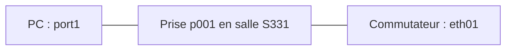

# Module 03 — Gestion de parc et inventaire informatique

Un inventaire utile décrit les objets, leurs caractéristiques, leur localisation et leurs relations. Il permet de retrouver le matériel impliqué dans un ticket, ses composants, ses logiciels, ses connexions, son cycle de vie et ses données administratives ou financières.

## Définir une nomenclature

Le support construit un nom à partir de quatre informations : `PC` pour le type, `DIR` pour la direction, `202203` pour mars2022 et `012` comme index. Le choix des séparateurs appartient à la convention retenue. Un nom doit rester unique et compréhensible sans porter toutes les informations de la fiche.

Les champs récurrents sont nom, lieu, statut, type, fabricant, modèle, numéro d’inventaire, responsable et groupe techniques, utilisateur et groupe, commentaire. Les intitulés se préparent en amont ou peuvent se créer depuis le bouton d’ajout de la fiche. Distinguer le **modèle** matériel, le **gabarit** de saisie et l’**exemplaire** physique.

## Gabarits et incrémentation

Un gabarit préremplit les caractéristiques communes d’une famille d’équipements. On complète ensuite les informations propres à chaque exemplaire. Les champs accompagnés d’une baguette peuvent être incrémentés selon un format.

| Élément du format | Sens dans le support |
|---|---|
| `<` et `>` | Début et fin du format interprété |
| Caractères fixes | Partie conservée dans le nom |
| `####` | Compteur sur quatre chiffres |
| `\Y`, `\y` | Année sur quatre ou deux chiffres |
| `\m`, `\d` | Mois et jour |

Exemple : `<Proliant-DL380-GEN-####>` fournit une base cohérente pour deux serveurs. Avant une création en masse, générer un exemplaire et contrôler nom, compteur, lieu et statut.

## Décrire un ordinateur

Dans **Parc → Ordinateurs**, le type distingue fixe, portable et serveur. Les composants se créent dans **Configuration → Composants** : ils possèdent leurs propres champs et intitulés, une entité de création et éventuellement une récursivité. La liste des types de composants est prévue par l’application ; l’inventaire automatique peut alimenter ces éléments.

Les logiciels sont classés par catégorie et définis par nom, version et statut. Le parcours est : créer une catégorie (bureautique), créer le logiciel (Office) et son éditeur, créer sa version (365 ProPlus) avec son OS, créer les licences avec quantité puis les affecter aux ordinateurs. Installer le logiciel et attribuer une licence sont deux opérations distinctes.

Les connexions directes représentent USB, série, HDMI et les liaisons à des moniteurs, imprimantes, téléphones ou périphériques. Les ports réseau représentent les interfaces Ethernet, Wi-Fi, fibre ou agrégées. Un port possède un nom et un numéro ; il peut être associé à une carte réseau et porter les informations IP, domaine, VLAN et réseau.

Cette représentation ajoutée au cours montre le raccordement physique. La prise appartient à un lieu ; le switch et le PC restent des éléments d’inventaire. Les autres onglets couvrent systèmes d’exploitation, contrats, volumes, virtualisation, antivirus, liens externes et certificats.

## Choisir le bon type d’élément

| Élément | Informations et relations à vérifier |
|---|---|
| Moniteur | Gestion/responsable/statut/lieu, fabricant/modèle/type, usagers, taille et connectiques, gestion unitaire ou globale |
| Matériel réseau | Switch, routeur, pare-feu ou borne distingués par type, caractéristiques, gabarit et ports réseau |
| Imprimante | Caractéristiques, gestion, usagers, spécifications, connexion directe/réseau, cartouches et gestion unitaire/globale |
| Cartouche/consommable | Modèle, import en masse, imprimantes compatibles, installation, fin de vie et seuils d’alerte |
| Téléphone | Fixe/portable/combiné, spécifications, usagers, composants, liaisons et tickets |
| Périphérique | Matériel non couvert par un type spécialisé, connexion, usager, réservation et tickets |

Pour les cartouches : créer le modèle d’imprimante, créer le modèle de cartouche compatible, ajouter le stock (l’exemple donne50cartouches neuves), puis installer les cartouches dans l’imprimante du bon modèle. Le stock disponible et les consommables installés doivent rester distingués.

## Modéliser un centre de données

Créer le datacenter, puis sa salle serveur, la grille d’emplacements et la baie, puis les matériels et leurs modèles avec images avant/arrière. L’exemple théorique utilise2 colonnes,2 lignes et une baie42U. Le TP nomme `Olympus datacenter`, `Salle serveur1` et une baie HPE. Les PDU représentent la distribution électrique ; le libellé « Onduleurs (PDU) » du support ne doit pas faire confondre PDU et onduleur.

Une baie décrit position, orientation, hauteur en U, dimensions, charge maximale et équipements. Placer chaque objet dans les U attendues et vérifier les conflits, la charge et le statut. Une relation dessinée ne remplace pas une vérification de capacité physique.

## Réaliser l’inventaire Olympus

Le TP complet conserve toutes les quantités et valeurs demandées : deux ProliantDL380, une baie42U, deux PDU, quatre commutateurs48 ports, six commutateurs24 ports, douze portables affectés plus deux réservables, deux écrans, cinq imprimantes, cartouches/papier de réserve, un téléphone et une webcam. Les fiches détaillées des processeurs, mémoire, disques, cartes réseau, Wi-Fi, OS et licences figurent dans l’énoncé.

Les relations réseau attendues sont : les24ports0001/0002 vers les ports1/2 du48ports0001 ; les0003/0004 vers1/2 du48ports0002 ; le0005 vers1 du48ports0003. Préparer4prises dans la salle des trésors,2 à l’hôtellerie,4 au temple d’Héra et2au temple de Zeus, puis connecter les portables par les prises de leur lieu. Le24ports0006 reste l’exemplaire supplémentaire prévu par l’énoncé, sans affectation détaillée.

La réservation s’active sur l’équipement : autoriser, rendre indisponible, rendre disponible ou ne plus autoriser. Le TP réserve un portable pendant un mois au nom de Zeus. Vérifier le calendrier de réservation et l’identité du bénéficiaire.

## Lire les incohérences sans les propager

La fiche Aruba fournie identifie **JL356A comme24portsPoE+** et **JL357A comme48portsPoE+**, avec4uplinksSFP+1/10GbE. Le TP nomme aussi un48portsJL356A et lui donne des vitesses100/10 Gbit/s ; ces valeurs ne correspondent pas à cette fiche. Les originaux les conservent. Pour un inventaire matériel réel, relever l’étiquette et le modèle, puis choisir les interfaces du matériel réellement présent. Le document Aruba reste accessible dans le lecteur Original du TP.

Le TP indique aussi6 To comme12×512 Go (6144 Go), une fréquence CPU par défaut enMHz à côté d’une fréquence enGHz,8096 Mio de mémoire graphique, un protocole Wi-Fi `a/b/g/n/y`, un écran relié à un Optiplex absent des créations précédentes, et deux emplacements de baies dans une grille1×1. Ces points doivent être décidés avec le formateur et documentés, sans inventer du matériel manquant. Les captures de correction montrent parfois d’autres valeurs : elles illustrent une réalisation, pas une nouvelle consigne prioritaire.

### Mini-quiz

1. Quelle différence entre modèle, gabarit et exemplaire ?
2. Installer Office garantit-il l’affectation d’une licence ?
3. Quel document tranche la confusion24/48 ports du TP ?

??? success "Réponses"
    1. Le modèle décrit une référence ; le gabarit prépare la saisie ; l’exemplaire représente un matériel identifié.
    2. Non. Version installée et licence attribuée se contrôlent séparément.
    3. La fiche Aruba fournie et l’étiquette de l’équipement effectivement inventorié.

## Appliquer ce module

- [Énoncé du TP](../../tp/glpi/module-03/enonces.md)
- [Correction expliquée](../../tp/glpi/module-03/corrections.md)
- [Fiche de révision](../../revision/glpi/module-03-gestion-de-parc-inventaire-informatique.md)
