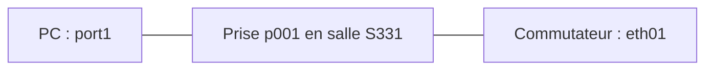

# Module 03 — Gestion de parc et inventaire informatique

Un inventaire utile décrit les objets, leurs caractéristiques, leur localisation et leurs relations. Il permet de retrouver le matériel impliqué dans un ticket, ses composants, ses logiciels, ses connexions, son cycle de vie et ses données administratives ou financières.

## Objectifs

- Distinguer modèles, gabarits, objets, licences et consommables.
- Construire le centre de données et l’inventaire Olympus avec les relations demandées.
- Contrôler les ports, quantités et réservations à partir du matériel et des preuves.

## Définir une nomenclature

Le support construit un nom à partir de quatre informations : `PC` pour le type, `DIR` pour la direction, `202203` pour mars 2022 et `012` comme index. Le choix des séparateurs appartient à la convention retenue. Un nom doit rester unique et compréhensible sans porter toutes les informations de la fiche.

Les champs récurrents sont nom, lieu, statut, type, fabricant, modèle, numéro d’inventaire, responsable et groupe techniques, utilisateur et groupe, commentaire. Les intitulés se préparent en amont ou peuvent se créer depuis le bouton d’ajout de la fiche. Distinguer le **modèle** matériel, le **gabarit** de saisie et l’**exemplaire** physique.

## Gabarits et incrémentation

Un gabarit préremplit les caractéristiques communes d’une famille d’équipements. On complète ensuite les informations propres à chaque exemplaire. Les champs accompagnés d’une baguette peuvent être incrémentés selon un format.

| Élément du format | Sens dans le support |
|---|---|
| `<` et `>` | Début et fin du format interprété |
| Caractères fixes | Partie conservée dans le nom |
| `####` | Compteur sur quatre chiffres |
| `\Y`, `\y` | Année sur quatre ou deux chiffres |
| `\m`, `\d` | Mois et jour |

Exemple : `<Proliant-DL380-GEN-####>` fournit une base cohérente pour deux serveurs. Avant une création en masse, générer un exemplaire et contrôler nom, compteur, lieu et statut.

## Décrire un ordinateur

Dans **Parc → Ordinateurs**, le type distingue fixe, portable et serveur. Les composants se créent dans **Configuration → Composants** : ils possèdent leurs propres champs et intitulés, une entité de création et éventuellement une récursivité. La liste des types de composants est prévue par l’application ; l’inventaire automatique peut alimenter ces éléments.

Les logiciels sont classés par catégorie et définis par nom, version et statut. Le parcours est : créer une catégorie (bureautique), créer le logiciel (Office) et son éditeur, créer sa version (365 ProPlus) avec son OS, créer les licences avec quantité puis les affecter aux ordinateurs. Installer le logiciel et attribuer une licence sont deux opérations distinctes.

Les connexions directes représentent USB, série, HDMI et les liaisons à des moniteurs, imprimantes, téléphones ou périphériques. Les ports réseau représentent les interfaces Ethernet, Wi-Fi, fibre ou agrégées. Un port possède un nom et un numéro ; il peut être associé à une carte réseau et porter les informations IP, domaine, VLAN et réseau.

Cette représentation ajoutée au cours montre le raccordement physique. La prise appartient à un lieu ; le switch et le PC restent des éléments d’inventaire. Les autres onglets couvrent systèmes d’exploitation, contrats, volumes, virtualisation, antivirus, liens externes et certificats.

## Choisir le bon type d’élément

| Élément | Informations et relations à vérifier |
|---|---|
| Moniteur | Gestion/responsable/statut/lieu, fabricant/modèle/type, usagers, taille et connectiques, gestion unitaire ou globale |
| Matériel réseau | Switch, routeur, pare-feu ou borne distingués par type, caractéristiques, gabarit et ports réseau |
| Imprimante | Caractéristiques, gestion, usagers, spécifications, connexion directe/réseau, cartouches et gestion unitaire/globale |
| Cartouche/consommable | Modèle, import en masse, imprimantes compatibles, installation, fin de vie et seuils d’alerte |
| Téléphone | Fixe/portable/combiné, spécifications, usagers, composants, liaisons et tickets |
| Périphérique | Matériel non couvert par un type spécialisé, connexion, usager, réservation et tickets |

Pour les cartouches : créer le modèle d’imprimante, créer le modèle de cartouche compatible, ajouter le stock (l’exemple donne 50 cartouches neuves), puis installer les cartouches dans l’imprimante du bon modèle. Le stock disponible et les consommables installés doivent rester distingués.

## Modéliser un centre de données

Créer le datacenter, puis sa salle serveur, la grille d’emplacements et la baie, puis les matériels et leurs modèles avec images avant/arrière. L’exemple théorique utilise 2 colonnes et 2 lignes et une baie de 42 U. Le TP nomme `Olympus datacenter`, `Salle serveur1` et une baie HPE. Les PDU représentent la distribution électrique ; le libellé « Onduleurs (PDU) » du support ne doit pas faire confondre PDU et onduleur.

Une baie décrit position, orientation, hauteur en U, dimensions, charge maximale et équipements. Placer chaque objet dans les U attendues et vérifier les conflits, la charge et le statut. Une relation dessinée ne remplace pas une vérification de capacité physique.

## TP — Construire l’inventaire Olympus

1. Créer `Olympus datacenter` et `Salle serveur1`. Préparer la baie HPE de 42 U, les deux ProLiant DL380 et les deux PDU. Vérifier la position et la hauteur occupée de chaque appareil dans la baie.
2. Créer les modèles puis les gabarits des commutateurs. Générer quatre appareils de 48 ports et six de 24 ports avec la nomenclature de l’énoncé. Vérifier le modèle avant de saisir les caractéristiques à l’aide de la fiche Aruba.
3. Renseigner les ports et connecter les appareils. Vérifier les deux extrémités de chaque lien dans GLPI.

| Appareil 48 ports | Ports | Appareils 24 ports |
| --- | --- | --- |
| 0001 | 1 et 2 | 0001 et 0002 |
| 0002 | 1 et 2 | 0003 et 0004 |
| 0003 | 1 | 0005 |

L’exemplaire 24 ports 0006 est demandé dans l’énoncé sans affectation détaillée. Relever son état sans lui inventer de connexion.

4. Créer quatre prises dans la salle des trésors, deux à l’hôtellerie, quatre au temple d’Héra et deux au temple de Zeus. Affecter les douze portables et les relier aux prises des lieux correspondants. Les deux autres portables restent prévus pour la réservation.
5. Ajouter les deux écrans, les cinq imprimantes, les consommables de réserve, le téléphone et la webcam. Renseigner les composants, logiciels, licences et connexions demandés dans les fiches du TP. Pour les cartouches, vérifier successivement modèle d’imprimante, compatibilité et stock.
6. Activer la réservation d’un portable, puis l’attribuer à Zeus pour un mois. Vérifier dans le calendrier les dates, l’équipement et le bénéficiaire. Tester ensuite la différence entre rendre temporairement indisponible et retirer la possibilité de réserver.

Comparer les quantités, les affectations par lieu et les relations réseau à l’énoncé. Un nom correct ne prouve pas que les ports ou les licences sont renseignés.

## Lire les incohérences sans les propager

La fiche Aruba fournie identifie **JL356A comme modèle 24 ports PoE+** et **JL357A comme modèle 48 ports PoE+**, avec 4 liaisons SFP+ 1/10 GbE. Le TP nomme aussi un modèle 48 ports JL356A et lui donne des vitesses de 100/10 Gbit/s ; ces valeurs ne correspondent pas à cette fiche. Les originaux les conservent. Pour un inventaire matériel réel, relever l’étiquette et le modèle, puis choisir les interfaces du matériel réellement présent. Le document Aruba reste accessible dans le lecteur Original du TP.

Le TP indique aussi 6 To comme 12 × 512 Go (6144 Go), une fréquence CPU par défaut en MHz à côté d’une fréquence en GHz, 8 096 Mio de mémoire graphique, un protocole Wi-Fi `a/b/g/n/y`, un écran relié à un Optiplex absent des créations précédentes, et deux emplacements de baies dans une grille 1 × 1. Ces points doivent être décidés avec le formateur et documentés, sans inventer du matériel manquant. Les captures de correction montrent parfois d’autres valeurs : elles illustrent une réalisation, pas une nouvelle consigne prioritaire.

## À retenir

Créer les références avant leurs exemplaires. Vérifier les deux extrémités de chaque liaison et les propriétés réellement constatées du matériel. Une réservation se contrôle dans le calendrier avec l’objet et le bénéficiaire.

## Mini-quiz

1. Quelle différence entre modèle, gabarit et exemplaire ?
2. Installer Office garantit-il l’affectation d’une licence ?
3. Quel document tranche la confusion 24/48 ports du TP ?
4. Pourquoi vérifier le modèle avant de déclarer les ports ?
5. Que contrôler après avoir autorisé la réservation d’un portable ?

??? success "Réponses commentées"
    1. Le modèle décrit une référence ; le gabarit prépare la saisie ; l’exemplaire représente un matériel identifié.
    2. Non. Version installée et licence attribuée se contrôlent séparément.
    3. La fiche Aruba fournie et l’étiquette de l’équipement effectivement inventorié.
    4. Une nomenclature de TP peut contenir une incohérence. Comparer l’étiquette et la fiche technique pour choisir le nombre et le type de ports.
    5. Créer la réservation, puis vérifier dans le calendrier le portable, le bénéficiaire et la période.

## Appliquer ce module

- [Énoncé du TP](../../tp/glpi/module-03/enonces.md)
- [Correction expliquée](../../tp/glpi/module-03/corrections.md)
- [Fiche de révision](../../revision/glpi/module-03-gestion-de-parc-inventaire-informatique.md)
