# Module 04 — Assistance et traitements automatisés des tickets

[Travaux pratiques](../../tp/glpi/module-04/index.md)

Les parties ci-dessous reprennent le cours original, dans le même ordre. Les encadrés et les schémas répètent ses formulations.

## Parcours de lecture

1. Support · Module 04 - Support de cours · 10 pages transcrites

**Visuel externe**

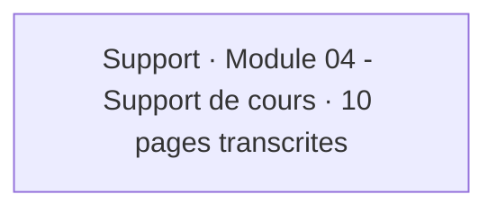

SOURCE DRIVE · TRANSCRIPTION DU SUPPORT

Le contenu des documents du dossier TSSR est transcrit ci-dessous, page par page. Les textes et tableaux sont intégrés à la page Web. Aucun fichier PDF, aucune diapositive entière ni aucune reproduction de page n’est affiché. Seuls des croquis ou visuels isolés et vérifiés peuvent accompagner la transcription. Les versions et les consignes restent celles des supports de formation. Les compléments IA sont conservés dans leur onglet distinct.

## Support · Module 04 - Support de cours · 10 pages transcrites

#### Administration GLPI

#### Module 04 – Assistance – Traitements automatisés des tickets

#### Objectifs

**Visuel externe**

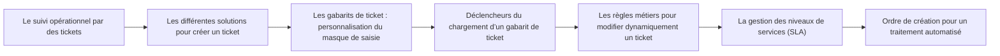

- Le suivi opérationnel par des tickets
- Les différentes solutions pour créer un ticket

- Les gabarits de ticket : personnalisation du masque de saisie
- Déclencheurs du chargement d’un gabarit de ticket
- Les règles métiers pour modifier dynamiquement un ticket
- La gestion des niveaux de services (SLA)
- Ordre de création pour un traitement automatisé

#### Rappels sur les tickets

#### Le ticket

!!! note "À retenir"
    Dans le monde de l’informatique, tout fonctionne à base de ticket Il va permettre de solliciter le centre de service Un ticket passera par plusieurs statuts : c’est le cycle de vie d’un ticket Il peut être de type « incident » ou « demande » Il doit compter un minimum d’informations

**Visuel externe**

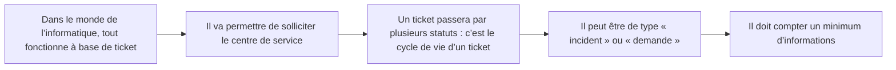

- Dans le monde de l’informatique, tout fonctionne à base de ticket
- Il va permettre de solliciter le centre de service

- Un ticket passera par plusieurs statuts : c’est le cycle de vie d’un ticket
- Il peut être de type « incident » ou « demande »
- Il doit compter un minimum d’informations

#### Répartition des

#### Traçabilité Détection des

#### tâches Communication

#### problèmes

#### Utilisation d’un outil de gestion de ticket

#### Flux d'entrée

#### Trois façons de créer un ticket

!!! note "À retenir"
    Interface d’ouverture de tickets anonymes Interface simplifiée Interface standard Depuis GLPI Envoi d’un mail dans une boîte mail support Configuration d’un collecteur Mail Création du ticket par téléphone Utilisation de l’interface standard par le technicien Téléphone

**Visuel externe**

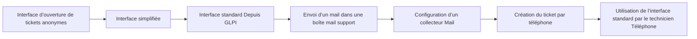

- Interface d’ouverture de tickets anonymes
- Interface simplifiée
- Interface standard Depuis GLPI

- Envoi d’un mail dans une boîte mail support
- Configuration d’un collecteur Mail

- Création du ticket par téléphone
- Utilisation de l’interface standard par le technicien Téléphone

#### Création ticket : interface anonyme

!!! note "À retenir"
    http(s)://<@glpi>/front/helpdesk.html Aucune authentification requise Possibilité de désactivation Personnalisation possible : HTML/CSS Par défaut, rattaché à l’entité racine Visuel isolé — Module 04 - Support de cours

**Visuel externe**

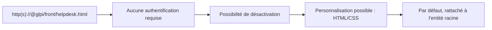

- http(s)://<@glpi>/front/helpdesk.html
- Aucune authentification requise

- Possibilité de désactivation
- Personnalisation possible : HTML/CSS
- Par défaut, rattaché à l’entité racine

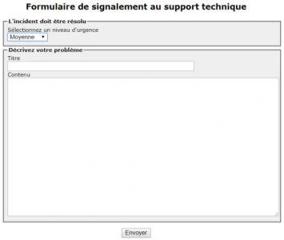

Visuel isolé — Module 04 - Support de cours

#### Création ticket : interface simplifiée

- Accessible après authentification
- Formulaire à compléter et géré par un gabarit
- Si une délégation est configurée, possibilité de sélectionner un utilisateur
- Ajout possible de document (imprime écran, manuel, etc.)
- Suivi par mail possible
- Association possible des CI concernés
- Récapitulatif de tous ses tickets depuis l’accueil

#### Création ticket : interface standard

!!! note "À retenir"
    Assistance => Tickets => Ticket par téléphone Utilisé par le support N1 et N2 Accès à plus d’éléments Vu en détail par la suite Visuel isolé — Module 04 - Support de cours Visuel isolé — Module 04 - Support de cours

- Assistance => Tickets =>
- Ticket par téléphone

- Utilisé par le support N1 et N2
- Accès à plus d’éléments
- Vu en détail par la suite

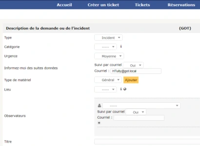

Visuel isolé — Module 04 - Support de cours

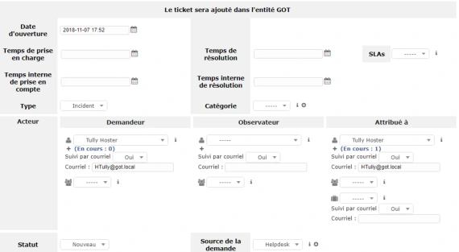

Visuel isolé — Module 04 - Support de cours

#### Gabarits de ticket

#### Le gabarit : généralités

!!! note "À retenir"
    Personnalisation de l’interface de saisie d’un ticket en fonction du type et d’une catégorie de ticket Interface standard et simplifiée Champs obligatoires Champs masqués Champs prédéfinis Notion de gabarit par défaut Accessibles depuis le menu listant les tickets

- Personnalisation de l’interface de saisie d’un ticket en fonction du type et d’une catégorie de ticket
- Interface standard et simplifiée

- Champs obligatoires
- Champs masqués
- Champs prédéfinis
- Notion de gabarit par défaut
- Accessibles depuis le menu listant les tickets

#### Le gabarit : fonctionnement

#### Le gabarit : création

!!! note "À retenir"
    Assistance => Tickets => Attention à l’entité active : récursivité possible Personnalisation visuelle Rendu côté utilisateur Liaison avec catégorie / type Depuis la catégorie Visuel isolé — Module 04 - Support de cours Visuel isolé — Module 04 - Support de cours Visuel isolé — Module 04 - Support de cours

!!! warning "Attention"
    Assistance => Tickets => Attention à l’entité active : récursivité possible Personnalisation visuelle Rendu côté utilisateur Liaison avec catégorie / type Depuis la catégorie Visuel isolé — Module 04 - Support de cours Visuel isolé — Module 04 - Support de cours Visuel isolé — Module 04 - Support de cours

- Assistance => Tickets =>
- Attention à l’entité active : récursivité possible

- Personnalisation visuelle

- Rendu côté utilisateur

- Liaison avec catégorie / type
- Depuis la catégorie

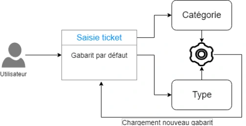

Visuel isolé — Module 04 - Support de cours

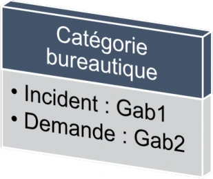

Visuel isolé — Module 04 - Support de cours

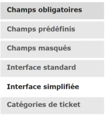

Visuel isolé — Module 04 - Support de cours

#### Le gabarit : bonnes pratiques

- On commence par créer ses différentes catégories
- Création des gabarits nommés ainsi : « catégorie-type »
- Jusqu’à deux gabarits par catégorie (incidents et demandes)
- Liaison entre les gabarits et les catégories pour chaque type

- On évite au maximum d’inclure dans le gabarit le paramétrage du ticket (priorité, SLA, etc.)

- Gabarit uniquement pour le visuel
- Utilisation de règles métier pour la configuration du ticket

#### Règles métier pour les tickets

!!! note "À retenir"
    « Administration => règles » Permettre une configuration automatisée des tickets saisis Maintenance simplifiée : configuration centralisée au travers de règles Visuel isolé — Module 04 - Support de cours

- « Administration => règles »
- Permettre une configuration automatisée des tickets saisis

- Maintenance simplifiée : configuration centralisée au travers de règles

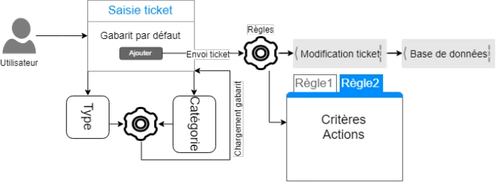

Visuel isolé — Module 04 - Support de cours

#### Règles métier pour les tickets

- Règles uniquement lues à la création du ticket
- Toutes les règles sont interprétées
- Importance de l’ordre => Champs concurrent
- Critères : permettre d’identifier les tickets *
- Type
- Catégorie
- Actions : définir des champs hors de portée de l’utilisateur *
- Priorité
- Techniciens / groupes de techniciens
- SLA
- etc.

#### * Donnés à titre d’exemples

#### Niveaux de services

- Objectif : attribuer un temps de résolution ou de prise en charge
- Saisie manuelle d’une date/heure ou utilisation des objets SLA sous GLPI

- Attribution des objets SLA manuelle ou automatique via des règles

#### Sélection d’un SLA

#### Priorité SLA

#### 1 2h

#### 2 8h

#### 3 2j Calcul effectué en fonction du calendrier de travail

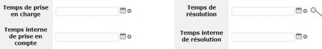

Visuel isolé — Module 04 - Support de cours

#### Niveaux de services : objets SLA

- « Configuration => Niveaux de services »

- Doivent être facilement identifiables
- Le type : temps de résolution/prise en charge

- La durée max de résolution souhaitée
- Possibilité de créer des niveaux d’escalades

#### Dépasser la date butoir de résolution n’est pas bloquant, juste informatif

#### Niveaux de services

- Permettre une modification automatisée du ticket pendant son cycle de vie
- Se configure à travers des objets SLA qu’on applique à un ticket

- Identifiable par un nom
- Configuration d’un déclencheur temporelle par rapport au temps de résolution
- Vont ensuite s’appuyer sur des critères (optionnels) pour réaliser des actions
- Critères et actions applicables aux différents champs du ticket

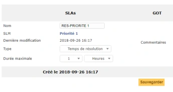

Visuel isolé — Module 04 - Support de cours

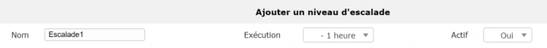

Visuel isolé — Module 04 - Support de cours

#### Ordre de création

- Matériel
- Logiciel => Bureautique
- Logiciel => Infographiste Créer les catégories de ticket

#### lier aux catégories suivant le type

- Personnalisation de l’interface
- Champs obligatoires
- Champs masqués Créer les gabarits de ticket puis les

- Temps de prise en charge
- Temps de résolution Créer les SLAs

- Critère (catégories, type, temps restant…)
- Action (élévation de priorité, affection à un niveau supérieur…) Créer les escalades de SLAs

- Critère (type (incident, demande), catégorie de ticket)
- Action (affectation technicien, SLA, priorité…) Créer les règles métier

#### pour les tickets

```
Assistance – Traitements automatisés des tickets
                                                                     Ordre de création

                                                                                              • Matériel
                   Créer les catégories de ticket              • Logiciel => Bureautique
                                                                                              • Logiciel => Infographiste

                 Créer les gabarits de ticket puis les         • Personnalisation de l’interface                                                                                              • Champs obligatoires
                        lier aux catégories suivant le type          • Champs masqués

                          Créer les SLAs                          •• TempsTemps dede résolutionprise en charge

                    Créer les escalades de SLAs               •• CritèreAction (élévation(catégories,detype,priorité,tempsaffectionrestant…)à un niveau supérieur…)

                      Créer les règles métier                   • Critère (type (incident, demande), catégorie de ticket)
                       pour les tickets                         • Action (affectation technicien, SLA, priorité…)

19
```

Référence du document : 1FpyeKf-53BHRTG1_lWgd5AZEkFTlvBLP · SHA-256 c0540fd062bffa26…
