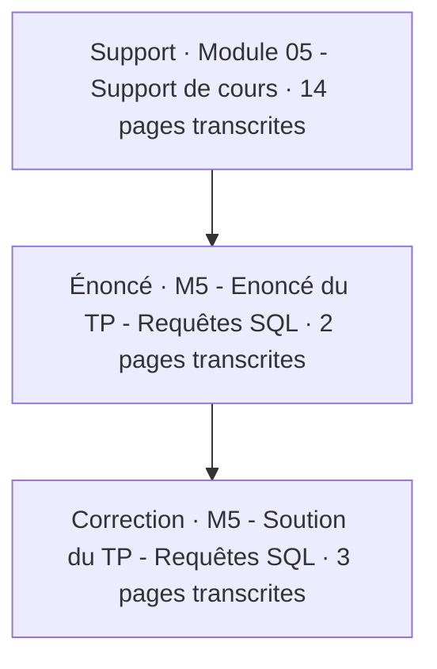
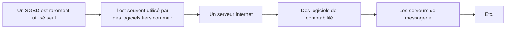
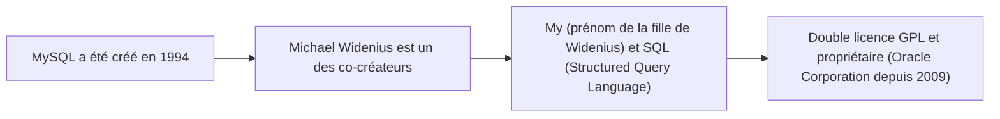
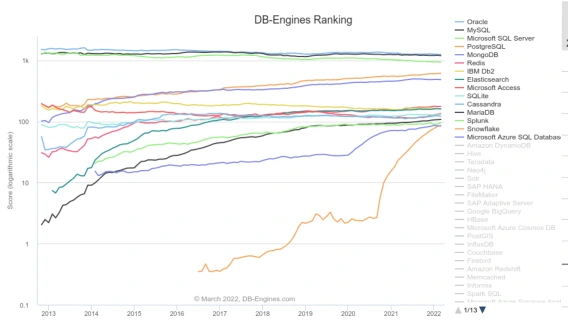
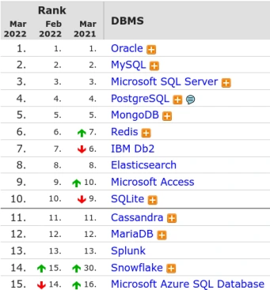
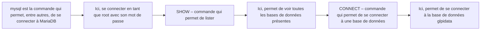

# Module 05 — Les bases de MySQL et MariaDB

Les parties ci-dessous reprennent le cours original, dans le même ordre. Les encadrés et les schémas répètent ses formulations.

## Parcours de lecture

1. Support · Module 05 - Support de cours · 14 pages transcrites
2. Énoncé · M5 - Enoncé du TP - Requêtes SQL · 2 pages transcrites
3. Correction · M5 - Soution du TP - Requêtes SQL · 3 pages transcrites

**Visuel externe**



SOURCE DRIVE · TRANSCRIPTION DU SUPPORT

Le contenu des documents du dossier TSSR est transcrit ci-dessous, page par page. Les textes et tableaux sont intégrés à la page Web. Aucun fichier PDF, aucune diapositive entière ni aucune reproduction de page n’est affiché. Seuls des croquis ou visuels isolés et vérifiés peuvent accompagner la transcription. Les versions et les consignes restent celles des supports de formation. Les compléments IA sont conservés dans leur onglet distinct.

## Support · Module 05 - Support de cours · 14 pages transcrites

#### Administration GLPI

#### Module 05 – Les bases de MySQL et MariaDB

#### Objectifs

**Visuel externe**


- Rappels sur les SGBD et le langage d’interrogation SQL
- Utilisation des commandes de bases de MySQL/MariaDB

- Se connecter à une base de données et en afficher la structure
- Ce qu’est une table dans une base de données
- Effectuer une recherche d’enregistrements selon certains critères
- Utiliser les fonctions de base du langage SQL
- Afficher par des requêtes SQL, la liste des utilisateurs de GLPI
- Effectuer une sauvegarde de la base de données de GLPI

#### Rappels sur les SGBD

#### SGBD - Système de Gestion de Bases de Données

!!! note "À retenir"
    Sert à stocker, administrer, effectuer des opérations, récolter des données (data) sur un support facilement consultable.

**Visuel externe**



- Sert à stocker, administrer, effectuer des opérations, récolter des données (data) sur un support facilement consultable.
- Création des SGBDR - Système de Gestion de Base de Données Relationnelle (DB2, Oracle, SQL Server, PostgreSQL, MySQL…)
- Un SGBD est rarement utilisé seul
- Il est souvent utilisé par des logiciels tiers comme :
- Un serveur internet
- Des logiciels de comptabilité
- Les serveurs de messagerie
- Etc.

#### SGBD - Système de Gestion de Bases de Données

#### Historique

**Visuel externe**



- MySQL a été créé en 1994
- Michael Widenius est un des co-créateurs

- My (prénom de la fille de Widenius) et SQL (Structured Query Language)
- Double licence GPL et propriétaire (Oracle Corporation depuis 2009)
- En 2009, Widenius a créé MariaDB qui est open source (Maria, prénom de sa deuxième fille)



Visuel isolé — Module 05 - Support de cours



Visuel isolé — Module 05 - Support de cours

#### Le langage

!!! note "À retenir"
    Contrairement à Bash par exemple, SQL ne s’exécute pas de manière séquentielle mais analyse globalement une requète.

- Contrairement à Bash par exemple, SQL ne s’exécute pas de manière séquentielle mais analyse globalement une requète.
- La création d’une base de données et de sa structure (tables et clés) doit être mûrement réfléchie en amont ; c’est l’étape du MCD (Modèle Conceptuel de Données).

- On fabrique d’abord les étagères de la bibliothèque et on organise à vide avant de vouloir tout bouger une fois que les livres sont dessus.

#### Des commandes de base

**Visuel externe**



- mysql est la commande qui permet, entre autres, de se connecter à MariaDB

- Ici, se connecter en tant que root avec son mot de passe

```
mysql –u root -p
```

- SHOW – commande qui permet de lister
- Ici, permet de voir toutes les bases de données présentes

```
mysql>SHOW databases;
```

- CONNECT – commande qui permet de se connecter à une base de données

- Ici, permet de se connecter à la base de données glpidata

```
mysql>CONNECT glpidata;
```

#### Des commandes de base

- DROP – commande qui permet de supprimer
- Ici, permet de supprimer la base de données glpidata

```
mysql>DROP database glpidata;
```

- SHOW – commande qui permet de lister
- Ici, permet de voir toutes les tables présentes une fois connecté à une base de données

```
mysql>SHOW tables;
```

- UPDATE / INSERT – commandes qui permettent d’ajouter du contenu à une base de données

- Ces commandes ne seront pas vues dans ce cours.

#### La structure

- Dans une base de données, les informations sont contenues dans des tables (ou relations)
- Une relation est constituée de deux sous-ensembles :
- L’en-tête est composé d’attributs (colonnes)
- Le corps est composé de lignes
- La table clients définit cinq attributs (ID, Prénom, Nom, Ville et Age) et se compose de quatre lignes (1, 2, 3 et 4)

| ID | Prénom | Nom | Ville | Age |
| --- | --- | --- | --- | --- |
| Fred | Enlefrigau | Stockholm |  |  |
| François | Belététoi | Pyongyang |  |  |
| Gilles | Edenotre | Rennes |  |  |
| Yann | Apourtous | Caen |  |  |

#### La commande SELECT

!!! note "À retenir"
    Cette commande sert à lister les données d’un ou plusieurs attributs d’une table SELECT * FROM nom_de_la_table * veut dire tous les attributs Exemple : lister tous les attributs de la table clients

- Cette commande sert à lister les données d’un ou plusieurs attributs d’une table

- SELECT * FROM nom_de_la_table
- * veut dire tous les attributs
- Exemple : lister tous les attributs de la table clients

```
mysql>SELECT * FROM clients;
```

| ID | Prénom | Nom | Ville | Age |
| --- | --- | --- | --- | --- |
| 1 | Fred | Enlefrigau | Stockholm | 45 |
| 2 | François | Belététoi | Pyongyang | 26 |
| 3 | Gilles | Etdenotre | Rennes | 32 |
| 4 | Yann | Apourtous | Caen | NULL |

#### La commande SELECT

!!! note "À retenir"
    SELECT nom_de_l’attribut, nom_d’un_deuxième_attribut FROM nom_de_la_table Liste les attributs « Nom » et « Ville » de la table clients

- SELECT nom_de_l’attribut, nom_d’un_deuxième_attribut FROM nom_de_la_table
- Liste les attributs « Nom » et « Ville » de la table clients

```
mysql>SELECT Nom, Ville FROM clients;
```

| Nom | Ville |
| --- | --- |
| Enlefrigau | Stockholm |
| Belététoi | Pyongyang |
| Etdenotre | Rennes |
| Apourtous | Caen |

#### La condition WHERE à la commande SELECT

!!! note "À retenir"
    WHERE permet de mettre une condition à notre recherche Liste les attributs « Prénom » et « Nom » de la table clients si Caen est la ville

- WHERE permet de mettre une condition à notre recherche
- Liste les attributs « Prénom » et « Nom » de la table clients si Caen est la ville

```
mysql>SELECT Prénom, Nom FROM clients WHERE Ville='Caen';
```

| Prénom | Nom |
| --- | --- |
| Yann | Apourtous |

#### Les opérateurs de comparaison

- WHERE permet d’utiliser des symboles pour définir des critères plus précis de recherche

- = égal
- < inférieur
- <= inférieur ou égal
- > supérieur
- >= supérieur ou égal
- <> ou != différent
- <=> égal (fonctionne aussi si la valeur est NULL)

- Liste les attributs « Prénom » et « Nom » de la table clients si l’ID est strictement supérieur à 3.

```
mysql>SELECT Prénom, Nom FROM clients WHERE
ID > 3;
```

| Prénom | Nom |
| --- | --- |
| Yann | Apourtous |

#### La combinaison de critères

!!! note "À retenir"
    Il existe aussi des opérateurs qui permettent de combiner plusieurs critères AND et OR ou XOR ou exclusif (ou, mais pas les deux) NOT non (sauf) Liste les attributs « Prénom » et « Nom » de la table clients si l’ID est supérieur ou égal à 2 et la ville est Caen.

- Il existe aussi des opérateurs qui permettent de combiner plusieurs critères

- AND et
- OR ou
- XOR ou exclusif (ou, mais pas les deux)
- NOT non (sauf)
- Liste les attributs « Prénom » et « Nom » de la table clients si l’ID est supérieur ou égal à 2 et la ville est Caen.

```
mysql>SELECT Prénom, Nom FROM clients WHERE ID >= 2 AND ville = 'Caen';
```

| Prénom | Nom |
| --- | --- |
| Yann | Apourtous |

#### Les sélections complexes

!!! note "À retenir"
    Si vous souhaitez utiliser plusieurs opérateurs de combinaison ( ) met la priorité sur les opérateurs combinés Liste les attributs « Prénom » et « Nom » de la table clients si (l’ID est supérieur ou égal à 2 et la ville est Caen) ou (l’ID est strictement supérieur à 2 et la ville est Rennes).

- Si vous souhaitez utiliser plusieurs opérateurs de combinaison
- ( ) met la priorité sur les opérateurs combinés
- Liste les attributs « Prénom » et « Nom » de la table clients si (l’ID est supérieur ou égal à 2 et la ville est Caen) ou (l’ID est strictement supérieur à 2 et la ville est Rennes).

```
mysql>SELECT Prénom, Nom FROM clients WHERE (ID >= '2' AND ville = 'Caen') OR (ID 
> 2 AND ville = 'Rennes');
```

| Prénom | Nom |
| --- | --- |
| Yann | Apourtous |
| Gilles | Etdenotre |

#### Les valeurs NULL et NOT NULL

!!! note "À retenir"
    Le marqueur NULL représente qu’il n’y a pas de valeur Le marqueur NOT NULL représente qu’il existe une valeur On peut utiliser, colonne = NULL ou colonne is NULL Idem pour NOT NULL, colonne = NOT NULL ou colonne is NOT NULL Liste les attributs « Prénom » et « Nom » de la table clients si l'âge n’est pas renseigné

- Le marqueur NULL représente qu’il n’y a pas de valeur
- Le marqueur NOT NULL représente qu’il existe une valeur
- On peut utiliser, colonne = NULL ou colonne is NULL
- Idem pour NOT NULL, colonne = NOT NULL ou colonne is NOT NULL

- Liste les attributs « Prénom » et « Nom » de la table clients si l'âge n’est pas renseigné

```
mysql>SELECT Prénom, Nom FROM clients WHERE age = NULL;
```

| Prénom | Nom |
| --- | --- |
| Yann | Apourtous |

#### Le tri des données

- Si vous souhaitez trier vos données en sortie
- ORDER BY colonne tri en fonction de la colonne choisie
- ASC tri par ordre croissant
- DESC tri par ordre décroissant
- Par défaut, sans préciser ASC ou DESC, c’est un ordre ascendant
- Liste les attributs « Prénom » de la table clients triés par âge puis par nom.

```
mysql>SELECT Prénom FROM clients ORDER by age, nom;
```

| Prénom |
| --- |
| Yann |
| François |
| Gilles |
| Fred |

#### Choisir le nombre de lignes récupérées

- Si vous souhaitez restreindre le nombre de lignes en résultat
- LIMIT nombre_de_ligne OFFSET à_partir_de_quelle_ligne
- OFFSET est optionnel et dans ce cas, il est égal à 0
- OFFSET différent de 0, permet de déterminer à partir de quelle ligne on compte le nombre de lignes souhaitées
- Liste les attributs « Prénom » de la table clients triés par âge à partir de la deuxième ligne et que deux lignes.

```
mysql>SELECT Prénom FROM clients ORDER by age LIMIT '2' OFFSET '1';
```

| Prénom |
| --- |
| François |
| Gilles |

#### Compter le nombre de lignes récupérées

- Si vous souhaitez compter le nombre de lignes en résultat
- COUNT vous donne le nombre de lignes en résultat
- Un attribut NULL ne compte pas
- Compte le nombre d’attributs « âge » de la table clients.

```
mysql>SELECT COUNT(age) FROM clients;
3
```

#### Utilisation d'un alias

- Il est possible de modifier le nom d’une colonne à l’affichage
- Nom_de_la_colonne as nom_d’affichage
- Liste les attributs « Prénom » de la table clients trier par âge en changeant le nom de la colonne Prénom par Firstname.

```
mysql>SELECT Prénom as Firstname FROM clients ORDER by age;
```

| Firstname |
| --- |
| Yann |
| François |
| Gilles |
| Fred |

#### Quelques fonctions d'agrégation

- Quelques fonctions qui permettent un traitement numérique
- MAX(Nom_de_la_colonne) affiche la valeur maximum d’une colonne
- MIN(Nom_de_la_colonne) affiche la valeur maximum d’une colonne
- SUM(Nom_de_la_colonne) affiche la somme d’une colonne
- AVG(Nom_de_la_colonne) affiche la moyenne d’une colonne

- Liste la moyenne des âges de la table clients.

```
mysql>SELECT AVG(age) FROM clients;
34
```

#### La clé primaire (primary key)

- Une clé primaire identifie de manière unique une ligne (contrainte d’unicité)

- Dans la table client et la table achat, il s’agit de l’ID
- Elle identifie une ou plusieurs colonnes (création d’index que nous ne verrons pas dans ce cours)
- Une clé primaire ne peut pas être NULL.

#### La clé étrangère (foreign key)

- Une clé étrangère permet de gérer des relations entre plusieurs tables

- Elle vérifie l'intégrité de notre base.
- Dans notre table achat, il s’agit de ID_client et vérifie que le client existe bien dans la table client.
- Si vous indiquez un ID_client qui n’existe pas, MySQL vous indiquera une erreur et c’est pour cela qu’on appelle les clés des contraintes (CONSTRAINT).
- À la création d’une clé étrangère, un index est automatiquement créé.
- La colonne ID_client est la clé étrangère de la table achat en relation avec la colonne ID de la table client. La colonne ID de la table client DOIT être une clé primaire.

| ID | Prénom | Nom | Ville | Age |
| --- | --- | --- | --- | --- |
| 1 | Fred | Enlefrigau | Stockholm | 45 |
| 2 | François | Belététoi | Pyongyang | 26 |
| 3 | Gilles | Edenotre | Rennes | 32 |
| 4 | Yann | Apourtous | Caen |  |

| ID | Nom | ID_client | Prix | Pateforme |
| --- | --- | --- | --- | --- |
| 1 | Overwatch | 4 | 14,99 | XBOX ONE |
| 2 | Call of Duty | 2 | 69,99 | PS4 |
| 3 | Minecraft | 1 | 23,95 | SWITCH |
| 4 | League of Legends | 4 | 0 | PC |
| 5 | Mario Kart 8 DELUXE | 4 | 43,99 | SWITCH |
| 6 | Civilization VI | 3 | 29,99 | PC |

#### Les jointures

- L’idée est de pouvoir associer plusieurs tables dans une même requête (l’avantage des tables relationnelles)

- Lorsque l’on fait une jointure, on crée une table virtuelle qui réunit les 2 tables avec ID de la table client qui correspond à ID_client de la table achat

#### La jointure interne

- INNER JOIN

- Jointure interne
- Condition vraie dans les 2 tables

#### A B

#### La jointure représente l’intersection de A et B

- SELECT * FROM table_A INNER JOIN table_B ON table_A.clé = table_B.clé

#### * Il existe d’autres jointures que nous ne verrons pas dans ce cours

| ID | Prénom | Nom | Ville | Age |
| --- | --- | --- | --- | --- |
| 1 | Fred | Enlefrigau | Stockholm | 45 |
| 2 | François | Belététoi | Pyongyang | 26 |
| 3 | Gilles | Edenotre | Rennes | 32 |
| 4 | Yann | Apourtous | Caen |  |

| ID | Nom | ID_client | Prix | Pateforme |
| --- | --- | --- | --- | --- |
| 1 | Overwatch | 4 | 14,99 | XBOX ONE |
| 2 | Call of Duty | 2 | 69,99 | PS4 |
| 3 | Minecraft | 1 | 23,95 | SWITCH |
| 4 | League of Legends | 4 | 0 | PC |
| 5 | Mario Kart 8 DELUXE | 4 | 43,99 | SWITCH |
| 6 | Civilization VI | 3 | 29,99 | PC |

#### La jointure interne

- Si je souhaite connaître le nom des jeux qu’a achetés Yann :
- SELECT achat.nom : # je sélectionne ce que je veux afficher
- FROM achat : # sur quelle table je travaille
- INNER JOIN client : # je la joins à la table client
- ON client.id = achat.id_client : # on fait la jointure sur la colonne ID de la table client et sur la colonne ID_client de la table achat
- WHERE client.Prénom = ‘yann’; : # ID_client à 4 correspond à Yann

```
mysql>SELECT achat.nom FROM achat INNER JOIN client ON client.id = achat.id_client where 
client.prénom = ‘yann’;
```

| Nom |
| --- |
| Overwatch |
| League of Legends |
| Mario Kart 8 DELUXE |

Référence du document : 1jTYcrI9DsvbHbatiTABHNIJRTST3YJOh · SHA-256 3239ef86ad6e4c9e…

## Énoncé · M5 - Enoncé du TP - Requêtes SQL · 2 pages transcrites

#### Requêtes SQL

#### TP du Module 5 – Les bases de MySQL/MariaDB

Avant de démarrer ce TP, il convient d’avoir suivi les vidéos des modules 1 à 5 et d’avoir réalisé les TP proposés.

#### Enoncé

#### Objectifs

- Comprendre le fonctionnement des requêtes MySQL. Prérequis

- Avoir fini les TP des modules précédents.

Contexte :

- Vous gérez l’application GLPI au sein du domaine de la société Olympus depuis quelque temps et votre DSI vous demande des informations à extraire dans la base de données directement. Principales tâches à réaliser

#### Connexion à la base de données en ligne de commande de votre serveur GLPI

```
• 
Connectez-vous en Shell à votre base de données de GLPI avec le compte root que 
vous 
avez 
configuré 
lorsque 
vous 
avez 
effectué 
la 
commande 
mysql_secure_installation.
```

- Affichez toutes les bases de données présentes dans votre serveur MariaDB.

- Connectez-vous à la base de données glpidata puis affichez toutes les tables présentes.

- Affichez tous les attributs de la table des calendriers.

- Affichez les noms et prénoms des utilisateurs de GLPI.

- Affichez le nom des utilisateurs qui ont la langue en anglais (en_GB).

- Affichez le nom et le nom complet des catégories de ticket qui sont enfants de.

- Indice : utiliser un comparateur.

- Affichez le nom des switchs réseau qui ne sont pas des gabarits et qui sont liés au modèle GAB-JL356A-ARUBA-2540-24P.

- Indices :

- Utiliser les sélections complexes.

- Is_template à 1 est un gabarit.

- GAB-JL356A-ARUBA-2540-24P est networkequipmentmodels_id à 2.

- Comptez le nombre de SLMs et affichez en en-tête de colonne nb_de_SLMs.

- Indice : utiliser un alias.

- Affichez le nom du switch avec le chiffre le plus haut qui utilise le modèle 24Ports.

- Indice : utiliser une fonction d’agrégation.

#### BONUS

- Affichez le(s) nom(s) de la catégorie de ticket et le nom du gabarit de ticket qui est utilisé pour une demande dans les catégories de ticket.

- Indice : utiliser une jointure interne.

#### BONUS

- Comptez-les en affichant le nom du gabarit utilisé et le nombre avec comme en-tête « nombre de catégories qui utilise un gabarit de demande ».

#### Solution

Une solution est proposée pour ce TP sous la forme d'un PDF commenté, disponible dans les ressources à télécharger, accompagnée de captures d’écran pour vous guider.

Référence du document : 19sKB7N1JMcfOPh045bfERaW6DXogBlju · SHA-256 30bc1746cd40575a…

## Correction · M5 - Soution du TP - Requêtes SQL · 3 pages transcrites

Correction originale : à consulter après avoir tenté l’exercice.

#### Requêtes SQL

#### TP du Module 5 – Les bases de MySQL/MariaDB

Avant de démarrer ce TP, il convient d’avoir suivi les vidéos des modules 1 à 5 et d’avoir réalisé les TP proposés.

#### Solution

#### Objectifs

- Comprendre le fonctionnement des requêtes MySQL.

##### Prérequis

- Avoir fini les TP des modules précédents.

Contexte :

- Vous gérez l’application GLPI au sein du domaine de la société Olympus depuis quelque temps et votre DSI vous demande des informations à extraire dans la base de données directement.

Des images de correction sont disponibles dans les ressources.

#### Principales tâches à réaliser

#### Connexion à la base de données en ligne de commande de votre serveur GLPI

- Connectez-vous en Shell à votre base de données de GLPI avec le compte root que vous avez configuré lorsque vous avez effectué la commande `mysql_secure_installation`.

```
mysql -u root -p
```

- Affichez toutes les bases de données présentes dans votre serveur MariaDB.

```
show databases;
```

Attention, ne pas oublier le ; à chaque fin de ligne.

- Connectez-vous à la base de données glpidata puis affichez toutes les tables présentes.

```
connect glpidata;
```

```
show tables;
```

- Affichez tous les attributs de la table des calendriers.

```
select * from glpi_calendars;
```

- Affichez les noms et prénoms des utilisateurs de GLPI.

```
select name, firstname from glpi_users;
```

- Affichez le nom des utilisateurs qui ont la langue en anglais (en_GB).

```
select name from glpi_users where language=’en_GB’;
```

- Affichez le nom et le nom complet des catégories de ticket qui sont enfants de.

- Indice : utiliser un comparateur.

```
select name, completename
from glpi_itilcatégories
where completename<>name;
```

Ou

```
select name, completename from glpi_itilcatégories where level > ‘1’;
```

- Affichez le nom des switchs réseau qui ne sont pas des gabarits et qui sont liés au modèle GAB-JL356A-ARUBA-2540-24P.

- Indices :

- Utiliser les sélections complexes.

- Is_template à 1 est un gabarit.

- GAB-JL356A-ARUBA-2540-24P est networkequipmentmodels_id à 2.

```
select name
from glpi_networkequipments
where is_template=’0’ and networkequipmentmodels_id=’2’;
```

- Comptez le nombre de SLMs et affichez en en-tête de colonne nb_de_SLMs.

- Indice : utiliser un alias.

```
select count(name) as nb_de_SLMs from glpi_slms;
```

- Affichez le nom du switch avec le chiffre le plus haut qui utilise le modèle 24Ports.

- Indice : utiliser une fonction d’agrégation.

```
select MAX(name) from_glpinetworkequipments
where networkequipmentmodels_id=’2’;
```

#### BONUS

- Affichez le(s) nom(s) de la catégorie de ticket et le nom du gabarit de ticket qui est utilisé pour une demande dans les catégories de ticket.

- Indice : utiliser une jointure interne.

Le but étant d’afficher le gabarit de ticket « demande bureautique » qui est le seul qui est de type demande rattaché à une catégorie.

Une solution :

```
SELECT glpi_tickettemplates.name, glpi_itilcategories.name
from glpi_tickettemplates
INNER JOIN glpi_itilcategories
ON glpi_itilcategories.tickettemplates_id_demand=glpi_tickettemplates.id
where glpi_itilcategories.tickettemplates_id_demand=’3’;
```

#### BONUS

- Comptez-les en affichant le nom du gabarit utilisé et le nombre avec comme en-tête « nombre de catégories qui utilise un gabarit de demande ».

```
SELECT count(glpi_tickettemplates.name) as ‘nombre de catégories qui utilise un gabarit de demande’, glpi_tickettemplates.name
from glpi_tickettemplates
INNER JOIN glpi_itilcategories
ON
```

```
glpi_itilcategories.tickettemplates_id_demand=glpi_tickettemplates.id 
where glpi_itilcategories.tickettemplates_id_demand=’3’;
```

Référence du document : 1oGRkZ3gFA16mmN9ZLpVa9rT3e3jIYN7o · SHA-256 35c7ff2134c6c85a…

## Fiche de synthèse

Les lignes reprennent les titres du cours et la première phrase de chaque partie.

| Partie | Repère du cours |
| --- | --- |
| Correction · M5 - Soution du TP - Requêtes SQL · 3 pages transcrites | Correction originale : à consulter après avoir tenté l’exercice. |
