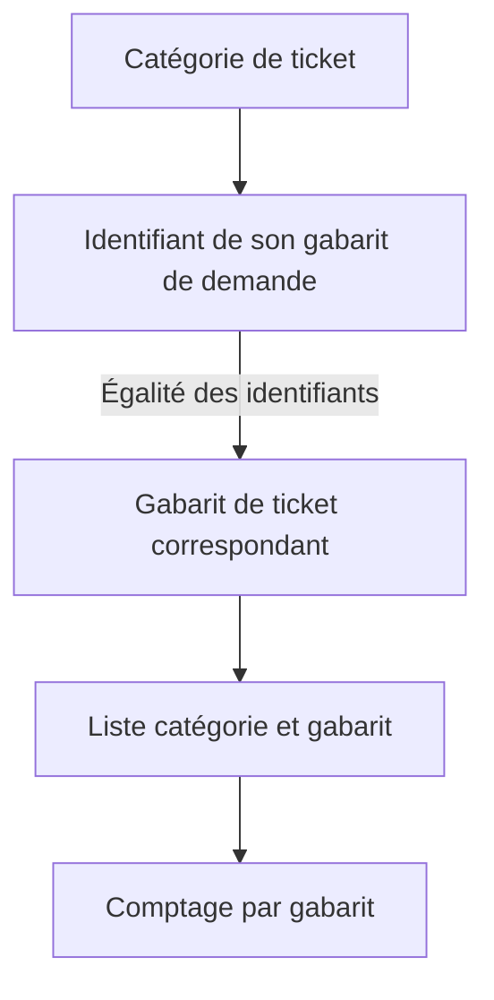

# Module 05 — Les bases de MySQL et MariaDB

Un SGBD stocke, administre et permet d’interroger les données. Un SGBD relationnel organise celles-ci en tables reliées par des clés : MySQL, MariaDB, PostgreSQL, Oracle, SQLServer et DB2 sont les exemples du support. L’application GLPI l’utilise comme un logiciel de comptabilité ou un serveur de messagerie utilise sa propre base.

Le rappel historique du support situe MySQL en1994 avec Michael Widenius, son nom venant de sa fille My et de SQL, puis MariaDB en2009, nommé d’après Maria. Le schéma de la base doit être réfléchi avant de remplir ses tables : le cours l’associe au MCD, modèle conceptuel de données. SQL décrit le résultat recherché ; le SGBD détermine comment le produire.

## Objectifs

- Lire un schéma MariaDB et sélectionner les colonnes utiles.
- Filtrer, compter, trier et joindre les tables de la base GLPI du laboratoire.
- Contrôler les résultats en distinguant valeurs nulles, noms de modèles et identifiants.

## Entrer dans le client SQL

```bash
mysql -u root -p
```

```sql
SHOW DATABASES;
CONNECT glpidata;
SHOW TABLES;
DESCRIBE glpi_users;
```

`mysql` est ici le client du SGBD, `-u` choisit le compte et `-p` demande son secret. Ne pas inclure celui-ci dans la ligne. `CONNECT` apparaît dans le support ; `USE glpidata;` exprime aussi le choix de la base. Ne pas recopier le prompt `mysql>` dans une requête.

`DROP DATABASE` supprime une base : l’exemple source sert à comprendre la syntaxe et ne fait pas partie des requêtes d’extraction du TP. `INSERT` ajoute des lignes ; `UPDATE` modifie les lignes existantes, contrairement au regroupement approximatif des deux commandes dans le diaporama. Ces modifications ne sont pas étudiées ici.

## Tables, lignes et colonnes

La table exemple contient quatre clients. Les colonnes sont les attributs ; les lignes sont les enregistrements. L’âge de Yann n’est pas renseigné.

| ID | Prénom | Nom | Ville | Age |
|---:|---|---|---|---:|
| 1 | Fred | Enlefrigau | Stockholm | 45 |
| 2 | François | Belététoi | Pyongyang | 26 |
| 3 | Gilles | Edenotre | Rennes | 32 |
| 4 | Yann | Apourtous | Caen | NULL |

Le support alterne `Edenotre` et `Etdenotre`, ainsi que `client` et `clients`. Les exemples ci-dessous utilisent `clients` pour les sélections simples ; le nom réel de la table doit rester cohérent dans une réalisation.

```sql
SELECT * FROM clients;
SELECT Nom, Ville FROM clients;
SELECT Prénom, Nom FROM clients WHERE Ville = 'Caen';
SELECT Prénom, Nom FROM clients WHERE ID > 3;
```

La projection choisit les colonnes ; `WHERE` choisit les lignes. Les comparateurs sont `=`, `<`, `<=`, `>`, `>=`, `<>` ou`!=`. `<=>` compare aussi les valeursNULL. Écrire les chaînes entre apostrophes droites, les nombres sans guillemets typographiques.

## Combiner, trier et limiter

`AND` exige les deux critères ; `OR` en accepte au moins un ; `XOR` en accepte exactement un ; `NOT` inverse un prédicat. Les parenthèses rendent les regroupements explicites.

```sql
SELECT Prénom, Nom FROM clients
WHERE ID >= 2 AND Ville = 'Caen';

SELECT Prénom, Nom FROM clients
WHERE (ID >= 2 AND Ville = 'Caen')
   OR (ID > 2 AND Ville = 'Rennes');

SELECT Prénom FROM clients ORDER BY Age, Nom;
SELECT Prénom FROM clients ORDER BY Age DESC;
SELECT Prénom FROM clients ORDER BY Age, ID LIMIT 2 OFFSET 1;
```

L’ordre ascendant est utilisé si `ASC` ou`DESC` n’est pas précisé. `OFFSET1` ignore la première ligne ; `LIMIT2` conserve les deux suivantes. Dans les données du cours, le tri ascendant par âge placeYann(NULL), François(26), Gilles(32), puis Fred(45) : la limite retourne François et Gilles. Ajouter une clé de tri départage les égalités.

## Traiter NULL et les agrégats correctement

`NULL` représente une absence de valeur. Le support montre `Age = NULL` comme s’il sélectionnaitYann ; cette comparaison ne teste pas l’absence. Employer `IS NULL` ou`IS NOT NULL`. [Référence MariaDB sur NULL](https://mariadb.com/docs/server/reference/data-types/null-values).

```sql
SELECT Prénom, Nom FROM clients WHERE Age IS NULL;
SELECT Prénom, Nom FROM clients WHERE Age IS NOT NULL;
SELECT COUNT(*) AS nombre_clients, COUNT(Age) AS ages_renseignes FROM clients;
SELECT MIN(Age), MAX(Age), SUM(Age), AVG(Age) FROM clients;
SELECT Prénom AS Firstname FROM clients ORDER BY Age;
```

`COUNT(*)` compte les quatre lignes ; `COUNT(Age)` compte les trois âges renseignés. Les agrégats sur Age ignorentNULL : minimum26, maximum45, somme de 103 et moyenne de 103/3, soit environ 34,33. Le support affiche 34 et décrit par erreurMIN comme le maximum : [MIN renvoie le minimum](https://mariadb.com/docs/server/reference/sql-functions/aggregate-functions/min). L’alias change le libellé de sortie, pas le nom stocké de la colonne.

## Relier les tables

Une clé primaire identifie une ligne de façon unique et ne peut pas êtreNULL. Une clé étrangère relie une colonne à une clé de la table référencée et impose l’intégrité du lien. L’exemple relie `achat.ID_client` à `client.ID` : un achat ne doit pas référencer un client inexistant. Le support présente la référence à une clé primaire ; l’essentiel à retenir ici est l’identifiant stable et la contrainte de relation.

| Achat de l’exemple | ID_client | Prix | Plateforme |
|---|---:|---:|---|
| Overwatch | 4 | 14,99 | XBOX ONE |
| Call of Duty | 2 | 69,99 | PS4 |
| Minecraft | 1 | 23,95 | SWITCH |
| League of Legends | 4 | 0 | PC |
| Mario Kart8DELUXE | 4 | 43,99 | SWITCH |
| CivilizationVI | 3 | 29,99 | PC |

Une jointure interne conserve les correspondances entre les tables. Pour retrouver les jeux de Yann dans l’exemple à table `client` :

```sql
SELECT achat.Nom
FROM achat
INNER JOIN client ON client.ID = achat.ID_client
WHERE client.Prénom = 'Yann';
```

La sortie attendue est Overwatch, LeagueofLegends et MarioKart8DELUXE. La condition `ON` réalise la relation ; `WHERE` restreint au client recherché.

## TP — Extraire des données de la base GLPI

### Identifier le schéma

Se connecter au client MariaDB avec le compte autorisé. Vérifier la base active et les noms de tables du laboratoire avant les requêtes. Le TP utilise `glpidata`. Les requêtes de consultation ci-dessous ne changent aucune donnée.

```sql
SHOW DATABASES;
USE glpidata;
SHOW TABLES;
DESCRIBE glpi_calendars;
SELECT * FROM glpi_calendars;
SELECT name, firstname FROM glpi_users;
SELECT name FROM glpi_users WHERE language = 'en_GB';
```

La colonne `name` contient ici le nom de connexion. Examiner `realname` si la question demande le patronyme. Les nombres observés dans la capture de correction dépendent des données du laboratoire.

### Appliquer les filtres et compter

```sql
SELECT name, completename
FROM glpi_itilcategories
WHERE completename <> name;

SELECT name
FROM glpi_networkequipments
WHERE is_template = 0
  AND networkequipmentmodels_id = 2;

SELECT COUNT(*) AS nb_de_SLMs
FROM glpi_slms;

SELECT MAX(name)
FROM glpi_networkequipments
WHERE networkequipmentmodels_id = 2;
```

Contrôler que `2` est bien l’identifiant du modèle 24 ports dans votre base. La correction n’affiche que quatre commutateurs, alors que le TP d’inventaire en demande six. Vérifier les objets réellement créés. `MAX(name)` compare des chaînes. Les suffixes de largeur fixe du scénario permettent que leur ordre coïncide avec l’ordre numérique.

### Relier les catégories aux gabarits de demande

**Illustration IA / externe au cours — de la catégorie à son gabarit de demande.**



```sql
SELECT c.name AS categorie, t.name AS gabarit
FROM glpi_itilcategories AS c
INNER JOIN glpi_tickettemplates AS t
    ON c.tickettemplates_id_demand = t.id;

SELECT t.name AS gabarit,
       COUNT(*) AS `nombre de catégories qui utilise un gabarit de demande`
FROM glpi_itilcategories AS c
INNER JOIN glpi_tickettemplates AS t
    ON c.tickettemplates_id_demand = t.id
GROUP BY t.id, t.name;
```

Contrôler que le total de chaque groupe correspond au nombre de catégories de la requête détaillée. Le gabarit `3` de la capture appartient à son jeu de données. N’ajouter un filtre que si la consigne ou le résultat recherché le demande. L’accent dans le nom d’une table et le `FROM` collé du corrigé restent des erreurs visibles dans l’Original.

### Complément pédagogique — vérifier une sauvegarde

Le support annonce la sauvegarde de la base sans détailler une procédure. Sur une base de laboratoire et avec le compte autorisé, produire un fichier et vérifier qu’il est non vide. Tester ensuite la restauration dans une autre base isolée.

```bash
mysqldump -u root -p --single-transaction glpidata > glpidata.sql
test -s glpidata.sql
```

## À retenir

Vérifier les colonnes et les identifiants dans la base interrogée. Un filtre et une jointure répondent à des questions distinctes. Comparer une agrégation à la liste de lignes qui l’alimente.

## Mini-quiz

1. Comment sélectionner les clients sans âge ?
2. Quelle différence entre `COUNT(*)` et `COUNT(Age)` ?
3. À quoi sert `ON` dans une jointure ?
4. Pourquoi vérifier l’identifiant de modèle avant de reprendre le `2` du TP ?
5. Pourquoi le comptage par gabarit utilise-t-il `GROUP BY` ?

??? success "Réponses commentées"
    1. `WHERE Age IS NULL`.
    2. L’un compte les lignes ; l’autre compte les valeurs non NULL de la colonne.
    3. À exprimer la correspondance entre les deux tables.
    4. Les identifiants sont propres à la base. Un même numéro peut correspondre à un modèle différent après une autre installation.
    5. Il sépare les lignes par gabarit, puis calcule le nombre de catégories de chaque groupe. Le comparer à la liste détaillée permet de vérifier le résultat.

## Appliquer ce module

- [Énoncé du TP](../../tp/glpi/module-05/enonces.md)
- [Correction expliquée](../../tp/glpi/module-05/corrections.md)
- [Fiche de révision](../../revision/glpi/module-05-les-bases-de-mysql-et-mariadb.md)
