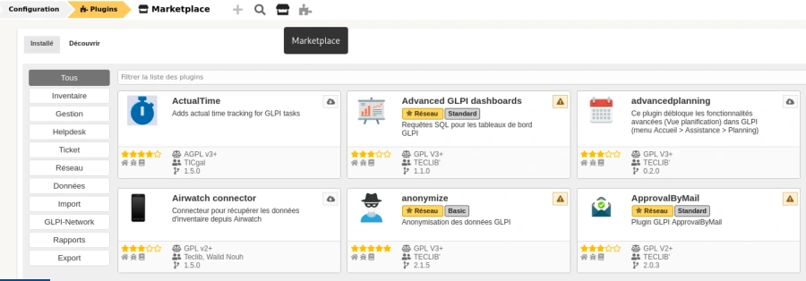
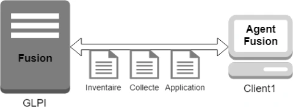
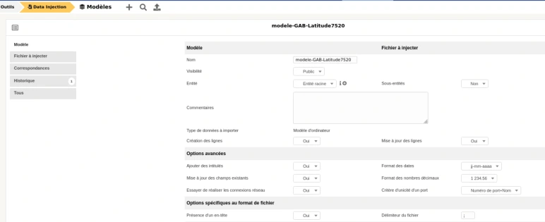
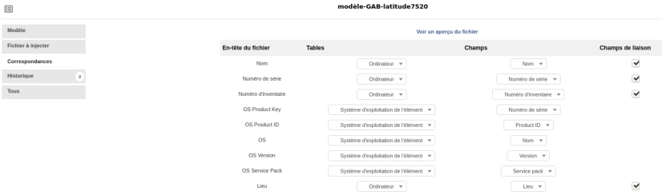
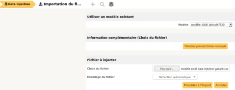

# Module 06 — Plug-ins et inventaire

[Travaux pratiques](../../tp/glpi/module-06/index.md)

Les parties ci-dessous reprennent le cours original, dans le même ordre. Les encadrés et les schémas répètent ses formulations.

## Parcours de lecture

1. Support · Module 06 - Support de cours · 10 pages transcrites

**Visuel externe**

SOURCE DRIVE · TRANSCRIPTION DU SUPPORT

Le contenu des documents du dossier TSSR est transcrit ci-dessous, page par page. Les textes et tableaux sont intégrés à la page Web. Aucun fichier PDF, aucune diapositive entière ni aucune reproduction de page n’est affiché. Seuls des croquis ou visuels isolés et vérifiés peuvent accompagner la transcription. Les versions et les consignes restent celles des supports de formation. Les compléments IA sont conservés dans leur onglet distinct.

## Support · Module 06 - Support de cours · 10 pages transcrites

#### Administration GLPI

#### Module 06 – Présentation des plug-ins – Inventaire avec

#### FusionInventory

#### Objectifs

**Visuel externe**

- Comment ajouter/gérer des plugins avec GLPI
- Exploration du site https://plugins.glpi-project.org/

- Comment installer le plugin FusionInventory pour GLPI
- Installation d’un agent FusionInventory sous Windows
- Savoir modifier la configuration de l’agent FusionInventory
- Comment forcer un inventaire depuis un agent
- Installer le plugin Data-Injection en vue d’importer des données
- Paramétrer un modèle d’importation Data-Injection

#### Présentation des plug-ins

#### Les plug-ins : présentation

!!! note "À retenir"
    Étendre les possibilités de GLPI sans modification du produit de base Catalogue: « https://plugins.glpi-project.org »

- Étendre les possibilités de GLPI sans modification du produit de base
- Catalogue: « https://plugins.glpi-project.org »

#### * Domaines traités

!!! note "À retenir"
    Depuis la version 9.5, il est possible d’utiliser le Marketplace (inscription sur le site obligatoire) Principaux domaines : Rapports / Graphiques Inventaire * Réseau Gestion administrative HelpDesk * Import

!!! warning "Attention"
    Depuis la version 9.5, il est possible d’utiliser le Marketplace (inscription sur le site obligatoire) Principaux domaines : Rapports / Graphiques Inventaire * Réseau Gestion administrative HelpDesk * Import

**Visuel externe**

- Depuis la version 9.5, il est possible d’utiliser le Marketplace (inscription sur le site obligatoire)
- Principaux domaines :
- Rapports / Graphiques
- Inventaire *
- Réseau
- Gestion administrative
- HelpDesk *
- Import

#### Les plug-ins : installation manuelle

**Visuel externe**

- Récupération des sources au format Gzip ou Bzip2
- Extraction des plug-ins : « GlpiInstallationDir/plugins »
- Installation et activation depuis l’interface graphique : « Configuration => Plugins »
- Chemin d’accès de configuration du plugin : va dépendre du plugin

- Une version de plugin pour une version ou plus de GLPI

- La mise à jour de GLPI peut nécessiter une mise à jour du plugin

#### Paramétrage du Marketplace

!!! note "À retenir"
    Inscription gratuite sur le site https://services.glpi-network.com/register afin de récupérer une clé d’enregistrement Puis la coller dans la section Configuration→Générale de GLPI :

- Inscription gratuite sur le site https://services.glpi-network.com/register afin de récupérer une clé d’enregistrement
- Puis la coller dans la section Configuration→Générale de GLPI :

#### Les plug-ins : installation par le Marketplace

#### Plugin FusionInventory

!!! note "À retenir"
    Visuel isolé — Module 06 - Support de cours

Visuel isolé — Module 06 - Support de cours

#### FusionInventory Présentation des plug-ins – Inventaire avec FusionInventory

!!! note "À retenir"
    Plugins dans GLPI => la partie serveur Les clients FusionInventory agents : Windows/Linux/macOS/Android Permettre un inventaire automatique des équipements Déploiement en mode Push / Pull d’applications Collecte de données Inventaire distant SNMP Découverte réseau Wake-on-LAN

**Visuel externe**

- Plugins dans GLPI => la partie serveur
- Les clients FusionInventory agents : Windows/Linux/macOS/Android
- Permettre un inventaire automatique des équipements
- Déploiement en mode Push / Pull d’applications
- Collecte de données
- Inventaire distant SNMP
- Découverte réseau
- Wake-on-LAN

#### FusionInventory : vue d'ensemble

!!! note "À retenir"
    Modèle client / serveur Le client communique à intervalle régulier avec son serveur Le serveur peut réveiller le client pour une communication anticipée Données d’inventaire, remontée d’information de collecte, etc.

- Modèle client / serveur
- Le client communique à intervalle régulier avec son serveur

- Le serveur peut réveiller le client pour une communication anticipée
- Données d’inventaire, remontée d’information de collecte, etc.
- Protocole HTTP : documents XML

Visuel isolé — Module 06 - Support de cours

#### FusionInventory : préparation inventaire

!!! note "À retenir"
    Nécessité de préparer la partie serveur avant toute importation de clients Comment gérer l’affectation des lieux et entités aux objets inventoriés ?

- Nécessité de préparer la partie serveur avant toute importation de clients
- Comment gérer l’affectation des lieux et entités aux objets inventoriés ?

- Comment maintenir une relation cohérente utilisateur <=> ordinateur
- Inventaire automatique par défaut très volumineux => limitation nécessaire
- Définition d’une liste noire

#### Dictionnaires Administration =>

#### Règles fusion Administration => Fusion =>

#### Dictionnaires

#### Règles

#### FusionInventory : règles Présentation des plug-ins – Inventaire avec FusionInventory

- « Règles d’informations d’ordinateur »

- À chaque update, modifier des informations ordinateur en fonction d’information de collecte

- « Règles de lieu »

- Permettre l’affectation et modification automatique du lieu des équipements importés par Fusion

- « Règles sur l’entité ordinateur »

- Permettre l’affectation et modification automatique de l’entité de rattachement

- « Règles d’import et de liaison des matériels »

- Liste fixe – Identification précise des machines à mettre à jour ou importer – éviter les doublons

- « Matériels ignorés durant l’import »

- Liste des équipements n’ayant pas pu être importés suite à une découverte réseau

#### Pour aller plus loin : Plugin Data Injection

#### Data Injection Présentation des plug-ins – Inventaire avec FusionInventory

- Il permet d’injecter des données depuis un fichier .csv
- Comme dans la création à la main, l’ordre de création est important
- Par exemple, création d’un fabricant, puis d’un composant et enfin l’ordinateur
- Attention :
- Aux droits des utilisateurs qui utilisent l’injection
- Si l’utilisateur n’a pas le droit de créer un composant, il ne sera pas créé
- Si vous utilisez FusionInventory, est-il indispensable d’injecter vos données ?

#### Data Injection

- Ce qu’on peut importer

- Ce qu’on ne peut pas importer

- Logiciel
- Versions de logiciels
- Licences
- Données relations au helpdesk (catégories, tickets)
- Données relatives à la base de connaissance

- Ordinateur
- Écran
- Imprimante
- Matériel réseau
- Téléphone
- Périphériques
- Composants
- Utilisateur
- Groupe

- Entité
- Contrat
- Fournisseur
- Contact
- Informations financières
- Ports réseau
- Type de cartouche
- Type de consommable
- Documents

#### Data Injection

- Étape 1 – La création d'un modèle

Visuel isolé — Module 06 - Support de cours

#### Data Injection

- Étape 2 – Injecter un fichier au format .csv avec vos en-têtes de colonne

- UTF-8 pour un fichier venant de Linux

- ISO8859-1 pour un fichier venant de

#### Windows

#### Data Injection

- Étape 3 - Correspondance de vos en-têtes de colonne avec les champs des différentes tables

Visuel isolé — Module 06 - Support de cours

Visuel isolé — Module 06 - Support de cours

#### Data Injection

- Étape 4 - Procéder à l’importation avec votre fichier rempli

Visuel isolé — Module 06 - Support de cours

Visuel isolé — Module 06 - Support de cours

Référence du document : 1eMXIAtWOdMn7JW5Yk_x7-7OfxkaCRy5H · SHA-256 ca46466dda0781a7…
