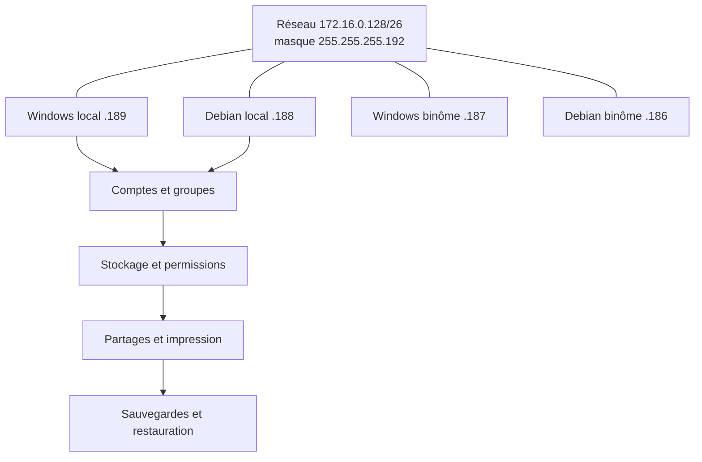
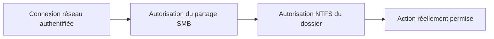

# Module 01 — MSP Systèmes clients

Cette mise en situation assemble les compétences Windows, Debian, réseau et bureautique dans une maquette de quatre machines. Le travail attendu comprend une configuration fonctionnelle, des procédures réutilisables et des preuves de vérification. L’énoncé prévoit **4 jours et 3,5 heures** ; le modèle ancien annonce 4 jours et 2 heures, ce qui constitue une différence de version.

Les prérequis sont Office 365, les bases des réseaux, les systèmes clients Microsoft, l’utilisation et l’administration d’une distribution GNU/Linux. Les versions demandées sont **Windows 10 Professionnel et Debian 10**. Elles décrivent le laboratoire historique du dossier : ne pas transposer leurs versions, dépôts ou outils anciens à une installation actuelle sans vérification.

!!! info "Provenance de cette aide"
    La solution adaptée de 27 pages au réseau 172.16.0.128/26 et ses huit scripts constituent la correction principale. L’énoncé de 14 pages reste la référence pour les exigences. L’ancien modèle de 143 pages, les variantes de scripts et les quatre classeurs sont conservés dans **Cours Original**. Les explications, contrôles supplémentaires et schémas de cette fiche sont des compléments pédagogiques externes au cours.

Les valeurs d’accès nominatives sont remplacées par « fourni par le formateur », y compris dans Original et dans les tableaux CSV. Les adresses personnelles utilisent example.com. Les champs, rôles et différences entre versions sont conservés. Pour les manipulations, les mots de passe sont saisis de façon interactive ou dans un fichier local protégé qui ne doit pas entrer dans le compte rendu partagé.

## Objectifs

- Installer les deux postes locaux, intégrer ceux du binôme au plan réseau et démontrer leur connectivité.
- Créer les identités et l’environnement de travail, puis vérifier les autorisations avec les comptes concernés.
- Organiser les volumes, les permissions, les partages et l’impression, puis vérifier l’accès depuis un autre poste.
- Configurer et tester les accès distants et les applications demandées sur chaque système.
- Produire des sauvegardes, restaurer une donnée témoin et contrôler la persistance des montages.
- Livrer une procédure et un tableur vérifiables en justifiant les écarts entre l’énoncé et les modèles.

## Parcours de réalisation

| Partie de l’énoncé | Aller à la solution | Preuve attendue |
| --- | --- | --- |
| 1. Installation | [VM, réseau et tests](#msp-optimise-1) | Tableau des machines et essais de connectivité avec le binôme. |
| 2. Utilisateurs et environnement | [Identités, groupes et stratégies](#msp-optimise-2) | Connexions de test, groupes et restrictions observées. |
| 3. Stockage et ressources | [Disques, partages et imprimantes](#msp-optimise-3) | Montages et droits effectifs, lecteur U: et paramètres des files d’impression. |
| 4. Configuration avancée | [GRUB, swap, mises à jour et RDP](#msp-optimise-4) | Paramètres persistants et session RDP authentifiée avec le binôme. |
| 5. Applications | [7-Zip, Remmina et Webmin](#msp-optimise-5) | Installation et lancement vérifiés sur les systèmes demandés. |
| 6. Sauvegarde et restauration | [Copies, planifications et restauration](#msp-optimise-6) | Archives produites aux horaires demandés, contrôle distant et restauration témoin. |
| 7. LVM et tableur | [Montages, volumes et formules](#msp-optimise-7) | Montage persistant, calculs vérifiés et cas limite d’appréciation signalé. |

Chaque partie associe les étapes, les commandes utiles, le résultat attendu et les écarts du dossier. La [matrice de validation finale](#msp-optimise-bilan) permet de contrôler l’ensemble après la réalisation.

## Comprendre les dépendances avant de commencer

Un compte identifie une personne ; un groupe rassemble un service ; une permission autorise une action sur une ressource. Le partage SMB rend un dossier accessible par le réseau, mais les permissions NTFS continuent de s’appliquer. Sous Debian, le système de fichiers, son point de montage et les permissions du répertoire sont trois éléments distincts. Un montage réussi ne prouve donc pas que les bons utilisateurs ont les bons droits.



*Schéma pédagogique externe, reconstruit à partir de la solution adaptée. La passerelle .190 est une hypothèse à confirmer dans le laboratoire.*

La bonne séquence consiste à fixer le plan réseau, installer les systèmes, vérifier la connectivité, créer les identités, préparer le stockage, appliquer les droits, publier les ressources et enfin automatiser leurs sauvegardes. À chaque étape, noter l’état attendu avant d’effectuer le test. Un essai négatif avec un utilisateur non autorisé est aussi utile qu’un essai réussi.

## Décisions de version à conserver dans le compte rendu

| Point | Énoncé / ressource ancienne | Choix de la solution adaptée |
| --- | --- | --- |
| Mode réseau | Bridged dans l’énoncé ; Host-only dans le modèle et le récapitulatif | Bridged pour l’exercice, ou un réseau isolé convenu avec le formateur ; les quatre VM doivent partager le même réseau |
| Mémoire Debian | 2048 Mo dans l’énoncé ; 512 Mo dans le vieux récapitulatif | 2048 Mo |
| Effectif | Le texte annonce 9 employés, le tableau contient 10 personnes avec vous et le binôme | Créer les 10 comptes du tableau |
| Compte du binôme | Administrateur dans le sujet ; prestataire dans le modèle | Droits Windows d’administration demandés ; shell KSH sous Debian |
| Expiration des mots de passe | « Jamais » au début du sujet, puis politique Windows de 25 jours | Appliquer la règle Windows spécifique de 25 jours ; sous Debian, pas d’expiration générale, mais changement initial du binôme |
| Adresses de l’ancien modèle | .63.253/.63.252 avec masque /26, schéma étiqueté à tort /18 ; autre lecteur U: en 10.10.255.253 | Réseau cohérent 172.16.0.128/26, tableau ci-dessous |
| Impression | Ancien modèle .63.251/.250/.249 | Recalculer les octets 168 et 169 demandés par le sujet |
| Sources APT | Le modèle emploie « décommenter », mais sa substitution ajoute # | Commenter deb-src et le DVD comme demandé dans l’énoncé |
| Sauvegarde Debian | Ancien cron limité aux jours ouvrés | Tous les jours à 12 h 30 |
| SMB | Ancien modèle active SMB1 et écrit un mot de passe dans fstab | SMB3, fichier de secrets local en mode 600 et partage caché conservé |
| Script CSV ancien | Variables de boucle erronées et mots de passe en clair | Scripts consolidés à saisie interactive ; anciennes versions restent consultables comme documents historiques |

## Préparer les preuves et le retour arrière

Le document de procédure utilise des styles, des titres et un sommaire. Il décrit les choix, commandes, résultats et corrections d’erreurs. Les captures PSR complètent la procédure ; régler leur nombre à **200 minimum**. Le dossier source montre parfois 50 dans la capture : la consigne écrite de 200 prévaut. Tester la capture, vérifier son contenu puis insérer uniquement les images utiles dans le compte rendu.

Avant le partitionnement, le déplacement de /home, /var/log, /opt ou du fichier d’échange, relever les disques, sauvegarder les données et prendre l’instantané conseillé machine arrêtée. Une désignation telle que /dev/sda4 ou disque 1 décrit une maquette ; il faut identifier le bon périphérique avec sa taille, son rôle et ses montages.

## Solution détaillée, dans l’ordre des opérations

La suite reprend intégralement la matière exploitable de la solution adaptée : analyse du dossier, adressage, sept parties de travaux, formules et matrice de validation. Les retours à la ligne qui coupaient une commande dans le PDF sont réassemblés pour la lecture. La quote de fermeture manquante à la fin de la commande NTFS de Support_Info est rétablie dans cette aide ; l’Original conserve la source.

## Analyse du dossier et règle de priorité

La solution fournie présente l’inventaire suivant. Les versions d’exécutables citées sont celles qu’elle annonce ; cette reprise n’a pas exécuté ni vérifié les binaires du Drive.

| Catégorie | Fichier | Analyse / utilisation |
| --- | --- | --- |
| Sujet | Enoncé MSP - Systèmes clients.pdf | 14 pages. Référence prioritaire pour toutes les tâches et contraintes. |
| Documentation | NP_MDP_NoteTech.pdf | 11 pages. Recommandations ANSSI : mots de passe distincts, non liés à l’identité, robustes, temporaires à changer, stockage prudent. |
| Ressource | 7zip.exe | Installateur 7-Zip 19.00 x64 ; installation silencieuse avec /S. |
| Ressource | Pilote_HP_LaserJet_M9050_MFP.exe | Pilote HP pour l’imprimante fictive. Installation via port TCP/IP standard. |
| Ressource | Pilote_Xerox_Office_Color_C60C70.exe | Archive auto-extractible Xerox C60/C70 ; utilisée pour le pool et les files prioritaires. |
| Tableur | Résultats_séminaire.xlsx | Classeur à compléter avec SOMME, MOYENNE, MAX, MIN, NBVAL et SI/ET. |
| Corrigé | Modèle_Solution_MSP.pdf | 143 pages. Référence de méthode et de chemins graphiques, adaptée au sujet actuel. |
| Scripts / CSV | création_groupes, création_utilisateur, groupes.csv, utilisateurs.csv | Méthode d’import et de création en masse. Plusieurs erreurs de guillemets, d’encodage et de syntaxe ont été corrigées dans les scripts fournis avec cette solution. |
| Tableurs corrigés | Résultats_séminaire_corrigé.xlsx, Tableau_récap.xlsx | Valeurs et formules utilisées pour contrôler les résultats et la convention de nommage. |

### 1.1 Règle de priorité appliquée

### Priorité documentaire

1. Suivre l’énoncé actuel.
2. Utiliser les méthodes du cours et du corrigé modèle lorsqu’elles s’appliquent au sujet.
3. Expliquer l’ajustement technique quand la méthode fournie ne satisfait pas le scénario.

### 1.2 Incohérences détectées et décision retenue

| Point | Contradiction | Décision appliquée |
| --- | --- | --- |
| Réseau VMware | Le sujet actuel demande Bridged ; le corrigé modèle et le tableau récap utilisent Host-only. | Utiliser Bridged, car le sujet actuel est prioritaire. |
| Mémoire Debian | Le sujet actuel impose 2048 Mo ; le corrigé modèle montre 512 Mo. | Utiliser 2048 Mo. |
| Nombre de comptes | Le texte annonce 9 employés, mais le tableau contient 10 personnes. | Créer les 10 comptes du tableau. |

| Point | Contradiction | Décision appliquée |
| --- | --- | --- |
| Expiration des mots de passe | « N’expirent jamais » puis politique Windows avec changement tous les 25 jours. | Sous Windows, appliquer 25 jours car cette contrainte est plus précise et vérifiable. Sous Debian, conserver sans expiration sauf changement initial du prestataire. |
| Adresses imprimantes | Le corrigé modèle emploie des IP proches des postes ; le sujet actuel impose des troisièmes octets binaires 10101000 et 10101001. | Appliquer exactement le sujet actuel : 168 et 169 en décimal. |
| deb-src | Le corrigé écrit parfois « décommenter » alors que le sujet demande de commenter. | Commenter les lignes deb-src et la source DVD. |
| Sauvegarde Debian | Le sujet demande tous les jours ; le corrigé planifie seulement du lundi au vendredi. | Cron quotidien : 30 12 * * *. |
| SMB | Le corrigé évoque l’activation d’un ancien support SMB. | Utiliser SMB 3.0 avec cifs-utils ; ne pas activer SMB1. |
| Groupe documentation | Le sujet le demande sans le définir dans la liste des services. | Créer un groupe supplémentaire documentation et appliquer le bit setgid à /services. |

## 2. Paramètres à personnaliser et plan IP

### 2.1 Remplacements obligatoires

| Variable | À remplacer par | Exemple |
| --- | --- | --- |
| &lt;INITIALES&gt; | Vos initiales | AB |
| &lt;VOTRE_LOGIN&gt; | Première lettre du prénom + nom | jdupont |
| &lt;VOTRE_PRENOM_NOM&gt; | Votre identité | Jean Dupont |
| &lt;LOGIN_BINOME&gt; | Login de votre binôme | mmartin |
| &lt;PRENOM_NOM_BINOME&gt; | Identité du binôme | Marie Martin |

### Avant toute exécution

Remplacer les valeurs entre chevrons dans les scripts. Ne jamais exécuter une commande de disque avant d’avoir contrôlé le numéro du disque avec list disk, detail disk, lsblk et fdisk -l.

### 2.2 Calcul du sous-réseau 172.16.0.128/26

Un préfixe /26 laisse 6 bits pour les hôtes : 2^6 = 64 adresses. Le bloc commence à .128 et se termine à .191. La première adresse est le réseau et la dernière est le broadcast, donc 62 adresses sont utilisables.

| Élément | Valeur | Pourquoi |
| --- | --- | --- |
| Adresse réseau | 172.16.0.128 | Identifie le sous-réseau ; ne jamais attribuer à une machine. |
| Masque | 255.255.255.192 | Équivalent décimal du /26. |
| Première IP utilisable | 172.16.0.129 | Premier hôte possible. |
| Dernière IP utilisable / passerelle retenue | 172.16.0.190 | Le corrigé modèle place la passerelle sur la dernière IP utilisable. |
| Broadcast | 172.16.0.191 | Adresse de diffusion ; ne jamais attribuer. |

### Hypothèse de passerelle

La passerelle 172.16.0.190 reprend la méthode du corrigé modèle. Si le formateur ou le DHCP fournit une autre passerelle/DNS, conserver les IP des postes mais remplacer la passerelle et le DNS par les valeurs réellement fournies.

## Schéma et adresses retenues

| Machine | Adresse IPv4 |
| --- | --- |
| W10-VosInitiales | 172.16.0.189 |
| DEB10-VosInitiales | 172.16.0.188 |
| W10-Binôme | 172.16.0.187 |
| DEB10-Binôme | 172.16.0.186 |
| Réseau et masque | 172.16.0.128/26 — 255.255.255.192 |
| Passerelle retenue dans cette solution | 172.16.0.190 |

### 2.3 Adresses retenues

| Équipement | Adresse | Masque | Passerelle | DNS conseillé |
| --- | --- | --- | --- | --- |
| W10-&lt;INITIALES&gt; | 172.16.0.189 | 255.255.255.192 | 172.16.0.190 | 172.16.0.190 ou DNS fourni |
| DEB10-&lt;INITIALES&gt; | 172.16.0.188 | 255.255.255.192 | 172.16.0.190 | 172.16.0.190 ou DNS fourni |
| W10 du binôme | 172.16.0.187 | 255.255.255.192 | 172.16.0.190 | idem |
| Debian du binôme | 172.16.0.186 | 255.255.255.192 | 172.16.0.190 | idem |

Les adresses hautes sont retenues pour reproduire la logique du corrigé modèle et limiter le risque d’utiliser les premières adresses souvent réservées. Il faut néanmoins vérifier la plage DHCP avant de les fixer.

### 2.4 Adresses fictives des imprimantes

101010002 = 168 et 101010012 = 169. Le sujet impose de conserver le dernier octet du poste concerné.

| Périphérique | Calcul | Adresse |
| --- | --- | --- |
| HP LaserJet M9050 MFP | 172.16 + 168 + dernier octet W10 (.189) | 172.16.168.189 |
| Xerox physique 1 | 172.16 + 168 + dernier octet Debian (.188) | 172.16.168.188 |
| Xerox physique 2 | 172.16 + 169 + dernier octet Debian (.188) | 172.16.169.188 |

### Pourquoi ces IP sont hors du /26 ?

Elles sont explicitement annoncées comme fictives. Elles servent à créer les ports TCP/IP et à démontrer la configuration d’impression ; elles ne sont pas destinées à répondre au ping sur votre sous-réseau.

### 2.5 Tableau des machines virtuelles

| Machine | CPU | Mémoire | Disques | Réseau | Système |
| --- | --- | --- | --- | --- | --- |
| W10-&lt;INITIALES&gt; | 2 vCPU | 4 Go conseillés (2 Go minimum) | 32 Go système + 40 Go données + 60 Go sauvegarde si nécessaire | Bridged | Windows 10 Professionnel 64 bits |
| DEB10-&lt;INITIALES&gt; | 1 vCPU | 2048 Mo | 20 Go système + 40 Go données + 2 x 20 Go pour LVM | Bridged | Debian 10 avec environnement graphique |

<span id="msp-optimise-1"></span>

## 3. Partie 1 - Installation des systèmes

### 3.1 Préparation VMware

1. Créer W10-&lt;INITIALES&gt; et DEB10-&lt;INITIALES&gt; dans des dossiers distincts.
1. Ajouter immédiatement les deux disques demandés, mais installer chaque système uniquement sur le premier disque.

1. Configurer l’interface réseau en Bridged. Ne pas utiliser Host-only malgré le corrigé modèle.
1. Monter l’ISO Windows 10 Professionnel la plus récente et l’ISO DVD Debian 10.x.
1. Créer un snapshot machine éteinte après chaque grande étape : installation, utilisateurs, stockage, imprimantes.

### Pourquoi les snapshots machine éteinte ?

Ils permettent un retour fiable avant une opération risquée sur les partitions, /home, /var/log, le swap ou le spool d’impression.

### 3.2 Installation de Windows 10 Professionnel

1. Démarrer sur l’ISO et sélectionner Windows 10 Professionnel.
1. Choisir l’installation personnalisée et sélectionner uniquement le disque de 32 Go.
1. Créer le compte administrateur initial, appliquer les mises à jour de pilotes nécessaires, puis renommer le poste W10-&lt;INITIALES&gt;.

1. Configurer IPv4 statiquement avec 172.16.0.189/26, passerelle 172.16.0.190 et le DNS retenu.
1. Arrêter Windows Update selon la méthode du cours, puis appliquer la stratégie locale qui interdit la connexion aux emplacements Windows Update sur Internet.

### Chemins de configuration

```text
services.msc
Service : Windows Update (wuauserv)
Type de démarrage : Manuel
État : Arrêté
```

```text
gpedit.msc
Configuration ordinateur > Modèles d’administration > Composants Windows > Windows Update
Activer : Ne pas se connecter aux emplacements Internet Windows Update
```

### Vérification

```text
hostname
ipconfig /all
sc query wuauserv
```

### Pourquoi arrêter le service et ajouter une stratégie ?

Le service arrêté satisfait la méthode du corrigé. La stratégie évite qu’un utilisateur ou une tâche ne relance ensuite une connexion aux serveurs Microsoft.

### 3.3 Installation de Debian 10

1. Démarrer l’installation graphique depuis l’ISO DVD.
1. Nommer la machine DEB10-&lt;INITIALES&gt; et configurer l’adresse 172.16.0.188/26.

1. Choisir le partitionnement manuel et placer les partitions dans l’ordre indiqué ci-dessous afin que le swap soit suivi par l’espace libre.

1. Conserver les systèmes de fichiers proposés par l’installateur pour chaque point de montage.
1. Laisser les paquets par défaut, conserver l’environnement graphique et choisir ftp.fr.debian.org comme miroir français.

| Partition | Taille | Point de montage / type | Remarque |
| --- | --- | --- | --- |
| /dev/sda1 | 512 Mo | /boot | Système de fichiers par défaut de l’installateur. |
| /dev/sda2 | 17 Go | / | Racine du système. |
| /dev/sda3 | 1 Go | /home | Sera remplacée plus tard par PROFILS. |
| /dev/sda4 | 256 Mo | swap | À agrandir à 1 Go avec l’espace libre contigu. |
| Espace non alloué | environ 1 Go ou plus | aucun | Conservé pour agrandir le swap. |

### Point important

Le numéro réel des partitions peut varier. Dans toutes les commandes ultérieures, utiliser lsblk -f et swapon -- show plutôt que de recopier aveuglément /dev/sda4.

### 3.4 Configuration réseau et tests

Sous Windows, utiliser les propriétés IPv4 de la carte réseau. Sous Debian graphique, utiliser NetworkManager. La carte doit être désactivée/réactivée après modification si l’adresse ne se met pas à jour.

```text
# Windows
ipconfig /all
ping 172.16.0.188
ping 172.16.0.187
ping 172.16.0.186
```

```text
# Debian
ip -br a
ip route
cat /etc/resolv.conf
ping -c 4 172.16.0.189
ping -c 4 172.16.0.187
ping -c 4 172.16.0.186
```

Si le ping vers Windows échoue, autoriser la règle prédéfinie « Partage de fichiers et d’imprimantes (Demande d’écho - Trafic entrant ICMPv4) » dans le pare-feu, plutôt que d’ouvrir tous les protocoles.

### Contrôle à conserver dans la procédure

Capturer les quatre adresses, le masque /26, la passerelle, puis un ping réussi entre vos deux machines et vers les deux machines du binôme.

### Commandes de vérification

```text
ipconfig /all
ip -br a
ping ...
```

<span id="msp-optimise-2"></span>

## 4. Partie 2 - Utilisateurs et environnement

### 4.1 Convention de nommage et comptes

Convention commune aux deux systèmes : groupes locaux en minuscules sans accent, préfixés par l_. Les groupes de service sont l_direction, l_commercial, l_comptabilite, l_informatique et l_logistique. Le groupe documentation est ajouté pour satisfaire la consigne de /services.

| Service | Nom | Login |
| --- | --- | --- |
| Direction | Rick Grimes | rgrimes |
| Commercial | Daryl Dixon | ddixon |
| Commercial | Gabriel Stokes | gstokes |
| Commercial | Maggie Greene | mgreene |
| Comptabilité | Eugene Porter | eporter |
| Comptabilité | Carol Peletier | cpeletier |
| Informatique | Vous-même | &lt;VOTRE_LOGIN&gt; |
| Informatique | Votre binôme / prestataire | &lt;LOGIN_BINOME&gt; |
| Logistique | Rosita Espinosa | respinosa |
| Logistique | Morgan Jones | mjones |

### Mots de passe

Utiliser un mot de passe temporaire unique d’au moins 12 caractères, sans nom/prénom, mélangeant plusieurs types de caractères. Le fournir de manière sûre et le changer à la première connexion lorsque demandé. Ne pas réutiliser le même mot de passe entre Windows et Debian.

### 4.2 Création sous Windows selon les trois méthodes imposées

### Direction et comptabilité - Invite de commandes

```text
net localgroup l_direction /add /comment:"Groupe local du service Direction"
net localgroup l_comptabilite /add /comment:"Groupe local du service Comptabilite"
net user rgrimes * /add /fullname:"Rick Grimes" /comment:"Direction" /expires:never
net localgroup l_direction rgrimes /add
net user eporter * /add /fullname:"Eugene Porter" /comment:"Comptabilite" /expires:never
net localgroup l_comptabilite eporter /add
net user cpeletier * /add /fullname:"Carol Peletier" /comment:"Comptabilite - interimaire" /expires:never
net localgroup l_comptabilite cpeletier /add
net user cpeletier /times:L-V,09:00-12:00
```

Le caractère * demande le mot de passe sans l’écrire dans le script. Le fichier 01_direction_comptabilite.cmd fourni reprend ces commandes.

### Informatique et logistique - PowerShell

```text
$pwd = Read-Host 'Mot de passe temporaire' -AsSecureString
New-LocalGroup -Name 'l_informatique' -Description 'Service Informatique'
New-LocalUser -Name '<VOTRE_LOGIN>' -FullName '<VOTRE_PRENOM_NOM>' -Description 'Informatique - administrateur' -Password $pwd
```

```text
Add-LocalGroupMember -Group 'l_informatique' -Member '<VOTRE_LOGIN>'
Add-LocalGroupMember -Group 'Administrateurs' -Member '<VOTRE_LOGIN>'
```

Utiliser le script 02_informatique_logistique.ps1 pour les quatre comptes. Il demande les mots de passe de manière sécurisée et ajoute les deux membres informatiques au groupe Administrateurs.

### Commercial - Interface graphique

1. Exécuter lusrmgr.msc.
1. Créer le groupe l_commercial avec une description explicite.
1. Dans Utilisateurs, créer ddixon, gstokes et mgreene avec leur nom complet et la description Commercial.
1. Ajouter les trois comptes au groupe l_commercial.
1. Vérifier les membres depuis les propriétés du groupe.

### 4.3 Dossier Procédures sur le Bureau

1. Créer C:\Users\Default\Desktop\Procédures.
1. Créer le fichier Règlement intérieur.txt dans ce dossier.
1. Le profil Default sert de modèle aux futurs profils. Pour les profils déjà ouverts, recopier le dossier manuellement ou exécuter 03_preparer_profils.ps1.

### Pourquoi Default ?

Un simple dossier créé dans le Bureau de l’administrateur ne sera visible que pour ce compte. Le profil Default garantit sa présence pour tout nouvel utilisateur.

### 4.4 Horaires de Carol Peletier

```text
net user cpeletier /times:L-V,09:00-12:00
net user cpeletier
```

Sur certains systèmes, les noms de jours sont localisés différemment. Utiliser net help user si la syntaxe L-V est refusée. Le contrôle doit afficher les heures autorisées du lundi au vendredi.

### 4.5 Stratégie de mots de passe et administrateurs

1. Ouvrir secpol.msc &gt; Stratégies de comptes &gt; Stratégie de mot de passe.
1. Définir longueur minimale = 12, durée de vie maximale = 25 jours et exigences de complexité = Activées.
1. Créer le compte adminsecours en CMD et l’ajouter au groupe Administrateurs.
1. Ajouter &lt;VOTRE_LOGIN&gt; et &lt;LOGIN_BINOME&gt; au groupe Administrateurs.
1. Forcer le changement du mot de passe du binôme à la première connexion.

```text
net accounts /minpwlen:12 /maxpwage:25
net user adminsecours * /add /fullname:"Administrateur de secours"
net localgroup Administrateurs adminsecours /add
net localgroup Administrateurs <VOTRE_LOGIN> /add
net localgroup Administrateurs <LOGIN_BINOME> /add
net user <LOGIN_BINOME> /logonpasswordchg:yes
net accounts
```

### Contradiction assumée

La politique globale de 25 jours rend impossible « mot de passe n’expire jamais » pour tous les comptes. La solution retient la contrainte spécifique de 25 jours, plus tardive et contrôlable dans secpol.msc.

### 4.6 Comptes et groupes sous Debian

Exécuter le script 01_utilisateurs_groupes.sh après avoir remplacé les variables. Il installe KSH, crée les six groupes, les dix comptes et force le changement initial du binôme.

```text
chmod +x 01_utilisateurs_groupes.sh
sudo ./01_utilisateurs_groupes.sh
```

```text
# Contrôles
getent passwd rgrimes ddixon gstokes mgreene eporter cpeletier <VOTRE_LOGIN> <LOGIN_BINOME> respinosa mjones
getent group l_direction l_commercial l_comptabilite l_informatique l_logistique documentation
chage -l <LOGIN_BINOME>
```

### Correction du corrigé modèle

useradd -p n’accepte pas un mot de passe en clair : il attend un hash. Le script utilise passwd, ce qui est sûr et fonctionnel. Le fichier correct est /etc/group, pas /etc/groups.

### 4.7 Stratégies locales pour les non-administrateurs Windows

1. Exécuter mmc, ajouter le composant Éditeur d’objet de stratégie de groupe, cliquer Parcourir &gt; Utilisateurs &gt; Non- administrateurs.

1. Configuration utilisateur &gt; Modèles d’administration &gt; Système &gt; Accès au stockage amovible : activer CD et DVD -

Refuser l’accès en lecture et en écriture.

1. Configuration utilisateur &gt; Modèles d’administration &gt; Composants Windows &gt; Explorateur de fichiers : supprimer les fonctions de gravure de CD.

1. Configuration utilisateur &gt; Modèles d’administration &gt; Système : activer Empêcher l’accès aux outils de modification du Registre.

1. Configuration utilisateur &gt; Modèles d’administration &gt; Bureau &gt; Bureau : activer Papier peint du Bureau et indiquer un chemin local lisible par tous.

1. Dans la stratégie ordinateur, ouvrir les propriétés du Pare-feu Windows Defender et activer les profils Domaine,

Privé et Public.

1. Exécuter gpupdate /force et contrôler avec gpresult /r.

```text
gpupdate /force
gpresult /r
netsh advfirewall show allprofiles
```

### 4.8 Sources APT et confort Vim

1. Ouvrir /etc/apt/sources.list avec Vim.
1. Commenter en une seule commande toutes les lignes deb-src non commentées.
1. Commenter la ligne du DVD.
1. Mettre à jour la base de paquets et installer vim.
1. Activer la coloration, la numérotation et le mode non compatible dans /etc/vim/vimrc.local.

```text
sudo vim /etc/apt/sources.list
:g/^\s*deb-src/s/^/#/
:g/^\s*deb cdrom:/s/^/#/
:wq
```

```text
sudo apt update
```

```text
sudo apt install -y vim
sudo tee /etc/vim/vimrc.local >/dev/null <<'EOF'
set nocompatible
syntax on
set number
EOF
```

Dans Vim, :g applique la substitution à toutes les lignes correspondantes. Le motif ne cible que les lignes actives, donc il évite de doubler les #.

### Contrôle à conserver dans la procédure

Capturer le fichier sources.list avec les lignes commentées et un fichier ouvert dans Vim montrant les numéros de lignes et la coloration.

### Commandes de vérification

```text
grep -nE '^(deb-src|deb cdrom:)' /etc/apt/sources.list || echo 'Toutes les lignes demandées sont commentées'
vim --version | head
```

<span id="msp-optimise-3"></span>

## 5. Partie 3 - Stockage, partages et imprimantes

### 5.1 Partition DATA de 15 Go sous Windows avec DISKPART

### Risque de destruction

La commande clean n’est pas nécessaire ici et n’est volontairement pas utilisée. Vérifier que le disque sélectionné est bien le second disque de 40 Go.

```text
diskpart
list disk
select disk 1
detail disk
offline disk
online disk
convert mbr
create partition primary size=15360
format fs=ntfs quick label=DATA
assign letter=D
list volume
exit
```

15360 Mo correspond à 15 Gio. Si le formateur attend la convention du corrigé modèle, size=15000 donne environ 15 Go décimaux.

### 5.2 Partitions PROFILS, DATA et LOGS sous Debian

1. Identifier le disque de 40 Go avec lsblk -o NAME,SIZE,MODEL,TYPE,MOUNTPOINTS.
1. Lancer fdisk /dev/sdb et créer trois partitions primaires : +15G, +15G, puis tout le reste.
1. Écrire avec w, installer xfsprogs puis formater avec les labels demandés.

```text
sudo fdisk /dev/sdb
# n, p, 1, Entrée, +15G
# n, p, 2, Entrée, +15G
# n, p, 3, Entrée, Entrée
# w
sudo partprobe /dev/sdb
sudo apt install -y xfsprogs
sudo mkfs.ext4 -L PROFILS /dev/sdb1
sudo mkfs.ext4 -L DATA /dev/sdb2
sudo mkfs.xfs -f -L LOGS /dev/sdb3
lsblk -f
```

### 5.3 Remplacement définitif de /home par PROFILS

1. Éteindre la VM et créer un snapshot.
1. Démarrer en mode secours afin qu’aucun utilisateur n’écrive dans /home.
1. Monter PROFILS temporairement et copier toutes les données avec les droits.
1. Commenter l’ancienne ligne /home dans /etc/fstab et ajouter LABEL=PROFILS.
1. Redémarrer et vérifier que les comptes retrouvent leurs fichiers.

```text
sudo systemctl isolate rescue.target
sudo mkdir -p /mnt/profils
sudo mount LABEL=PROFILS /mnt/profils
sudo cp -a /home/. /mnt/profils/
sudo vim /etc/fstab
# Commenter l'ancienne ligne /home
# Ajouter :
```

```text
LABEL=PROFILS  /home  ext4  defaults  0  2
sudo reboot
```

### Contrôle à conserver dans la procédure

Le point /home doit provenir de LABEL=PROFILS et un utilisateur doit pouvoir créer un fichier dans son profil.

### Commandes de vérification

```text
findmnt /home
df -hT /home
su - ddixon -c 'touch ~/test-profils && ls -l ~/test-profils'
```

### 5.4 Montage de DATA dans /services et confidentialité

```text
sudo mkdir -p /services
sudo sh -c 'echo "LABEL=DATA /services ext4 defaults 0 2" >> /etc/fstab'
sudo mount -a
sudo mkdir -p /services/{commercial,comptabilite,direction,informatique,logistique}
```

```text
sudo chown root:documentation /services
sudo chmod 2770 /services
sudo chown root:l_commercial /services/commercial
sudo chown root:l_comptabilite /services/comptabilite
sudo chown root:l_direction /services/direction
sudo chown root:l_informatique /services/informatique
sudo chown root:l_logistique /services/logistique
sudo chmod 2770 /services/{commercial,comptabilite,direction,informatique,logistique}
```

Le bit 2 (setgid) force les nouveaux fichiers à hériter du groupe du dossier. À la racine, ils appartiennent à documentation ; dans chaque dossier de service, ils héritent du groupe du service, ce qui permet la confidentialité.

### Contrôle à conserver dans la procédure

La première commande doit réussir et la seconde doit renvoyer Permission non accordée.

### Commandes de vérification

```text
su - ddixon -c 'touch /services/commercial/test-ok'
su - ddixon -c 'touch /services/comptabilite/test-interdit'
```

### 5.5 Dossiers NTFS Commerciaux et Support_Info

1. Créer D:\donnees\Commerciaux et D:\Support_Info.
1. Dans Sécurité &gt; Avancé, désactiver l’héritage et supprimer les autorisations héritées.
1. Conserver SYSTEM et Administrateurs en contrôle total.
1. Accorder Modifier au groupe l_commercial sur Commerciaux et au groupe l_informatique sur Support_Info.
1. Utiliser l’onglet Accès effectif pour tester un membre autorisé et un utilisateur étranger au service.

```text
mkdir D:\donnees\Commerciaux
mkdir D:\Support_Info
icacls D:\donnees\Commerciaux /inheritance:r
icacls D:\donnees\Commerciaux /grant:r "SYSTEM:(OI)(CI)F" "Administrateurs:(OI)(CI)F" "l_commercial:(OI)(CI)M"
icacls D:\Support_Info /inheritance:r
icacls D:\Support_Info /grant:r "SYSTEM:(OI)(CI)F" "Administrateurs:(OI)(CI)F" "l_informatique:(OI)(CI)M"
```

### Règle NTFS + partage

Lors d’un accès réseau, le droit effectif est l’intersection des permissions de partage et NTFS. Il faut donc contrôler les deux niveaux.

### 5.6 Partage caché Support_Info$ et lecteur U:

Exécuter le script 04_partage_support_info.ps1. Le signe $ rend le partage non visible lors de l’exploration, mais il reste accessible avec son chemin exact.

```text
New-SmbShare -Name 'Support_Info$' -Path 'D:\Support_Info' -ChangeAccess 'l_informatique' -FullAccess 'Administrateurs'
Get-SmbShare
net share
```

### Méthode 1 - CMD persistante sur le poste du binôme

```text
net use U: \\172.16.0.189\Support_Info$ /persistent:yes
U:
echo Test d'écriture > test-binome.txt
```

### Méthode 2 - PowerShell ou interface graphique

```text
New-PSDrive -Name U -PSProvider FileSystem -Root '\\172.16.0.189\Support_Info$' -Persist
```

Méthode graphique équivalente : Explorateur &gt; Ce PC &gt; Connecter un lecteur réseau &gt; U: &gt; chemin UNC &gt; Reconnexion à l’ouverture de session.

### 5.7 Imprimante HP LaserJet M9050 MFP

1. Extraire ou installer le pilote HP fourni.
1. Ouvrir printmanagement.msc, ajouter un port TCP/IP standard avec 172.16.168.189. Si la détection échoue, choisir

Carte réseau générique et désactiver la requête SNMP.

1. Ajouter l’imprimante avec le pilote HP, la nommer HP LaserJet M9050 MFP et la partager sous HP-M9050.
1. Dans Sécurité : Tout le monde = Imprimer ; l_comptabilite = Imprimer + Gérer les documents ; l_informatique =

Imprimer + Gérer cette imprimante + Gérer les documents.

1. Depuis le W10 du binôme, ouvrir \\172.16.0.189, connecter l’imprimante et la définir par défaut.

### Pourquoi « Gérer les documents » pour la comptabilité ?

Ce droit permet de supprimer une impression bloquée sans permettre de modifier toute la configuration de l’imprimante.

### 5.8 Pool Xerox, horaires et priorités

1. Installer le pilote Xerox C60/C70 fourni.
1. Créer les ports TCP/IP 172.16.168.188 et 172.16.169.188.
1. Créer une imprimante Xerox-Comptabilite, ouvrir Ports, activer le pool et sélectionner les deux ports.
1. Sécurité : supprimer Tout le monde, autoriser l_comptabilite à imprimer et l_informatique en contrôle total.
1. Avancé : définir Disponible de 19:00 à 03:00.
1. Créer une deuxième file Xerox-Direction utilisant le même pilote et les mêmes ports ; priorité 99 contre priorité 1 pour la file normale.

1. Limiter Xerox-Direction au groupe l_direction et conserver l_informatique en contrôle total.

### Pourquoi deux files ?

Deux files logiques peuvent envoyer vers les mêmes ports physiques. Windows traite d’abord la file ayant la priorité la plus haute, ce qui donne la priorité aux directeurs.

### 5.9 Déplacement du spool vers D:

1. Créer D:\Spool avec les droits SYSTEM et Administrateurs.
1. Arrêter le service Spouleur d’impression.
1. Dans les propriétés avancées du serveur d’impression, remplacer le dossier de spool par D:\Spool, ou exécuter

05_deplacer_spool.ps1.

1. Redémarrer le service et envoyer une page de test.

```text
Stop-Service Spooler -Force
New-Item D:\Spool -ItemType Directory -Force
Set-ItemProperty 'HKLM:\SYSTEM\CurrentControlSet\Control\Print\Printers' -Name DefaultSpoolDirectory -Value 'D:\Spool'
Start-Service Spooler
```

<span id="msp-optimise-4"></span>

## 6. Partie 4 - Configuration avancée

### 6.1 GRUB à 2 secondes

```text
sudo vim /etc/default/grub
# Modifier : GRUB_TIMEOUT=2
sudo update-grub
grep '^GRUB_TIMEOUT=' /etc/default/grub
```

update-grub régénère le fichier réellement lu au démarrage ; modifier uniquement /etc/default/grub sans cette commande ne suffit pas.

### 6.2 Agrandissement définitif du swap à 1 Go

### Snapshot obligatoire

Cette opération modifie la table du premier disque. Relever avec précision le numéro de la partition swap et l’espace libre avant de continuer.

```text
swapon --show
lsblk -f
sudo swapoff -a
sudo fdisk /dev/sda
# p : relever la partition swap et l'espace libre
# d : supprimer uniquement l'ancienne partition swap
# n : recréer la partition swap à 1G dans l'espace disponible
# t : type Linux swap (82 sur MBR)
# w
sudo partprobe /dev/sda
sudo mkswap -L SWAP /dev/sda4
sudo vim /etc/fstab
# Remplacer l'ancienne ligne par :
LABEL=SWAP none swap sw 0 0
sudo swapon -a
swapon --show
free -h
```

Le swap ne contient pas de données à conserver : il peut être désactivé, recréé plus grand, puis réactivé. Adapter /dev/sda4 au numéro réellement observé.

### 6.3 Mise à jour Debian

```text
sudo apt update
sudo apt full-upgrade -y
sudo apt autoremove --purge -y
```

### 6.4 Bureau à distance Windows avec NLA

1. Panneau de configuration &gt; Système &gt; Paramètres d’utilisation à distance.
1. Autoriser les connexions distantes et conserver l’authentification au niveau du réseau (NLA).
1. Ajouter &lt;LOGIN_BINOME&gt; ou le groupe l_informatique aux Utilisateurs du Bureau à distance.
1. Vérifier l’écoute sur le port 3389 puis demander au binôme de se connecter.

```text
Add-LocalGroupMember -Group 'Utilisateurs du Bureau à distance' -Member '<LOGIN_BINOME>'
netstat -ano | findstr :3389
Get-NetTCPConnection -LocalPort 3389 -State Listen
```

### Contrôle à conserver dans la procédure

Capturer la ligne LISTENING sur 0.0.0.0:3389 ou [::]:3389 et une session RDP réussie depuis le poste du binôme.

### Commandes de vérification

```text
netstat -ano | findstr :3389
```

<span id="msp-optimise-5"></span>

## 7. Partie 5 - Installation des applications

### 7.1 Installation silencieuse de 7-Zip sous Windows

La ressource fournie est l’installateur 7-Zip 19.00 x64. L’option /S lance le mode silencieux et /D définit le dossier, à placer en dernier.

```text
cd <DOSSIER_RESSOURCES>
7zip.exe /S
"C:\Program Files\7-Zip\7z.exe" i
```

Aucune boîte de dialogue ne doit apparaître, hors éventuelle demande UAC. La seconde commande prouve que le programme est installé.

### 7.2 Client RDP graphique sous Debian : Remmina

```text
sudo apt update
sudo apt install -y remmina
remmina
```

1. Créer un profil RDP vers 172.16.0.189.
1. Renseigner le login Windows autorisé et son mot de passe.
1. Conserver la négociation de sécurité automatique/NLA.
1. Se connecter et capturer le Bureau Windows affiché dans Remmina.

### 7.3 Installation de Webmin

La méthode du corrigé installe un paquet .deb, laisse dpkg signaler les dépendances, puis les répare avec apt. Utiliser le paquet officiel téléchargé pour Debian.

```text
sudo apt update
sudo apt install -y perl openssl libauthen-pam-perl libio-pty-perl apt-show-versions
sudo dpkg -i webmin_*.deb
sudo apt --fix-broken install -y
sudo systemctl enable --now webmin
sudo ss -lntp | grep 10000
```

Accéder depuis le navigateur à https://172.16.0.188:10000/. Le certificat auto-signé provoque un avertissement normal dans ce laboratoire. S’authentifier avec root ou un compte autorisé.

<span id="msp-optimise-6"></span>

## 8. Partie 6 - Sauvegarde et restauration

### 8.1 Sauvegarde quotidienne Debian à 12 h 30

Le script 02_sauvegarde_quotidienne.sh crée deux archives tar datées : une pour /home et une pour /services. Il les copie ensuite vers le Debian du binôme par SCP.

1. Sur le Debian du binôme, installer openssh-server et créer /srv/sauvegardes/DEB10-&lt;INITIALES&gt; avec les droits du compte distant.

1. Sur votre Debian, installer openssh-client, générer une clé SSH pour root et copier la clé publique avec ssh-copy-id.
1. Adapter REMOTE_USER, REMOTE_HOST et REMOTE_DIR dans le script.
1. Tester le script manuellement avant de le planifier.
1. Ajouter une tâche cron quotidienne à 12 h 30.

```text
sudo apt install -y openssh-client
sudo ssh-keygen -t ed25519 -f /root/.ssh/id_ed25519
sudo ssh-copy-id -i /root/.ssh/id_ed25519.pub <LOGIN_BINOME>@172.16.0.186
sudo install -m 700 02_sauvegarde_quotidienne.sh /usr/local/sbin/sauvegarde-msp
sudo /usr/local/sbin/sauvegarde-msp
sudo crontab -e
30 12 * * * /usr/local/sbin/sauvegarde-msp >> /var/log/sauvegarde-msp.log 2>&1
```

### Pourquoi une clé SSH ?

Cron ne peut pas répondre à une demande de mot de passe interactive. La clé permet une copie automatique ; elle doit être protégée par des permissions strictes.

### Contrôle à conserver dans la procédure

Les deux archives doivent exister localement et sur la machine distante.

### Commandes de vérification

```text
sudo crontab -l
ls -lh /var/backups/msp
ssh <LOGIN_BINOME>@172.16.0.186 ls -lh /srv/sauvegardes/DEB10-<INITIALES>
```

### 8.2 Image système Windows

1. Ajouter le disque de 60 Go dans VMware, l’initialiser et le formater en NTFS avec une lettre libre, par exemple E:.
1. Ouvrir Panneau de configuration &gt; Sauvegarder et restaurer (Windows 7) &gt; Créer une image système.
1. Choisir le disque de 60 Go comme destination et inclure les volumes critiques proposés.
1. Lancer la sauvegarde et vérifier la présence du dossier WindowsImageBackup.

### Alternative en ligne de commande

```text
wbadmin start backup -backupTarget:E: -include:C: -allCritical -quiet
wbadmin get versions
```

### 8.3 Sauvegarde du dossier Support_Info vers le W10 du binôme à 12 h 45

1. Sur le W10 du binôme, créer dans son partage Support_Info$ un dossier Sauvegarde_W10_&lt;INITIALES&gt;.
1. Ouvrir Sauvegarder et restaurer &gt; Configurer la sauvegarde &gt; Enregistrer sur un réseau.
1. Saisir \\172.16.0.187\Support_Info$\Sauvegarde_W10_&lt;INITIALES&gt; et un compte autorisé.
1. Choisir Me laisser choisir, sélectionner D:\Support_Info et décocher l’image système.

1. Créer la planification quotidienne. Si l’interface ne propose pas 12 h 45, modifier la tâche AutomaticBackup dans le

Planificateur de tâches.

### Pourquoi un sous-dossier dédié ?

Il évite de mélanger les sauvegardes de plusieurs postes et simplifie la restauration et la preuve de fonctionnement.

### 8.4 Points de restauration : 8 % sur C:

1. Ouvrir Protection du système.
1. Sélectionner C: &gt; Configurer &gt; Activer la protection du système.
1. Placer l’utilisation maximale à 8 %.
1. Créer un point nommé Avant_MSP_Final et vérifier qu’il apparaît.

```text
Enable-ComputerRestore -Drive 'C:\'
vssadmin resize shadowstorage /For=C: /On=C: /MaxSize=8%
Checkpoint-Computer -Description 'Avant_MSP_Final' -RestorePointType 'MODIFY_SETTINGS'
```

<span id="msp-optimise-7"></span>

## 9. Partie 7 - Pour aller plus loin

### 9.1 Montage permanent de LOGS dans /var/log sans perte

1. Créer un snapshot machine éteinte.
1. Passer en mode secours pour réduire les écritures dans /var/log.
1. Monter la partition LOGS dans un emplacement temporaire et copier les journaux en préservant les attributs.
1. Ajouter LABEL=LOGS dans /etc/fstab puis monter la nouvelle partition sur /var/log.

100.Redémarrer et vérifier que de nouvelles lignes sont écrites.

```text
sudo systemctl isolate rescue.target
sudo mkdir -p /mnt/logs
sudo mount LABEL=LOGS /mnt/logs
sudo cp -a /var/log/. /mnt/logs/
sudo sh -c 'echo "LABEL=LOGS /var/log xfs defaults 0 0" >> /etc/fstab'
sudo mount -a
sudo reboot
findmnt /var/log
sudo tail -n 30 /var/log/syslog
```

### Pourquoi cp -a ?

cp -a conserve propriétaires, groupes, permissions, dates et liens. Une copie simple risquerait d’empêcher certains services d’écrire leurs journaux.

### 9.2 Montage du partage Windows depuis Debian avec SMB 3

101.Installer cifs-utils. 102.Créer /mnt/support_info et un fichier d’identifiants root-only. 103.Ajouter le partage caché du W10 du binôme dans /etc/fstab avec vers=3.0 et _netdev. 104.Monter et tester la création d’un fichier.

```text
sudo apt install -y cifs-utils
sudo mkdir -p /mnt/support_info
sudo tee /root/.smb-support >/dev/null <<'EOF'
username=<LOGIN_BINOME>
password=<MOT_DE_PASSE_WINDOWS>
EOF
sudo chmod 600 /root/.smb-support
sudo sh -c 'echo "//172.16.0.187/Support_Info$ /mnt/support_info cifs credentials=/root/.smb-support,vers=3.0,iocharset=utf8,uid=<VOTRE_LOGIN>,gid=l_informatique,file_mode=0660,dir_mode=0770,_netdev,nofail 0 0" >> /etc/fstab'
sudo mount -a
findmnt /mnt/support_info
touch /mnt/support_info/test-debian.txt
```

### Ne pas activer SMB1

Windows 10 et cifs-utils savent utiliser SMB2/SMB3. SMB1 est obsolète et inutile pour cette tâche.

### 9.3 Déplacement du fichier de pagination Windows vers D:

105.Système &gt; Paramètres système avancés &gt; Performances &gt; Paramètres &gt; Avancé &gt; Mémoire virtuelle &gt; Modifier. 106.Décocher la gestion automatique.

107.Sélectionner C: &gt; Aucun fichier d’échange &gt; Définir. 108.Sélectionner D: &gt; Taille gérée par le système &gt; Définir. 109.Valider et redémarrer. Vérifier la présence de D:\pagefile.sys.

### 9.4 Volume LVM de 32 Go monté sur /opt

110.Ajouter deux disques SCSI de 20 Go et vérifier qu’ils sont /dev/sdc et /dev/sdd. 111.Installer lvm2, créer les volumes physiques, le groupe vg_applications et le volume logique lv_opt de 32 Go. 112.Formater en ext4, copier le contenu actuel de /opt puis ajouter le montage permanent. 113.Le script 03_lvm_opt.sh automatise ces opérations après une confirmation explicite.

```text
sudo pvcreate /dev/sdc /dev/sdd
sudo vgcreate vg_applications /dev/sdc /dev/sdd
sudo lvcreate -L 32G -n lv_opt vg_applications
sudo mkfs.ext4 -L OPT /dev/vg_applications/lv_opt
sudo mkdir -p /mnt/nouveau_opt
sudo mount /dev/vg_applications/lv_opt /mnt/nouveau_opt
sudo cp -a /opt/. /mnt/nouveau_opt/
# Ajouter l'UUID dans /etc/fstab puis :
sudo mount -a
pvs
vgs
lvs
findmnt /opt
```

### Pourquoi copier /opt avant le montage ?

Monter un nouveau volume sur /opt masque les fichiers déjà présents. La copie évite de perdre l’accès aux applications existantes.

### 9.5 Formules du classeur Résultats_séminaire.xlsx

| Zone | Formule française à saisir puis recopier |
| --- | --- |
| F5 - Total par élève | =SOMME(B5:E5) |
| G5 - Moyenne par élève | =MOYENNE(B5:E5) |
| I5 - Appréciation | =SI(ET(G5&gt;10;H5&gt;10);"Bien";SI(ET(G5&lt;=10;H5&gt;=10);"En progrès";SI(ET(G5&gt;=10;H5&lt;10);"Trop d'absences";"En danger!"))) |
| B15 - Total par matière | =SOMME(B5:B12) |
| B16 - Moyenne par matière | =MOYENNE(B5:B12) |
| B17 - Note maximum | =MAX(B5:B12) |
| B18 - Note minimum | =MIN(B5:B12) |
| B19 - Nombre d’élèves | =NBVAL(A5:A12) |

Recopier F5:G5 et I5 jusqu’à la ligne 12. Recopier B15:B18 vers les colonnes C à E. Le classeur Resultats_seminaire_solution_complete.xlsx fourni contient toutes les formules, y compris celles manquantes dans certaines lignes du corrigé distribué.

### Cas limite de la consigne

La règle ne définit pas explicitement le cas moyenne &gt; 10 et assiduité = 10. La formule du corrigé utilise En danger! comme cas par défaut. Les données fournies ne contiennent pas cette combinaison, donc les résultats attendus restent identiques.

<span id="msp-optimise-bilan"></span>

## 10. Matrice de validation finale

| Bloc | Preuve minimale à insérer dans votre procédure |
| --- | --- |
| VM et réseau | Paramètres VMware, noms des VM, ipconfig /all, ip -br a, pings croisés. |
| Utilisateurs Windows | net user, listes de membres des groupes, compte Carol et heures, secpol.msc, Administrateurs. |
| Utilisateurs Debian | getent passwd, getent group, shell KSH du binôme, chage -l. |
| GPO / Vim | gpresult /r, pare-feu actif, refus regedit sur un non-admin, sources.list et Vim numéroté. |
| Disques | DISKPART list volume, lsblk -f, findmnt /home, findmnt /services. |
| Permissions | Accès effectif Windows ; test autorisé/interdit sous Debian. |
| Partage | Get-SmbShare, net share, lecteur U: persistant et fichier créé depuis le binôme. |
| Imprimantes | Ports TCP/IP, permissions, pool, deux files/priorités, dossier D: \Spool. |
| Avancé | GRUB_TIMEOUT=2, swap 1 Go, paquets mis à jour, RDP 3389 et connexion réussie. |
| Applications | 7-Zip installé sans assistant, Remmina connecté, Webmin sur le port 10000. |
| Sauvegardes | Archives tar locales et distantes, cron, image système, sauvegarde Windows à 12 h 45, point de restauration. |
| LVM et tableur | pvs/vgs/lvs, findmnt /opt, formules et résultats du classeur. |

### 10.1 Fichiers fournis avec ce document

| Fichier | Rôle |
| --- | --- |
| scripts/windows/01_direction_comptabilite.cmd | Création CMD des groupes/comptes Direction et Comptabilité, horaires de Carol, admin de secours. |
| scripts/windows/02_informatique_logistique.ps1 | Création PowerShell des comptes Informatique et Logistique et droits administrateurs. |
| scripts/windows/03_preparer_profils.ps1 | Création du dossier Procédures dans Default et les profils existants. |
| scripts/windows/04_partage_support_info.ps1 | Permissions NTFS et partage caché Support_Info$. |
| scripts/windows/05_deplacer_spool.ps1 | Déplacement du spool vers D:\Spool. |
| scripts/debian/01_utilisateurs_groupes.sh | Création des groupes et dix comptes Debian, KSH et changement initial. |
| scripts/debian/02_sauvegarde_quotidienne.sh | Archives tar, copie SCP et rétention locale. |

| Fichier | Rôle |
| --- | --- |
| scripts/debian/03_lvm_opt.sh | Création LVM de 32 Go et montage sécurisé de /opt. |
| tableur/Resultats_seminaire_solution_complete.xlsx | Classeur complété avec toutes les formules. |

## Contrôles complémentaires et pièges à comprendre

Ces précisions sont des compléments pédagogiques externes. Elles permettent de contrôler les solutions plutôt que de conclure à partir d’une seule capture.

### Limite de la méthode Windows Update du corrigé

La solution associe l’arrêt de wuauserv et la stratégie « Ne pas se connecter aux emplacements Internet Windows Update ». Microsoft précise que cette stratégie ne s’applique que si un service de mise à jour intranet est configuré. La MSP ne fournit pas de WSUS : cette stratégie seule ne prouve donc pas un blocage durable des connexions Internet. L’arrêt manuel montre un état ponctuel ; documenter cette limite et appliquer le dispositif de laboratoire validé par le formateur si une interdiction réseau durable est exigée. [Documentation Microsoft sur les paramètres Windows Update](https://learn.microsoft.com/en-us/windows/deployment/update/waas-wu-settings).

### Adressage et pare-feu

Un /26 regroupe 64 adresses : 62 hôtes, une adresse réseau et une adresse de diffusion. Dans 172.16.0.128/26, .128 est le réseau, .191 la diffusion et .129 à .190 les hôtes. Le masque doit être identique sur les quatre postes. La passerelle et le DNS ne sont pas déduits automatiquement du préfixe : .190 est un choix à confirmer. Avant de fixer les adresses, vérifier le réseau de l’hôte et la plage DHCP pour éviter les doublons.

Dans l’ancien modèle, la règle de pare-feu autorise tous les programmes, tous les ports et tous les profils. Cela dépasse le besoin d’un test ping. Dans l’exercice, créer une règle entrante ciblant la demande d’écho **ICMPv4**, limiter sa portée au réseau de la maquette et garder le pare-feu actif. Un ping échoué peut venir du pare-feu sans que l’adressage soit faux ; un ping réussi ne prouve ni DNS, ni partage, ni RDP.

| Contrôle | Résultat à expliquer |
| --- | --- |
| ipconfig /all ; ip -br a | Adresse, préfixe, interface utilisée |
| ip route ; route print | Réseau directement joignable et route par défaut |
| Ping entre les quatre postes | Joignabilité IP autorisée dans la maquette |
| Résolution d’un nom connu | Fonctionnement du DNS, test distinct d’un ping par adresse |
| Test TCP 3389 et vraie session RDP | Service à l’écoute puis authentification et autorisation |

### Comptes, stratégie et profils

`/expires:never` concerne l’expiration du **compte**, pas celle de son mot de passe. [Référence Microsoft de net user](https://learn.microsoft.com/en-us/windows-server/administration/windows-commands/net-user). Une option PasswordNeverExpires sur le compte empêcherait la politique de 25 jours d’atteindre le résultat attendu : contrôler les deux niveaux. La complexité se configure dans la stratégie de sécurité locale, en plus de `net accounts` pour la longueur et la durée. Le changement obligatoire à la première ouverture de session doit être vérifié avec le binôme ; une connexion RDP avec NLA peut exiger que le mot de passe soit changé préalablement par une autre méthode autorisée.

La restriction horaire de Carol contrôle les horaires d’ouverture de session. Elle ne constitue pas à elle seule un mécanisme qui ferme une session déjà ouverte à midi. Vérifier la syntaxe locale avec `net help user`, puis consulter `net user cpeletier`. Sous Debian, `useradd -p` attend un mot de passe **déjà haché**, pas un mot de passe en clair. [Manuel de useradd](https://www.man7.org/linux/man-pages/man8/useradd.8.html). Utiliser `passwd` comme le script consolidé. Le fichier des groupes est `/etc/group` ; `/etc/groups` dans l’ancien modèle est une erreur conservée dans Original. `getent` convient pour les contrôles sans afficher les empreintes de mots de passe du fichier shadow.

Le profil Default prépare les profils créés ensuite. Le script fourni complète aussi les profils déjà présents ; il utilise le chemin Desktop du laboratoire, à adapter si le Bureau est redirigé. Les stratégies « Non-administrateurs » s’appliquent à cette population ; elles ne doivent pas empêcher les administrateurs d’effectuer leur travail. Tester avec un compte standard et un compte IT séparément.

### Volumes, montages et droits

Le sujet demande 15 Go ; le modèle utilise `size=15000` et la solution adaptée `size=15360` dans DiskPart. Ces valeurs correspondent à deux conventions de capacité différentes. Conserver la convention choisie dans la procédure et vérifier le résultat affiché. Le passage à MBR n’est pas une opération à essayer sur le disque système.

Pour /home et /var/log, copier `répertoire/.` avec `cp -a` préserve aussi les fichiers cachés et les attributs. Monter le nouveau volume sur un dossier non vide masque les données qui s’y trouvaient ; il ne les déplace pas. Vérifier la copie avant de changer définitivement le montage, puis contrôler le résultat après redémarrage. Pour /var/log, la maintenance évite qu’un service écrive pendant la copie. Ne pas empiler plusieurs entrées fstab au fil des essais : éditer l’entrée retenue et contrôler avec `findmnt`.

Le bit setgid des dossiers de service (`2770`) fait hériter le groupe aux nouveaux éléments ; il n’accorde pas automatiquement l’écriture de groupe aux fichiers créés avec un umask restrictif. Si les membres doivent modifier les fichiers des collègues, examiner aussi leur umask ou une ACL par défaut. La consigne demande ici des dossiers réservés à leur service : vérifier le droit d’entrer dans /services, puis celui du dossier du service.



*Schéma pédagogique externe : l’action distante dépend des deux autorisations. Le caractère $ masque le partage dans une liste ; il ne remplace aucune permission.*

Le script NTFS consolidé révoque l’héritage et ajoute les entrées prévues. Il ne supprime pas forcément d’anciennes entrées **explicites** déjà présentes : inspecter `icacls` ou l’onglet de sécurité après l’exécution. Conserver SYSTEM et les administrateurs pour l’administration et la restauration, puis vérifier l’accès effectif du service et d’un utilisateur étranger. Un « refus » explicite général peut bloquer un utilisateur membre de plusieurs groupes ; la solution privilégie des autorisations limitées.

### Impression et disponibilité

Les IP calculées pour les imprimantes sont **fictives** : leurs octets 168 et 169 les placent hors du /26 de la maquette. Le sujet évalue la création des ports, files, droits et horaires ; l’absence d’une imprimante physique joignable doit être indiquée dans les preuves. Un pool répartit les travaux sur plusieurs ports d’une même file. Deux files avec des priorités distinctes vers le même périphérique représentent un autre mécanisme. La priorité n’interrompt pas un document déjà imprimé.

« Gérer les documents » permet de gérer les travaux, alors que « Gérer cette imprimante » agit sur sa configuration. La disponibilité 19 h–3 h traverse minuit : vérifier les deux bornes dans les propriétés avancées. Après le déplacement du spool, contrôler le service, le chemin du registre et les ACL de D:\Spool, puis lancer un test si le périphérique existe.

### Applications et accès à distance

Les installateurs et pilotes du Drive sont inventoriés mais aucun binaire n’est publié ni exécuté par cette reprise. La commande silencieuse concerne l’exécutable 7-Zip fourni ; `/S` est sensible à la casse dans le modèle. Les commandes de ce chapitre sont à lancer dans l’interpréteur indiqué : sous PowerShell, le lancement d’un chemin entre guillemets nécessite l’opérateur d’appel `&`, par exemple `& 'C:\Program Files\7-Zip\7z.exe' i`. Le dossier du programme varie selon l’installateur.

Remmina est le **client** qui ouvre une session vers le **serveur** RDP Windows. NLA exige une authentification avant de créer la session complète. La vérification doit donc associer service à l’écoute, autorisation du compte et ouverture de session réelle. Le script Debian du dossier prépare KSH et les comptes ; il ne remplace pas ces tests de connexion.

Le téléchargement et les dépendances Webmin du modèle correspondent à une ancienne version. Le laboratoire doit utiliser une version et une provenance validées pour sa distribution ; la procédure actuelle ne doit pas être déduite de l’ancienne capture. L’accès HTTPS sur 10000 avec certificat local ne justifie pas d’accepter aveuglément toute alerte : identifier l’hôte et le certificat du laboratoire. Le contrôle de service ne prouve pas que l’interface est accessible à distance.

### Sauvegarder et restaurer

Le script de sauvegarde fourni crée deux archives datées et les copie vers le Debian du binôme. Avant le premier lancement, créer le dossier distant, donner l’accès au compte et tester la connexion SSH non interactive utilisée par cron. La clé privée reste sur la machine qui sauvegarde ; seule la clé publique est installée à distance. Ne pas copier la clé privée dans la procédure. Le script conserve les fichiers locaux de moins de sept jours ; la conservation distante n’est pas traitée par ce script.

Pour inspecter les archives, utiliser `tar -tf fichier.tar`, puis restaurer un petit fichier dans un dossier temporaire et vérifier son propriétaire et son contenu. Une copie distante de taille non nulle n’est pas une preuve de restauration. La commande cron fournie s’exécute tous les jours à **12:30** ; vérifier l’heure du système, le journal et les chemins absolus. Les données Windows du service IT sont sauvegardées à **12:45**, dans un sous-dossier du partage du binôme. L’image système et les points de restauration ont des objectifs différents : la première restaure le système complet, les seconds permettent un retour de certains composants système et ne remplacent pas la sauvegarde des données personnelles.

Pour LVM, deux volumes physiques de 20 Go alimentent un groupe, dans lequel le volume logique de 32 Go est créé. Le volume ext4 reste à monter sur /opt. Deux disques réunis par LVM sans redondance ne constituent pas une sauvegarde : la perte d’un disque peut rendre le volume inutilisable. Le script consolidé copie /opt avant de monter le nouveau volume et demande une confirmation locale de cible ; ce sont des éléments de la manipulation de laboratoire, pas une demande d’approbation de cette reprise.

### Tableur : calculs et cas limite

La base contient huit élèves, quatre notes par élève (B:E), puis total F, moyenne G, assiduité H et appréciation I. Le classeur corrigé et la solution complète contiennent les formules ; leurs valeurs affichées peuvent dépendre du recalcul du logiciel. Les Original conservent les quatre classeurs et les six feuilles sous forme de tableaux et de formules littérales, avec leurs cellules vides.

| Élève | Total | Moyenne | Appréciation avec les données fournies |
| --- | ---: | ---: | --- |
| Rick Grimes | 46,5 | 11,625 | Trop d’absences |
| Daryl Dixon | 52 | 13 | Trop d’absences |
| Gabriel Stokes | 34 | 8,5 | En progrès |
| Maggie Greene | 61 | 15,25 | Bien |
| Eugene Porter | 56 | 14 | Bien |
| Carol Peletier | 36 | 9 | En danger ! |
| Rosita Espinosa | 48 | 12 | Bien |
| Morgan Jones | 50 | 12,5 | Bien |

Le sujet ne définit pas le cas **moyenne > 10 et assiduité = 10**. La formule imbriquée de la correction le range dans son cas final « En danger ! », ce qui n’est pas une règle explicitement donnée par le sujet. Conserver ce choix comme celui de la correction et demander une règle métier avant de généraliser. Aucune des huit lignes de données n’a une assiduité égale à 10. Tester les valeurs frontières 9, 10 et 11 pour chaque critère révèle cette lacune.

## Mini-quiz d’application — 10 questions

1. Quelles adresses ne peut-on pas attribuer à un poste dans 172.16.0.128/26 ?
2. Pourquoi un lecteur U: peut-il se connecter puis refuser la création d’un fichier ?
3. Un nouveau volume monté sur /home contient-il automatiquement les anciens fichiers ?
4. Que prouve le résultat `netstat` sur 3389, et quel test manque encore ?
5. Pourquoi la règle `30 12 * * 1-5` de l’ancien modèle ne répond-elle pas au sujet ?
6. Le partage caché a-t-il besoin de permissions ?
7. Un utilisateur qui a le droit de gérer les documents peut-il nécessairement modifier le pilote ?
8. Quelle entrée exacte de fstab appliquer pour son swap si la maquette diffère de celle du corrigé ?
9. Quel est le résultat de l’appréciation pour une moyenne de 11 et une assiduité de 10 ?
10. Une capture d’un fichier de sauvegarde suffit-elle pour conclure que les données sont récupérables ?

??? success "Réponses expliquées"
    1. .128 est le réseau et .191 la diffusion ; les hôtes vont de .129 à .190. Vérifier aussi les adresses déjà utilisées.
    2. L’authentification, le partage et NTFS sont des contrôles distincts. Examiner les deux jeux d’autorisations et le compte réellement utilisé.
    3. Non. Le montage masque le contenu précédent ; copier les données et préserver leurs attributs avant le basculement.
    4. Il montre un port à l’écoute ou une connexion, selon les lignes. Une session authentifiée avec le compte du binôme reste nécessaire.
    5. Elle ne s’exécute que du lundi au vendredi. Le sujet demande une sauvegarde quotidienne : `30 12 * * *`.
    6. Oui. Le suffixe $ masque l’énumération, il ne protège pas l’accès.
    7. Non. La gestion des travaux et celle de l’imprimante sont deux autorisations différentes.
    8. Identifier le swap réel avec `lsblk -f` et `swapon --show`, puis utiliser son UUID ou label. Ne pas recopier un nom de partition supposé.
    9. Le sujet ne le spécifie pas. La formule fournie retombe sur « En danger ! » ; signaler le cas limite.
    10. Non. Vérifier le contenu, l’horodatage, la copie distante et restaurer un échantillon.

## Livrables attendus

- Schéma des quatre VM, réseau, masque, passerelle et DNS validés ; tableau de caractéristiques sans secret.
- Procédure structurée, captures utiles et relevé des choix de versions.
- Comptes, groupes et droits testés avec comptes autorisés et non autorisés.
- Volumes, montages persistants et accès aux données vérifiés après redémarrage.
- Partage, lecteur U:, impression et RDP vérifiés dans les limites matérielles du laboratoire.
- Archives locales et distantes, planifications 12 h 30 / 12 h 45 et restauration d’un fichier témoin.
- Tableur complété par des formules et mention du cas frontière non défini.

## Pour pratiquer et réviser

- [Énoncé complet](../../tp/msp/module-01/enonces.md)
- [Correction détaillée et scripts fournis](../../tp/msp/module-01/corrections.md)
- [Accéder aux huit scripts consolidés](../../tp/msp/module-01/corrections.md#msp-scripts)
- [Comparer les preuves à la matrice de validation](../../tp/msp/module-01/corrections.md#msp-bilan)
- [Fiche de révision](../../revision/msp/module-01-msp-systemes-clients.md)
