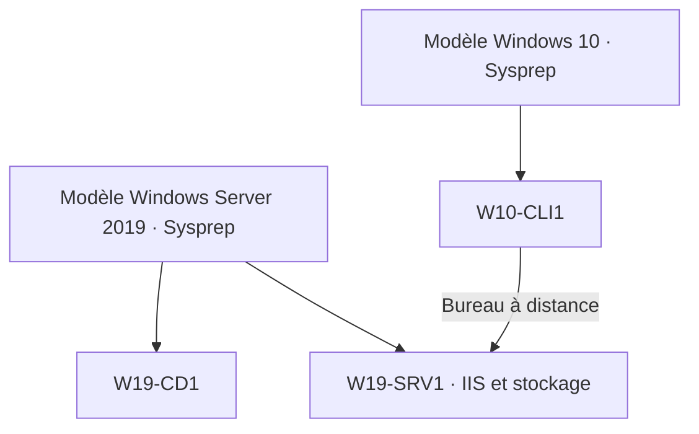

# Module 01 — Administration Windows

Dans le laboratoire, Windows Server fournit les rôles de l’infrastructure et Windows 10 sert de poste client. Les deux TP construisent d’abord trois machines réutilisables, puis vérifient comment les volumes réagissent à la perte d’un disque.

## Objectifs

- Distinguer éditions, licences, rôles et modes d’installation de Windows Server.
- Préparer deux modèles et trois clones, puis vérifier IIS et le Bureau à distance.
- Choisir un type de volume selon la capacité, les performances et la tolérance à une panne.
- Vérifier la disponibilité des fichiers avant et après le retrait d’un disque.

## Versions, éditions et modes d’installation

Le support situe Windows Server 2008/R2, 2012/R2, 2016, 2019, 2022 et 2025 face aux générations clientes Windows 7, 8/8.1, 10 et 11. Le TP installe Windows Server 2019 Standard et Windows 10. Standard, Datacenter et Essentials répondent à des besoins distincts de virtualisation, capacité et licence. Le tableau du support conserve ses valeurs historiques. Pour dimensionner un autre serveur, vérifier les prérequis correspondant à sa version. [Configuration matérielle Windows Server](https://learn.microsoft.com/windows-server/get-started/hardware-requirements).

Une licence du système permet son installation. Les licences d’accès client concernent l’accès aux services du serveur, avec des besoins supplémentaires possibles pour RDS. Pour le TP, la distinction opérationnelle est entre Server Core, administrable par commandes et outils distants, et l’Expérience de bureau, qui fournit l’environnement graphique utilisé par les démonstrations.

| Composant | Rôle dans l’infrastructure |
|---|---|
| AD DS | Domaine, comptes, machines et authentification |
| DNS | Résolution de noms et localisation des services |
| DHCP | Attribution automatique des paramètres IP |
| Hyper-V | Création et gestion de machines virtuelles |
| WDS, WSUS | Déploiement de systèmes et gestion des mises à jour |
| Impression | Centralisation des ports, pilotes, files et partages |
| AD FS, AD RMS, AD CS | Fédération d’identité, protection de ressources et certificats. Le support les cite comme extensions du parcours. |

Un **rôle** correspond généralement au service fourni aux clients. Une **fonctionnalité** apporte un composant ou un outil au serveur. Le Gestionnaire de serveur installe et supervise ces composants. Les consoles de rôle, les outils distants, PowerShell et CMD servent aux tâches ciblées.

**Illustration IA / externe au cours — des modèles aux machines du laboratoire.**



## TP guidé — Installation et configuration initiale

**Durée du support.** Une à deux heures. Préparer les ISO fournies pour le laboratoire, les dossiers de stockage et le réseau prévu.

### A. Créer les modèles

1. Créer `VM_Modele_2019` et `VM_Modele_W10` sous `D:\Machines_Virtuelles\Modeles`. Affecter **32 Go** de disque, **2 Go** de mémoire et une carte en pont à chacun.
2. Installer Windows Server 2019 Standard et Windows 10 sur leurs disques respectifs, puis les VMware Tools. Vérifier le démarrage et la présence des outils invités.
3. Généraliser avec Sysprep et arrêter. Dans Workstation, ranger les deux VM dans **VM MODELES – A NE PAS DEMARRER**.
4. Préparer les clones dans leurs propres dossiers, hors du répertoire des modèles. Démarrer les clones pour leur configuration initiale et garder les modèles arrêtés pour les prochains ateliers.

### B. Renommer et adresser les clones

| Clone | Modèle | Adresse statique |
| --- | --- | --- |
| `W19-CD1` | Windows Server 2019 | `172.28.10.1/16` |
| `W19-SRV1` | Windows Server 2019 | `172.28.10.2/16` |
| `W10-CLI1` | Windows 10 | `172.28.10.11/16` |

Donner au système invité le même nom que la VM et vérifier l’interface configurée. Avec le masque `/16`, le préfixe réseau canonique est `172.28.0.0/16`. Le support écrit `172.28.10.0/16` pour désigner la plage de salle. Les adresses des trois hôtes restent celles du scénario.

### C. Mettre en service et vérifier

1. Dans le Gestionnaire de serveur de `W19-SRV1`, installer IIS et la fonctionnalité de Sauvegarde Windows Server. Contrôler la fin de l’assistant.
2. Sur le serveur, ouvrir `http://localhost` et vérifier la page IIS. Ce test porte sur le service local. Examiner le pare-feu et la liaison séparément si un accès depuis le client est demandé.
3. Autoriser le Bureau à distance dans le scénario. Depuis `W10-CLI1`, tester la connexion à `W19-SRV1` avec l’outil graphique, puis la commande. Vérifier la cible et le droit du compte utilisé.

```cmd
ipconfig /all
ping 172.28.10.2
mstsc /?
mstsc /v:172.28.10.2
```

Garder comme preuves l’état arrêté des deux modèles, les noms et adresses des clones, la page IIS et la session distante sur le serveur prévu.

## Partitionner puis formater

La table de partition décrit nombre, position et taille des partitions. MBR propose au plus quatre entrées principales, ou trois principales plus une partition étendue contenant des lecteurs logiques. Sa limite usuelle est proche de 2 Tio avec secteurs de 512 octets. GPT conserve une copie de ses métadonnées en fin de disque et Windows prend en charge jusqu’à 128 partitions. Le démarrage de Windows sur GPT implique un démarrage UEFI. Un disque GPT de données ne dépend pas de ce mode d’amorçage.

Le disque de base stocke les données dans les partitions d’un disque. Le disque dynamique du TP permet les volumes sur plusieurs disques. Le support indique une conversion de base vers dynamique sans supprimer les données et un retour qui demande la suppression préalable des volumes. Avant une conversion, identifier le disque et contrôler la possibilité de restaurer ses données.

| Volume | Répartition | Capacité utile pour des portions de même taille |
|---|---|---|
| Simple | Un disque | Portion allouée |
| Fractionné | Plusieurs espaces combinés | Somme des portions. La perte d’un disque compromet le volume. |
| RAID 0 | Bandes réparties sur les disques | Somme des portions. Aucune tolérance de panne. |
| RAID 1 | Copie identique sur deux disques | Une portion. Tolère la perte d’un des deux disques. |
| RAID 5 | Bandes et parité distribuée sur au moins trois disques | Total moins l’équivalent d’une portion. Tolère la perte d’un disque. |

Deux portions de 100 Go donnent 200 Go en RAID 0 ou 100 Go en miroir. Trois portions de 100 Go donnent 200 Go utiles en RAID 5. Le schéma RAID 5 du support contient le libellé « volume en miroir » à côté de la capacité logique. Le mécanisme décrit est bien la parité distribuée. Une redondance maintient certains accès pendant une panne, tandis qu’une sauvegarde permet de restaurer une autre copie des données.

Après la création du volume, choisir le système de fichiers. Le support cite FAT32/exFAT, NTFS et ReFS. Les outils de l’exercice sont Gestion des disques (`diskmgmt.msc`), `diskpart` et les commandes PowerShell de stockage.

## TP guidé — Gestion du stockage

**Durée du support.** Trente minutes à une heure. Utiliser `W19-SRV1`. Repérer son disque système, changer la lettre du lecteur CD en `L:` et ajouter trois disques SCSI de **10 Go** chacun. Comparer l’inventaire de Workstation et celui de Gestion des disques avant toute conversion ou initialisation.

| Besoin | Volume et résultat attendus |
| --- | --- |
| Documents de travail | `D:\` **Données**, RAID 5 d’environ 6 Go utiles. Trois portions de 3 Go fournissent environ 6 Go après parité. |
| Outils accessibles au service informatique | Miroir de **4 Go** sur les disques 1 et 3, monté sous `C:\INFO-TOOLS`. |
| Espace Database | Volume en bandes de **8 Go** accessible par `E:\`, choisi pour le scénario de performance du TP. |

1. Créer les trois volumes dans Gestion des disques et relever leurs capacités. Vérifier le type, les portions de disque et le chemin de montage.
2. Créer un fichier témoin par volume. Depuis Workstation, simuler la panne du disque SCSI nº 3 du laboratoire après avoir identifié le bon périphérique.
3. Comparer le statut et l’accès aux fichiers. Données et INFO-TOOLS peuvent rester accessibles avec une seule perte admissible. Database peut devenir indisponible si le disque retiré participe au volume en bandes.
4. Ajouter le disque de remplacement et rétablir la redondance selon le type de volume. Pour INFO-TOOLS, le corrigé montre l’ajout d’un nouveau miroir sur le disque prévu. Contrôler la reconstruction et ouvrir les fichiers témoins.
5. Si un volume sans redondance est perdu, distinguer recréation du volume et restauration des fichiers. Vérifier le résultat depuis une copie prévue par la maquette.

## À retenir

Le modèle prépare les prochains postes. Un clone se vérifie avec son identité et son réseau propres. La redondance tolère certaines pannes, tandis que la restauration récupère des données depuis une autre copie.

## Mini-quiz — 5 questions {#mini-quiz}

1. Que distingue un rôle d’une fonctionnalité ?
2. Pourquoi conserver les modèles arrêtés après Sysprep ?
3. Quel préfixe correspond à 172.28.10.2/16 ?
4. Combien de Go utiles donnent trois portions de 3 Go en RAID 5 ?
5. Que prouve un fichier lisible sur un volume dégradé ?

??? success "Réponses commentées"

    1. Le rôle fournit généralement un service. Une fonctionnalité ajoute un composant ou un outil.
    2. Pour réutiliser un état généralisé. Les clones reçoivent leurs propres noms et adresses.
    3. 172.28.0.0/16. L’adresse d’hôte reste 172.28.10.2.
    4. Environ 6 Go. La parité consomme l’équivalent d’une portion.
    5. Le volume a supporté la panne simulée. Il faut encore vérifier le remplacement, la reconstruction et la restauration.

## Pour pratiquer et réviser {#appliquer-le-cours}

- [Énoncés](../../tp/services-reseaux-microsoft/module-01/enonces.md) et [corrections](../../tp/services-reseaux-microsoft/module-01/corrections.md)
- [Démonstrations](../../tp/services-reseaux-microsoft/module-01/demonstrations.md)
- [Fiche de révision](../../revision/services-reseaux-microsoft/module-01-module-01.md)
- [Kahoot existant](../../kahoot/09-services-reseaux-microsoft-module-01-module-01.md)
- [Sommaire de Services réseau en environnement Microsoft](index.md)

## Provenance pédagogique

Le support M01, les trois démonstrations et les deux paires de TP fondent les réglages. Le schéma et les contrôles intermédiaires expliquent les dépendances de la maquette.
