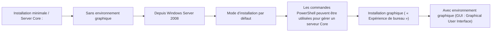

# Module 01 — Administration Windows

[Travaux pratiques](../../tp/services-reseaux-microsoft/module-01/index.md)

Les parties ci-dessous reprennent le cours original, dans le même ordre. Les encadrés et les schémas répètent ses formulations.

## Parcours de lecture

1. Support · Module 01 – Support de cours · 29 pages transcrites

**Visuel externe**


SOURCE DRIVE · TRANSCRIPTION DU SUPPORT

Le contenu des documents du dossier TSSR est transcrit ci-dessous, page par page. Les textes et tableaux sont intégrés à la page Web. Aucun fichier PDF, aucune diapositive entière ni aucune reproduction de page n’est affiché. Seuls des croquis ou visuels isolés et vérifiés peuvent accompagner la transcription. Les versions et les consignes restent celles des supports de formation. Les compléments IA sont conservés dans leur onglet distinct.

## Support · Module 01 – Support de cours · 29 pages transcrites

#### Module 01 – Administration Windows

#### Objectifs

!!! note "À retenir"
    Connaître Microsoft Server et son biotope Gérer le stockage du serveur et le RAID

- Connaître Microsoft Server et son biotope
- Gérer le stockage du serveur et le RAID

```
Administration Windows

                                         •  Connaître Microsoft Server et son biotopeObjectifs
                                         •  Gérer le stockage du serveur et le RAID
```

#### Version des systèmes d’exploitation Microsoft

#### Les deux familles

- Les systèmes d’exploitation serveur

#### Windows 2008

#### Windows 2012

& R2

#### & R2 Windows 2016 Windows 2019 Windows 2022 Windows 2025

#### Ces versions ont la capacité de fournir un ensemble de services au sein d’une infrastructure

- Les systèmes d’exploitation client

#### Windows 7 Windows 8 & 8.1 Windows 10 Windows 11

#### Ces systèmes sont en règle générale utilisés en tant que station de travail par les utilisateurs

#### Version des systèmes d’exploitation Microsoft

#### Les différentes éditions Windows Server

!!! note "À retenir"
    160 Go de stockage avec une 32 Go de stockage disque 2 VMs Nombre illimité de VMs

CPU 1,4 GHz 64 bits – 1 sock.

160 Go de stockage avec une

32 Go de stockage disque

2 VMs Nombre illimité de VMs

#### Pas de CALs

| Caractéristique | Standard | Datacenter | Essentials |
| --- | --- | --- | --- |
| Prise en charge matérielle (minimum) | 512 Mo de RAM en mode Core ; 2 Go avec expérience utilisateur ; CPU 1,4 GHz 64 bits ; 32 Go de stockage | 512 Mo de RAM en mode Core ; 2 Go avec expérience utilisateur ; CPU 1,4 GHz 64 bits ; 32 Go de stockage | 2 Go de RAM ; CPU 1,4 GHz 64 bits – 1 socket ; 160 Go de stockage avec partition système de 60 Go |
| Droits à la virtualisation et spécificités | 2 VM | Nombre illimité de VM | Pas de licence pour virtualiser ; pas de CAL |
| Mode de licence | Basé sur les cœurs CPU (16 cœurs / 1 licence) | Basé sur les cœurs CPU (16 cœurs / 1 licence) | Licence serveur |

#### Version des systèmes d’exploitation Microsoft

#### Quelques rappels sur les licences

#### Licence d’Accès

#### Licence du Système

#### Client SE

d’Exploitation (SE)

Licence du SE du

client

#### Installation du produit Mise en œuvre des services

#### Accès aux services depuis

d’autres postes

#### Certains services peuvent

nécessiter des CAL supplémentaires (RDS)

#### Accès aux rôles

#### Les services pris en charge par Windows Server

!!! note "À retenir"
    L’ajout d’un serveur dans un contexte d’entreprise permet de fournir des services spécifiques.

- L’ajout d’un serveur dans un contexte d’entreprise permet de fournir des services spécifiques.

- Un ensemble de services est nativement pris en charge par les systèmes d’exploitation Windows Server. Ceux-ci seront présentés ci-après.

- Bien d’autres solutions, outils, applications, non présentés ici, peuvent être mis en œuvre sur les systèmes d’exploitation serveur (serveur de messagerie Exchange, serveur de bases de données Microsoft SQL).

#### Les services pris en charge par Windows Server

#### Les services de domaine pris en charge Les systèmes d’exploitation serveur prennent en charge les composantes de services Active Directory suivants :

#### Services de domaine Active Directory (AD DS) Ce rôle fournit la gestion de contextes de domaine Active Directory.

!!! note "À retenir"
    Protection des ressources contre une utilisation non autorisée, basée sur l’utilisation de certificats (permet notamment d’interdire la copie ou l’impression d’un fichier).

Protection des ressources contre une utilisation non autorisée, basée sur l’utilisation de certificats (permet notamment d’interdire la copie ou l’impression d’un fichier).

#### Services de certificat Active Directory (AD CS)* Service de gestion d’une autorité de certification (fournit une infrastructure à clef publique).

* Non vus pendant ce cours.

| Services | Description |
| --- | --- |
| Services de domaine Active Directory (AD DS) | Gestion de contextes de domaine Active Directory. |
| Service de fédération AD (AD FS) | Services fédérés de gestion des identités. |
| Services de gestion des droits Active Directory (AD RMS) | Protection des ressources contre une utilisation non autorisée, basée sur l’utilisation de certificats, par exemple pour interdire la copie ou l’impression d’un fichier. |
| Services de certificat Active Directory (AD CS) | Gestion d’une autorité de certification et d’une infrastructure à clef publique. |

#### Les services pris en charge par Windows Server

#### Les autres services pris en charge (liste non exhaustive) :

!!! note "À retenir"
    Permet de créer un environnement informatique virtualisé dans lequel vous pouvez créer et gérer des machines virtuelles.

Permet de créer un environnement informatique virtualisé dans lequel vous pouvez créer et gérer des machines virtuelles.

WSUS Fournit une prise en charge centralisée des mises à jour des produits Microsoft.

Services d’impression et de numérisation de document Permet d’avoir une gestion centralisée de vos périphériques d’impressions.

| Services | Description |
| --- | --- |
| DNS | Service de résolution de noms d’hôtes |
| DHCP | Service de gestion de l’adressage IP |
| Hyper-V | Environnement informatique virtualisé pour créer et gérer des machines virtuelles |
| WDS | Déploiement de systèmes d’exploitation Windows à travers le réseau |
| WSUS | Prise en charge centralisée des mises à jour des produits Microsoft |
| Services d’impression et de numérisation de document | Gestion centralisée des périphériques d’impression |

#### Installation du système et composants

#### Les modes d’installation

!!! note "À retenir"
    Installation minimale / Server Core : Sans environnement graphique Depuis Windows Server 2008 Mode d’installation par défaut Les commandes PowerShell peuvent être utilisées pour gérer un serveur Core Installation graphique ( « Expérience de bureau ») Avec environnement graphique (GUI : Graphical User Interface)

**Visuel externe**



- Installation minimale / Server Core :

- Sans environnement graphique

- Depuis Windows Server 2008

- Mode d’installation par défaut

- Les commandes PowerShell peuvent être utilisées pour gérer un serveur Core

- Installation graphique ( « Expérience de bureau »)

- Avec environnement graphique (GUI : Graphical User Interface)

#### Installer Windows Server 2019 Standard

#### Démonstration

#### Installation du système et composants

#### Les rôles et fonctionnalités

!!! note "À retenir"
    Des composants peuvent être ajoutés par : Le gestionnaire de serveur Des commandes PowerShell Deux types de composants : Les rôles : correspond généralement à un service que l’on fournit à des clients Les fonctionnalités : correspond généralement à un outil/composant utile sur l’élément sur lequel on l’ajoute

**Visuel externe**


- Des composants peuvent être ajoutés par :
- Le gestionnaire de serveur
- Des commandes PowerShell

- Deux types de composants :
- Les rôles : correspond généralement à un service que l’on fournit à des clients
- Les fonctionnalités : correspond généralement à un outil/composant utile sur l’élément sur lequel on l’ajoute

#### Installation du système et composants

#### Les outils de gestion de Windows Server

#### Les différents outils sont :

!!! note "À retenir"
    Le Gestionnaire de serveur : Élément central d’administration du ou des serveurs Les consoles de gestion des services : Disponibles suite à l’ajout d’un rôle sur un serveur Peuvent être ajoutées sur un poste d’administration ne disposant pas du rôle à gérer La console PowerShell Ligne de commande (CMD)

**Visuel externe**


- Le Gestionnaire de serveur :
- Élément central d’administration du ou des serveurs

- Les consoles de gestion des services :
- Disponibles suite à l’ajout d’un rôle sur un serveur
- Peuvent être ajoutées sur un poste d’administration ne disposant pas du rôle à gérer

- La console PowerShell

- Ligne de commande (CMD)

#### Démonstration

#### M01TP01 - Installation et configuration initiale

TP

#### Gestion du stockage

#### Les outils

#### Ce que nous allons voir

#### Les tables de partition

Gestion des

#### Les ensembles

```
disques
```

de stockage

#### Les types de configuration

#### RAID

de disques

#### La table de partitionnement

**Visuel externe**


- Stockée en début de disque (et fin de disque si GPT)

- Détermine les caractéristiques des partitions créées sur un disque
- Nombre
- Taille
- Position

- Héberge un chargeur d’amorçage

- 2 formats existent:
- MBR (années 80)
- GPT (années 2000)
- BIOS UEFI obligatoire

#### Les formats de tables de partition

#### Caractéristiques de formats de partitionnement

- Le partitionnement MBR
- 4 partitions physiques (dont 1 étendue) max
- Limite de taille d’une partition à 2,2 To max

- Le partitionnement GPT
- Meilleure tolérance aux pannes (Données dupliquées en fin de disque)
- Possibilité de reconstruction
- 128 partitions physiques

- Possibilité de conversion

#### MBR Conversion OK avant que le disque ne contienne des données GPT

#### Les types de configuration des disques

#### Les configurations de disques sous Windows

#### 2 types de configurations :

- Configuration de base
- Simplifie la gestion du disque
- Toutes les données sont inscrites dans des partitions physiques
- Sur un seul disque physique

- Configuration dynamique
- La gestion se fait par ensemble de disques
- Les données sont inscrites dans des volumes
- Nécessaire pour le RAID logiciel

#### De base Sans incidence pour les données Dynamique

- Conversion

#### De base Nécessite la suppression préalable des volumes Dynamique

#### Partitionnement physique (MBR)

#### Partition étendue

#### Lecteur logique

#### Partition principale 1 Partition principale 2 Partition principale 3 Lecteur logique

#### Partitionnement d’un disque de base

- Sur un disque de base, on peut créer au maximum soit :
- 4 partitions principales
- 3 partitions principales et 1 partition étendue dans laquelle on crée des lecteurs logiques
- Les lecteurs logiques seront formatés

- Les partitions peuvent être étendues ou réduites sur l’espace contigu du même disque.

- Le lancement d’un OS à partir d’un lecteur logique n’est pas possible.

#### Partitionnement et RAID

#### Partitionnement d’un disque dynamique

- Il est composé de volumes qui peuvent être de plusieurs types :
- Volume simple
- Volume fractionné
- Volume agrégé par bandes
- Volume en miroir
- Volume agrégé par bandes avec parité

- RAID (Redundancy Array of Inexpensive Disk)

#### Partitionnement et RAID

#### Le volume simple

#### On parlera d’espace disque.

- C’est le seul type de volume qui utilise un seul disque physique

#### Volume simple 1 Volume simple 2 Espace libre

- Il peut être étendu au sein du même disque

#### Volume simple 1 Volume simple 2 Volume simple 1 Espace libre

#### Partitionnement et RAID

#### Le volume fractionné

#### Un volume fractionné utilise plusieurs espaces sur plusieurs disques physiques.

- Situation initiale

#### Volume simple 1 Volume simple 2 Espace libre

#### Espace libre

- Extension du volume simple 2 sur le disque dynamique 2

#### Volume simple 1 Volume simple 2 Espace libre

#### Volume simple 2

#### Espace libre

#### Disque 1 Disque 2 Disque 1 Disque 2

#### Partitionnement et RAID

#### Le volume agrégé par bandes

#### Le RAID-0 ou volume agrégé par bandes en est un type :

#### Volume simple 1 100 Go

#### Volume agrégé par bandes 200 Go

#### Vue logique

#### Vue physique

100 Go Espace libre

RAID 0

#### Disque 1 Disque 2

A1

A2

A3

A4

A5

A6

#### Disque 1 Disque 2

- La taille des bandes doit être identique sur chaque disque
- Réparti sur 2 à x disques
- Rapidité de lecture/écriture accrue
- Aucune tolérance de panne
- Tout l’espace disque alloué est utilisable

```
Administration Windows
Partitionnement et RAID

      Le volume agrégé par bandes
       Le RAID-0 ou volume agrégé par bandes en est un type :

      1
                     physique           Disque           Volume simple 1         Volume agrégé100parGobandes                                                  logique                             200 Go
      2                                                                                                           Vue        Vue                             100 Go           Espace libre                                      Disque                                                                                                                                 RAID 0

                                                                    A1           A2                 • La taille des bandes doit être identique sur chaque disque
                 • Réparti sur 2 à x disques                                   A3           A4
                 • Rapidité de lecture/écriture accrue
                                                                        A5            A6                 • Aucune tolérance de panne
                 • Tout l’espace disque alloué est utilisable                                                     Disque 1                          Disque 2
```

#### Partitionnement et RAID

#### Le volume en miroir

#### Le RAID-1 ou volume miroir en est un type :

#### Volume simple 1 100 Go

#### Volume en miroir 100 Go

#### Vue logique

#### Vue physique

100 Go Espace libre

#### Disque 1 Disque 2

RAID 1

A1

A1

A2

A2

A3

A3

#### Disque 1 Disque 2

- Réparti sur 2 disques
- L’espace alloué sur les 2 disques doit être identique
- Les mêmes données sont écrites simultanément sur les 2 disques
- Tolérances aux pannes accrues, un des disques peut être perdu sans impact sur les données
- La moitié de l’espace disque alloué n’est pas directement utilisable

```
Administration Windows
Partitionnement et RAID

      Le volume en miroir
       Le RAID-1 ou volume miroir en est un type :

         1
                                     physique           Disque           Volume simple 1             Volume100en miroirGo                                                             logique                             100 Go
         2                                                                                                                 Vue              Vue                                 100 Go           Espace libre                                                      Disque
                                                                                                                                           RAID 1
                 • Réparti sur 2 disques                                                                            A1           A1
                 • L’espace alloué sur les 2 disques doit être identique
                                                                            A2           A2                 • Les mêmes données sont écrites simultanément sur les 2 disques
                 • Tolérances aux pannes accrues, un des disques peut être perdu                                                                                 A3            A3
             sans impact sur les données
                 • La moitié de l’espace disque alloué n’est pas directement utilisable                  Disque 1                          Disque 2
```

#### Partitionnement et RAID

#### Le volume agrégé par bandes avec parité

#### Le RAID-5 ou volume agrégé par bandes avec parité en est un type :

#### Volume simple 1 100 Go

200 Go

#### Volume en miroir

#### Vue logique

RAID 5

100 Go Espace libre

#### Disque 1 Disque 2

#### Volume agrégé par bandes avec parité

#### Vue physique

A1

A2

Ap

100 Go

#### Espace libre

#### Disque 3

B1

#### Bp

B2

Cp

C1

C2

- 3 disques minimum
- 1 disque (espace d’une bande) est alloué à la tolérance de panne
- RAID offrant un compromis tolérance panne / coûts

#### Disque 1 Disque 2

#### Disque 3

#### Formatage et outils

#### Formatage

Partitionnement

- Les partitions principales, lecteurs logiques et volumes doivent être formatés avant d’être utilisables.

Formatage

- Le formatage est l’installation d’un système de fichier (hébergement des données).

- Les systèmes de fichiers disponibles sont :

#### FAT32 / exFAT

#### NTFS Depuis Windows NT

ReFS

#### Depuis Windows 2012 (pour les espaces de stockage)

#### Formatage et outils

#### Les outils

- La console de Gestion des disques (diskmgmt.msc)

- La commande (CMD) diskpart

- Les commandes PowerShell

#### Gestion du stockage

#### Démonstration

#### M01TP02 - Gestion du stockage

TP

Référence du document : 1v0jBGuIPpEKDn1pkUIXbEnE7W21_DXVC · SHA-256 bb53066775c91dbf…
