# Module 01 — Administration Windows

Les parties ci-dessous reprennent le cours original, dans le même ordre. Les encadrés et les schémas répètent ses formulations.

## Parcours de lecture

1. Support · Module 01 – Support de cours · 29 pages transcrites
2. Démonstration · Fiche démo 1 - Installation du système · 9 pages transcrites
3. Démonstration · Fiche démo 2 - Ajout de rôles et de fonctionnalités via le gestionnaire de serveur · 5 pages transcrites
4. Démonstration · Fiche démo 3 - Le formatage sous Windows Server · 15 pages transcrites
5. Énoncé · Enoncé du TP 1 - Installation et configuration initiale · 3 pages transcrites
6. Énoncé · Enoncé du TP 2 - Gestion du stockage · 2 pages transcrites
7. Correction · Solution du TP 1 - Installation et configuration initiale · 6 pages transcrites
8. Correction · Solution du TP 2 - Gestion du stockage · 7 pages transcrites

**Visuel externe**

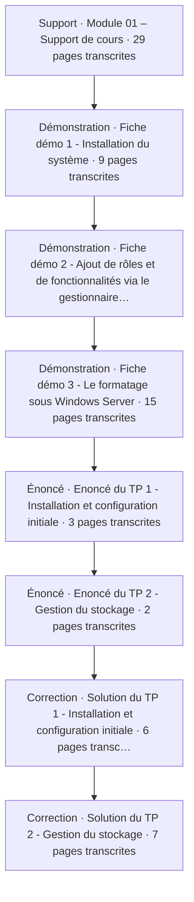

SOURCE DRIVE · TRANSCRIPTION DU SUPPORT

Le contenu des documents du dossier TSSR est transcrit ci-dessous, page par page. Les textes et tableaux sont intégrés à la page Web. Aucun fichier PDF, aucune diapositive entière ni aucune reproduction de page n’est affiché. Seuls des croquis ou visuels isolés et vérifiés peuvent accompagner la transcription. Les versions et les consignes restent celles des supports de formation. Les compléments IA sont conservés dans leur onglet distinct.

## Support · Module 01 – Support de cours · 29 pages transcrites

#### Module 01 – Administration Windows

#### Objectifs

!!! note "À retenir"
    Connaître Microsoft Server et son biotope Gérer le stockage du serveur et le RAID

- Connaître Microsoft Server et son biotope
- Gérer le stockage du serveur et le RAID

```
Administration Windows

                                         •  Connaître Microsoft Server et son biotopeObjectifs
                                         •  Gérer le stockage du serveur et le RAID
```

#### Version des systèmes d’exploitation Microsoft

#### Les deux familles

- Les systèmes d’exploitation serveur

#### Windows 2008

#### Windows 2012

#### & R2

#### & R2 Windows 2016 Windows 2019 Windows 2022 Windows 2025

#### Ces versions ont la capacité de fournir un ensemble de services au sein d’une infrastructure

- Les systèmes d’exploitation client

#### Windows 7 Windows 8 & 8.1 Windows 10 Windows 11

#### Ces systèmes sont en règle générale utilisés en tant que station de travail par les utilisateurs

#### Version des systèmes d’exploitation Microsoft

#### Les différentes éditions Windows Server

!!! note "À retenir"
    160 Go de stockage avec une 32 Go de stockage disque 2 VMs Nombre illimité de VMs

CPU 1,4 GHz 64 bits – 1 sock.

160 Go de stockage avec une

32 Go de stockage disque

2 VMs Nombre illimité de VMs

#### Pas de CALs

| Caractéristique | Standard | Datacenter | Essentials |
| --- | --- | --- | --- |
| Prise en charge matérielle (minimum) | 512 Mo de RAM en mode Core ; 2 Go avec expérience utilisateur ; CPU 1,4 GHz 64 bits ; 32 Go de stockage | 512 Mo de RAM en mode Core ; 2 Go avec expérience utilisateur ; CPU 1,4 GHz 64 bits ; 32 Go de stockage | 2 Go de RAM ; CPU 1,4 GHz 64 bits – 1 socket ; 160 Go de stockage avec partition système de 60 Go |
| Droits à la virtualisation et spécificités | 2 VM | Nombre illimité de VM | Pas de licence pour virtualiser ; pas de CAL |
| Mode de licence | Basé sur les cœurs CPU (16 cœurs / 1 licence) | Basé sur les cœurs CPU (16 cœurs / 1 licence) | Licence serveur |

#### Version des systèmes d’exploitation Microsoft

#### Quelques rappels sur les licences

#### Licence d’Accès

#### Licence du Système

#### Client SE

#### d’Exploitation (SE)

#### Licence du SE du

client

#### Installation du produit Mise en œuvre des services

#### Accès aux services depuis

#### d’autres postes

#### Certains services peuvent

#### nécessiter des CAL supplémentaires (RDS)

#### Accès aux rôles

#### Les services pris en charge par Windows Server

!!! note "À retenir"
    L’ajout d’un serveur dans un contexte d’entreprise permet de fournir des services spécifiques.

- L’ajout d’un serveur dans un contexte d’entreprise permet de fournir des services spécifiques.

- Un ensemble de services est nativement pris en charge par les systèmes d’exploitation Windows Server. Ceux-ci seront présentés ci-après.

- Bien d’autres solutions, outils, applications, non présentés ici, peuvent être mis en œuvre sur les systèmes d’exploitation serveur (serveur de messagerie Exchange, serveur de bases de données Microsoft SQL).

#### Les services pris en charge par Windows Server

#### Les services de domaine pris en charge Les systèmes d’exploitation serveur prennent en charge les composantes de services Active Directory suivants :

#### Services de domaine Active Directory (AD DS) Ce rôle fournit la gestion de contextes de domaine Active Directory.

!!! note "À retenir"
    Protection des ressources contre une utilisation non autorisée, basée sur l’utilisation de certificats (permet notamment d’interdire la copie ou l’impression d’un fichier).

Protection des ressources contre une utilisation non autorisée, basée sur l’utilisation de certificats (permet notamment d’interdire la copie ou l’impression d’un fichier).

#### Services de certificat Active Directory (AD CS)* Service de gestion d’une autorité de certification (fournit une infrastructure à clef publique).

* Non vus pendant ce cours.

| Services | Description |
| --- | --- |
| Services de domaine Active Directory (AD DS) | Gestion de contextes de domaine Active Directory. |
| Service de fédération AD (AD FS) | Services fédérés de gestion des identités. |
| Services de gestion des droits Active Directory (AD RMS) | Protection des ressources contre une utilisation non autorisée, basée sur l’utilisation de certificats, par exemple pour interdire la copie ou l’impression d’un fichier. |
| Services de certificat Active Directory (AD CS) | Gestion d’une autorité de certification et d’une infrastructure à clef publique. |

#### Les services pris en charge par Windows Server

#### Les autres services pris en charge (liste non exhaustive) :

!!! note "À retenir"
    Permet de créer un environnement informatique virtualisé dans lequel vous pouvez créer et gérer des machines virtuelles.

Permet de créer un environnement informatique virtualisé dans lequel vous pouvez créer et gérer des machines virtuelles.

WSUS Fournit une prise en charge centralisée des mises à jour des produits Microsoft.

Services d’impression et de numérisation de document Permet d’avoir une gestion centralisée de vos périphériques d’impressions.

| Services | Description |
| --- | --- |
| DNS | Service de résolution de noms d’hôtes |
| DHCP | Service de gestion de l’adressage IP |
| Hyper-V | Environnement informatique virtualisé pour créer et gérer des machines virtuelles |
| WDS | Déploiement de systèmes d’exploitation Windows à travers le réseau |
| WSUS | Prise en charge centralisée des mises à jour des produits Microsoft |
| Services d’impression et de numérisation de document | Gestion centralisée des périphériques d’impression |

#### Installation du système et composants

#### Les modes d’installation

!!! note "À retenir"
    Installation minimale / Server Core : Sans environnement graphique Depuis Windows Server 2008 Mode d’installation par défaut Les commandes PowerShell peuvent être utilisées pour gérer un serveur Core Installation graphique ( « Expérience de bureau ») Avec environnement graphique (GUI : Graphical User Interface)

**Visuel externe**

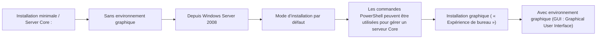

- Installation minimale / Server Core :

- Sans environnement graphique

- Depuis Windows Server 2008

- Mode d’installation par défaut

- Les commandes PowerShell peuvent être utilisées pour gérer un serveur Core

- Installation graphique ( « Expérience de bureau »)

- Avec environnement graphique (GUI : Graphical User Interface)

#### Installer Windows Server 2019 Standard

#### Démonstration

#### Installation du système et composants

#### Les rôles et fonctionnalités

!!! note "À retenir"
    Des composants peuvent être ajoutés par : Le gestionnaire de serveur Des commandes PowerShell Deux types de composants : Les rôles : correspond généralement à un service que l’on fournit à des clients Les fonctionnalités : correspond généralement à un outil/composant utile sur l’élément sur lequel on l’ajoute

**Visuel externe**


- Des composants peuvent être ajoutés par :
- Le gestionnaire de serveur
- Des commandes PowerShell

- Deux types de composants :
- Les rôles : correspond généralement à un service que l’on fournit à des clients
- Les fonctionnalités : correspond généralement à un outil/composant utile sur l’élément sur lequel on l’ajoute

#### Installation du système et composants

#### Les outils de gestion de Windows Server

#### Les différents outils sont :

!!! note "À retenir"
    Le Gestionnaire de serveur : Élément central d’administration du ou des serveurs Les consoles de gestion des services : Disponibles suite à l’ajout d’un rôle sur un serveur Peuvent être ajoutées sur un poste d’administration ne disposant pas du rôle à gérer La console PowerShell Ligne de commande (CMD)

**Visuel externe**


- Le Gestionnaire de serveur :
- Élément central d’administration du ou des serveurs

- Les consoles de gestion des services :
- Disponibles suite à l’ajout d’un rôle sur un serveur
- Peuvent être ajoutées sur un poste d’administration ne disposant pas du rôle à gérer

- La console PowerShell

- Ligne de commande (CMD)

#### Démonstration

#### M01TP01 - Installation et configuration initiale

#### TP

#### Gestion du stockage

#### Les outils

#### Ce que nous allons voir

#### Les tables de partition

#### Gestion des

#### Les ensembles

#### disques

#### de stockage

#### Les types de configuration

#### RAID

#### de disques

#### La table de partitionnement

**Visuel externe**


- Stockée en début de disque (et fin de disque si GPT)

- Détermine les caractéristiques des partitions créées sur un disque
- Nombre
- Taille
- Position

- Héberge un chargeur d’amorçage

- 2 formats existent:
- MBR (années 80)
- GPT (années 2000)
- BIOS UEFI obligatoire

#### Les formats de tables de partition

#### Caractéristiques de formats de partitionnement

- Le partitionnement MBR
- 4 partitions physiques (dont 1 étendue) max
- Limite de taille d’une partition à 2,2 To max

- Le partitionnement GPT
- Meilleure tolérance aux pannes (Données dupliquées en fin de disque)
- Possibilité de reconstruction
- 128 partitions physiques

- Possibilité de conversion

#### MBR Conversion OK avant que le disque ne contienne des données GPT

#### Les types de configuration des disques

#### Les configurations de disques sous Windows

#### 2 types de configurations :

- Configuration de base
- Simplifie la gestion du disque
- Toutes les données sont inscrites dans des partitions physiques
- Sur un seul disque physique

- Configuration dynamique
- La gestion se fait par ensemble de disques
- Les données sont inscrites dans des volumes
- Nécessaire pour le RAID logiciel

#### De base Sans incidence pour les données Dynamique

- Conversion

#### De base Nécessite la suppression préalable des volumes Dynamique

#### Partitionnement physique (MBR)

#### Partition étendue

#### Lecteur logique

#### Partition principale 1 Partition principale 2 Partition principale 3 Lecteur logique

#### Partitionnement d’un disque de base

- Sur un disque de base, on peut créer au maximum soit :
- 4 partitions principales
- 3 partitions principales et 1 partition étendue dans laquelle on crée des lecteurs logiques
- Les lecteurs logiques seront formatés

- Les partitions peuvent être étendues ou réduites sur l’espace contigu du même disque.

- Le lancement d’un OS à partir d’un lecteur logique n’est pas possible.

#### Partitionnement et RAID

#### Partitionnement d’un disque dynamique

- Il est composé de volumes qui peuvent être de plusieurs types :
- Volume simple
- Volume fractionné
- Volume agrégé par bandes
- Volume en miroir
- Volume agrégé par bandes avec parité

- RAID (Redundancy Array of Inexpensive Disk)

#### Partitionnement et RAID

#### Le volume simple

#### On parlera d’espace disque.

- C’est le seul type de volume qui utilise un seul disque physique

#### Volume simple 1 Volume simple 2 Espace libre

- Il peut être étendu au sein du même disque

#### Volume simple 1 Volume simple 2 Volume simple 1 Espace libre

#### Partitionnement et RAID

#### Le volume fractionné

#### Un volume fractionné utilise plusieurs espaces sur plusieurs disques physiques.

- Situation initiale

#### Volume simple 1 Volume simple 2 Espace libre

#### Espace libre

- Extension du volume simple 2 sur le disque dynamique 2

#### Volume simple 1 Volume simple 2 Espace libre

#### Volume simple 2

#### Espace libre

#### Disque 1 Disque 2 Disque 1 Disque 2

#### Partitionnement et RAID

#### Le volume agrégé par bandes

#### Le RAID-0 ou volume agrégé par bandes en est un type :

#### Volume simple 1 100 Go

#### Volume agrégé par bandes 200 Go

#### Vue logique

#### Vue physique

100 Go Espace libre

#### RAID 0

#### Disque 1 Disque 2

A1

A2

A3

A4

A5

A6

#### Disque 1 Disque 2

- La taille des bandes doit être identique sur chaque disque
- Réparti sur 2 à x disques
- Rapidité de lecture/écriture accrue
- Aucune tolérance de panne
- Tout l’espace disque alloué est utilisable

```
Administration Windows
Partitionnement et RAID

      Le volume agrégé par bandes
       Le RAID-0 ou volume agrégé par bandes en est un type :

      1
                     physique           Disque           Volume simple 1         Volume agrégé100parGobandes                                                  logique                             200 Go
      2                                                                                                           Vue        Vue                             100 Go           Espace libre                                      Disque                                                                                                                                 RAID 0

                                                                    A1           A2                 • La taille des bandes doit être identique sur chaque disque
                 • Réparti sur 2 à x disques                                   A3           A4
                 • Rapidité de lecture/écriture accrue
                                                                        A5            A6                 • Aucune tolérance de panne
                 • Tout l’espace disque alloué est utilisable                                                     Disque 1                          Disque 2
```

#### Partitionnement et RAID

#### Le volume en miroir

#### Le RAID-1 ou volume miroir en est un type :

#### Volume simple 1 100 Go

#### Volume en miroir 100 Go

#### Vue logique

#### Vue physique

100 Go Espace libre

#### Disque 1 Disque 2

#### RAID 1

A1

A1

A2

A2

A3

A3

#### Disque 1 Disque 2

- Réparti sur 2 disques
- L’espace alloué sur les 2 disques doit être identique
- Les mêmes données sont écrites simultanément sur les 2 disques
- Tolérances aux pannes accrues, un des disques peut être perdu sans impact sur les données
- La moitié de l’espace disque alloué n’est pas directement utilisable

```
Administration Windows
Partitionnement et RAID

      Le volume en miroir
       Le RAID-1 ou volume miroir en est un type :

         1
                                     physique           Disque           Volume simple 1             Volume100en miroirGo                                                             logique                             100 Go
         2                                                                                                                 Vue              Vue                                 100 Go           Espace libre                                                      Disque
                                                                                                                                           RAID 1
                 • Réparti sur 2 disques                                                                            A1           A1
                 • L’espace alloué sur les 2 disques doit être identique
                                                                            A2           A2                 • Les mêmes données sont écrites simultanément sur les 2 disques
                 • Tolérances aux pannes accrues, un des disques peut être perdu                                                                                 A3            A3
             sans impact sur les données
                 • La moitié de l’espace disque alloué n’est pas directement utilisable                  Disque 1                          Disque 2
```

#### Partitionnement et RAID

#### Le volume agrégé par bandes avec parité

#### Le RAID-5 ou volume agrégé par bandes avec parité en est un type :

#### Volume simple 1 100 Go

200 Go

#### Volume en miroir

#### Vue logique

#### RAID 5

100 Go Espace libre

#### Disque 1 Disque 2

#### Volume agrégé par bandes avec parité

#### Vue physique

A1

A2

Ap

100 Go

#### Espace libre

#### Disque 3

#### B1

#### Bp

#### B2

Cp

C1

C2

- 3 disques minimum
- 1 disque (espace d’une bande) est alloué à la tolérance de panne
- RAID offrant un compromis tolérance panne / coûts

#### Disque 1 Disque 2

#### Disque 3

#### Formatage et outils

#### Formatage

Partitionnement

- Les partitions principales, lecteurs logiques et volumes doivent être formatés avant d’être utilisables.

Formatage

- Le formatage est l’installation d’un système de fichier (hébergement des données).

- Les systèmes de fichiers disponibles sont :

#### FAT32 / exFAT

#### NTFS Depuis Windows NT

ReFS

#### Depuis Windows 2012 (pour les espaces de stockage)

#### Formatage et outils

#### Les outils

- La console de Gestion des disques (diskmgmt.msc)

- La commande (CMD) diskpart

- Les commandes PowerShell

#### Gestion du stockage

#### Démonstration

#### M01TP02 - Gestion du stockage

#### TP

Référence du document : 1v0jBGuIPpEKDn1pkUIXbEnE7W21_DXVC · SHA-256 bb53066775c91dbf…

## Démonstration · Fiche démo 1 - Installation du système · 9 pages transcrites

#### Installation du système Windows Server

#### Démonstration 01 du module 01

Cette démonstration décrit les différentes étapes relatives à l’installation du système Microsoft Server, en mode graphique.

#### Déroulement

- Prérequis

- Disposer d’une ISO Windows Server (ici en_windows_server_2019_x64).

- Disposer d’un logiciel de virtualisation (ici VMware Workstation 15.5.2 Pro)

- Créer votre machine virtuelle Windows Server

- Démarrer votre VM

Il faut démarrer la nouvelle machine virtuelle en sélectionnant votre machine virtuelle puis en cliquant sur la flèche verte.

- Booter sur le CD afin de lancer le processus d’installation du système d’exploitation

Il faut appuyer sur n’importe quelle touche du clavier afin de démarrer le processus d’installation de votre système d’exploitation (ici la touche « espace » sera utilisée).

- Choisir sa région puis continuer le processus.

Il convient ici de choisir la région afin de continuer le processus.

Ici :

- La langue d’installation sera l’Anglais

- Le fuseau horaire sera celui de Paris

- Les préférences du clavier seront Françaises

- Lancement de l’installation du système d’exploitation

Ici, cliquer sur le bouton Install now (1) afin de passer à l’étape suivante.

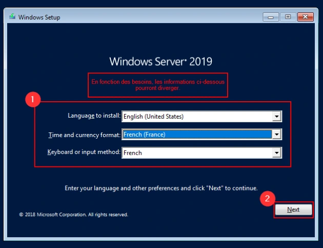

Visuel isolé — Fiche démo 1 - Installation du système

- Passer outre l’activation du système

Ici, cliquer sur le texte I don’t have a product key (1) pour passer à l’étape suivante.

- Choisir la version du système d’exploitation que vous souhaitez installer.

C’est ici que s’opère le choix de la version du système d’exploitation. Ici, nous choisirons Windows Server 2019 Standard (Desktop Experince)(1) puis cliquer sur le bouton « Next » (2) pour passer à l’étape suivante.

Attention : Ssi Windows Server 2019 est sélectionné, seule la version Core sera installée (sans interface graphique).

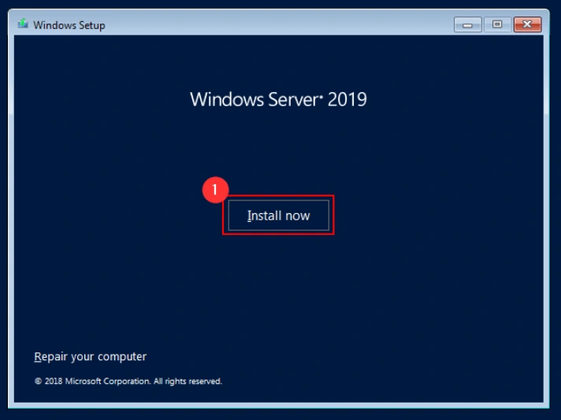

Visuel isolé — Fiche démo 1 - Installation du système

- Validation du contrat de licence Microsoft

Pour passer à l’étape suivante, il faut accepter le contrat de licence de Microsoft en cochant la case (1) puis en cliquant sur le bouton Next (2) pour passer à la suite.

- Choix du type d’installation

Choisir Custom: Install Windows only (advanced) (1) afin de passer à la suite.

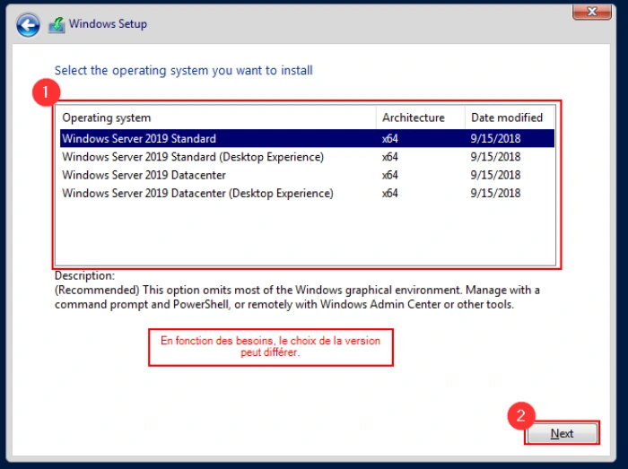

Visuel isolé — Fiche démo 1 - Installation du système

- Localisation de l’installation du système d’exploitation

Par défaut, nous n’avons qu’un seul disque dans notre VM (1). Cliquer sur le bouton Next (2).

- Démarrage de l’installation

#### L’installation a démarré

- Modification du mot de passe Administration

Une fois l’installation terminée, la VM redémarrera automatiquement. Sur cet écran, il faudra customiser le mot de passe administrateur (1) puis cliquer sur le bouton Finish afin de finaliser le processus de configuration.

- Finalisation de l’installation

À la suite de la modification du mot de passe Administrateur, la page de connexion au serveur

apparaît.

- Test de connexion au serveur

Sur la mire de connexion appuyer sur les touches de votre clavier « Ctrl » « Alt » » Inser » simultanément afin de pouvoir renseigner le login et mot de passe (1) puis appuyer sur la touche « Entrée » du clavier pour accéder au bureau du serveur.

- Installation des VMware Tools

Pour finaliser l’installation et faciliter un certain nombre d’actions (presse-papier par exemple)

l’installation des VMware Tools est nécessaire.

Faites un clic droit sur l’onglet portant le nom de la VM (1) puis cliquer sur Install VMware Tools… (2)

- Lancement de l’installation de VMware Tools

Ouvrir l’explorateur de document (1) puis double cliquer sur le DVD Drive (D :) VMware Tools (2)

- Installation de VMware Tools

Cliquer sur le bouton Suivant (1) pour démarrer l’installation. Cliquer sur le bouton Suivant (2) afin de

#### continuer l’installation. Cliquer sur le bouton Suivant pour engager l’installation (3)

Cliquer sur le bouton Terminer (4) pour finaliser l’installation.

- Redémarrage VM suite installation VMware Tools

Cliquer sur le bouton Oui (1) afin de redémarrer la VM et la prise en compte des paramètres des VMware Tools nouvellement installés.

Référence du document : 1-f_7dFPPZj41QBGVHhPoKRH8sQECoJlG · SHA-256 6dc10da4c91f445e…

## Démonstration · Fiche démo 2 - Ajout de rôles et de fonctionnalités via le gestionnaire de serveur · 5 pages transcrites

#### Ajout de rôles et de fonctionnalités via le gestionnaire de serveur

#### Démonstration 02 du module 01

Cette démonstration décrit les différentes étapes relatives à l’ajout de rôle et de fonctionnalités via le gestionnaire de serveur sous Microsoft Server.

#### Déroulement

- Prérequis

- Avoir suivi la démonstration 1 du module 1.

- Avoir installé et configuré une VM Windows Server.

- Démarrer la machine virtuelle

Sélectionner la VM utilisée lors de la précédente démonstration (1) (ici W2019), puis cliquer sur le bouton démarrer (2).

- Se connecter à la VM

Utiliser le compte Administrateur ainsi que le mot de passe associé (1).

- Accès à la console d’installation.

Lors de l’accès à la session du serveur, le Gestionnaire de Serveur ou «Serveur Manager se lance automatiquement.

Pour lancer la console permettant l’ajout d’un rôle, cliquer sur Manage ou Gérer (1) puis sur Add Roles and Features ou Ajout de Rôles et Fonctionnalités (2).

- Choix du rôle à installer.

Cliquer sur le bouton Next (1), puis encore une fois sur le bouton Next (2). Sur l’écran Select destination server, cliquer sur le bouton Next (3). Sur l’écran Select server roles, cocher la case Windows Déployment Services (4). Sur la fenêtre contextuelle qui vient d’apparaître, cliquer sur le bouton Add Features (5), puis sur le bouton Next (6).

- Choix de la fonctionnalité à installer.

Cocher la case Windows Server Backup (1) puis cliquer sur le bouton Next (2). Sur l’écran Web Server Role (IIS), cliquer sur le bouton Next (3). Sur l’écran Select role services, cliquer sur le bouton Next (4). Sur l’écran WDS, cliquer sur le bouton Next (5). Sur l’écran Select role services, cliquer sur le bouton Next (6).

- Confirmation de l’installation

Cocher la case Restart the destination serveur automatically if required (1) puis cliquer sur le bouton Yes (2) de la fenêtre contextuelle. Enfin, cliquer sur le bouton Install (3). Enfin, quand le processus d’installation est terminé, cliquer sur le bouton Close (4).

#### Étapes illustrées dans le support

1. Dans Confirm installation selections, cocher Restart the destination server automatically if required.
2. Confirmer le redémarrage automatique avec Yes.
3. Contrôler la liste des composants sélectionnés, puis choisir Install.
4. Attendre la fin de l’installation, vérifier le message Installation succeeded puis choisir Close.

Référence du document : 12lIBq0RuUAGY5KkavZnahA8jlVLUzxrA · SHA-256 be95d2fe09a1cb63…

## Démonstration · Fiche démo 3 - Le formatage sous Windows Server · 15 pages transcrites

#### Le formatage sous Windows Server

#### Démonstration 03 du module 01

Cette démonstration décrit les différentes étapes relatives au formatage avec les outils Windows

#### Déroulement

- Prérequis

- Avoir suivi la démonstration 2 du module 1.

- Avoir installé et configuré une VM Windows Server.

- Éditer la VM afin de pouvoir lui ajouter des disques.

Sélectionner la VM utilisée lors de la précédente démonstration (1) (ici W2019), puis cliquer sur Edit virtual machine settings (2).

- Ajout des disques depuis les Settings de la VM (à répéter 3 fois).

Cliquer sur le bouton Add (1). Vérifier que la ligne Hard Disk est correctement sélectionnée, puis cliquer sur le bouton Next (3). Vérifier que le bouton radio SCSI est coché, puis cliquer sur le bouton Next (4). Vérifier que le bouton radio Create a new virtual disk est coché, puis cliquer sur le bouton Next (5). Dans l’input box Maximum disk size (GB) : (6), choisir la taille du disque souhaité (ici 20GB). Ici, nous sélectionnons Split virtual disk into multiple files, puis cliquer sur le bouton Next (7). Enfin, cliquer sur le bouton Finish (8) pour finaliser l’ajout du disque sur votre VM.

- Vérification de l’ajout des 3 disques sur la VM.

À la fin du processus de rajout des disques sur la VM. Il doit apparaître 4 lignes Hard Disk dans les propriétés Devices de la VM. Sélectionner la VM modifiée puis vérifier que les 3 nouveaux disques sont bien présents (1).

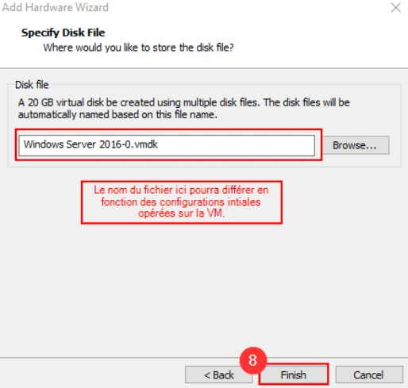

Visuel isolé — Fiche démo 3 - Le formatage sous Windows Server

- Démarrer la machine virtuelle

Sélectionner la VM utilisée lors de la précédente démonstration (1) (ici W2019), puis cliquer sur le bouton démarrer (2).

- Se connecter à la VM

Utiliser le compte Administrateur ainsi que le mot de passe associé (1).

- Accès à la console de gestion des disques.

Lors de l’accès à la session du serveur, le Gestionnaire de Serveur ou Serveur Manager se lance automatiquement.

Pour lancer la console permettant la gestion des disques, cliquer sur Tools (1), puis sur Computer Management (2).

#### Management des disques

Sur la console Computer Manager, cliquer sur Disk management (1) situé dans le menu Storage.

- Mise en ligne des disques (à répéter sur les 3 nouveaux disques).

La première étape pour pouvoir utiliser les disques nouvellement installés sur la VM est la mise en ligne de ces derniers.

Pour ce faire, sélectionner le premier disque Disk 1 (1), puis faire un clic droit sur ce dernier afin de pouvoir cliquer sur la ligne Online (2).

- Initialisations des disques

La deuxième étape pour pouvoir utiliser les disques nouvellement installés sur la VM est l’initialisation de ces éléments.

Pour ce faire, sélectionner le premier disque Disk 1 (1), puis faire un clic droit sur ce dernier afin de pouvoir cliquer sur la ligne Initialize Disk (2).

Vérifier que les 3 disques soient bien sélectionnés (3) ainsi que le bouton radio GPT (4). Enfin, cliquer sur le bouton OK (5).

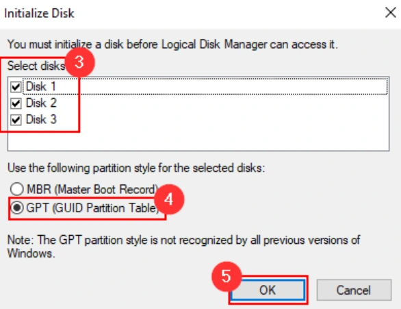

Visuel isolé — Fiche démo 3 - Le formatage sous Windows Server

- Création d’un volume fractionné

Sélectionner le Disk 1 (1), puis faire un clic droit afin de pouvoir cliquer sur la ligne New Spanned Volume (2).

Cliquer sur le bouton Next (3).

Dans la colonne Available (4), sélectionner le Disk 2 (5), puis cliquer sur le bouton Add (6).

Dans l’input box Select the amount of space in MB, nous indiquerons « 5000 » pour les deux disques (7), puis cliquer sur le bouton Next (8).

Sélectionner la lettre de lecteur F : (9), puis cliquer sur le bouton Next (10).

Dans l’input box Volume label, indiquer « Volume Fractionné » (11), puis cliquer sur le bouton Next (12).

Enfin, cliquer sur le bouton Finish (13), puis sur le bouton Yes (14) pour finaliser la configuration du nouveau Volume.

- Vérification du volume fractionné

Une fois la configuration terminée, votre volume doit apparaître à l’écran.

- Création d’un RAID-0

Sélectionner le Disk 1 (1), puis faire un clic droit afin de pouvoir cliquer sur la ligne New Striped Volume (2).

Cliquer sur le bouton Next (3).

Dans la colonne Available (4), sélectionner le Disk 2 (5), puis cliquer sur le bouton Add (6).

Dans l’input box Select the amount of space in MB, nous indiquerons « 5000 » (7), puis cliquer sur le bouton Next (8).

Sélectionner la lettre de lecteur G : (9), puis cliquer sur le bouton Next (10).

Dans l’input box Volume label, indiquer « RAID0 » (11), puis cliquer sur le bouton Next (12).

Enfin, cliquer sur le bouton Finish (13) pour finaliser la configuration du nouveau Volume.

- Vérification du RAID0

Une fois la configuration terminée, votre volume doit apparaître à l’écran.

- Création d’un RAID-1

Sélectionner le Disk 1 (1), puis faire un clic droit afin de pouvoir cliquer sur la ligne New Striped Volume (2).

Cliquer sur le bouton Next (3).

Dans la colonne Available (4), sélectionner le Disk 2 (5), puis cliquer sur le bouton Add (6).

Dans l’input box Select the amount of space in MB, nous indiquerons « 2000 » (7), puis cliquer sur le bouton Next (8).

Sélectionner la lettre de lecteur H : (9), puis cliquer sur le bouton Next (10).

Dans l’input box Volume label, indiquer « RAID1 » (11), puis cliquer sur le bouton Next (12).

Enfin, cliquer sur le bouton Finish (13) pour finaliser la configuration du nouveau Volume.

- Vérification du RAID1

Une fois la configuration terminée, votre volume doit apparaître à l’écran.

- Création d’un RAID-5

Sélectionner le Disk 1 (1), puis faire un clic droit afin de pouvoir cliquer sur la ligne New RAID-5 Volume (2).

Cliquer sur le bouton Next (3).

Dans la colonne Available (4), sélectionner le Disk 2 et 3 (5), puis cliquer sur le bouton Add (6).

Dans l’input box Select the amount of space in MB, nous indiquerons « 8462 » (7), puis cliquer sur le bouton Next (8).

Sélectionner la lettre de lecteur E : (9), puis cliquer sur le bouton Next (10).

Dans l’input box Volume label, indiquer RAID5 (11), puis cliquer sur le bouton Next (12).

Enfin, cliquer sur le bouton Finish (13), puis sur le bouton Yes (14) pour finaliser la configuration du nouveau Volume.

- Vérification du RAID5

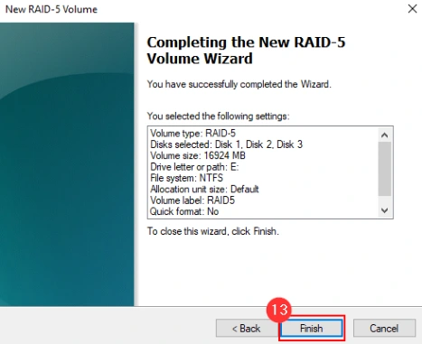

Visuel isolé — Fiche démo 3 - Le formatage sous Windows Server

Une fois la configuration terminée, votre volume doit apparaître à l’écran.

Référence du document : 1Pk5L3XaKZtQYnJ9ysoL8u4eIrKn0IBaW · SHA-256 ee1d4323dd580eb5…

## Énoncé · Enoncé du TP 1 - Installation et configuration initiale · 3 pages transcrites

#### Installation et configuration initiale

#### TP 1 du Module 01 – Administration Windows

Avant de démarrer ce TP, il convient d’avoir suivi les vidéos du module 1.

#### Durée estimée

1 à 2 heures

#### Énoncé

Prérequis :

- Copiez le fichier image ISO « Windows Server 2019 Standard » depuis le partage Réseau vers votre lecteur local

Création des machines virtuelles :

#### Nom de la machine virtuelle Caractéristiques supplémentaires

- Windows Server 2019
- 1 disque dur : 32Go
- Mémoire vive : 2Go
- Carte réseau : mode « bridge »

- Windows 10

- 1 disque dur : 32Go
- Mémoire vive : 2Go
- Carte réseau : mode « bridge »

#### Les VM seront stockées sous D:\Machines_Virtuelles\Modeles\Nom_de_la_VM

Les systèmes seront hébergés sur la totalité du disque. Au fur et à mesure de l’avancée du cours, vous serez amené à ajouter des disques supplémentaires.

Une fois les systèmes installés :

- Installez les VMware Tools.

- Procédez à un sysprep des OS puis éteignez-les.
- Créez un Folder nommé VM MODELES – A NE PAS DEMARRER dans le volet Library de Workstation puis glissez-déplacez vos VM_Modele dedans.

| Nom de la machine virtuelle | Système | Disque dur | Mémoire vive | Carte réseau |
| --- | --- | --- | --- | --- |
| VM_Modele_2019 | Windows Server 2019 | 32 Go | 2 Go | Bridge |
| VM_Modele_W10 | Windows 10 | 32 Go | 2 Go | Bridge |

Ces VM seront utiles pour faire évoluer l’infrastructure au fur et à mesure des modules, mais aussi en cas de perte éventuelle d’un serveur ou d’un client. Ces modèles ne doivent pas être démarrés et devront être conservés durant l’ensemble des modules du cours Service Réseau Microsoft. Création de l’infrastructure :

- Clonez VM_Modele_2019 en W19-CD1 ainsi qu’en W19-SRV1.
- Clonez VM_Modele_W10 en W10-CLI1.
- Les dossiers d’accueil de ces VM seront situés dans D:\Machines_Virtuelles\Nom_De_La_VM

Configuration réseau :

- Les machines auront un adressage IPv4 statique.
- Le réseau à utiliser sera 172.28.10.0/16.
- Les systèmes d’exploitation porteront le même nom que les VM.

#### Nom : W19-CD1 Adresse IP : 172.28.10.1

#### Nom : W19-SRV1 Adresse IP : 172.28.10.2 Nom : W10-CLI1 Adresse IP : 172.28.10.11

#### Réseau salle 172.28.10.0/16

Rôle et fonctionnalités :

- Installez sur le serveur le service Web IIS et l’outil de Sauvegarde Windows Server.

- Pour tester le bon fonctionnement du service IIS, vérifiez l’accès à l’URL http://localhost depuis le navigateur web du serveur (une image IIS doit s’afficher).

- Autorisez l’utilisation du bureau à distance pour l’administration à distance du serveur et du client.

Testez l’administration du serveur depuis W10-CLI1 :

- Avec l’outil graphique Connexion Bureau à distance

- Avec l’outil en ligne de commande mstsc (si besoin, afficher l’aide avec la commande mstsc / ?)

Référence du document : 133Ih3ietcLy20Yg1BDuO-_xKBeX4fefI · SHA-256 9664cd370a45e847…

## Énoncé · Enoncé du TP 2 - Gestion du stockage · 2 pages transcrites

#### Service Réseau en environnement Microsoft

#### Gestion du stockage

#### TP du Module 01 – Administration Windows

Avant de démarrer ce TP, il convient d’avoir suivi les vidéos du module 1 et réalisé le TP précédent.

#### Durée estimée

30min / 1 heure

#### Énoncé

Prérequis :

- Disposer des machines virtuelles installées dans le TP précédent.

- Modifier la lettre du lecteur CD en « L: »

Ajout de disques au serveur :

Ajouter trois disques SCSI de 10 Go chacun au serveur W19-SRV1.

Besoins de stockage :

En vue de stocker les documents de travail des utilisateurs, créez un volume en RAID-5 pouvant héberger environ 6 Go de données appelé « Données » et accessible depuis le lecteur D:\

Les membres du service informatique doivent pouvoir accéder à tout moment aux outils d’administration du système. Créez un volume miroir de 4 Go monté dans C:\INFO-TOOLS et reposant sur les disques 1 et 3.

Une base de données SQL Server d’une taille maximale de 8 Go sera hébergée sur le serveur. Créez un volume optimisé pour les performances en lecture/écriture, nommé Database et accessible via le lecteur E:\

Ces partitions n’hébergeront pas de système d’exploitation.

#### Service Réseau en environnement Microsoft

Configuration du stockage sur le serveur :

- Créez les volumes correspondant aux besoins depuis la console de Gestion des disques.
- Stockez des fichiers quelconques sur l’ensemble de vos lecteurs. Simulation de panne : Depuis les paramètres VMware Workstation, supprimez le disque SCSI n°3 puis observez les changements dans la console de Gestion des disques.

```
1. Pouvez-vous accéder aux données stockées sur Données ? □ Oui   □ Non
```

Pourquoi ?

```
2. Pouvez-vous accéder aux données stockées dans C:\INFO-TOOLS ? □ Oui   □ Non
```

Pourquoi ?

Réparation des volumes défectueux :

- Ajoutez un disque supplémentaire via les paramètres de la machine virtuelle VMWare.
- Retirez le dernier disque pour simuler une panne.
- Réparez les volumes défectueux depuis la console Gestion des disques.

Référence du document : 1W_pwB4Uxiuh0_EQApcPdVrexCJeqZTkE · SHA-256 194f0163ef2c4ce7…

## Correction · Solution du TP 1 - Installation et configuration initiale · 6 pages transcrites

Correction originale : à consulter après avoir tenté l’exercice.

#### Installation et configuration initiale

#### TP 1 du Module 01 – Administration Windows

Avant de démarrer ce TP, il convient d’avoir suivi les vidéos du module 1.

#### Durée estimée

1 à 2 heures

#### Énoncé

Prérequis :

- Copiez le fichier image ISO « Windows Server 2019 Standard » depuis le partage Réseau vers votre lecteur local.

Création des machines virtuelles :

#### Nom de la machine virtuelle Caractéristiques supplémentaires

- Windows Server 2019
- 1 disque dur : 32Go
- Mémoire vive : 2Go
- Carte réseau : mode « bridge »

- Windows 10
- 1 disque dur : 32Go

- Mémoire vive : 2Go
- Carte réseau : mode « bridge »

#### Les VM seront stockées sous D:\Machines_Virtuelles\Modeles\Nom_de_la_VM

Les systèmes seront hébergés sur la totalité du disque. Au fur et à mesure de l’avancée du

| Nom de la machine virtuelle | Système | Disque dur | Mémoire vive | Carte réseau |
| --- | --- | --- | --- | --- |
| VM_Modele_2019 | Windows Server 2019 | 32 Go | 2 Go | Bridge |
| VM_Modele_W10 | Windows 10 | 32 Go | 2 Go | Bridge |

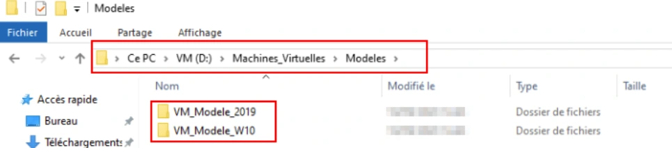

Visuel isolé — Solution du TP 1 - Installation et configuration initiale

cours, nous serons amenés à ajouter des disques supplémentaires.

Une fois les systèmes installés :

- Installez les VMware Tools.

- Procédez à un sysprep des OS puis éteignez-les.

- Créez un Folder nommé VM MODELES – A NE PAS DEMARRER dans le volet Library de Workstation puis glissez-déplacez vos VM_Modele dedans.

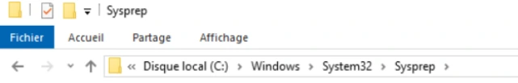

Visuel isolé — Solution du TP 1 - Installation et configuration initiale

Ces VM seront utiles pour faire évoluer l’infrastructure au fur et à mesure des modules, mais aussi en cas de perte éventuelle d’un serveur ou d’un client. Ces modèles ne doivent pas être démarrés et devront être conservés durant l’ensemble des modules du cours Service Réseau Microsoft. Création de l’infrastructure :

- Clonez VM_Modele_2019 en W19-CD1 ainsi qu’en W19-SRV1.
- Clonez VM_Modele_W10 en W10-CLI1.
- Les dossiers d’accueil de ces VM seront situés dans D:\Machines_Virtuelles\Nom_De_La_VM

Configuration réseau :

- Les machines auront un adressage IPv4 statique.
- Le réseau sera 172.28.10.0/16.
- Les systèmes d’exploitation porteront le même nom que les VM.

#### Nom : W19-CD1 Adresse IP : 172.28.10.1

#### Nom : W19-SRV1 Adresse IP : 172.28.10.2 Nom : W10-CLI1 Adresse IP : 172.28.10.11

#### Réseau salle 172.28.10.0/16

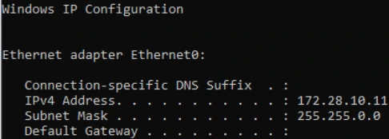

Visuel isolé — Solution du TP 1 - Installation et configuration initiale

Rôle et fonctionnalités :

- Installez sur le serveur le service Web IIS et l’outil de Sauvegarde Windows Server.

- Pour tester le bon fonctionnement du service IIS, vérifiez l’accès à l’URL http://localhost depuis le navigateur web du serveur (une image IIS doit s’afficher).

- Autorisez l’utilisation du bureau à distance pour l’administration à distance du serveur et du client.

Testez l’administration du serveur depuis W10-CLI1 :

- Avec l’outil graphique Connexion Bureau à distance

- Avec l’outil en ligne de commande mstsc (si besoin, afficher l’aide avec la commande mstsc / ?)

Référence du document : 1TDGUDprctzvtknJKVd31KrNOR083lDtL · SHA-256 34373d61eff83041…

## Correction · Solution du TP 2 - Gestion du stockage · 7 pages transcrites

Correction originale : à consulter après avoir tenté l’exercice.

#### Gestion du stockage

#### TP du Module 01 – Administration Windows

Avant de démarrer ce TP, il convient d’avoir suivi les vidéos du module 1 et réalisé le TP précédent.

#### Durée estimée

30 minutes à 1 heure

#### Énoncé

Prérequis :

- Disposer des machines virtuelles installées dans le TP précédent.

- Modifier la lettre du lecteur CD en L:\.

Ajout de disques au serveur :

Ajouter trois disques SCSI de 10 Go chacun au serveur W19-SRV1.

Besoins de stockage :

- Modifier la lettre du lecteur CD en L:\.

En vue de stocker les documents de travail des utilisateurs, créez un volume en RAID-5 pouvant héberger environ 6 Go de données appelé « Données » et accessible depuis le lecteur D:\

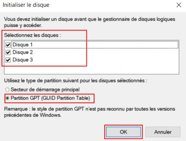

Visuel isolé — Solution du TP 2 - Gestion du stockage

Les membres du service informatique doivent pouvoir accéder à tout moment aux outils d’administration du système. Créez un volume miroir de 4 Go monté dans C:\INFO-TOOLS et reposant sur les disques 1 et 3.

Une base de données SQL Server d’une taille maximale de 8 Go sera hébergée sur le serveur. Créez un volume optimisé pour les performances en lecture/écriture, nommé Database et accessible via le lecteur E:\.

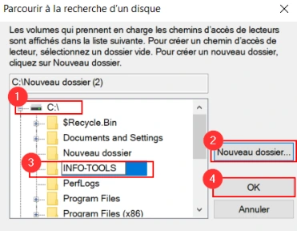

Visuel isolé — Solution du TP 2 - Gestion du stockage

Ces partitions n’hébergeront pas de système d’exploitation.

Configuration du stockage sur le serveur :

- Créez les volumes correspondant aux besoins depuis la console de Gestion des disques.
- Stockez des fichiers quelconques sur l’ensemble de vos lecteurs. Simulation de panne : Depuis les paramètres VMware Workstation, supprimez le disque SCSI n°3 puis observez les changements dans la console de Gestion des disques.

```
1. Pouvez-vous accéder aux données stockées sur Données ?  Oui   □ Non
```

Le comportement peut différer en fonction du disque retiré.

Sur un RAID-5 il est possible de retirer un disque sans incidence sur l’accès aux données.

```
2. Pouvez-vous accéder aux données stockées dans C:\INFO-TOOLS ?  Oui   □ Non
```

Pourquoi ? Le comportement peut différer en fonction du disque retiré. Sur un RAID-1 il est possible de retirer un disque sans incidence sur l’accès aux données. Réparation des volumes défectueux :

- Ajoutez un disque supplémentaire via la console VMware Workstation puis réparez les volumes défectueux depuis la console Gestion des disques.
- Retirez un disque pour simuler une panne.
- Ajoutez un disque via la console VMware Workstation puis réparez les volumes défectueux depuis la console Gestion des disques.

#### Étapes illustrées dans le support

1. Dans Gestion des disques, sélectionner le volume INFO-TOOLS et choisir Ajouter un disque miroir.
2. Dans la fenêtre Ajouter un disque miroir, choisir le disque 3 pour la copie miroir, puis valider.

Référence du document : 1X7JX1Z0j2I0I9J7RhG-XNdINZMPPIMPU · SHA-256 7bd3f6ca5a7f2c2c…

## Fiche de synthèse

Les lignes reprennent les titres du cours et la première phrase de chaque partie.

| Partie | Repère du cours |
| --- | --- |
| Correction · Solution du TP 1 - Installation et configuration initiale · 6 pages transcrites | Correction originale : à consulter après avoir tenté l’exercice. |
| Correction · Solution du TP 2 - Gestion du stockage · 7 pages transcrites | Correction originale : à consulter après avoir tenté l’exercice. |
