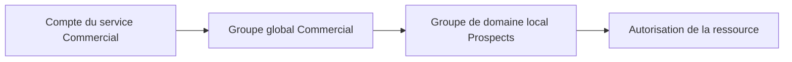

# Module 02 — Active Directory

AD DS centralise les comptes et machines, l’authentification, les paramètres et la recherche de ressources. DNS permet de trouver les hôtes et les services du domaine, LDAP permet d’interroger l’annuaire et Kerberos s’appuie sur des tickets pour l’authentification. Les exercices réutilisent les trois machines créées au module 01.

## Domaine, forêt et sites

Le domaine regroupe des objets administrés avec des règles communes. Ses contrôleurs hébergent l’annuaire et authentifient les membres. Une forêt partage le schéma et la configuration entre ses domaines, avec des relations d’approbation transitives et bidirectionnelles dans le modèle présenté. Un site regroupe un ou plusieurs sous-réseaux afin d’orienter l’accès aux ressources et la réplication. Le support illustre Nantes en `10.44.0.0/16` et Rennes en `10.35.0.0/16`.

Avant une promotion, vérifier nom, adresse, DNS, rôle AD DS et contexte existant. Le niveau fonctionnel dépend des versions des contrôleurs. Les valeurs 2008 R2, 2012 R2 et 2016 du support décrivent son périmètre historique. Dans le TP, `W19-CD1` devient contrôleur et serveur DNS de `monprenom.local`. `W19-SRV1` et `W10-CLI1` rejoignent le domaine en utilisant le DNS interne. Contrôler leurs comptes dans l’annuaire et tester séparément un compte local du client et un compte du domaine.

| Rôle FSMO | Portée | Fonction |
|---|---|---|
| Maître de schéma | Forêt | Coordonne la modification du schéma |
| Maître d’attribution de noms | Forêt | Coordonne l’ajout ou le retrait des domaines |
| Maître RID | Domaine | Distribue les blocs de RID utilisés pour former les SID |
| Maître d’infrastructure | Domaine | Suit des références vers des objets d’autres domaines |
| Émulateur PDC | Domaine | Joue un rôle dans les mots de passe, l’heure et l’administration des GPO |

Avant de rétrograder un contrôleur, contrôler les rôles FSMO, la disponibilité DNS et l’existence d’un autre contrôleur adapté au scénario. La commande du support est `Uninstall-ADDSDomainController`. Les vérifications de lecture peuvent s’effectuer avec les commandes suivantes depuis un poste disposant des outils AD.

```powershell
Get-ADDomainController -Filter *
Get-ADDomain | Select-Object PDCEmulator, RIDMaster, InfrastructureMaster
Get-ADForest | Select-Object SchemaMaster, DomainNamingMaster
```

## Organiser comptes et groupes

Utilisateurs, ordinateurs et groupes de sécurité disposent de propriétés distinctes. L’ordinateur s’authentifie également dans le domaine. Les conteneurs par défaut incluent Builtin, Computers, System et Users. Créer des UO pour le classement, les liens GPO et la délégation administrative. Un objet est placé dans un conteneur direct et peut appartenir à plusieurs groupes.

Les comptes modèles portent un nom explicite et restent désactivés. Leur copie reprend les caractéristiques utiles, mais une modification du modèle ne modifie pas les comptes déjà créés. Les propriétés couvrent l’identité, l’organisation, le profil, les groupes, les restrictions de connexion et les services de bureau à distance. `csvde` et PowerShell facilitent une création en nombre.

| Type ou étendue | Utilisation |
|---|---|
| Groupe de sécurité | Attribuer des droits à des comptes ou d’autres groupes |
| Groupe de distribution | Diffusion de messages |
| Global | Regrouper les comptes par métier ou fonction dans le domaine |
| Universel | Regrouper des membres de plusieurs domaines selon les règles de portée |
| Domaine local | Porter des permissions sur une ressource du domaine où il est créé |
| Local à un ordinateur | Usage limité à cet ordinateur et sa base locale |

Le TP classe Nantes, Vertou et Rennes, les services Informatique, Production et Commercial, ainsi que les fonctions Secrétaire et Intérimaire. Production travaille à Vertou sur la tranche 6 h–12 h ou 13 h–21 h. Informatique est à Nantes et la secrétaire est exclue du privilège d’administration demandé. Commercial travaille à Rennes et se connecte sur les postes clients Windows 10 prévus. L’annexe conserve les douze noms associés aux services. Les essais DNS et Netlogon distinguent une connexion antérieure mise en cache d’une première connexion nécessitant le domaine.

## Appliquer AGDLP et contrôler les accès



Le schéma ajouté au cours illustre Comptes → Globaux → Domaine local → Permissions. La couche de partage SMB et la couche NTFS s’appliquent ensemble à l’accès réseau. Examiner les entrées de sécurité, leurs autorisations et refus et leur héritage. Un utilisateur sans droit applicable est refusé implicitement. Pour confirmer un refus ou un droit, tester avec son compte sur le chemin réseau et examiner l’accès effectif. Les autorisations de base incluent lecture, écriture, modification et contrôle total. Les paramètres avancés distinguent par exemple création, suppression, appropriation et modification des permissions.

Le support distingue déplacement sur un même volume, qui conserve généralement la sécurité, et copie ou déplacement vers un autre volume, où les droits hérités de la destination s’appliquent en général. La démonstration de partage publie `Public` et règle les droits dans l’onglet Sécurité. Publier un partage dans l’annuaire facilite sa recherche, tandis que l’autorisation dépend toujours de ses ACL.

Le TP crée le miroir `C:\datasafe`, le partage `Profils` et les dossiers Production, Applications, Prospects et Public. Un profil itinérant est chargé depuis le partage et synchronisé à la fermeture de session. Vérifier les droits de chaque profil et modifier les comptes existants du service Commercial qui ne reçoivent pas automatiquement le réglage du modèle.

| Partage | Accès attendu du TP |
|---|---|
| Production | Service Production et administrateurs. Contrôle total pour les administrateurs. |
| Applications | Lecture pour les membres, écriture pour Informatique, exclusion des secrétaires |
| Prospects | Commerciaux |
| Public | Lecture pour tous dans le scénario |

## Centraliser l’impression

Un port relie la file au périphérique. La file conserve les travaux, et le pilote permet au serveur et aux clients de préparer les documents. Installer Serveur d’impression, ajouter port TCP/IP et pilote, créer la file, publier le partage et régler les autorisations Imprimer, Gérer l’imprimante et Gérer les documents. La console Gestion de l’impression montre pilotes, ports, files, erreurs et déploiement par GPO.

Le TP configure `Imp-Commercial-35RDC` à `172.28.10.46` en recto verso pour Commercial et `Imp-BL44-Usine` sur les ports `172.28.10.90` et `.91` pour Production. Pour le pool, les deux périphériques compatibles partagent la file. Tester depuis Windows 10 avec un membre autorisé, un compte exclu et les droits des administrateurs.

### Mini-quiz

1. Quel service permet au client de localiser un contrôleur de domaine ?
2. Où les permissions d’une ressource sont-elles attribuées dans AGDLP ?
3. Que faut-il vérifier après la modification d’un compte modèle ?

??? success "Réponses"
    1. Le DNS du domaine, notamment ses enregistrements de service.
    2. Au groupe de domaine local qui représente le droit sur la ressource.
    3. Les comptes déjà créés et le résultat de connexion. Ils ne sont pas réécrits par la modification du modèle.


## Appliquer le cours

- [Travaux pratiques et démonstrations](../../tp/services-reseaux-microsoft/module-02/index.md)
- [Fiche de révision](../../revision/services-reseaux-microsoft/module-02-module-02.md)
