# Module 02 — Active Directory

Les parties ci-dessous reprennent le cours original, dans le même ordre. Les encadrés et les schémas répètent ses formulations.

## Parcours de lecture

1. Support · Module 02 – Support de cours · 25 pages transcrites
2. Démonstration · Fiche démo 1 - Mise en place d'un contexte AD · 6 pages transcrites
3. Démonstration · Fiche démo 2 - Les bases de gestion d'un domaine · 9 pages transcrites
4. Démonstration · Fiche démo 3 - L'accès aux ressources · 6 pages transcrites
5. Démonstration · Fiche démo 4 - La gestion des impressions · 10 pages transcrites
6. Énoncé · Enoncé du TP 1 - Mise en place d’un domaine Active Directory · 2 pages transcrites
7. Énoncé · Enoncé du TP 2 - Utilisateurs et groupes en contexte de domaine AD · 4 pages transcrites
8. Énoncé · Enoncé du TP 3 - L’accès aux ressources · 2 pages transcrites
9. Énoncé · Enoncé du TP 4 - La gestion des impressions · 2 pages transcrites
10. Correction · Solution du TP 1 - Mise en place d’un domaine Active Directory · 4 pages transcrites
11. Correction · Solution du TP 2 - Utilisateurs et groupes en contexte de domaine AD · 7 pages transcrites
12. Correction · Solution du TP 3 - L'accès aux ressources · 10 pages transcrites
13. Correction · Solution du TP 4 - La gestion des impressions · 22 pages transcrites

**Visuel externe**

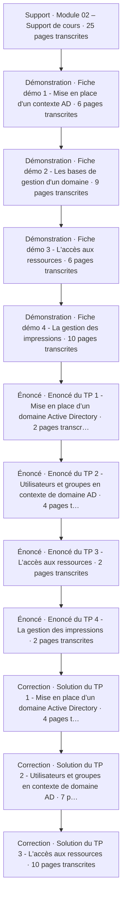

SOURCE DRIVE · TRANSCRIPTION DU SUPPORT

Le contenu des documents du dossier TSSR est transcrit ci-dessous, page par page. Les textes et tableaux sont intégrés à la page Web. Aucun fichier PDF, aucune diapositive entière ni aucune reproduction de page n’est affiché. Seuls des croquis ou visuels isolés et vérifiés peuvent accompagner la transcription. Les versions et les consignes restent celles des supports de formation. Les compléments IA sont conservés dans leur onglet distinct.

## Support · Module 02 – Support de cours · 25 pages transcrites

#### Module 02 – Active Directory

#### Objectifs

!!! note "À retenir"
    Appréhender le rôle Active Directory Gérer les ressources partagées avec AGDLP Connaître la gestion des imprimantes

**Visuel externe**


- Appréhender le rôle Active Directory
- Gérer les ressources partagées avec AGDLP
- Connaître la gestion des imprimantes

#### Les services d’annuaire-Présentation et installation

#### Domaine Active Directory

!!! note "À retenir"
    Centraliser la gestion de l’authentification.

**Visuel externe**

```mermaid
flowchart LR
    N1["Pour quoi faire ?"]
    N2["Centraliser la gestion de l’authentification."]
    N3["Centraliser les informations relatives aux utilisateurs et ressources."]
    N4["Centraliser la gestion des paramètres utilisateurs et ordinateurs."]
    N5["Fournir une base de fonctionnement aux services et outils Microsoft."]
    N6["Utilisation de protocoles standardisés : DNS / LDAP / Kerberos"]
    N7["DNS : Résolution des noms de machines et localisation de services."]
    N1 --> N2
    N2 --> N3
    N3 --> N4
    N4 --> N5
    N5 --> N6
    N6 --> N7
```

- Pour quoi faire ?
- Centraliser la gestion de l’authentification.
- Centraliser les informations relatives aux utilisateurs et ressources.
- Centraliser la gestion des paramètres utilisateurs et ordinateurs.
- Fournir une base de fonctionnement aux services et outils Microsoft.

- Utilisation de protocoles standardisés : DNS / LDAP / Kerberos
- DNS : Résolution des noms de machines et localisation de services.
- LDAP : Norme pour les systèmes d’annuaires avec une structure de base de données arborescente.
- Kerberos : Protocole d’authentification reposant sur un mécanisme de clés secrètes et l’utilisation de tickets.

#### Les services d’annuaire - Présentation et installation

#### La forêt Active Directory

#### Une forêt

#### Domaine racine

#### de la forêt

#### Comprend un ou plusieurs domaine

#### AD partageant le même schéma, les

#### mêmes informations de configuration

et de recherche.

#### Relation parent / enfant

#### Relation de domaine

#### Les domaines d’une même forêt sont

Domaine

enfant

#### liés par une relation d’approbation

transitive bidirectionnelle.

Forêt

```
Active Directory
 Les services d’annuaire-Présentation et installation

       Domaine Active Directory
             • Pour quoi faire ?
                      •  Centraliser la gestion de l’authentification.
                      •  Centraliser les informations relatives aux utilisateurs et ressources.
                      •  Centraliser la gestion des paramètres utilisateurs et ordinateurs.
                      •  Fournir une base de fonctionnement aux services et outils Microsoft.

             •  Utilisation de protocoles standardisés : DNS / LDAP / Kerberos
                      • DNS : Résolution des noms de machines et localisation de services.
                      • LDAP : Norme pour les systèmes d’annuaires avec une structure de base de données arborescente.
                      •  Kerberos : Protocole d’authentification reposant sur un mécanisme de clés secrètes et l’utilisation de
                        tickets.

                                                                                         3

3

   Active Directory
 Les services d’annuaire - Présentation et installation

        La forêt Active Directory
             Une forêt
                                                                                             Domaine racine
            Comprend un ou plusieurs domaine                                           de la forêt
          AD partageant le même schéma, les
          mêmes informations de configuration
                et de recherche.                                                                                    Relation parent / enfant
              Les domaines d’une même forêt sont                                                                          Relationde domaine
                                                                        Domaine
                   liés par une relation d’approbation                      enfant
                 transitive bidirectionnelle.
                                                          Forêt

                                                                                         4

4
```

#### Les services d’annuaire - Présentation et installation

#### Un domaine Active Directory

#### Poste en WorkGroup

#### Les composantes de domaine : le domaine

!!! note "À retenir"
    Ensemble d’ordinateurs en réseau qui partagent une base de donnée commune.

Ensemble d’ordinateurs en réseau qui partagent une base de donnée commune.

Un domaine est administré comme un ensemble, régi par des règles et procédures communes.

#### Poste client membre du domaine

#### Domaine Active Directory

#### Serveur autonome

#### Le contrôleur de domaine

#### CD1 Contrôleur de domaine

ADDS

#### Serveur membre

!!! note "À retenir"
    Les contrôleurs d’un domaine AD sont les serveurs qui assurent la gestion du domaine.

Les contrôleurs d’un domaine AD sont les serveurs qui assurent la gestion du domaine. Ils assurent les tâches d’hébergement et de gestion de la base AD, ainsi que l’authentification.

#### Les services d’annuaire - Présentation et installation

#### Les composantes de domaine : les sites

#### Nantes 10.44.0.0 /16 Rennes 10.35.0.0 /16 Sites

#### Site Active Directory

!!! note "À retenir"
    Est une composante logique du domaine utilisée afin d’optimiser : La réplication.

Est une composante logique du domaine utilisée afin d’optimiser :

- La réplication.
- L’accès aux ressources. Il est composé d’un ou de plusieurs sous-réseaux TCP/IP.

#### Les services d’annuaire - Présentation et installation

!!! note "À retenir"
    Prérequis pour un contexte de domaine Avant de promouvoir un serveur en Contrôleur de Domaine, ces prérequis doivent être respectés : Composants Windows Les composants relatifs aux services ADDS doivent être installés.

Prérequis pour un contexte de domaine Avant de promouvoir un serveur en Contrôleur de Domaine, ces prérequis doivent être respectés :

Composants Windows Les composants relatifs aux services ADDS doivent être installés.

#### Les services d’annuaire - Présentation et installation

!!! note "À retenir"
    Versions Active Directory Pour une forêt ou un domaine ciblé, les niveaux fonctionnels déterminent les fonctionnalités fournies au sein de la forêt et du domaine.

!!! example "Exemple"
    Par exemple depuis W2008 R2 : Corbeille AD Le choix des niveaux est contraint par les versions des contrôleurs présents au sein du domaine et de la forêt.

Versions Active Directory

- Pour une forêt ou un domaine ciblé, les niveaux fonctionnels déterminent les fonctionnalités fournies au sein de la forêt et du domaine.

- Par exemple depuis W2008 R2 : Corbeille AD

- Le choix des niveaux est contraint par les versions des contrôleurs présents au sein du domaine et de la forêt.

#### NF de domaine 2008 R2 2012 R2 2016

#### Version des CD

#### NF de la forêt 2008 R2 2012 R2 2016

| Prérequis | Description |
| --- | --- |
| Nom d’hôte du poste | Le nom d’hôte et le suffixe DNS doivent être correctement définis. |
| Configuration réseau et adressage IP | Ces paramètres doivent être opérationnels. |
| Composants Windows | Les composants relatifs aux services AD DS doivent être installés. |
| Prise en compte de l’existant | Analyser l’infrastructure existante et déterminer les points essentiels. |
| Préparation de l’AD | La forêt ou le domaine peut être préparé lors de l’ajout d’un DC. |

| Niveau fonctionnel de domaine | 2008 R2 | 2012 R2 | 2016 |
| --- | --- | --- | --- |
| Versions des CD | 2008 R2, 2012 R2, 2016, 2019 | 2012 R2, 2016, 2019 | 2016, 2019 |
| Niveau fonctionnel de la forêt | 2008 R2 | 2012 R2 | 2016 |

#### Les services d’annuaire - Présentation et installation

#### Rétrograder / promouvoir un CD

- L’ajout et la suppression d’un contrôleur de domaine sont des actions qui impactent tous les contrôleurs de domaine de la forêt.

- Avant de rétrograder un contrôleur de domaine, on s’assurera qu’il ne dispose plus de rôles FSMO.

- Notions abordées dans la slide suivante.

- Sous Windows 2016 et ultérieur, afin de rétrograder un CD, utiliser la commande suivante :

PS C:\Windows\System32> Uninstall-AddsDomainController

#### Les services d’annuaire - Présentation et installation

#### Les composants de domaine : les 5 rôles FSMO

#### Rôles Description

- Lors de l’ajout de la suppression d’un domaine dans un forêt
- En cas de renommage de domaine (Attention)

Peut modifier le schéma. Dans le schéma sont stockées les caractéristiques des objets. Les autres CD ont accès en L au schéma.

Alloue les « bloc d’IDentificateurs Relatifs » aux autres CD. Ces derniers puisent dans le bloc pour attribuer les SID aux objets.

Il gère : MAJ des mots de passe. MAJ des GPO. Synchronisation des horloges. Explorateur principal de domaine.

| Portée | Rôle | Description |
| --- | --- | --- |
| Forêt | Maître de nom de domaine | Contacté lors de l’ajout ou de la suppression d’un domaine dans une forêt, ou du renommage d’un domaine. |
| Forêt | Maître de schéma | Peut modifier le schéma. Le schéma stocke les caractéristiques des objets. Les autres CD ont accès en lecture au schéma. |
| Domaine | Maître RID | Alloue les blocs d’identificateurs relatifs aux autres CD, qui les utilisent pour les SID des objets. |
| Domaine | Maître d’infrastructure | Responsable des objets des autres domaines de la forêt qui sont membres d’objets de son domaine. |
| Domaine | Maître émulateur PDC | Mises à jour des mots de passe et des GPO, synchronisation des horloges et explorateur principal de domaine. |

#### Démonstration

#### TP

#### Les bases de gestion d’un domaine

#### Objets de l’annuaire et outils de gestion

- Dans un contexte de domaine AD, les tâches courantes de gestion sont liées à l’administration des principaux objets de l’annuaire.

#### Entités de sécurité

Conteneurs

Utilisateur

#### Unité d’organisation

Ordinateur

#### Conteneur système

**Visuel externe**

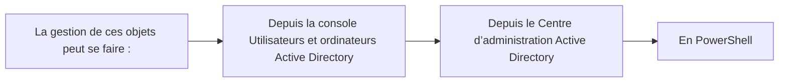

Groupe

- La gestion de ces objets peut se faire :
- Depuis la console Utilisateurs et ordinateurs Active Directory
- Depuis le Centre d’administration Active Directory
- En PowerShell

#### Les bases de gestion d’un domaine

#### Les caractéristiques de l’objet utilisateur

- Ces dernières sont regroupées graphiquement avec un ensemble de catégories.

- Elles sont relatives :
- aux paramètres de l’utilisateur pour l’utilisation des services de bureau distant

#### Contrôle à distance Environnement Profil des services de bureau à distance Sessions

- aux informations générales concernant l’utilisateur

#### Adresse Général Organisation Téléphones

- aux informations nécessaires à sa connexion

#### Compte Profil

- à l’appartenance aux groupes et aux paramètres utilisateur des connexions entrantes

#### Membres de Appel entrant

#### Les bases de gestion d’un domaine

#### Les modèles utilisateur

Il est conseillé d’utiliser des modèles de comptes pour simplifier la création de nouveaux comptes utilisateurs.

#### Un nom clair

#### Le plus grand

#### Dupliquer le compte modèle Compte

#### nombre de caractéristiques

#### Nouvel utilisateur

modèle

#### Le compte est

inactif

#### Les bases de gestion d’un domaine

#### Les profils utilisateurs

Par défaut, les utilisateurs du domaine peuvent ouvrir une session sur les ordinateurs du domaine.

#### Ses propres fichiers / répertoires

#### Des fichiers de configuration logiciels personnalisés

Utilisateur

Possède

#### Un environnement de travail personnalisé

AD

#### Des dossiers personnels

Profil

%systemdrive%\Utilisateurs\%username%

#### Stockés dans

#### Les bases de gestion d’un domaine

#### Les profils itinérants

Utilisé pour les utilisateurs ayant besoin d’un accès à leur profil depuis n’importe quel ordinateur. C’est ici qu’interviennent les profils itinérants.

- Le profil est copié du partage vers l’ordinateur
- Synchronisation du profil à chaque fermeture de session

Le profil est chargé sur l’ordinateur.

L’utilisateur travaille.

À la fermeture de session, le profil est synchronisé.

#### Les bases de gestion d’un domaine

#### Les ordinateurs

- Dans un contexte de domaine, les membres s’authentifient afin de disposer d’un jeton d’accès permettant l’accès aux ressources du domaine.

- Ce processus est commun aux utilisateurs et aux ordinateurs.

- Ceux-ci doivent donc disposer d’un compte dans le domaine.

#### Les bases de gestion d’un domaine

#### Les caractéristiques de l’objet ordinateur

**Visuel externe**

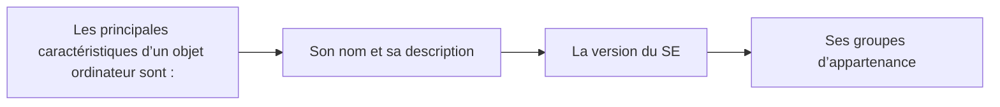

- Au même titre que l’objet utilisateur, l’objet ordinateur dispose de caractéristiques qui lui sont propres.

- Les principales caractéristiques d’un objet ordinateur sont :
- Son nom et sa description
- La version du SE
- Ses groupes d’appartenance
- …

#### Les bases de gestion d’un domaine

#### Les groupes

- Les groupes sont des objets de l’annuaire.

- Tout groupe est caractérisé par un type et une étendue.
- Il en existe deux types :

#### De sécurité De distribution

Dispose d’un identifiant de sécurité (SID). Ne dispose pas d’identifiant de sécurité.

Peut être utilisé pour répondre à un ensemble de besoins. N’est utilisable qu’à des fins de messagerie.

- L’étendue du groupe détermine le périmètre d’appartenance des membres ainsi que celui d’utilisation.

#### Global Universel De Domaine Local Local

#### Les bases de gestion d’un domaine

#### Les groupes globaux

#### Caractéristiques des GG

#### Regrouper des objets qui possèdent

GG_Commerciaux_Nantes

Utilité

des caractéristiques communes.

#### Ils ne peuvent contenir que des

Contraintes

#### objets utilisateur, ordinateur ou

d’appartenance

groupe global du même domaine.

#### Ils peuvent être utilisés sur toute

Contrainte

#### ressource du domaine ou approuvée

d’utilisation

(forêt).

#### Exemple de nom GG_Commerciaux_Nantes

Membres

#### Les bases de gestion d’un domaine

#### Les groupes de domaines locaux

#### Caractéristiques des DL

#### Ressource partagée

#### Privilèges Groupe de Domaine Local

#### Regrouper des objets qui requièrent un

#### même privilège d’accès pour une ressource

Utilité

DL_Marketing_Sur_SRVFIC_CT

CT

donnée.

#### Ils peuvent contenir des objets utilisateur,

DL_Marketing_Sur_SRVFIC_M

Contraintes

M

#### ordinateur ou groupe de tout domaine de

Marketing

d’appartenance

la forêt.

L

DL_Marketing_Sur_SRVFIC_L

Contrainte

#### Ils peuvent être utilisés uniquement sur les

DL_Marketing_Sur_SRVFIC_R

R

ressources de leur domaine de création.

d’utilisation

#### Exemple de nom DL_Comptabilite_Sur_SRVFIC_L

#### Les bases de gestion d’un domaine

#### Les groupes locaux

- Ils peuvent être utilisés.
- Les membres du domaine conservent leur base SAM.

- L’utilisation de ce type de groupe est limitée et limitante.
- Ils ne peuvent être utilisés que sur leur poste d’appartenance.

- Cette limite peut être un atout pour certains besoins en termes de sécurité.

- C’est le seul type de groupe qui peut être utilisé hors domaine.

#### Les bases de gestion d’un domaine

#### Les conteneurs système

- Les objets de l’annuaire AD sont stockés dans des conteneurs.

- Ces conteneurs système sont définis par défaut dans tout domaine AD.

Élements (utilisateurs et groupes locaux) présents dans la base SAM des CD avant leur promotion. Une fois la promotion faite, ces derniers sont déplacés dans ce conteneur.

- Attention :
- Il n’est pas conseillé de conserver les comptes ordinateurs du domaine dans le conteneur Computer, il en va de même pour les comptes utilisateurs dans le conteneur Users.

| Nom de l’objet | Fonction |
| --- | --- |
| Builtin | Éléments utilisateurs et groupes locaux présents dans la base SAM des CD avant leur promotion, puis déplacés dans ce conteneur selon le support. |
| Computers | Emplacement de stockage par défaut des comptes ordinateurs. |
| System | Éléments nécessaires au fonctionnement de l’AD et aux composants associés. |
| Users | Groupes et utilisateurs existant par défaut dans un AD. |

#### Les bases de gestion d’un domaine

#### Les unités d’organisation

- Des conteneurs supplémentaires peuvent être créés :
- OU Organizational Unit / UO Unité d’Organisation

- L’élaboration d’une structure organisationnelle doit prendre en considération les besoins suivants :

- Les stratégies de groupe (GPO Group Policy Object)
- Les délégations administratives
- L’organisation des objets dans l’arborescence

- Tout objet de l’annuaire ne peut être positionné directement que dans un seul conteneur.

- Attention :
- Sur les CD, les UO sont protégées contre toute suppression accidentelle (il est possible de modifier cela).

#### Les bases de gestion d’un domaine

Active_Directory

Builtin

#### Les unités d’organisation

Computers

Domain_Controllers

ForeignSecurityPrincipals

Manage_Security_Accounts

Users

Mon_Entreprise

Groupes

NANTES

Stagiaires

Ordinateurs

Administration

Direction

Formateurs

Ordinateur_Administration

```
Active Directory
 Les bases de gestion d’un domaine

        Les unités d’organisation
              • Des conteneurs supplémentaires peuvent être créés :
                      • OU Organizational Unit / UO Unité d’Organisation
              • L’élaboration d’une structure organisationnelle doit prendre en considération les besoins
             suivants :
                      • Les stratégies de groupe (GPO Group Policy Object)
                      • Les délégations administratives
                      •  L’organisation des objets dans l’arborescence
              • Tout objet de l’annuaire ne peut être positionné directement que dans un seul conteneur.
              • Attention :
                      • Sur les CD, les UO sont protégées contre toute suppression accidentelle (il est possible de
                 modifier cela).

                                                                                          25

25

   Active Directory
 Les bases de gestion d’un domaine

                                                                                          Active_Directory
        Les unités d’organisation                            Builtin
                                                                               Computers
                                                                                         Domain_Controllers
                                                                                                  ForeignSecurityPrincipals
                                                                                      Manage_Security_Accounts
                                                                                         Users
                                                                                        Mon_Entreprise
                                                                                        Groupes
                                                                            NANTES
                                                                                                                      Stagiaires
                                                                                                         Ordinateurs
                                                                                                          Administration
                                                                                                                      Direction
                                                                                                         Formateurs
                                                                                                         Ordinateur_Administration              
                                                                                          26

26
```

#### Les bases de gestion d’un domaine

#### Importation et exportation de comptes

- Quand un nombre important de comptes utilisateurs doit être créé, l’utilisation d’outils permet de fiabiliser et réduire la durée de la tâche.

- Des outils dédiés existent (PowerShell ou Csvde par exemple).

#### Démonstration

#### TP

#### L’accès aux ressources

#### Les ressources

- Le partage de ressource est un service nécessaire aux utilisateurs.

- Sa mise en œuvre et sa gestion incombent à l’administrateur système qui doit respecter les exigences de disponibilités et de sécurité.

- Nous parlerons d’espace disque partagé.

#### L’accès aux ressources

#### Utilité des autorisations NTFS

Sur un espace disque formaté en NTFS ou ReFS :

- Les autorisations NTFS permettent de définir quels sont les privilèges d’accès

- Tous les dossiers et fichiers d’un volume formaté y sont soumis

#### Sécurité NTFS

- Elles sont visualisables et/ou modifiables depuis l’onglet Sécurité des éléments

#### L’accès aux ressources

#### Les caractéristiques des autorisations NTFS

- Deux niveaux de gestions sont disponibles :
- Les autorisations de base
- Les autorisations avancées

- La gestion des permissions est basée sur des règles explicites.

- Plusieurs règles d’accès peuvent s’appliquer à un même utilisateur.

- Chaque règle peut accorder des privilèges ou les ôter.

- Le mécanisme d’héritage s’applique aux autorisations positionnées sur des dossiers et s’appliquent aux objets enfants.

- Une règle de refus peut être explicite ou implicite.

#### L’accès aux ressources

#### Les autorisations NTFS de base et avancées

- Pour répondre aux besoins courants, les autorisations de base permettent d’accorder les privilèges suivants :

#### Lecture Liste de contenu Lecture + exécution Écriture Modification Contrôle Total

- Les privilèges complémentaires suivants peuvent être attribués, par les autorisations avancées.

#### Appropriation Création de fichiers Création de dossiers Écriture des attributs étendus

Lecture des attributs étends Modifier les autorisations Suppression Suppression de sous-dossiers et fichiers

#### L’accès aux ressources

#### Cumul d’autorisations

- Chaque autorisation s’applique à un objet utilisateur ou groupe de sécurité. Il est cependant préférable de n’appliquer des autorisations qu’aux groupes.

- Pour chaque entrée de contrôle d’accès, l’autorisation peut être appliquée :
- Autoriser afin d’accorder le privilège correspondant
- Refuser afin d’ôter le privilège correspondant

- À défaut de règle d’autorisation (explicite) le concernant, l’utilisateur est soumis à un refus implicite.

- Les autorisations sont cumulatives, la résultante des autorisations affectant un utilisateur correspond au cumul des autorisations le concernant.

- En cas de conflit, le refus l’emporte.

#### L’accès aux ressources

#### L’héritage des autorisations NTFS

- L’héritage s’applique par défaut aux autorisations NTFS positionnées sur des dossiers.

- Il est conseillé d’affecter ces autorisations en partant de la racine d’une arborescence afin de bénéficier de l’héritage.

- L’héritage peut être rompu sur un point d’arborescence ou repropagé à partir d’un élément.

- Il y a néanmoins des contraintes :

#### L’accès aux ressources

#### Le partage de fichiers

- Le partage vient en complément des autorisations NTFS.

- Un poste disposant de partages joue le rôle de serveur de fichiers.

Partage

Réseau

#### Sécurité NTFS

| Opération | Au sein d’une même partition | Entre deux partitions ou disques |
| --- | --- | --- |
| Déplacement | Conservation | Héritage |
| Copie | Héritage | Héritage |

#### L’accès aux ressources

#### Les autorisations de partage

- Les autorisations permettent de définir :
- Quels seront les privilèges
- S’ils autoriseront ou interdiront
- Pour qui

- Les trois types de privilèges de partage sont les suivants :

#### Lecture Modification Contrôle Total

- Pour chaque niveau, les privilèges correspondants pourront être :

#### Autorisé Refusé

- Chaque règle cible une ou plusieurs entités.

- Les règles de contrôles d’accès sont cumulatives et les refus prioritaires.

#### L’accès aux ressources

#### Autorisations résultantes

Quand l’utilisateur accède depuis son poste de travail à une ressource partagée :

- Il est d’abord soumis aux autorisations du partage

- Puis aux autorisations NTFS

#### Partage Sécurité NTFS

- Les privilèges les plus restrictifs prévalent.

#### L’accès aux ressources

#### Les publications de partage

- Une fois créé, il est possible de le publier dans l’AD.

- L’objet Partage est soit lié à :
- L’objet ordinateur auquel il est associé.
- Indépendant et peut être déplacé dans un UO dédié.
- La publication de partage facilite la recherche pour les utilisateurs depuis leur poste client avec la fonction Rechercher dans Active Directory.

#### L’accès aux ressources

#### Stratégie d’imbrication des groupes

Afin de gérer efficacement l’accès aux ressources, Microsoft préconise l’imbrication des Groupes Globaux et de Domaines Locaux.

- Cf. Slide sur les groupes de Domaines Locaux

A Le compte utilisateur est créé.

G Il est affecté aux Groupes Globaux.

#### Gestion des utilisateurs

#### Gestion de la ressource

DL Un groupe de Domaine Local est créé par type de privilège pour chaque ressource.

P Des autorisations NTFS sont attribuées pour ce groupe de domaine local sur la ressource.

#### Démonstration

#### TP

#### La gestion des impressions

#### Le service d’impression

- L’ajout du service de rôle Serveur d’impression permet de partager des imprimantes et centraliser la gestion de l’impression.

- Les imprimantes sont des ressources généralement raccordées au réseau de l’entreprise.

- Cependant la mise en place d’un serveur d’impression permet de centraliser et d’en simplifier la gestion.

#### La gestion des impressions

#### Point de vocabulaire

Port d’impression Lien qui permet la communication entre le périphérique d’impression et le serveur (ou à un poste client).

File d’attente Liste des documents en attente de traitement par l’imprimante.

Imprimante locale Imprimante directement (physiquement) connectée à un serveur ou à un poste client.

- Elle peut être du type imprimante réseau
- Elle peut être du type imprimante locale mais il faut que le poste ou le serveur qui la partage soit allumé pour qu’elle soit accessible

Imprimante réseau Imprimante indépendante qui possède sa propre carte réseau, parfois un écran de configuration ou/et un petit serveur web embarqué pour l’administration à distance.

| Vocabulaire | Définition |
| --- | --- |
| Port d’impression | Lien entre le périphérique d’impression et le serveur ou le poste client. |
| File d’attente | Liste des documents en attente de traitement. |
| Imprimante locale | Imprimante physiquement connectée à un serveur ou à un poste client. |
| Imprimante partagée | Imprimante accessible sur le réseau. Si elle est locale au poste qui la partage, ce poste doit être allumé. |
| Imprimante réseau | Imprimante avec sa propre interface réseau, parfois un écran ou un serveur Web embarqué. |

#### La gestion des impressions

#### Les tâches de gestion et outils

#### Vue de l’état des imprimantes

- L’ajout du service de rôle Serveur d’impression fournit la console de gestion Gestionnaire d’impression.

- Cette console rassemble les composants de gestion nécessaire :

#### Configuration des services d’impression

#### Gestion du déploiement par stratégies

#### La gestion des impressions

#### La gestion des périphériques

- Comme pour les ressources disque, une imprimante doit être partagée pour être accessible via le réseau.

- L’attribution des privilèges se configure depuis les paramètres de sécurité :

#### Autorisation de base Autorisation étendue

Imprimer

#### Gérer l’imprimante

#### Gérer les documents

#### Autorisation de lecture

#### Modifier les autorisations

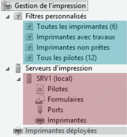

Visuel isolé — Module 02 – Support de cours

#### La gestion des impressions

#### La gestion du déploiement

Plusieurs méthodes peuvent être utilisées pour déployer les imprimantes :

- Le déploiement manuel

- L’utilisation de scripts

- Le déploiement par stratégies de groupe

#### Démonstration

#### TP

#### Conclusion

- Vous connaissez le rôle Active Directory
- Vous savez gérer les ressources partagées avec AGDLP
- Vous connaissez la gestion des imprimantes

Référence du document : 1vdms-QniMNlL6tu_g8XbsS6Bnf4IGR_S · SHA-256 6477d99065feae3c…

## Démonstration · Fiche démo 1 - Mise en place d'un contexte AD · 6 pages transcrites

#### Mise en place d’un contexte Active Directory

#### Démonstration 01 du module 02

Cette démonstration décrit les différentes étapes relatives à la mise en place d’un contexte Active Directory

#### Déroulement

- Prérequis

- Avoir installé et configuré une VM Windows Server.

- Avoir renommé correctement la VM.

- Avoir attribué une IP fixe à la VM.

- Ajout du rôle

Lors de l’accès à la session du serveur, le Gestionnaire de Serveur ou Serveur Manager se lance automatiquement.

Pour lancer la console permettant la gestion des disques, cliquer sur Manage (1), puis sur Add Roles and Features (2).

- Ajout du rôle Active Directory

Cliquer sur le bouton Next (1). Sur la fenêtre Select installation type, cliquer sur le bouton Next (2). Cliquer sur le bouton Next (3) sur la fenêtre Select destination server. Cocher Active Directory Domain Services (4), puis cliquer sur le bouton Add Features (5) de la fenêtre contextuelle qui vient de s’ouvrir. Puis, cliquer sur le bouton Next (6). Sur la fenêtre Select features, cliquer sur le bouton Next (7). Cliquer sur le bouton Next (8) sur la fenêtre Active Directory Domain Services. Enfin, cocher la case Restart the destination server automatically if required (9), puis cliquer sur le bouton Yes (10) de la fenêtre contextuelle qui apparaît. Enfin, cliquer sur le bouton Install (11) pour lancer le processus d’installation du rôle. Cliquer sur le bouton Close (12) pour terminer le processus d’installation.

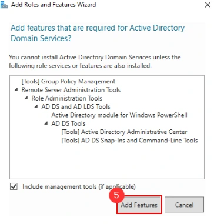

Visuel isolé — Fiche démo 1 - Mise en place d'un contexte AD

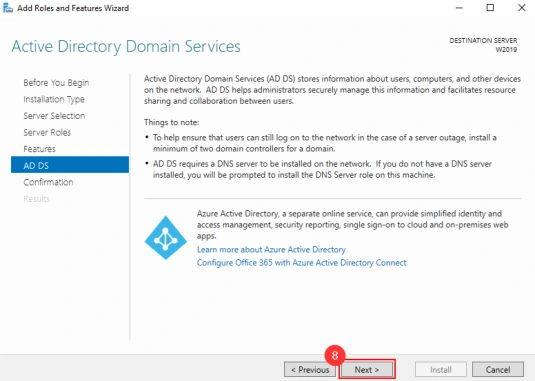

Visuel isolé — Fiche démo 1 - Mise en place d'un contexte AD

- Configuration de l’Active Directory

Une fois l’installation terminée, un « flag » jaune (1) apparaît sur le dashboard. Cliquer sur le drapeau (2), puis sur la ligne Promote this server to a domain controller (3). Dans la partie Select the deployment operation (4), cocher le bouton radio Add a new forest (5). Par la suite, spécifier le nom de votre domaine dans l’input box Root domaine name (6), puis cliquer sur le bouton Next (7). Renseigner un mot de passe de récupération et le confirmer (8), puis cliquer sur le bouton Next (9). Dans la fenêtre DNS Options, cliquer sur le bouton Next (10). Cliquer sur le bouton Next (11) dans la fenêtre Additional Options. Cliquer sur le bouton Next (12) dans la fenêtre Paths. Dans cette fenêtre l’ensemble des éléments de configurations sont repris, cliquer sur le bouton Next (13). Une fois les prérequis validés (14), cliquer sur le bouton Install (15). À l’issue de l’installation, la VM va redémarrer pour appliquer les modifications.

#### Étapes illustrées dans le support

1. Avancer depuis DNS Options. L’avertissement de délégation DNS est présenté dans l’assistant.
2. Dans Additional Options, vérifier le nom NetBIOS MONDOMAINE.
3. Dans Paths, conserver les chemins proposés C:\Windows\NTDS pour la base et ses journaux et C:\Windows\SYSVOL pour SYSVOL.
4. Dans Review Options, relire le domaine, les niveaux fonctionnels et les composants, puis passer à Prerequisites Check.
5. Lorsque tous les contrôles prérequis réussissent, lancer Install.

- Validation de la configuration AD

À la suite du redémarrage de la VM, la mire de connexion doit proposer la connexion sur le domaine précédemment configuré (1).

Référence du document : 1DCMI9odaQzxmbabT6GxDxTlDQYm9OzVO · SHA-256 1f0e02a1e98ac8fc…

## Démonstration · Fiche démo 2 - Les bases de gestion d'un domaine · 9 pages transcrites

#### Les bases de gestion d’un domaine

#### Démonstration 02 du module 02

Cette démonstration décrit les différentes étapes relatives aux opérations courantes dans la gestion d’un domaine Active Directory.

#### Déroulement

- Ouverture de la console MMC

Après l’ouverture de session sur la session du domaine, cliquer sur le menu démarrer (1), puis sur la tuile Windows Administrative Tools (2).

- Ajout du raccourci dans la barre des tâches

Dans l’explorateur qui vient de s’ouvrir, faire un clic droit sur la ligne Active Directory Users and Computers (1), puis sur la ligne Pin to taskbar (2). L’icône (3) apparaît.

- Accès à la console Active Directory

Cliquer sur le raccourci précédemment créé afin de voir l’arborescence de l’Active Directory précédemment configuré.

- Création Unité d’Organisation

Faire un clic droit à la racine du domaine (1), puis sur la ligne New (2) et enfin sur la ligne Organizational Unit (3). Indiquer dans l’input box Mon Entreprise (4), puis cliquer sur le bouton OK (5). L’UO apparaît dans l’arborescence du domaine (6).

- Création Arborescence

Dans l’UO « Mon Entreprise » qui vient d’être créée, créer les UO suivantes :

#### - Utilisateurs

#### - Ordinateurs

#### - Groupes

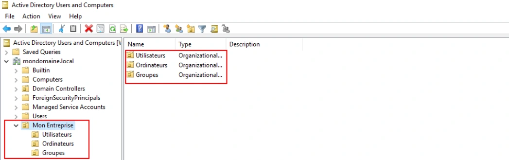

Visuel isolé — Fiche démo 2 - Les bases de gestion d'un domaine

- Création Utilisateur

Se positionner dans l’UO Utilisateurs (1). Faire un clic droit, aller sur la ligne New (2), puis sur la ligne User (3). Dans les deux input box First name et Last name (4), indiquer un prénom et un nom. Dans l’input box User logon name (5), indiquer un login de connexion pour l’utilisateur, puis cliquer sur le bouton Next (6). Sur les lignes Password et Confirm password (7), indiquer un mot de passe avec Majuscule + Minuscule + Chiffre, puis cliquer sur le bouton Next (8). Enfin, cliquer sur le bouton Finish (9). L’utilisateur apparaît dans l’UO Utilisateurs (10).

- Création Ordinateur

Se positionner dans l’UO Ordinateurs (1). Faire un clic droit, aller sur la ligne New (2), puis sur la ligne Computer (3). Dans l’input box Computer name (4), indiquer un nom de machine, puis cliquer sur le bouton Next (5). Cliquer sur le bouton Next (6). Enfin, cliquer sur le bouton Finish (7). L’ordinateur apparaît dans l’UO Ordinateurs (8).

- Création Utilisateur

Se positionner dans l’UO Groupes (1). Faire un clic droit, aller sur la ligne New (2), puis sur la ligne Group (3). Dans l’input box Group Name (4), indiquer le nom du groupe, puis cliquer sur le bouton OK (5). Le groupe apparaît dans l’UO Groupes (6).

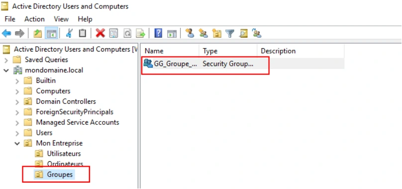

Visuel isolé — Fiche démo 2 - Les bases de gestion d'un domaine

- Intégration Ordinateurs dans AD

Prérequis : avoir une VM Windows 10 configurée (correctement nommée, sur le même sous-réseau que la VM sur laquelle l’Active Directory est installé).

Aller dans les propriétés système de la VM Windows 10. Pour ce faire, appuyer simultanément sur la touche Windows du clavier ainsi que la touche R du clavier. Indiquer control dans l’input-box (1), puis cliquer sur le bouton OK (2). Cliquer sur le lien Système et sécurité (3). Cliquer sur le lien Système (4). Cliquer sur le lien Modifier les paramètres (5). Cliquer sur le bouton Modifier (6). Cocher le bouton radio Domaine et indiquer le nom du domaine à rejoindre (7), puis cliquer sur le bouton OK (8). Saisir les informations de sécurité (9), puis cliquer sur le bouton OK (10). Après redémarrage de la VM, la mire de connexion propose la connexion sur le domaine.

#### Étapes illustrées dans le support

1. Sur W10-Client2, ouvrir Système puis Modifier les paramètres.
2. Dans Propriétés système, utiliser Modifier et choisir Domaine. Saisir mondomaine.local, puis valider.
3. S’authentifier avec le compte autorisé à joindre le domaine et le secret fourni par le formateur.

- Vérification de l’ajout du nouvel ordinateur dans l’AD

Se connecter sur la VM sur laquelle est installé l’Active Directory. Ouvrir la console Active Directory Users and Computers. Aller sur l’UO Computers (1). Faire un clic droit sur le nouvel ordinateur, puis sur le menu Move (2). Sélectionner l’UO Ordinateurs précédemment créée (3), puis cliquer sur le bouton OK (4). L’ordinateur se trouve désormais dans l’UO Ordinateurs précédemment créé.

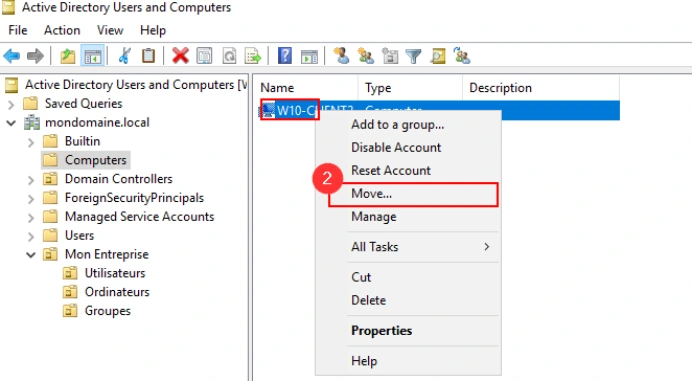

Visuel isolé — Fiche démo 2 - Les bases de gestion d'un domaine

Référence du document : 1hbc5tZ6pphePd8otUMwo5__RpcpQqYZv · SHA-256 98736da7e470ebdd…

## Démonstration · Fiche démo 3 - L'accès aux ressources · 6 pages transcrites

#### L’accès aux ressources

#### Démonstration 03 du module 02

Cette démonstration décrit comment gérer les accès à des ressources partagées dans un contexte de domaine Active Directory.

#### Déroulement

- Création de groupes de Domaine Local

Ouvrir la console Active Directory Users and Computers sur la VM où est installé l’Active Directory. Se positionner sur l’Unité d’Organisation Groupes (1). Créer quatre nouveaux groupes.

L’ensemble de ces groupes sera de type « Domaine Local » :

#### DL_Public_CT = Groupe de Domaine Local pour la ressource Public en accès Contrôle Total

#### DL_Public_M = Groupe de Domaine Local pour la ressource Public en accès Modification

#### DL_Public_L = Groupe de Domaine Local pour la ressource Public en accès Lecture

#### DL_Public_R = Groupe de Domaine Local pour la ressource Public en accès Refus

- Affectations Groupe Global Utilisateur

Se positionner sur l’Unité d’Organisation Utilisateurs (1). Double cliquer sur l’utilisateur présent dans l’Unité d’Organisation. Cliquer sur l’onglet Member Of (2). Cliquer sur le bouton Add (3). Dans l’input-box Enter the object name to select, indiquer le nom du Groupe Global créé dans la démonstration précédente (4), puis appuyer sur la touche [Entrée] du clavier. Enfin, cliquer sur le bouton Apply (5) pour valider l’ajout du groupe à l’utilisateur.

- Affectations groupe de Domaine Local

Se positionner sur l’Unité d’Organisation Groupes (1). Double cliquer sur le groupe DL_Public_M. Cliquer sur l’onglet Members (2). Cliquer sur le bouton Add… (3). Dans l’input-box Enter the object name to select, indiquer le nom du Groupe Global créé dans la démonstration précédente (4), puis appuyer sur la touche [Entrée] du clavier. Enfin, cliquer sur le bouton Apply (5) pour valider l’ajout du groupe.

- Création de la ressource partagée

Se positionner sur un volume (ici le RAID1 créé lors des démonstrations précédentes). Création d’un nouveau dossier nommé Public (1). Faire un clic droit sur le dossier Public puis sur le menu Properties (2). Cliquer sur l’onglet Sharing (3), puis sur le bouton Advanced Sharing… (4). Cliquer sur la case à cocher Share this folder (5), puis cliquer sur le bouton Permissions (6). Ajouter l’ensemble des droits pour le groupe Everyone (7), puis cliquer sur le bouton Apply (8). Cliquer sur le bouton Apply (9), puis sur le bouton OK (10). Cliquer sur l’onglet Security (11). Sélectionner le groupe Users (12), puis cliquer sur le bouton Edit… (13). Sélectionner le groupe Users, puis cliquer sur le bouton Remove (14). Cliquer sur le bouton Apply (15). Cliquer sur le bouton Add… (16). Ajouter dans l’input-box les 4 DL précédemment créés (17), puis cliquer sur le bouton OK (18). Positionner les droits adéquats pour chaque DL. Enfin, cliquer sur le bouton Apply (19), puis le bouton OK (20).

#### Étapes illustrées dans le support

1. Dans les propriétés du dossier Public sur H:, ouvrir Partage puis Partage avancé.
2. Cocher Share this folder, conserver le nom Public, ouvrir Permissions et accorder Full Control à Everyone dans l’exemple.
3. Valider le partage, ouvrir l’onglet Security du dossier, puis modifier les autorisations. La capture montre la suppression de l’entrée Users dans le réglage proposé.

#### Étapes illustrées dans le support

1. Dans Permissions for Public, ajouter les groupes DL_Public_CT, DL_Public_L, DL_Public_M et DL_Public_R.
2. Attribuer le contrôle total au groupe CT, la lecture au groupe L et la modification au groupe M. Le groupe R reçoit les refus indiqués par la capture.
3. Appliquer les réglages puis fermer la boîte de dialogue.

Référence du document : 1R7vZ8RE1ofisB6Sa9Op42a3XCaGjgUht · SHA-256 6d2b7928549af8f2…

## Démonstration · Fiche démo 4 - La gestion des impressions · 10 pages transcrites

#### La gestion des impressions

#### Démonstration 04 du module 02

Cette démonstration décrit comment gérer les impressions dans un contexte Active Directory

#### Déroulement

- Installation du rôle Services d’impression et de numérisation de documents

Sur la VM W2019, lancer l’utilitaire d’installation de rôle (via le dashboard), puis cocher la case Print and Document Services (1). Cliquer sur le bouton Add Features (2) sur la fenêtre contextuelle. Cliquer sur le bouton Next (3). Cliquer sur le bouton Next (4). Cliquer sur le bouton Next (5). Cocher la case Restart the destination server automatically if required (6), puis cliquer sur le bouton Install (7). Enfin, cliquer sur le bouton Close (8).

#### Étapes illustrées dans le support

1. Dans l’assistant d’ajout, continuer après Select features puis lire Print and Document Services.
2. Dans Select role services, cocher Print Server. Confirmer la sélection, lancer Install, vérifier la réussite et choisir Close.

- Ajout du raccourci dans la barre des tâches

Ouvrir Administrative Tools, puis création du raccourci Print Management (1) dans la barre des taches (2).

- Installation d’un nouveau driver.

NB : un update via Windows Update sera utile s’il n’y a pas de driver sélectionnable dans l’utilitaire d’ajout.

Ouvrir la console Print Management depuis le raccourci précédemment créé. Se positionner sur la ligne Driver (1). Faire un clic droit dans la zone blanche centrale, puis sur le menu Add Driver… (2). Dans l’utilitaire d’installation, cliquer sur le bouton Next (3). Cliquer sur le bouton Next (4) (pour la démonstration, seuls des drivers x64 seront installés). Sélection d’un driver, ici HP Color LaserJet Pro MFP M274 PCL 6 (5), puis cliquer sur le bouton Next (6). Enfin, cliquer sur le bouton Finish (7). Le driver apparaît correctement (8).

#### Étapes illustrées dans le support

1. Dans Print Management, ouvrir Drivers, puis Add Driver.
2. Dans l’assistant, sélectionner l’architecture x64 puis le constructeur HP et le pilote HP Color LaserJet Pro MFP M274 PCL 6.
3. Terminer puis vérifier le pilote dans Drivers.

- Installation d’un nouveau port.

Se positionner sur la ligne Ports (1). Faire un clic droit dans la zone blanche centrale, puis sur la ligne Add Port… (2). Sélection de la ligne Standard TCP/IP Port (2), puis cliquer sur le bouton New Port… (3). Cliquer sur le bouton Next de l’utilitaire d’ajout de port (4). Indiquer dans l’input-box Printer Name or IP Adress l’adresse IP de l’imprimante (5). Indiquer dans l’input-box Port Name un nom de port (6), puis cliquer sur le bouton Next (7). Cliquer sur le bouton Next (8). Enfin, cliquer sur le bouton Finish (9). Le port apparaît correctement (10).

- Installation d’une nouvelle imprimante

Se positionner sur la ligne Printers (1). Faire un clic droit dans la zone blanche centrale, puis sur la ligne Add Printer… (2). Sélectionner le bouton radio Add a new printer using an existing port (3), sélectionner dans la combo-box le port créé précédemment (4). Cliquer sur le bouton Next (5). Sélectionner le bouton radio Use an existing printer driver on the computer (6), puis le driver précédemment installé (7). Cliquer sur le bouton Next (8). Cliquer sur le bouton Next (9). Cliquer sur le bouton Next (10). Enfin, cliquer sur le bouton Finish (11). L’imprimante apparaît correctement (12).

#### Étapes illustrées dans le support

1. Dans Print Management, ouvrir Printers puis Add Printer.
2. Choisir Add a new printer using an existing port et le port TCP/IP standard P_192.168.1.100.
3. Choisir Use an existing printer driver on the computer et le pilote HP Color LaserJet Pro MFP M274 PCL 6.
4. Dans Printer Name and Sharing Settings, renseigner le nom et activer Share this printer. Vérifier le nom de partage, l’emplacement et le commentaire.

#### Étapes illustrées dans le support

1. Relire le récapitulatif Printer Found. Il affiche le modèle HP Color LaserJet Pro MFP M274 PCL 6, le port TCP/IP standard P_192.168.1.100 et le nom de partage.
2. Choisir Next puis Finish après la réussite. La capture finale montre l’imprimante prête dans Print Management.

- Installation imprimante sur poste client

L’imprimante étant installée sur le serveur d’impression, elle est désormais disponible pour l’ensemble des utilisateurs du domaine.

Une fois connecté sur la VM W10 avec un utilisateur du domaine, ouvrir l’explorateur de document. Indiquer dans la barre, le nom de la VM sur lequel le serveur d’impression est installé (1), puis appuyer sur la touche [Entrée]. Double cliquer sur l’imprimante nouvellement installée sur le serveur cible (2). Quand la fenêtre contextuelle apparaît, c’est que le processus d’installation est terminé, l’imprimante est correctement installée la VM cliente.

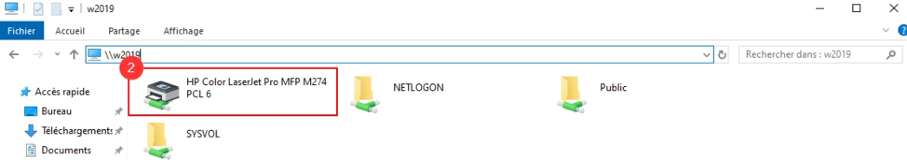

Visuel isolé — Fiche démo 4 - La gestion des impressions

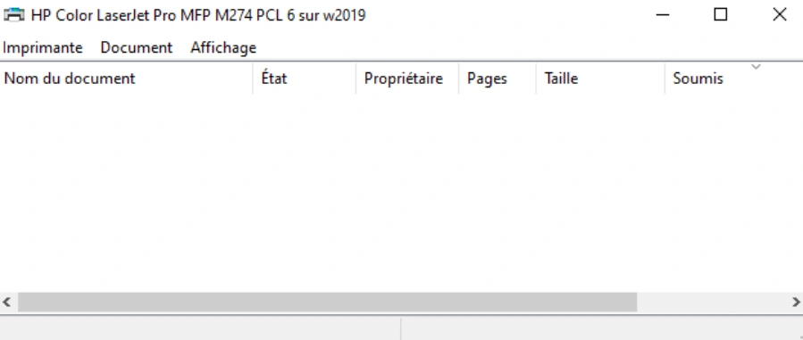

Visuel isolé — Fiche démo 4 - La gestion des impressions

Référence du document : 1JUqdAJleUYwjXnUPpkBX-JoFYSi1YjFo · SHA-256 e87b9387751651bb…

## Énoncé · Enoncé du TP 1 - Mise en place d’un domaine Active Directory · 2 pages transcrites

#### Services réseau en environnement Microsoft Mise en place d’un domaine Active Directory

#### TP du Module 02 – Active Directory

Avant de démarrer ce TP, il convient d’avoir suivi les vidéos du module 2 et réalisé les TP précédents.

#### Durée estimée

30 minutes à 1 heure

#### Énoncé

Prérequis :

Disposer des machines virtuelles installées dans le TP 01 du module 01.

Création d’un contexte de domaine Active Directory :

#### Domaine Monprenom.local

#### W19-CD1 Contrôleur de domaine Serveur DNS

#### W10-CLI1 Client membre

#### W19-SRV1 Serveur membre

Analyse de différents cas d’ouverture de session :

Assurez-vous au préalable que les trois hôtes communiquent entre eux.

Pouvez-vous ouvrir une session avec un compte local sur W10-CLI1 ?

#### Oui Non

Pouvez-vous ouvrir une session avec un compte du domaine sur W10-CLI1 ?

#### Oui Non

Avec quel(s) compte(s) utilisateur(s) ?

Pouvez-vous ouvrir une session sur le contrôleur de domaine W19-CD1 ?

#### Oui Non

Avec quel(s) compte(s) utilisateur(s) ?

Dans quelle(s) console(s) et dans quel emplacement pouvez-vous visualiser les machines hôtes membres du domaine ?

Référence du document : 1B2gL9O4db8aZMg_jx_eaRnpWgikX7Ca6 · SHA-256 5d79597c7a5c0455…

## Énoncé · Enoncé du TP 2 - Utilisateurs et groupes en contexte de domaine AD · 4 pages transcrites

#### Services réseau en environnement Microsoft Utilisateurs et groupes en contexte de domaine AD

#### TP du Module 02 – Active Directory

Avant de démarrer ce TP, il convient d’avoir suivi les vidéos du module 2 et réalisé les TP précédents.

#### Durée estimée

1 à 2 heures

#### Énoncé

Prérequis :

Avoir réalisé le TP précédent du Module 02.

Recherche d’objets dans l’annuaire : Utilisez les fonctions de recherche de l’AD pour contrôler si les comptes locaux existants existent toujours.

Si oui, où se trouvent-ils ?

Où se trouve le compte d’ordinateur W19-CD1 ?

Création de la structure de stockage des objets de l’annuaire :

Créez les unités d’organisation en vous basant sur les informations du tableau ci-dessous.

#### Création des modèles et comptes utilisateurs

Créez des modèles d’utilisateurs pour les services :

Les caractéristiques des comptes utilisateurs selon leur service d’appartenance sont indiquées ci-après :

#### Les utilisateurs du service Production

#### Leur tranche horaire est soit

- De 6h à 12h o De 13h à 21h Chaque collaborateur n’est affecté qu’à une tranche horaire Ils travaillent tous dans l’agence de Vertou Ils font partie du groupe Production

#### Les utilisateurs du service Informatique

Ils disposent de l’ensemble des privilèges à l’échelle du domaine (à l’exception de la secrétaire) Ils travaillent tous à l’agence de Nantes

#### Les utilisateurs du service Commercial

Ils ne pourront se connecter que sur les postes clients Windows 10 Ils travaillent tous dans l’agence de Rennes

| Type | Nom |
| --- | --- |
| Agence | Nantes |
| Agence | Vertou |
| Agence | Rennes |
| Services | Production |
| Services | Informatique |
| Services | Commercial |
| Fonction dans les services | Intérimaire |
| Fonction dans les services | Secrétaire |
| Ordinateurs | Serveurs Membres |
| Ordinateurs | Postes Clients |

En partant de vos nouveaux modèles :

Vous contrôlerez la bonne prise en compte des caractéristiques des comptes créés.

Dépendance aux services de domaine AD : 1. Arrêtez le service DNS du contrôleur de domaine. 2. Redémarrez le poste client puis effectuez les tests suivants.

Parvenez-vous à ouvrir une session sur le domaine avec l’utilisateur précédemment utilisé ?

#### Oui Non

Parvenez-vous à ouvrir une session sur le domaine avec un utilisateur qui n’a encore jamais utilisé W10-CLI1 ?

#### Oui Non

Après avoir relancé le service DNS, arrêtez le service Netlogon, quelle est la conséquence de cet arrêt ?

Pour rétablir la situation, relancez les services Services de domaine Active Directory.

| Service Informatique | Service Production | Service Commercial |
| --- | --- | --- |
| Stéphane | Philippe | Camille (Secrétaire) |
| Sophie (Secrétaire) | Pascal | Claude |
| Samir | Paul | Corentin |
| mon prénom | Isabelle (Intérimaire) | Ines (Intérimaire) |

Cadre de réponse vide dans le support.

Référence du document : 1j7nol4DzNlXkWLqTBGGz04CO30fUiESh · SHA-256 a1e2b2f811ebf033…

## Énoncé · Enoncé du TP 3 - L’accès aux ressources · 2 pages transcrites

#### Services réseau en environnement Microsoft L’accès aux ressources

#### TP du Module 02 – Active Directory

Avant de démarrer ce TP, il convient d’avoir suivi les vidéos du module 2 et réalisé les TP précédents.

#### Durée estimée

1 à 2 heures

#### Énoncé

Prérequis :

Avoir réalisé le TP précédent du Module 02.

#### Ajout et préparation d’un nouvel espace disque

Ajoutez deux disques de 10 Go chacun au serveur membre W19-SRV1.

Créez un volume en miroir de 5 Go au format NTFS.

Ce volume sera accessible via une lettre de lecteur et depuis C:\datasafe.

L’espace restant (de ces deux disques) sera accessible via le lecteur D:\.

Configuration de profils itinéraires :

Modifier le compte modèle du service Commercial afin que chaque utilisateur du service dispose d’un profil itinérant.

Ce profil sera stocké sur le serveur membre depuis C:\datasafe\users et accessible depuis un partage intitulé « Profils ». Les comptes existants sont-ils impactés par ces modifications ?

#### Oui Non

Sinon, apportez les modifications nécessaires.

#### Partage de ressources

#### Configurez le partage de ressources en respectant les contraintes indiquées

Le partage Production :

Accessible uniquement aux membres du service Production et aux administrateurs (ces derniers pourront tout y faire).

Le partage Applications :

Accessible en lecture à tous les membres de la société et en écriture aux membres du service Informatique. Les secrétaires n’auront aucun accès.

Le partage Prospects :

Accessible exclusivement aux Commerciaux.

Ajouter un partage Public qui donnera accès aux données se trouvant sur D:\ sur le serveur membre W19-SRV1. Ce partage sera accessible à tous en lecture.

| Nom du partage | Localisation sur W19-SRV1 |
| --- | --- |
| Production | C:\datasafe\prod |
| Applications | C:\datasafe\appli |
| Prospects | C:\datasafe\en_cours |

Référence du document : 1Guhv5Wx0z2snNuhB7a_7G9d0Mhsy9oW1 · SHA-256 d0c0de693174ca1c…

## Énoncé · Enoncé du TP 4 - La gestion des impressions · 2 pages transcrites

#### Service Réseau en environnement Microsoft

#### La gestion des impressions

#### TP du Module 02 – Active Directory

Avant de démarrer ce TP, il convient d’avoir suivi les vidéos du module 2 et avoir réalisé les TP précédents.

#### Durée estimée

30 mn à 1 heure

#### Énoncé

Prérequis :

- Avoir réalisé le TP précédent du Module 02.

#### Mise en place du service d’impression

W19-SRV1 sera le serveur en charge de la gestion des imprimantes. Le fichier de pilote unique et universel est présent sur le partage distrib (lecteur R:) à l’endroit suivant : ‘Drivers\Drivers_imprimante_TSSR090_services_réseau_Microsoft’, il commence par upd-pcl6-x64-… Dans ce fichier compressé, le fichier d’installation “.inf” à utiliser est hpzipa23.inf Configuration d’imprimantes L’entreprise vient d'investir dans un périphérique d'impression réseau à destination du service commercial sur le site de Rennes. Le modèle est HP Color LaserJet M552. Réalisez les actions nécessaires sur le serveur afin de pouvoir mettre à disposition ce périphérique sur le réseau.

Adresse IP Nom imprimante Param. par défaut Qui peut imprimer ?

| Adresse IP | Nom imprimante | Paramètres par défaut | Qui peut imprimer ? |
| --- | --- | --- | --- |
| 172.28.10.46 | Imp-Commercial-35RDC | Recto/Verso | Service commercial |

#### Service Réseau en environnement Microsoft

Paramètres supplémentaires :

- Les administrateurs du domaine auront le contrôle total sur la gestion de ces imprimantes

- Les imprimantes seront publiées dans l’annuaire Active Directory La société possède un périphérique HP Laserjet 5 destinée à imprimer des bons de livraison/retrait pour le service production. Les livreurs doivent impérativement récupérer ceux-ci avant de quitter la plateforme logistique. L'imprimante actuelle ne suffit plus aujourd’hui pour suivre la cadence de l'usine. La direction a donc décidé d'investir dans deux nouveaux périphériques d'impression de modèle HP Color LaserJet Pro MFP M274 réunies au sein d’un « pool » d’imprimantes, permettant de paralléliser les travaux et donc de gagner du temps. Réalisez les actions nécessaires sur le serveur afin de mettre à disposition ces périphériques sur le réseau.

Paramètres supplémentaires :

- Les administrateurs du domaine auront le contrôle total sur la gestion de cette imprimante

- Les périphériques seront configurés dans un « pool » d’imprimantes

- L’imprimante sera publiée dans l’annuaire Active Directory Installation d’une imprimante sur un poste client

- Installer manuellement l’imprimante partagée IMP-Commercial-35RDC sur le poste client W10

- Tester l’impression avec un compte utilisateur membre du groupe G-Commercial

| Adresse IP | Nom imprimante | Qui peut imprimer ? |
| --- | --- | --- |
| 172.28.10.90 et 172.28.10.91 | Imp-BL44-Usine | Service production |

Référence du document : 1KyYVZmcI_tJV4pARpiGdra87-XdxJ0iY · SHA-256 7228cf762389c665…

## Correction · Solution du TP 1 - Mise en place d’un domaine Active Directory · 4 pages transcrites

Correction originale : à consulter après avoir tenté l’exercice.

#### Mise en place d’un domaine Active Directory

#### TP du Module 02 – Active Directory

Avant de démarrer ce TP, il convient d’avoir suivi les vidéos du module 2 et réalisé les TP précédents.

#### Durée estimée

30 minutes à 1 heure

#### Énoncé

Prérequis :

- Disposer des machines virtuelles installées dans le TP 01 du module 01.

Création d’un contexte de domaine Active Directory :

#### Domaine Monprenom.local

#### W19-CD1 Contrôleur de domaine Serveur DNS

#### W10-CLI1 Client membre

#### W19-SRV1 Serveur membre

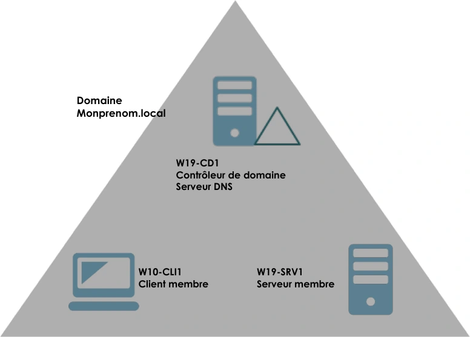

Visuel isolé — Solution du TP 1 - Mise en place d’un domaine Active Directory

#### Étapes illustrées dans le support

1. Sélectionner le rôle Services AD DS, installer puis choisir Promouvoir ce serveur en contrôleur de domaine.
2. Dans l’assistant, choisir Ajouter une nouvelle forêt et saisir monprenom.local.
3. Vérifier les niveaux fonctionnels, DNS et catalogue global. Saisir le secret DSRM fourni par le formateur.
4. Continuer après les options DNS, vérifier le nom NetBIOS MONPRENOM, exécuter le contrôle des prérequis et lancer Installer.
5. Après redémarrage, la capture montre la connexion du compte MONPRENOM\Administrateur.

Sur W19-SRV1 et W10-CLI1 il est important d’avoir comme serveur DNS préféré l’adresse IP de W19-CD1

Analyse de différents cas d’ouverture de session :

Assurez-vous au préalable que les trois hôtes communiquent entre eux.

- Pouvez-vous ouvrir une session avec un compte local sur W10-CLI1 ?

```
Oui   □ Non
```

- Pouvez-vous ouvrir une session avec un compte du domaine sur W10-CLI1 ?

```
Oui   □ Non
```

- Avec quel(s) compte(s) utilisateur(s) ?

Avec le compte administrateur du domaine ou tout autre compte créé sur l’annuaire Active Directory et comptes locaux de W10-CLI.

- Pouvez-vous ouvrir une session sur le contrôleur de domaine W19-CD1 ?

```
Oui   □ Non
```

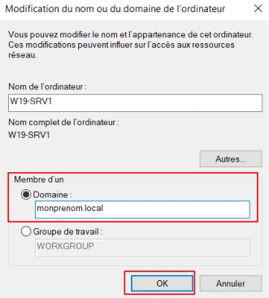

Visuel isolé — Solution du TP 1 - Mise en place d’un domaine Active Directory

- Avec quel(s) compte(s) utilisateur(s) ?

Avec le compte administrateur du domaine ou tout autre compte créé sur l’annuaire Active Directory.

- Dans quelle(s) console(s) et dans quel emplacement pouvez-vous visualiser les machines hôtes membres du domaine ?

Dans la console : Utilisateurs et ordinateurs Active Directory/Centre d’administration Active Directory.

#### Se déplacer dans le conteneur : Computers et Domain Controllers

Référence du document : 1n1rLGYHA1QDhSCuOR662ZOr5EyVmhPX4 · SHA-256 a8cb833f1835ce3a…

## Correction · Solution du TP 2 - Utilisateurs et groupes en contexte de domaine AD · 7 pages transcrites

Correction originale : à consulter après avoir tenté l’exercice.

#### Utilisateurs et groupes en contexte de domaine AD

#### TP du Module 02 – Active Directory

Avant de démarrer ce TP, il convient d’avoir suivi les vidéos du module 2 et réalisé les TP précédents.

#### Durée estimée

1 à 2 heures

Prérequis :

- Avoir réalisé le TP précédent du Module 02.

Recherche d’objets dans l’annuaire : Utilisez les fonctions de recherche de l’AD pour contrôler si les comptes locaux existants existent toujours.

- Si oui, où se trouvent-ils ?

- Où se trouve le compte d’ordinateur W19-CD1 ?

#### Dans le conteneur Domain Controllers

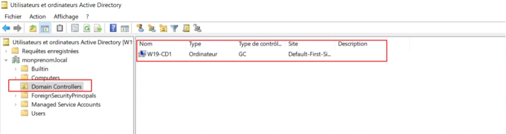

Visuel isolé — Solution du TP 2 - Utilisateurs et groupes en contexte de domaine AD

Création de la structure de stockage des objets de l’annuaire :

Créez les unités d’organisation en vous basant sur les informations du tableau ci-dessous.

Attention, ceci est une solution, il en existe d’autres.

| Type | Nom |
| --- | --- |
| Agence | Nantes |
| Agence | Vertou |
| Agence | Rennes |
| Services | Production |
| Services | Informatique |
| Services | Commercial |
| Fonction dans les services | Intérimaire |
| Fonction dans les services | Secrétaire |
| Ordinateurs | Serveurs Membres |
| Ordinateurs | Postes Clients |

Création des modèles et comptes utilisateurs Créez des modèles d’utilisateurs pour les services :

- Informatique
- Production
- Commercial Les caractéristiques des comptes utilisateurs selon leur service d’appartenance sont indiquées ci-après : Les utilisateurs du service Production

- Leur tranche horaire est soit

- De 6h à 12h o De 13h à 21h • Chaque collaborateur n’est affecté qu’à une tranche horaire • Ils travaillent tous dans l’agence de Vertou • Ils font partie du groupe Production

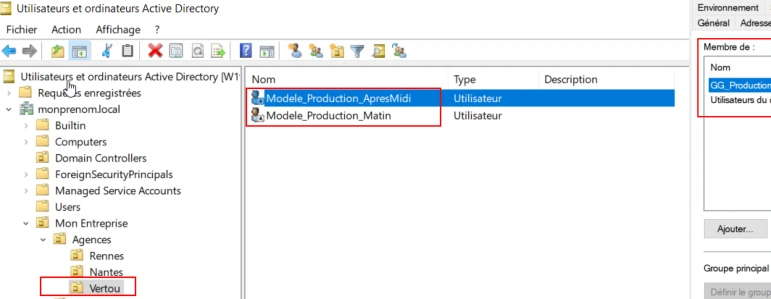

Visuel isolé — Solution du TP 2 - Utilisateurs et groupes en contexte de domaine AD

#### Les utilisateurs du service Informatique

- Ils disposent de l’ensemble des privilèges à l’échelle du domaine (à l’exception de la secrétaire)
- Ils travaillent tous à l’agence de Nantes

#### Les utilisateurs du service Commercial

- Ils ne pourront se connecter que sur les postes clients Windows 10
- Ils travaillent tous dans l’agence de Rennes

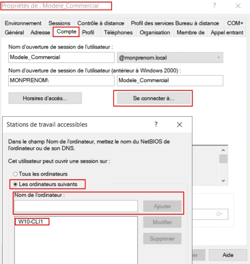

Visuel isolé — Solution du TP 2 - Utilisateurs et groupes en contexte de domaine AD

En partant de vos nouveaux modèles :

```
Vous contrôlerez la bonne prise en compte des caractéristiques des comptes créés. 
 
Dépendance aux services de domaine AD : 
1. Arrêtez le service DNS du contrôleur de domaine. 
2. Redémarrez le poste client puis effectuez les tests suivants. 
 
• 
Parvenez-vous à ouvrir une session sur le domaine avec l’utilisateur précédemment 
utilisé ? 
 Oui   □ Non
```

```
• 
Parvenez-vous à ouvrir une session sur le domaine avec un utilisateur qui n’a encore 
jamais utilisé W10-CLI1 ? 
□ Oui    Non
```

- Après avoir relancé le service DNS, arrêtez le service Netlogon, quelle est la conséquence de cet arrêt ?

Le service netlogon vérifie la bonne authentification des éléments actifs tentant de se connecter à l’AD.

Pour rétablir la situation, relancez les services Services de domaine Active Directory.

| Service Informatique | Service Production | Service Commercial |
| --- | --- | --- |
| Stéphane | Philippe | Camille (Secrétaire) |
| Sophie (Secrétaire) | Pascal | Claude |
| Samir | Paul | Corentin |
| mon prénom | Isabelle (Intérimaire) | Ines (Intérimaire) |

Référence du document : 1nqj-gZDzZzzOwwhIz6Hj6YPc3TSV8hA5 · SHA-256 475f6b7792e58a39…

## Correction · Solution du TP 3 - L'accès aux ressources · 10 pages transcrites

Correction originale : à consulter après avoir tenté l’exercice.

#### Service Réseau en environnement Microsoft

#### L’accès aux ressources

#### TP du Module 02 – Active Directory

Avant de démarrer ce TP, il convient d’avoir suivi les vidéos du module 2 et réalisé les TP précédents.

#### Durée estimée

1 à 2 heures

#### Énoncé

Prérequis :

- Avoir réalisé le TP précédent du Module 02.

#### Ajout et préparation d’un nouvel espace disque

- Ajoutez deux disques de 10 Go chacun au serveur membre W19-SRV1.
- Créez un volume en miroir de 5 Go au format NTFS.
- Ce volume sera accessible via une lettre de lecteur et depuis C:\datasafe.
- L’espace restant (de ces deux disques) sera accessible via le lecteur D:\.

#### Service Réseau en environnement Microsoft

Configuration de profils itinéraires :

- Modifier le compte modèle du service Commercial afin que chaque utilisateur du service dispose d’un profil itinérant.

- Ce profil sera stocké sur le serveur membre depuis C:\datasafe\users et accessible depuis un partage intitulé « Profils ».

#### Service Réseau en environnement Microsoft

```
• 
Les comptes existants sont-ils impactés par ces modifications ? 
□ Oui    Non 
Sinon, apportez les modifications nécessaires.
```

#### Service Réseau en environnement Microsoft

#### Partage de ressources

#### Configurez le partage de ressources en respectant les contraintes indiquées

1°) Gestion des accès en respectant les préconisations AGDLP de Microsoft Sur le contrôleur de domaine, dans la console Utilisateurs et ordinateurs Active Directory :

- Création des Unités d’organisation pour classifier les groupes de ressources correctement :

- Création des groupes de domaine local 4 groupes de domaine local par ressource partagée : pour gérer les accès en lecture, en modification, en contrôle total et un groupe pour les refus d’accès. Il y aura donc 12 groupes de domaine local au total.

| Nom du partage | Localisation sur W19-SRV1 |
| --- | --- |
| Production | C:\datasafe\prod |
| Applications | C:\datasafe\appli |
| Prospects | C:\datasafe\en_cours |

#### Service Réseau en environnement Microsoft

Voici ce que cela donne pour la ressource Applications :

- Ensuite, selon les accès à octroyer, il s’agit de gérer les appartenances aux groupes de domaine local. Le partage Applications :

- Membre du groupe de domaine local DL_Applications_M : groupe GG_Informatique_Admin. Les administrateurs du service informatique auront ainsi les droits de modifier le contenu de la ressource Applications

- Membre du groupe de domaine local DL_Applications_L : groupe Utilisateurs du domaine

- Membre du groupe de domaine local DL_Applications_R : groupe GG_Secrétaires.

#### Service Réseau en environnement Microsoft

Les deux autres partages suivent la même logique Le partage Production :

- Accessible uniquement aux membres du service Production et aux administrateurs (ces derniers pourront tout y faire).

- Membre du groupe de domaine local DL_Production_M : groupe GG_Production

- Membre du groupe de domaine local DL_Applications_CT : groupe GG_Informatique_Admin. Le partage Prospects :

- Accessible exclusivement aux Commerciaux.

- Membre du groupe de domaine local DL_Prospects_M : groupe GG_Commercial

#### Service Réseau en environnement Microsoft

2°) Gestion des accès NTFS et partages réseau des dossiers

#### a-Création des partages avec autorisation en CT pour le groupe Utilisateurs

authentifiés Pour cela :

- Clic droit sur chacun des dossiers concernés, puis Propriétés

- Dans l’onglet Partage, choisir Partage avancé

- Définir les paramètres comme suit :

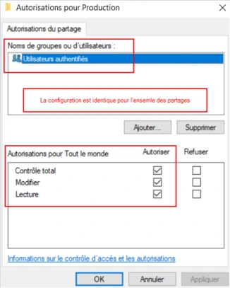

Visuel isolé — Solution du TP 3 - L'accès aux ressources

#### Service Réseau en environnement Microsoft

Faire exactement les mêmes manipulations dans l’onglet Partage sur chacun des dossiers.

Ajouter un partage Public qui donnera accès aux données se trouvant sur D:\ sur le serveur membre W19-SRV1. Ce partage sera accessible à tous en lecture. Il faudra respecter le même schéma que celui vu précédemment : Création de 4 groupes de domaine local et placement des bons groupes globaux.

#### Service Réseau en environnement Microsoft

#### b-Application des règles d’accès NTFS

#### La procédure qui suit vaut pour la ressource Production

- Dans l’onglet Sécurité du dossier Prod cliquer sur Avancé

- Puis cliquer sur Désactiver l’héritage

#### Et convertir les autorisations héritées en autorisations explicites

- Supprimer toutes les entrées mentionnant des groupes d’utilisateurs

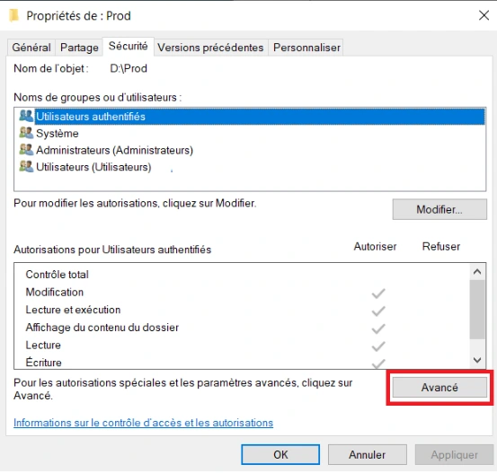

Visuel isolé — Solution du TP 3 - L'accès aux ressources

#### Service Réseau en environnement Microsoft

- Puis ajouter les groupes de domaine local concernés (DL_Production_*), créés précédemment comme suit

Pour chaque DL, il conviendra d’appliquer les bons droits les uns après les autres.

#### DL_Production_CT => cocher la case Contrôle Total dans la colonne Autoriser

#### DL_Production_M => cocher la case Modification dans la colonne Autoriser

#### DL_Production_L => cocher la case Lecture et exécution dans la colonne Autoriser

#### DL_Production_R => cocher la case Contrôle Total dans la colonne Refus

Faire exactement les mêmes manipulations dans l’onglet Sécurité sur chacun des dossiers. Il ne reste plus qu’à tester les accès aux partages depuis un système client via les liens UNC.

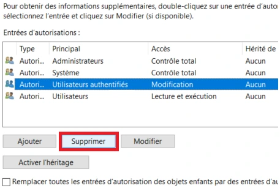

Visuel isolé — Solution du TP 3 - L'accès aux ressources

Référence du document : 1ugnwkZO8QSxrU6er7gzre7jESsSr8ie7 · SHA-256 49d0d4bed7d42977…

## Correction · Solution du TP 4 - La gestion des impressions · 22 pages transcrites

Correction originale : à consulter après avoir tenté l’exercice.

#### Service Réseau en environnement Microsoft

#### La gestion des impressions

#### TP du Module 02 – Active Directory

Avant de démarrer ce TP, il convient d’avoir suivi les vidéos du module 2 et réalisé les TP précédents.

#### Durée estimée

30 à 1 heure

#### Énoncé

Prérequis :

- Avoir réalisé le TP précédent du Module 02.

#### Mise en place du service d’impression

W19-SRV1 sera le serveur en charge de la gestion des imprimantes. Installation du rôle du serveur d’impression Depuis la console Gestionnaire de serveur de W19-SRV1, cliquer sur Gérer puis Ajouter des rôles et fonctionnalités et réaliser l’installation du rôle Services d’impression. Attendre la fin de l’installation du service (le redémarrage du serveur n’est pas nécessaire).

#### Service Réseau en environnement Microsoft

Une fois l’installation du rôle et des fonctionnalités associées effectuée, lancer la console Gestion de l’impression à partir du menu Outils dans la console Gestionnaire de serveur.

Configuration d’imprimantes L’entreprise vient d'investir dans un périphérique d'impression réseau à destination du service commercial sur le site de Rennes. Le modèle est HP Color LaserJet M552. Réalisez les actions nécessaires sur le serveur afin de pouvoir mettre à disposition ce périphérique.

Adresse IP Nom imprimante Param. par défaut Qui peut imprimer ?

Paramètres supplémentaires :

| Adresse IP | Nom imprimante | Paramètres par défaut | Qui peut imprimer ? |
| --- | --- | --- | --- |
| 172.28.10.46 | Imp-Commercial-35RDC | Recto/Verso | Service commercial |

#### Service Réseau en environnement Microsoft

- Les administrateurs du domaine auront le contrôle total sur la gestion de ces imprimantes

- Les imprimantes seront publiées dans l’annuaire Active Directory La société possède un périphérique HP Laserjet 5 destinée à imprimer des bons de livraison/retrait pour le service production. Les livreurs doivent impérativement récupérer ceux-ci avant de quitter la plateforme logistique. L'imprimante actuelle ne suffit plus aujourd’hui pour suivre la cadence de l'usine. La direction a donc décidé d'investir dans deux nouveaux périphériques d'impression de modèle HP Color LaserJet Pro MFP M274 Réalisez les actions nécessaires sur le serveur afin de mettre à disposition ces périphériques.

Paramètres supplémentaires :

- Les administrateurs du domaine auront le contrôle total sur la gestion de cette imprimante

- L’imprimante sera publiée dans l’annuaire Active Directory 1°) Copie des fichiers A partir de votre machine centre de formation, se rendre sur le partage distrib (lecteur R:) à l’endroit suivant : ‘Drivers\Drivers_imprimantes_TSSR090_Services_réseau_Microsoft’

| Adresse IP | Nom imprimante | Qui peut imprimer ? |
| --- | --- | --- |
| 172.28.10.90 et 172.28.10.91 | Imp-BL44-Usine | Service production |

#### Service Réseau en environnement Microsoft

Copier/coller sur W19-SRV1 le fichier contenant le pilote universel d’imprimante HP nommé upd-pcl6-x64-….

2°) Extraction des pilotes Faire un clic droit sur le fichier de pilote et sélectionner Extraire tout…, puis choisir le dossier de votre choix

Un nouveau dossier apparait avec le contenu du fichier décompressé.

#### Service Réseau en environnement Microsoft

3°) Ajout des pilotes au serveur d’impression Dans la console Gestion de l’impression, se diriger dans la section Pilotes. Seuls les pilotes installés par défaut sont affichés pour le moment :

Faire un clic droit sur le noeud Pilotes puis sélectionner Ajouter un pilote. Une fenêtre d’assistant s’ouvre pour effectuer les paramétrages.

#### Service Réseau en environnement Microsoft

Dans le cas présent, seuls des pilotes x64 (64 bits) seront utilisés, ne pas cocher ARM64 ni x86.

Pour ajouter des pilotes complémentaires, cliquer sur Disque fourni.

Cliquer ensuite sur Parcourir pour accéder aux fichiers décompressés sur W19-SRV1 précédemment.

#### Service Réseau en environnement Microsoft

Dans la capture ci-dessous, les fichiers de pilotes ont été décompressés dans un dossier sur le bureau de l’utilisateur Administrateur. Sélectionner le fichier hpzipa23.inf comme indiqué dans la capture :

Confirmer en cliquant sur Ouvrir puis OK Le modèle de périphérique d’impression apparait, valider avec le bouton Suivant.

#### Service Réseau en environnement Microsoft

Le nouveau pilote est maintenant listé dans la console Gestion de l’impression.

#### Service Réseau en environnement Microsoft

Création des ports d’impression 4 ports d’impression doivent être créés. Faire un clic droit dans la console sur la section Ports puis sélectionner Ajouter un port.

Choisir le type de port Standard TCP/IP Port et cliquer sur Ajouter un port.

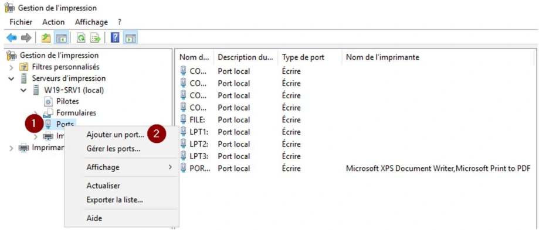

Visuel isolé — Solution du TP 4 - La gestion des impressions

#### Service Réseau en environnement Microsoft

Renseigner dans la zone Nom ou adresse IP la première adresse IP (ici 172.28.10.46) Le Nom du port se complète automatiquement.

L’assistant tente de contacter l’imprimante sur l’adresse indiquée. Il faut attendre que le test se termine pour pouvoir poursuivre. Choisir ensuite le périphérique générique proposé et cliquer sur Suivant.

#### Service Réseau en environnement Microsoft

. Cliquer sur Terminer pour valider la fin du paramétrage.

#### Un port TCP/IP est maintenant créé et listé dans la console de gestion

#### Service Réseau en environnement Microsoft

Effectuer les mêmes opérations pour les ports restants (172.28.10.90 et 172.28.10.91) Cela doit donner finalement :

Création des imprimantes Il faut maintenant configurer les différentes imprimantes nécessaires sur le serveur. 2 imprimantes différentes seront créées pour correspondre aux « profils d’impression » demandés, IMP-Commercial-35RDC (HP Color Laserjet M552) Faire un clic droit sur la section Imprimantes puis sélectionner Ajouter une imprimante

#### Service Réseau en environnement Microsoft

Cocher Ajouter une nouvelle imprimante via un port existant et sélectionner le premier port TCP/IP créé (ici 172.28.10.46)

#### Sélectionner le pilote existant

#### Service Réseau en environnement Microsoft

Nommer l’imprimante et paramétrez-là comme suit :

Cliquez sur suivant dans chaque écran restant puis sur Terminer IMP-BL44-Usine (HP Color Laserjet Pro MFP M274) Procédez de la même façon pour le périphérique suivant

#### Service Réseau en environnement Microsoft

Ajoutez une imprimante, puis sélectionnez le port existant 172.28.10.90 (le 2ème port sera sélectionné plus tard) et le pilote installé précédemment.

Paramétrez l’imprimante comme suit :

Gestion des droits d’accès Il faut maintenant configurer les autorisations d’utiliser ou gérer ces imprimantes en respectant les préconisations AGDLP Pour la création des groupes de domaine local, veuillez vous reporter à l’atelier précédent relatif aux partages de fichiers. Vous devrez avoir créé les groupes de domaine local suivant :

#### Service Réseau en environnement Microsoft

Pour chacune des imprimantes, signification des groupes :

- GestDocuments => permet de gérer la file d’attente et les travaux qui y sont

- GestImprimante => permet de gérer l’imprimante (modifier autorisations d’accès, gérer les documents et imprimer)

- Imprimer => pas besoin de préciser…

Le groupe des administrateurs GG_Informatique_Admin sera membre des DL_*_GestImprimante Le groupe GG_Commercial sera membre du groupe DL_IMP-Commercial-35RDC_Imprimer Le groupe GG_Production sera membre du groupe DL_IMP-BL44-Usine_Imprimer IMP-Commercial-35RDC (HP Color Laserjet Pro MFP M274) Faire un clic droit sur l’imprimante IMP-Commercial-35RDC, puis Propriétés

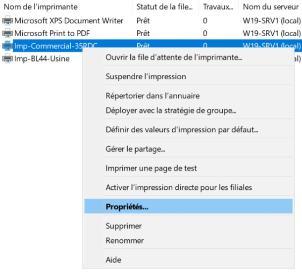

Visuel isolé — Solution du TP 4 - La gestion des impressions

#### Service Réseau en environnement Microsoft

Dans l’onglet Sécurité, ajoutez les bons groupes DL comme suit après avoir supprimé le groupe tout le monde :

Pour publier l’imprimante dans l’annuaire Active Directory, rendez-vous dans l’onglet Partage et cocher la case :

#### Service Réseau en environnement Microsoft

IMP-BL44-Usine (HP Color Laserjet Pro MFP M274) Faire un clic droit sur l’imprimante IMP-BL44-Usine, puis Propriétés

Dans l’onglet Sécurité, ajoutez les bons groupes DL comme suit après avoir supprimé le groupe tout le monde :

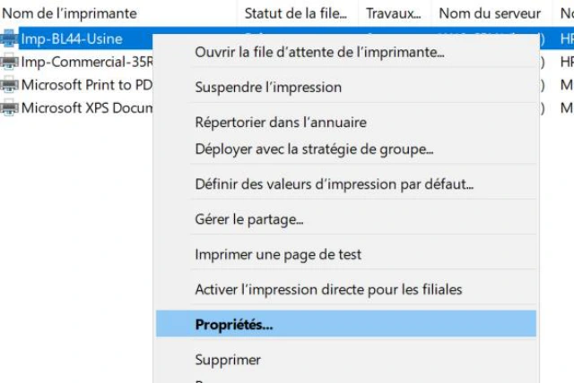

Visuel isolé — Solution du TP 4 - La gestion des impressions

#### Service Réseau en environnement Microsoft

Pour publier l’imprimante dans l’annuaire Active Directory, cochez la case déjà abordée pour l’imprimante précédente (dans onglet Partage) Dernier point, pour associer l’imprimante IMP-BL44-Usine à deux adresses IP, il faut activer ce qui s’appelle un « pool » d’imprimantes. Pour ce faire, direction onglet Ports afin d’activer la case nécessaire permettant de cocher le 2ème port :

#### Installation d’une imprimante sur un poste client

- Installer manuellement l’imprimante partagée IMP-Commercial-35RDC sur le poste client W10

- Tester l’impression avec un compte utilisateur membre du groupe G-Commercial Ouvrir une session avec un compte administrateur sur le poste client pour installer l’imprimante. 1ère méthode Le moyen le plus simple pour installer une imprimante est de taper le chemin UNC dans le menu Exécuter :

#### Service Réseau en environnement Microsoft

Valider par OK, voici la présentation des partages disponibles où nous retrouvons les 2 imprimantes :

Un clic droit, puis sélectionner Connecter… pour déclencher l’installation de l’imprimante 2ème méthode Passer par le menu Démarrer -> Paramètres :

#### Puis cliquer sur ajouter une imprimante

#### Service Réseau en environnement Microsoft

Les imprimantes, si elles sont bien listées dans l’annuaire AD, doivent apparaitre.

Ne reste plus qu’à sélectionner l’imprimante souhaitée et cliquer sur Ajouter l’appareil

Fermer la session et rouvrez-là avec un compte du service commercial. Utilisez une application type bureautique ou retouche/affichage d’image et lancez une impression en utilisant l’imprimante installé précédemment. Le travail d’impression doit normalement apparaitre dans la file d’attente d’impression.

#### Service Réseau en environnement Microsoft

Référence du document : 1XxOE5N_ysgd-upRkGySwik9Zc4Bif4CI · SHA-256 8c998f003a98d4d6…

## Fiche de synthèse

Les lignes reprennent les titres du cours et la première phrase de chaque partie.

| Partie | Repère du cours |
| --- | --- |
| Correction · Solution du TP 1 - Mise en place d’un domaine Active Directory · 4 pages transcrites | Correction originale : à consulter après avoir tenté l’exercice. |
| Correction · Solution du TP 2 - Utilisateurs et groupes en contexte de domaine AD · 7 pages transcrites | Correction originale : à consulter après avoir tenté l’exercice. |
| Correction · Solution du TP 3 - L'accès aux ressources · 10 pages transcrites | Correction originale : à consulter après avoir tenté l’exercice. |
| Correction · Solution du TP 4 - La gestion des impressions · 22 pages transcrites | Correction originale : à consulter après avoir tenté l’exercice. |
