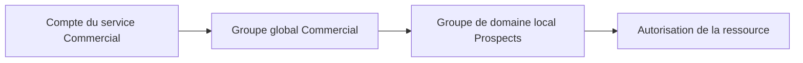

# Module 02 — Active Directory

AD DS centralise les comptes et machines, l’authentification, les paramètres et la recherche de ressources. DNS permet de trouver les hôtes et les services du domaine, LDAP permet d’interroger l’annuaire et Kerberos s’appuie sur des tickets pour l’authentification. Les exercices réutilisent les trois machines créées au module 01.

## Objectifs

- Identifier domaine, forêt, site, contrôleur et rôles FSMO.
- Joindre les machines au domaine et vérifier les dépendances de la connexion.
- Structurer comptes et groupes, puis appliquer AGDLP aux ressources.
- Mettre en place l’impression partagée et contrôler les résultats côté client.

## Domaine, forêt et sites

Le domaine regroupe des objets administrés avec des règles communes. Ses contrôleurs hébergent l’annuaire et authentifient les membres. Une forêt partage le schéma et la configuration entre ses domaines, avec des relations d’approbation transitives et bidirectionnelles dans le modèle présenté. Un site regroupe un ou plusieurs sous-réseaux afin d’orienter l’accès aux ressources et la réplication. Le support illustre Nantes en `10.44.0.0/16` et Rennes en `10.35.0.0/16`.

Avant une promotion, vérifier nom, adresse, DNS, rôle AD DS et contexte existant. Le niveau fonctionnel dépend des versions des contrôleurs. Les valeurs 2008 R2, 2012 R2 et 2016 du support décrivent son périmètre historique. Dans le TP, `W19-CD1` devient contrôleur et serveur DNS de `monprenom.local`. `W19-SRV1` et `W10-CLI1` rejoignent le domaine en utilisant le DNS interne. Contrôler leurs comptes dans l’annuaire et tester séparément un compte local du client et un compte du domaine.

| Rôle FSMO | Portée | Fonction |
|---|---|---|
| Maître de schéma | Forêt | Coordonne la modification du schéma |
| Maître d’attribution de noms | Forêt | Coordonne l’ajout ou le retrait des domaines |
| Maître RID | Domaine | Distribue les blocs de RID utilisés pour former les SID |
| Maître d’infrastructure | Domaine | Suit des références vers des objets d’autres domaines |
| Émulateur PDC | Domaine | Joue un rôle dans les mots de passe, l’heure et l’administration des GPO |

Avant de rétrograder un contrôleur, contrôler les rôles FSMO, la disponibilité DNS et l’existence d’un autre contrôleur adapté au scénario. La commande du support est `Uninstall-ADDSDomainController`. Les vérifications de lecture peuvent s’effectuer avec les commandes suivantes depuis un poste disposant des outils AD.

```powershell
Get-ADDomainController -Filter *
Get-ADDomain | Select-Object PDCEmulator, RIDMaster, InfrastructureMaster
Get-ADForest | Select-Object SchemaMaster, DomainNamingMaster
```

## Organiser comptes et groupes

Utilisateurs, ordinateurs et groupes de sécurité disposent de propriétés distinctes. L’ordinateur s’authentifie également dans le domaine. Les conteneurs par défaut incluent Builtin, Computers, System et Users. Créer des UO pour le classement, les liens GPO et la délégation administrative. Un objet est placé dans un conteneur direct et peut appartenir à plusieurs groupes.

Les comptes modèles portent un nom explicite et restent désactivés. Leur copie reprend les caractéristiques utiles, mais une modification du modèle ne modifie pas les comptes déjà créés. Les propriétés couvrent l’identité, l’organisation, le profil, les groupes, les restrictions de connexion et les services de bureau à distance. `csvde` et PowerShell facilitent une création en nombre.

| Type ou étendue | Utilisation |
|---|---|
| Groupe de sécurité | Attribuer des droits à des comptes ou d’autres groupes |
| Groupe de distribution | Diffusion de messages |
| Global | Regrouper les comptes par métier ou fonction dans le domaine |
| Universel | Regrouper des membres de plusieurs domaines selon les règles de portée |
| Domaine local | Porter des permissions sur une ressource du domaine où il est créé |
| Local à un ordinateur | Usage limité à cet ordinateur et sa base locale |

## Appliquer AGDLP et contrôler les accès



Le schéma ajouté au cours illustre Comptes → Globaux → Domaine local → Permissions. La couche de partage SMB et la couche NTFS s’appliquent ensemble à l’accès réseau. Examiner les entrées de sécurité, leurs autorisations et refus et leur héritage. Un utilisateur sans droit applicable est refusé implicitement. Pour confirmer un refus ou un droit, tester avec son compte sur le chemin réseau et examiner l’accès effectif. Les autorisations de base incluent lecture, écriture, modification et contrôle total. Les paramètres avancés distinguent par exemple création, suppression, appropriation et modification des permissions.

Le support distingue déplacement sur un même volume, qui conserve généralement la sécurité, et copie ou déplacement vers un autre volume, où les droits hérités de la destination s’appliquent en général. La démonstration de partage publie `Public` et règle les droits dans l’onglet Sécurité. Publier un partage dans l’annuaire facilite sa recherche, tandis que l’autorisation dépend toujours de ses ACL.

## Centraliser l’impression

Un port relie la file au périphérique. La file conserve les travaux, et le pilote permet au serveur et aux clients de préparer les documents. Installer Serveur d’impression, ajouter port TCP/IP et pilote, créer la file, publier le partage et régler les autorisations Imprimer, Gérer l’imprimante et Gérer les documents. La console Gestion de l’impression montre pilotes, ports, files, erreurs et déploiement par GPO.

## TP guidé — Créer le domaine Active Directory

**Durée du support.** Trente minutes à une heure. Reprendre les trois clones du module 1. Vérifier leurs IP et leur communication.

1. Sur `W19-CD1`, installer AD DS puis choisir **Ajouter une nouvelle forêt**. Donner le nom de laboratoire `monprenom.local`. Vérifier le niveau fonctionnel demandé, DNS, catalogue global, NetBIOS et prérequis avant l’installation. Préparer le secret DSRM sans le reproduire dans le rapport.
2. Après redémarrage, vérifier le contrôleur, la zone DNS et le compte ordinateur dans **Domain Controllers**.
3. Faire utiliser le DNS du domaine à `W19-SRV1` et `W10-CLI1`. Les joindre au domaine puis redémarrer. Vérifier leurs comptes ordinateurs dans **Utilisateurs et ordinateurs Active Directory**, dans le conteneur Computers ou l’UO prévue.
4. Sur le client, tester une identité locale, par exemple avec le contexte `.\`, puis un compte du domaine. Sur le contrôleur, utiliser un compte dont les droits autorisent la connexion. Noter le contexte, le compte et le résultat.

## TP guidé — Créer les utilisateurs et les groupes

**Durée du support.** Une à deux heures. Les objets locaux déjà présents ne deviennent pas des utilisateurs de l’annuaire par la seule adhésion au domaine.

1. Créer les UO selon la structure du TP. Agences Nantes, Vertou et Rennes, services Informatique, Production et Commercial, fonctions Secrétaire et Intérimaire, et emplacements des serveurs membres et postes clients.
2. Préparer des comptes modèles désactivés par service. Créer les **douze comptes** de l’annexe. Pour chacun, vérifier son UO, son service, son groupe et ses restrictions.
3. Tester les horaires Production à Vertou, soit **6 h à 12 h**, soit **13 h à 21 h**. Pour Informatique à Nantes, distinguer l’administration de laboratoire de l’exception secrétaire. Pour Commercial à Rennes, contrôler les postes Windows 10 autorisés.
4. Dans la maquette, arrêter DNS sur le contrôleur, redémarrer le client et essayer un compte déjà utilisé puis un compte neuf. Une ouverture de session mise en cache peut réussir sans que la recherche du contrôleur fonctionne. Le résultat dépend de la configuration du cache.
5. Relancer DNS, puis observer l’effet de l’arrêt de Netlogon demandé. Réactiver les services du domaine à la fin et refaire une connexion et un test de résolution. Consigner les différences entre authentification, découverte DNS et service d’ouverture de session.

## TP guidé — Profils et accès aux ressources

**Durée du support.** Une à deux heures. Sur `W19-SRV1`, ajouter deux disques de **10 Go**. Créer le miroir NTFS de **5 Go**, accessible par une lettre et sous `C:\datasafe`. Le reste de l’espace prévu est accessible par `D:\`.

1. Créer le partage **Profils** depuis `C:\datasafe\users`. Définir le chemin du profil itinérant dans le modèle Commercial et modifier les comptes existants selon la consigne. Vérifier le chargement et la synchronisation à la fermeture de session.
2. Créer les dossiers, les partages et les groupes de droits locaux au domaine. Imbriquer les groupes globaux des métiers selon AGDLP.
3. Régler séparément partage SMB et NTFS. Vérifier l’héritage et la portée des refus. Pour Applications, un refus des secrétaires doit cibler exactement les comptes concernés. Tester le cas d’un compte qui cumule plusieurs groupes.
4. Depuis `W10-CLI1`, tester lecture, modification et refus sur chaque chemin réseau avec un utilisateur autorisé et un utilisateur exclu.

| Partage | Emplacement | Résultat à prouver |
| --- | --- | --- |
| Production | `C:\datasafe\prod` | Service Production et administrateurs, contrôle total pour les administrateurs. |
| Applications | `C:\datasafe\appli` | Lecture pour les membres autorisés, écriture pour Informatique et aucun accès pour les secrétaires. |
| Prospects | `C:\datasafe\en_cours` | Accès des Commerciaux. |
| Public | `D:\` | Lecture pour tous dans le scénario. |

## TP guidé — Serveur et files d’impression

**Durée du support.** Trente minutes à une heure. Installer le service d’impression sur `W19-SRV1` et préparer le pilote universel PCL6 de laboratoire. Le support cite le fichier `hpzipa23.inf`. Vérifier que le pilote convient au périphérique choisi.

1. Créer la file `Imp-Commercial-35RDC` et le port TCP/IP `172.28.10.46`. Régler le recto verso, donner le droit Imprimer à Commercial et les droits de gestion aux administrateurs. Publier la file dans Active Directory.
2. Préparer les ports `172.28.10.90` et `172.28.10.91` pour `Imp-BL44-Usine`. Créer la file Production et activer le **pool** sur deux périphériques compatibles. Configurer le droit d’impression, le contrôle des administrateurs et la publication dans l’annuaire.
3. Sur le poste Windows 10, connecter manuellement la file Commercial. Depuis la session d’un membre de `G-Commercial`, envoyer une page de test puis observer la file et la remise. Comparer avec un compte hors du groupe.
4. Distinguer une file créée, une file visible, une tâche acceptée et une impression délivrée. Vérifier port, pilote et droits pour isoler un échec.

## À retenir

DNS sert à localiser les services d’AD. Les UO structurent les objets et les stratégies, les groupes portent des droits et l’accès se valide depuis le compte concerné. Une file d’impression associe le pilote, les ports et les permissions.

## Mini-quiz — 5 questions {#mini-quiz}

1. Quel service aide le client à localiser un contrôleur ?
2. Dans quelle UO se trouve W19-CD1 après la promotion ?
3. Pourquoi comparer un compte déjà utilisé et un compte neuf après l’arrêt DNS ?
4. Où attribuer l’autorisation d’une ressource dans AGDLP ?
5. Que vérifier avant de publier une file en pool ?

??? success "Réponses commentées"

    1. Le DNS interne et ses enregistrements de service.
    2. Dans Domain Controllers. Les machines membres sont rangées selon le conteneur ou l’UO prévue.
    3. Un compte connu peut ouvrir une session avec des informations mises en cache. Le compte neuf doit atteindre le domaine pour sa première connexion.
    4. Au groupe de domaine local représentant le droit, avec les groupes globaux des métiers comme membres.
    5. La compatibilité des périphériques, les ports, le pilote et les droits de la file. Une impression de test vérifie ensuite le résultat.

## Pour pratiquer et réviser {#appliquer-le-cours}

- [Énoncés](../../tp/services-reseaux-microsoft/module-02/enonces.md) et [corrections](../../tp/services-reseaux-microsoft/module-02/corrections.md)
- [Démonstrations](../../tp/services-reseaux-microsoft/module-02/demonstrations.md)
- [Fiche de révision](../../revision/services-reseaux-microsoft/module-02-module-02.md)
- [Kahoot existant](../../kahoot/09-services-reseaux-microsoft-module-02-module-02.md)
- [Sommaire de Services réseau en environnement Microsoft](index.md)

## Provenance pédagogique

Le support M02, les quatre démonstrations et les quatre ateliers détaillent domaine, comptes, partages et impression. Les contrôles d’accès, de session et d’impression explicitent les résultats attendus.
