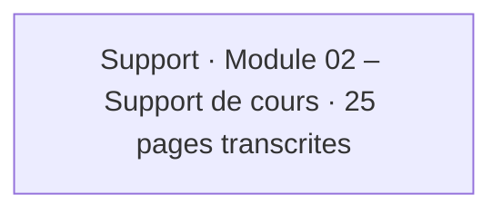
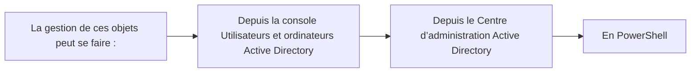
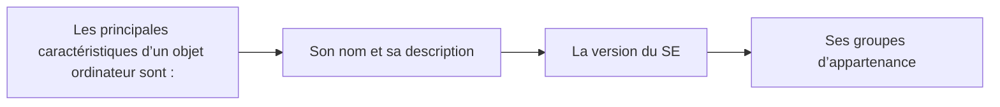

# Module 02 — Active Directory

[Travaux pratiques](../../tp/services-reseaux-microsoft/module-02/index.md)

Les parties ci-dessous reprennent le cours original, dans le même ordre. Les encadrés et les schémas répètent ses formulations.

## Parcours de lecture

1. Support · Module 02 – Support de cours · 25 pages transcrites

**Visuel externe**



SOURCE DRIVE · TRANSCRIPTION DU SUPPORT

Le contenu des documents du dossier TSSR est transcrit ci-dessous, page par page. Les textes et tableaux sont intégrés à la page Web. Aucun fichier PDF, aucune diapositive entière ni aucune reproduction de page n’est affiché. Seuls des croquis ou visuels isolés et vérifiés peuvent accompagner la transcription. Les versions et les consignes restent celles des supports de formation. Les compléments IA sont conservés dans leur onglet distinct.

## Support · Module 02 – Support de cours · 25 pages transcrites

#### Module 02 – Active Directory

#### Objectifs

!!! note "À retenir"
    Appréhender le rôle Active Directory Gérer les ressources partagées avec AGDLP Connaître la gestion des imprimantes

**Visuel externe**


- Appréhender le rôle Active Directory
- Gérer les ressources partagées avec AGDLP
- Connaître la gestion des imprimantes

#### Les services d’annuaire-Présentation et installation

#### Domaine Active Directory

!!! note "À retenir"
    Centraliser la gestion de l’authentification.

**Visuel externe**


- Pour quoi faire ?
- Centraliser la gestion de l’authentification.
- Centraliser les informations relatives aux utilisateurs et ressources.
- Centraliser la gestion des paramètres utilisateurs et ordinateurs.
- Fournir une base de fonctionnement aux services et outils Microsoft.

- Utilisation de protocoles standardisés : DNS / LDAP / Kerberos
- DNS : Résolution des noms de machines et localisation de services.
- LDAP : Norme pour les systèmes d’annuaires avec une structure de base de données arborescente.
- Kerberos : Protocole d’authentification reposant sur un mécanisme de clés secrètes et l’utilisation de tickets.

#### Les services d’annuaire - Présentation et installation

#### La forêt Active Directory

#### Une forêt

#### Domaine racine

de la forêt

#### Comprend un ou plusieurs domaine

AD partageant le même schéma, les

mêmes informations de configuration

et de recherche.

#### Relation parent / enfant

#### Relation de domaine

#### Les domaines d’une même forêt sont

Domaine

enfant

liés par une relation d’approbation

transitive bidirectionnelle.

Forêt

```
Active Directory
 Les services d’annuaire-Présentation et installation

       Domaine Active Directory
             • Pour quoi faire ?
                      •  Centraliser la gestion de l’authentification.
                      •  Centraliser les informations relatives aux utilisateurs et ressources.
                      •  Centraliser la gestion des paramètres utilisateurs et ordinateurs.
                      •  Fournir une base de fonctionnement aux services et outils Microsoft.

             •  Utilisation de protocoles standardisés : DNS / LDAP / Kerberos
                      • DNS : Résolution des noms de machines et localisation de services.
                      • LDAP : Norme pour les systèmes d’annuaires avec une structure de base de données arborescente.
                      •  Kerberos : Protocole d’authentification reposant sur un mécanisme de clés secrètes et l’utilisation de
                        tickets.

                                                                                         3

3

   Active Directory
 Les services d’annuaire - Présentation et installation

        La forêt Active Directory
             Une forêt
                                                                                             Domaine racine
            Comprend un ou plusieurs domaine                                           de la forêt
          AD partageant le même schéma, les
          mêmes informations de configuration
                et de recherche.                                                                                    Relation parent / enfant
              Les domaines d’une même forêt sont                                                                          Relationde domaine
                                                                        Domaine
                   liés par une relation d’approbation                      enfant
                 transitive bidirectionnelle.
                                                          Forêt

                                                                                         4

4
```

#### Les services d’annuaire - Présentation et installation

#### Un domaine Active Directory

#### Poste en WorkGroup

#### Les composantes de domaine : le domaine

!!! note "À retenir"
    Ensemble d’ordinateurs en réseau qui partagent une base de donnée commune.

Ensemble d’ordinateurs en réseau qui partagent une base de donnée commune.

Un domaine est administré comme un ensemble, régi par des règles et procédures communes.

#### Poste client membre du domaine

#### Domaine Active Directory

#### Serveur autonome

#### Le contrôleur de domaine

#### CD1 Contrôleur de domaine

ADDS

#### Serveur membre

!!! note "À retenir"
    Les contrôleurs d’un domaine AD sont les serveurs qui assurent la gestion du domaine.

Les contrôleurs d’un domaine AD sont les serveurs qui assurent la gestion du domaine. Ils assurent les tâches d’hébergement et de gestion de la base AD, ainsi que l’authentification.

#### Les services d’annuaire - Présentation et installation

#### Les composantes de domaine : les sites

#### Nantes 10.44.0.0 /16 Rennes 10.35.0.0 /16 Sites

#### Site Active Directory

!!! note "À retenir"
    Est une composante logique du domaine utilisée afin d’optimiser : La réplication.

Est une composante logique du domaine utilisée afin d’optimiser :

- La réplication.
- L’accès aux ressources. Il est composé d’un ou de plusieurs sous-réseaux TCP/IP.

#### Les services d’annuaire - Présentation et installation

!!! note "À retenir"
    Prérequis pour un contexte de domaine Avant de promouvoir un serveur en Contrôleur de Domaine, ces prérequis doivent être respectés : Composants Windows Les composants relatifs aux services ADDS doivent être installés.

Prérequis pour un contexte de domaine Avant de promouvoir un serveur en Contrôleur de Domaine, ces prérequis doivent être respectés :

Composants Windows Les composants relatifs aux services ADDS doivent être installés.

#### Les services d’annuaire - Présentation et installation

!!! note "À retenir"
    Versions Active Directory Pour une forêt ou un domaine ciblé, les niveaux fonctionnels déterminent les fonctionnalités fournies au sein de la forêt et du domaine.

!!! example "Exemple"
    Par exemple depuis W2008 R2 : Corbeille AD Le choix des niveaux est contraint par les versions des contrôleurs présents au sein du domaine et de la forêt.

Versions Active Directory

- Pour une forêt ou un domaine ciblé, les niveaux fonctionnels déterminent les fonctionnalités fournies au sein de la forêt et du domaine.

- Par exemple depuis W2008 R2 : Corbeille AD

- Le choix des niveaux est contraint par les versions des contrôleurs présents au sein du domaine et de la forêt.

#### NF de domaine 2008 R2 2012 R2 2016

#### Version des CD

#### NF de la forêt 2008 R2 2012 R2 2016

| Prérequis | Description |
| --- | --- |
| Nom d’hôte du poste | Le nom d’hôte et le suffixe DNS doivent être correctement définis. |
| Configuration réseau et adressage IP | Ces paramètres doivent être opérationnels. |
| Composants Windows | Les composants relatifs aux services AD DS doivent être installés. |
| Prise en compte de l’existant | Analyser l’infrastructure existante et déterminer les points essentiels. |
| Préparation de l’AD | La forêt ou le domaine peut être préparé lors de l’ajout d’un DC. |

| Niveau fonctionnel de domaine | 2008 R2 | 2012 R2 | 2016 |
| --- | --- | --- | --- |
| Versions des CD | 2008 R2, 2012 R2, 2016, 2019 | 2012 R2, 2016, 2019 | 2016, 2019 |
| Niveau fonctionnel de la forêt | 2008 R2 | 2012 R2 | 2016 |

#### Les services d’annuaire - Présentation et installation

#### Rétrograder / promouvoir un CD

- L’ajout et la suppression d’un contrôleur de domaine sont des actions qui impactent tous les contrôleurs de domaine de la forêt.

- Avant de rétrograder un contrôleur de domaine, on s’assurera qu’il ne dispose plus de rôles FSMO.

- Notions abordées dans la slide suivante.

- Sous Windows 2016 et ultérieur, afin de rétrograder un CD, utiliser la commande suivante :

PS C:\Windows\System32> Uninstall-AddsDomainController

#### Les services d’annuaire - Présentation et installation

#### Les composants de domaine : les 5 rôles FSMO

#### Rôles Description

- Lors de l’ajout de la suppression d’un domaine dans un forêt
- En cas de renommage de domaine (Attention)

Peut modifier le schéma. Dans le schéma sont stockées les caractéristiques des objets. Les autres CD ont accès en L au schéma.

Alloue les « bloc d’IDentificateurs Relatifs » aux autres CD. Ces derniers puisent dans le bloc pour attribuer les SID aux objets.

Il gère : MAJ des mots de passe. MAJ des GPO. Synchronisation des horloges. Explorateur principal de domaine.

| Portée | Rôle | Description |
| --- | --- | --- |
| Forêt | Maître de nom de domaine | Contacté lors de l’ajout ou de la suppression d’un domaine dans une forêt, ou du renommage d’un domaine. |
| Forêt | Maître de schéma | Peut modifier le schéma. Le schéma stocke les caractéristiques des objets. Les autres CD ont accès en lecture au schéma. |
| Domaine | Maître RID | Alloue les blocs d’identificateurs relatifs aux autres CD, qui les utilisent pour les SID des objets. |
| Domaine | Maître d’infrastructure | Responsable des objets des autres domaines de la forêt qui sont membres d’objets de son domaine. |
| Domaine | Maître émulateur PDC | Mises à jour des mots de passe et des GPO, synchronisation des horloges et explorateur principal de domaine. |

#### Démonstration

TP

#### Les bases de gestion d’un domaine

#### Objets de l’annuaire et outils de gestion

- Dans un contexte de domaine AD, les tâches courantes de gestion sont liées à l’administration des principaux objets de l’annuaire.

#### Entités de sécurité

Conteneurs

Utilisateur

#### Unité d’organisation

Ordinateur

#### Conteneur système

**Visuel externe**



Groupe

- La gestion de ces objets peut se faire :
- Depuis la console Utilisateurs et ordinateurs Active Directory
- Depuis le Centre d’administration Active Directory
- En PowerShell

#### Les bases de gestion d’un domaine

#### Les caractéristiques de l’objet utilisateur

- Ces dernières sont regroupées graphiquement avec un ensemble de catégories.

- Elles sont relatives :
- aux paramètres de l’utilisateur pour l’utilisation des services de bureau distant

#### Contrôle à distance Environnement Profil des services de bureau à distance Sessions

- aux informations générales concernant l’utilisateur

#### Adresse Général Organisation Téléphones

- aux informations nécessaires à sa connexion

#### Compte Profil

- à l’appartenance aux groupes et aux paramètres utilisateur des connexions entrantes

#### Membres de Appel entrant

#### Les bases de gestion d’un domaine

#### Les modèles utilisateur

Il est conseillé d’utiliser des modèles de comptes pour simplifier la création de nouveaux comptes utilisateurs.

#### Un nom clair

#### Le plus grand

#### Dupliquer le compte modèle Compte

nombre de caractéristiques

#### Nouvel utilisateur

modèle

#### Le compte est

inactif

#### Les bases de gestion d’un domaine

#### Les profils utilisateurs

Par défaut, les utilisateurs du domaine peuvent ouvrir une session sur les ordinateurs du domaine.

#### Ses propres fichiers / répertoires

#### Des fichiers de configuration logiciels personnalisés

Utilisateur

Possède

#### Un environnement de travail personnalisé

AD

#### Des dossiers personnels

Profil

%systemdrive%\Utilisateurs\%username%

Stockés dans

#### Les bases de gestion d’un domaine

#### Les profils itinérants

Utilisé pour les utilisateurs ayant besoin d’un accès à leur profil depuis n’importe quel ordinateur. C’est ici qu’interviennent les profils itinérants.

- Le profil est copié du partage vers l’ordinateur
- Synchronisation du profil à chaque fermeture de session

Le profil est chargé sur l’ordinateur.

L’utilisateur travaille.

À la fermeture de session, le profil est synchronisé.

#### Les bases de gestion d’un domaine

#### Les ordinateurs

- Dans un contexte de domaine, les membres s’authentifient afin de disposer d’un jeton d’accès permettant l’accès aux ressources du domaine.

- Ce processus est commun aux utilisateurs et aux ordinateurs.

- Ceux-ci doivent donc disposer d’un compte dans le domaine.

#### Les bases de gestion d’un domaine

#### Les caractéristiques de l’objet ordinateur

**Visuel externe**



- Au même titre que l’objet utilisateur, l’objet ordinateur dispose de caractéristiques qui lui sont propres.

- Les principales caractéristiques d’un objet ordinateur sont :
- Son nom et sa description
- La version du SE
- Ses groupes d’appartenance
- …

#### Les bases de gestion d’un domaine

#### Les groupes

- Les groupes sont des objets de l’annuaire.

- Tout groupe est caractérisé par un type et une étendue.
- Il en existe deux types :

#### De sécurité De distribution

Dispose d’un identifiant de sécurité (SID). Ne dispose pas d’identifiant de sécurité.

Peut être utilisé pour répondre à un ensemble de besoins. N’est utilisable qu’à des fins de messagerie.

- L’étendue du groupe détermine le périmètre d’appartenance des membres ainsi que celui d’utilisation.

#### Global Universel De Domaine Local Local

#### Les bases de gestion d’un domaine

#### Les groupes globaux

#### Caractéristiques des GG

#### Regrouper des objets qui possèdent

GG_Commerciaux_Nantes

Utilité

des caractéristiques communes.

Ils ne peuvent contenir que des

Contraintes

objets utilisateur, ordinateur ou

d’appartenance

groupe global du même domaine.

#### Ils peuvent être utilisés sur toute

Contrainte

ressource du domaine ou approuvée

d’utilisation

(forêt).

#### Exemple de nom GG_Commerciaux_Nantes

Membres

#### Les bases de gestion d’un domaine

#### Les groupes de domaines locaux

#### Caractéristiques des DL

#### Ressource partagée

#### Privilèges Groupe de Domaine Local

Regrouper des objets qui requièrent un

même privilège d’accès pour une ressource

Utilité

DL_Marketing_Sur_SRVFIC_CT

CT

donnée.

#### Ils peuvent contenir des objets utilisateur,

DL_Marketing_Sur_SRVFIC_M

Contraintes

M

ordinateur ou groupe de tout domaine de

Marketing

d’appartenance

la forêt.

L

DL_Marketing_Sur_SRVFIC_L

Contrainte

Ils peuvent être utilisés uniquement sur les

DL_Marketing_Sur_SRVFIC_R

R

ressources de leur domaine de création.

d’utilisation

#### Exemple de nom DL_Comptabilite_Sur_SRVFIC_L

#### Les bases de gestion d’un domaine

#### Les groupes locaux

- Ils peuvent être utilisés.
- Les membres du domaine conservent leur base SAM.

- L’utilisation de ce type de groupe est limitée et limitante.
- Ils ne peuvent être utilisés que sur leur poste d’appartenance.

- Cette limite peut être un atout pour certains besoins en termes de sécurité.

- C’est le seul type de groupe qui peut être utilisé hors domaine.

#### Les bases de gestion d’un domaine

#### Les conteneurs système

- Les objets de l’annuaire AD sont stockés dans des conteneurs.

- Ces conteneurs système sont définis par défaut dans tout domaine AD.

Élements (utilisateurs et groupes locaux) présents dans la base SAM des CD avant leur promotion. Une fois la promotion faite, ces derniers sont déplacés dans ce conteneur.

- Attention :
- Il n’est pas conseillé de conserver les comptes ordinateurs du domaine dans le conteneur Computer, il en va de même pour les comptes utilisateurs dans le conteneur Users.

| Nom de l’objet | Fonction |
| --- | --- |
| Builtin | Éléments utilisateurs et groupes locaux présents dans la base SAM des CD avant leur promotion, puis déplacés dans ce conteneur selon le support. |
| Computers | Emplacement de stockage par défaut des comptes ordinateurs. |
| System | Éléments nécessaires au fonctionnement de l’AD et aux composants associés. |
| Users | Groupes et utilisateurs existant par défaut dans un AD. |

#### Les bases de gestion d’un domaine

#### Les unités d’organisation

- Des conteneurs supplémentaires peuvent être créés :
- OU Organizational Unit / UO Unité d’Organisation

- L’élaboration d’une structure organisationnelle doit prendre en considération les besoins suivants :

- Les stratégies de groupe (GPO Group Policy Object)
- Les délégations administratives
- L’organisation des objets dans l’arborescence

- Tout objet de l’annuaire ne peut être positionné directement que dans un seul conteneur.

- Attention :
- Sur les CD, les UO sont protégées contre toute suppression accidentelle (il est possible de modifier cela).

#### Les bases de gestion d’un domaine

Active_Directory

Builtin

#### Les unités d’organisation

Computers

Domain_Controllers

ForeignSecurityPrincipals

Manage_Security_Accounts

Users

Mon_Entreprise

Groupes

NANTES

Stagiaires

Ordinateurs

Administration

Direction

Formateurs

Ordinateur_Administration

```
Active Directory
 Les bases de gestion d’un domaine

        Les unités d’organisation
              • Des conteneurs supplémentaires peuvent être créés :
                      • OU Organizational Unit / UO Unité d’Organisation
              • L’élaboration d’une structure organisationnelle doit prendre en considération les besoins
             suivants :
                      • Les stratégies de groupe (GPO Group Policy Object)
                      • Les délégations administratives
                      •  L’organisation des objets dans l’arborescence
              • Tout objet de l’annuaire ne peut être positionné directement que dans un seul conteneur.
              • Attention :
                      • Sur les CD, les UO sont protégées contre toute suppression accidentelle (il est possible de
                 modifier cela).

                                                                                          25

25

   Active Directory
 Les bases de gestion d’un domaine

                                                                                          Active_Directory
        Les unités d’organisation                            Builtin
                                                                               Computers
                                                                                         Domain_Controllers
                                                                                                  ForeignSecurityPrincipals
                                                                                      Manage_Security_Accounts
                                                                                         Users
                                                                                        Mon_Entreprise
                                                                                        Groupes
                                                                            NANTES
                                                                                                                      Stagiaires
                                                                                                         Ordinateurs
                                                                                                          Administration
                                                                                                                      Direction
                                                                                                         Formateurs
                                                                                                         Ordinateur_Administration              
                                                                                          26

26
```

#### Les bases de gestion d’un domaine

#### Importation et exportation de comptes

- Quand un nombre important de comptes utilisateurs doit être créé, l’utilisation d’outils permet de fiabiliser et réduire la durée de la tâche.

- Des outils dédiés existent (PowerShell ou Csvde par exemple).

#### Démonstration

TP

#### L’accès aux ressources

#### Les ressources

- Le partage de ressource est un service nécessaire aux utilisateurs.

- Sa mise en œuvre et sa gestion incombent à l’administrateur système qui doit respecter les exigences de disponibilités et de sécurité.

- Nous parlerons d’espace disque partagé.

#### L’accès aux ressources

#### Utilité des autorisations NTFS

Sur un espace disque formaté en NTFS ou ReFS :

- Les autorisations NTFS permettent de définir quels sont les privilèges d’accès

- Tous les dossiers et fichiers d’un volume formaté y sont soumis

#### Sécurité NTFS

- Elles sont visualisables et/ou modifiables depuis l’onglet Sécurité des éléments

#### L’accès aux ressources

#### Les caractéristiques des autorisations NTFS

- Deux niveaux de gestions sont disponibles :
- Les autorisations de base
- Les autorisations avancées

- La gestion des permissions est basée sur des règles explicites.

- Plusieurs règles d’accès peuvent s’appliquer à un même utilisateur.

- Chaque règle peut accorder des privilèges ou les ôter.

- Le mécanisme d’héritage s’applique aux autorisations positionnées sur des dossiers et s’appliquent aux objets enfants.

- Une règle de refus peut être explicite ou implicite.

#### L’accès aux ressources

#### Les autorisations NTFS de base et avancées

- Pour répondre aux besoins courants, les autorisations de base permettent d’accorder les privilèges suivants :

#### Lecture Liste de contenu Lecture + exécution Écriture Modification Contrôle Total

- Les privilèges complémentaires suivants peuvent être attribués, par les autorisations avancées.

#### Appropriation Création de fichiers Création de dossiers Écriture des attributs étendus

Lecture des attributs étends Modifier les autorisations Suppression Suppression de sous-dossiers et fichiers

#### L’accès aux ressources

#### Cumul d’autorisations

- Chaque autorisation s’applique à un objet utilisateur ou groupe de sécurité. Il est cependant préférable de n’appliquer des autorisations qu’aux groupes.

- Pour chaque entrée de contrôle d’accès, l’autorisation peut être appliquée :
- Autoriser afin d’accorder le privilège correspondant
- Refuser afin d’ôter le privilège correspondant

- À défaut de règle d’autorisation (explicite) le concernant, l’utilisateur est soumis à un refus implicite.

- Les autorisations sont cumulatives, la résultante des autorisations affectant un utilisateur correspond au cumul des autorisations le concernant.

- En cas de conflit, le refus l’emporte.

#### L’accès aux ressources

#### L’héritage des autorisations NTFS

- L’héritage s’applique par défaut aux autorisations NTFS positionnées sur des dossiers.

- Il est conseillé d’affecter ces autorisations en partant de la racine d’une arborescence afin de bénéficier de l’héritage.

- L’héritage peut être rompu sur un point d’arborescence ou repropagé à partir d’un élément.

- Il y a néanmoins des contraintes :

#### L’accès aux ressources

#### Le partage de fichiers

- Le partage vient en complément des autorisations NTFS.

- Un poste disposant de partages joue le rôle de serveur de fichiers.

Partage

Réseau

#### Sécurité NTFS

| Opération | Au sein d’une même partition | Entre deux partitions ou disques |
| --- | --- | --- |
| Déplacement | Conservation | Héritage |
| Copie | Héritage | Héritage |

#### L’accès aux ressources

#### Les autorisations de partage

- Les autorisations permettent de définir :
- Quels seront les privilèges
- S’ils autoriseront ou interdiront
- Pour qui

- Les trois types de privilèges de partage sont les suivants :

#### Lecture Modification Contrôle Total

- Pour chaque niveau, les privilèges correspondants pourront être :

#### Autorisé Refusé

- Chaque règle cible une ou plusieurs entités.

- Les règles de contrôles d’accès sont cumulatives et les refus prioritaires.

#### L’accès aux ressources

#### Autorisations résultantes

Quand l’utilisateur accède depuis son poste de travail à une ressource partagée :

- Il est d’abord soumis aux autorisations du partage

- Puis aux autorisations NTFS

#### Partage Sécurité NTFS

- Les privilèges les plus restrictifs prévalent.

#### L’accès aux ressources

#### Les publications de partage

- Une fois créé, il est possible de le publier dans l’AD.

- L’objet Partage est soit lié à :
- L’objet ordinateur auquel il est associé.
- Indépendant et peut être déplacé dans un UO dédié.
- La publication de partage facilite la recherche pour les utilisateurs depuis leur poste client avec la fonction Rechercher dans Active Directory.

#### L’accès aux ressources

#### Stratégie d’imbrication des groupes

Afin de gérer efficacement l’accès aux ressources, Microsoft préconise l’imbrication des Groupes Globaux et de Domaines Locaux.

- Cf. Slide sur les groupes de Domaines Locaux

A Le compte utilisateur est créé.

G Il est affecté aux Groupes Globaux.

#### Gestion des utilisateurs

#### Gestion de la ressource

DL Un groupe de Domaine Local est créé par type de privilège pour chaque ressource.

P Des autorisations NTFS sont attribuées pour ce groupe de domaine local sur la ressource.

#### Démonstration

TP

#### La gestion des impressions

#### Le service d’impression

- L’ajout du service de rôle Serveur d’impression permet de partager des imprimantes et centraliser la gestion de l’impression.

- Les imprimantes sont des ressources généralement raccordées au réseau de l’entreprise.

- Cependant la mise en place d’un serveur d’impression permet de centraliser et d’en simplifier la gestion.

#### La gestion des impressions

#### Point de vocabulaire

Port d’impression Lien qui permet la communication entre le périphérique d’impression et le serveur (ou à un poste client).

File d’attente Liste des documents en attente de traitement par l’imprimante.

Imprimante locale Imprimante directement (physiquement) connectée à un serveur ou à un poste client.

- Elle peut être du type imprimante réseau
- Elle peut être du type imprimante locale mais il faut que le poste ou le serveur qui la partage soit allumé pour qu’elle soit accessible

Imprimante réseau Imprimante indépendante qui possède sa propre carte réseau, parfois un écran de configuration ou/et un petit serveur web embarqué pour l’administration à distance.

| Vocabulaire | Définition |
| --- | --- |
| Port d’impression | Lien entre le périphérique d’impression et le serveur ou le poste client. |
| File d’attente | Liste des documents en attente de traitement. |
| Imprimante locale | Imprimante physiquement connectée à un serveur ou à un poste client. |
| Imprimante partagée | Imprimante accessible sur le réseau. Si elle est locale au poste qui la partage, ce poste doit être allumé. |
| Imprimante réseau | Imprimante avec sa propre interface réseau, parfois un écran ou un serveur Web embarqué. |

#### La gestion des impressions

#### Les tâches de gestion et outils

#### Vue de l’état des imprimantes

- L’ajout du service de rôle Serveur d’impression fournit la console de gestion Gestionnaire d’impression.

- Cette console rassemble les composants de gestion nécessaire :

#### Configuration des services d’impression

#### Gestion du déploiement par stratégies

#### La gestion des impressions

#### La gestion des périphériques

- Comme pour les ressources disque, une imprimante doit être partagée pour être accessible via le réseau.

- L’attribution des privilèges se configure depuis les paramètres de sécurité :

#### Autorisation de base Autorisation étendue

Imprimer

#### Gérer l’imprimante

#### Gérer les documents

#### Autorisation de lecture

#### Modifier les autorisations


Visuel isolé — Module 02 – Support de cours

#### La gestion des impressions

#### La gestion du déploiement

Plusieurs méthodes peuvent être utilisées pour déployer les imprimantes :

- Le déploiement manuel

- L’utilisation de scripts

- Le déploiement par stratégies de groupe

#### Démonstration

TP

#### Conclusion

- Vous connaissez le rôle Active Directory
- Vous savez gérer les ressources partagées avec AGDLP
- Vous connaissez la gestion des imprimantes

Référence du document : 1vdms-QniMNlL6tu_g8XbsS6Bnf4IGR_S · SHA-256 6477d99065feae3c…
