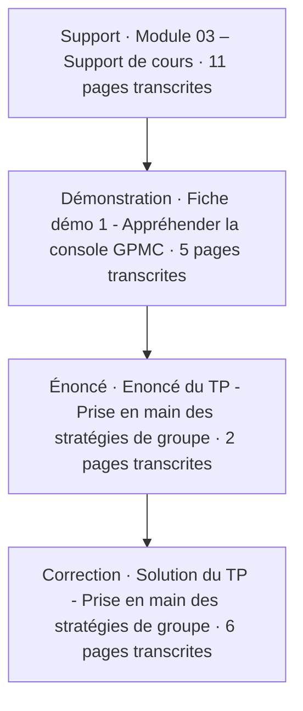
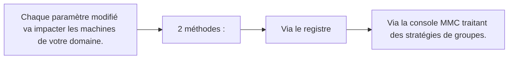
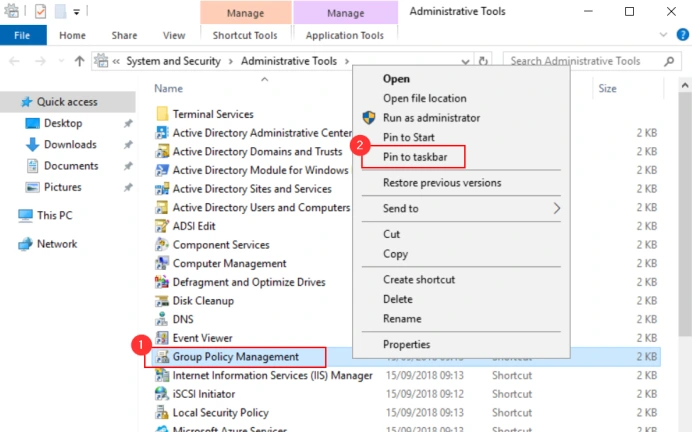
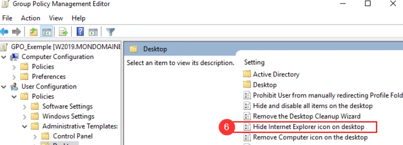

# Module 03 — Stratégies de groupe

Les parties ci-dessous reprennent le cours original, dans le même ordre. Les encadrés et les schémas répètent ses formulations.

## Parcours de lecture

1. Support · Module 03 – Support de cours · 11 pages transcrites
2. Démonstration · Fiche démo 1 - Appréhender la console GPMC · 5 pages transcrites
3. Énoncé · Enoncé du TP - Prise en main des stratégies de groupe · 2 pages transcrites
4. Correction · Solution du TP - Prise en main des stratégies de groupe · 6 pages transcrites

**Visuel externe**



SOURCE DRIVE · TRANSCRIPTION DU SUPPORT

Le contenu des documents du dossier TSSR est transcrit ci-dessous, page par page. Les textes et tableaux sont intégrés à la page Web. Aucun fichier PDF, aucune diapositive entière ni aucune reproduction de page n’est affiché. Seuls des croquis ou visuels isolés et vérifiés peuvent accompagner la transcription. Les versions et les consignes restent celles des supports de formation. Les compléments IA sont conservés dans leur onglet distinct.

## Support · Module 03 – Support de cours · 11 pages transcrites

#### Module 03 – Les stratégies de groupe

#### Objectifs

!!! note "À retenir"
    Appréhender les stratégies de groupe (GPO)

- Appréhender les stratégies de groupe (GPO)

#### Le fonctionnement des GPO

##### Descriptif

!!! note "À retenir"
    Les GPO (Group Policy Object) ou stratégies de groupes sont utilisés dans un domaine AD pour paramétrer les ordinateurs et les utilisateurs.

Les GPO (Group Policy Object) ou stratégies de groupes sont utilisés dans un domaine AD pour paramétrer les ordinateurs et les utilisateurs.

| Les + | Les − |
| --- | --- |
| Ajoute de la sécurité dans l’entreprise | La configuration peut être complexe |
| Automatisation d’actions | Le nombre de paramètres est élevé |
| Réduction des tâches d’administration | Dépendant des versions système |

##### Les types de stratégie

!!! note "À retenir"
    Les conditions d’utilisation et d’application varient selon le type de stratégie.

Les conditions d’utilisation et d’application varient selon le type de stratégie.

| Type | Conditions et portée |
| --- | --- |
| La stratégie de groupe | Nécessite un contexte de domaine. S’applique sur un ou des ensembles d’éléments. En cas de conflits, elle l’emporte sur la stratégie locale. |
| La stratégie locale | Est utilisable dans et hors contexte de domaine. Se configure poste par poste. |

#### Le fonctionnement des GPO

#### Du registre aux stratégies

!!! note "À retenir"
    Chaque paramètre modifié va impacter les machines de votre domaine.

**Visuel externe**



- Chaque paramètre modifié va impacter les machines de votre domaine.

- 2 méthodes :
- Via le registre

- Via la console MMC traitant des stratégies de groupes.

#### Le fonctionnement des GPO

#### Application des stratégies

- Comment sont appliquées les GPO :

#### Pour les contrôleurs de domaine, toutes les 5min

!!! note "À retenir"
    Par défaut toutes les 90min à plus ou moins 30min près.

Par défaut toutes les 90min à plus ou moins 30min près.

#### Application d’une stratégie

#### Commande gpdupate sur le

#### Passage en mode manuel

#### poste visé par les

!!! note "À retenir"
    Les extensions côté client (CSE) sont les composants du poste client qui : Récupèrent les stratégies mises à disposition par le contrôleur de domaine.

**Visuel externe**


stratégies.

- Les extensions côté client (CSE) sont les composants du poste client qui :
- Récupèrent les stratégies mises à disposition par le contrôleur de domaine.
- Intègrent et appliquent les paramétrages qui s’y trouvent.

#### Le fonctionnement des GPO

##### Les stratégies par défaut

!!! note "À retenir"
    Après l’installation d’un domaine, deux stratégies sont configurées par défaut :

Après l’installation d’un domaine, deux stratégies sont configurées par défaut :

| Stratégie | Liaison | Paramètres de sécurité |
| --- | --- | --- |
| Default Domain Policy (DDP) | Racine du domaine | Utilisateurs du domaine |
| Default Domain Controller Policy | UO Domain Controllers | Contrôleurs de domaine |

#### Le ciblage des stratégies

!!! note "À retenir"
    Le ciblage permet de définir le ou les objets soumis à cette règle.

1. Le ciblage permet de définir le ou les objets soumis à cette règle.
2. La liaison d’une stratégie se fait via un site Active Directory, un domaine ou une unité d’organisation.
3. Une fois liée, la stratégie s’applique sur les objets ordinateurs pour les paramètres ordinateur et sur les objets utilisateurs pour les paramètres utilisateur.

La note du support distingue la liaison à un conteneur d’une affectation directe à un groupe.

#### Le ciblage des stratégies

##### La console de gestion

**Visuel externe**


- Conteneurs de liaisons
- Liaisons de stratégies
- Conteneur des stratégies du domaine

##### Ordre de traitement

**Visuel externe**


Priorités et héritage

- Les stratégies sont héritées du parent vers l’enfant.
- Les stratégies héritées sont appliquées avant celles du conteneur courant.
- Les stratégies dont le numéro d’ordre est le plus élevé sont d’abord appliquées au sein d’un même conteneur.
- Les stratégies marquées Appliqué deviennent prioritaires.

#### Le ciblage des stratégies

#### Ordre de traitement

#### Si les stratégies définissent des paramètres

#### Un objet peut être soumis à plusieurs

#### distincts, la résultante est le cumul de ces

stratégies

paramètres

#### Valeurs conflictuelles

#### / Paramètres complémentaires

#### Si plusieurs stratégies appliquant des valeurs

#### La dernière stratégie appliquée l’emporte

#### distinctes d’un même paramètre à un même

#### objet existent, c’est l’ordre d’application qui

#### La plus proche de l’objet

définira la valeur prise en compte.

#### Le ciblage des stratégies

#### Les possibilités de restrictions de liaison

d’héritage

- S’active sur un conteneur.
- Annule la prise en comptes des stratégies héritées de conteneurs parents.
- Impacte toutes les stratégies héritées. Le blocage

- Permet d’outrepasser le blocage d’héritage.
- Rend la GPO prioritaire Le paramètre

Appliqué

- De sécurité
- Restreint la lecture et l’application de GPO.
- Des règles de contrôle d’accès pour accorder ou ôter des privilèges.
- WMI : limiter l’application grâce aux requêtes WMI Les filtres

```
Les stratégies de groupe
 Le ciblage des stratégies

        Ordre de traitement

                                                                                          Si les stratégies définissent des paramètres                         Un objet peut être soumis à plusieurs                                                                                           distincts, la résultante est le cumul de ces                                                    stratégies                                                                                     paramètres

                                                 Valeurs conflictuelles
                                                                    /
                                                  Paramètres
                                             complémentaires
                                                                                          Si plusieurs stratégies appliquant des valeurs
                               La dernière stratégie appliquée l’emporte    distinctes d’un même paramètre à un même
                                       La plus proche de l’objet            objet existent, c’est l’ordre d’application qui
                                                                                         définira la valeur prise en compte.

                                                                                          11

11

  Les stratégies de groupe
 Le ciblage des stratégies

        Les possibilités de restrictions de liaison

                   Le blocage        • S’active sur un conteneur.
                     d’héritage        •• AnnuleImpactelatoutesprise enles comptesstratégiesdeshéritées.stratégies héritées de conteneurs parents.

                  Le paramètre      • Permet d’outrepasser le blocage d’héritage.
                    Appliqué         • Rend la GPO prioritaire

                                                                  • De sécurité
                     Les filtres           •• RestreintDes règlesladelecturecontrôleet l’applicationd’accès pourdeaccorderGPO.  ou ôter des privilèges.
                                                                  • WMI : limiter l’application grâce aux requêtes WMI

                                                                                          12

12
```

#### La mise en œuvre des stratégies

#### Les domaines impactés

Les domaines impactés sont représentés ci-dessous, nous les verrons par la suite en détail

#### Déploiement applicatif

Scripts

Sécurité

Configuration

- Système
- De composants intégrés
- D’applications tierces

#### La mise en œuvre des stratégies

#### Les paramètres de stratégie de groupe

Un point de configuration est associé à un paramètre de GPO et dispose des caractéristiques suivantes

#### Nom Etat Support Description Commentaire

#### La mise en œuvre des stratégies

#### Les modèles d’administration

#### Ils permettent de configurer

- Le système d’exploitation

- Des composants système

- Des outils Microsoft

#### Fichiers stockés dans le partage SYSVOL

#### Démonstration

#### Principe de redirection

Les dossiers du profil utilisateur sont stockés sur un emplacement réseau.

Documents

#### Serveur de fichiers

Bureau

#### Menu démarrer

Contacts

#### Stratégie de redirection des dossiers

Les redirections s’appliquent aux objets utilisateurs.

#### Paramètres Options

- Les nouveaux utilisateurs ne bénéficieront pas de redirection de dossiers.

- Les dossiers redirigés des utilisateurs se trouveront dans le même sous-dossier

Créer un dossier pour chaque utilisateur sous le chemin d’accès racine.

- Chaque utilisateur disposera de son propre sous-dossier. Avancé : En fonction de leur appartenance à des groupes, les dossiers des utilisateurs seront stockés dans des emplacements réseau différents

- Arrêt de la redirection

| Paramètre | Options |
| --- | --- |
| De base | Les dossiers redirigés de l’ensemble des utilisateurs seront stockés dans un même emplacement réseau. |
| Avancé | Selon leurs groupes, les utilisateurs ont des emplacements réseau différents. |
| Redirection vers le répertoire d’accueil | Les nouveaux utilisateurs ne bénéficieront pas de redirection de dossiers, selon le support. |
| Créer un dossier pour chaque utilisateur | Chaque utilisateur dispose de son sous-dossier sous le chemin racine. |
| Rediriger vers l’emplacement suivant | Les dossiers redirigés des utilisateurs se trouvent dans le même sous-dossier. |
| Redirection vers l’emplacement du profil local | Arrêt de la redirection. |

#### Le déploiement d’imprimantes par GPO

- Depuis le Gestionnaire d’impression, il est possible de déployer des imprimantes par GPO.

- Les informations à renseigner seront :

- La stratégie existante ou nouvelle à utiliser.
- Le type d’objet ciblé par le déploiement

#### TP

#### Conclusion

- Vous connaissez les stratégies de groupe (GPO)

Référence du document : 10ZzrWSG0Yv4qDn5q0uoc9aIXFqFdfMX4 · SHA-256 6a79d7f43db84631…

## Démonstration · Fiche démo 1 - Appréhender la console GPMC · 5 pages transcrites

#### Appréhender la console GPMC

#### Démonstration 01 du module 03

#### Cette démonstration décrit les différents points relatifs à la console de GPO

#### Déroulement

- Prérequis

Avoir installé et configuré une VM Windows Server.

Avoir renommé correctement la VM.

Avoir attribué une IP fixe à la VM.

L’objectif de la GPO qui va être créée est de cacher l’icône Internet Explorer pour les utilisateurs d’une OU spécifique.

- Ouverture de la console MMC

Après l’ouverture de session sur la session du domaine, cliquer sur le menu démarrer (1), puis sur la tuile Windows Administrative Tools (2).

- Ajout du raccourci dans la barre des tâches

Dans l’explorateur qui vient de s’ouvrir, faire un clic droit sur la ligne Group Policy Management (1), puis sur le menu Pin to taskbar (2). L’icône (3) apparaît.

- Accès à la console GPMC

Cliquer sur le raccourci précédemment créé afin de voir la console des GPO apparaître.



Visuel isolé — Fiche démo 1 - Appréhender la console GPMC

- Création GPO utilisateur

Faire un clic droit sur la ligne Utilisateur (1) ou tout autre OU, puis sur le menu Create GPO in the domain, and lin kit here… (2). Indiquer le nom de la GPO (3) puis cliquer sur le bouton OK. La GPO apparaît (4).

- Ajout des paramètres à la GPO

Faire un clic droit sur la ligne GPO_Exemple (1), puis sur le menu Edit (2). Aller dans les menus User Configuration (3) , Administrative Template (4), Desktop (5). Double cliquer sur la ligne Hide Internet Explorer icon on desktop (6). Cocher le bouton radio Enabled (7) puis cliquer sur le bouton Apply (8). Enfin cliquer sur le bouton OK.



Visuel isolé — Fiche démo 1 - Appréhender la console GPMC

#### Étapes illustrées dans le support

1. Dans Hide Internet Explorer icon on desktop, sélectionner Enabled puis Apply.
2. Le paramètre illustré masque l’icône Internet Explorer du Bureau et de la barre de lancement rapide pour l’utilisateur.

Référence du document : 1TdIMQLVdwwzgRk6xk51jxLkz34IsyYFX · SHA-256 9f4795eaed184eb0…

## Énoncé · Enoncé du TP - Prise en main des stratégies de groupe · 2 pages transcrites

#### Prise en main des stratégies de groupes

#### TP du Module 03 – Active Directory

Avant de démarrer ce TP, il convient d’avoir suivi les vidéos du module 3 et réalisé les TP précédents.

#### Durée estimée

30 minutes à 1 heure

#### Énoncé

Prérequis :

- Avoir réalisé le TP précédent du Module 02.

#### Mise en œuvre des GPO

- Trouvez et validez le paramètre adapté (utilisateur ou ordinateur).
- Définissez les stratégies de groupe nécessaires et le point de liaison (UO) pour leur application.
- Regroupez les paramètres du même type dans une seule GPO.
- Testez-en le bon fonctionnement avec les comptes utilisateurs adéquats. Pour l’ensemble des utilisateurs du domaine

- La fonctionnalité de chiffrement EFS doit être désactivée.
- Le pare-feu système doit être désactivé.
- Internet Explorer sera client proxy du serveur 172.28.10.248 en écoutant sur le port 8080.
- Le mot de passe devra compter au moins 5 caractères et il sera à changer tous les 5 jours.
- Aucune exigence de complexité de mot de passe n’est envisagée.

#### Pour les membres du service Commercial

- Le partage Prospects doit automatiquement être disponible dans l’explorateur de fichiers, et dès l’ouverture de session. Pour les membres du service Production

- L’imprimante HP Color LaserJet Pro MFP M477 sera automatiquement installée. Pour les Secrétaires

- Le fond d’écran sera commun (logo de l’entreprise).

Bonus :

- Automatiser l’installation d’Acrobat Reader (paquet .msi) pour les secrétaires.
- Le répertoire Documents des utilisateurs sera déporté sur W19-SRV1 (excepté pour les membres du service Informatique).
- Ouverture de session limitée de 9h à 18h.
- Fermeture de session obligatoire après 18h pour les intérimaires.

Référence du document : 1L0CB2J9fOsTuLTzAC1-vKfl-v5mhGGjG · SHA-256 a9bcc6275473bed3…

## Correction · Solution du TP - Prise en main des stratégies de groupe · 6 pages transcrites

Correction originale : à consulter après avoir tenté l’exercice.

#### Prise en main des stratégies de groupes

#### TP du Module 03 – Active Directory

Avant de démarrer ce TP, il convient d’avoir suivi les vidéos du module 3 et réalisé les TP précédents.

#### Durée estimée

30 minutes à 1 heure

#### Solution

Prérequis :

- Avoir réalisé le TP précédent du Module 02.

#### Mise en œuvre des GPO

- Trouvez et validez le paramètre adapté (utilisateur ou ordinateur).
- Définissez les stratégies de groupe nécessaires et le point de liaison (UO) pour leur application.
- Regroupez les paramètres du même type dans une seule GPO.
- Testez-en le bon fonctionnement avec les comptes utilisateurs adéquats. Pour l’ensemble des utilisateurs du domaine

- La fonctionnalité de chiffrement EFS doit être désactivée.

- Le pare-feu système doit être désactivé.

- Internet Explorer sera client proxy du serveur 172.28.10.248 en écoutant sur le port 8080.

- Le mot de passe devra compter au moins 5 caractères et il sera à changer tous les 5 jours.
- Aucune exigence de complexité de mot de passe n’est envisagée.

#### Pour les membres du service Commercial

- Le partage Prospects doit automatiquement être disponible dans l’explorateur de fichiers, et dès l’ouverture de session.

#### Pour les membres du service Production

- L’imprimante HP Color LaserJet Pro MFP M477 sera automatiquement installée.

#### Pour les Secrétaires

- Le fond d’écran sera commun (logo de l’entreprise).

#### Étapes illustrées dans le support

1. Dans GPO_Secretaire, ouvrir Configuration utilisateur, Stratégies, Modèles d’administration, Bureau, Bureau, Papier peint du Bureau.
2. Activer le paramètre, renseigner le chemin du fichier de fond d’écran puis choisir le style Center.
3. Dans Group Policy Management, vérifier le lien de GPO_Secretaire sur l’UO SECRETAIRE. La capture affiche le filtrage Utilisateurs authentifiés et aucun filtre WMI.

Référence du document : 184DIHm_-zbA5j2Skl4Zxm55YXj5sW70b · SHA-256 608287ee01bf54d8…

## Fiche de synthèse

Les lignes reprennent les titres du cours et la première phrase de chaque partie.

| Partie | Repère du cours |
| --- | --- |
| Correction · Solution du TP - Prise en main des stratégies de groupe · 6 pages transcrites | Correction originale : à consulter après avoir tenté l’exercice. |
