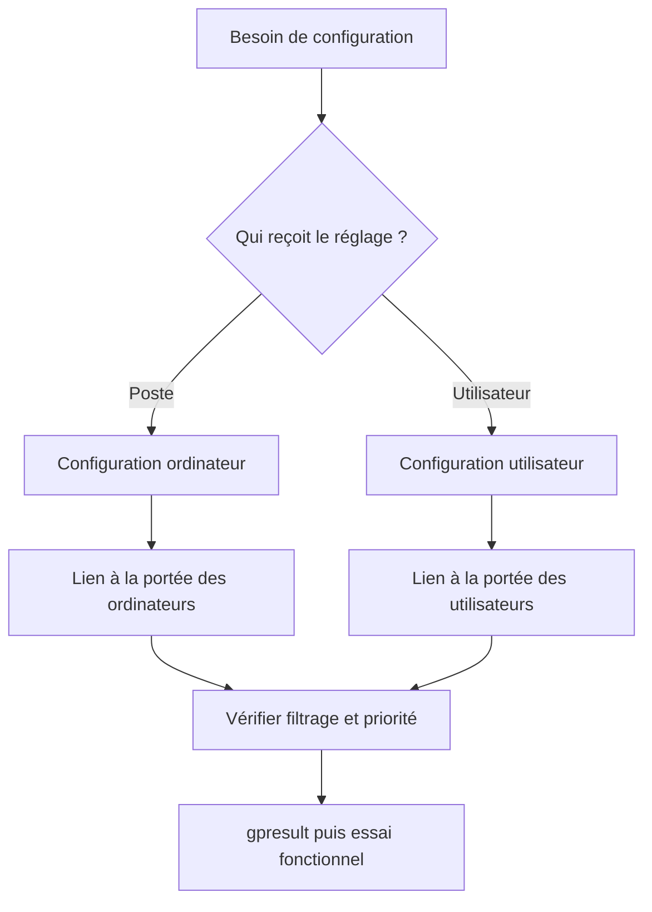

# Module 03 — Stratégies de groupe

Les GPO appliquent des paramètres aux utilisateurs et ordinateurs du domaine. Elles réduisent les interventions poste par poste et permettent de définir des règles cohérentes. Le choix de la portée dépend du type de paramètre, du conteneur de l’objet et de l’ordre de traitement.

## Objectifs

- Prévoir l’ordre de traitement d’une stratégie et distinguer objet GPO, lien et filtrage.
- Choisir la branche utilisateur ou ordinateur selon le réglage.
- Appliquer les réglages de laboratoire aux utilisateurs et postes visés.
- Vérifier le résultat avec un compte ciblé et un compte exclu.

## De la stratégie locale au domaine

La stratégie locale est utilisable avec ou sans domaine. Les stratégies de domaine sont créées dans GPMC et liées à un site, un domaine ou une UO. Les extensions clientes récupèrent la stratégie, puis appliquent ses réglages. Les paramètres ordinateur se traitent notamment au démarrage et les paramètres utilisateur à l’ouverture de session. Le support mentionne un rafraîchissement ordinaire de 90 minutes avec variation et un intervalle de 5 minutes pour les contrôleurs.

Le modèle standard de traitement suit **Local → Site → Domaine → UO**, du parent vers l’enfant. Les paramètres distincts se cumulent. Les valeurs concurrentes sont départagées par leur priorité. Dans une même UO, le lien d’ordre 1 a la priorité normale. Un lien forcé traverse le blocage de l’héritage. Le filtrage de sécurité contrôle la lecture et l’application, tandis qu’un filtre WMI vérifie une condition sur la machine. [Traitement des GPO dans Windows](https://learn.microsoft.com/windows-server/identity/ad-ds/manage/group-policy/group-policy-processing).

Le domaine fournit une Default Domain Policy liée à sa racine et une Default Domain Controllers Policy liée à l’UO Domain Controllers. GPMC distingue le conteneur des objets GPO et les liens qui les appliquent. Créer un objet sans lien permet de le préparer. Pour prévoir sa portée, suivre le lien, l’UO effective, les permissions de filtrage et l’état des sections utilisateur et ordinateur.

## Choisir le bon réglage

Les paramètres couvrent scripts, déploiement d’applications, sécurité, système et composants. Les modèles d’administration décrivent les réglages, leur prise en charge et leur effet. Le support présente la redirection des dossiers utilisateur sur un serveur de fichiers. En mode de base, les utilisateurs suivent une même configuration. Le mode avancé choisit des emplacements par groupe. Prévoir les droits de partage et NTFS avant de faire pointer Documents vers ce serveur.

Dans le Gestionnaire d’impression, une file peut être déployée avec une GPO existante ou nouvelle, sur les ordinateurs ou sur les utilisateurs. Lier la règle à l’UO où sont les objets qui reçoivent le réglage. Un déploiement applicatif utilise un paquet accessible depuis un chemin UNC au contexte qui l’installe.

**Illustration IA / externe au cours — choix de portée d’un réglage.**



## Tester et diagnostiquer

```cmd
gpupdate /force
gpresult /r
gpresult /h rapport-gpo.html
```

Le support écrit `gpdupate`. La commande utilisable est `gpupdate`. Certains réglages prennent effet après fermeture de session ou redémarrage. Tester une cible et un compte exclu, puis comparer la configuration réellement appliquée et les stratégies filtrées. Pour un lecteur ou une imprimante absents, vérifier aussi la ressource et les droits réseau indépendamment de la GPO.

## TP guidé — Mettre en œuvre les stratégies de groupe

**Durée du support.** Trente minutes à une heure, puis bonus. Reprendre les UO, groupes et ressources du module 2. Dans GPMC, repérer le conteneur des stratégies et les liens existants. Pour chaque consigne, noter le réglage, la branche, la cible, le compte utilisé et la preuve du résultat.

### A. Appliquer les réglages communs du laboratoire

| Besoin du TP | Portée et résultat à vérifier |
| --- | --- |
| Désactiver EFS | Paramètre ordinateur sur les postes du scénario. Vérifier le résultat du réglage EFS dans le laboratoire. |
| Désactiver le pare-feu | Paramètre ordinateur sur les profils prévus par le TP isolé. Contrôler l’état des profils concernés. |
| Proxy Internet Explorer | Cible utilisateur avec `172.28.10.248:8080`. Le navigateur et ses options sont ceux de la maquette historique. |
| Mot de passe du domaine | Portée domaine, longueur de **5 caractères**, changement tous les **5 jours** et complexité désactivée dans l’exercice. |

Regrouper les réglages du même type selon le TP, puis lier à la portée appropriée. Les valeurs du pare-feu et du mot de passe servent à l’observation dans le laboratoire. Elles ne constituent pas des valeurs de déploiement pour une organisation.

### B. Appliquer les réglages propres aux métiers

1. **Commercial.** Déployer le lecteur Prospects à l’ouverture de session pour les membres du groupe prévu. Tester la présence du lecteur et l’accès au partage `\\W19-SRV1\Prospects`. Une GPO appliquée ne donne pas à elle seule les droits SMB et NTFS.
2. **Production.** Déployer la file du serveur d’impression pour les utilisateurs visés et ouvrir une session de test. L’énoncé cite le modèle M477, alors que les modèles du module 2 diffèrent. Relever le nom de la file Production effectivement configurée avant le déploiement.
3. **Secrétaires.** Dans la branche utilisateur de `GPO_Secretaire`, ouvrir **Modèles d’administration → Bureau → Bureau → Papier peint du Bureau**. Renseigner un chemin d’image lisible, choisir le style centré du corrigé et vérifier le lien sur l’UO cible.
4. Pour chaque réglage, comparer le résultat d’un compte concerné avec un compte hors cible. Si un lecteur ou une imprimante manque, vérifier aussi le chemin réseau, les permissions et la file.

### C. Traiter les bonus de l’énoncé

- **Acrobat Reader.** Préparer le paquet MSI sur un chemin UNC lisible par le contexte de déploiement. Lier à la portée des secrétaires et vérifier le traitement de l’installation lors du prochain cycle adapté.
- **Documents.** Rediriger vers le serveur de fichiers `W19-SRV1` avec un périmètre qui exclut Informatique. Examiner le chemin obtenu et les droits des deux profils.
- **Horaires.** Limiter les nouvelles ouvertures de session à **9 h–18 h**. Pour les intérimaires, vérifier séparément la fermeture effective d’une session déjà ouverte à 18 h. Les restrictions d’horaires et le réglage de déconnexion des sessions SMB ne prouvent pas à eux seuls la fermeture d’une session interactive. [Déconnexion réseau à l’expiration des heures de connexion](https://learn.microsoft.com/en-us/windows/security/threat-protection/security-policy-settings/network-security-force-logoff-when-logon-hours-expire)

## À retenir

Un objet GPO devient effectif selon son lien, son ciblage et le traitement des réglages. `gpresult` montre la stratégie reçue. Une seconde preuve doit montrer que le réglage change l’usage attendu.

## Mini-quiz — 5 questions {#mini-quiz}

1. Une GPO existe sans lien. Est-elle appliquée ?
2. Quel type de lien peut traverser un blocage d’héritage ?
3. Où viser le réglage du fond d’écran des secrétaires ?
4. Pourquoi vérifier séparément le chemin Prospects ?
5. Comment distinguer le test de la GPO et celui de son effet ?

??? success "Réponses commentées"

    1. Elle doit être liée à une portée pertinente, puis passer les conditions d’application.
    2. Un lien forcé. Le traitement des autres stratégies dépend de leur portée et ordre.
    3. Dans la configuration utilisateur, avec un lien et un filtrage qui atteignent les comptes concernés.
    4. La stratégie peut présenter le lecteur alors que le partage ou NTFS refuse l’accès.
    5. Lire gpresult dans le contexte attendu, puis utiliser la ressource ou observer le réglage avec un compte de test.

## Pour pratiquer et réviser {#appliquer-le-cours}

- [Énoncés](../../tp/services-reseaux-microsoft/module-03/enonces.md) et [corrections](../../tp/services-reseaux-microsoft/module-03/corrections.md)
- [Démonstrations](../../tp/services-reseaux-microsoft/module-03/demonstrations.md)
- [Fiche de révision](../../revision/services-reseaux-microsoft/module-03-module-03.md)
- [Kahoot existant](../../kahoot/09-services-reseaux-microsoft-module-03-module-03.md)
- [Sommaire de Services réseau en environnement Microsoft](index.md)

## Provenance pédagogique

Le support M03, la démonstration GPMC et la paire de TP fondent la progression. Les réglages de sécurité et les différences de modèles d’impression restent liés à leur contexte de laboratoire.
