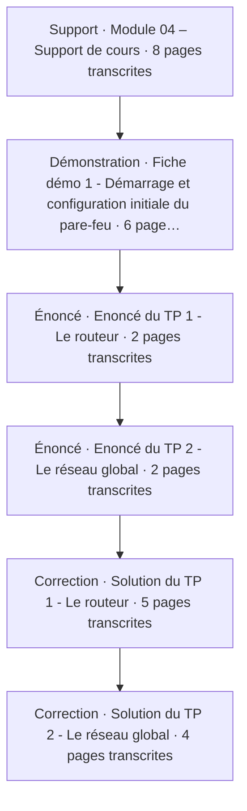
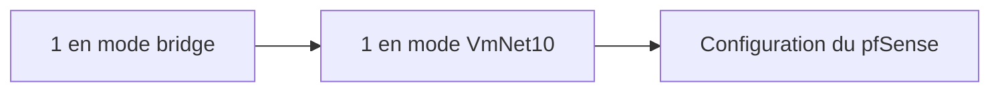
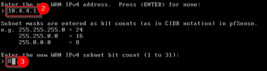
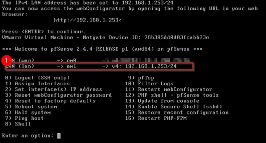
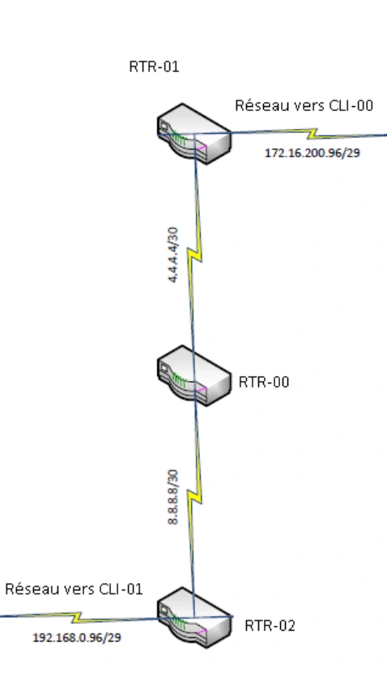
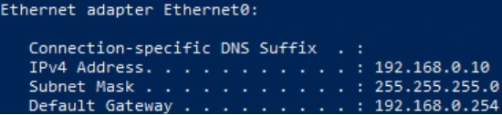
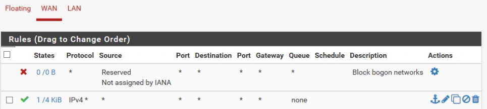
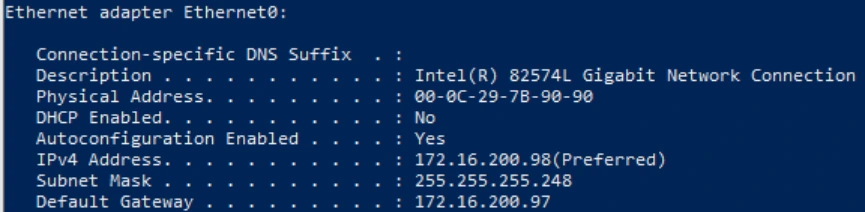
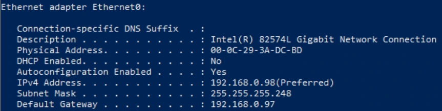

# Module 04 — Le routage

Les parties ci-dessous reprennent le cours original, dans le même ordre. Les encadrés et les schémas répètent ses formulations.

## Parcours de lecture

1. Support · Module 04 – Support de cours · 8 pages transcrites
2. Démonstration · Fiche démo 1 - Démarrage et configuration initiale du pare-feu · 6 pages transcrites
3. Énoncé · Enoncé du TP 1 - Le routeur · 2 pages transcrites
4. Énoncé · Enoncé du TP 2 - Le réseau global · 2 pages transcrites
5. Correction · Solution du TP 1 - Le routeur · 5 pages transcrites
6. Correction · Solution du TP 2 - Le réseau global · 4 pages transcrites

**Visuel externe**

SOURCE DRIVE · TRANSCRIPTION DU SUPPORT

Le contenu des documents du dossier TSSR est transcrit ci-dessous, page par page. Les textes et tableaux sont intégrés à la page Web. Aucun fichier PDF, aucune diapositive entière ni aucune reproduction de page n’est affiché. Seuls des croquis ou visuels isolés et vérifiés peuvent accompagner la transcription. Les versions et les consignes restent celles des supports de formation. Les compléments IA sont conservés dans leur onglet distinct.

## Support · Module 04 – Support de cours · 8 pages transcrites

#### Module 04 – Le routage

#### Objectifs

- Comprendre et configurer le routage

#### Concept du routage

#### Le mécanisme du routage

!!! note "À retenir"
    Il permet la communication entre différents réseaux logiques.

**Visuel externe**

- Il permet la communication entre différents réseaux logiques.

- Les types de routage :
- Statique
- Dynamique
- Constitution d’une route :
- Adresse de réseau de destination
- Masque de sous-réseau du réseau de destination
- Adresse de passerelle

#### Concept du routage

#### Communication au sein d’un même réseau logique

- Si ping de A vers B

#### Poste A Poste B

#### Ping 1A vers 1B

#### Domaine de diffusion

#### Réseau identique

#### Envoi de la requête ping

!!! note "À retenir"
    @MAC : Phy1B @IP : 1B @MAC : Phy1A @IP : 1A

@MAC : Phy1B @IP : 1B

@MAC : Phy1A @IP : 1A

#### Poste C

#### Poste A Poste B

- Si ping de A vers C

#### Domaine de diffusion

#### Ping 1A vers 2C

#### Réseau différent

!!! note "À retenir"
    @MAC : Phy1A @IP : 1A @MAC : Phy1B @IP : 1B @MAC : Phy2C @IP : 2C

@MAC : Phy1A @IP : 1A

@MAC : Phy1B @IP : 1B

@MAC : Phy2C @IP : 2C

#### Pas d’envoi de requête ping

#### Concept du routage

##### Communication au sein d’un même réseau logique

!!! note "À retenir"
    Ping 127.0.0.1 Calcul de réseau logique A @IPA : 192.168.1.10 Mask A : 255.255.255.0 Réseau A : 192.168.1.0 pour A @IPB : 192.168.1.20 Mask A : 255.255.255.0 Réseau A : 192.168.1.0 Le poste A compare le réseau logique de la destination à son propre réseau.

| Poste | Adresses indiquées |
| --- | --- |
| Poste A | 00:29:0C:1E:30:1A 192.168.1.10/24 |
| Poste B | 00:29:0C:1E:30:1B 192.168.1.20/24 |

Ping 127.0.0.1

Calcul de réseau logique A @IPA : 192.168.1.10 Mask A : 255.255.255.0 Réseau A : 192.168.1.0

pour A @IPB : 192.168.1.20 Mask A : 255.255.255.0 Réseau A : 192.168.1.0

1. Le poste A compare le réseau logique de la destination à son propre réseau. Si les réseaux diffèrent, le schéma indique un retour d’erreur ICMP ou l’utilisation de la passerelle si elle est renseignée.
2. Si le réseau est identique, le poste A consulte sa table ARP. Si l’adresse matérielle manque, il met le ping en attente et envoie une requête ARP pour le poste B.
3. Le poste B répond si l’adresse demandée est locale. Le poste A met à jour sa table ARP puis envoie le ping au poste B.

| Échange | Champs IPv4 | Champs MAC |
| --- | --- | --- |
| Requête ARP | 192.168.1.20 192.168.1.10 | FF:FF:FF:FF:FF:FF 00:29:0C:1E:30:1A |
| Réponse ARP B | 192.168.1.20 192.168.1.10 | 00:29:0C:1E:30:1B 00:29:0C:1E:30:1A |
| Ping vers le poste B | 192.168.1.20 192.168.1.10 | 00:29:0C:1E:30:1B 00:29:0C:1E:30:1A |

##### Communication au sein de réseaux logiques différents

!!! note "À retenir"
    Si le poste A envoie un ping de 1A vers 2D, le réseau est différent.

| Équipement ou interface | Domaine | MAC | IP |
| --- | --- | --- | --- |
| Poste A (passerelle 1R) | 1 | Phy1A | 1A |
| Poste B | 1 | Phy1B | 1B |
| Routeur, interface 1 | 1 | Phy1R | 1R |
| Routeur, interface 2 | 2 | Phy2R | 2R |
| Poste C | 2 | Phy2C | 2C |
| Poste D | 2 | Phy2D | 2D |

Si le poste A envoie un ping de 1A vers 2D, le réseau est différent. Le poste utilise sa passerelle par défaut si elle est configurée.

| Échange | MAC destination | MAC source | IP destination | IP source |
| --- | --- | --- | --- | --- |
| A recherche l’adresse physique de R | FF:FF:FF:FF:FF:FF | Phy1A | 1R | 1A |
| Réponse ARP du routeur | Phy1A | Phy1R | 1A | 1R |
| Trame du ping envoyée au routeur | Phy1R | Phy1A | 2D | 1A |
| Le routeur recherche l’adresse physique de D | FF:FF:FF:FF:FF:FF | Phy2R | 2D | 2R |
| Réponse ARP de D | Phy2R | Phy2D | 2R | 2D |
| Trame du ping envoyée au poste D | Phy2D | Phy2R | 2D | 1A |

#### Concept du routage

##### Communication au sein de réseaux logiques différents

!!! note "À retenir"
    Ping 127.0.0.1 Calcul de réseau logique A @IPA : 192.168.1.10 Mask A : 255.255.255.0 Réseau A : 192.168.1.0 pour A @IPD : 192.168.2.140 Mask A : 255.255.255.0 Réseau A : 192.168.2.0 Le poste A vérifie que le réseau de la destination diffère du sien, puis recherche la passerelle configurée et calcule son réseau.

| Poste | MAC, IPv4, préfixe et passerelle |
| --- | --- |
| Poste A | MAC 00:29:0C:1E:30:1A IPv4 192.168.1.10/24 GW 192.168.1.254 |
| Poste D | MAC 00:29:0C:1E:30:2D IPv4 192.168.2.140/26 GW 192.168.2.254 |

Ping 127.0.0.1

Calcul de réseau logique A @IPA : 192.168.1.10 Mask A : 255.255.255.0 Réseau A : 192.168.1.0

pour A @IPD : 192.168.2.140 Mask A : 255.255.255.0 Réseau A : 192.168.2.0

1. Le poste A vérifie que le réseau de la destination diffère du sien, puis recherche la passerelle configurée et calcule son réseau. Sans passerelle utilisable, le schéma indique un retour d’erreur ICMP.
2. Le poste A consulte sa table ARP, puis envoie une requête ARP pour la passerelle si nécessaire. Le ping reste en attente pendant cette recherche.
3. Après la réponse ARP, le poste A met à jour sa table et envoie le ping au routeur. Le dessin étiquette la réponse « Réponse Arp B », alors que la recherche porte sur la passerelle.

| Échange | Champs IPv4 | Champs MAC |
| --- | --- | --- |
| Requête ARP | 192.168.1.254 192.168.1.10 | FF:FF:FF:FF:FF:FF 00:29:0C:1E:30:1A |
| Réponse ARP | 192.168.1.254 192.168.1.10 | 00:29:0C:1E:30:1R 00:29:0C:1E:30:1A |
| Ping vers le routeur | 192.168.2.140 192.168.1.10 | 00:29:0C:1E:30:1R 00:29:0C:1E:30:1A |

##### Traitement du ping par le routeur

!!! note "À retenir"
    Le routeur reçoit le ping et désencapsule jusqu’à la couche 3.

1. Le routeur reçoit le ping et désencapsule jusqu’à la couche 3. Il consulte sa table de routage. Si le réseau n’est pas présent, le schéma indique un retour d’erreur ICMP.
2. Si le réseau est présent mais n’est pas directement connecté, le routeur envoie le ping au routeur suivant.
3. Si le réseau est local, le routeur consulte sa table ARP et recherche l’adresse matérielle du poste D si nécessaire. Le ping est mis en attente pendant cette recherche.
4. À réception de la réponse, il met à jour la table ARP, réencapsule à la couche 2 et transmet le ping au poste D. Si la recherche ARP échoue, le schéma indique un retour d’erreur ICMP.

| Échange | Champs IPv4 | Champs MAC |
| --- | --- | --- |
| Ping reçu par le routeur | 192.168.2.140 192.168.1.10 | 00:29:0C:1E:30:1R 00:29:0C:1E:30:1A |
| Requête ARP vers D | ARP ? 192.168.2.140 192.168.2.254 | FF:FF:FF:FF:FF:FF 00:29:0C:1E:30:2R |
| Réponse ARP D | 192.168.2.140 192.168.2.254 | 00:29:0C:1E:30:2D 00:29:0C:1E:30:2R |
| Ping transmis à D | 192.168.2.140 192.168.1.10 | 00:29:0C:1E:30:2D 00:29:0C:1E:30:2R |

#### Concept du routage

#### Principe de fonctionnement du routage

#### À chaque saut

!!! note "À retenir"
    Le routeur vérifie les informations de transfert dans la table de routage.

Le routeur vérifie les informations de transfert dans la table de routage.

Est traité de manière indépendante dans chaque routeur le long du chemin.

Le routeur examine l’adresse IP de destination pour chaque paquet.

#### Chaque paquet

#### Est vérifié

#### Concept de la traduction d’adresse

#### La traduction d’adresse : sans NAT

Internet

80.87.128.67

90.83.78.224

192.168.20.0 /24

192.168.20.13

192.168.20.254

#### Source : 80.87.128.67:80

#### Source : 192.168.20.13:3008

#### Destination : 192.168.20.13:3008

#### Destination : 80.87.128.67:80

#### Concept de la traduction d’adresse

#### La traduction d’adresse : avec NAT

#### Source : 90.83.78.224:49010

#### Source : 192.168.20.13:3008

#### Destination : 80.87.128.67:80

#### Destination : 80.87.128.67:80

#### Internet 80.87.128.67

192.168.20.0 /24

192.168.20.254 90.83.78.224

192.168.20.13

#### Source : 80.87.128.67:80

#### Source : 80.87.128.67:80

#### Destination : 192.168.20.13:3008

#### Destination : 90.83.78.224 : 49010

#### Démonstration

#### Le routeur et la traduction d'adresses

#### TP

#### Le réseau global

#### TP

#### Conclusion

- Vous comprenez et savez configurer le routage

Référence du document : 1Lkf-lTyovca0i4z_9kGhD7T32aIPlqYD · SHA-256 eaf504284cca02e3…

## Démonstration · Fiche démo 1 - Démarrage et configuration initiale du pare-feu · 6 pages transcrites

#### Démarrage et configuration initiale du pare-feu

#### Démonstration 01 du module 04

Cette démonstration décrit les différentes étapes d’installation du pare-feu sous pfSense

#### Déroulement

- Prérequis

Disposer d’un fichier .iso pfSense disponible sous Distrib ou sur https://www.pfSense.org/download/

Disposer d’une machine virtuelle avec une carte réseau VmNet10.

- Création de la machine virtuelle

Créer une nouvelle machine virtuelle avec les prérequis suivants :

#### - 2 CPU

#### - 20 Go de disque

#### - 2 interfaces

**Visuel externe**

- 1 en mode bridge

- 1 en mode VmNet10

La création de la machine virtuelle se fera de la même manière que lors des démonstrations précédentes.

- Configuration du pfSense

Au premier lancement de la machine virtuelle, l’utilitaire d’installation se lance. Appuyer sur la touche [Entrée]. Appuyer de nouveau sur la touche [Entrée]. Sélectionner le clavier français, puis appuyer sur la touche [Entrée]. Appuyer sur la touche [Entrée] pour valider le choix du clavier. Appuyer sur la touche [Entrée] afin de valider la configuration des disques. Appuyer sur la touche [Entrée] afin de finaliser le processus d’installation. Enfin, appuyer sur la touche [Entrée] afin de procéder au redémarrage de la machine virtuelle.

#### Étapes illustrées dans le support

**Visuel externe**

1. Accepter l’écran d’accueil et choisir Install pfSense.
2. Sélectionner la disposition de clavier French et continuer avec cette disposition.
3. Dans le partitionnement, sélectionner Auto (UFS). Une fois l’installation terminée, choisir No lorsque l’installateur propose une intervention manuelle, puis Reboot.

- Configuration des interfaces réseau

Lors du démarrage de la machine virtuelle, cet écran apparaît (1). Pour assigner des interfaces (indiquer à la machine virtuelle quelle est l’interface bridgée par exemple), appuyer sur la touche [ 1 ], puis appuyer sur la touche [Entrée]. Appuyer sur la touche [ n ], puis appuyer sur la touche [Entrée] pour indiquer qu’il n’y a pas de VLANs à configurer. Indiquer le nom de l’interface WAN (bridge), ici « em0 » puis appuyer sur la touche [Entrée]. Indiquer le nom de l’interface LAN (VmNet10), ici « em1 » puis appuyer sur la touche [Entrée]. Enfin appuyer sur les touches [ y ] et [Entrée] pour indiquer que la configuration des interfaces est bonne.

- Configuration des adresses IP des cartes réseau

Pour configurer les adresses réseau des cartes sur la machine virtuelle, appuyer sur la touche [ 2 ], puis appuyer sur la touche [Entrée]. Indiquer le nom de l’interface puis appuyer sur la touche [Entrée] (1). La configuration ne se fera pas en DHCP (ici), appuyer sur [ n ] puis sur la touche [Entrée]. Indiquer l’adresse IP à affecter à l’interface (2) ainsi que le masque en notation CIDR (3), puis appuyer sur la touche [Entrée]. Appuyer sur la touche [Entrée]. Appuyer de nouveau sur la touche [Entrée]. Appuyer sur la touche [ n ] puis sur [Entrée]

N. B. la méthodologie sera utilisée pour la configuration de la carte LAN em1.

Visuel isolé — Fiche démo 1 - Démarrage et configuration initiale du pare-feu

- Accès à la console web du routeur

L’accès au portail web se fait via l’adresse IP configurée précédemment (adresse de l’interface LAN).

Dans cet exemple, l’adresse IP utilisée est 192.168.1.253. L’adresse est trouvable sur la page d’accueil du pfSense (1) ou lors de la configuration de l’interface LAN (2).

Sur le client, ouvrir un navigateur puis indiquer dans la barre URL l’adresse IP du routeur (3). Lors de la première connexion, les informations sont les suivantes :

#### - Username : admin

#### - Password : [valeur fournie par le formateur]

Cliquer sur le bouton Next (4). Cliquer sur le bouton Next (5). Indiquer le nom du routeur dans la combo-box Hostname (6) puis cliquer sur le bouton Next (7). Indiquer un nom de serveur NTP (8) ainsi que la bonne région pour la timezone (9), puis cliquer sur le bouton Next (10). Décocher la checkbox Block private networks from entering via WAN (11) puis cliquer sur le bouton Next (12). Cliquer sur le bouton Next (13). Indiquer un nouveau mot de passe pour se connecter à la console (14), puis cliquer sur le bouton Next (15). Enfin, cliquer sur le bouton Reload (16) pour finaliser la configuration.

Visuel isolé — Fiche démo 1 - Démarrage et configuration initiale du pare-feu

#### Étapes illustrées dans le support

1. Dans le Wizard / pfSense Setup, avancer depuis l’accueil puis l’écran de support.
2. Renseigner le nom de l’équipement. La capture montre Routeur, le serveur de temps 0.pfsense.pool.ntp.org et le fuseau Europe/Paris.
3. Configurer les réseaux privés sur le WAN selon le scénario, puis le LAN 192.168.1.253/24 dans l’exemple.
4. Saisir le secret d’administration fourni par le formateur, confirmer, puis recharger la configuration.

Référence du document : 1L1EB41e5KJUatgu-qTdXIb3Lrwd04YwA · SHA-256 bb9666eb5aa6576d…

## Énoncé · Enoncé du TP 1 - Le routeur · 2 pages transcrites

#### Services réseau en environnement Microsoft Le routeur

#### TP du Module 04 – Le routage

Avant de démarrer ce TP, il convient d’avoir suivi les vidéos du module 4.

#### Durée estimée

30 minutes à 1 heure

#### Énoncé

Prérequis :

Déployer la machine virtuelle CLI-01-TP8-OK.

#### Identifiant : AdminFormation - Mot de passe : [valeur fournie par le formateur]

Déployer la machine virtuelle RTR-01-TP8-OK sur VMware Workstation.

#### Identifiant : admin - Mot de passe : [valeur fournie par le formateur]

Création des VMs.

Une VM Windows 10 nommée CLI-00 qui fera office de poste client. Une VM routeur pfSense nommée RTR-00.

Connectivité :

Configurer le poste client CLI-00.

- Carte réseau : VMNET10 o Adresse IP : 192.168.0.10/24.

Configurer le routeur RTR-00.

- 1ère carte réseau : Bridge. o Adresse IP : utiliser l’adressage dynamique. o 2ème carte réseau : Bridge. o Utiliser l’adresse IP 172.16.0.1/16

- 3ème carte réseau : VMNET10 o Adresse IP : utiliser la dernière adresse d’hôte du réseau privé défini précédemment.

Vérifier la connectivité des machines :

- Du poste CLI-00 vers le routeur RTR-00. o Du routeur RTR-01 vers le routeur RTR-00. o Du poste CLI-00 vers le poste CLI-01.

Routes

Indiquer ci-dessous les opérations que vous avez réalisées sur votre routeur pfSense :

Documentation

· Vous réaliserez un schéma et reporterez les paramètres IP de chacun de vos postes.

Référence du document : 1t36yZff121s2gllEm0ZicfkoHq7LlwYp · SHA-256 f1bf4f5795d2038d…

## Énoncé · Enoncé du TP 2 - Le réseau global · 2 pages transcrites

#### Le réseau global

#### TP du Module 04 – Le routage

Avant de démarrer ce TP, il convient d’avoir suivi les vidéos du module 4 et réalisé le TP précédent.

#### Durée estimée

1 à 2 heures

#### Énoncé

**Visuel externe**

Prérequis :

- Avoir réalisé le TP précédent du Module 04.

Création des VM.

- Deux VM Windows 10 nommées CLI-00 et CLI-01 qui feront office de postes clients.
- Trois VM routeurs pfSense nommée RTR-00, RTR-01, RTR-02. Connectivité :

- Configurer le poste client CLI-00.

- Carte réseau : BRIDGE o Adresse IP : Utiliser la deuxième IP disponible du réseau. • Configurer le poste client CLI-01.

- Carte réseau : BRIDGE o Adresse IP : Utiliser la deuxième IP disponible du réseau.

- Configurer le routeur RTR-00.

- 1ère carte réseau : Bridge o Adresse IP : utiliser la première adresse du réseau. o 2ème carte réseau : Bridge o Adresse IP : utiliser la première adresse du réseau.

- Configurer le routeur RTR-01.

- 1ère carte réseau : Bridge o Adresse IP : utiliser la dernière adresse du réseau. o 2ème carte réseau : Bridge o Adresse IP : utiliser la première adresse du réseau. o • Configurer le routeur RTR-02.

- 1ère carte réseau : Bridge o Adresse IP : utiliser la dernière adresse du réseau.

- 2ème carte réseau : Bridge o Adresse IP : utiliser la première adresse du réseau.

- Vérifiez la connectivité des machines : Finalisation

- L’ensemble des routeurs et des clients doivent pouvoir communiquer entre eux.
- Votre routeur devra contenir le moins possible de routes dans sa table de routage.

Visuel isolé — Enoncé du TP 2 - Le réseau global

Référence du document : 1OJJ97Sz9nvYft-F7uvEB4B9yKQ3neEIO · SHA-256 3f5c564d1e30e3ff…

## Correction · Solution du TP 1 - Le routeur · 5 pages transcrites

Correction originale : à consulter après avoir tenté l’exercice.

#### Le routeur

#### TP du Module 04 – Le routage

Avant de démarrer ce TP, il convient d’avoir suivi les vidéos du module 4.

#### Durée estimée

30 minutes à 1 heure

#### Solution

Prérequis :

- Déployer la machine Virtuelle CLI-01-TP8-OK.

- Identifiant : AdminFormation - Mot de passe : [valeur fournie par le formateur]

- Déployer la machine virtuelle RTR-01-TP8-OK sur VMware Workstation.

- Identifiant : admin - Mot de passe : [valeur fournie par le formateur]

#### Création des VM

- Une VM Windows 10 nommée CLI-00 qui fera office de poste client.
- Une VM routeur pfSense nommée RTR-00. Connectivité

- Configurer le poste client CLI-00.

- Carte réseau : VMnet 10 o Adresse IP : 192.168.0.10/24.

- Configurer le routeur RTR-00.

- 1ère carte réseau : Bridge. o Adresse IP : utiliser l’adressage dynamique. o 2ème carte réseau : Bridge. o Utiliser l’adresse IP 172.16.0.1/16 o 3ème carte réseau : VMNET10

Visuel isolé — Solution du TP 1 - Le routeur

- Adresse IP : utiliser la dernière adresse d’hôte du réseau privé défini

précédemment.

- Vérifier la connectivité des machines :

- Du poste CLI-00 vers le routeur RTR-00.

- Du routeur RTR-01 vers le routeur RTR-00

- Du poste CLI-00 vers le poste CLI-01.

Routes

- Indiquer ci-dessous les opérations que vous avez réalisées sur votre routeur PfSense :

1. Mise en place d’une adresse IP fixe sur l’interface WAN du PfSense (la même adresse que celle obtenue via le DHCP). 2. Mise en place d’une adresse IP fixe sur l’interface LAN. 3. Connexion sur l’interface web PfSense depuis le client Windows 10 (NB : par défaut le login est admin et le mot de passe [secret fourni par le formateur]). 4. Désactivation du « Block private networks and loopback adresses » pour les interfaces WAN et LAN :

1. Suppression des règles superflues :

1. Suppression et création de la gateway adéquate (par où vous souhaitez passer pour atteindre le réseau cible).

Visuel isolé — Solution du TP 1 - Le routeur

1. Création de la route vers le réseau distant en passant par la Gateway créée

Référence du document : 1axGCw8rH_pOhvp2hwm7XrZFZ5qoQuzZ9 · SHA-256 c8a1e2b4838b6efd…

## Correction · Solution du TP 2 - Le réseau global · 4 pages transcrites

Correction originale : à consulter après avoir tenté l’exercice.

#### Le réseau global

#### TP du Module 04 – Le routage

Avant de démarrer ce TP, il convient d’avoir suivi les vidéos du module 4 et réalisé le TP précédent.

#### Durée estimée

1 à 2 heures

#### Énoncé

Prérequis :

- Avoir réalisé le TP précédent du Module 04.

#### Création des VM

- Deux VM Windows 10 nommées CLI-00 et CLI-01 qui feront office de postes clients.
- Trois VM routeur pfSense nommée RTR-00, RTR-01, RTR-02. Connectivité :

- Configurer le poste client CLI-00.

- Carte réseau : BRIDGE o Adresse IP : Utiliser la deuxième IP disponible du réseau.

- Configurer le poste client CLI-01.

- Carte réseau : BRIDGE o Adresse IP : utiliser la deuxième IP disponible du réseau.

Visuel isolé — Solution du TP 2 - Le réseau global

- Configurer le routeur RTR-00.

- 1ère carte réseau : Bridge o Adresse IP : utiliser la première adresse du réseau. o 2ème carte réseau : Bridge o Adresse IP : utiliser la première adresse du réseau.

- Configurer le routeur RTR-01.

- 1ère carte réseau : Bridge o Adresse IP : utiliser la dernière adresse du réseau. o 2ème carte réseau : Bridge o Adresse IP : utiliser la première adresse du réseau.

Visuel isolé — Solution du TP 2 - Le réseau global

- Configurer le routeur RTR-02.

- 1ère carte réseau : Bridge o Adresse IP : utiliser la dernière adresse du réseau. o 2ème carte réseau : Bridge o Adresse IP : utiliser la première adresse du réseau.

- Vérifiez la connectivité des machines : Finalisation

- L’ensemble des routeurs et des clients doivent pouvoir communiquer entre eux.
- Votre routeur devra contenir le moins possible de routes dans sa table de routage.

Réseau de destination Masque réseau de destination Adresse de tronçon suivant 172.16.200.96 255.255.255.248 4.4.4.6 192.168.0.96 255.255.255.248 8.8.8.10 RTR-02

| Routeur | Réseau de destination | Masque réseau de destination | Adresse de tronçon suivant |
| --- | --- | --- | --- |
| RTR-01 | 0.0.0.0 | 0.0.0.0 | 4.4.4.5 |
| RTR-00 | 172.16.200.96 | 255.255.255.248 | 4.4.4.6 |
| RTR-00 | 192.168.0.96 | 255.255.255.248 | 8.8.8.10 |
| RTR-02 | 0.0.0.0 | 0.0.0.0 | 8.8.8.9 |

Référence du document : 1FkCgJhAYvUBrLoybg9VA_pEu99k6VfEC · SHA-256 addeb42624169770…

## Fiche de synthèse

Les lignes reprennent les titres du cours et la première phrase de chaque partie.

| Partie | Repère du cours |
| --- | --- |
| Correction · Solution du TP 1 - Le routeur · 5 pages transcrites | Correction originale : à consulter après avoir tenté l’exercice. |
| Correction · Solution du TP 2 - Le réseau global · 4 pages transcrites | Correction originale : à consulter après avoir tenté l’exercice. |
