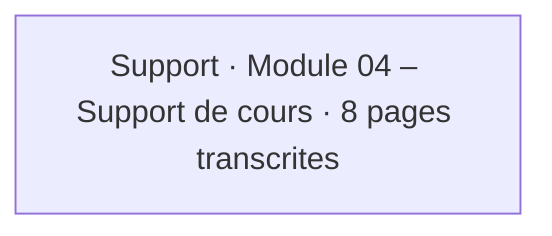
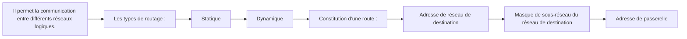

# Module 04 — Le routage

[Travaux pratiques](../../tp/services-reseaux-microsoft/module-04/index.md)

Les parties ci-dessous reprennent le cours original, dans le même ordre. Les encadrés et les schémas répètent ses formulations.

## Parcours de lecture

1. Support · Module 04 – Support de cours · 8 pages transcrites

**Visuel externe**

SOURCE DRIVE · TRANSCRIPTION DU SUPPORT

Le contenu des documents du dossier TSSR est transcrit ci-dessous, page par page. Les textes et tableaux sont intégrés à la page Web. Aucun fichier PDF, aucune diapositive entière ni aucune reproduction de page n’est affiché. Seuls des croquis ou visuels isolés et vérifiés peuvent accompagner la transcription. Les versions et les consignes restent celles des supports de formation. Les compléments IA sont conservés dans leur onglet distinct.

## Support · Module 04 – Support de cours · 8 pages transcrites

#### Module 04 – Le routage

#### Objectifs

- Comprendre et configurer le routage

#### Concept du routage

#### Le mécanisme du routage

!!! note "À retenir"
    Il permet la communication entre différents réseaux logiques.

**Visuel externe**

- Il permet la communication entre différents réseaux logiques.

- Les types de routage :
- Statique
- Dynamique
- Constitution d’une route :
- Adresse de réseau de destination
- Masque de sous-réseau du réseau de destination
- Adresse de passerelle

#### Concept du routage

#### Communication au sein d’un même réseau logique

- Si ping de A vers B

#### Poste A Poste B

#### Ping 1A vers 1B

#### Domaine de diffusion

#### Réseau identique

#### Envoi de la requête ping

!!! note "À retenir"
    @MAC : Phy1B @IP : 1B @MAC : Phy1A @IP : 1A

@MAC : Phy1B @IP : 1B

@MAC : Phy1A @IP : 1A

#### Poste C

#### Poste A Poste B

- Si ping de A vers C

#### Domaine de diffusion

#### Ping 1A vers 2C

#### Réseau différent

!!! note "À retenir"
    @MAC : Phy1A @IP : 1A @MAC : Phy1B @IP : 1B @MAC : Phy2C @IP : 2C

@MAC : Phy1A @IP : 1A

@MAC : Phy1B @IP : 1B

@MAC : Phy2C @IP : 2C

#### Pas d’envoi de requête ping

#### Concept du routage

##### Communication au sein d’un même réseau logique

!!! note "À retenir"
    Ping 127.0.0.1 Calcul de réseau logique A @IPA : 192.168.1.10 Mask A : 255.255.255.0 Réseau A : 192.168.1.0 pour A @IPB : 192.168.1.20 Mask A : 255.255.255.0 Réseau A : 192.168.1.0 Le poste A compare le réseau logique de la destination à son propre réseau.

| Poste | Adresses indiquées |
| --- | --- |
| Poste A | 00:29:0C:1E:30:1A 192.168.1.10/24 |
| Poste B | 00:29:0C:1E:30:1B 192.168.1.20/24 |

Ping 127.0.0.1

Calcul de réseau logique A @IPA : 192.168.1.10 Mask A : 255.255.255.0 Réseau A : 192.168.1.0

pour A @IPB : 192.168.1.20 Mask A : 255.255.255.0 Réseau A : 192.168.1.0

1. Le poste A compare le réseau logique de la destination à son propre réseau. Si les réseaux diffèrent, le schéma indique un retour d’erreur ICMP ou l’utilisation de la passerelle si elle est renseignée.
2. Si le réseau est identique, le poste A consulte sa table ARP. Si l’adresse matérielle manque, il met le ping en attente et envoie une requête ARP pour le poste B.
3. Le poste B répond si l’adresse demandée est locale. Le poste A met à jour sa table ARP puis envoie le ping au poste B.

| Échange | Champs IPv4 | Champs MAC |
| --- | --- | --- |
| Requête ARP | 192.168.1.20 192.168.1.10 | FF:FF:FF:FF:FF:FF 00:29:0C:1E:30:1A |
| Réponse ARP B | 192.168.1.20 192.168.1.10 | 00:29:0C:1E:30:1B 00:29:0C:1E:30:1A |
| Ping vers le poste B | 192.168.1.20 192.168.1.10 | 00:29:0C:1E:30:1B 00:29:0C:1E:30:1A |

##### Communication au sein de réseaux logiques différents

!!! note "À retenir"
    Si le poste A envoie un ping de 1A vers 2D, le réseau est différent.

| Équipement ou interface | Domaine | MAC | IP |
| --- | --- | --- | --- |
| Poste A (passerelle 1R) | 1 | Phy1A | 1A |
| Poste B | 1 | Phy1B | 1B |
| Routeur, interface 1 | 1 | Phy1R | 1R |
| Routeur, interface 2 | 2 | Phy2R | 2R |
| Poste C | 2 | Phy2C | 2C |
| Poste D | 2 | Phy2D | 2D |

Si le poste A envoie un ping de 1A vers 2D, le réseau est différent. Le poste utilise sa passerelle par défaut si elle est configurée.

| Échange | MAC destination | MAC source | IP destination | IP source |
| --- | --- | --- | --- | --- |
| A recherche l’adresse physique de R | FF:FF:FF:FF:FF:FF | Phy1A | 1R | 1A |
| Réponse ARP du routeur | Phy1A | Phy1R | 1A | 1R |
| Trame du ping envoyée au routeur | Phy1R | Phy1A | 2D | 1A |
| Le routeur recherche l’adresse physique de D | FF:FF:FF:FF:FF:FF | Phy2R | 2D | 2R |
| Réponse ARP de D | Phy2R | Phy2D | 2R | 2D |
| Trame du ping envoyée au poste D | Phy2D | Phy2R | 2D | 1A |

#### Concept du routage

##### Communication au sein de réseaux logiques différents

!!! note "À retenir"
    Ping 127.0.0.1 Calcul de réseau logique A @IPA : 192.168.1.10 Mask A : 255.255.255.0 Réseau A : 192.168.1.0 pour A @IPD : 192.168.2.140 Mask A : 255.255.255.0 Réseau A : 192.168.2.0 Le poste A vérifie que le réseau de la destination diffère du sien, puis recherche la passerelle configurée et calcule son réseau.

| Poste | MAC, IPv4, préfixe et passerelle |
| --- | --- |
| Poste A | MAC 00:29:0C:1E:30:1A IPv4 192.168.1.10/24 GW 192.168.1.254 |
| Poste D | MAC 00:29:0C:1E:30:2D IPv4 192.168.2.140/26 GW 192.168.2.254 |

Ping 127.0.0.1

Calcul de réseau logique A @IPA : 192.168.1.10 Mask A : 255.255.255.0 Réseau A : 192.168.1.0

pour A @IPD : 192.168.2.140 Mask A : 255.255.255.0 Réseau A : 192.168.2.0

1. Le poste A vérifie que le réseau de la destination diffère du sien, puis recherche la passerelle configurée et calcule son réseau. Sans passerelle utilisable, le schéma indique un retour d’erreur ICMP.
2. Le poste A consulte sa table ARP, puis envoie une requête ARP pour la passerelle si nécessaire. Le ping reste en attente pendant cette recherche.
3. Après la réponse ARP, le poste A met à jour sa table et envoie le ping au routeur. Le dessin étiquette la réponse « Réponse Arp B », alors que la recherche porte sur la passerelle.

| Échange | Champs IPv4 | Champs MAC |
| --- | --- | --- |
| Requête ARP | 192.168.1.254 192.168.1.10 | FF:FF:FF:FF:FF:FF 00:29:0C:1E:30:1A |
| Réponse ARP | 192.168.1.254 192.168.1.10 | 00:29:0C:1E:30:1R 00:29:0C:1E:30:1A |
| Ping vers le routeur | 192.168.2.140 192.168.1.10 | 00:29:0C:1E:30:1R 00:29:0C:1E:30:1A |

##### Traitement du ping par le routeur

!!! note "À retenir"
    Le routeur reçoit le ping et désencapsule jusqu’à la couche 3.

1. Le routeur reçoit le ping et désencapsule jusqu’à la couche 3. Il consulte sa table de routage. Si le réseau n’est pas présent, le schéma indique un retour d’erreur ICMP.
2. Si le réseau est présent mais n’est pas directement connecté, le routeur envoie le ping au routeur suivant.
3. Si le réseau est local, le routeur consulte sa table ARP et recherche l’adresse matérielle du poste D si nécessaire. Le ping est mis en attente pendant cette recherche.
4. À réception de la réponse, il met à jour la table ARP, réencapsule à la couche 2 et transmet le ping au poste D. Si la recherche ARP échoue, le schéma indique un retour d’erreur ICMP.

| Échange | Champs IPv4 | Champs MAC |
| --- | --- | --- |
| Ping reçu par le routeur | 192.168.2.140 192.168.1.10 | 00:29:0C:1E:30:1R 00:29:0C:1E:30:1A |
| Requête ARP vers D | ARP ? 192.168.2.140 192.168.2.254 | FF:FF:FF:FF:FF:FF 00:29:0C:1E:30:2R |
| Réponse ARP D | 192.168.2.140 192.168.2.254 | 00:29:0C:1E:30:2D 00:29:0C:1E:30:2R |
| Ping transmis à D | 192.168.2.140 192.168.1.10 | 00:29:0C:1E:30:2D 00:29:0C:1E:30:2R |

#### Concept du routage

#### Principe de fonctionnement du routage

#### À chaque saut

!!! note "À retenir"
    Le routeur vérifie les informations de transfert dans la table de routage.

Le routeur vérifie les informations de transfert dans la table de routage.

Est traité de manière indépendante dans chaque routeur le long du chemin.

Le routeur examine l’adresse IP de destination pour chaque paquet.

#### Chaque paquet

#### Est vérifié

#### Concept de la traduction d’adresse

#### La traduction d’adresse : sans NAT

Internet

80.87.128.67

90.83.78.224

192.168.20.0 /24

192.168.20.13

192.168.20.254

#### Source : 80.87.128.67:80

#### Source : 192.168.20.13:3008

#### Destination : 192.168.20.13:3008

#### Destination : 80.87.128.67:80

#### Concept de la traduction d’adresse

#### La traduction d’adresse : avec NAT

#### Source : 90.83.78.224:49010

#### Source : 192.168.20.13:3008

#### Destination : 80.87.128.67:80

#### Destination : 80.87.128.67:80

#### Internet 80.87.128.67

192.168.20.0 /24

192.168.20.254 90.83.78.224

192.168.20.13

#### Source : 80.87.128.67:80

#### Source : 80.87.128.67:80

#### Destination : 192.168.20.13:3008

#### Destination : 90.83.78.224 : 49010

#### Démonstration

#### Le routeur et la traduction d'adresses

#### TP

#### Le réseau global

#### TP

#### Conclusion

- Vous comprenez et savez configurer le routage

Référence du document : 1Lkf-lTyovca0i4z_9kGhD7T32aIPlqYD · SHA-256 eaf504284cca02e3…
