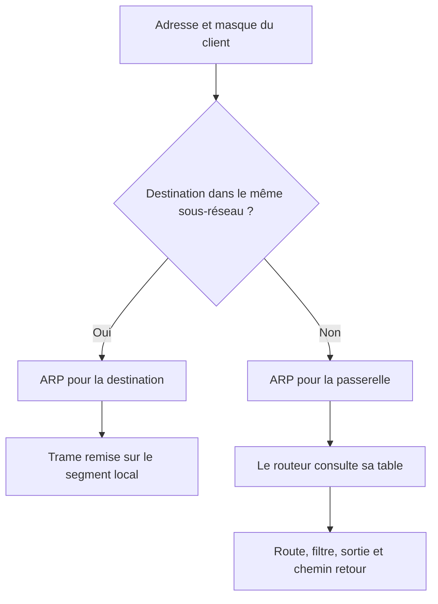

# Module 04 — Le routage

Une route donne un réseau de destination, un masque et un prochain saut. Le routeur prend une décision pour chaque paquet. Les routes peuvent être configurées statiquement ou apprises dynamiquement. Le TP utilise des routes statiques et des routeurs pfSense.

## Objectifs

- Calculer le sous-réseau de destination et identifier le prochain saut.
- Expliquer la différence entre adresse IP de destination et MAC du saut local.
- Distinguer routage, traduction et filtrage.
- Configurer et vérifier les deux topologies pfSense du module.

## Décider si la destination est locale

Avec `192.168.1.10/24` et `192.168.1.20/24`, les postes appartiennent à `192.168.1.0/24`. Si nécessaire, le premier diffuse une requête ARP pour apprendre la MAC du second. Il envoie alors le paquet à cette MAC. Si la destination est distante, le poste cherche la MAC de sa passerelle et lui remet la trame. L’adresse IP de destination reste celle de l’hôte distant.

À chaque saut, le routeur lit la destination IP, choisit la route, puis prépare une nouvelle trame sur son interface de sortie. Il recherche par ARP l’hôte directement connecté ou le routeur suivant. Le chemin retour doit fonctionner lui aussi. Un ping perdu peut venir d’une route manquante, d’un filtre ou d’une réponse impossible.

Le support associe `192.168.2.140/26` à la passerelle `192.168.2.254`. Ce poste appartient à `192.168.2.128/26`, dont les hôtes vont de `.129` à `.190`. Une passerelle comme `.190` serait joignable sur ce sous-réseau si elle était configurée sur le routeur. Vérifier l’adresse et le masque ensemble. Les MAC terminées par `1R` ou `2R` sont des symboles du schéma. Une MAC réelle s’écrit en hexadécimal.

Dans la table, sélectionner d’abord la route au préfixe le plus précis qui correspond à la destination. La route par défaut ne s’applique que lorsqu’aucun préfixe plus précis ne correspond. Une route dynamique peut être apprise d’un protocole de routage. Les deux ateliers travaillent avec des routes statiques.

## Distinguer routage, NAT et filtrage

Le routage choisit où envoyer le paquet. Le filtrage autorise ou refuse le passage. La traduction d’adresse et de port modifie les valeurs exposées sur une interface. Dans l’exemple du support, `192.168.20.13:3008` contacte `80.87.128.67:80`. Le routeur traduit la source en `90.83.78.224:49010`, puis utilise son état pour remettre la réponse à `192.168.20.13:3008`. Les IP publiques du schéma sont des valeurs historiques d’illustration.

**Illustration IA / externe au cours — reconnaître le prochain saut.**



## TP guidé — Le routeur

**Durée du support.** Trente minutes à une heure. Déployer les VM fournies `CLI-01-TP8-OK` et `RTR-01-TP8-OK`, puis créer `CLI-00` et `RTR-00` dans la maquette Workstation.

| Équipement | Liaison | Valeur demandée |
| --- | --- | --- |
| `CLI-00` | VMNet10 | `192.168.0.10/24` |
| `RTR-00`, carte 1 | Bridge | Adresse dynamique dans l’énoncé |
| `RTR-00`, carte 2 | Bridge | `172.16.0.1/16` |
| `RTR-00`, carte 3 | VMNet10 | Dernière adresse utilisable, `192.168.0.254/24` |

1. Identifier chaque carte dans pfSense avant de lui appliquer l’adresse. Sur le client, utiliser l’adresse du routeur VMNet10 comme passerelle pour joindre les réseaux distants.
2. Vérifier le premier lien avec un test `CLI-00 → RTR-00`, puis `RTR-01 → RTR-00`. Repérer les interfaces de transit et les adresses du routeur fourni.
3. Ouvrir l’interface d’administration depuis le client de laboratoire. Pour le réseau de destination distant, créer une passerelle pfSense correspondant au prochain saut joignable, puis une route qui utilise cette passerelle.
4. Contrôler les règles d’entrée, le retour depuis le réseau distant et la présence éventuelle de NAT. Tester `CLI-00 → CLI-01` puis le sens opposé. Documenter la route ajoutée et le réglage qui permet au trafic de passer.
5. Le corrigé fixe l’adresse WAN reçue dans sa configuration de laboratoire, alors que l’énoncé demande l’adressage dynamique. Relever le choix retenu. Le corrigé adapte aussi le blocage des réseaux privés. Se limiter à l’interface de la maquette qui doit effectivement recevoir ce trafic privé et vérifier les règles existantes. [Configuration des interfaces pfSense](https://docs.netgate.com/pfsense/en/latest/config/interface-configuration.html)

## TP guidé — Le réseau global

**Durée du support.** Une à deux heures. Créer deux clients et trois routeurs. Pour les liaisons du TP, « première » et « dernière » adresses désignent des **adresses d’hôte utilisables**.

| Réseau du corrigé | Équipements et adresses de la maquette |
| --- | --- |
| `172.16.200.96/29` | Routeur de bord `RTR-01` en `.97`, client `CLI-00` en `.98` |
| `4.4.4.4/30` | `RTR-00` en `.5` et `RTR-01` en `.6` |
| `8.8.8.8/30` | `RTR-00` en `.9` et `RTR-02` en `.10` |
| `192.168.0.96/29` | Routeur de bord `RTR-02` en `.97`, client `CLI-01` en `.98` |

Les deux préfixes de transit utilisent des adresses publiques dans les documents. Les reprendre uniquement dans les segments isolés prévus par le laboratoire, sans relier ces exemples à Internet.

1. Configurer les deux cartes de chaque routeur sur leurs segments respectifs. Les deux clients utilisent la première adresse utilisable de leur segment comme passerelle.
2. Tester chaque liaison directement connectée. Pour un `/30`, identifier réseau, deux hôtes et diffusion avant de créer les routes.
3. Ajouter les routes du corrigé. Les préfixes déjà connectés ne nécessitent pas de route statique supplémentaire.

| Routeur | Préfixe de destination | Prochain saut |
|---|---|---|
| RTR-01 | `0.0.0.0/0` | `4.4.4.5` |
| RTR-00 | `172.16.200.96/29` | `4.4.4.6` |
| RTR-00 | `192.168.0.96/29` | `8.8.8.10` |
| RTR-02 | `0.0.0.0/0` | `8.8.8.9` |

4. Vérifier les communications entre clients et routeurs dans les deux sens. Si le test s’arrête à un routeur, vérifier son choix de sortie, le filtre et la route de retour. Consigner l’adresse du prochain saut, le chemin observé et les routes réellement nécessaires.

```cmd
ipconfig /all
arp -a
route print
tracert 192.168.0.98
```

## À retenir

Pour un réseau distant, le client remet la trame à la passerelle locale. Chaque routeur prend une nouvelle décision. Une route utilisable, un filtre compatible et un chemin de retour sont nécessaires pour valider le trajet.

## Mini-quiz — 5 questions {#mini-quiz}

1. Quelle MAC le client utilise-t-il pour joindre un réseau distant ?
2. Pourquoi .254 est-elle inadaptée comme passerelle à 192.168.2.140/26 ?
3. À quoi servent les deux préfixes /30 du TP 2 ?
4. Pourquoi RTR-00 possède-t-il deux routes vers les réseaux clients ?
5. Qu’examiner si le chemin semble correct mais le ping échoue ?

??? success "Réponses commentées"

    1. Celle de sa passerelle sur le segment local. L’adresse IP de destination reste celle de l’hôte distant.
    2. Le poste appartient à 192.168.2.128/26 et peut atteindre directement les adresses d’hôte .129 à .190.
    3. À relier RTR-00 aux routeurs de bord avec deux adresses d’hôte utilisables sur chaque lien.
    4. Ils ne lui sont pas directement connectés. Il doit joindre chaque routeur de bord par le prochain saut correspondant.
    5. Le filtrage, la route de retour, les règles de traduction éventuelles et l’adresse utilisée comme cible.

## Pour pratiquer et réviser {#appliquer-le-cours}

- [Énoncés](../../tp/services-reseaux-microsoft/module-04/enonces.md) et [corrections](../../tp/services-reseaux-microsoft/module-04/corrections.md)
- [Démonstrations](../../tp/services-reseaux-microsoft/module-04/demonstrations.md)
- [Fiche de révision](../../revision/services-reseaux-microsoft/module-04-module-04.md)
- [Kahoot existant](../../kahoot/09-services-reseaux-microsoft-module-04-module-04.md)
- [Sommaire de Services réseau en environnement Microsoft](index.md)

## Provenance pédagogique

Le support M04, la démonstration de configuration pfSense et les deux ateliers fondent l’adressage et le routage. Le diagramme et l’inventaire des interfaces rendent explicites les chemins du corrigé.
