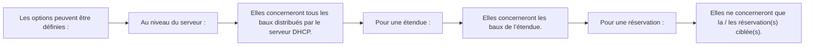

# Module 05 — Le service DHCP

[Travaux pratiques](../../tp/services-reseaux-microsoft/module-05/index.md)

Les parties ci-dessous reprennent le cours original, dans le même ordre. Les encadrés et les schémas répètent ses formulations.

## Parcours de lecture

1. Support · Module 05 – Support de cours · 12 pages transcrites

**Visuel externe**

SOURCE DRIVE · TRANSCRIPTION DU SUPPORT

Le contenu des documents du dossier TSSR est transcrit ci-dessous, page par page. Les textes et tableaux sont intégrés à la page Web. Aucun fichier PDF, aucune diapositive entière ni aucune reproduction de page n’est affiché. Seuls des croquis ou visuels isolés et vérifiés peuvent accompagner la transcription. Les versions et les consignes restent celles des supports de formation. Les compléments IA sont conservés dans leur onglet distinct.

## Support · Module 05 – Support de cours · 12 pages transcrites

#### Module 05 – Le service DHCP

#### Objectifs

- Comprendre et configurer le rôle DHCP

#### Définition du service DHCP

Dynamic Host Configuration Protocol

| Avantages | Inconvénients |
| --- | --- |
| Propagation rapide des informations | Ouvert à toute demande |
| Réduction des erreurs | Vulnérabilité accrue aux attaques DOS |
| Centralisation du réseau |  |

#### La notion de bail

!!! note "À retenir"
    Ensemble des informations qu’un serveur DHCP transmet à son client.

**Visuel externe**

Ensemble des informations qu’un serveur DHCP transmet à son client.

- Une durée
- Une adresse IP
- Un masque
- D’autres paramètres

#### La notion de bail

#### L’obtention d’un bail - DORA

DHCP-1

DHCP-2

#### La notion de bail

#### Le renouvellement du bail

!!! note "À retenir"
    au démarrage du client à 50% du bail DHCP-1 à 87,5% du bail à 100% du bail DHCP-2

**Visuel externe**

- au démarrage du client

- à 50% du bail

DHCP-1

- à 87,5% du bail

- à 100% du bail

DHCP-2

#### La notion de bail

#### La résiliation du bail

DHCP-1

DHCP-2

#### Les conteneurs

##### À la base : l’étendue

| Caractéristique | Valeur du support |
| --- | --- |
| Un nom | LAN_Serveurs |
| Une plage d’adresses | 192.168.0.1 à 192.168.0.254 /24 |
| Des exclusions | 192.168.0.5 à 192.168.0.10 |
| Une durée | 2 jours |

#### Les conteneurs

##### Le plus ciblé : la réservation

| Caractéristique | Valeur du support |
| --- | --- |
| Un nom | SRVFIC |
| Le conteneur parent : l’étendue | LAN_Serveurs |
| L’adresse IP à réserver | 192.168.0.1 |
| L’adresse matérielle de l’équipement | 00155D6E6E03 |

#### Démonstration

#### La gestion des options

#### Les options de configuration

!!! note "À retenir"
    Elles complètent la configuration IP des clients DHCP.

Elles complètent la configuration IP des clients DHCP.

Quelques exemples :

#### La gestion des options

#### Le positionnement des options DHCP

!!! note "À retenir"
    Les options peuvent être définies : Au niveau du serveur : Elles concerneront tous les baux distribués par le serveur DHCP.

**Visuel externe**

- Les options peuvent être définies :
- Au niveau du serveur :
- Elles concerneront tous les baux distribués par le serveur DHCP.

- Pour une étendue :
- Elles concerneront les baux de l’étendue.

- Pour une réservation :
- Elles ne concerneront que la / les réservation(s) ciblée(s).

| Nom | Code | Utilité |
| --- | --- | --- |
| Routeur | 3 | Définit la passerelle par défaut |
| Serveur de Noms de Domaine | 6 | Définit le(s) serveur(s) DNS |
| Nom de domaine DNS | 12 | Définit le suffixe DNS |

#### Démonstration

TP

#### Le DHCP et les réseaux

#### Un serveur DHCP pour plusieurs réseaux

!!! note "À retenir"
    Problématique : les trames sont envoyées en diffusion.

Problématique : les trames sont envoyées en diffusion.

Client

#### Relais DHCP

#### DHCP Limite de diffusion

#### Solution : l’agent relais DHCP

#### Le service DHCP et les réseaux

TP

#### La gestion du DHCP

#### DHCP dans un contexte de domaine

!!! note "À retenir"
    La notion d’autorisation : Le ou les serveurs DHCP doivent être autorisés pour démarrer les services et fournir le service.

**Visuel externe**

- La notion d’autorisation :
- Le ou les serveurs DHCP doivent être autorisés pour démarrer les services et fournir le service.

- Incidence de la non-autorisation :
- Le service DHCP d’un serveur membre non autorisé ne démarrera pas.
- Le service DHCP d’un serveur autonome présent dans le domaine de diffusion d’un serveur autorisé s’arrêtera.

#### La gestion du DHCP

#### Les opérations de gestion de la base DHCP

!!! note "À retenir"
    L’ensemble des données de configuration est stocké dans une base.

- L’ensemble des données de configuration est stocké dans une base.

- Un certain nombre d’opérations peuvent être effectuées :
- Sauvegardes
- Synchrone
- Asynchrone

- Restaurations

- Contrôle de la cohérence de la base

- Déplacement de la base

À noter : les serveurs DHCP autres que Microsoft ne prennent pas en compte cette autorisation.

#### La gestion du DHCP

#### Le fractionnement d’étendues

!!! note "À retenir"
    Il permet d’automatiser la création d’une étendue sur deux serveurs ayant la charge de la plage correspondante.

Il permet d’automatiser la création d’une étendue sur deux serveurs ayant la charge de la plage correspondante.

#### Étendue : 192.168.0.1 à 192.168.0.254

Les modifications pouvant être apportées après création ne sont pas répliquées entre les deux serveurs ayant la charge de l’étendue (elles sont à faire sur les deux)

#### Plage adresses allouées au serveur Plage d’exclusions pour le serveur

#### Plage d’exclusions pour le serveur Plage adresses allouées au serveur

#### Démonstration

#### La gestion du DHCP

#### Pour aller plus loin

- Pour les problématiques de panne et de disponibilité :
- Configurer un serveur DHCP « de secours » : opérationnel, mais non démarré
- La solution DHCP failover

- Pour améliorer la sécurité :
- Mettre en place des stratégies de filtrage (sur les adresses MAC)

- Pour la surveillance et le diagnostic :
- Consulter les journaux d’évènements (source DHCP-Server)
- Consulter le journal d’audit : 1 fichier .log par jour dans le répertoire de la base

#### Disponibilité du service DHCP

TP

#### Conclusion

- Vous comprenez et savez configurer le rôle DHCP

Référence du document : 1QkckDtJxuvxo-zCNO6NKVcQWzlASNEVj · SHA-256 ff5adfcbb7299f86…
