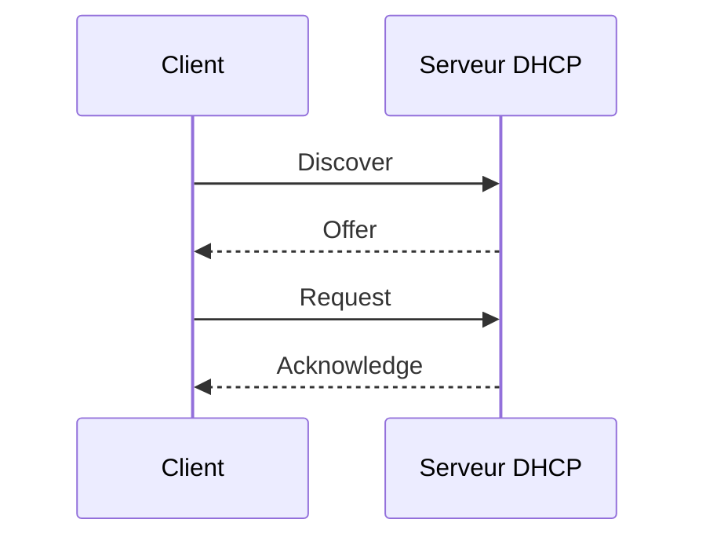

# Module 05 — Le service DHCP

DHCP fournit une adresse, un masque, une durée de bail et les options de configuration. Une étendue décrit la plage d’un sous-réseau. Une exclusion écarte des adresses de l’attribution, et une réservation associe une adresse à un identifiant de client dans une étendue.

## Objectifs

- Expliquer l’obtention, le renouvellement et la libération d’un bail DHCP.
- Construire une étendue, ses exclusions, une réservation et ses options.
- Distribuer des baux à travers un relais entre domaines de diffusion.
- Distinguer fractionnement et relation de basculement, puis prouver la disponibilité.

La distribution automatique centralise les paramètres et évite une saisie poste par poste. La contrepartie est une dépendance au service et à son réseau. Une plage épuisée, un serveur absent ou des options erronées peuvent empêcher la connexion d’un poste.

## Comprendre le bail



Le schéma ajouté au cours représente la première attribution. Le client découvre les serveurs, reçoit une offre, demande un bail et attend sa confirmation. Le support étudie aussi les tentatives au démarrage, vers 50 % du bail, vers 87,5 % si le renouvellement échoue, et l’expiration. Avec un bail de deux jours et ces valeurs usuelles, les tentatives sont vers 24 h puis 42 h. `ipconfig /release` libère un bail et `ipconfig /renew` demande son renouvellement ou une nouvelle attribution.

Dans le support, `LAN_Serveurs` couvre `192.168.0.1` à `.254` en `/24`, avec un bail de deux jours et l’exclusion `.5`–`.10`. La réservation `SRVFIC` associe `.1` à `00155D6E6E03`. Le TP 1 demande une plage de 100 adresses pour les clients, des adresses statiques distinctes pour les serveurs et la réservation de la première adresse de la plage au second client.

| Option DHCPv4 | Code | Effet |
|---|---:|---|
| Routeur | 3 | Passerelle par défaut |
| Serveurs DNS | 6 | Adresses des résolveurs |
| Nom du client | 12 | Nom d’hôte |
| Nom de domaine | 15 | Suffixe de recherche du scénario |

Le support attribue le code 12 au nom de domaine. La RFC distingue 12 et 15, et une capture du corrigé montre l’option 015. Les options peuvent être définies au niveau du serveur, de l’étendue ou de la réservation. Contrôler la configuration reçue par un client de la bonne étendue. [RFC 2132](https://datatracker.ietf.org/doc/rfc2132/).

```cmd
ipconfig /all
ipconfig /renew
ipconfig /release
ipconfig /renew
```

## Distribuer dans plusieurs sous-réseaux

La découverte initiale se fait en diffusion locale. Le relais DHCP reçoit les messages dans le réseau client et les transmet au serveur. Le serveur utilise les informations du relais pour sélectionner l’étendue du réseau d’origine. Le serveur doit pouvoir répondre au relais et les postes doivent recevoir des options adaptées à leur propre réseau.

| Domaine de diffusion | Routeur | Serveur du scénario | Client |
|---|---|---|---|
| VMNet10 `192.168.0.0/24` | RTR-00 `.254` | SRV-2K19-0 `.1` | CLI-00 automatique |
| VMNet11 `192.168.1.0/24` | RTR-01 `.254` | SRV-2K19-1 `.1` | CLI-01 automatique |

Le TP 2 prépare les deux étendues sur chaque serveur. Pour éviter des offres concurrentes incohérentes dans un essai, contrôler quelles étendues et quelles plages sont actives. Arrêter le service prévu dans le laboratoire, obtenir un bail de test depuis l’autre réseau et vérifier la connectivité. Relever le serveur DHCP effectivement indiqué par `ipconfig /all`.

## Administrer et assurer la disponibilité

Le support traite l’autorisation des serveurs DHCP Windows en contexte AD, la sauvegarde et restauration de la base, la vérification de cohérence, le déplacement et les journaux. L’autorisation AD concerne les serveurs compatibles. Elle ne filtre pas à elle seule tous les serveurs DHCP raccordés au réseau.

Le fractionnement d’étendue distribue des portions distinctes entre serveurs au moyen d’exclusions. Les modifications doivent être répercutées sur chacun. Le failover associe deux serveurs qui partagent l’état des baux et les informations de l’étendue. Le TP 3 montre une relation en répartition de charge 50/50, avec un délai maximum client d’une heure. Tester les phases service arrêté puis relancé dans chaque réseau, le renouvellement et la connectivité croisée. [Basculement DHCP dans Windows Server](https://learn.microsoft.com/windows-server/networking/technologies/dhcp/dhcp-failover).

Le support cite aussi un serveur de secours préparé et gardé à l’arrêt, et le filtrage par adresse MAC sur le serveur. Ce filtrage ne protège pas à lui seul le réseau d’un serveur DHCP non autorisé.

Si aucun bail n’arrive, vérifier client en automatique, VLAN ou VMNet, service, autorisation, étendue active, adresses disponibles et relais. Un bail obtenu avec un mauvais DNS ou routeur indique surtout un problème d’options. Les journaux DHCP Server et les fichiers d’audit aident à relier les symptômes aux événements de l’essai.

## TP guidé — Distribuer sur un seul réseau

**Durée du support.** Une à deux heures. Préparer un client Windows 10 et un serveur Windows Server 2019 Standard sur VMNet10.

1. Établir un plan avec **100 adresses** pour les clients, les adresses statiques des serveurs et les paramètres de masque, passerelle et DNS. Vérifier les bornes et l’absence de recouvrement. Relever le plan sur un schéma.
2. Installer DHCP et créer l’étendue du sous-réseau. Définir les exclusions nécessaires pour que les IP statiques ne soient pas proposées. Vérifier l’autorisation AD si la maquette rejoint un domaine.
3. Définir les options utiles, dont routeur, DNS et domaine selon le plan. Activer l’étendue et configurer le client en automatique. Relever l’adresse, le masque, les options et le serveur via `ipconfig /all`.
4. Réserver la première adresse de la plage au second client en utilisant l’identifiant réel de sa carte. Vérifier la correspondance dans les baux et sur le poste prévu.
5. Demander un renouvellement puis, séparément, libérer et redemander un bail. Le nouvel essai peut restituer la même adresse. Vérifier le serveur, les dates et la configuration reçue, pas seulement la valeur de l’IP.

## TP guidé — Étendre la distribution à deux réseaux

**Durée du support.** Une à deux heures. Reprendre les routeurs du module 4, `RTR-00` et `RTR-01`, et les réseaux VMNet10 et VMNet11. Préparer le serveur et le client de chaque réseau.

1. Configurer sur chaque serveur les étendues nécessaires pour le réseau local et l’autre réseau, selon l’énoncé. Dans chaque étendue, contrôler le masque, les exclusions, la passerelle et le DNS **du réseau client**.
2. Avant d’activer une plage, vérifier la coordination des offres. Deux serveurs indépendants qui distribuent les mêmes adresses peuvent provoquer des conflits. Prévoir des plages distinctes ou activer uniquement le service prévu pour l’essai.
3. Activer le relais de la maquette sur le routeur côté clients et l’orienter vers le serveur qui doit répondre. Vérifier qu’il utilise le bon segment d’origine et que le retour jusqu’au relais est possible.
4. Sur chaque poste, constater un bail de l’étendue attendue et tester la communication avec l’autre réseau. Puis arrêter l’un des serveurs du laboratoire et obtenir ou renouveler un bail via le chemin prévu.
5. Pour chaque réseau, relever l’adresse du serveur DHCP, le réseau et les options reçues avant et après l’arrêt. Un bail conservé par un poste ne prouve pas à lui seul que le relais fonctionne.

## TP guidé — Mettre en place le basculement DHCP

**Durée du support.** Une à deux heures. Faire communiquer les deux serveurs DHCP et vérifier l’état des étendues du TP précédent. Une relation de basculement réplique ses étendues vers le partenaire. Si une étendue identique a été créée indépendamment sur les deux serveurs, résoudre cette situation dans le laboratoire avant de créer la relation. [Gérer les relations de basculement DHCP](https://learn.microsoft.com/en-us/windows-server/networking/technologies/dhcp/manage-dhcp-failover-relationships)

### A. Configurer la relation

1. Depuis l’étendue VMNet10 du serveur qui la porte, choisir **Configurer le basculement** et ajouter le partenaire du second réseau. Le corrigé montre `192.168.1.67`, tandis que le TP précédent emploie une adresse différente pour son serveur. Utiliser l’adresse constatée dans la maquette.
2. Nommer la relation. La capture utilise **répartition de charge 50/50** et un **MCLT d’une heure**. Le délai de transition et l’authentification du partenaire sont des réglages distincts. Vérifier les valeurs demandées avant de valider.
3. Intégrer les étendues attendues des deux réseaux. Vérifier l’état de la relation et la configuration présente sur chaque serveur.
4. Configurer le relais pour que les requêtes du réseau client atteignent les partenaires qui doivent pouvoir répondre. Vérifier le retour et les options de chaque étendue.

### B. Tester l’arrêt et le retour, dans chaque sens

| Étape | Preuve attendue |
| --- | --- |
| Avant l’arrêt | Relation opérationnelle et client de chaque réseau correctement adressé. |
| DHCP VMNet10 arrêté | Nouveau bail ou renouvellement observé depuis le partenaire, passerelle et réseau corrects, communication croisée. |
| DHCP VMNet10 relancé | Retour de la relation à l’état prévu et nouvel essai. |
| DHCP VMNet11 arrêté puis relancé | Même contrôle sur l’autre réseau, avec serveur qui répond, état et communication croisée. |

Le corrigé répète certains sens de relais sous des cas différents. Fonder chaque test sur l’interface d’origine, le serveur effectivement arrêté et le partenaire qui doit répondre. Après le TP, rétablir les deux services et noter l’état de la relation.

## À retenir

L’étendue correspond au réseau du client. Le relais transporte les échanges vers le serveur désigné. Le basculement se prouve par une attribution ou un renouvellement constaté chez le partenaire, puis un retour à l’état prévu.

## Mini-quiz — 5 questions {#mini-quiz}

1. Quelle différence entre exclusion et réservation ?
2. Quel code DHCPv4 fournit le nom de domaine de l’option du TP ?
3. Que faire quand le serveur se trouve dans un autre domaine de diffusion ?
4. Quel état distinguer avant de créer une relation de basculement ?
5. Un client reste joignable après l’arrêt du serveur. Cela valide-t-il le basculement ?

??? success "Réponses commentées"

    1. Une exclusion retire une adresse de l’attribution ordinaire. Une réservation associe une adresse à l’identifiant d’un client.
    2. L’option 15. L’option 12 porte le nom d’hôte.
    3. Configurer un relais et une étendue adaptée au réseau d’origine du client.
    4. Vérifier qu’une étendue identique indépendante n’existe pas déjà sur le partenaire. La relation transmet l’étendue.
    5. Le client peut conserver son bail. Vérifier une attribution ou un renouvellement du partenaire, les options, puis le retour à l’état prévu.

## Pour pratiquer et réviser {#appliquer-le-cours}

- [Énoncés](../../tp/services-reseaux-microsoft/module-05/enonces.md) et [corrections](../../tp/services-reseaux-microsoft/module-05/corrections.md)
- [Démonstrations](../../tp/services-reseaux-microsoft/module-05/demonstrations.md)
- [Fiche de révision](../../revision/services-reseaux-microsoft/module-05-module-05.md)
- [Kahoot existant](../../kahoot/09-services-reseaux-microsoft-module-05-module-05.md)
- [Sommaire de Services réseau en environnement Microsoft](index.md)

## Provenance pédagogique

Le support M05, les trois démonstrations et les trois paires de TP fondent les réglages. Les cas de coordination et les preuves de basculement distinguent les essais du corrigé et les conditions de mise en œuvre.
