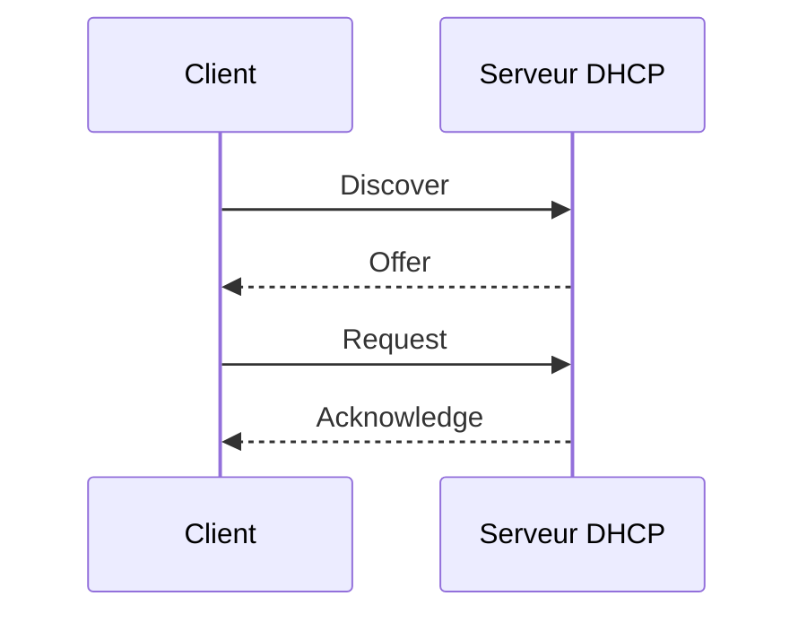

# Module 05 — Le service DHCP

DHCP fournit une adresse, un masque, une durée de bail et les options de configuration. Une étendue décrit la plage d’un sous-réseau. Une exclusion écarte des adresses de l’attribution, et une réservation associe une adresse à un identifiant de client dans une étendue.

## Comprendre le bail



Le schéma ajouté au cours représente la première attribution. Le client découvre les serveurs, reçoit une offre, demande un bail et attend sa confirmation. Le support étudie aussi les tentatives au démarrage, vers 50 % du bail, vers 87,5 % si le renouvellement échoue, et l’expiration. Avec un bail de deux jours et ces valeurs usuelles, les tentatives sont vers 24 h puis 42 h. `ipconfig /release` libère un bail et `ipconfig /renew` demande son renouvellement ou une nouvelle attribution.

Dans le support, `LAN_Serveurs` couvre `192.168.0.1` à `.254` en `/24`, avec un bail de deux jours et l’exclusion `.5`–`.10`. La réservation `SRVFIC` associe `.1` à `00155D6E6E03`. Le TP 1 demande une plage de 100 adresses pour les clients, des adresses statiques distinctes pour les serveurs et la réservation de la première adresse de la plage au second client.

| Option DHCPv4 | Code | Effet |
|---|---:|---|
| Routeur | 3 | Passerelle par défaut |
| Serveurs DNS | 6 | Adresses des résolveurs |
| Nom du client | 12 | Nom d’hôte |
| Nom de domaine | 15 | Suffixe de recherche du scénario |

Le support attribue le code 12 au nom de domaine. La RFC distingue 12 et 15, et une capture du corrigé montre l’option 015. Les options peuvent être définies au niveau du serveur, de l’étendue ou de la réservation. Contrôler la configuration reçue par un client de la bonne étendue. [RFC 2132](https://datatracker.ietf.org/doc/rfc2132/).

```cmd
ipconfig /all
ipconfig /renew
ipconfig /release
ipconfig /renew
```

## Distribuer dans plusieurs sous-réseaux

La découverte initiale se fait en diffusion locale. Le relais DHCP reçoit les messages dans le réseau client et les transmet au serveur. Le serveur utilise les informations du relais pour sélectionner l’étendue du réseau d’origine. Le serveur doit pouvoir répondre au relais et les postes doivent recevoir des options adaptées à leur propre réseau.

| Domaine de diffusion | Routeur | Serveur du scénario | Client |
|---|---|---|---|
| VMNet10 `192.168.0.0/24` | RTR-00 `.254` | SRV-2K19-0 `.1` | CLI-00 automatique |
| VMNet11 `192.168.1.0/24` | RTR-01 `.254` | SRV-2K19-1 `.1` | CLI-01 automatique |

Le TP 2 prépare les deux étendues sur chaque serveur. Pour éviter des offres concurrentes incohérentes dans un essai, contrôler quelles étendues et quelles plages sont actives. Arrêter le service prévu dans le laboratoire, obtenir un bail de test depuis l’autre réseau et vérifier la connectivité. Relever le serveur DHCP effectivement indiqué par `ipconfig /all`.

## Administrer et assurer la disponibilité

Le support traite l’autorisation des serveurs DHCP Windows en contexte AD, la sauvegarde et restauration de la base, la vérification de cohérence, le déplacement et les journaux. L’autorisation AD concerne les serveurs compatibles. Elle ne filtre pas à elle seule tous les serveurs DHCP raccordés au réseau.

Le fractionnement d’étendue distribue des portions distinctes entre serveurs au moyen d’exclusions. Les modifications doivent être répercutées sur chacun. Le failover associe deux serveurs qui partagent l’état des baux et les informations de l’étendue. Le TP 3 montre une relation en répartition de charge 50/50, avec un délai maximum client d’une heure. Tester les phases service arrêté puis relancé dans chaque réseau, le renouvellement et la connectivité croisée. [Basculement DHCP dans Windows Server](https://learn.microsoft.com/windows-server/networking/technologies/dhcp/dhcp-failover).

Si aucun bail n’arrive, vérifier client en automatique, VLAN ou VMNet, service, autorisation, étendue active, adresses disponibles et relais. Un bail obtenu avec un mauvais DNS ou routeur indique surtout un problème d’options. Les journaux DHCP Server et les fichiers d’audit aident à relier les symptômes aux événements de l’essai.

### Mini-quiz

1. Quelle option fournit le suffixe de domaine DHCPv4 ?
2. Que faire lorsque le serveur est dans un autre domaine de diffusion ?
3. Quelle observation valide le basculement ?

??? success "Réponses"
    1. L’option 15.
    2. Configurer un relais et une étendue correspondant au sous-réseau client.
    3. Obtenir un bail utilisable du partenaire après arrêt du service testé, puis vérifier le retour à l’état normal.


## Appliquer le cours

- [Travaux pratiques et démonstrations](../../tp/services-reseaux-microsoft/module-05/index.md)
- [Fiche de révision](../../revision/services-reseaux-microsoft/module-05-module-05.md)
