# Module 05 — Le service DHCP

Les parties ci-dessous reprennent le cours original, dans le même ordre. Les encadrés et les schémas répètent ses formulations.

## Parcours de lecture

1. Support · Module 05 – Support de cours · 12 pages transcrites
2. Démonstration · Fiche démo 1 - La configuration du serveur DHCP · 6 pages transcrites
3. Démonstration · Fiche démo 2 - La configuration des options et le comportement du client · 2 pages transcrites
4. Démonstration · Fiche démo 3 - Le fractionnement d'étendue · 3 pages transcrites
5. Énoncé · Enoncé du TP 1 - Le service DHCP · 1 pages transcrites
6. Énoncé · Enoncé du TP 2 - Le service DHCP et les réseaux · 2 pages transcrites
7. Énoncé · Enoncé du TP 3 - Disponibilité du service DHCP · 1 pages transcrites
8. Correction · Solution du TP 1 - Le service DHCP · 3 pages transcrites
9. Correction · Solution du TP 2 - Le service DHCP et les réseaux · 4 pages transcrites
10. Correction · Solution du TP 3 - Disponibilité du service DHCP · 9 pages transcrites

**Visuel externe**

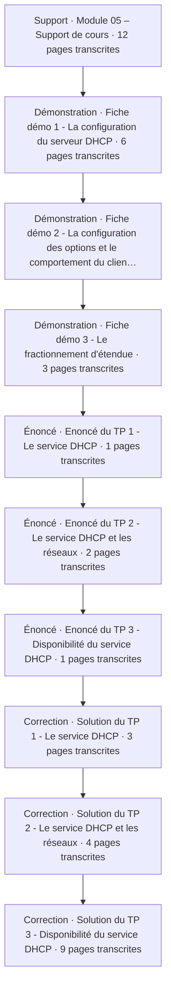

SOURCE DRIVE · TRANSCRIPTION DU SUPPORT

Le contenu des documents du dossier TSSR est transcrit ci-dessous, page par page. Les textes et tableaux sont intégrés à la page Web. Aucun fichier PDF, aucune diapositive entière ni aucune reproduction de page n’est affiché. Seuls des croquis ou visuels isolés et vérifiés peuvent accompagner la transcription. Les versions et les consignes restent celles des supports de formation. Les compléments IA sont conservés dans leur onglet distinct.

## Support · Module 05 – Support de cours · 12 pages transcrites

#### Module 05 – Le service DHCP

#### Objectifs

- Comprendre et configurer le rôle DHCP

#### Définition du service DHCP

Dynamic Host Configuration Protocol

| Avantages | Inconvénients |
| --- | --- |
| Propagation rapide des informations | Ouvert à toute demande |
| Réduction des erreurs | Vulnérabilité accrue aux attaques DOS |
| Centralisation du réseau |  |

#### La notion de bail

!!! note "À retenir"
    Ensemble des informations qu’un serveur DHCP transmet à son client.

**Visuel externe**


Ensemble des informations qu’un serveur DHCP transmet à son client.

- Une durée
- Une adresse IP
- Un masque
- D’autres paramètres

#### La notion de bail

#### L’obtention d’un bail - DORA

DHCP-1

DHCP-2

#### La notion de bail

#### Le renouvellement du bail

!!! note "À retenir"
    au démarrage du client à 50% du bail DHCP-1 à 87,5% du bail à 100% du bail DHCP-2

**Visuel externe**


- au démarrage du client

- à 50% du bail

DHCP-1

- à 87,5% du bail

- à 100% du bail

DHCP-2

#### La notion de bail

#### La résiliation du bail

DHCP-1

DHCP-2

#### Les conteneurs

##### À la base : l’étendue

| Caractéristique | Valeur du support |
| --- | --- |
| Un nom | LAN_Serveurs |
| Une plage d’adresses | 192.168.0.1 à 192.168.0.254 /24 |
| Des exclusions | 192.168.0.5 à 192.168.0.10 |
| Une durée | 2 jours |

#### Les conteneurs

##### Le plus ciblé : la réservation

| Caractéristique | Valeur du support |
| --- | --- |
| Un nom | SRVFIC |
| Le conteneur parent : l’étendue | LAN_Serveurs |
| L’adresse IP à réserver | 192.168.0.1 |
| L’adresse matérielle de l’équipement | 00155D6E6E03 |

#### Démonstration

#### La gestion des options

#### Les options de configuration

!!! note "À retenir"
    Elles complètent la configuration IP des clients DHCP.

Elles complètent la configuration IP des clients DHCP.

Quelques exemples :

#### La gestion des options

#### Le positionnement des options DHCP

!!! note "À retenir"
    Les options peuvent être définies : Au niveau du serveur : Elles concerneront tous les baux distribués par le serveur DHCP.

**Visuel externe**


- Les options peuvent être définies :
- Au niveau du serveur :
- Elles concerneront tous les baux distribués par le serveur DHCP.

- Pour une étendue :
- Elles concerneront les baux de l’étendue.

- Pour une réservation :
- Elles ne concerneront que la / les réservation(s) ciblée(s).

| Nom | Code | Utilité |
| --- | --- | --- |
| Routeur | 3 | Définit la passerelle par défaut |
| Serveur de Noms de Domaine | 6 | Définit le(s) serveur(s) DNS |
| Nom de domaine DNS | 12 | Définit le suffixe DNS |

#### Démonstration

#### TP

#### Le DHCP et les réseaux

#### Un serveur DHCP pour plusieurs réseaux

!!! note "À retenir"
    Problématique : les trames sont envoyées en diffusion.

Problématique : les trames sont envoyées en diffusion.

Client

#### Relais DHCP

#### DHCP Limite de diffusion

#### Solution : l’agent relais DHCP

#### Le service DHCP et les réseaux

#### TP

#### La gestion du DHCP

#### DHCP dans un contexte de domaine

!!! note "À retenir"
    La notion d’autorisation : Le ou les serveurs DHCP doivent être autorisés pour démarrer les services et fournir le service.

**Visuel externe**


- La notion d’autorisation :
- Le ou les serveurs DHCP doivent être autorisés pour démarrer les services et fournir le service.

- Incidence de la non-autorisation :
- Le service DHCP d’un serveur membre non autorisé ne démarrera pas.
- Le service DHCP d’un serveur autonome présent dans le domaine de diffusion d’un serveur autorisé s’arrêtera.

#### La gestion du DHCP

#### Les opérations de gestion de la base DHCP

!!! note "À retenir"
    L’ensemble des données de configuration est stocké dans une base.

- L’ensemble des données de configuration est stocké dans une base.

- Un certain nombre d’opérations peuvent être effectuées :
- Sauvegardes
- Synchrone
- Asynchrone

- Restaurations

- Contrôle de la cohérence de la base

- Déplacement de la base

À noter : les serveurs DHCP autres que Microsoft ne prennent pas en compte cette autorisation.

#### La gestion du DHCP

#### Le fractionnement d’étendues

!!! note "À retenir"
    Il permet d’automatiser la création d’une étendue sur deux serveurs ayant la charge de la plage correspondante.

Il permet d’automatiser la création d’une étendue sur deux serveurs ayant la charge de la plage correspondante.

#### Étendue : 192.168.0.1 à 192.168.0.254

Les modifications pouvant être apportées après création ne sont pas répliquées entre les deux serveurs ayant la charge de l’étendue (elles sont à faire sur les deux)

#### Plage adresses allouées au serveur Plage d’exclusions pour le serveur

#### Plage d’exclusions pour le serveur Plage adresses allouées au serveur

#### Démonstration

#### La gestion du DHCP

#### Pour aller plus loin

- Pour les problématiques de panne et de disponibilité :
- Configurer un serveur DHCP « de secours » : opérationnel, mais non démarré
- La solution DHCP failover

- Pour améliorer la sécurité :
- Mettre en place des stratégies de filtrage (sur les adresses MAC)

- Pour la surveillance et le diagnostic :
- Consulter les journaux d’évènements (source DHCP-Server)
- Consulter le journal d’audit : 1 fichier .log par jour dans le répertoire de la base

#### Disponibilité du service DHCP

#### TP

#### Conclusion

- Vous comprenez et savez configurer le rôle DHCP

Référence du document : 1QkckDtJxuvxo-zCNO6NKVcQWzlASNEVj · SHA-256 ff5adfcbb7299f86…

## Démonstration · Fiche démo 1 - La configuration du serveur DHCP · 6 pages transcrites

#### La configuration du serveur DHCP

#### Démonstration 01 du module 05

Cette démonstration décrit les différentes étapes relatives à l’installation du service DHCP sur une machine virtuelle Windows.

#### Déroulement

- Prérequis

Avoir installé et configuré une VM Windows Server.

- Accès à la console d’installation.

Lors de l’accès à la session du serveur, le Gestionnaire de Serveur ou Serveur Manager se lance automatiquement.

Pour lancer la console permettant l’ajout d’un rôle, cliquer sur Manage ou Gérer (1) puis sur Add Roles and Features ou Ajout de Rôles et Fonctionnalités (2).

- Choix du rôle à installer.

Cliquer sur le bouton Next (1), puis encore une fois sur le bouton Next (2). Sur l’écran Select destination server cliquer sur le bouton Next (3). Sur l’écran Select server roles, cocher la case DHCP Server (4). Sur la fenêtre contextuelle qui vient d’apparaître, cliquer sur le bouton Add Features (5), puis sur le bouton Next (6). Sur l’écran Select Features, cliquer sur le bouton Next (7). Sur l’écran DHCP Server, cliquer sur le bouton Next (8). Continuer jusqu’à la finalisation du rôle.

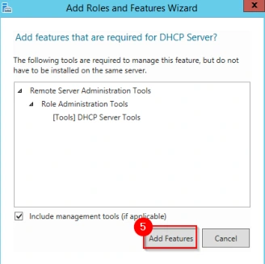

Visuel isolé — Fiche démo 1 - La configuration du serveur DHCP

- Finalisation configuration DHCP

Dès lors que l’installation est terminée, un « flag » jaune apparaît sur le dashboard du serveur (1). Cliquer sur le « flag » puis sur le lien Complete DHCP configuration (2). Sur l’écran Description, cliquer sur le bouton Commit (3). Enfin, cliquer sur le bouton Close (4).

- Ajout du raccourci dans la barre des tâches

Ouvrir Administrative Tools, puis créer le raccourci DHCP (1) dans la barre des tâches (2).

- Création d’une étendue

Cliquer sur le raccourci précédemment créé afin d’ouvrir la console DHCP. Faire un clic droit sur le nœud IPv4 puis sur le menu New Scope (1). Cliquer sur le bouton Next (2). Indiquer dans les input box Name et Description (3) un nom et une description pour l’étendue, puis cliquer sur le bouton Next (4).

Indiquer une adresse de début pour l’étendue ainsi qu’une adresse de fin (5), vérifier que le masque indiquer est le bon (6) et cliquer sur le bouton Next (7). S’il est requis d’avoir une plage d’adresses exclues, indiquer une adresse de début et de fin (8), puis cliquer sur le bouton Add (9) et cliquer sur le bouton Next (10). Si besoin, la durée du bail peut être modifiée (11), ensuite cliquer sur le bouton Next (12). Cliquer sur le bon Next (13). Indiquer si besoin l’adresse de la passerelle par défaut que les clients obtiendront via leur bail (14) puis cliquer sur le bouton Add (15) et cliquer sur le bouton Next (16). Cliquer sur le bouton Next (17). Cliquer sur le bouton Next (18). Cliquer sur le bouton Next (19). Enfin, cliquer sur le bouton Finish (20).

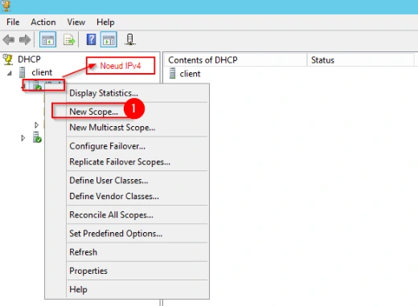

Visuel isolé — Fiche démo 1 - La configuration du serveur DHCP

#### Étapes illustrées dans le support

1. Dans New Scope Wizard, renseigner Étendue_LAN et la description Étendue pour le réseau LAN.
2. Renseigner la plage 192.168.1.20–192.168.1.30 avec le masque 255.255.255.0 (longueur 24).
3. Ajouter la plage d’exclusion présentée par l’assistant, puis choisir la durée du bail.
4. Sélectionner Yes, I want to configure these options now. Saisir le routeur 192.168.1.254 et l’ajouter.

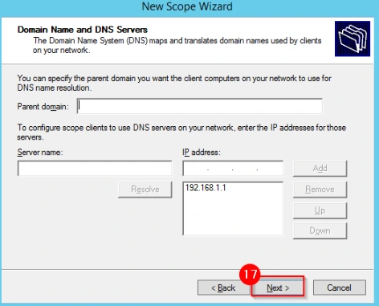

Visuel isolé — Fiche démo 1 - La configuration du serveur DHCP

Référence du document : 1n9okb0SDn4hGg5F7Qvrg0WU5Y7hrRyLA · SHA-256 8e82584331da95d6…

## Démonstration · Fiche démo 2 - La configuration des options et le comportement du client · 2 pages transcrites

#### La configuration des options et le comportement du client

#### Démonstration 02 du module 05

Cette démonstration décrit les différentes étapes relatives à la configuration des options ainsi que de l’obtention du bail par un client.

#### Déroulement

- Prérequis

Avoir installé et configuré une machine virtuelle sous Windows 10, sans IP fixe.

- Ajout d’une option dans l’étendue

Cliquer sur le raccourci précédemment créé afin d’ouvrir la console DHCP. Dérouler le nœud de l’étendue (1) précédemment créée, faire un clic droit sur la ligne Scope Options (2) puis sur le menu Configure Options (3). Se positionner sur l’option 006 (4). Indiquer l’adresse IP d’un serveur DNS de votre infrastructure (5) puis cliquer sur le bouton Add (6). L’adresse IP qui est en haut de la liste sera le DNS préféré des machines clientes du service DHCP (7). Une fois l’ajout de l’adresse IP terminée, cliquer sur le bouton OK (8).

- Test de récupération adresse IP sur le client

```
Se connecter sur la machine virtuelle Windows 10. Lancer une invite de commande, puis indiquer 
la commande ipconfig /renew (1) afin d’interroger le serveur DHCP. Une fois le processus DORA 
terminé, le client se voit attribuer une configuration IP via le DHCP (2). Indiquer la commande 
ipconfig /all afin de vérifier que le serveur DNS est bien celui ou ceux configurés précédemment 
(3).
```

- Vérification sur l’étendue du serveur

Se connecter sur la machine virtuelle hébergeant le serveur DHCP. Vérifier dans les baux d’adresses IP (1) que le client est bien présent (2).

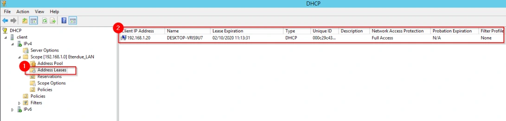

Visuel isolé — Fiche démo 2 - La configuration des options et le comportement du client

Référence du document : 1YQkDVaPklQFOamDAo5IzYKtKZt1PEoKz · SHA-256 eb04fec2ef3f2b7b…

## Démonstration · Fiche démo 3 - Le fractionnement d'étendue · 3 pages transcrites

#### Le fractionnement d’étendue

#### Démonstration 03 du module 05

Cette démonstration décrit les différentes étapes relatives au fractionnement d’une étendue.

#### Déroulement

- Prérequis

Avoir installé un second serveur hébergeant le service DHCP.

- Création du fractionnement

Cliquer sur le raccourci précédemment créé afin d’ouvrir la console DHCP. Faire un clic droit sur l’étendue (1) précédemment créée, cliquer sur le menu Advanced (2) puis sur le menu Split-Scope (3). Sur la fenêtre, cliquer sur le bouton Next (4). Indiquer le nom du second serveur DHCP (5) et cliquer sur le bouton Add Server (6). Enfin, cliquer sur le bouton Next (7).

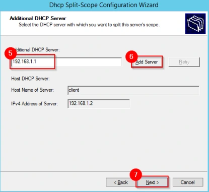

Visuel isolé — Fiche démo 3 - Le fractionnement d'étendue

- Ajustement du fractionnement

Lorsque le nouveau serveur est ajouté, la fenêtre qui permet la customisation de l’étendue apparaît. Ajuster en conséquence, puis cliquer sur le bouton Next (1). Cliquer sur le bouton Next (2). Enfin, cliquer sur le bouton Finish (3), puis sur le bouton Close (4).

- Vérification sur le second serveur DHCP

Ouvrir la console DHCP. L’étendue doit apparaître (1), si ce n’est pas le cas, il faut actualiser la console MMC avec la touche [F5]. Faire un clic droit sur l’étendue, puis sur le menu Activate (2). Le fractionnement est opérationnel.

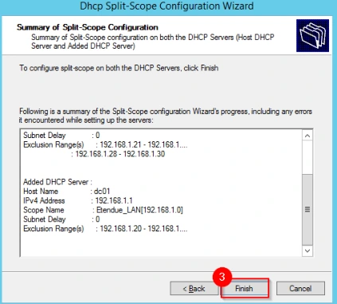

Visuel isolé — Fiche démo 3 - Le fractionnement d'étendue

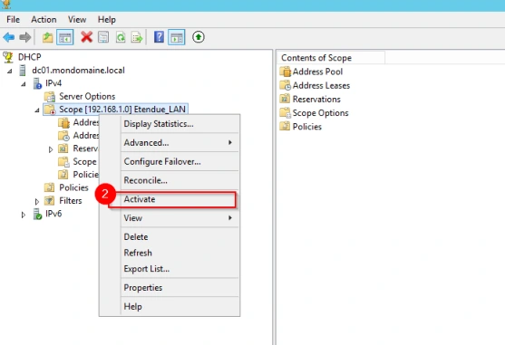

Visuel isolé — Fiche démo 3 - Le fractionnement d'étendue

Référence du document : 1rKdU-FLjjz7JLrh1uUwOuaQ33sYPllZR · SHA-256 faf7d54e56c34f49…

## Énoncé · Enoncé du TP 1 - Le service DHCP · 1 pages transcrites

#### TP du Module 05 – Le service DHCP

Avant de démarrer ce TP, il convient d’avoir suivi les vidéos du module 5.

#### Durée estimée

1 à 2 heures

#### Énoncé

Prérequis :

- Avoir réalisé le TP précédent du Module 04.

Création des machines virtuelles :

- Une machine virtuelle cliente Windows 10 sur le réseau VmNet10.
- Une machine virtuelle serveur Windows 2019 Standard sur le réseau VmNet10. Installation du service DHCP

- Définir un nouveau plan d’adressage pour votre réseau VmNet10 avec :

- Une plage de 100 adresses pour les postes clients. o Les adresses statiques pour les serveurs. • Configurer le service DHCP sur le nouveau serveur Windows 2019 Standard pour :

- Fournir des adresses IP sur les postes clients. o Fournir l’ensemble des paramètres IP nécessaires aux postes clients. o Ne pas fournir les adresses IP prévues pour les serveurs (configuration

statique). Un schéma de l’infrastructure devra être réalisé. Paramétrage des clients :

- Adapter les paramètres clients :

- Configurer une réservation pour le 2e poste client avec la 1re adresse IP de la

plage d’adresses définie.

- Sur un poste client, utiliser la commande ipconfig pour :

- Renouveler le bail DHCP (sans perdre l’adresse IP obtenue). o Relâcher et obtenir une nouvelle adresse IP.

Référence du document : 1s-0qflFffSr7GnVTsAALguKqYwww3E1Z · SHA-256 662749d7fc394ef0…

## Énoncé · Enoncé du TP 2 - Le service DHCP et les réseaux · 2 pages transcrites

#### Le service DHCP et les réseaux

#### TP du Module 05 – Le service DHCP

Avant de démarrer ce TP, il convient d’avoir suivi les vidéos du module 5 et terminé le TP précédent.

#### Durée estimée

1 à 2 heures

#### Énoncé

Prérequis :

- Avoir réalisé le TP précédent du Module 04.

- Avoir les deux machines virtuelles RTR-00 et RTR-01.

Pouvoir distribuer des adresses IP dans un autre domaine de diffusion.

#### Nom : RTR-00 Adresse IP : 192.168.0.254 Nom : CLI-00 Adresse IP : AUTO

#### Nom : SRV-2K19-0 Adresse IP : 192.168.0.1

#### Carte Réseau

#### Réseau 192.168.0.0/24

VNET10

- Paramétrer le serveur d’un domaine de diffusion pour fournir des adresses IP à plusieurs domaines de diffusion.
- Créer sur le serveur SRV-2K19-0 une étendue DHCP pour fournir des adresses IP dans le domaine de diffusion du serveur.
- Créer également une étendue pour le second domaine de diffusion hébergé sur le routeur RTR-01.

- Faire la même opération sur le second réseau.

- Faire la mise en place d’un client en adressage automatique. o Faire la mise en place d’un serveur Windows. o Configurer deux étendues DHCP sur le serveur afin de pouvoir fournir

#### Nom : RTR-01 Adresse IP : 192.168.1.254 Nom : CLI-01 Adresse IP : AUTO

#### Nom : SRV-2K19-1 Adresse IP : 192.168.1.1

des adresses IP dans les deux domaines de diffusion.

#### Carte Réseau

#### Réseau 192.168.1.0/24

VNET11

- Tester le bon fonctionnement.

- Vérifier l’obtention d’une adresse IP sur les postes clients de chaque réseau. o Tester la connectivité entre les clients de chaque réseau.

- Mettre en place un service de relai DHCP sur les routeurs de chaque domaine de diffusion afin de pallier la défaillance d’un serveur DHCP.

- Arrêter l’un des deux serveurs DHCP et vérifier l’obtention et la connectivité

des postes clients.

Référence du document : 1GSiFfNFFukflyBPqC6YPxpr_j1q4hRiy · SHA-256 02816f317cd47461…

## Énoncé · Enoncé du TP 3 - Disponibilité du service DHCP · 1 pages transcrites

#### Disponibilité du service DHCP

#### TP du Module 05 – Le service DHCP

Avant de démarrer ce TP, il convient d’avoir suivi les vidéos du module 5 et terminé le TP précédent.

#### Durée estimée

1 à 2 heures

#### Énoncé

Prérequis :

- Avoir réalisé le TP précédent du Module 05.

Définition des paramètres :

- Définir le plan d’adressage et les paramètres pour :

- Fournir à vos postes clients des adresses IP dans votre réseau VmNet10. o Fournir aux postes client du réseau 192.168.1.0/24 des adresses IP de votre

serveur en cas de défaillance du serveur. Vous configurerez les serveurs avec la fonction de FailOver. Configuration pour les clients du 1er réseau :

- Configurer les plages adaptées sur les deux serveurs DHCP.
- Configurer le relais DHCP sur le routeur adapté.
- Tester le bon fonctionnement.

- Si le serveur DHCP du 1er réseau est arrêté. o Si le serveur DHCP du 1er réseau est relancé. o Vérifier la connectivité avec le réseau VmNet10 du VmNet11. Configuration pour les clients du 2e réseau :

- Configurer les plages adaptées sur les deux serveurs DHCP.
- Configurer le relais DHCP sur le routeur adapté.
- Tester le bon fonctionnement.

- Si le serveur DHCP du 2e réseau est arrêté. o Si le serveur DHCP du 2e réseau est relancé. o Vérifier la connectivité avec le réseau VmNet11 du VmNet10.

Référence du document : 1AV-Y6IzKD5fOwpIGpSBSfWLHBoon_RD8 · SHA-256 2085739fbb3fd3ba…

## Correction · Solution du TP 1 - Le service DHCP · 3 pages transcrites

Correction originale : à consulter après avoir tenté l’exercice.

#### TP du Module 05 – Le service DHCP

Avant de démarrer ce TP, il convient d’avoir suivi les vidéos du module 5.

#### Durée estimée

1 à 2 heures

#### Énoncé

Prérequis :

- Avoir réalisé le TP précédent du Module 04.

Création des machines virtuelles :

- Une machine virtuelle cliente Windows 10 sur le réseau VmNet10.
- Une machine virtuelle serveur Windows 2019 Standard sur le réseau VmNet10. Installation du service DHCP

- Définir un nouveau plan d’adressage pour votre réseau VmNet10 avec :

- Une plage de 100 adresses pour les postes clients. o Les adresses statiques pour les serveurs. • Configurer le service DHCP sur le nouveau serveur Windows 2019 Standard pour :

- Fournir des adresses IP sur les postes clients. o Fournir l’ensemble des paramètres IP nécessaires aux postes clients. o Ne pas fournir les adresses IP prévues pour les serveurs (configuration

statique).

Paramétrage des clients :

- Adapter les paramètres clients :

- Configurer une réservation pour le 2ème poste client avec la 1ère adresse IP de

la plage d’adresses définie.

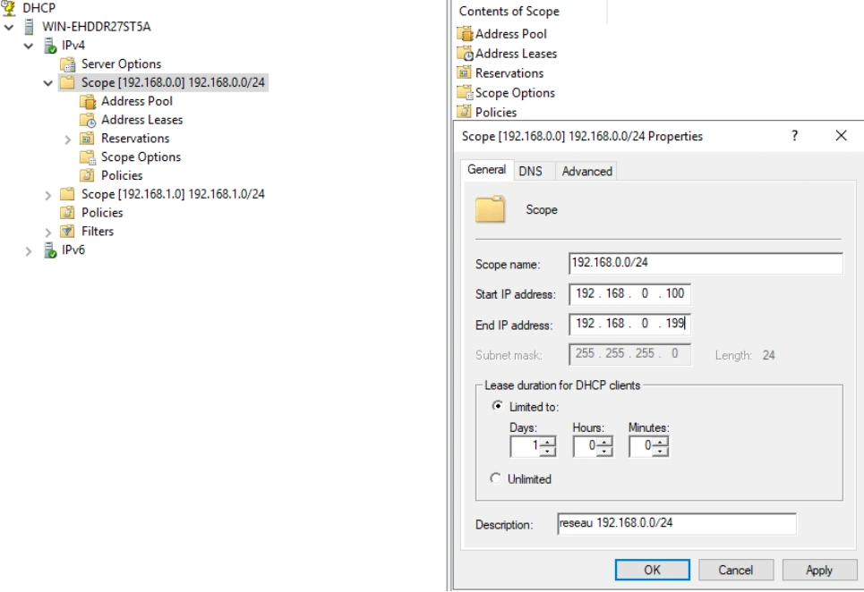

Visuel isolé — Solution du TP 1 - Le service DHCP

- Sur un poste client, utiliser la commande ipconfig pour :

- Renouveler le bail DHCP (sans perdre l’adresse IP obtenue). o Relâcher et obtenir une nouvelle adresse IP.

Référence du document : 1MS1FB2T7pNgaBi5eIpbRNpq5byZDOunA · SHA-256 b4f578b7f7236a0b…

## Correction · Solution du TP 2 - Le service DHCP et les réseaux · 4 pages transcrites

Correction originale : à consulter après avoir tenté l’exercice.

#### Le service DHCP et les réseaux

#### TP du Module 05 – Le service DHCP

Avant de démarrer ce TP, il convient d’avoir suivi les vidéos du module 5 et terminé le TP précédent.

#### Durée estimée

1 à 2 heures

#### Solution

Prérequis :

- Avoir réalisé le TP précédent du Module 04.

- Avoir les deux machines virtuelles RTR-00 et RTR-01.

Pouvoir distribuer des adresses IP dans un autre domaine de diffusion.

- Paramétrer le serveur d’un domaine de diffusion pour fournir des adresses IP à plusieurs domaines de diffusion.
- Créer sur le serveur SRV-2K19-0 une étendue DHCP pour fournir des adresses IP dans le domaine de diffusion du serveur.
- Créer également une étendue pour le second domaine de diffusion hébergé sur le routeur RTR-01.

- Faire la même opération sur le second réseau.

- Faire la mise en place d’un client en adressage automatique. o Faire la mise en place d’un serveur Windows. o Configurer deux étendues DHCP sur le serveur afin de pouvoir fournir

des adresses IP dans les deux domaines de diffusion.

- Tester le bon fonctionnement.

- Vérifier l’obtention d’une adresse IP sur les postes clients de chaque réseau. o Tester la connectivité entre les clients de chaque réseau.

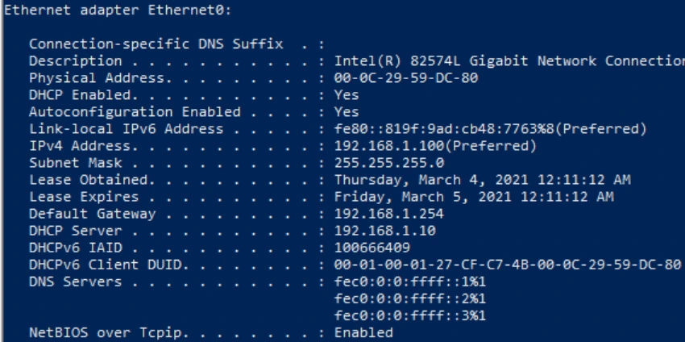

Visuel isolé — Solution du TP 2 - Le service DHCP et les réseaux

- Mettre en place un service de relai DHCP sur les routeurs de chaque domaine de diffusion afin de pallier la défaillance d’un serveur DHCP.

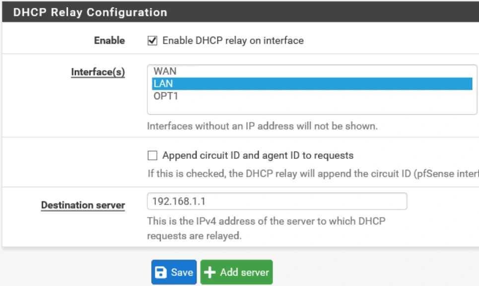

Visuel isolé — Solution du TP 2 - Le service DHCP et les réseaux

- Arrêter l’un des deux serveurs DHCP et vérifier l’obtention et la connectivité

des postes clients.

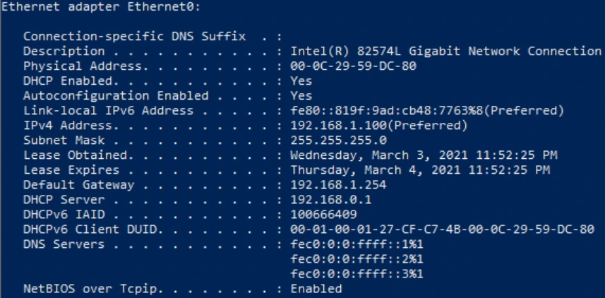

Visuel isolé — Solution du TP 2 - Le service DHCP et les réseaux

Référence du document : 115UTH-tUZEGgrwlhBlCO0UIvFIucbOdv · SHA-256 a3673ae941cdf154…

## Correction · Solution du TP 3 - Disponibilité du service DHCP · 9 pages transcrites

Correction originale : à consulter après avoir tenté l’exercice.

#### Disponibilité du service DHCP

#### TP du Module 05 – Le service DHCP

Avant de démarrer ce TP, il convient d’avoir suivi les vidéos du module 5 et terminé le TP précédent.

#### Durée estimée

1 à 2 heures

#### Énoncé

Prérequis :

- Avoir réalisé le TP précédent du Module 05.

Définition des paramètres :

- Définir le plan d’adressage et les paramètres pour :

- Fournir à vos postes clients des adresses IP dans votre réseau VmNet10.

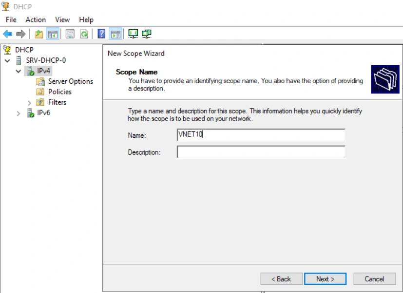

Visuel isolé — Solution du TP 3 - Disponibilité du service DHCP

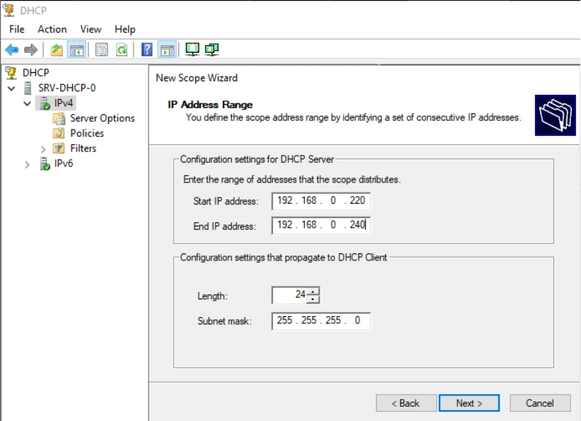

Visuel isolé — Solution du TP 3 - Disponibilité du service DHCP

- Permettre au serveur du réseau 192.168.1.0/24 de fournir les adresses IP de

```
votre réseau en cas de défaillance de votre serveur. 
o Utiliser la fonction FailOver
```

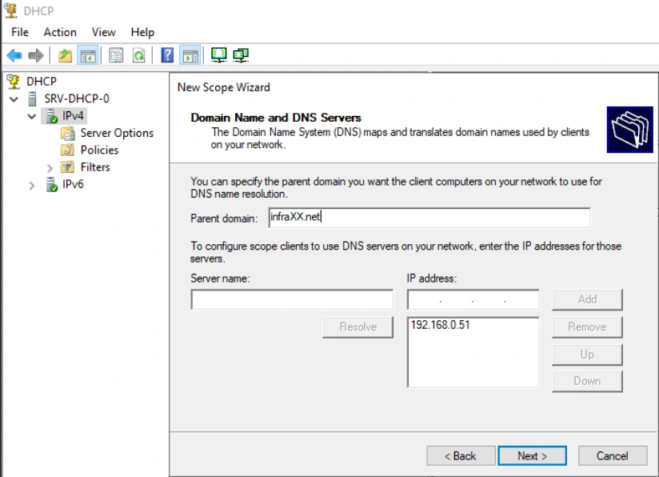

Visuel isolé — Solution du TP 3 - Disponibilité du service DHCP

Il faut utiliser la fonction Failover pour partager la zone créée sur le premier serveur DHCP vers le serveur DHCP du second réseau.

#### Étapes illustrées dans le support

1. Dans Configure Failover sur l’étendue VNET10 (192.168.0.0), choisir le serveur partenaire.
2. Dans Add Server, saisir 192.168.1.67 dans This server puis valider.

#### Étapes illustrées dans le support

1. Créer la relation de basculement avec le partenaire 192.168.1.67.
2. L’exemple affiche un délai maximum de prise en charge du client de 1 heure et le mode Load balance. La répartition est de 50 % pour le serveur local et 50 % pour le partenaire.
3. L’intervalle de basculement et l’authentification des messages sont des options distinctes. Le champ Shared Secret est vide dans la capture. Choisir Next.

Configuration pour les clients du 1er réseau:

- Configurer les plages adaptées sur les deux serveurs DHCP. Il faut suivre la procédure indiquée sur la première phase du TP pour créer les plages DHCP.

- Configurer le relais DHCP sur le routeur adapté.

- Tester le bon fonctionnement.

- Si le serveur DHCP du 1er réseau est arrêté.

Le relai DHCP du réseau VNET10 doit renvoyer les requêtes sur le serveur DHCP du réseau vnet11.

- Si le serveur DHCP du 1er réseau est relancé.

#### Le relai DHCP du réseau VNET11 doit renvoyer les requêtes sur le serveur DHCP du réseau

vnet10.

- Vérifier la connectivité avec le réseau VmNet10 du VmNet11. Configuration pour les clients du 2ème réseau :

- Configurer les plages adaptées sur les deux serveurs DHCP.

- Configurer le relais DHCP sur le routeur adapté.

- Tester le bon fonctionnement.

- Si le serveur DHCP du 2ème réseau est arrêté.

Le relai DHCP du réseau VNET10 doit renvoyer les requêtes sur le serveur DHCP du réseau vnet11.

- Si le serveur DHCP du 2ème réseau est relancé.

Le relai DHCP du réseau VNET11 doit renvoyer les requêtes sur le serveur DHCP du réseau vnet10.

- Vérifier la connectivité avec le réseau VmNet11 du VmNet10.

Référence du document : 1JAgoxpY6ovsW9pQhr5KUN5wnfqro3ZCL · SHA-256 6df2f16d39e96b98…

## Fiche de synthèse

Les lignes reprennent les titres du cours et la première phrase de chaque partie.

| Partie | Repère du cours |
| --- | --- |
| Correction · Solution du TP 1 - Le service DHCP · 3 pages transcrites | Correction originale : à consulter après avoir tenté l’exercice. |
| Correction · Solution du TP 2 - Le service DHCP et les réseaux · 4 pages transcrites | Correction originale : à consulter après avoir tenté l’exercice. |
| Correction · Solution du TP 3 - Disponibilité du service DHCP · 9 pages transcrites | Correction originale : à consulter après avoir tenté l’exercice. |
