# Module 06 — Le service DNS

Les parties ci-dessous reprennent le cours original, dans le même ordre. Les encadrés et les schémas répètent ses formulations.

## Parcours de lecture

1. Support · Module 06 – Support de cours · 21 pages transcrites
2. Démonstration · Fiche démo 1 - La configuration du service DNS · 5 pages transcrites
3. Démonstration · Fiche démo 2 - La configuration d’un serveur DNS hébergeur · 4 pages transcrites
4. Démonstration · Fiche démo 3 - Le DNS et les mises à jour · 6 pages transcrites
5. Démonstration · Fiche démo 4 - Le DNS les sous-domaines et les délégations · 3 pages transcrites
6. Énoncé · Enoncé du TP 1 - DNS résolveur · 2 pages transcrites
7. Énoncé · Enoncé du TP 2 - DNS hébergeur · 2 pages transcrites
8. Énoncé · Enoncé du TP 3 - DNS hébergeur et redondance · 3 pages transcrites
9. Énoncé · Enoncé du TP 4 - DNS délégations et redirections · 2 pages transcrites
10. Correction · Solution du TP 1 - DNS résolveur · 4 pages transcrites
11. Correction · Solution du TP 2 - DNS hébergeur · 6 pages transcrites
12. Correction · Solution du TP 3 - DNS hébergeur et redondance · 11 pages transcrites
13. Correction · Solution du TP 4 - DNS délégations et redirections · 7 pages transcrites

**Visuel externe**

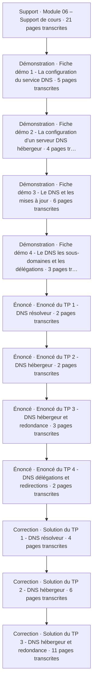

SOURCE DRIVE · TRANSCRIPTION DU SUPPORT

Le contenu des documents du dossier TSSR est transcrit ci-dessous, page par page. Les textes et tableaux sont intégrés à la page Web. Aucun fichier PDF, aucune diapositive entière ni aucune reproduction de page n’est affiché. Seuls des croquis ou visuels isolés et vérifiés peuvent accompagner la transcription. Les versions et les consignes restent celles des supports de formation. Les compléments IA sont conservés dans leur onglet distinct.

## Support · Module 06 – Support de cours · 21 pages transcrites

#### Module 06 – Le service DNS

#### Objectifs

- Comprendre et configurer le rôle DNS

#### La résolution de noms

#### La machine et l’humain, les chiffres ou les lettres

!!! note "À retenir"
    Quand nous sollicitons un service ou une ressource, nous indiquons : Le service sollicité Le nom de la machine qui fournit le service http://www.google.com 172.18.0.0/16 \\SRVFIC01\Partage SRVFIC01

Quand nous sollicitons un service ou une ressource, nous indiquons :

- Le service sollicité

- Le nom de la machine qui fournit le service

http://www.google.com

172.18.0.0/16

\\SRVFIC01\Partage

SRVFIC01

#### La résolution de noms

#### La résolution de noms d’hôtes

!!! note "À retenir"
    Afin de résoudre les noms d’hôtes en adresses IP, plusieurs mécanismes peuvent être utilisés.

Afin de résoudre les noms d’hôtes en adresses IP, plusieurs mécanismes peuvent être utilisés.

#### Mécanismes Utilité

!!! note "À retenir"
    Il contient des correspondances entre des noms d’hôtes déjà résolus et les adresses IP correspondantes.

Il contient des correspondances entre des noms d’hôtes déjà résolus et les adresses IP correspondantes. Il conserve aussi les réponses négatives aux requêtes du client. Il se gère avec la commande ipconfig.

Le service DNS Les clients DNS interrogent leur(s) serveur(s) DNS pour leurs requêtes de résolution.

Les modifications effectuées dans ce fichier (ajout et suppression d’entrées) sont reportées dans le cache DNS dès l’enregistrement du fichier.

| Mécanisme | Utilité |
| --- | --- |
| Cache DNS | Correspondances déjà résolues et réponses négatives. Il se gère avec ipconfig. |
| Service DNS | Les clients interrogent les serveurs DNS configurés. |
| Fichier hosts | Les modifications effectuées dans ce fichier sont reportées dans le cache DNS dès son enregistrement. |

#### La résolution de noms

#### Structure du fichier hosts

!!! note "À retenir"
    Le fichier de configuration local C:\Windows\System32\drivers\etc\hosts permet de renseigner des correspondances entre des noms et les adresses IP correspondantes.

- Le fichier de configuration local C:\Windows\System32\drivers\etc\hosts permet de renseigner des correspondances entre des noms et les adresses IP correspondantes.

- La syntaxe de ce fichier est la suivante :

#### Adresse_IP Nom

!!! note "À retenir"
    172.16.255.254 rtsiege.monentreprise.local 172.17.0.0 srv01,srv01.monentreprise.local Les informations contenues dans le fichier hosts sont prioritaires à l’interrogation du service DNS, s’il trouve une correspondance pour un nom donné dans ce fichier, le poste n’ira pas requêter le service DNS configuré.

172.16.255.254 rtsiege.monentreprise.local

172.17.0.0 srv01,srv01.monentreprise.local

Les informations contenues dans le fichier hosts sont prioritaires à l’interrogation du service DNS, s’il trouve une correspondance pour un nom donné dans ce fichier, le poste n’ira pas requêter le service DNS configuré.

Qu’est-ce que DNS ?

- Domain Name System est un service de résolution de noms.

#### Un service pour un espace

#### de noms en

#### Il permet de

#### nom de

résoudre

#### serveur l’hébergeant

#### Un nom en

#### Une adresse

#### adresse IP

#### IP en nom

Il est défini par des RFCs.

#### L’espace de

#### Ses principales caractéristiques

#### nom qu’il couvre est hiérarchique

#### La gestion de son espace de

#### Il est le mécanisme de

#### résolutions de

#### nom est distribuée

#### noms d’Internet

#### Noms d’hôtes et de domaine

#### Les noms d’hôtes

!!! note "À retenir"
    DNS permet la résolution de noms d’hôtes pleinement qualifiés (ou FQDN pour Fully Qualified Domain Name) en adresse IP.

- DNS permet la résolution de noms d’hôtes pleinement qualifiés (ou FQDN pour Fully Qualified Domain Name) en adresse IP.

- Voici un exemple :

#### Séparateur hôte / domaine

!!! note "À retenir"
    Nom de domaine pleinement qualifié (FQDN) www .

Nom de domaine pleinement qualifié (FQDN) www . google.fr.

- La première partie du nom identifie le poste au sein de son espace de nom, on parlera de partie hôte du nom.

- La deuxième partie identifie l’espace de nom auquel appartient l’hôte, on parlera de la partie domaine du nom.

#### Noms d’hôtes et de domaine

#### Les noms de domaines

!!! note "À retenir"
    C’est la partie commune à plusieurs hôtes d’un espace de noms.

**Visuel externe**


- Qu’est-ce que le domaine DNS ?
- C’est la partie commune à plusieurs hôtes d’un espace de noms.

- Pour être résolvable, tout hôte doit être identifiable par d’autre(s) poste(s) appartenant à d’autres espaces de noms. Pour cela, il dispose d’un nom pleinement qualifié unique à l’échelle mondiale.

- Il y a deux manières d’utiliser les espaces de noms :
- Usage privé : pour un espace de nom interne uniquement.
- Usage public : référencé sur Internet.

#### La hiérarchisation des espaces de noms

- L’espace de noms DNS est hiérarchique.

- Chaque espace de nom respecte cette hiérarchisation.

#### La racine Domaine

racine

#### .fr .com .de .net

#### Les TLD (Top Level Domain) (1er niveau)

#### Domaines de niveau

.gouv

#### inférieur (2e niveau)

#### éducation défense

#### (3e niveau)

#### La hiérarchisation des espaces de noms

##### Un serveur DNS comment ? Pour faire quoi ?

- Fournir des correspondances entre noms d’hôtes et adresse(s) IP associée(s).
- La résolution de noms externes à l’entreprise nécessite un serveur DNS résolveur.
- La mise en place d’un service de nommage interne (AD par exemple) nécessite un serveur DNS hébergeur.
- Le résolveur et l’hébergeur peuvent être assurés sur deux serveurs distincts ou cumulés sur le même serveur.
- En premier lieu, il faut identifier les besoins de résolutions de noms.

#### Le rôle du DNS résolveur

- C’est le partenaire désigné des équipements clients du service de résolution de noms.
- Il effectue des requêtes auprès d’autres serveurs DNS afin de résoudre les requêtes de ses clients.
- Il ne gère pas d’espace de noms.

#### Les mécanismes d’interrogation

#### Mécanismes d’interrogation des serveurs DNS

**Visuel externe**


Deux types de requêtes peuvent être adressés à un serveur DNS :

- Les requêtes récursives :
- Le serveur répondant doit fournir une réponse complète à la question posée.

Ce type de requête est fréquemment utilisé par un client pour son serveur DNS.

- Les requêtes itératives :
- Le serveur qui envoie la requête accepte une réponse partielle à la question posée.
- La réponse sera une indication lui permettant d’avancer dans son processus de résolution.

Ce type de requête est fréquemment utilisé lors de l’exploration de l’arborescence DNS à partir de la racine

#### Les mécanismes d’interrogation

#### Les requêtes récursives

Quelle est l’adresse IP de www.google.com. ?

#### IP de www.google.com. = 172.217.18.196

DNS

#### Les mécanismes d’interrogation

#### Les requêtes itératives

.

#### Quelle est l’adresse IP

fr.

de www.amendes.gouv.fr. ?

#### A de www.amendes.gouv.fr. = 160.92.178.39

gouv.fr.

amendes.gouv.fr.

#### Les redirections

#### La redirection non conditionnelle

- Sans configuration particulière, un serveur DNS ira interroger les serveurs racine afin de résoudre les requêtes de ses clients.

- Si un serveur est configuré de telle sorte à utiliser la redirection, il demandera à son serveur redirecteur de trouver les réponses aux requêtes de ses clients.

#### Résolveur interne

Quelle est l’adresse IP de www.google.com. ?

#### Réseau interne DNS FAI

#### IP de www.google.com. = 172.217.18.196

#### Les redirections

#### Le redirecteur conditionnel

- Un serveur DNS peut être configuré pour faire appel à des redirecteurs ciblés pour des espaces de noms identifiés. Il s’agit de redirecteurs conditionnels.

- Cette configuration permet de :
- Résoudre des espaces de noms privés non référencés et non résolvables dans l’arborescence d’espaces de noms publics.
- D’optimiser la résolution d’espaces de noms qui sont souvent sollicités.

Serveur faisant autorité pour enigme.lcl.

#### Redirection conditionnelle

Pour le domaine enigme.lcl.

Zone enigme.lcl.

#### Résolveur interne

#### Les redirections

#### La mise en cache

- Chaque fois qu’un serveur DNS fait appel à d’autres serveurs pour ses demandes de résolutions, il enregistre dans le cache DNS les résultats obtenus.

- La durée de conservation en cache est propre à chaque enregistrement (TTL).

- Les réponses négatives (enregistrement inexistant par exemple) sont aussi conservées en cache.

- Lorsque le serveur reçoit une requête d’un client, il détermine si cette dernière est relative à une zone pour laquelle il fait autorité. Si ce n’est pas le cas, il consulte son cache.

Le serveur et le client disposent de caches différents.

#### Démonstration

#### DNS résolveur

#### TP

#### Le DNS hébergeur

#### Le rôle du DNS hébergeur

#### Il a pour mission de

#### répondre aux requêtes relatives à

#### l’espace de nom

#### qu’il gère

#### Le DNS hébergeur

#### Il fait autorité pour

#### le ou les espace(s)

#### de nom(s) qu’il

#### Il gère un ou plusieurs espaces

gère

#### de noms

#### Les zones

- Correspondent au conteneur de l’ensemble des données d’un espace de nom.

- Elle contient un ensemble d’enregistrements.

- Le contenu de chaque zone est stocké dans un fichier de zone qui lui est propre (habituellement stocké dans %windir%\system32\dns*).

#### Les zones

#### Zone directe

- À chaque espace de nom correspond une zone.
- Un serveur faisant autorité est en mesure de répondre directement aux requêtes concernant l’espace de noms correspondant.

- S’il fait autorité sur une zone directe, il peut résoudre un nom en adresse IP.

#### Résolveur interne

Quelle est l’adresse IP de srvfic.masociete.lcl. ?

Héberge la zone masociete.lcl.

#### Réseau interne

#### IP de srvfic.masociete.lcl. = 192.168.0.1

#### Les zones

#### Zone inverse

S’il fait autorité sur une zone inverse, il peut résoudre une adresse IP en nom.

#### Résolveur interne

Héberge la zone inverse pour le réseau 192.168.0.0 Quel est le nom de 192.168.0.1 ?

#### Réseau interne

Nom de 192.168.0.1 = srvfic.masociete.lcl.

#### Les zones

#### Zone principale et zone secondaire

#### Les zones

#### Le contenu d’une zone

**Visuel externe**


- Une zone contient un ensemble d’enregistrements.

- Dans une zone directe ou inverse, il y a :
- Un SOA : (Start Of Authority) nom FQDN du serveur DNS disposant de la zone en écriture.
- Un ou des NS : (Name Server) serveur(s) faisant autorité pour la zone.

|  | Serveur maître | Serveur esclave |
| --- | --- | --- |
| Type de zone hébergée | Zone principale | Zone secondaire |
| Autorisation d’accès | Lecture / écriture | Lecture |
| Fait autorité pour la zone | Oui | Oui |

#### Les zones

#### Le contenu d’une zone

- Les enregistrements présents dans des zones directes

#### Type d’enregistrement Contenu

#### SOA nom FQDN du serveur DNS disposant de la zone en écriture

#### NS serveur(s) faisant autorité pour la zone

#### Les zones

#### Le contenu d’une zone

- Les enregistrements présents dans des zones inverses

#### Type d’enregistrement Contenu

#### SOA nom FQDN du serveur DNS disposant de la zone en écriture

#### NS serveur(s) faisant autorité pour la zone

| Enregistrements de zone directe | Contenu |
| --- | --- |
| SOA | Nom FQDN du serveur disposant de la zone en écriture |
| NS | Serveur(s) faisant autorité |
| A | Hôte IPv4 |
| AAAA | Hôte IPv6 |
| CNAME | Alias |
| MX | Serveur de messagerie |
| SRV | Services |

| Enregistrements de zone inverse | Contenu |
| --- | --- |
| SOA | Nom FQDN du serveur disposant de la zone en écriture |
| NS | Serveur(s) faisant autorité |
| PTR | Pointeur |

#### Les zones

#### Récapitulatif des étapes de résolution

Demande de résolution du client pour www.hadopi.fr.

#### Le serveur cherche la réponse dans sa zone et répond au client

Oui

Le serveur interrogé fait-il autorité pour la zone hadopi.fr.

?

Non

#### Le serveur répond au client

Oui

réponse en cache ?

Non

#### Le serveur interroge le redirecteur configuré

Oui

#### Le serveur est-il configuré pour

1 – redirecteur conditionnel 2 – redirecteur non-conditionnel

faire appel aux redirecteurs ?

Non

#### Le serveur interroge un serveur racine

#### Le serveur interroge les racines

Oui

#### Le serveur a-t-il obtenu la réponse à la requête de son

#### Le serveur interroge un serveur indiqué par

client ?

Non

#### la réponse à la précédente requête

#### Démonstration

#### DNS hébergeur

#### TP

#### Les mises à jour

#### Les enregistrements dynamiques

Dans une zone sont inscrites des correspondances entre des noms et des adresses IP.

- Parfois, ces enregistrements doivent être maintenus statiquement.

mail1

www

#### edition-exemple.test. www = 2001:0DB8:1234::1 mail1 = 2001:0DB8:1234::5

- Dans d’autres cas, pour une zone principale, l’enregistrement dynamique sera autorisé.

Cli-1

Cli-2

#### Réseau interne Zone mondomaine.lcl. Cli-1 = 192.168.0.20 Cli-2 = 192.168.0.21

#### Les mises à jour

#### Le transfert de zone

Le transfert de zone est le processus d’échanges de données d’une zone entre un serveur maître et un serveur esclave.

#### DNS maitre DNS esclave

1-Le serveur DNS esclave interroge le maître pour obtenir le numéro de version de la zone

#### Zone mondomaine.lcl. @ IN SOA […] @ IN A 192[…]

2-Le serveur DNS maître fournit en retour le numéro de version de la zone

#### Zone mondomaine.lcl. Serial 120 Cli-1 = 192.168.0.20 Cli-2 = 192.168.0.21

Zone mondomaine.lcl. Serial 123 Cli-1 = 192.168.0.20 Cli-2 = 192.168.0.21 Cli-3 = 192.168.0.22

3-Si le numéro de version reçu est supérieur au numéro de version connu, le serveur esclave initie alors une requête IXFR (incrémentale) ou AXFR (complet)

Requête IXFR ou AXFR pour mon domaine.lcl.

SOA de mondomaine.lcl.

#### SOA de mondomaine.lcl. […] Serial 123

4-Si le transfert de zone est autorisé vers celui qui lui a adressé la requête, le serveur DNS maître répond alors en fournissant les mises à jour de la zone ou toute celle-ci

#### Les mises à jour

#### Le transfert de zone

- C’est au serveur esclave d’aller interroger son serveur maître afin d’obtenir les mises à jour.

- Néanmoins, le serveur maître a la possibilité de prévenir le ou les serveur(s) esclave(s).

- Quand une modification est effectuée dans sa zone, le numéro de série de celle-ci est incrémenté et le serveur maître émet une requête DNS de type Notify à destination des serveurs esclaves.

- Suite à la réception de cette requête, le serveur esclave initiera le processus de transfert de zone précédemment décrit.

```
Le service DNS
 Les mises à jour

     Le transfert de zone
      Le transfert de zone est le processus d’échanges de données d’une zone entre un
      serveur maître et un serveur esclave.

           1- Le serveur DNS esclave interroge le maître pour obtenir le
                                                                           DNS maitre                          DNS esclave               numéro de version de la zone                                                                                                    Zone mondomaine.lcl.
                                                              @ IN SOA […]
              2- Le serveur DNS maître fournit en retour le numéro de                      Zone mondomaine.lcl.@ IN A 192[…]                 Zone mondomaine.lcl.
                        version de la zone                                                                        Serial 123                                            Serial 120
                                                                                                                                Cli-1 = 192.168.0.20                                     Cli-1 = 192.168.0.20
                                                                                                                                Cli-2 = 192.168.0.21                                     Cli-2 = 192.168.0.21
                  3- Si le numéro de version reçu est supérieur au numéro de                  Cli-3 = 192.168.0.22
                                version connu, le serveur esclave initie alors une requête IXFR
                                (incrémentale) ou AXFR (complet)                                              Requête IXFR ou AXFR pour mon domaine.lcl.

                                                     Si le                                                       transfert                                                de                                                     zone                                                                       est                                                                         autorisé                                                                                 vers                                                                                             celui qui                                                                                                                        lui                                                                                     a                        4-
                                                                                         SOASOAdedemondomaine.lcl.mondomaine.lcl.[…]                                        adressé                                                           la                                                    requête,                                                                       le                                                             serveur                                                DNS                                                                         maître                                                                       répond                                                                                                 alors                                                                               en
                                          fournissant les mises à jour de la zone ou toute celle-ci                                Serial 123

                                                                                          33

33

  Le service DNS
 Les mises à jour

        Le transfert de zone
             • C’est au serveur esclave d’aller interroger son serveur maître afin d’obtenir les mises
          à jour.

             • Néanmoins, le serveur maître a la possibilité de prévenir le ou les serveur(s)
             esclave(s).

             • Quand une modification est effectuée dans sa zone, le numéro de série de celle-ci
            est incrémenté et le serveur maître émet une requête DNS de type Notify à
            destination des serveurs esclaves.

             • Suite à la réception de cette requête, le serveur esclave initiera le processus de
             transfert de zone précédemment décrit.

                                                                                          34

34
```

#### Démonstration

#### DNS hébergeur et redondance

#### TP

#### Les sous-domaines

Ils permettent d’organiser un espace de noms en regroupant des enregistrements par leur appartenance à une même entité (site, service).

Fait autorité pour mondomaine.lcl.

#### Fait autorité pour mondomaine.lcl. Et pour les espaces de noms enfants

Zone mondomaine.lcl.

Zone mondomaine.lcl.

#### Srv1.nantes = 10.0.0.1 Cli1.nantes = 10.0.20.1

Nantes-Srv1 = 10.0.0.1 Nantes-Cli1 = 10.0.20.1 Brest-Srv1 = 10.1.0.1 Brest-Cli1 = 10.1.20.1 Rennes-Srv1 = 10.2.0.1 Rennes-Cli1 = 10.2.20.1

#### Srv1.brest = 10.1.0.1 Cli1.brest = 10.1.20.1

#### Srv1.rennes=10.2.0.1 Cli1.rennes = 10.2.20.1

#### Sous-domaines intégrés

#### dans la zone

#### Les sous-domaines

Les délégations La gestion des espaces de noms enfants peut être assurée par d’autre(s) serveur(s) DNS si une délégation de zone est faite.

Zone mondomaine.lcl.

Fait autorité pour mondomaine.lcl. Mais ne fait pas autorité pour les espaces enfants Nantes, Brest et Rennes Délégations pour nantes brest rennes

Zone rennes.mondomaine.lcl.

Zone nantes.mondomaine.lcl.

#### Zone brest.mondomaine.lcl. Srv1 = 10.35.0.1 Cli1 = 10.35.20.1

#### Srv1 = 10.44.0.1 Cli1 = 10.44.20.1

#### Srv1 = 10.29.0.1 Cli1 = 10.29.20.1

#### Démonstration

#### DNS délégations et redirections

#### TP

#### Conclusion

- Vous comprenez et savez configurer le rôle DNS

Référence du document : 15wPmzaKhPIC2AxqYSJ1xp2rVRMAxdaLf · SHA-256 a33356182e938793…

## Démonstration · Fiche démo 1 - La configuration du service DNS · 5 pages transcrites

#### La configuration du service DNS

#### Démonstration 01 du module 06

Cette démonstration décrit les différentes étapes relatives à l’installation du service DNS sur une machine virtuelle Windows.

#### Déroulement

**Visuel externe**


- Prérequis

Avoir installé et configuré une VM Windows Server.

- Accès à la console d’installation.

Lors de l’accès à la session du serveur, le Gestionnaire de Serveur ou Serveur Manager se lance automatiquement.

Pour lancer la console permettant l’ajout d’un rôle, cliquer sur Manage ou Gérer (1) puis sur Add Roles and Features ou Ajout de Rôles et Fonctionnalités (2).

- Choix du rôle à installer.

Cliquer sur le bouton Suivant (1), puis encore une fois sur le bouton Suivant (2). Sur l’écran, Sélectionner le serveur de destination, cliquer sur le bouton Suivant (3). Sur l’écran Sélectionner des rôles de serveurs, cocher la case Serveur DNS (4). Sur la fenêtre contextuelle qui vient d’apparaître, cliquer sur le bouton Ajouter des fonctionnalités (5), puis sur le bouton Suivant (7). Sur l’écran Sélectionner des fonctionnalités, cliquer sur le bouton Suivant (8). Sur l’écran Serveur DNS, cliquer sur le bouton Suivant (9). Continuer jusqu’à la finalisation du rôle.

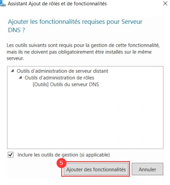

Visuel isolé — Fiche démo 1 - La configuration du service DNS

- Ajout du raccourci dans la barre des tâches

Ouvrir Outils d’administration, puis création du raccourci DHCP (1) dans la barre des taches (2).

- Présentation de la console

Cliquer sur le raccourci précédemment créé afin d’ouvrir la console DNS.

Zone de recherche directe (1) : processus de recherche d'une adresse IP basée sur le nom d'hôte dans DNS.

Zone de recherche inversée (2) : processus de recherche de nom d’hôte basé sur l’adresse IP dans le système DNS.

Redirecteurs conditionnels (3) : le serveur DNS peut être configuré pour faire appel à des redirecteurs ciblés pour des espaces de noms identifiés. Résoudre des espaces de noms privés non référencés et non résolvables dans l’arborescence d’espaces de noms publics. D’optimiser la résolution d’espaces de noms qui sont souvent sollicités.

DNS (4) et Redirecteurs (5) : si le serveur est configuré de telle sorte à utiliser la redirection, il demandera à son serveur redirecteur de trouver les réponses aux requêtes de ses clients.

#### Étapes illustrées dans le support

1. Dans Gestionnaire DNS, développer le nœud DNS puis le serveur.
2. Repérer Zones de recherche directes, Zones de recherche inverse, Points d’approbation et Redirecteurs conditionnels. La vue du serveur présente également les indications de racine et les redirecteurs.

Référence du document : 1N-sN7cnYWR7yvZmxoK_vjcPG3jzxL-p6 · SHA-256 913c358d2761dde8…

## Démonstration · Fiche démo 2 - La configuration d’un serveur DNS hébergeur · 4 pages transcrites

#### La configuration d’un serveur DNS hébergeur

#### Démonstration 02 du module 06

Cette démonstration décrit les différentes étapes relatives à l’installation d’un serveur DNS hébergeur sur une machine virtuelle Windows.

#### Déroulement

- Ouvrir la console MMC du service DNS.

Ouvrir la fenêtre Outils d’administration puis cliquer sur la ligne DNS (1).

- Création d’une zone directe

Faire un clic droit sur la ligne Zones de recherche directes (1) puis sur le menu Nouvelle zone… (2). Cocher le bouton radio Zone principale (3), puis cliquer sur le bouton Suivant (4). Spécifier le nom de la zone (5), puis cliquer sur le bouton Suivant (6). Cliquer de nouveau sur le bouton Suivant (7). Laisser cocher la case qui n’autorise pas les enregistrements dynamiques (cela sera abordé dans une prochaine démonstration), cliquer directement sur le bouton Suivant (8). La zone est créée et apparaît (9). Cette dernière dispose bien d’un SOA et d’un NS.

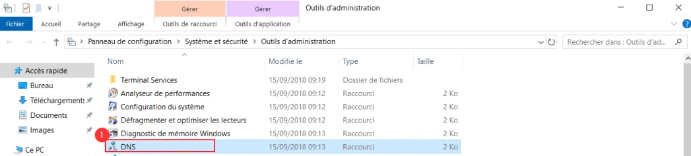

Visuel isolé — Fiche démo 2 - La configuration d’un serveur DNS hébergeur

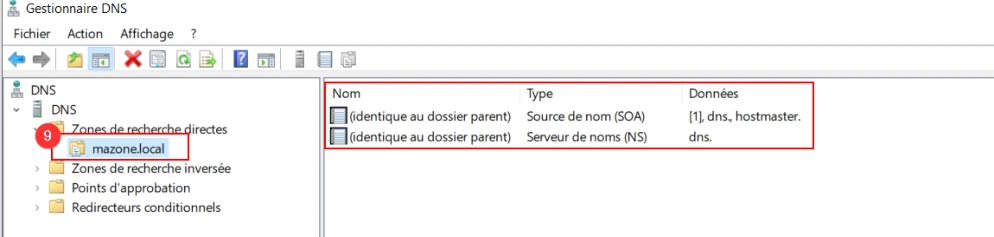

Visuel isolé — Fiche démo 2 - La configuration d’un serveur DNS hébergeur

- Création d’une zone de recherche inversée

Cliquer droit sur la ligne Zones de recherche inversée (1) puis sur le menu Nouvelle zone (2). Cocher le bouton radio Zone principale (3), puis cliquer sur le bouton Suivant (4). Laisser cocher le bouton radio Zone de recherche inversée IPv4 (5), puis cliquer sur le bouton Suivant (6). Spécifier l’adresse réseau de la zone inverse (pour les besoins de la démonstration, le réseau est en 192.168.1.0/24) (7), puis cliquer sur le bouton Suivant (8). Tout comme l’étape d’avant, ne pas changer le nom du fichier de zone et ne pas autoriser les enregistrements dynamiques. La zone est désormais visible.

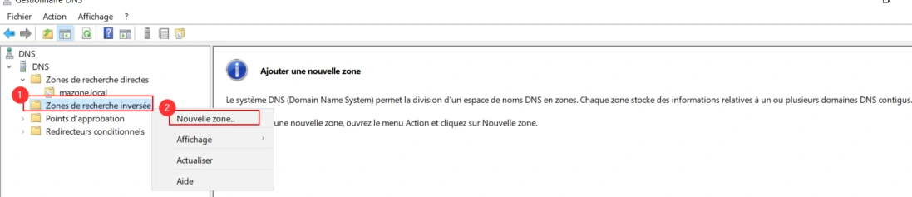

Visuel isolé — Fiche démo 2 - La configuration d’un serveur DNS hébergeur

- Ajout d’enregistrement dans une zone

Se positionner dans la zone directe nouvellement créée. Dans le volet central, faire un clic droit, puis cliquer sur le menu Nouvel hôte (1). Indiquer le nom NetBIOS de l’hôte (2), le nom FQDN s’autocomplète (2), indiquer l’adresse IP associée à l’hôte (4) et si besoin laisser cocher la case Créer un pointeur d’enregistrement PTR associé, cela permettra d’avoir directement l’enregistrement de créé dans la zone inverse. Enfin, cliquer sur le bouton Ajouter un hôte (5).

- Vérification avec nslookup

```
Pour vérifier les éléments précédemment configurés, ouvrir l’invite de commande puis indiquer 
nslookup suivi du nom de la zone directe.
```

```
Enfin indiquer nslookup suivi du nom FQDN de l’hôte.
```

Référence du document : 106ggN1NeWhtibgdwD6mdfGnPSwqd1HS1 · SHA-256 5ee1a7c02c57073a…

## Démonstration · Fiche démo 3 - Le DNS et les mises à jour · 6 pages transcrites

#### Le DNS et les mises à jour

#### Démonstration 03 du module 06

Cette démonstration décrit les différentes étapes relatives à la configuration des mises à jour sur un serveur DNS

#### Déroulement

- Ouvrir la console MMC du service DNS.

Ouvrir la fenêtre Outils d’administration puis cliquer sur la ligne DNS (1).

- Mise en place de l’enregistrement automatique des hôtes

Lors de la configuration des zones dans la précédente démonstration, l’enregistrement automatique des hôtes n’a pas été activé.

Pour ce faire, faire droit sur la zone directe (2), puis cliquer sur le menu Propriétés (3). Sélectionner la ligne Non sécurisé et sécurisé (4). De base, dans le contexte de domaine Active Directory, les zones seront créées et les enregistrements d’hôtes seront automatiques.

- Une autre manière de forcer l’enregistrement d’un hôte.

Installer une VM cliente étant sur le même sous-réseau que le serveur DNS et avec comme serveur DNS préféré, le serveur DNS sur lequel vous travailler dans cette démonstration.

```
Ouvrir une invite de commande en tant qu’administrateur sur le poste et client et indiquer la 
commande ipconfig /registerdns
```

- Activer le transfert de zone

Installer une VM serveur étant sur le même sous-réseau que le serveur DNS. Installer le service DNS.

Sur le premier serveur DNS, faire un clic droit sur la zone directe (1), puis sur le menu Propriétés (2). Cliquer sur l’onglet Transferts de zone (3). Dans cette démonstration, le second serveur DNS sera utilisé. Cocher le bouton radio Uniquement vers les serveurs suivants (4). Cliquer sur le bouton Modifier (5). Indiquer l’adresse du second serveur DNS (6), puis cliquer sur le bouton OK (7).

- Configuration du transfert de zone sur le second serveur

Faire un clic droit sur la ligne Zones de recherche directes (1) puis sur le menu Nouvelle zone… (2). Cocher le bouton radio Zone secondaire (3), puis cliquer sur le bouton Suivant (4). Indiquer le nom de la zone que vous souhaitez « copier » (5), puis cliquer sur le bouton Suivant (6). Indiquer l’adresse IP (7) du serveur maître (ici le premier serveur DNS), puis cliquer sur le bouton Suivant (8).

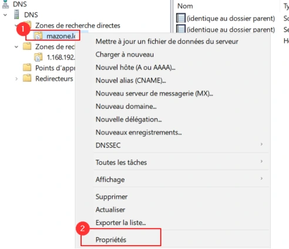

Visuel isolé — Fiche démo 3 - Le DNS et les mises à jour

- Vérification du transfert de zone

Se positionner sur la nouvelle zone créée (1). L’ensemble des enregistrements doivent être présents (2). En cas d’ajout de nouveaux enregistrements, ces derniers seront automatiquement ajoutés sur cette zone secondaire.

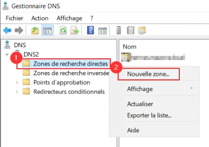

Visuel isolé — Fiche démo 3 - Le DNS et les mises à jour

Attention, il n’est pas possible d’ajouter des enregistrements sur cette zone secondaire (lecture uniquement).

Référence du document : 1_MNES0GabYoPW15w4Qx4eiMntT51oqMM · SHA-256 6baeed86e5a42e85…

## Démonstration · Fiche démo 4 - Le DNS les sous-domaines et les délégations · 3 pages transcrites

#### Le DNS, les sous-domaines et les délégations

#### Démonstration 04 du module 06

Cette démonstration décrit les différentes étapes relatives à la configuration d’un sous-domaine et la mise en place de délégation.

#### Déroulement

- Ouvrir la console MMC du service DNS.

Ouvrir la fenêtre Outils d’administration puis cliquer sur la ligne DNS (1).

- Création d’une zone principale sur le deuxième serveur DNS

Sur le second serveur DNS, créer une zone principale (ici rennes.mazone.local) (1).

Y ajouter des enregistrements d’hôtes à l’intérieur (2).

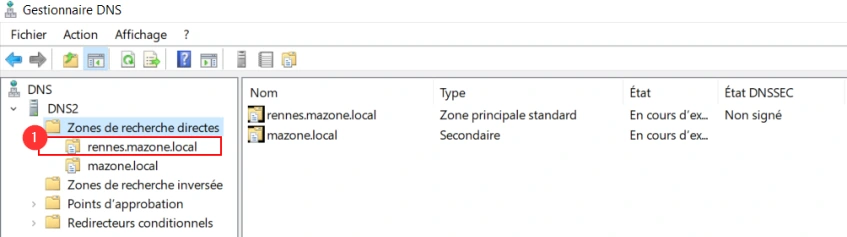

Visuel isolé — Fiche démo 4 - Le DNS les sous-domaines et les délégations

- Création de la délégation

Sur le premier serveur DNS, faire droit sur la zone précédemment créée (ici mazone.local) (1), puis sur le menu Nouvelle délégation… (2). Indiquer le nom du domaine délégué (ici Rennes, qui correspond à la zone créée sur le second serveur DNS) (3), puis cliquer sur le bouton Suivant (4). Indiquer l’adresse IP du second serveur DNS (5), puis cliquer sur le bouton Suivant (6). Ne pas oublier de faire des redirecteurs conditionnels afin de pouvoir résoudre correctement vos zones.

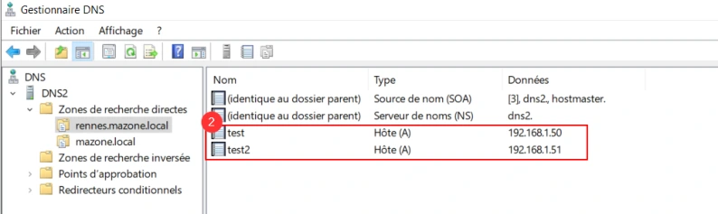

Visuel isolé — Fiche démo 4 - Le DNS les sous-domaines et les délégations

- Vérification

Avant la mise en place du redirecteur, il n’était pas possible de résoudre le sous-domaine rennes.mazone.local, c’est désormais possible.

```
Sur le premier serveur DNS, ouvrir une invite de commande et tester avec des commandes 
nslookup
```

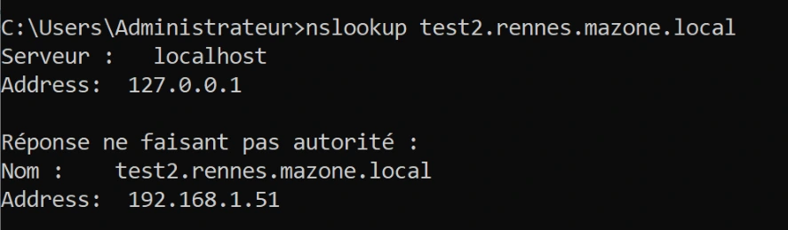

Visuel isolé — Fiche démo 4 - Le DNS les sous-domaines et les délégations

Référence du document : 166kmmVyH9fut3FVPTQPLCLEXYL8cPQXJ · SHA-256 c6a5549e7bcae9bb…

## Énoncé · Enoncé du TP 1 - DNS résolveur · 2 pages transcrites

#### Services réseau en environnement Microsoft DNS résolveur

#### TP du Module 06 – Le service DNS

Avant de démarrer ce TP, il convient d’avoir suivi les vidéos du module 6.

#### Durée estimée

1 à 2 heures

#### Énoncé

Prérequis :

Avoir réalisé le TP précédent du Module 05.

Création de la machine virtuelle : Installer une nouvelle machine virtuelle sous Windows Server 2019 Standard.

- Cette dernière sera nommée W19-DNS.

Cette machine devra communiquer avec l’ensemble de votre infrastructure.

#### Installation du service DNS : Installer le service DNS sur W19-DNS

Configurer W19-DNS afin qu’elle fasse appel à son propre service DNS.

Tester la résolution depuis W19-DNS.

- Pouvez-vous résoudre les noms DNS publics ?

#### Oui Non

- Pouvez-vous résoudre les noms DNS de centre de formation École ? (ad.campus-formation.test)

#### Oui Non

Est-ce normal ?

#### Afficher les informations contenues dans le cache du service DNS

Vider le cache DNS du serveur.

Configurer les redirecteurs vers les serveurs DNS de l’centre de formation, dont est cliente votre machine physique.

- Pouvez-vous résoudre les noms DNS publics ?

#### Oui Non

- Pouvez-vous résoudre les noms DNS de centre de formation École ?

#### Oui Non

Afficher les informations contenues dans le cache du service DNS.

- Que pouvez-vous en déduire ?

#### Paramétrages clients

Configurer le serveur DHCP afin qu’il fasse appel au serveur DNS de votre infrastructure.

Configurer automatiquement les clients afin qu’ils fassent appel au serveur DNS de votre infrastructure.

- Pouvez-vous résoudre les noms DNS publics ?

#### Oui Non

- Pouvez-vous résoudre les noms DNS de centre de formation École ?

#### Oui Non

Référence du document : 17NjF3si6dTyLqzOpap5MZ87gaZ6hNAp8 · SHA-256 52d5d0074f914b27…

## Énoncé · Enoncé du TP 2 - DNS hébergeur · 2 pages transcrites

#### Services réseau en environnement Microsoft DNS hébergeur

#### TP du Module 06 – Le service DNS

Avant de démarrer ce TP, il convient d’avoir suivi les vidéos du module 6 et d’avoir réalisé le précédent TP.

#### Durée estimée

1 à 2 heures

#### Énoncé

Prérequis :

Avoir réalisé le TP précédent du Module 05.

Mettre en place la VM SRV-2K19-DNS-TP14.ova mise à disposition.

#### Identifiant : Administrator - Mot de passe : [valeur fournie par le formateur]

#### Configuration du serveur DNS hébergeur

Installez le service DNS sur la machine virtuelle ou le service DHCP est hébergé.

Sur ce serveur, créez les zones pour les besoins suivants :

- Résolution directe pour un domaine infraXX.net (ou XX = vos initiales).

- Résolution inverse pour votre réseau VmNet10.

- Création de l’ensemble des enregistrements permettant la résolution des noms et adresses IP de vos serveurs.

Testez et validez le bon fonctionnement depuis votre serveur :

- nslookup -q=soa <votre domaine>

- nslookup -q=ns <votre domaine>

#### Paramétrage du client

Revoir la configuration automatique des paramètres DNS sur les clients :

- Configurez le 2e serveur DNS comme serveur DNS préféré. o Configurez le suffixe DNS relatif à votre domaine.

Testez et validez le bon fonctionnement de la résolution de vos domaines depuis le poste client.

- En utilisant le FQDN o En utilisant le nom d’hôte uniquement

Chaîne de résolution :

Configurez le 2e serveur DNS pour faire appel uniquement à votre 1er serveur DNS pour la résolution des noms DNS extérieurs.

Configurez votre 2e serveur DNS pour permettre la résolution du domaine DNS mis à disposition «infraXX.net » .

Testez et validez le bon fonctionnement de la résolution depuis le client.

- Vers vos domaines DNS ?

#### Oui Non

- Vers les domaines DNS fournis ?

#### Oui Non

- Vers les domaines DNS publics ?

#### Oui Non

Référence du document : 1zsTogw-3-KIyqlbywqVOhe-tdG1zbXfV · SHA-256 21b8123e765b1781…

## Énoncé · Enoncé du TP 3 - DNS hébergeur et redondance · 3 pages transcrites

#### Services réseau en environnement Microsoft DNS hébergeur et redondance

#### TP du Module 06 – Le service DNS

Avant de démarrer ce TP, il convient d’avoir suivi les vidéos du module 6 et réalisé le précédent TP.

#### Durée estimée

1 à 2 heures

#### Énoncé

Prérequis :

Avoir réalisé le TP précédent du Module 05.

Un serveur DNS sera à mettre en place dans le réseau 192.168.0.0/24 ainsi que dans le réseau 192.168.1.0/24.

Le routage entre les deux réseaux doit être fonctionnel.

Enregistrements dynamiques : Sur le serveur DNS hébergeur, configurez les zones principales pour permettre l’enregistrement dynamique des clients.

Sur les postes clients, configurez le suffixe DNS principal.

Vérifiez la présence des nouveaux enregistrements DNS :

- avec la console DNS sur le serveur DNS hébergeur

- avec la commande nslookup

- quels types d’enregistrements sont créés ?

Mise en œuvre de la redondance DNS : Vérifiez au préalable que le routage est opérationnel entre les deux réseaux. Vous réaliserez un schéma des infrastructures.

Sur le serveur DNS hébergeur du réseau 192.168.0.0/24 :

- Configurez les zones principales, et le transfert de zone pour permettre le transfert à partir du serveur DNS hébergeur du réseau 192.168.1.0/24.

Sur le serveur DNS du réseau 192.168.1.0/24 :

- Configurez les zones secondaires et le transfert de zone pour permettre le transfert à partir du serveur DNS du réseau 192.168.0.0/24.

Vérifiez que le transfert est fonctionnel en créant un nouvel enregistrement dans la zone principale :

- Le nouvel enregistrement est-il créé ?

#### Oui Non

- Sinon, consultez le journal d’évènements DNS, vérifiez les connexions…

#### Validation de la redondance DNS

Paramétrez les clients de chacune des infrastructures :

- Pour les clients du réseau 192.168.0.0/24 :

DNS préféré = Serveur DNS hébergeur du réseau d’appartenance. DNS auxiliaire = Serveur DNS hébergeur du second réseau.

- Pouvez-vous configurer les suffixes DNS de deux domaines sur tous les clients ?

#### Oui Non

- Comment procéder ?

Arrêtez le service DNS hébergeur du 1er réseau et testez la résolution depuis l’infrastructure du 2e réseau.

- Peut-on résoudre les noms du 1er Réseau ?

#### Oui Non

- Peut-on résoudre les noms du 2e réseau ?

#### Oui Non

- Peut-on résoudre les noms DNS publics ?

#### Oui Non

Redémarrez le service DNS hébergeur du 1er réseau.

- Peut-on résoudre les noms du 1er Réseau ?

#### Oui Non

- Peut-on résoudre les noms du 2e réseau ?

#### Oui Non

- Peut-on résoudre les noms DNS publics ?

#### Oui Non

Vous réaliserez un schéma montrant les chaînes de résolutions DNS.

Référence du document : 1Co9vVOLLLr8YZ4SNXIhgw98h8YJ6nXHP · SHA-256 e333e8791c394924…

## Énoncé · Enoncé du TP 4 - DNS délégations et redirections · 2 pages transcrites

#### DNS délégations et redirections

#### TP du Module 06 – Le service DNS

Avant de démarrer ce TP, il convient d’avoir suivi les vidéos du module 6 et réalisé le précédent TP.

#### Durée estimée

2 à 3 heures

#### Énoncé

Prérequis :

- Avoir réalisé le TP précédent du Module 05.

L’objectif est de mettre en place une hiérarchie DNS :

- Un domaine de 2e niveau : formation.test
- Un domaine de 3e niveau : nantes.formation.test OU rennes.formation.test OU niort.formation.test
- Neuf domaines de 4e niveau : res.nantes.formation.test OU res.rennes.formation.test … Gestion des domaines :

- Chacun des serveurs DNS prend en charge un des domaines de la hiérarchie.
- Le domaine est géré sur le 1er serveur DNS et la redondance est assurée.

- Vous reportez les informations relatives au domaine (nom du domaine,

gestionnaire du domaine, adresses IP des serveurs DNS).

- Validez le bon fonctionnement de la résolution et de la redondance sur le domaine pris en charge avant de passer à l’étape suivante.

#### Résolution des domaines de l’ensemble de la hiérarchie

- Paramétrez chacun des serveurs pour permettre la résolution de l’ensemble des domaines de la hiérarchie (domaine parent, enfant...)

- Vérifiez le bon fonctionnement de la résolution sur l’ensemble de la hiérarchie.

- Vous réaliserez un schéma montrant les chaînes de résolutions DNS.

Référence du document : 1YB86UyrarU5OVHtE0YYAZuRm-Cw_zP5d · SHA-256 ae01b13efac5bf93…

## Correction · Solution du TP 1 - DNS résolveur · 4 pages transcrites

Correction originale : à consulter après avoir tenté l’exercice.

#### DNS résolveur

#### TP du Module 06 – Le service DNS

Avant de démarrer ce TP, il convient d’avoir suivi les vidéos du module 6.

#### Durée estimée

1 à 2 heures

#### Solution

Prérequis :

- Avoir réalisé le TP précédent du Module 05.

Création de la machine virtuelle :

Installation du service DNS :

- Installer le service DNS sur W19-DNS

- Configurez W19-DNS afin qu’elle fasse appel à son propre service DNS.

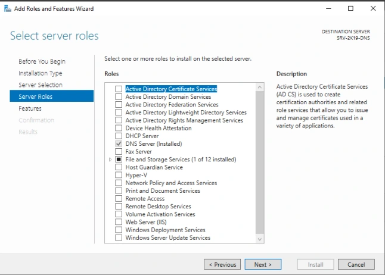

Visuel isolé — Solution du TP 1 - DNS résolveur

- Tester la résolution depuis W19-DNS.

- Pouvez-vous résoudre les noms DNS publics ? □ Non

- Pouvez-vous résoudre les noms DNS de centre de formation École ? (ad.campus-formation.test) □ Non

- Est-ce normal ? Oui, car il n’y a pas de redirecteur.

- Affichez les informations contenues dans le cache du service DNS

- Vider le cache DNS du serveur.

- Configurer les redirecteurs

- Vers les serveurs DNS de l’centre de formation, dont est cliente votre machine physique. o Pouvez-vous résoudre les noms DNS publics ? □ Oui

- Pouvez-vous résoudre les noms DNS de centre de formation École ? □ Oui

- Afficher les informations contenues dans le cache du service DNS.

- Que pouvez-vous en déduire ? Le serveur DNS résolveur renseigne le cache DNS au fur et à mesure des demandes de l’utilisateur. Paramétrages clients

- Configurer le serveur DHCP afin qu’il fasse appel au serveur DNS de votre infrastructure.

- Configurer automatiquement les clients afin qu’ils fassent appel au serveur DNS de votre infrastructure.

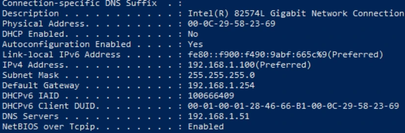

Visuel isolé — Solution du TP 1 - DNS résolveur

- Pouvez-vous résoudre les noms DNS publics ? □ Oui

- Pouvez-vous résoudre les noms DNS de centre de formation École ? □ Oui

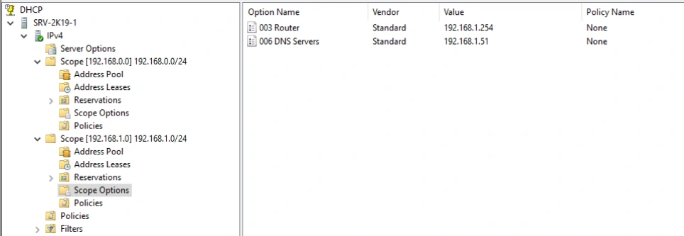

Visuel isolé — Solution du TP 1 - DNS résolveur

Référence du document : 1CKoJTNvqPRBNGHG3yOos6RoNxANpvh8M · SHA-256 23ca5c52dbd3a231…

## Correction · Solution du TP 2 - DNS hébergeur · 6 pages transcrites

Correction originale : à consulter après avoir tenté l’exercice.

#### DNS hébergeur

#### TP du Module 06 – Le service DNS

Avant de démarrer ce TP, il convient d’avoir suivi les vidéos du module 6 et d’avoir réalisé le précédent TP.

#### Durée estimée

1 à 2 heures

#### Énoncé

Prérequis :

- Avoir réalisé le TP précédent du Module 05.

- Mettre en place la VM SRV-2K19-DNS-TP14.ova mise à disposition.

- Identifiant : Administrator - Mot de passe : [valeur fournie par le formateur]

#### Configuration du serveur DNS hébergeur

- Installez le service DNS sur la machine virtuelle ou est hébergé le service DHCP.

- Sur ce serveur, créez les zones pour les besoins suivants :

- Résolution directe pour un domaine infraXX.net (ou XX = vos initiales).

- Résolution inverse pour votre réseau VmNet10. o Création de l’ensemble des enregistrements permettant la résolution des

noms et adresses IP de vos serveurs.

- Testez et validez le bon fonctionnement depuis votre serveur :

- nslookup -q=soa <votre domaine> o nslookup -q=ns <votre domaine>

#### Paramétrage du client

- Revoir la configuration automatique des paramètres DNS sur les clients :

- Configurez le 2e serveur DNS comme serveur DNS préféré.

- Configurer le suffixe DNS relatif à votre domaine.

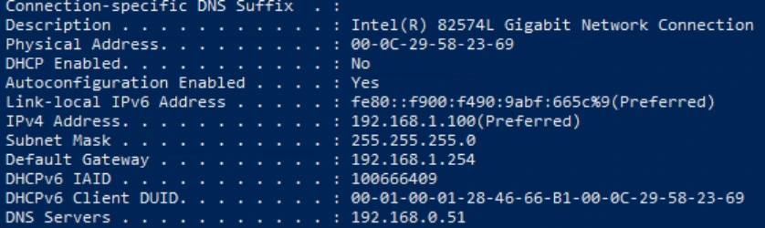

Visuel isolé — Solution du TP 2 - DNS hébergeur

- Testez et validez le bon fonctionnement de la résolution de vos domaines depuis le poste client.

- En utilisant le FQDN

- En utilisant le nom d’hôte uniquement

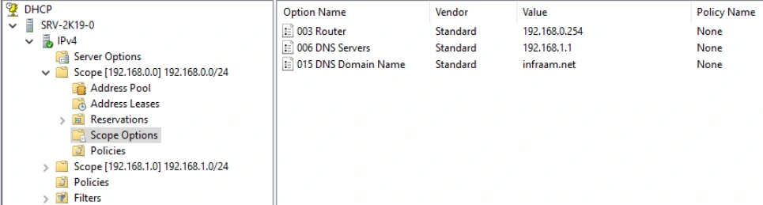

Visuel isolé — Solution du TP 2 - DNS hébergeur

Chaîne de résolution :

- Configurez le 2e serveur DNS pour faire appel uniquement à votre 1er serveur DNS pour la résolution des noms DNS extérieurs.

- Configurez votre 2e serveur DNS pour permettre la résolution du domaine DNS mis à disposition «infraXX.net » .

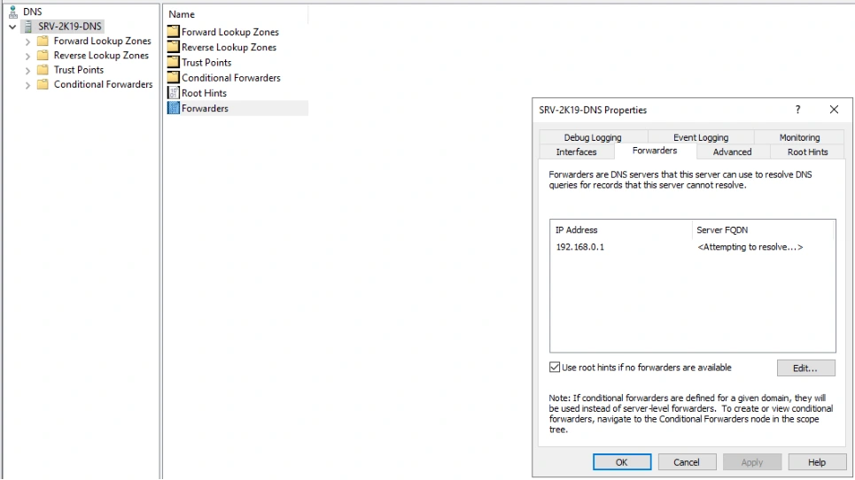

Visuel isolé — Solution du TP 2 - DNS hébergeur

- Testez et validez le bon fonctionnement de la résolution depuis le client.

- Vers vos domaines DNS ? □ Oui

- Vers les domaines DNS fournis ? □ Oui

- Vers les domaines DNS publics ? □ Oui

Référence du document : 10nLXlOI84_vLn6rvh0KDns-q7pdGvOpB · SHA-256 289193b6fe1553cc…

## Correction · Solution du TP 3 - DNS hébergeur et redondance · 11 pages transcrites

Correction originale : à consulter après avoir tenté l’exercice.

#### DNS hébergeur et redondance

#### TP du Module 06 – Le service DNS

Avant de démarrer ce TP, il convient d’avoir suivi les vidéos du module 6 et réalisé le précédent TP.

#### Durée estimée

1 à 2 heures

#### Solution

Prérequis :

- Avoir réalisé le TP précédent du module 05.

- Un serveur DNS sera à mettre en place dans le réseau 192.168.0.0/24 ainsi que dans le réseau 192.168.1.0/24.

- Le routage entre les deux réseaux doit être fonctionnel.

Enregistrements dynamiques :

- Sur le serveur DNS hébergeur, configurez les zones principales pour permettre l’enregistrement dynamique des clients.

Il faut faire un clic droit sur la zone DNS, puis dans l’onglet Général, sélectionner Nonsecure and Secure dans le champ Dynamic Update.

- Sur les postes clients, configurez le suffixe DNS principal.

Il faut aller dans les propriétés de la carte réseau, puis cliquer sur Advanced, puis sur l’onglet DNS.

- Vérifiez la présence des nouveaux enregistrements DNS :

- avec la console DNS sur le serveur DNS hébergeur

Voici le détail des fichiers de zone mis à jour par le serveur DHCP et le détail de la configuration du serveur DHCP.

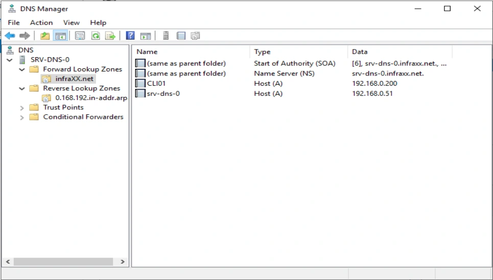

Visuel isolé — Solution du TP 3 - DNS hébergeur et redondance

Il faut aller dans les propriétés du serveur DHCP en cliquant sur IPV4, puis sur l’onglet DNS et activer les cases suivantes.

- Avec la commande nslookup

#### Avec la configuration du suffixe DNS configuré

Sans la configuration du suffixe, il faut ajouter le nom de domaine.

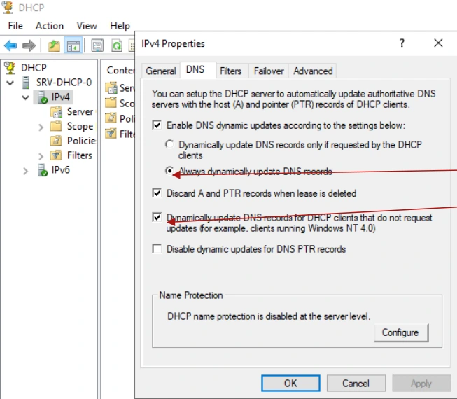

Visuel isolé — Solution du TP 3 - DNS hébergeur et redondance

- Quels types d’enregistrements sont créés ? Des enregistrements de type A et TXT.

Mise en œuvre de la redondance DNS : Vérifiez au préalable que le routage est opérationnel entre les deux réseaux. Vous réaliserez un schéma des infrastructures.

- Sur le serveur DNS hébergeur du réseau 192.168.0.0/24 :

- Configurez les zones principales, et le transfert de zone pour permettre le

transfert à partir du serveur DNS hébergeur du réseau 192.168.1.0/24. Il faut faire un clic droit sur la zone DNS puis dans l’onglet Zone Transfers, il faut ajouter l’IP du serveur distant.

- Sur le serveur DNS du réseau 192.168.1.0/24 :

- Configurez les zones secondaires et le transfert de zone pour permettre le

transfert à partir du serveur DNS du réseau 192.168.0.0/24.

On crée une nouvelle zone sur le serveur DNS, en type secondary, puis on spécifie le nom de la zone

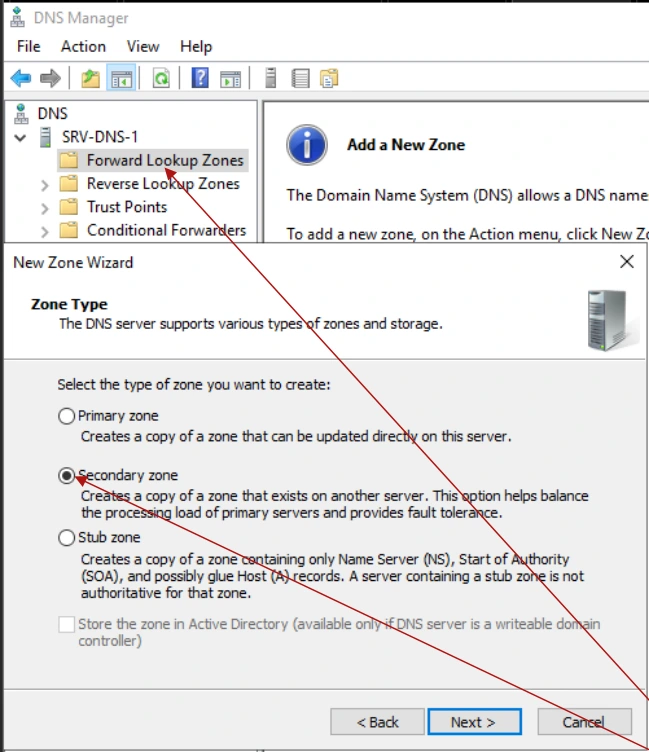

Visuel isolé — Solution du TP 3 - DNS hébergeur et redondance

On indique ensuite l’IP du serveur DNS Maitre.

- Vérifiez que le transfert est fonctionnel en créant un nouvel enregistrement dans la zone principale :

Ici on crée l’enregistrement sur le serveur maître.

- Le nouvel enregistrement est-il créé ? □ Oui

- Sinon, consultez le journal d’évènements DNS, vérifiez les connexions…

#### Validation de la redondance DNS

- Paramétrez les clients de chacune des infrastructures :

- Pour les clients du réseau 192.168.0.0/24 :

- DNS préféré = Serveur DNS hébergeur du réseau d’appartenance.
- DNS auxiliaire = Serveur DNS hébergeur du second réseau.

- Pouvez-vous configurer les suffixes DNS de deux domaines sur tous les

```
clients ? 
  □ OUI
```

- Comment procéder ? Une option DHCP est disponible.

- Arrêtez le service DNS hébergeur du 1er réseau et testez la résolution depuis l’infrastructure du 2e réseau.

- Peut-on résoudre les noms du 1er Réseau ? □ Oui

- Peut-on résoudre les noms du 2e Réseau ?

```
□ Oui
```

- Peut-on résoudre les noms DNS publics ? □ Oui, à condition d’indiquer l’IP du serveur DNS de l’centre de formation comme redirecteur non conditionnel

- Redémarrez le service DNS hébergeur du 1er réseau.

- Peut-on résoudre les noms du 1er Réseau ? □ Oui

- Peut-on résoudre les noms du 2e réseau ? □ Oui

- Peut-on résoudre les noms DNS publics ? □ Oui, à condition d’indiquer l’IP du serveur DNS de l’centre de formation comme redirecteur non conditionnel

- Vous réaliserez un schéma montrant les chaînes de résolutions DNS.

Référence du document : 1dq3eJVa646vscYkKDxz9dHIJm9xIC4hY · SHA-256 1b6e674b68df5266…

## Correction · Solution du TP 4 - DNS délégations et redirections · 7 pages transcrites

Correction originale : à consulter après avoir tenté l’exercice.

#### DNS délégations et redirections

#### TP du Module 06 – Le service DNS

Avant de démarrer ce TP, il convient d’avoir suivi les vidéos du module 6 et réalisé le précédent TP.

#### Durée estimée

2 à 3 heures

#### Solution

Prérequis :

- Avoir réalisé le TP précédent du Module 05.

L’objectif est de mettre en place une hiérarchie DNS :

- Un domaine de 2e niveau : formation.test

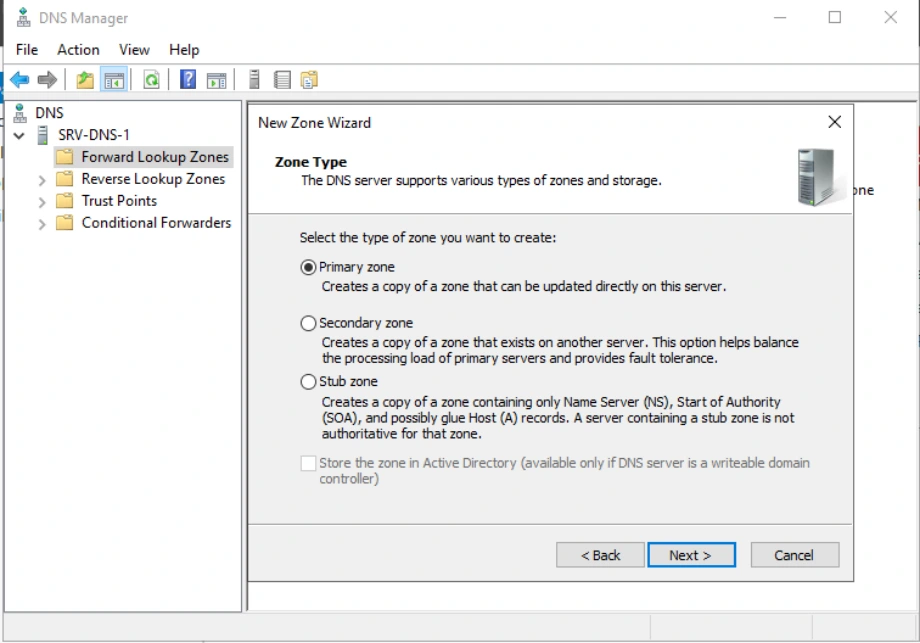

Visuel isolé — Solution du TP 4 - DNS délégations et redirections

#### On crée une nouvelle zone principale pour le nom de domaine formation.test

- Un domaine de 3e niveau : nantes.formation.test OU rennes.formation.test OU niort.formation.test
- Neuf domaines de 4e niveau : res.nantes.formation.test OU res.rennes.formation.test …

Faites un clic droit sur la zone formation.test puis sur Nouvelle délégations.

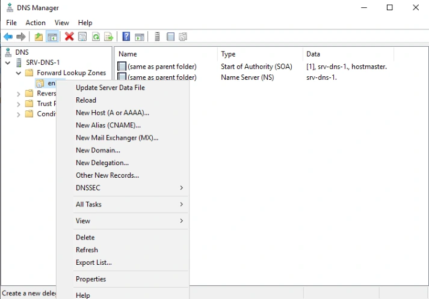

Visuel isolé — Solution du TP 4 - DNS délégations et redirections

#### Sur le second serveur DNS, créer la zone formation.test puis ajouter le domaine NANTES

Créer des enregistrements de TEST. Tester la résolution de nom en envoyant la requête sur l’un ou l’autre des deux serveur DNS.

Gestion des domaines :

- Chacun des serveurs DNS prend en charge un des domaines de la hiérarchie.
- Le domaine est géré sur le 1er serveur DNS et la redondance est assurée.

- Vous reportez les informations relatives au domaine (nom du domaine,

gestionnaire du domaine, adresses IP des serveurs DNS).

- Validez le bon fonctionnement de la résolution et de la redondance sur le domaine pris en charge avant de passer à l’étape suivante.

#### Résolution des domaines de l’ensemble de la hiérarchie

- Paramétrez chacun des serveurs pour permettre la résolution de l’ensemble des domaines de la hiérarchie (domaine parent, enfant...)

- Vérifiez le bon fonctionnement de la résolution sur l’ensemble de la hiérarchie.

- Vous réaliserez un schéma montrant les chaînes de résolutions DNS.

Référence du document : 1fVa7mIvVUU_DhhEQYfXQoSkUSwdP5Od2 · SHA-256 3f5e84ae83ec103b…

## Fiche de synthèse

Les lignes reprennent les titres du cours et la première phrase de chaque partie.

| Partie | Repère du cours |
| --- | --- |
| Correction · Solution du TP 1 - DNS résolveur · 4 pages transcrites | Correction originale : à consulter après avoir tenté l’exercice. |
| Correction · Solution du TP 2 - DNS hébergeur · 6 pages transcrites | Correction originale : à consulter après avoir tenté l’exercice. |
| Correction · Solution du TP 3 - DNS hébergeur et redondance · 11 pages transcrites | Correction originale : à consulter après avoir tenté l’exercice. |
| Correction · Solution du TP 4 - DNS délégations et redirections · 7 pages transcrites | Correction originale : à consulter après avoir tenté l’exercice. |
