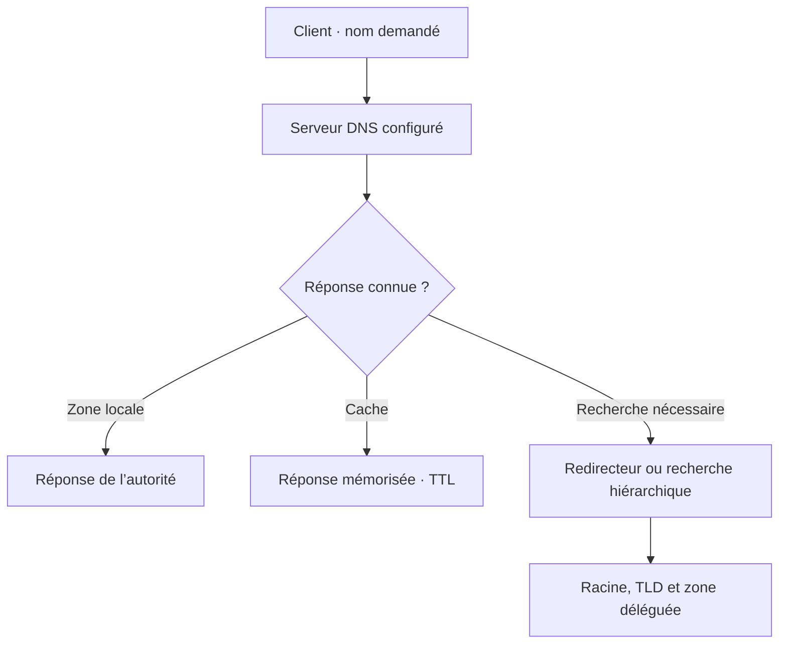

# Module 06 — Le service DNS

Un poste peut interroger un serveur qui fait autorité sur sa zone, un résolveur qui cherche la réponse ailleurs, ou le même serveur pour ces deux fonctions. Les quatre TP suivent cette progression et vérifient séparément la résolution, l’hébergement, la redondance et la délégation.

## Objectifs

- Distinguer la résolution locale, récursive et itérative.
- Reconnaître la fonction des zones, des enregistrements et des redirecteurs.
- Créer et vérifier des zones directes, inverses et secondaires dans Windows Server.
- Tester le nom court, le FQDN, le transfert et la résolution entre domaines délégués.

## 1. Suivre la requête du poste à la réponse

Le client Windows peut obtenir une réponse de son cache, d’une entrée du fichier hosts ou d’un serveur DNS configuré. Le fichier `C:\Windows\System32\drivers\etc\hosts` associe une adresse à un ou plusieurs noms séparés par des espaces. Le support montre un séparateur virgule à un endroit. La syntaxe attend des espaces ou tabulations entre les champs.

Un **FQDN** situe l’hôte dans la hiérarchie DNS. Dans `srvfic.masociete.lcl.`, `srvfic` est le nom d’hôte, `masociete.lcl` son domaine et le point final désigne la racine. Un **nom court** peut dépendre d’un suffixe principal, d’un suffixe propre à la connexion ou d’une liste de recherche. Vérifier le nom demandé avant de modifier la zone.

| Étape | Contrôle |
| --- | --- |
| Identifier le DNS interrogé | Lire les serveurs indiqués par le poste et viser un serveur précis pour comparer. |
| Repérer un cache | Distinguer le cache du client et celui du serveur. Chacun peut retenir des réponses positives ou négatives. |
| Comparer nom court et FQDN | Le nom complet peut fonctionner malgré une configuration de suffixe incomplète. |
| Tester le nom inverse | Interroger le PTR et identifier la zone inverse qui le contient. |

```cmd
ipconfig /all
ipconfig /displaydns
nslookup srvfic.masociete.lcl.
nslookup -type=soa masociete.lcl.
nslookup -type=ns masociete.lcl.
```

La commande `ipconfig /flushdns` agit sur le cache local du poste. Pour comparer des requêtes non mémorisées sur un résolveur du TP, vider aussi son cache au moment prévu avec le Gestionnaire DNS.

## 2. Distinguer résolution et autorité

Une demande **récursive** attend une réponse finale du résolveur. Une requête **itérative** peut recevoir un renvoi vers un autre serveur. La hiérarchie DNS mène de la racine au domaine de premier niveau, puis à la zone qui contient la réponse. La zone primaire porte les données de référence. La secondaire reçoit une copie et répond également avec autorité. La copie reste en lecture seule pour l’administration ordinaire.

**Illustration IA / externe au cours — les chemins possibles d’une requête.**



Un redirecteur général traite les noms qui nécessitent une recherche externe. Un **redirecteur conditionnel** n’est utilisé que pour le suffixe ciblé. Une **délégation** se configure dans une zone parente et annonce les serveurs qui font autorité pour la zone enfant. En l’absence de redirecteur, la résolution publique peut réussir via les indications de racine si la récursion est autorisée et les serveurs atteignables. Le corrigé du TP 1 montre un résultat négatif avant la redirection dans sa maquette. [Redirection et indications de racine Windows DNS](https://learn.microsoft.com/en-us/windows-server/networking/dns/forwarding)

## 3. Lire une zone et ses enregistrements

| Type | Donnée représentée |
| --- | --- |
| SOA | Autorité administrative, numéro de série et temporisations de la zone. |
| NS | Nom d’un serveur qui fait autorité. |
| A / AAAA | Adresse IPv4 ou IPv6 d’un hôte. |
| CNAME | Alias vers un nom canonique. |
| MX | Serveur de messagerie et priorité. |
| SRV | Localisation d’un service selon priorité, poids, port et cible. |
| PTR | Nom associé à une adresse, dans la zone inverse. |

Le Gestionnaire DNS permet de repérer les zones directes et inverses, les indications de racine, les redirecteurs et les points d’approbation. Une zone directe héberge les noms. Une zone inverse organise les adresses pour retrouver les noms. Le support présente les zones en fichier sous `%windir%\system32\dns`. Une zone intégrée à AD utilise une réplication différente. [Gérer les zones DNS Windows Server](https://learn.microsoft.com/windows-server/networking/dns/manage-dns-zones)

Une **mise à jour dynamique** ajoute ou modifie les données de la zone primaire suivant ses droits et sa configuration. Un **transfert** recopie la zone vers un serveur secondaire autorisé. Comparer le numéro de série SOA, les hôtes autorisés et le journal DNS. Les transferts complets AXFR et incrémentaux IXFR répondent à des besoins différents. Un secondaire doit accéder au primaire et peut utiliser une notification pour accélérer la vérification du numéro de série.

## 4. TP guidé — DNS résolveur

**Durée du support.** Une à deux heures. Reprendre le réseau et le DHCP du module 5. Créer `W19-DNS` sous Windows Server 2019 Standard et lui permettre de communiquer avec les autres machines de la maquette.

1. Installer le rôle DNS. Configurer `W19-DNS` pour interroger son propre service, puis ouvrir le Gestionnaire DNS et identifier les options de recherche.
2. Depuis le serveur, interroger un nom public et le nom privé `ad.campus-formation.test` du scénario neutralisé. Noter l’adresse du DNS interrogé et le résultat. Le corrigé obtient deux échecs avant la redirection. Vérifier les indications de racine et les possibilités de sortie pour expliquer le résultat dans votre maquette.
3. Examiner le cache du serveur et le vider. Dans les propriétés DNS, ajouter les redirecteurs du laboratoire indiqués par l’atelier.
4. Répéter les deux requêtes et examiner les entrées apparues dans le cache. Le corrigé obtient la résolution publique et privée par les redirecteurs du scénario. La zone privée doit être connue sur le chemin emprunté.
5. Dans DHCP, renseigner l’option **006 Serveurs DNS** avec le résolveur de l’infrastructure. Renouveler le bail du poste client, vérifier `ipconfig /all` et répéter les tests sur les deux catégories de noms.

## 5. TP guidé — DNS hébergeur

**Durée du support.** Une à deux heures. Préparer la VM fournie dans le scénario `SRV-2K19-DNS-TP14.ova` et les accès de laboratoire.

1. Installer DNS sur le serveur qui héberge DHCP selon l’énoncé. Dans **Zones de recherche directes**, créer la zone primaire du domaine `infraXX.net`, avec les initiales demandées. Dans **Zones de recherche inverse**, créer la zone du réseau VMNet10.
2. Ajouter les enregistrements A et PTR des serveurs. Vérifier les réponses A et PTR, ainsi que les SOA et NS de la zone, depuis le serveur.
3. Distribuer l’adresse du second DNS comme DNS préféré et le suffixe du domaine pour le client. Dans le scénario, l’option **015 Nom de domaine DNS** indique un suffixe de connexion. Renouveler le bail et comparer le FQDN puis le nom court.
4. Configurer le second DNS pour transmettre les requêtes extérieures uniquement au premier résolveur. Vérifier le choix de secours par indications de racine si la consigne exige ce chemin unique.
5. Tester sur le poste les noms locaux, les domaines fournis et les noms publics. Le même libellé `infraXX.net` apparaît pour le domaine créé et un domaine fourni dans le document. Une zone locale faisant autorité répond pour son espace de noms. Si deux espaces sont attendus, clarifier les domaines exacts avant de tester une redirection.

```powershell
$dnsLabo = Read-Host "Adresse du serveur DNS de laboratoire"
$zoneLabo = Read-Host "Nom de la zone de laboratoire"
Resolve-DnsName -Name $zoneLabo -Type SOA -Server $dnsLabo -DnsOnly
Resolve-DnsName -Name $zoneLabo -Type NS -Server $dnsLabo -DnsOnly
```

## 6. TP guidé — DNS hébergeur et redondance

**Durée du support.** Une à deux heures. Utiliser un DNS sur `192.168.0.0/24` et un autre sur `192.168.1.0/24`. Vérifier le routage et identifier les adresses des serveurs avant la configuration.

### A. Prouver l’enregistrement dynamique

1. Dans les propriétés des zones principales, activer le mode de mise à jour prévu pour la maquette. La solution montre **Non sécurisé et sécurisé**. Ce réglage autorise une portée plus large que le mode sécurisé d’une zone intégrée à AD.
2. Configurer le suffixe principal du poste et les options DNS de DHCP indiquées. La démonstration propose `ipconfig /registerdns` sur le client. Vérifier ensuite le résultat dans la console et avec une requête ciblée.
3. Relever les types réellement créés. Le corrigé mentionne A et TXT. Les enregistrements observés dépendent du service qui effectue la mise à jour et des réglages direct et inverse. Vérifier séparément les A et les PTR attendus dans votre maquette.

### B. Prouver le transfert et le basculement

1. Sur le primaire, autoriser le transfert vers l’adresse du second serveur dans **Transferts de zone**. Sur le secondaire, créer chaque zone secondaire avec le même nom et préciser l’adresse du primaire.
2. Interroger chaque serveur et comparer le numéro de série SOA. Créer un enregistrement témoin sur le primaire, puis vérifier qu’il apparaît sur le secondaire. En cas d’échec, vérifier le journal DNS, l’autorisation de transfert et la connectivité avant d’ajouter une seconde fois l’enregistrement.
3. Configurer le DNS préféré et l’auxiliaire des postes selon le réseau du TP. Pour deux suffixes, utiliser une liste de recherche adaptée à la version du poste et de sa stratégie. L’option DHCP 015 transmet un seul nom de domaine et ne suffit pas à prouver la présence d’une liste.
4. Arrêter le service du premier DNS dans le laboratoire. Depuis le second réseau, tester des noms de chaque réseau et un nom public, en évitant de valider sur une réponse déjà en cache. Le corrigé prévoit un redirecteur général sur le serveur encore disponible pour la résolution publique.
5. Redémarrer le service du premier DNS et répéter les essais. Documenter le DNS interrogé, le numéro de série, la réponse et le chemin de chaque test. Dessiner les deux réseaux et leurs chaînes de résolution.

## 7. TP guidé — Délégations et redirections

**Durée du support.** Deux à trois heures. L’équipe répartit `formation.test`, les trois branches Nantes, Rennes, Niort et les neuf espaces de quatrième niveau.

1. Relever pour chaque domaine le gestionnaire, le primaire, le secondaire et leurs adresses. Créer les zones attendues et des enregistrements de test. Vérifier chaque zone localement avant de chercher à traverser la hiérarchie.
2. Dans la zone parente, créer une **Nouvelle délégation** pour la zone enfant. Renseigner ses serveurs faisant autorité et l’adresse nécessaire pour les joindre lorsque leur nom dépend de la zone déléguée.
3. Sur les serveurs responsables de la branche, vérifier la zone enfant et la redondance par le transfert autorisé. Le corrigé parle de créer la zone parente puis d’ajouter le sous-domaine sur le second serveur. Pour démontrer une délégation, contrôler que le second serveur répond bien avec autorité pour la zone **enfant** attendue.
4. Relier les autres branches avec le chemin de résolution convenu. Un redirecteur conditionnel envoie des requêtes d’un suffixe vers un serveur désigné. La délégation annonce l’autorité dans la zone parente. Tester les deux mécanismes séparément lorsqu’ils sont tous deux configurés.
5. Interroger explicitement différents DNS pour un nom du parent, de l’enfant et d’une branche voisine. Comparer la résolution normale depuis le client et le résultat ciblé sur l’autorité. Dessiner les zones, les NS, la redondance et les liens de redirection.

## À retenir

Le cache, le serveur interrogé et le nom exact font partie du diagnostic. Le transfert réplique une zone vers un secondaire. La délégation donne une autorité à l’enfant. Pour vérifier le TP, relever les réponses de chaque serveur et les conditions du chemin utilisé.

## Mini-quiz — 5 questions {#mini-quiz}

1. Un FQDN fonctionne et le nom court échoue. Quel paramètre vérifier ?
2. Que prouve un numéro de série SOA identique sur deux serveurs ?
3. Pourquoi un nom public peut-il être résolu sans redirecteur ?
4. Comment prouver qu’un transfert continue après création d’un enregistrement ?
5. Où configure-t-on la délégation et que doit fournir le serveur enfant ?

??? success "Réponses commentées"

    1. Les suffixes du poste et leur ordre de recherche, puis le DNS réellement utilisé.
    2. Les deux serveurs annoncent la même version de la zone. Vérifier aussi l’enregistrement témoin pour établir le résultat attendu.
    3. Le résolveur peut utiliser ses indications de racine si la récursion et le réseau le permettent.
    4. Ajouter un enregistrement au primaire, comparer les SOA puis interroger directement le secondaire pour ce nom.
    5. Dans la zone parente. Le serveur enfant doit héberger la zone et répondre avec autorité.

## Pour pratiquer et réviser {#appliquer-le-cours}

- [Les quatre énoncés](../../tp/services-reseaux-microsoft/module-06/enonces.md) et [leurs corrections](../../tp/services-reseaux-microsoft/module-06/corrections.md)
- [Démonstrations du Gestionnaire DNS](../../tp/services-reseaux-microsoft/module-06/demonstrations.md)
- [Fiche de révision](../../revision/services-reseaux-microsoft/module-06-module-06.md)
- [Kahoot existant](../../kahoot/09-services-reseaux-microsoft-module-06-module-06.md)
- [Sommaire de Services réseau en environnement Microsoft](index.md)

## Provenance pédagogique

Le support M06, les quatre fiches de démonstration et les quatre paires d’énoncé et de solution fondent la leçon et les procédures. Les exemples neutralisés, le schéma et les contrôles détaillent la démarche de laboratoire.
