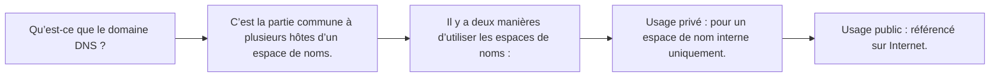
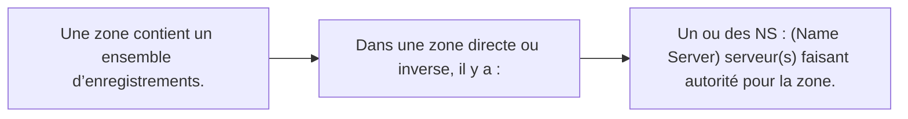

# Module 06 — Le service DNS

[Travaux pratiques](../../tp/services-reseaux-microsoft/module-06/index.md)

Les parties ci-dessous reprennent le cours original, dans le même ordre. Les encadrés et les schémas répètent ses formulations.

## Parcours de lecture

1. Support · Module 06 – Support de cours · 21 pages transcrites

**Visuel externe**


SOURCE DRIVE · TRANSCRIPTION DU SUPPORT

Le contenu des documents du dossier TSSR est transcrit ci-dessous, page par page. Les textes et tableaux sont intégrés à la page Web. Aucun fichier PDF, aucune diapositive entière ni aucune reproduction de page n’est affiché. Seuls des croquis ou visuels isolés et vérifiés peuvent accompagner la transcription. Les versions et les consignes restent celles des supports de formation. Les compléments IA sont conservés dans leur onglet distinct.

## Support · Module 06 – Support de cours · 21 pages transcrites

#### Module 06 – Le service DNS

#### Objectifs

- Comprendre et configurer le rôle DNS

#### La résolution de noms

#### La machine et l’humain, les chiffres ou les lettres

!!! note "À retenir"
    Quand nous sollicitons un service ou une ressource, nous indiquons : Le service sollicité Le nom de la machine qui fournit le service http://www.google.com 172.18.0.0/16 \\SRVFIC01\Partage SRVFIC01

Quand nous sollicitons un service ou une ressource, nous indiquons :

- Le service sollicité

- Le nom de la machine qui fournit le service

http://www.google.com

172.18.0.0/16

\\SRVFIC01\Partage

SRVFIC01

#### La résolution de noms

#### La résolution de noms d’hôtes

!!! note "À retenir"
    Afin de résoudre les noms d’hôtes en adresses IP, plusieurs mécanismes peuvent être utilisés.

Afin de résoudre les noms d’hôtes en adresses IP, plusieurs mécanismes peuvent être utilisés.

#### Mécanismes Utilité

!!! note "À retenir"
    Il contient des correspondances entre des noms d’hôtes déjà résolus et les adresses IP correspondantes.

Il contient des correspondances entre des noms d’hôtes déjà résolus et les adresses IP correspondantes. Il conserve aussi les réponses négatives aux requêtes du client. Il se gère avec la commande ipconfig.

Le service DNS Les clients DNS interrogent leur(s) serveur(s) DNS pour leurs requêtes de résolution.

Les modifications effectuées dans ce fichier (ajout et suppression d’entrées) sont reportées dans le cache DNS dès l’enregistrement du fichier.

| Mécanisme | Utilité |
| --- | --- |
| Cache DNS | Correspondances déjà résolues et réponses négatives. Il se gère avec ipconfig. |
| Service DNS | Les clients interrogent les serveurs DNS configurés. |
| Fichier hosts | Les modifications effectuées dans ce fichier sont reportées dans le cache DNS dès son enregistrement. |

#### La résolution de noms

#### Structure du fichier hosts

!!! note "À retenir"
    Le fichier de configuration local C:\Windows\System32\drivers\etc\hosts permet de renseigner des correspondances entre des noms et les adresses IP correspondantes.

- Le fichier de configuration local C:\Windows\System32\drivers\etc\hosts permet de renseigner des correspondances entre des noms et les adresses IP correspondantes.

- La syntaxe de ce fichier est la suivante :

#### Adresse_IP Nom

!!! note "À retenir"
    172.16.255.254 rtsiege.monentreprise.local 172.17.0.0 srv01,srv01.monentreprise.local Les informations contenues dans le fichier hosts sont prioritaires à l’interrogation du service DNS, s’il trouve une correspondance pour un nom donné dans ce fichier, le poste n’ira pas requêter le service DNS configuré.

172.16.255.254 rtsiege.monentreprise.local

172.17.0.0 srv01,srv01.monentreprise.local

Les informations contenues dans le fichier hosts sont prioritaires à l’interrogation du service DNS, s’il trouve une correspondance pour un nom donné dans ce fichier, le poste n’ira pas requêter le service DNS configuré.

Qu’est-ce que DNS ?

- Domain Name System est un service de résolution de noms.

#### Un service pour un espace

de noms en

Il permet de

nom de

résoudre

serveur l’hébergeant

Un nom en

#### Une adresse

adresse IP

#### IP en nom

Il est défini par des RFCs.

L’espace de

#### Ses principales caractéristiques

nom qu’il couvre est hiérarchique

La gestion de son espace de

Il est le mécanisme de

résolutions de

nom est distribuée

noms d’Internet

#### Noms d’hôtes et de domaine

#### Les noms d’hôtes

!!! note "À retenir"
    DNS permet la résolution de noms d’hôtes pleinement qualifiés (ou FQDN pour Fully Qualified Domain Name) en adresse IP.

- DNS permet la résolution de noms d’hôtes pleinement qualifiés (ou FQDN pour Fully Qualified Domain Name) en adresse IP.

- Voici un exemple :

#### Séparateur hôte / domaine

!!! note "À retenir"
    Nom de domaine pleinement qualifié (FQDN) www .

Nom de domaine pleinement qualifié (FQDN) www . google.fr.

- La première partie du nom identifie le poste au sein de son espace de nom, on parlera de partie hôte du nom.

- La deuxième partie identifie l’espace de nom auquel appartient l’hôte, on parlera de la partie domaine du nom.

#### Noms d’hôtes et de domaine

#### Les noms de domaines

!!! note "À retenir"
    C’est la partie commune à plusieurs hôtes d’un espace de noms.

**Visuel externe**



- Qu’est-ce que le domaine DNS ?
- C’est la partie commune à plusieurs hôtes d’un espace de noms.

- Pour être résolvable, tout hôte doit être identifiable par d’autre(s) poste(s) appartenant à d’autres espaces de noms. Pour cela, il dispose d’un nom pleinement qualifié unique à l’échelle mondiale.

- Il y a deux manières d’utiliser les espaces de noms :
- Usage privé : pour un espace de nom interne uniquement.
- Usage public : référencé sur Internet.

#### La hiérarchisation des espaces de noms

- L’espace de noms DNS est hiérarchique.

- Chaque espace de nom respecte cette hiérarchisation.

#### La racine Domaine

racine

#### .fr .com .de .net

#### Les TLD (Top Level Domain) (1er niveau)

#### Domaines de niveau

.gouv

inférieur (2e niveau)

éducation défense

#### (3e niveau)

#### La hiérarchisation des espaces de noms

##### Un serveur DNS comment ? Pour faire quoi ?

- Fournir des correspondances entre noms d’hôtes et adresse(s) IP associée(s).
- La résolution de noms externes à l’entreprise nécessite un serveur DNS résolveur.
- La mise en place d’un service de nommage interne (AD par exemple) nécessite un serveur DNS hébergeur.
- Le résolveur et l’hébergeur peuvent être assurés sur deux serveurs distincts ou cumulés sur le même serveur.
- En premier lieu, il faut identifier les besoins de résolutions de noms.

#### Le rôle du DNS résolveur

- C’est le partenaire désigné des équipements clients du service de résolution de noms.
- Il effectue des requêtes auprès d’autres serveurs DNS afin de résoudre les requêtes de ses clients.
- Il ne gère pas d’espace de noms.

#### Les mécanismes d’interrogation

#### Mécanismes d’interrogation des serveurs DNS

**Visuel externe**


Deux types de requêtes peuvent être adressés à un serveur DNS :

- Les requêtes récursives :
- Le serveur répondant doit fournir une réponse complète à la question posée.

Ce type de requête est fréquemment utilisé par un client pour son serveur DNS.

- Les requêtes itératives :
- Le serveur qui envoie la requête accepte une réponse partielle à la question posée.
- La réponse sera une indication lui permettant d’avancer dans son processus de résolution.

Ce type de requête est fréquemment utilisé lors de l’exploration de l’arborescence DNS à partir de la racine

#### Les mécanismes d’interrogation

#### Les requêtes récursives

Quelle est l’adresse IP de www.google.com. ?

#### IP de www.google.com. = 172.217.18.196

DNS

#### Les mécanismes d’interrogation

#### Les requêtes itératives

.

#### Quelle est l’adresse IP

fr.

de www.amendes.gouv.fr. ?

#### A de www.amendes.gouv.fr. = 160.92.178.39

gouv.fr.

amendes.gouv.fr.

#### Les redirections

#### La redirection non conditionnelle

- Sans configuration particulière, un serveur DNS ira interroger les serveurs racine afin de résoudre les requêtes de ses clients.

- Si un serveur est configuré de telle sorte à utiliser la redirection, il demandera à son serveur redirecteur de trouver les réponses aux requêtes de ses clients.

#### Résolveur interne

Quelle est l’adresse IP de www.google.com. ?

#### Réseau interne DNS FAI

#### IP de www.google.com. = 172.217.18.196

#### Les redirections

#### Le redirecteur conditionnel

- Un serveur DNS peut être configuré pour faire appel à des redirecteurs ciblés pour des espaces de noms identifiés. Il s’agit de redirecteurs conditionnels.

- Cette configuration permet de :
- Résoudre des espaces de noms privés non référencés et non résolvables dans l’arborescence d’espaces de noms publics.
- D’optimiser la résolution d’espaces de noms qui sont souvent sollicités.

Serveur faisant autorité pour enigme.lcl.

#### Redirection conditionnelle

Pour le domaine enigme.lcl.

Zone enigme.lcl.

#### Résolveur interne

#### Les redirections

#### La mise en cache

- Chaque fois qu’un serveur DNS fait appel à d’autres serveurs pour ses demandes de résolutions, il enregistre dans le cache DNS les résultats obtenus.

- La durée de conservation en cache est propre à chaque enregistrement (TTL).

- Les réponses négatives (enregistrement inexistant par exemple) sont aussi conservées en cache.

- Lorsque le serveur reçoit une requête d’un client, il détermine si cette dernière est relative à une zone pour laquelle il fait autorité. Si ce n’est pas le cas, il consulte son cache.

Le serveur et le client disposent de caches différents.

#### Démonstration

#### DNS résolveur

TP

#### Le DNS hébergeur

#### Le rôle du DNS hébergeur

Il a pour mission de

répondre aux requêtes relatives à

l’espace de nom

qu’il gère

#### Le DNS hébergeur

Il fait autorité pour

le ou les espace(s)

de nom(s) qu’il

#### Il gère un ou plusieurs espaces

gère

de noms

#### Les zones

- Correspondent au conteneur de l’ensemble des données d’un espace de nom.

- Elle contient un ensemble d’enregistrements.

- Le contenu de chaque zone est stocké dans un fichier de zone qui lui est propre (habituellement stocké dans %windir%\system32\dns*).

#### Les zones

#### Zone directe

- À chaque espace de nom correspond une zone.
- Un serveur faisant autorité est en mesure de répondre directement aux requêtes concernant l’espace de noms correspondant.

- S’il fait autorité sur une zone directe, il peut résoudre un nom en adresse IP.

#### Résolveur interne

Quelle est l’adresse IP de srvfic.masociete.lcl. ?

Héberge la zone masociete.lcl.

#### Réseau interne

#### IP de srvfic.masociete.lcl. = 192.168.0.1

#### Les zones

#### Zone inverse

S’il fait autorité sur une zone inverse, il peut résoudre une adresse IP en nom.

#### Résolveur interne

Héberge la zone inverse pour le réseau 192.168.0.0 Quel est le nom de 192.168.0.1 ?

#### Réseau interne

Nom de 192.168.0.1 = srvfic.masociete.lcl.

#### Les zones

#### Zone principale et zone secondaire

#### Les zones

#### Le contenu d’une zone

**Visuel externe**



- Une zone contient un ensemble d’enregistrements.

- Dans une zone directe ou inverse, il y a :
- Un SOA : (Start Of Authority) nom FQDN du serveur DNS disposant de la zone en écriture.
- Un ou des NS : (Name Server) serveur(s) faisant autorité pour la zone.

|  | Serveur maître | Serveur esclave |
| --- | --- | --- |
| Type de zone hébergée | Zone principale | Zone secondaire |
| Autorisation d’accès | Lecture / écriture | Lecture |
| Fait autorité pour la zone | Oui | Oui |

#### Les zones

#### Le contenu d’une zone

- Les enregistrements présents dans des zones directes

#### Type d’enregistrement Contenu

#### SOA nom FQDN du serveur DNS disposant de la zone en écriture

#### NS serveur(s) faisant autorité pour la zone

#### Les zones

#### Le contenu d’une zone

- Les enregistrements présents dans des zones inverses

#### Type d’enregistrement Contenu

#### SOA nom FQDN du serveur DNS disposant de la zone en écriture

#### NS serveur(s) faisant autorité pour la zone

| Enregistrements de zone directe | Contenu |
| --- | --- |
| SOA | Nom FQDN du serveur disposant de la zone en écriture |
| NS | Serveur(s) faisant autorité |
| A | Hôte IPv4 |
| AAAA | Hôte IPv6 |
| CNAME | Alias |
| MX | Serveur de messagerie |
| SRV | Services |

| Enregistrements de zone inverse | Contenu |
| --- | --- |
| SOA | Nom FQDN du serveur disposant de la zone en écriture |
| NS | Serveur(s) faisant autorité |
| PTR | Pointeur |

#### Les zones

#### Récapitulatif des étapes de résolution

Demande de résolution du client pour www.hadopi.fr.

#### Le serveur cherche la réponse dans sa zone et répond au client

Oui

Le serveur interrogé fait-il autorité pour la zone hadopi.fr.

?

Non

#### Le serveur répond au client

Oui

réponse en cache ?

Non

#### Le serveur interroge le redirecteur configuré

Oui

Le serveur est-il configuré pour

1 – redirecteur conditionnel 2 – redirecteur non-conditionnel

faire appel aux redirecteurs ?

Non

#### Le serveur interroge un serveur racine

#### Le serveur interroge les racines

Oui

#### Le serveur a-t-il obtenu la réponse à la requête de son

Le serveur interroge un serveur indiqué par

client ?

Non

la réponse à la précédente requête

#### Démonstration

#### DNS hébergeur

TP

#### Les mises à jour

#### Les enregistrements dynamiques

Dans une zone sont inscrites des correspondances entre des noms et des adresses IP.

- Parfois, ces enregistrements doivent être maintenus statiquement.

mail1

www

edition-exemple.test. www = 2001:0DB8:1234::1 mail1 = 2001:0DB8:1234::5

- Dans d’autres cas, pour une zone principale, l’enregistrement dynamique sera autorisé.

Cli-1

Cli-2

#### Réseau interne Zone mondomaine.lcl. Cli-1 = 192.168.0.20 Cli-2 = 192.168.0.21

#### Les mises à jour

#### Le transfert de zone

Le transfert de zone est le processus d’échanges de données d’une zone entre un serveur maître et un serveur esclave.

#### DNS maitre DNS esclave

1-Le serveur DNS esclave interroge le maître pour obtenir le numéro de version de la zone

#### Zone mondomaine.lcl. @ IN SOA […] @ IN A 192[…]

2-Le serveur DNS maître fournit en retour le numéro de version de la zone

#### Zone mondomaine.lcl. Serial 120 Cli-1 = 192.168.0.20 Cli-2 = 192.168.0.21

Zone mondomaine.lcl. Serial 123 Cli-1 = 192.168.0.20 Cli-2 = 192.168.0.21 Cli-3 = 192.168.0.22

3-Si le numéro de version reçu est supérieur au numéro de version connu, le serveur esclave initie alors une requête IXFR (incrémentale) ou AXFR (complet)

Requête IXFR ou AXFR pour mon domaine.lcl.

SOA de mondomaine.lcl.

#### SOA de mondomaine.lcl. […] Serial 123

4-Si le transfert de zone est autorisé vers celui qui lui a adressé la requête, le serveur DNS maître répond alors en fournissant les mises à jour de la zone ou toute celle-ci

#### Les mises à jour

#### Le transfert de zone

- C’est au serveur esclave d’aller interroger son serveur maître afin d’obtenir les mises à jour.

- Néanmoins, le serveur maître a la possibilité de prévenir le ou les serveur(s) esclave(s).

- Quand une modification est effectuée dans sa zone, le numéro de série de celle-ci est incrémenté et le serveur maître émet une requête DNS de type Notify à destination des serveurs esclaves.

- Suite à la réception de cette requête, le serveur esclave initiera le processus de transfert de zone précédemment décrit.

```
Le service DNS
 Les mises à jour

     Le transfert de zone
      Le transfert de zone est le processus d’échanges de données d’une zone entre un
      serveur maître et un serveur esclave.

           1- Le serveur DNS esclave interroge le maître pour obtenir le
                                                                           DNS maitre                          DNS esclave               numéro de version de la zone                                                                                                    Zone mondomaine.lcl.
                                                              @ IN SOA […]
              2- Le serveur DNS maître fournit en retour le numéro de                      Zone mondomaine.lcl.@ IN A 192[…]                 Zone mondomaine.lcl.
                        version de la zone                                                                        Serial 123                                            Serial 120
                                                                                                                                Cli-1 = 192.168.0.20                                     Cli-1 = 192.168.0.20
                                                                                                                                Cli-2 = 192.168.0.21                                     Cli-2 = 192.168.0.21
                  3- Si le numéro de version reçu est supérieur au numéro de                  Cli-3 = 192.168.0.22
                                version connu, le serveur esclave initie alors une requête IXFR
                                (incrémentale) ou AXFR (complet)                                              Requête IXFR ou AXFR pour mon domaine.lcl.

                                                     Si le                                                       transfert                                                de                                                     zone                                                                       est                                                                         autorisé                                                                                 vers                                                                                             celui qui                                                                                                                        lui                                                                                     a                        4-
                                                                                         SOASOAdedemondomaine.lcl.mondomaine.lcl.[…]                                        adressé                                                           la                                                    requête,                                                                       le                                                             serveur                                                DNS                                                                         maître                                                                       répond                                                                                                 alors                                                                               en
                                          fournissant les mises à jour de la zone ou toute celle-ci                                Serial 123

                                                                                          33

33

  Le service DNS
 Les mises à jour

        Le transfert de zone
             • C’est au serveur esclave d’aller interroger son serveur maître afin d’obtenir les mises
          à jour.

             • Néanmoins, le serveur maître a la possibilité de prévenir le ou les serveur(s)
             esclave(s).

             • Quand une modification est effectuée dans sa zone, le numéro de série de celle-ci
            est incrémenté et le serveur maître émet une requête DNS de type Notify à
            destination des serveurs esclaves.

             • Suite à la réception de cette requête, le serveur esclave initiera le processus de
             transfert de zone précédemment décrit.

                                                                                          34

34
```

#### Démonstration

#### DNS hébergeur et redondance

TP

#### Les sous-domaines

Ils permettent d’organiser un espace de noms en regroupant des enregistrements par leur appartenance à une même entité (site, service).

Fait autorité pour mondomaine.lcl.

#### Fait autorité pour mondomaine.lcl. Et pour les espaces de noms enfants

Zone mondomaine.lcl.

Zone mondomaine.lcl.

#### Srv1.nantes = 10.0.0.1 Cli1.nantes = 10.0.20.1

Nantes-Srv1 = 10.0.0.1 Nantes-Cli1 = 10.0.20.1 Brest-Srv1 = 10.1.0.1 Brest-Cli1 = 10.1.20.1 Rennes-Srv1 = 10.2.0.1 Rennes-Cli1 = 10.2.20.1

#### Srv1.brest = 10.1.0.1 Cli1.brest = 10.1.20.1

#### Srv1.rennes=10.2.0.1 Cli1.rennes = 10.2.20.1

#### Sous-domaines intégrés

dans la zone

#### Les sous-domaines

Les délégations La gestion des espaces de noms enfants peut être assurée par d’autre(s) serveur(s) DNS si une délégation de zone est faite.

Zone mondomaine.lcl.

Fait autorité pour mondomaine.lcl. Mais ne fait pas autorité pour les espaces enfants Nantes, Brest et Rennes Délégations pour nantes brest rennes

Zone rennes.mondomaine.lcl.

Zone nantes.mondomaine.lcl.

#### Zone brest.mondomaine.lcl. Srv1 = 10.35.0.1 Cli1 = 10.35.20.1

#### Srv1 = 10.44.0.1 Cli1 = 10.44.20.1

#### Srv1 = 10.29.0.1 Cli1 = 10.29.20.1

#### Démonstration

#### DNS délégations et redirections

TP

#### Conclusion

- Vous comprenez et savez configurer le rôle DNS

Référence du document : 15wPmzaKhPIC2AxqYSJ1xp2rVRMAxdaLf · SHA-256 a33356182e938793…
