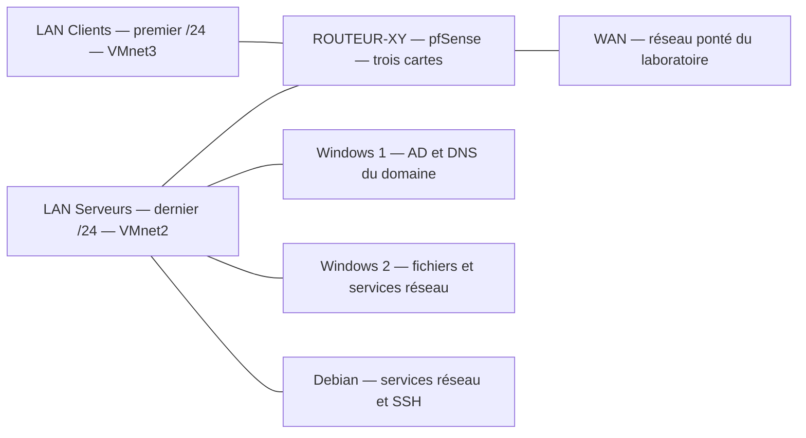

# Mise en situation professionnelle : services réseau

Cette maquette met en place les réseaux, services et contrôles de l’équipe fictive **Support-Terre**. Le sujet prévoit environ **4,5 jours** et suppose les cours et TP précédents réalisés. L’onglet **Cours Original** contient les 18 pages de l’énoncé. **Correction fournie : Inexistant.** Les explications et exemples ci-dessous constituent un accompagnement pédagogique externe.

## Objectifs

- Construire le plan IPv4, le routeur et les cinq machines de la maquette.
- Distribuer les paramètres clients, résoudre les noms et joindre le domaine.
- Configurer un stockage résilient, des accès par groupes et les stratégies.
- Démontrer la continuité de DHCP, DNS et Active Directory, puis administrer les serveurs à distance.

## 1. Préparer le plan et les machines

Préparer VMware Workstation et les médias d’installation de pfSense, Windows Server et Debian prévus par le laboratoire. `D` désigne le dernier octet de l’adresse du poste fourni ; `XY` désigne vos initiales. Calculer `192.168.(4 × D).0/22` et vérifier que le troisième octet calculé est valide. Le `/22` couvre quatre réseaux `/24` : le premier pour les clients, le dernier pour les serveurs. Le routeur utilise la dernière adresse **d’hôte utilisable** de chacun de ces deux `/24`, soit `.254`. Vérifier aussi que les quatre valeurs de troisième octet, de `4 × D` à `4 × D + 3`, restent dans l’intervalle IPv4. La formule du sujet fonctionne pour `D` de 0 à 63. Au-delà, utiliser un plan attribué par le laboratoire.

| Machine | Fin de l’adresse locale | Disque et RAM du sujet | Réseau |
|---|---:|---|---|
| Windows Server 1 | `.101` | 60 Go, 4 Go | VMnet2 |
| Windows Server 2 | `.102` | 60 Go, 4 Go | VMnet2 |
| Debian serveur, sans interface graphique | `.111` | 20 Go, 1 Go | VMnet2 |
| Windows 10 client | `.10` | 40 Go, 2 Go | VMnet3 |
| Debian client, avec interface graphique | `.1` | 20 Go, 2 Go | VMnet3 |

L’exemple du sujet utilise `D = 13` : réseau `192.168.52.0/22`, LAN Clients `192.168.52.0/24`, LAN Serveurs `192.168.55.0/24`. Sur le WAN d’exemple `10.3.0.0/16`, l’adresse du routeur est `10.3.42.13`. Reporter le nom d’interface, l’adresse IP et la MAC sur le schéma. Employer les valeurs WAN réellement attribuées si le réseau du laboratoire diffère.

### Contrôler le réseau avant les services

1. Dans Workstation, vérifier VMnet3 pour les clients, VMnet2 pour les serveurs et le pont pour le WAN. Associer les trois cartes de pfSense par leur MAC, puis configurer leurs adresses.
2. Depuis chaque machine, tester son interface de passerelle et les échanges dans son propre LAN. Tester ensuite entre les deux LAN et relever la route de retour.
3. Depuis pfSense, tester la passerelle WAN attribuée puis `9.9.9.9`, comme le demande le sujet. Depuis une VM de chaque LAN, vérifier l’accès à une ressource externe autorisée. Si le routeur sort mais pas la VM, relire filtre, route de retour et NAT sortant pour le réseau de la source.
4. Reporter le résultat de chaque liaison sur le schéma. Les règles **any** du sujet sont réservées à la maquette. Limiter le relais DHCP à l’interface LAN Clients.

### DNS et dépôts provisoires

Identifier le DNS du poste de salle avec `Get-DnsClientServerAddress -AddressFamily IPv4`. Vérifier sa joignabilité avant de l’utiliser sur les deux Debian. Le sujet attend une résolution **interne** de `ftp.fr.debian.org` dans ce laboratoire, des dépôts ordinaires via ce nom et les mises à jour de sécurité via `security.debian.org`. Ce résultat dépend du réseau de formation. Identifier le gestionnaire du réseau et de la résolution avant de modifier une configuration, puis actualiser les index APT et relever les erreurs éventuelles.

## 2. Installer DHCP pour le LAN Clients

| Parité de `D` | DHCP initial | DNS initial |
|---|---|---|
| Pair | Windows Server 2 | Debian |
| Impair | Debian | Windows Server 2 |

1. Définir une étendue pour la moitié des 254 hôtes utilisables du LAN Clients selon la convention de la proposition. Pour `D=13`, la plage `192.168.52.20` à `192.168.52.146` donne 127 adresses et préserve les IP statiques `.1`, `.10` et `.254`.
2. Transmettre le préfixe `/24` et la passerelle pfSense du LAN Clients. Le DNS interne sera ajouté après l’étape suivante. L’étendue doit correspondre au réseau d’origine du client, bien que le serveur écoute sur le LAN Serveurs.
3. Configurer le relais pfSense côté Clients vers l’adresse du serveur DHCP initial choisi par parité. Vérifier son chemin aller et retour, puis faire passer un poste de test en DHCP.
4. Relever un bail neuf et le serveur qui l’a fourni. Vérifier l’adresse de l’étendue, le masque et la passerelle, puis tester cette passerelle. Vérifier que le LAN Serveurs conserve les adresses statiques.

## 3. Mettre en place le DNS interne

Configurer le DNS désigné par la parité. Tester d’abord une requête vers le DNS de l’établissement, puis utiliser ce dernier comme redirecteur général. Configurer les serveurs et l’option DNS de DHCP pour utiliser le DNS interne. Créer la zone **`prénomD.infra.tld`**, puis les enregistrements des trois serveurs. Vérifier la réponse SOA et la résolution du nom du serveur primaire indiqué par celle-ci. Une requête de nom qui réussit ne prouve pas que la résolution inverse fonctionne.

Tester d’abord un PTR pour un serveur avant de créer les zones inverses. Un A existant ne crée pas à lui seul un PTR. Créer ensuite une zone inverse pour chacun des deux `/24`. Ajouter le PTR de la dernière adresse utilisable de chaque LAN vers `routeur.prénomD.infra.tld`, puis interroger directement le DNS du TP pour les deux adresses. Pour `D=13`, les zones inverses sont `52.168.192.in-addr.arpa` et `55.168.192.in-addr.arpa`.

| Contrôle | Preuve attendue |
| --- | --- |
| DNS de formation | Réponse à une requête explicite depuis le serveur qui deviendra résolveur interne. |
| Redirecteur général | Réponse publique depuis les clients et serveurs qui utilisent le DNS interne. |
| Zone directe | SOA et résolution du FQDN de son primaire, puis réponses A pour les trois serveurs. |
| Zones inverses | PTR pour chaque adresse `.254`, interrogé sur le DNS prévu. |
| Configuration cliente | Adresse du DNS visible dans les options du bail renouvelé ou dans le profil statique. |

## 4. Créer le domaine et contrôler ses dépendances

Sur Windows Server 1, installer AD DS et DNS, puis créer une nouvelle forêt et le domaine **`prénomD.domaine.tssr`**, au niveau fonctionnel **Windows Server 2016** demandé. Examiner les enregistrements A et SRV, notamment ceux qui permettent de trouver LDAP et Kerberos. Sur le DNS principal du TP, rediriger **ce seul espace de noms** vers le DNS du contrôleur. La zone `prénomD.infra.tld` et le domaine AD ne désignent pas le même espace.

Intégrer Windows 10 et Windows Server 2 au domaine et tester une ouverture de session. Si `D` est pair, vérifier que le rôle DHCP Windows est autorisé dans AD et que sa portée est active ; `Get-DhcpServerInDC` permet de contrôler l’autorisation. Créer les unités d’organisation pour services, postes et serveurs, puis les groupes de service. Créer les comptes du tableau de l’Original avec la première lettre du prénom suivie du nom et contrôler leurs appartenances. Depuis le client, vérifier une ouverture de session par service et relever l’identité et le domaine.

Avant la jonction au domaine, interroger le DNS interne pour `_ldap._tcp.dc._msdcs.<domaine-AD>` en type SRV et résoudre le nom du contrôleur annoncé. Ce test vérifie la redirection conditionnelle depuis le DNS réellement utilisé par le poste. Une résolution du seul nom du serveur ne valide pas la découverte des services AD.

## 5. Stockage, partages et accès

Le sujet demande trois disques de 1 Go et un volume **F:** supportant la perte d’un disque. Dans la version de Windows Server utilisée, choisir un mode de stockage qui fournit cette tolérance ; vérifier le résultat dans le laboratoire. Créer `F:\DATA`, puis `SERVICES` et `PUBLIC`. Associer les comptes aux groupes de service et les groupes de service aux groupes d’autorisation des ressources. Vérifier à la fois le partage et les ACL NTFS.

| Ressource | Modification | Lecture |
|---|---|---|
| `SERVICES\Direction` | Direction, Comptabilité | Secrétariat |
| `SERVICES\Comptabilité` | Comptabilité | Direction, Secrétariat |
| `SERVICES\Secrétariat` | Secrétariat | — |
| `SERVICES\Support` | Support, Secrétariat | Direction |
| `PUBLIC` | Membres de la société | — |

Pour le volume **F:**, relever le type de résilience, les trois disques qui le composent et sa capacité utile. Dans le scénario isolé, prévoir un fichier témoin et un contrôle de lecture pendant la simulation autorisée de perte d’un disque. Vérifier l’état dégradé, puis le retour à l’état normal après la réparation.

Le service informatique dispose du contrôle total sur les dossiers partagés selon le sujet. L’accès au dossier **Informatique** est réservé à ce service. **Incohérence de l’Original :** le tableau indique `F:\DATA\Informatique`, la phrase suivante `D:\DATA\Informatique`. La proposition conserve **F:** pour rester cohérente avec le volume créé et partage ce dossier sous `Outils$`. Le suffixe `$` masque le partage dans l’affichage ordinaire ; seules les permissions protègent son accès. Tester un compte autorisé et un compte non autorisé. Pour Comptabilité, comparer un comptable en modification avec Direction et Secrétariat en lecture. Tester aussi un membre sans droit prévu. Utiliser le chemin réseau de chaque partage pour éprouver à la fois SMB et NTFS. Documenter la création de F:, les groupes imbriqués et les autorisations effectives de Comptabilité.

## 6. Appliquer une stratégie, puis vérifier

| Exigence du sujet | Preuve à relever dans la maquette |
|---|---|
| Fond de bureau commun | Ouvrir une session avec deux comptes ciblés. |
| Accès au Panneau de configuration et aux Paramètres réservé aux administrateurs du domaine | Comparer administrateur et compte standard. |
| Mots de passe : 30 jours, minimum 3 caractères, complexité désactivée | Vérifier la politique réellement appliquée au domaine. C’est une consigne historique de laboratoire, à ne pas reprendre en production. |
| Partage SERVICES visible automatiquement pour les secrétaires | Vérifier le lecteur ou raccourci dans leur session et l’absence hors périmètre. |
| Installation ou mise à jour de pilotes réservée aux administrateurs locaux | Tester avec un compte standard et contrôler la stratégie effective. |
| Empêcher le redémarrage automatique pendant l’utilisation | Vérifier le résultat avec la version de Windows et le mécanisme de mises à jour du TP. |
| Ne pas lancer de recherche Internet depuis Windows | Tester une recherche et observer les résultats proposés. |
| Bloquer la remontée d’erreurs vers Microsoft | Contrôler le réglage effectif et son périmètre. |

Appliquer et tester un réglage à la fois. `gpresult /r` aide à vérifier que le bon utilisateur ou ordinateur reçoit la bonne GPO ; un réglage visible dans la console ne prouve pas son effet sur le client.

## 7. Vérifier la continuité des services

**DHCP.** Installer le second service sur l’autre serveur (Debian ou Windows Server 2), avec des plages **disjointes**. Pour `D=13`, la proposition prend `.147` à `.253` sur Windows 2. Fournir les mêmes options de passerelle et de DNS. Relayer les demandes vers les deux serveurs. Avec le premier arrêté, demander un nouveau bail sur un poste de test et relever le serveur qui répond, la plage et les options. Rétablir le premier, arrêter le second et inverser l’essai. Rétablir les deux services à la fin. Les plages séparées répartissent les adresses sans partager l’état des baux.

**DNS.** Installer le second DNS sur l’autre serveur. Configurer le redirecteur général vers le DNS de formation, le redirecteur du domaine AD vers Windows Server 1, et la zone directe `prénomD.infra.tld` en secondaire. Autoriser le transfert seulement vers le serveur secondaire et vérifier son résultat en interrogeant ce serveur directement. Augmenter le numéro de série de la zone lorsque sa méthode de gestion l’exige.

**Incohérence de l’Original :** le sujet écarte la résolution inverse sur le second DNS, puis demande un contrôle de transfert dans « chacune des 2 zones ». La proposition teste le transfert de la **zone directe** explicitement demandée, et indique que les zones inverses restent sur le DNS initial. Le domaine AD reste à ce stade une redirection, pas une seconde zone à transférer.

**Clients.** Ajouter le second DNS dans les options DHCP et dans les configurations statiques. Vérifier que les deux serveurs savent répondre aux noms internes attendus : un DNS de secours qui ignore les zones internes peut donner un résultat intermittent.

**AD.** Promouvoir Windows Server 2 comme second contrôleur. Créer un objet de test sur Windows Server 2 et le vérifier directement sur Windows Server 1. Contrôler la réplication et les enregistrements SRV du nouveau contrôleur. Arrêter le premier contrôleur dans le laboratoire et vérifier la connexion depuis le client, puis le redémarrer avant d’arrêter le second. Employer un compte de test dont la session n’est pas mise en cache et relever le contrôleur réellement sollicité. Rétablir ensuite les deux et vérifier la réplication. [Diagnostic de la réplication Active Directory](https://learn.microsoft.com/en-us/troubleshoot/windows-server/active-directory/diagnose-replication-failures) Si Windows Server 2 héberge désormais la zone AD localement, examiner le redirecteur conditionnel antérieur : le DNS Windows ne peut pas conserver une zone hébergée et un redirecteur conditionnel du même nom sur le même serveur.

## 8 et 9. Administrer depuis le poste client

### 8. Administrer depuis Windows 10

1. Installer et vérifier le serveur SSH sur Debian. Tester SSH vers Debian depuis le client Windows avec le compte prévu après avoir contrôlé sa joignabilité et l’identité du serveur. Relever le nom de l’hôte dans la session.
2. Configurer le Bureau à distance sur les deux serveurs Windows avec le périmètre informatique du sujet. Tester chacun depuis Windows 10 avec un membre du service, puis avec un compte hors périmètre. Distinguer port joignable, authentification et autorisation de session.
3. Dans **Fonctionnalités facultatives** du poste Windows 10, ajouter les outils RSAT de **Gestionnaire de serveur**, **AD DS**, **DHCP** et **DNS** adaptés à la version. Ajouter les serveurs dans le Gestionnaire de serveur, puis ouvrir la console Utilisateurs et ordinateurs Active Directory.
4. Depuis la console DNS distante, créer l’enregistrement A de test demandé dans la zone **intégrée au domaine**. Vérifier sa réponse en interrogeant le DNS du domaine, puis retirer l’enregistrement de test selon la consigne de laboratoire. [Outils RSAT](https://learn.microsoft.com/en-us/troubleshoot/windows-server/system-management-components/remote-server-administration-tools)

### 9. Tester Windows Admin Center

1. Choisir l’un des serveurs Windows comme hôte de Windows Admin Center, conformément à l’énoncé. Relever la version compatible et préparer l’accès au navigateur depuis le poste client.
2. Installer la passerelle de laboratoire et ouvrir son interface depuis Windows 10. Vérifier son certificat et le compte utilisé.
3. Ajouter les machines Microsoft de la maquette. Pour chacune, relever les fonctions disponibles selon le type de connexion et les droits du compte, par exemple l’inventaire, l’état des services ou les événements. [Options d’installation de Windows Admin Center](https://learn.microsoft.com/en-us/windows-server/manage/windows-admin-center/plan/installation-options)

## À retenir

À chaque étape, garder une preuve indépendante de la configuration. Le bail doit être attribué, le nom doit être résolu par le serveur attendu, le compte doit ouvrir une session et l’autorisation doit être testée depuis le poste client. Pour la continuité, provoquer une panne à la fois dans la maquette, constater le résultat puis remettre le service en état.

## Mini-quiz d’application

1. Quelles sont les deux passerelles pour `D=13` ?
2. Quels serveurs hébergent le DHCP et le DNS initiaux lorsque `D` est impair ?
3. Quelle preuve distingue un transfert de zone réussi d’une réponse obtenue depuis un cache ou le serveur primaire ?
4. Un partage `Outils$` est-il protégé par son nom ?
5. Pourquoi tester un nouveau compte quand on arrête un contrôleur ?

??? success "Réponses commentées"
    1. `192.168.52.254` et `192.168.55.254`.
    2. Le DNS initial est Windows Server 2 ; le DHCP initial est Debian. Windows Server 2 recevra ensuite le second DHCP.
    3. Interroger directement le secondaire pour un nouvel enregistrement de la zone transférée et vérifier le SOA ou le numéro de série.
    4. Non, le suffixe le masque ; les autorisations décident de l’accès.
    5. Pour écarter une session réussie seulement grâce aux identifiants déjà mis en cache.

## Pour pratiquer et réviser

- [Énoncé complet](../../tp/10-msp-services-reseau/module-01/enonces.md)
- [Proposition de correction externe](../../tp/10-msp-services-reseau/module-01/corrections.md)
- [Fiche de révision](../../revision/10-msp-services-reseau/module-01-mise-en-situation-professionnelle-services-reseau.md)
- [Retour à la mise en situation](index.md)

## Références externes

- [Microsoft Learn — autoriser et configurer DHCP](https://learn.microsoft.com/en-us/windows-server/networking/technologies/dhcp/quickstart-install-configure-dhcp-server)
- [Microsoft Learn — zones et transferts DNS](https://learn.microsoft.com/en-us/windows-server/networking/dns/zone-types)
- [Microsoft Learn — redirecteurs et résolution DNS](https://learn.microsoft.com/en-us/windows-server/networking/dns/forwarding)
