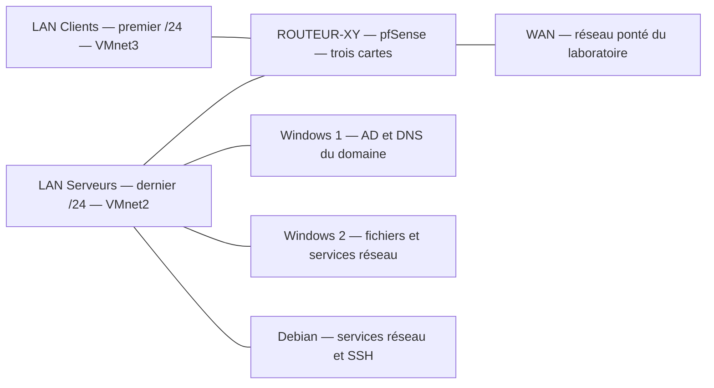

# Mise en situation professionnelle : services réseau

Cette maquette met en place les réseaux, services et contrôles de l’équipe fictive **Support-Terre**. Le sujet prévoit environ **4,5 jours** et suppose les cours et TP précédents réalisés. L’onglet **Cours Original** contient les 18 pages de l’énoncé. **Correction fournie : Inexistant.** Les explications et exemples ci-dessous constituent un accompagnement pédagogique externe.

## 1. Préparer le plan et les machines

Préparer VMware Workstation et les médias d’installation de pfSense, Windows Server et Debian prévus par le laboratoire. `D` désigne le dernier octet de l’adresse du poste fourni ; `XY` désigne vos initiales. Calculer `192.168.(4 × D).0/22` et vérifier que le troisième octet calculé est valide. Le `/22` couvre quatre réseaux `/24` : le premier pour les clients, le dernier pour les serveurs. Le routeur utilise la dernière adresse **d’hôte utilisable** de chacun de ces deux `/24`, soit `.254`.

| Machine | Fin de l’adresse locale | Disque et RAM du sujet | Réseau |
|---|---:|---|---|
| Windows Server 1 | `.101` | 60 Go, 4 Go | VMnet2 |
| Windows Server 2 | `.102` | 60 Go, 4 Go | VMnet2 |
| Debian serveur, sans interface graphique | `.111` | 20 Go, 1 Go | VMnet2 |
| Windows 10 client | `.10` | 40 Go, 2 Go | VMnet3 |
| Debian client, avec interface graphique | `.1` | 20 Go, 2 Go | VMnet3 |

L’exemple du sujet utilise `D = 13` : réseau `192.168.52.0/22`, LAN Clients `192.168.52.0/24`, LAN Serveurs `192.168.55.0/24`. Sur le WAN d’exemple `10.3.0.0/16`, l’adresse du routeur est `10.3.42.13`. Reporter le nom d’interface, l’adresse IP et la MAC sur le schéma. Employer les valeurs WAN réellement attribuées si le réseau du laboratoire diffère.

Commencer par vérifier la liaison entre serveurs, puis chaque LAN vers son interface pfSense, les routes et la passerelle, puis le NAT vers une destination de test autorisée. Le sujet utilise `9.9.9.9` comme contrôle depuis le routeur. Les règles **any** du sujet sont propres à la maquette : en réseau réel, restreindre flux et interfaces aux besoins. Le service DHCP du TP ne doit pas être diffusé sur le WAN.

### DNS et dépôts provisoires

Identifier le DNS du poste de salle avec `Get-DnsClientServerAddress -AddressFamily IPv4`. Vérifier sa joignabilité avant de l’utiliser sur les deux Debian. Le sujet attend une résolution **interne** de `ftp.fr.debian.org` dans ce laboratoire, des dépôts ordinaires via ce nom et les mises à jour de sécurité via `security.debian.org`. Ce résultat dépend du réseau de formation. Identifier le gestionnaire du réseau et de la résolution avant de modifier une configuration, puis actualiser les index APT et relever les erreurs éventuelles.

## 2. Installer DHCP pour le LAN Clients

| Parité de `D` | DHCP initial | DNS initial |
|---|---|---|
| Pair | Windows Server 2 | Debian |
| Impair | Debian | Windows Server 2 |

Définir une plage sur la moitié du LAN Clients selon les conventions du TP. Consigner ses bornes et exclure les adresses statiques, la passerelle, l’adresse de réseau et celle de diffusion. Transmettre le masque et la passerelle pfSense ; le DNS interne sera fourni après l’étape suivante. Les serveurs se trouvent sur un autre réseau : activer le relais sur l’interface LAN Clients si nécessaire. Vérifier un nouveau bail, ses options et la joignabilité de la passerelle depuis le client.

## 3. Mettre en place le DNS interne

Configurer le DNS désigné par la parité. Tester d’abord une requête vers le DNS de l’établissement, puis utiliser ce dernier comme redirecteur général. Configurer les serveurs et l’option DNS de DHCP pour utiliser le DNS interne. Créer la zone **`prénomD.infra.tld`**, puis les enregistrements des trois serveurs. Vérifier la réponse SOA et la résolution du nom du serveur primaire indiqué par celle-ci. Une requête de nom qui réussit ne prouve pas que la résolution inverse fonctionne.

Créer ensuite une zone inverse pour chacun des deux `/24`. Ajouter le PTR de la dernière adresse utilisable de chaque LAN vers `routeur.prénomD.infra.tld`, puis interroger directement le DNS du TP pour les deux adresses. Pour l’exemple `D=13`, les zones inverses sont `52.168.192.in-addr.arpa` et `55.168.192.in-addr.arpa`.

## 4. Créer le domaine et contrôler ses dépendances

Sur Windows Server 1, installer AD DS et DNS, puis créer une nouvelle forêt et le domaine **`prénomD.domaine.tssr`**, au niveau fonctionnel **Windows Server 2016** demandé. Examiner les enregistrements A et SRV, notamment ceux qui permettent de trouver LDAP et Kerberos. Sur le DNS principal du TP, rediriger **ce seul espace de noms** vers le DNS du contrôleur. La zone `prénomD.infra.tld` et le domaine AD ne désignent pas le même espace.

Intégrer Windows 10 et Windows Server 2 au domaine et tester une ouverture de session. Si `D` est pair, vérifier que le rôle DHCP Windows est autorisé dans AD et que sa portée est active ; `Get-DhcpServerInDC` permet de contrôler l’autorisation. Créer les unités d’organisation pour services, postes et serveurs ; créer les comptes du tableau de l’Original avec la première lettre du prénom suivie du nom, puis les groupes des services. Tester au moins un compte de chaque service depuis le client.

## 5. Stockage, partages et accès

Le sujet demande trois disques de 1 Go et un volume **F:** supportant la perte d’un disque. Dans la version de Windows Server utilisée, choisir un mode de stockage qui fournit cette tolérance ; vérifier le résultat dans le laboratoire. Créer `F:\DATA`, puis `SERVICES` et `PUBLIC`. Associer les comptes aux groupes de service et les groupes de service aux groupes d’autorisation des ressources. Vérifier à la fois le partage et les ACL NTFS.

| Ressource | Modification | Lecture |
|---|---|---|
| `SERVICES\Direction` | Direction, Comptabilité | Secrétariat |
| `SERVICES\Comptabilité` | Comptabilité | Direction, Secrétariat |
| `SERVICES\Secrétariat` | Secrétariat | — |
| `SERVICES\Support` | Support, Secrétariat | Direction |
| `PUBLIC` | Membres de la société | — |

Le service informatique dispose du contrôle total sur les dossiers partagés selon le sujet. L’accès au dossier **Informatique** est réservé à ce service. **Incohérence de l’Original :** le tableau indique `F:\DATA\Informatique`, la phrase suivante `D:\DATA\Informatique`. La proposition conserve **F:** pour rester cohérente avec le volume créé et partage ce dossier sous `Outils$`. Le suffixe `$` masque le partage dans l’affichage ordinaire ; seules les permissions protègent son accès. Tester un compte autorisé et un compte non autorisé. Documenter la création de F: et le partage avec les droits du dossier Comptabilité.

## 6. Appliquer une stratégie, puis vérifier

| Exigence du sujet | Preuve à relever dans la maquette |
|---|---|
| Fond de bureau commun | Ouvrir une session avec deux comptes ciblés. |
| Accès au Panneau de configuration et aux Paramètres réservé aux administrateurs du domaine | Comparer administrateur et compte standard. |
| Mots de passe : 30 jours, minimum 3 caractères, complexité désactivée | Vérifier la politique réellement appliquée au domaine. C’est une consigne historique de laboratoire, à ne pas reprendre en production. |
| Partage SERVICES visible automatiquement pour les secrétaires | Vérifier le lecteur ou raccourci dans leur session et l’absence hors périmètre. |
| Installation ou mise à jour de pilotes réservée aux administrateurs locaux | Tester avec un compte standard et contrôler la stratégie effective. |
| Empêcher le redémarrage automatique pendant l’utilisation | Vérifier le résultat avec la version de Windows et le mécanisme de mises à jour du TP. |
| Ne pas lancer de recherche Internet depuis Windows | Tester une recherche et observer les résultats proposés. |
| Bloquer la remontée d’erreurs vers Microsoft | Contrôler le réglage effectif et son périmètre. |

Appliquer et tester un réglage à la fois. `gpresult /r` aide à vérifier que le bon utilisateur ou ordinateur reçoit la bonne GPO ; un réglage visible dans la console ne prouve pas son effet sur le client.

## 7. Vérifier la continuité des services

**DHCP.** Installer le second service sur l’autre serveur (Debian ou Windows Server 2), avec des plages **disjointes**. Fournir les mêmes options de passerelle et de DNS attendues. Relayer les demandes vers les deux serveurs. Tester un nouveau bail après l’arrêt de chacun à tour de rôle. Des plages séparées ne synchronisent pas les baux : c’est la solution du TP, pas une réplication d’état.

**DNS.** Installer le second DNS sur l’autre serveur. Configurer le redirecteur général vers le DNS de formation, le redirecteur du domaine AD vers Windows Server 1, et la zone directe `prénomD.infra.tld` en secondaire. Autoriser le transfert seulement vers le serveur secondaire et vérifier son résultat en interrogeant ce serveur directement. Augmenter le numéro de série de la zone lorsque sa méthode de gestion l’exige.

**Incohérence de l’Original :** le sujet écarte la résolution inverse sur le second DNS, puis demande un contrôle de transfert dans « chacune des 2 zones ». La proposition teste le transfert de la **zone directe** explicitement demandée, et indique que les zones inverses restent sur le DNS initial. Le domaine AD reste à ce stade une redirection, pas une seconde zone à transférer.

**Clients.** Ajouter le second DNS dans les options DHCP et dans les configurations statiques. Vérifier que les deux serveurs savent répondre aux noms internes attendus : un DNS de secours qui ignore les zones internes peut donner un résultat intermittent.

**AD.** Promouvoir Windows Server 2 comme second contrôleur. Vérifier création puis réplication d’un objet, enregistrements SRV et ouverture de session lorsque chacun des contrôleurs est arrêté à tour de rôle. Utiliser un compte de test qui ne peut pas réussir uniquement grâce à une ouverture de session mise en cache. Si Windows Server 2 héberge désormais la zone AD localement, examiner le redirecteur conditionnel antérieur : le DNS Windows ne peut pas conserver une zone hébergée et un redirecteur conditionnel du même nom sur le même serveur.

## 8 et 9. Administrer depuis le poste client

Tester SSH vers Debian, puis RDP vers les serveurs Windows avec un membre du service informatique et un compte non autorisé. Vérifier que le port répond, puis que l’authentification et les autorisations correspondent au besoin. Les outils facultatifs **RSAT** du client Windows servent à gérer le serveur et les rôles AD DS, DHCP et DNS : ouvrir la console AD, vérifier les objets et créer un enregistrement A de test dans la zone de laboratoire. Pour Windows Admin Center, installer une version compatible dans la maquette, ajouter les machines Microsoft et vérifier les fonctions réellement disponibles pour le compte utilisé.

## Mini-quiz d’application

1. Quelles sont les deux passerelles pour `D=13` ?
2. Quel DHCP et quel DNS commencer sur Windows Server 2 lorsque `D` est impair ?
3. Quelle preuve distingue un transfert de zone réussi d’une réponse obtenue depuis un cache ou le serveur primaire ?
4. Un partage `Outils$` est-il protégé par son nom ?
5. Pourquoi tester un nouveau compte quand on arrête un contrôleur ?

??? success "Réponses commentées"
    1. `192.168.52.254` et `192.168.55.254`.
    2. Le DNS initial est Windows Server 2 ; le DHCP initial est Debian. Windows Server 2 recevra ensuite le second DHCP.
    3. Interroger directement le secondaire pour un nouvel enregistrement de la zone transférée et vérifier le SOA ou le numéro de série.
    4. Non, le suffixe le masque ; les autorisations décident de l’accès.
    5. Pour écarter une session réussie seulement grâce aux identifiants déjà mis en cache.

## Pour pratiquer et réviser

- [Énoncé complet](../../tp/10-msp-services-reseau/module-01/enonces.md)
- [Proposition de correction externe](../../tp/10-msp-services-reseau/module-01/corrections.md)
- [Fiche de révision](../../revision/10-msp-services-reseau/module-01-mise-en-situation-professionnelle-services-reseau.md)
- [Retour à la mise en situation](index.md)

## Références externes

- [Microsoft Learn — autoriser et configurer DHCP](https://learn.microsoft.com/en-us/windows-server/networking/technologies/dhcp/quickstart-install-configure-dhcp-server)
- [Microsoft Learn — zones et transferts DNS](https://learn.microsoft.com/en-us/windows-server/networking/dns/zone-types)
- [Microsoft Learn — redirecteurs et résolution DNS](https://learn.microsoft.com/en-us/windows-server/networking/dns/forwarding)
