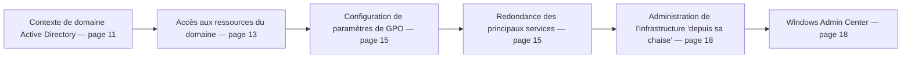
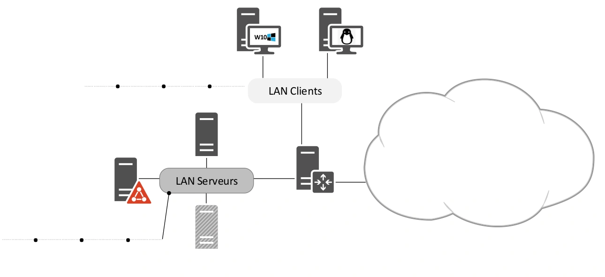
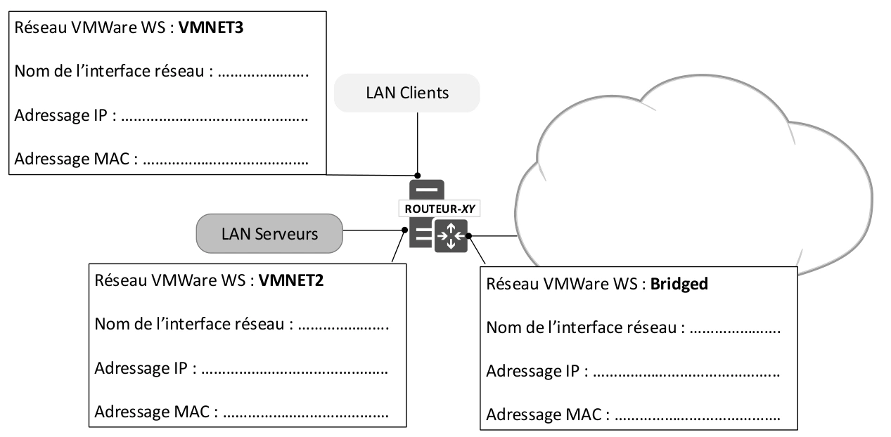
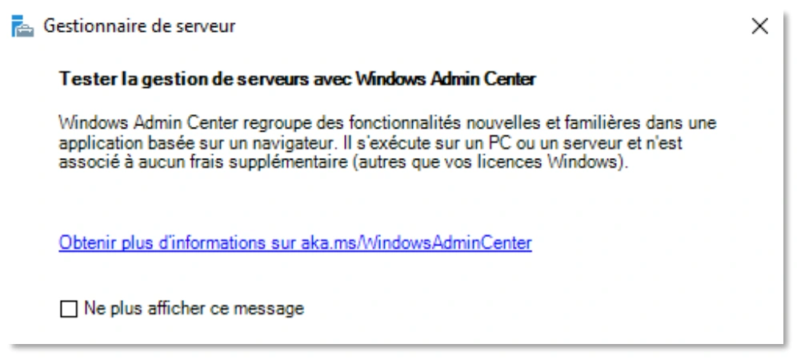

# Mise en situation professionnelle : services réseau

Les parties ci-dessous reprennent le cours original, dans le même ordre. Les encadrés et les schémas répètent ses formulations.

## Parcours de lecture

1. Énoncé · Mise en situation professionnelle : services réseau · 18 pages transcrites

Énoncé unique. Correction fournie : Inexistant.

SOURCE DRIVE · TRANSCRIPTION DU SUPPORT

Le contenu des documents du dossier TSSR est transcrit ci-dessous, page par page. Les textes et tableaux sont intégrés à la page Web. Aucun fichier PDF, aucune diapositive entière ni aucune reproduction de page n’est affiché. Seuls des croquis ou visuels isolés et vérifiés peuvent accompagner la transcription. Les versions et les consignes restent celles des supports de formation. Les compléments IA sont conservés dans leur onglet distinct.

## Énoncé · Mise en situation professionnelle : services réseau · 18 pages transcrites

!!! note "À retenir"
    Les mentions du centre de formation ont été neutralisées, les en-têtes répétitifs et les logos retirés.

Énoncé unique de 18 pages. Les mentions du centre de formation ont été neutralisées, les en-têtes répétitifs et les logos retirés. Les valeurs, incohérences et consignes historiques sont conservées ; aucune correction fournie n’a été trouvée.

### Page 1

#### Mise en situation professionnelle : services réseau

!!! note "À retenir"
    Avant de démarrer ce TP, il convient d’avoir suivi les vidéos des modules précédents et d’avoir réalisé les TP proposés.

Avant de démarrer ce TP, il convient d’avoir suivi les vidéos des modules précédents et d’avoir réalisé les TP proposés.

Durée estimée

Environ 4,5 jours

#### Sommaire

#### Table des matières

!!! note "À retenir"
    Présentation et préparation de l'infrastructure — page 3 a.

**Visuel externe**

1. Présentation et préparation de l'infrastructure — page 3

a. Présentation de l’infrastructure — page 3

b. Conception du plan d’adressage IPv4 — page 4

c. Implémentation du routeur — page 5

d. Ajout des serveurs à l’infrastructure — page 6

e. Les postes clients — page 7

f. Routage et NAT — page 7

g. Configuration cliente DNS et accès aux dépôts Debian — page 8

2. Implémentation du service DHCP — page 9

3. Implémentation d’un service DNS interne — page 9

a. Configuration d’un redirecteur inconditionnel — page 9

b. Configuration du client DNS sur votre infrastructure — page 10

### Page 2

!!! note "À retenir"
    Configuration de la résolution directe d’un espace de noms interne — page 10 d.

**Visuel externe**

c. Configuration de la résolution directe d’un espace de noms interne — page 10

d. Configuration de la résolution inverse — page 10

4. Contexte de domaine Active Directory — page 11

a. Création d'un domaine Active Directory — page 11

b. Etude de la nouvelle zone DNS suite à la création du domaine Active Directory .... 11

c. Intégration de postes à votre domaine Active Directory — page 12

d. Création des unités d’organisation, utilisateurs et groupes — page 12

5. Accès aux ressources du domaine — page 13

a. Ajout et configuration d’un nouvel espace disque sous Windows — page 13

b. Configuration du partage de fichiers et des règles de restriction d’accès — page 13

c. Création de documentation de la configuration réalisée au point précédant — page 14

6. Configuration de paramètres de GPO — page 15

7. Redondance des principaux services — page 15

a. Ajout d’une nouvelle instance du service DHCP — page 15

b. Ajout d’un second serveur DNS — page 16

c. Modification de la configuration des clients DNS — page 17

d. Ajout d’un second contrôleur de domaine — page 17

8. Administration de l'infrastructure "depuis sa chaise" — page 18

9. Windows Admin Center — page 18

### Page 3

#### Énoncé

#### 1. Présentation et préparation de l'infrastructure

!!! note "À retenir"
    Le cœur de métier de la société "Support-Terre" est de proposer du support informatique personnalisé pour les PME.

Le cœur de métier de la société "Support-Terre" est de proposer du support informatique personnalisé pour les PME.

Vous intégrez l'équipe technique du projet "TSSRC-Série-EU". Votre objectif est de maquetter une infrastructure en respectant les contraintes imposées par l'équipe architecture du projet.

Prérequis

- Disposer d'images ISO (Windows Server, Debian, pfSense)

- VMware Workstation doit être installé dans votre environnement de travail

a. Présentation de l’infrastructure

Le contexte d’infrastructure sur lequel vous travaillerez est organisé autour de 3 périmètres réseau :

| LAN Serveurs | Réseau d’appartenance des serveurs / services mis en place pour les utilisateurs de l’entreprise |
| --- | --- |
| LAN Clients | Réseau d’appartenance des postes clients des utilisateurs |
| WAN | Réseau public, non géré par l’entreprise, destiné à fournir des services aux utilisateurs |

Vous aurez à gérer l’ensemble des machines présentes dans les réseaux LAN Serveurs et LAN Clients.

### Page 4

!!! note "À retenir"
    Trois périmètres réseau et emplacement des machines — illustration isolée du support, page 4.

!!! example "Exemple"
    Exemple : Le dernier octet de l'adresse IP du poste de travail fourni par le centre de formation est 13.

**Visuel externe**

Trois périmètres réseau et emplacement des machines — illustration isolée du support, page 4.

b. Conception du plan d’adressage IPv4

D correspond au dernier octet de l'adresse IP du poste de travail fourni par le centre de formation

- Un réseau 192.168.4xD.0 / 22 est attribué par stagiaire.

Exemple :

Le dernier octet de l'adresse IP du poste de travail fourni par le centre de formation est 13. 13x4=52. Le réseau qui m’est alloué est le 192.168.52.0 / 22

- Ce réseau est segmenté en 4 sous réseaux, chacun ayant un masque de 255.255.255.0 (/24)

- Le premier sous réseau est utilisé pour adresser le LAN Clients

- Le dernier sous réseau est utilisé pour adresser le LAN Serveurs

- Le réseau du poste de travail fourni par le centre de formation est utilisé pour adresser la machine de l’environnement étant sur le WAN.

Reproduire le précédent schéma (ou équivalent) puis y reporter vos adresses de réseaux locaux Clients et Serveurs.

### Page 5

c. Implémentation du routeur

Installer une première machine virtuelle pfSense à partir d’une image ISO d’installation, elle possédera les caractéristiques suivantes :

| Nom | ROUTEUR-XY (remplacer XY par vos initiales) |
| --- | --- |
| Système d’exploitation | pfSense |
| Nombre de cartes réseau associées 3 | 3 |

À l’issue de l’installation, configurer le réseau en respectant les contraintes suivantes :

- Sur les réseaux LAN Clients et Serveurs, ROUTEUR-XY utilisera la dernière adresse d’hôte utilisable

- Sur le réseau global (accessible par l'interface WAN), votre routeur aura pour adresse : id_reseau.42.D

Exemple :

L'ID de réseau du poste de travail fourni par le centre de formation est 10.3.0.0/16 et le dernier octet de l'adresse IP du poste de travail fourni par le centre de formation est 13.

➔ L'adresse IP du routeur sera 10.3.42.13

Vous reproduirez le schéma ci-dessous (ou équivalent) et y reporterez les informations correspondantes :

Interfaces du routeur et réseaux VMware — illustration isolée du support, page 5.

### Page 6

!!! note "À retenir"
    TOUS les accès devront être autorisés depuis n’importe quel réseau.

TOUS les accès devront être autorisés depuis n’importe quel réseau. Pour cela, vous créerez une règle de filtrage « any » sur chaque interface réseau de votre pfSense le nécessitant !

Après configuration, s’assurer que ROUTEUR-XY communique avec la passerelle du réseau fourni par le centre de formation.

d. Ajout des serveurs à l’infrastructure

Vous hébergerez trois serveurs dans votre infrastructure. Vous respecterez les contraintes d’adressage réseau définies au point b. et reporterez l’adressage réseau IPv4 de chaque machine dans le tableau ci-dessous. Édictez une convention de nommage à appliquer. Ajouter les machines correspondantes à votre infrastructure. Pour cela, vous pouvez créer de nouvelles VM ou importer des templates "sysprep" de votre stock personnel ou mis à disposition par le centre de formation.

*Les rôles indiqués NE SONT PAS à installer pour le moment, ils sont donnés à titre indicatif.

*Votre coach vous précisera les versions et éditions des systèmes d'exploitation. Sans information de sa part, les versions et éditions des systèmes d'exploitation seront celles qui ont été utilisées lors des précédents modules de cours.

| Système | Rôles* | Caractéristiques |
| --- | --- | --- |
| Serveur Windows 1 Nom : ………………….. Adresse IPv4 : 192.168.___.101 | AD DNS de la zone AD | Windows Server* 1 disque dur : 60 Go Mémoire vive : 4 Go (à modifier si besoin) Réseau VMware WS : Custom – VMnet2 |
| Serveur Windows 2 Nom : ………………….. Adresse IPv4 : 192.168.___.102 | Serveur de fichiers DNS DHCP | Windows Server* 1 disque dur : 60 Go Mémoire vive : 4 Go (à modifier si besoin) Réseau VMware WS : Custom – VMnet2 |
| Serveur GNU/Linux Nom : ………………….. Adresse IPv4 : 192.168.___.111 | DHCP DNS | Debian* sans interface graphique 1 disque dur : 20 Go Mémoire vive : 1 Go Réseau VMware WS : Custom – VMnet2 |

### Page 7

**Visuel externe**

Après configuration, s’assurer que

- ☐ Les trois serveurs communiquent entre eux

- ☐ Les trois serveurs communiquent bien avec votre routeur

e. Les postes clients

Vous utiliserez des postes clients pour tester le bon fonctionnement des services qui seront mis en place. Vous devrez disposer d’un client Windows et un client Debian.

| Système | Caractéristiques |
| --- | --- |
| Client Windows Nom : ………………….. Adresse IPv4 : 192.168.___.10 | Windows 10 1 disque dur : 40 Go Mémoire vive : 2 Go Réseau VMware WS : Custom – VMnet3 |
| Client GNU/Linux Nom : ………………….. Adresse IPv4 : 192.168.___.1 | Debian - Interface graphique de votre choix 1 disque dur : 20 Go Mémoire vive : 2 Go Réseau VMware WS : Custom – VMnet3 |

Installer ces machines (ou récupérer des images "sysprep" prêtes à l'emploi), configurer statiquement leur adressage IPv4 et les nommer en respectant votre convention de nommage.

f. Routage et NAT

Configuration de la passerelle par défaut

- ☐ Depuis l’interface web de votre pfSense, via les outils de diagnostic, vérifier que celui-ci communique bien avec la machine ayant l’adresse IPv4 : 9.9.9.9.

- ☐ Configurer l’adresse de votre pfSense comme adresse de passerelle par défaut sur les clients et sur les serveurs.

- ☐ Vérifier que les clients parviennent bien à communiquer avec les serveurs

- Au besoin vérifier / adapter la configuration des pare-feu des

systèmes d’exploitation et vérifier les règles de filtrage actives sur votre routeur pfSense

### Page 8

- ☐ Vérifier que la communication entre vos différentes machines virtuelles et une ressource en dehors votre organisation (l'adresse IP du proxy du centre de formation par exemple) est bien fonctionnelle.

- Au besoin, vérifier sur votre routeur si une règle de NAT s’applique

bien pour chaque contexte réseau.

g. Configuration cliente DNS et accès aux dépôts Debian

Pour installer des outils sur le client Debian et des services sur le serveur Debian, ces machines devront être clientes DNS du serveur DNS dont le poste de travail fourni par l'centre de formation est client.

- Trouver et utiliser la commande PowerShell appropriée pour identifier le serveur DNS dont est client votre poste de salle PS > ………………………………………
- ☐ S’assurer que votre client et votre serveur GNU/Linux communiquent bien avec le serveur identifié à l’étape précédente.

- Configurer votre client et votre serveur GNU/Linux afin qu’ils soient temporairement clients DNS du serveur identifié précédemment.

- ☐ Vérifier que l’hôte ftp.fr.debian.org est bien résolu en une adresse IP interne à centre de formation (et non pas en une adresse IP publique)

- Vérifiez / modifiez la configuration des serveurs de dépôt du client et du serveur Debian afin qu’elle respecte les contraintes suivantes :

- Pour les mises à jour de sécurité, celles-ci devront être actives (ligne non

commentée) et se faire depuis l’hôte « security.debian.org » o Pour les nouvelles installations et les mises à jour, celles-ci devront être

récupérées depuis l’hôte « ftp.fr.debian.org » (et non pas deb.debian.org) • Mettre à jour la base des paquets logiciels.

### Page 9

#### 2. Implémentation du service DHCP

| Si D (le dernier octet du poste mis à disposition par le centre de formation) est pair | Si D (le dernier octet du poste mis à disposition par le centre de formation) est impair |
| --- | --- |
| • Le service DHCP sera hébergé par le 2ème serveur Windows | • Le service DHCP sera hébergé par le serveur Debian |

La configuration du service DHCP doit respecter les contraintes suivantes :

- Le service DHCP ne doit distribuer des baux qu’aux postes du réseau LAN Clients.

- Sur la totalité de la plage réseau configurée (en /24), seule la moitié des adresses sera allouable aux clients.

- La passerelle par défaut doit être transmise par le service DHCP.

- Si un service de relais DHCP doit être mis en place, il devra être implémenté sur votre

routeur.

#### 3. Implémentation d’un service DNS interne

| Si D est pair | Si D est impair |
| --- | --- |
| • Le service DNS sera hébergé par le serveur Debian | • Le service DNS sera hébergé par le 2ème serveur Windows |

- Vous procéderez à l’ajout du rôle ou du service sur le serveur considéré

a. Configuration d’un redirecteur inconditionnel

- ☐ Tester la liaison depuis votre serveur DNS vers le serveur DNS de l’école (identifié au g. du chapitre 1)

- ☐ Au moyen de la commande appropriée : …………………………………………………………………….

Requêter depuis votre serveur DNS, le serveur DNS de l’école et tester la résolution d’un nom d’hôte.

- Configurer sur votre serveur DNS un redirecteur inconditionnel vers le serveur

DNS du centre de formation.

### Page 10

b. Configuration du client DNS sur votre infrastructure

- Renseigner dans la configuration réseau de vos différents serveurs l’adresse de votre serveur DNS
- Modifier la configuration de votre serveur DHCP afin qu’il fournisse à tous ses clients l’adresse de votre serveur DNS

- ☐ S’assurer que les postes clients et les serveurs parviennent bien à résoudre des noms d’hôtes publics.

c. Configuration de la résolution directe d’un espace de noms interne

- Sur votre serveur DNS, créer une zone pour prénomD.infra.tld (D le dernier octet du poste mis à disposition par le centre de formation), y ajouter des enregistrements pour vos 3 serveurs.

- ☐ Depuis un poste client, requêter l’enregistrement du SOA de la zone créée et vérifier si celui-ci est bien un FQDN résolvable. Si ce n’est pas le cas, faire les modifications nécessaires.

- ☐ Faites un test de résolution inverse d’un de vos serveurs.

Ce test aboutit-il ? Pourquoi ? ……………………………………………………………………………………

d. Configuration de la résolution inverse

- Ajouter une zone inverse pour chacun de vos réseaux : LAN Client et LAN Serveur. Y créer un enregistrement pour routeur.prénomD.infra.tld ayant pour adresse IP la dernière de chaque réseau.

- ☐ Depuis un client, faire un test de résolution inverse de la dernière adresse de vos deux réseaux.

### Page 11

#### 4. Contexte de domaine Active Directory

- Votre domaine Active Directory utilise les informations d'une nouvelle zone DNS prénomD . domaine . tssr

a. Création d'un domaine Active Directory

- Sur votre « Serveur Windows 1 », installer les composants permettant la prise en charge des services de domaine Active Directory puis le promouvoir contrôleur de domaine en respectant les contraintes suivantes :

- Il s’agit d’un nouveau domaine dans une nouvelle forêt

- Le nom du domaine est celui reporté dans les prérequis de cet atelier

- Installer le service DNS sur le contrôleur de domaine

- Le niveau fonctionnel du domaine et de la forêt doit être « Windows Server

2016 »

b. Étude de la nouvelle zone DNS suite à la création du domaine Active

Directory

- Afficher le contenu de la nouvelle zone DNS prénomD.domaine.tssr et observez les différents enregistrements présents.

- À quoi correspondent-ils et quelle est leur utilité ?

…………………………………………………………………………………………………

…………………………………………………………………………………………………

…………………………………………………………………………………………………

…………………………………………………………………………………………………

### Page 12

c. Intégration de postes à votre domaine Active Directory

Prérequis :

Les clients et serveurs de votre infrastructure interrogent principalement le serveur DNS que vous avez configuré au point 3.

Ce serveur n'héberge pas le domaine DNS lié à votre domaine Active Directory !

Pour intégrer votre client Windows et votre serveur Windows au domaine, vous devez donc configurer un redirecteur conditionnel dans le serveur configuré au point 3.

- zone DNS : prénomD.domaine.tssr,

- Serveur DNS vers lequel rediriger les requêtes : "Serveur Windows 1"

- Intégrer votre poste client Windows au domaine Active Directory

- Intégrer le « Serveur Windows 2 » au domaine Active Directory
- ☐ Le client Windows et "Serveur Windows 2" sont bien intégrés au domaine AD

- Si D est pair, contrôler l’état de fonctionnement du service DHCP hébergé par le serveur Windows, celui-ci est-il toujours fonctionnel ? Pourquoi ?

…………………………………………………………………………………………………

- Au besoin, faire les modifications nécessaires pour rétablir le bon fonctionnement du service DHCP.

d. Création des unités d’organisation, utilisateurs et groupes

- En respectant les bonnes pratiques Microsoft, créer les utilisateurs en vous basant sur le tableau ci-dessous. L’identifiant de connexion sera composé de la première lettre du prénom suivi du nom de famille.

- Créer des unités d’organisation afin de regrouper les utilisateurs d’un même service et de séparer les comptes d’ordinateur des postes clients et des serveurs.

- Créer des groupes afin de cibler les utilisateurs de chaque service.

### Page 13

| Service | Membres |  |  |
| --- | --- | --- | --- |
| Direction | Christian Hef | Pauline Atron | Pascaline Résident |
| Comptabilité | Bruno Ilan | Christelle Rédit | Florence Acture |
| Secrétariat | Cédric Ourrier | Sandrine Tandard | Aline Genda |
| Production | Chloé Haîne | Ursule Sine | Denis Elais |
| Support Informatique | Clément Lavier | <Vous-même> | Elodie Cran |

- ☐ Tester l'ouverture de session sur le domaine d'un utilisateur par service depuis le client Windows

#### 5. Accès aux ressources du domaine

En partant de votre infrastructure de domaine Active Directory existante, vous allez ajouter un espace disque sécurisé que vous partagerez en respectant les préconisations Microsoft.

a. Ajout et configuration d’un nouvel espace disque sous Windows

- Ajouter trois disques de 1 Go (ces disques feraient 1 To en contexte réel) sur le serveur « Serveur Windows 2 », à partir de ces disques, créer un volume F: tolérant aux pannes (celui-ci devant permettre la perte d’un disque sans perte de données).

b. Configuration du partage de fichiers et des règles de restriction d’accès

- A la racine du volume F: configuré précédemment, créer un répertoire nommé DATA qui contiendra un sous-dossier SERVICES et un sous dossier PUBLIC.

- Les dossiers SERVICES et PUBLIC seront partagés.

- Les restrictions d’accès aux ressources partagées sont indiquées ci-dessous.

### Page 14

|  | Chemin |  |  | Privilèges d’accès |  |
| --- | --- | --- | --- | --- | --- |
| F:\DATA\SERVICES\Direction |  |  | Les membres de la direction et de la comptabilité ont accès en modification, les secrétaires ont accès en lecture. |  |  |
| F:\DATA\SERVICES\Comptabilité |  |  | Les membres de la direction et du secrétariat ont accès en lecture, les comptables en modification. |  |  |
| F:\DATA\SERVICES\Secrétariat |  |  | Seuls les secrétaires ont accès en modification sur ce dossier. |  |  |
| F:\DATA\SERVICES\Support |  |  | Les membres du service Support auront un accès en modification ainsi que les membres du service secrétariat. La direction aura un accès en lecture seulement. |  |  |
| F:\DATA\PUBLIC |  |  | Accessible en modification pour tous les membres de la société. |  |  |

- Pour des raisons de commodité de gestion, les membres du service informatique auront un accès en contrôle total sur tous les dossiers partagés.
- Respecter les préconisations Microsoft d’imbrication des groupes de domaine que vous appliquerez aux ACL des différents dossiers. Créer les groupes de domaine nécessaires à vos réalisations.

- Mettre en place le partage suivant

|  | Chemin |  |  | Privilèges d’accès |  |
| --- | --- | --- | --- | --- | --- |
| F:\DATA\Informatique |  |  | Seuls les membres du service informatique auront un accès à ce dossier |  |  |

- Le dossier D:\DATA\Informatique sera partagé sous le nom "Outils", ce partage sera caché.

- ☐ Tester depuis le client Windows les accès aux différentes ressources.

c. Création de documentation de la configuration réalisée au point précédent

Vous documenterez les aspects suivants :

- Processus de configuration du nouvel espace disque (F:)

- Configuration du partage et des autorisations s’appliquant au dossier du service comptabilité

### Page 15

#### 6. Configuration de paramètres de GPO

Pour chaque paramètre demandé, à l’issue de sa configuration, vous testerez sa bonne effectivité sur votre poste client Windows avant de passer au paramètre suivant.

Vous configurerez au moyen de stratégies de groupes les aspects suivants :

- Tous les utilisateurs de votre domaine auront le même arrière-plan de bureau (de votre choix)

- Seuls les administrateurs du domaine auront accès au Panneau de configuration et à l’outil Paramètres

- Tous les utilisateurs du domaine devront changer leur mot de passe tous les 30 jours, leur mot de passe aura 3 caractères minimum et ne sera pas soumis à des critères de complexité

- Les secrétaires verront automatiquement le partage SERVICES apparaitre dans leur explorateur de fichiers

- Seul un administrateur de la machine pourra installer ou mettre à jour les pilotes de périphériques.

- Empêcher le redémarrage automatique des postes en cours d’utilisation

- Lors de recherches Windows, ne pas rechercher sur Internet

- Bloquer la remontée d’erreurs à Microsoft

#### 7. Redondance des principaux services

Un audit a été réalisé sur votre infrastructure de domaine Active Directory existante, celui-ci a fait ressortir la problématique suivante : les services d’infrastructure critiques ne sont actuellement pas tolérants aux pannes qui pourraient survenir.

Les mises en œuvre à réaliser dans cet atelier visent à accroitre la disponibilité des services et la tolérance de pannes de l’infrastructure précédemment mise en place.

a. Ajout d’une nouvelle instance du service DHCP

- Au point 2, vous avez mis en œuvre le service DHCP sur un de vos serveurs. Notez ci-dessous les informations relatives au service mis en œuvre. Serveur sur lequel le service a été implémenté :

………………………………………………………………………………………………………….

Plage d’adresse distribuée : ………………………………………………………………………………………………………….

### Page 16

- Installer le service DHCP sur votre autre serveur (PAS LE CONTRÔLEUR DE DOMAINE).

| Mise en œuvre initiale du service DHCP sur | Machine sur laquelle implémenter le second service DHCP |
| --- | --- |
| Le serveur Debian | Le 2ème serveur Windows |
| Le 2ème serveur Windows | Le serveur Debian |

- Ce service DHCP devra distribuer des adresses en dehors de la plage d’adresse

déjà distribuée par votre premier service DHCP. o Il devra fournir l’adresse de la passerelle par défaut et celle de votre serveur DNS

configuré au point 3. o Modifier la configuration du relais DHCP de votre pfSense afin que les requêtes

clientes soient adressées à vos deux serveurs DHCP

- ☐ Valider le bon fonctionnement de votre second serveur DHCP

- ☐ Contrôler le bon fonctionnement de la tolérance de panne du service

après l’arrêt successif d’un puis de l’autre serveur DHCP

b. Ajout d’un second serveur DNS

Au point 3, vous avez mis en œuvre le service DNS sur un de vos serveurs, le tableau suivant vous indique sur quel autre serveur implémenter votre second service DNS.

- Installer le service DNS sur votre autre serveur (PAS LE CONTRÔLEUR DE DOMAINE).

| Mise en œuvre initiale du service DNS sur | Machine sur laquelle implémenter le second service DNS |
| --- | --- |
| Le serveur Debian | Le 2ème serveur Windows |
| Le 2ème serveur Windows | Le serveur Debian |

Les contraintes d’implémentation du service sont les suivantes :

- Ce serveur utilisera comme redirecteur inconditionnel le serveur DNS de l’école

### Page 17

- Ce serveur utilisera comme redirecteur conditionnel le "Windows Serveur 1" pour

répondre aux requêtes relatives au domaine prénomD.domaine.tssr o Ce serveur devra disposer de la zone prénomD.infra.tld en tant que zone

secondaire o La prise en charge de la résolution inverse n’est pas souhaitée

- ☐ Vérifier depuis un client que la résolution de noms est bien fonctionnelle

EN INTERROGEANT VOTRE SECOND SERVEUR DNS.

- ☐ Ajouter un enregistrement depuis votre premier service DNS dans

chacune des 2 zones puis vérifier que cet enregistrement a bien été transféré dans la zone du second service DNS.

c. Modification de la configuration des clients DNS

- Modifiez la configuration de vos services DHCP afin qu’ils indiquent l’adresse

de votre nouveau serveur DNS en complément de celle de votre premier. o Modifier la configuration des serveurs et leur ajouter l’adresse IP de votre

second service DNS en complément de celui déjà configuré.

- ☐ Contrôler la configuration cliente DNS des différents postes.

d. Ajout d’un second contrôleur de domaine

- Afin de ne pas perdre les services de domaine Active Directory en cas de défaillance du serveur Windows 1, ajouter le rôle des services de domaine sur le serveur Windows 2.

- ☐ Vérifier qu’il est possible de créer des objets dans la base Active Directory

depuis le second contrôleur de domaine et qu’ils sont bien répliqués sur le premier.

- ☐ Vérifier que les enregistrements de services (DNS) liés aux services de

domaine ont bien été générés pour le second contrôleur.

- ☐ Arrêter successivement chacun des contrôleurs et vérifier si vos

utilisateurs parviennent bien à se connecter depuis le poste client.

### Page 18

#### 8. Administration de l'infrastructure "depuis sa chaise"

Les éléments de votre infrastructure étant en salle serveur sécurisée, toutes les manipulations d'administration de serveurs seront effectuées depuis le poste client Windows 10.

- Installer le service SSH-Server sur votre serveur Debian. Pouvez-vous vous connecter en ssh depuis votre Client Windows ? En cas d'échec, faites le nécessaires pour que cela soit fonctionnel.
- Configurer le service bureau à distance sur les serveurs Windows. Seuls les membres du service informatique pourront ouvrir une session sur les serveurs. Faire des tests de connexions à l'aide de votre client RDP du client Windows 10.
- Sur le client Windows 10, afficher la liste des "Fonctionnalités facultatives" disponible
- Pour plus de productivité, rechercher puis installer les outils RSAT (Outils d’administration de serveur distant) du "Gestionnaire de serveur" et de gestion des rôles ADDS, DHCP et DNS sur votre client Windows 10.
- Lancer l'outil Gestionnaire de serveur et faire en sorte de pouvoir gérer vos serveurs Windows depuis cette console

- Pouvez-vous ouvrir la console "Utilisateurs et ordinateurs Active Directory" ?

- Pouvez-vous créer un enregistrement A dans la zone DNS intégrée au domaine ?

#### 9. Windows Admin Center

Fenêtre de présentation de Windows Admin Center — illustration isolée du support, page 18.

- Tester cette nouvelle fonctionnalité proposée par Windows Server 2019. Renseignez-vous, documentez-vous puis choisissez l'un de vos serveurs Windows pour y installer WAC.
- Importer toutes les machines Microsoft dans cet outil et observer/tester le plus de possibilités proposées par WAC

Référence du document : 17vtIX3kItMGv8dqN_fTSGJ2Nmzux766Q · SHA-256 0f4c80111269a2f2…

## Fiche de synthèse

Les lignes reprennent les titres du cours et la première phrase de chaque partie.

| Partie | Repère du cours |
| --- | --- |
| Énoncé · Mise en situation professionnelle : services réseau · 18 pages transcrites | Les mentions du centre de formation ont été neutralisées, les en-têtes répétitifs et les logos retirés. |

## Repères de relation du parcours

- Sur Windows Server 1, installer AD DS et DNS
- Tester SSH vers Debian
