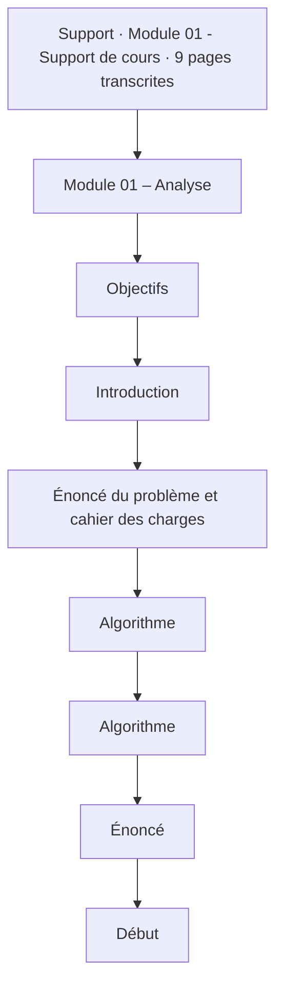
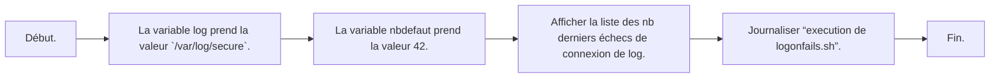
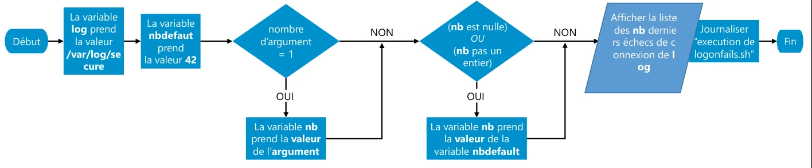

# Module 01 — Analyse

[Travaux pratiques](../../tp/11-initiation-scripting-bash/module-01/index.md)

Les parties ci-dessous reprennent le cours original, dans le même ordre. Les encadrés et les schémas répètent ses formulations.

## Parcours de lecture

1. Support · Module 01 - Support de cours · 9 pages transcrites
2. Module 01 – Analyse
3. Objectifs
4. Introduction
5. Énoncé du problème et cahier des charges
6. Algorithme
7. Algorithme
8. Énoncé
9. Début
10. FIN

**Visuel externe**



SOURCE DRIVE · TRANSCRIPTION DU SUPPORT

Le contenu des documents du dossier TSSR est transcrit ci-dessous, page par page. Les textes et tableaux sont intégrés à la page Web. Aucun fichier PDF, aucune diapositive entière ni aucune reproduction de page n’est affiché. Seuls des croquis ou visuels isolés et vérifiés peuvent accompagner la transcription. Les versions et les consignes restent celles des supports de formation. Les compléments IA sont conservés dans leur onglet distinct.

## Support · Module 01 - Support de cours · 9 pages transcrites

!!! note "À retenir"
    Le texte, les tableaux et le code sont transcrits d’après le PDF de formation.

Le texte, les tableaux et le code sont transcrits d’après le PDF de formation. Les sauts de ligne suivent la présentation du support. Les exemples historiques sont commentés dans le cours optimisé.

## Page 1

## Module 01 – Analyse

## Objectifs

!!! note "À retenir"
    Découvrir l’ingénierie logicielle Mettre en place un cahier des charges Planifier un algorithme et son pseudo-code

**Visuel externe**


- Découvrir l’ingénierie logicielle
- Mettre en place un cahier des charges
- Planifier un algorithme et son pseudo-code

## Page 2

## Introduction

### Introduction

!!! note "À retenir"
    Les scripts Shell sont des fichiers texte contenant un ensemble de commandes Shell.

- Les scripts Shell sont des fichiers texte contenant un ensemble de commandes Shell.
- Avant de se lancer dans l’écriture d’un script, un travail de réflexion s’impose. Cette phase d’analyse intègre la rédaction de cahier des charges et d’algorithme.

| Étape | Description |
| --- | --- |
| Énoncé du problème | Situation initiale ; objectif ciblé |
| Cahier des charges | Détail des contraintes et éléments à prendre en considération |
| Algorithme | Traduction détaillée de l’ensemble des actions menées pour parvenir à l’objectif à atteindre |
| Écriture du script | Code écrit dans le langage Shell par lequel il sera interprété |

ANALYSE

- Viendra ensuite la phase d’écriture qui vous permettra de pratiquer l’éditeur de texte vim.

## Page 3

## Énoncé du problème et cahier des charges

### Énoncé du problème et cahier des charges

!!! note "À retenir"
    La création d’un script Shell résulte de la réponse à un problème ou à un besoin donné.

- La création d’un script Shell résulte de la réponse à un problème ou à un besoin donné.
- Les scripts Shell peuvent être utilisés afin de répondre à des besoins :
  - D’administrations (pour le SI)
  - De l’utilisateur
- Après analyse du besoin et des contraintes, un travail de réflexion permettra l’elaboration d’une solution.

Besoin → Contraintes → Réflexion → Solution.

## Page 4

### Énoncé du problème et cahier des charges

### Identifier le besoin

!!! note "À retenir"
    Cibler, détailler et formaliser le besoin Le porteur du besoin ne se préoccupe pas des contraintes techniques liées à la réalisation du script.

Cibler, détailler et formaliser le besoin

- Le porteur du besoin ne se préoccupe pas des contraintes techniques liées à la réalisation du script. Il décrit sa problématique et son besoin.
- Le porteur du besoin détaille et formalise ses attentes.

#### Exemple de description du besoin

!!! note "À retenir"
    « Nous avons besoin d’un outil qui affiche les derniers échecs de connexion utilisateur.

« Nous avons besoin d’un outil qui affiche les derniers échecs de connexion utilisateur. »

Porteur du besoin

### Énoncé du problème et cahier des charges

### Contraintes et cahier des charges

!!! note "À retenir"
    Établir un cadre au projet Une fois le besoin bien compris, il reste à établir un cadre au projet.

Établir un cadre au projet

- Une fois le besoin bien compris, il reste à établir un cadre au projet.
- Ce cadre reprendra l’identification du besoin et la complètera par la liste de l’ensemble des contraintes s’appliquant à la solution.

Entité chargée de la realisation du script

## Page 5

### Énoncé du problème et cahier des charges

### Contraintes et cahier des charges

!!! note "À retenir"
    Établir un cadre au projet Besoin et contraintes.

Établir un cadre au projet

Besoin et contraintes. Porteur du besoin + Entité chargée de la realisation du script → Cahier des charges.

Sur toute la phase d’analyse, de l’expression du besoin à la réalisation de l’algorithme, les échanges sont essentiels entre le porteur du besoin et l’entité chargée de réaliser la solution.

### Énoncé du problème et cahier des charges

### Contraintes et cahier des charges

Établir un cadre au projet

#### Exemple de cahier des charges de l’outil souhaité

**Visuel externe**


- Il sera utilisé sur un serveur sous Debian 10
- Il n’aura pas de dépendances
- Il sera écrit en Bash
- Le nombre souhaité d’échec(s) à afficher sera défini par l’utilisateur au lancement du script
- À défaut d’indication de valeur de nombre d’échecs, une valeur par défaut sera considérée
- Le lancement du script pourra être initié par l’utilisateur ou automatisé

## Page 6

### Énoncé du problème et cahier des charges

Réflexion Déterminer comment parvenir au résultat attendu

S’ensuit un travail d’analyse lors duquel :

- Sera étudié dans le détail le cahier des charges
- On réfléchira aux traitements à effectuer pour parvenir au résultat attendu et à l’ordonnnancement des instructions

## Algorithme

## Page 7

### Algorithme

Pour poursuivre l’analyse, on réalisera un algorithme du script ou programme envisagé.

### Définition d’un algorithme

Pour qu’un ordinateur réalise une tâche, qu’elle soit basique ou très complexe, il est nécessaire de lui indiquer dans les moindres détails toutes les actions à réaliser.

Un algorithme, c’est une description complète et détaillee des instructions ordonnancées dont l’exécution conduit à un résultat donné.

#### Éléments utilisés pour la réalisation d’algorithmes

**Visuel externe**


- Instructions
- Variables
- Tests
- Boucles

### Algorithme

Un algorithme peut être représenté sous forme de texte. On parle alors de pseudo code. L’utilisation de schéma ou organigramme est aussi adaptée à sa representation.

#### Utilisation d’algorithme dans la vie de tous les jours

Les algorithmes sont aussi présents dans nos contextes professionnels. Ils représentent une étape essentielle au processus de création d’un script Shell.


Étapes illustrées du lavage des mains.

## Page 8

### Algorithme

### Pseudo code

Le pseudo code est utilisé pour la representation textuelle d’un algorithme.

#### Exemple de pseudo code de l’outil

```
Lancement du script

log ←/var/log/secure
nbdefaut ←42

Si (nombre d’argument passé au script = 1)
  alors nb ←argument
Finsi

Si ((nb est nul) OU (nb n’est pas un entier))
  alors la nb ←nbdefaut
Finsi

Afficher la liste des nb derniers échecs de connexion de log
Journaliser « exécution de logonfails.sh »

Fin d’exécution du script
```

### Algorithme

La représentation sous forme d’organigrammes est basée sur l’utilisation d’un ensemble de symboles.

### Les principaux symboles d’un organigramme

| Symbole | Signification |
| --- | --- |
| DÉBUT / FIN | L’ovale matérialise les étapes du début et de fin d’un programme. |
| Flèche | La flèche indique le sens des flux. |
| ACTION | Le rectangle représente la réalisation d’une action ou d’un processus. |
| DÉCISION | Le losange est utilisé pour représenter une décision à prendre ; ou la vérification d’une condition. Il est parfois utile d’utiliser des formes plus complexes quand on a plus de 3 décisions à prendre. |
| ENTRÉE / SORTIE | Entrée / Sortie |

## Page 9

### Algorithme

**Visuel externe**



Exemple d’algorithme de l’outil



Organigramme du script logonfails.sh.

1. Début.
2. La variable log prend la valeur `/var/log/secure`.
3. La variable nbdefaut prend la valeur 42.
4. Nombre d’argument = 1 ? OUI, la variable nb prend la valeur de l’argument. NON, passer au test suivant.
5. Nb est nulle OU nb pas un entier ? OUI, la variable nb prend la valeur de la variable nbdefault. NON, poursuivre.
6. Afficher la liste des nb derniers échecs de connexion de log.
7. Journaliser “execution de logonfails.sh”.
8. Fin.

Référence du document : 1WHz-uiQc8oSEwvbCb0U4uBppgkhov2Fk · SHA-256 149d28a5e4a17105…

| Support · Module 01 - Support de cours · 9 pages transcrites | Le texte, les tableaux et le code sont transcrits d’après le PDF de formation. |
| Objectifs | Découvrir l’ingénierie logicielle Mettre en place un cahier des charges Planifier un algorithme et son pseudo-code |
