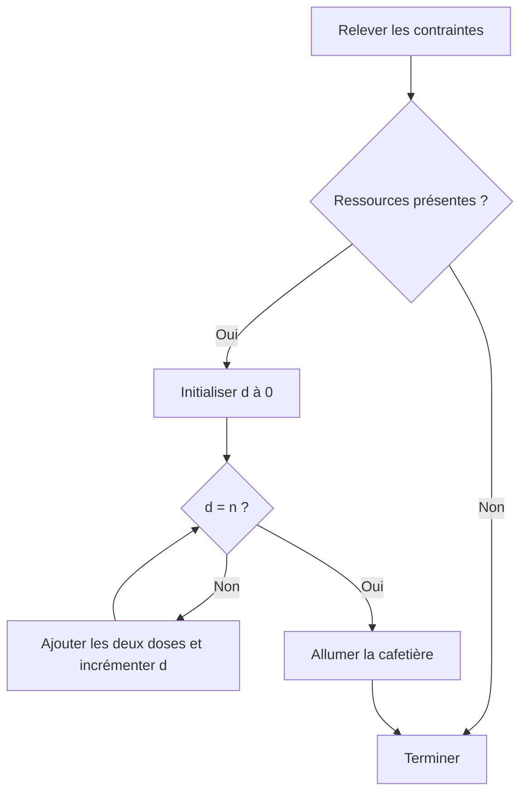

# Module 01 — Analyse

Avant d’écrire un script, décrivez le besoin avec la personne qui le formule. L’analyse aboutit à des règles vérifiables. Le cahier des charges donne le cadre, puis l’algorithme décrit les actions et leur ordre.

| Étape | Travail | Résultat |
| --- | --- | --- |
| Énoncé du problème | Partir de la situation et du résultat demandé | Besoin d’administration ou d’un utilisateur |
| Cahier des charges | Identifier les contraintes avec le porteur du besoin | Environnement, données, dépendances, critères de réussite |
| Algorithme | Prévoir les décisions et ordonner les actions | Pseudo-code ou organigramme |
| Écriture | Traduire l’algorithme dans le langage choisi | Fichier de commandes lu par l’interpréteur |

## Représenter et relire l’algorithme

Le pseudo-code met les étapes en texte. Indentez l’intérieur d’un test ou d’une boucle et repérez le retour à l’étape de décision. Dans l’organigramme, l’ovale représente le début et la fin, le rectangle une action, le losange une décision et le parallélogramme une entrée ou une sortie. Étiquetez chaque branche et suivez les flèches pour vérifier le résultat d’une saisie.

## Exemple de connexion

Le support demande d’afficher les derniers échecs de connexion sur Debian 10. Le script Bash `logonfails.sh` vise un lancement manuel ou automatique, sans dépendance supplémentaire dans le scénario. L’utilisateur peut indiquer le nombre d’échecs. Le défaut est 42. Le support prévoit de journaliser l’exécution.

```text
Début
  log ← /var/log/secure
  nbdefaut ← 42
  Si un seul argument est fourni
    nb ← cet argument
  Fin Si
  Si nb est absent ou n’est pas un entier
    nb ← nbdefaut
  Fin Si
  Afficher les nb derniers échecs de connexion issus de log
  Journaliser l’exécution de logonfails.sh
Fin
```

**Clarification pédagogique.** `/var/log/secure` est le chemin illustratif du support. Vérifiez le mécanisme de journalisation et les droits de lecture sur le système utilisé. Le support alterne `nbdefaut` et `nbdefault` dans ses représentations. Une implémentation doit employer un nom cohérent. Précisez aussi le comportement avec zéro, un entier négatif ou plusieurs arguments.

| Cas | Règle à contrôler |
| --- | --- |
| Aucun argument | Retenir la valeur par défaut |
| Un entier valide | Employer le nombre fourni |
| Valeur non numérique | Appliquer le défaut |
| Journal inaccessible | Définir une erreur observable |
| Nombre demandé supérieur au nombre de résultats | Définir la sortie attendue |

## TP 01 — Préparer du café

Pour obtenir `n` tasses, vérifiez la présence de l’eau, du café moulu, du filtre, de la cafetière et de l’électricité. Une ressource absente mène à la fin. Initialisez le compteur à zéro. À chaque passage, ajoutez une dose d’eau et une dose de café, puis incrémentez le compteur. Allumez la cafetière une fois la quantité atteinte. Déroulez les deux corrections avec une ressource absente, puis avec deux tasses.

### Schéma de synthèse — Complément pédagogique



## Mini-quiz

1. Qui formule le besoin ?
2. Comment représenter une décision ?
3. Quand incrémenter le compteur de doses ?

**Réponses.** Le porteur du besoin. Avec une condition en pseudo-code ou un losange et ses branches dans l’organigramme. Après l’ajout des deux doses.

- [Énoncé et corrections du TP 01](../../tp/11-initiation-scripting-bash/module-01/index.md)
- [Fiche de révision](../../revision/11-initiation-scripting-bash/module-01-analyse.md)
