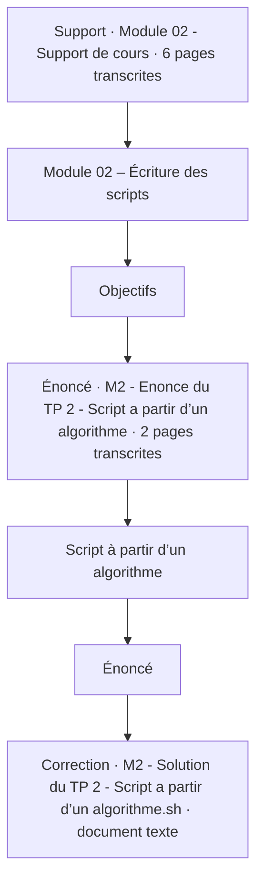

# Module 02 — Écriture des scripts

Les parties ci-dessous reprennent le cours original, dans le même ordre. Les encadrés et les schémas répètent ses formulations.

## Parcours de lecture

1. Support · Module 02 - Support de cours · 6 pages transcrites
2. Module 02 – Écriture des scripts
3. Objectifs
4. Énoncé · M2 - Enonce du TP 2 - Script a partir d’un algorithme · 2 pages transcrites
5. Script à partir d’un algorithme
6. Énoncé
7. Correction · M2 - Solution du TP 2 - Script a partir d’un algorithme.sh · document texte

**Visuel externe**



SOURCE DRIVE · TRANSCRIPTION DU SUPPORT

Le contenu des documents du dossier TSSR est transcrit ci-dessous, page par page. Les textes et tableaux sont intégrés à la page Web. Aucun fichier PDF, aucune diapositive entière ni aucune reproduction de page n’est affiché. Seuls des croquis ou visuels isolés et vérifiés peuvent accompagner la transcription. Les versions et les consignes restent celles des supports de formation. Les compléments IA sont conservés dans leur onglet distinct.

## Support · Module 02 - Support de cours · 6 pages transcrites

!!! note "À retenir"
    Le texte, les tableaux et le code sont transcrits d’après le PDF de formation.

Le texte, les tableaux et le code sont transcrits d’après le PDF de formation. Les sauts de ligne suivent la présentation du support. Les exemples historiques sont commentés dans le cours optimisé.

## Page 1

## Module 02 – Écriture des scripts

## Objectifs

!!! note "À retenir"
    Créer un fichier de script Bash Le rendre exécutable Commenter son code Suivre le déroulé de l'exécution du script

**Visuel externe**


- Créer un fichier de script Bash
- Le rendre exécutable
- Commenter son code
- Suivre le déroulé de l'exécution du script

## Page 2

### Écriture des scripts

!!! note "À retenir"
    Les scripts Shell sont des fichiers texte dans lesquels sont stockées des suites de commandes.

- Les scripts Shell sont des fichiers texte dans lesquels sont stockées des suites de commandes. Ces fichiers peuvent être créés et modifiés par l’éditeur de texte vim.
- Lors de l’interprétation du script par le Shell, les commandes sont lues et interprétées séquentiellement.
- Une ligne de commentaire commence par le caractère #. Ce même caractère peut être placé derrière le dernier élément d’une ligne à condition qu’il soit précédé d’au moins un espace.

### Écriture des scripts

### Le shebang

!!! note "À retenir"
    Afin d’éviter des erreurs, il est conseillé de spécifier le Shell à utiliser grâce au shebang.

!!! example "Exemple"
    suivie du chemin du Shell à utiliser (exemple : #!/bin/bash).

Afin d’éviter des erreurs, il est conseillé de spécifier

```
$ vi monscript.sh
```

le Shell à utiliser grâce au shebang.

```
#!/bin/bash
```

- Il doit être écrit sur la première ligne du script.

```
echo Hello world
```

- Il est matérialisé au moyen de la chaîne #! suivie du chemin du Shell à utiliser (exemple : #!/bin/bash).
- Il est possible d’indiquer le SH, le KSH, le Python, le Perl, ou tout autre langage interprété.
- S’assurer du chemin spécifié, en utilisant par exemple la commande which.

## Page 3

### Écriture des scripts

### Commenter

!!! note "À retenir"
    Il est important de commenter ses scripts, afin de : Rendre les modifications a posteriori plus simples.

**Visuel externe**


- Il est important de commenter ses scripts, afin de :
- Rendre les modifications a posteriori plus simples.
- Les rendre plus compréhensibles pour d’autres personnes.
- Tout texte inséré après le signe dièse (#) ne sera pas interprété.

```
$ vi monscript.sh
#!/bin/bash
# ce script affiche la phrase « Hello World ! »
echo Hello world !
```

```
# on peut commenter après une instruction
```

### Écriture des scripts

### Commenter

!!! note "À retenir"
    L’affectation d’un entête de script complet fait partie des bonnes pratiques.

- L’affectation d’un entête de script complet fait partie des bonnes pratiques.

```
#!/bin/bash
#=======================================================================
#
```

```
FILE:
```

```
                ~toris.sh
#
```

```
USAGE:
```

```
                ./~toris.sh
#
```

```
DESCRIPTION:
```

```
                une cli pour la gestion des flux
#
#
```

```
OPTIONS:
```

```
                ---
#
```

```
REQUIREMENTS:
```

```
                ---
#
```

```
BUGS:
```

```
                ---
#
```

```
NOTES:
```

```
                ---
#
```

```
        AUTHOR: Penthium2, contact@viperr.org
#
```

```
       COMPANY: viperr
#
```

```
       CREATED: 05.03.2015
#
```

```
      REVISION: 02.08.2019
#=======================================================================
```

## Page 4

### Écriture des scripts

### Fichier exécutable

!!! note "À retenir"
    Il faudra affecter la permission execute pour rendre le script exécutable.

Il faudra affecter la permission execute pour rendre le script exécutable.

```
$ chmod +x ./monscript.sh
```

```
$ chmod ug+x ./monscript.sh
```

### Écriture des scripts

### Débuguer

Les erreurs dans les scripts ne sont pas toujours faciles à repérer. Plusieurs méthodes peuvent être utilisées afin de les identifier.

- L’exécution du script en mode trace permet d’exécuter une à une les commandes de celui-ci tout en les affichant précédées du signal plus (+).

```
$ bash -x monscript.sh
+ echo Hello world
Hello world
```

## Page 5

### Écriture des scripts

### Débuguer

- L’intégration dans le script de commandes de débogue se traduit par l’ajout temporaire de commandes permettant d’analyser une situation.

```
echo "tapez votre nom"
read nom

## echo de debug avec pause :

echo "valeur de la variable nom : $nom"
read
```

```
       # pause avant de poursuivre le déroulement du script

## fin du debug

echo "Bienvenue $nom sur la machine $HOSTNAME"
```

- Cela permet de contrôler le résultat d’exécution de certaines parties du script et d’identifier des sources potentielles de dysfonctionnement.

### Écriture des scripts

### Débuguer

- Les commandes de débogue doivent être commentées avant la mise en production :

```
echo "tapez votre nom"
read nom

## echo de debug avec pause :

#echo "valeur de la variable nom : $nom"
#read

## fin du debug

echo "Bienvenue $nom sur la machine $HOSTNAME"
```

## Page 6

Démo

Création d'un script shell

Référence du document : 1vbEiATu28KtOyWzJGyi_YXbUD9dgKukc · SHA-256 9e3babe4930172fc…

## Énoncé · M2 - Enonce du TP 2 - Script a partir d’un algorithme · 2 pages transcrites

Le texte, les tableaux et le code sont transcrits d’après le PDF de formation. Les sauts de ligne suivent la présentation du support. Les exemples historiques sont commentés dans le cours optimisé.

## Page 1

## Script à partir d’un algorithme

### TP du Module 01 – Analyse

Avant de démarrer ce TP, il convient d’avoir suivi les vidéos du module 1.

## Énoncé

### Objectifs :

Créer un algorithme de solution en réponse à un besoin et cahier des charges donné.

Créer un script à partir d’un algorithme.

### Prérequis :

Disposer d’une machine sous GNU/Linux.

### Consigne :

**Visuel externe**


- À partir du cahier des charges présenté ci-dessous, réaliser l’organigramme de la solution que vous proposez.
- En vous basant sur l’organigramme créé précédemment, écrire le script.
- Tester le bon fonctionnement de votre script.

L’analyse du besoin et le cahier des charges sont les suivants :

On souhaite disposer d’un script Shell qui réalise dans cet ordre les actions suivantes :

- Affiche le message suivant : « Bonjour, cette machine est fin prête pour scripter … ».
- Affiche le message suivant : « Scripts Shell présents ici : ».
- Affiche la liste détaillée des scripts Shell présents dans le répertoire courant.
- Affiche un saut de ligne.
- Affiche le message suivant : « Informations relatives à l’interpréteur Bash : ».
- Affiche la version de Bash installée.
- Affiche les chemins du binaire de Bash, du fichier bashrc commun à tous les utilisateurs et du fichier contenant les pages de manuel de Bash.
- Affiche le message « Mise à jour disponible ? ».

## Page 2

- Affiche si une version mise à jour de Bash est disponible.

Référence du document : 1F8amy0_qIJ50pgeFn1wHLXmCie2_oKCH · SHA-256 3ffcf15da7d86d31…

## Correction · M2 - Solution du TP 2 - Script a partir d’un algorithme.sh · document texte

Le contenu du fichier shell est transcrit en texte. Les fins de ligne sont présentées au format Web.

Correction originale : à consulter après avoir tenté l’exercice.

## Page 1

```
#!/bin/bash
###########################
# Laboratoire
# 20190122
###########################
# Script Atel 2
###########################

# Affiche le message suivant : « Bonjour, cette machine est fin prête pour scripter … »
echo "Bonjour, cette machine est fin prête pour scripter ..."

# Affiche le message suivant : « Scripts Shell présents ici : »
echo "Scripts shells présents ici :"

# Affiche la liste détaillée des scripts Shell présents dans le répertoire courant
ls -l *.sh
ls -l *.bash

# Affiche un saut de ligne
echo ""

# Affiche le message suivant : « Informations relatives à l’interpréteur Bash : »
echo "Informations relatives à l’interpréteur Bash : "

# Affiche la version de Bash installée
bash --version

# Affiche les chemins : du binaire de Bash, du fichier bashrc commun à tous les utilisateurs et du fichier contenant les pages de manuel de Bash
whereis bash

# Affiche le message « Mise à jour disponible ? »
echo "Mise à jour disponible ?"

# Affiche si une version mise à jour de Bash est disponible
apt list --upgradable | grep bash
```

Référence du document : 1MGpXVAzXdNUy6-4bioMLmB0JCOiSi-69 · SHA-256 08375d0dd92a037d…

## Fiche de synthèse

Les lignes reprennent les titres du cours et la première phrase de chaque partie.

| Partie | Repère du cours |
| --- | --- |
| Support · Module 02 - Support de cours · 6 pages transcrites | Le texte, les tableaux et le code sont transcrits d’après le PDF de formation. |
| Objectifs | Créer un fichier de script Bash Le rendre exécutable Commenter son code Suivre le déroulé de l'exécution du script |
| echo de debug avec pause : | echo "valeur de la variable nom : $nom" read # pause avant de poursuivre le déroulement du script |
| fin du debug | echo "Bienvenue $nom sur la machine $HOSTNAME" |
| fin du debug | echo "Bienvenue $nom sur la machine $HOSTNAME" |
| Énoncé · M2 - Enonce du TP 2 - Script a partir d’un algorithme · 2 pages transcrites | Le texte, les tableaux et le code sont transcrits d’après le PDF de formation. |
| Correction · M2 - Solution du TP 2 - Script a partir d’un algorithme.sh · document texte | Le contenu du fichier shell est transcrit en texte. |
