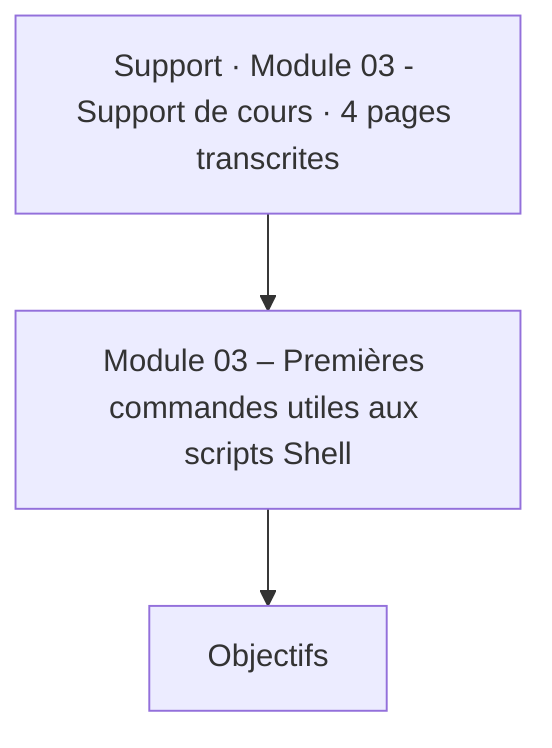

# Module 03 — Premières commandes utiles aux scripts shell

Les parties ci-dessous reprennent le cours original, dans le même ordre. Les encadrés et les schémas répètent ses formulations.

## Parcours de lecture

1. Support · Module 03 - Support de cours · 4 pages transcrites
2. Module 03 – Premières commandes utiles aux scripts Shell
3. Objectifs

**Visuel externe**



SOURCE DRIVE · TRANSCRIPTION DU SUPPORT

Le contenu des documents du dossier TSSR est transcrit ci-dessous, page par page. Les textes et tableaux sont intégrés à la page Web. Aucun fichier PDF, aucune diapositive entière ni aucune reproduction de page n’est affiché. Seuls des croquis ou visuels isolés et vérifiés peuvent accompagner la transcription. Les versions et les consignes restent celles des supports de formation. Les compléments IA sont conservés dans leur onglet distinct.

## Support · Module 03 - Support de cours · 4 pages transcrites

!!! note "À retenir"
    Le texte, les tableaux et le code sont transcrits d’après le PDF de formation.

Le texte, les tableaux et le code sont transcrits d’après le PDF de formation. Les sauts de ligne suivent la présentation du support. Les exemples historiques sont commentés dans le cours optimisé.

## Page 1

## Module 03 – Premières commandes utiles aux scripts Shell

## Objectifs

!!! note "À retenir"
    Découvrir les commandes intégrées à Bash Afficher des informations sur la console Sortir du programme Trouver de l'aide

**Visuel externe**


- Découvrir les commandes intégrées à Bash
- Afficher des informations sur la console
- Sortir du programme
- Trouver de l'aide

## Page 2

### Premières commandes utiles aux scripts Shell

!!! note "À retenir"
    Les commandes abordées dans cette partie sont des commandes internes (ou fonctionnalités du Shell).

Les commandes abordées dans cette partie sont des commandes internes (ou fonctionnalités du Shell).

Aucun fichier binaire dédié ne leur est associé.

### Premières commandes utiles aux scripts Shell

### echo

### affichage écran

!!! note "À retenir"
    echo permet d’afficher du texte Syntaxe Si « expression » contient des caractères spéciaux, il faut la protéger avec des doubles quotes et lui ajouter l’option –e.

echo permet d’afficher du texte

Syntaxe

```
echo [option] "expression"
```

Si « expression » contient des caractères spéciaux, il faut la protéger avec des doubles quotes et lui ajouter l’option –e.

On peut de plus utiliser des options de mise en forme

| Séquence | Mise en forme |
| --- | --- |
| \c | inhibe le changement de ligne en fin de commande |
| \n | nouvelle ligne |
| \t | tabulation horizontale |
| \\ | le caractère \ |

## Page 3

### Premières commandes utiles aux scripts Shell

### clear

### effacement de l’écran

!!! note "À retenir"
    Syntaxe Commande simple sans argument, permettant d’afficher une page écran vierge

Syntaxe

```
clear
```

Commande simple sans argument, permettant d’afficher une page écran vierge

### Premières commandes utiles aux scripts Shell

### exit

### sortie du Shell courant

!!! note "À retenir"
    Syntaxe n est la valeur retournée au Shell père dans la variable $?

Syntaxe

```
exit [ n ]
```

- n est la valeur retournée au Shell père dans la variable $?
- Un script est généralement exécuté dans un environnement enfant
- Celui-ci peut se terminer par la commande « exit 0 » ou non (dans ce cas, celle-ci est implicite)

## Page 4

### Premières commandes utiles aux scripts Shell

### help

### affiche la liste des commandes internes au Shell

!!! note "À retenir"
    Lorsqu’une commande interne est spécifiée en argument, affiche l’aide de la commande.

Lorsqu’une commande interne est spécifiée en argument, affiche l’aide de la commande.

- Afficher les commandes internes au Shell Syntaxe

```
help
```

Syntaxe

```
help wait
```

- Afficher l’aide de la commande interne wait

Premières commandes utiles aux scripts Shell

Démo

Premières commandes

Référence du document : 13yBSYlgjpQW4Pxubwql5vmOU3moLJi-a · SHA-256 c9fce4502e47015f…

## Fiche de synthèse

Les lignes reprennent les titres du cours et la première phrase de chaque partie.

| Partie | Repère du cours |
| --- | --- |
| Support · Module 03 - Support de cours · 4 pages transcrites | Le texte, les tableaux et le code sont transcrits d’après le PDF de formation. |
| Objectifs | Découvrir les commandes intégrées à Bash Afficher des informations sur la console Sortir du programme Trouver de l'aide |
