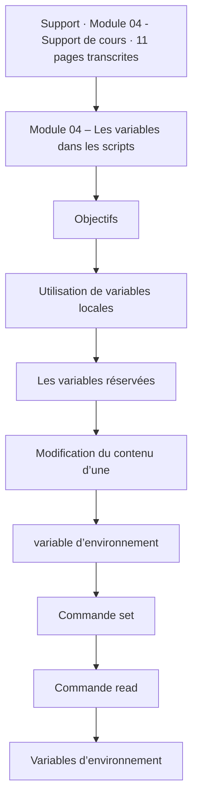
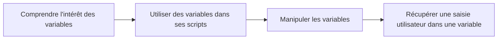
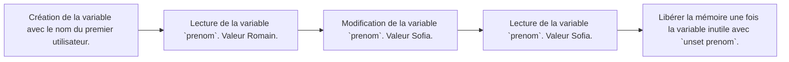
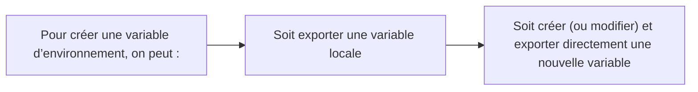

# Module 04 — Les variables dans les scripts

[Travaux pratiques](../../tp/11-initiation-scripting-bash/module-04/index.md)

Les parties ci-dessous reprennent le cours original, dans le même ordre. Les encadrés et les schémas répètent ses formulations.

## Parcours de lecture

1. Support · Module 04 - Support de cours · 11 pages transcrites
2. Module 04 – Les variables dans les scripts
3. Objectifs
4. Utilisation de variables locales
5. Les variables réservées
6. Modification du contenu d’une
7. variable d’environnement
8. Commande set
9. Commande read
10. Variables d’environnement
11. Variables d’environnement

**Visuel externe**



SOURCE DRIVE · TRANSCRIPTION DU SUPPORT

Le contenu des documents du dossier TSSR est transcrit ci-dessous, page par page. Les textes et tableaux sont intégrés à la page Web. Aucun fichier PDF, aucune diapositive entière ni aucune reproduction de page n’est affiché. Seuls des croquis ou visuels isolés et vérifiés peuvent accompagner la transcription. Les versions et les consignes restent celles des supports de formation. Les compléments IA sont conservés dans leur onglet distinct.

## Support · Module 04 - Support de cours · 11 pages transcrites

!!! note "À retenir"
    Le texte, les tableaux et le code sont transcrits d’après le PDF de formation.

Le texte, les tableaux et le code sont transcrits d’après le PDF de formation. Les sauts de ligne suivent la présentation du support. Les exemples historiques sont commentés dans le cours optimisé.

## Page 1

## Module 04 – Les variables dans les scripts

## Objectifs

!!! note "À retenir"
    Comprendre l'intérêt des variables Utiliser des variables dans ses scripts Manipuler les variables Récupérer une saisie utilisateur dans une variable

**Visuel externe**



- Comprendre l'intérêt des variables
- Utiliser des variables dans ses scripts
- Manipuler les variables
- Récupérer une saisie utilisateur dans une variable

## Page 2

### Les variables dans les scripts

!!! note "À retenir"
    Les variables sont des éléments essentiels à la réalisation de scripts.

- Les variables sont des éléments essentiels à la réalisation de scripts.
- Elles permettent de stocker temporairement des informations au cours du déroulement du script.
- Ce contenu peut être affiché ou réutilisé par d’autres commandes.

Il est important de bien appréhender les mécanismes régissant les variables.

### Les variables dans les scripts

```
rappel
```

### Fonctionnement d’une variable

!!! note "À retenir"
    Création de la variable avec le nom du premier utilisateur.

**Visuel externe**



1. Création de la variable avec le nom du premier utilisateur.
2. Lecture de la variable `prenom`. Valeur Romain.
3. Modification de la variable `prenom`. Valeur Sofia.
4. Lecture de la variable `prenom`. Valeur Sofia.
5. Libérer la mémoire une fois la variable inutile avec `unset prenom`.


Stockage de la valeur Sofia dans la variable prenom.

## Page 3

### Les variables dans les scripts

!!! note "À retenir"
    Les variables peuvent être classées en 4 catégories.

Les variables peuvent être classées en 4 catégories.

| Catégorie | Description |
| --- | --- |
| Les variables locales | Les noms doivent être en minuscule (utilisation de doubles quotes “ pour séparer les mots) |
| Les variables d’environnement | Variable système (comme HOME) ou variable exportée |
| Les variables réservées | Il est impossible d’utiliser leurs noms pour des variables locales ou d’environnement |
| Les constantes (variables en lecture seule) | Variable en lecture seule via declare –r <var>. Leurs noms doivent être en majuscule (utilisation de “_” pour séparer les mots |

### Les variables dans les scripts

!!! note "À retenir"
    Les principales actions Affectation d’un contenu réalisées sur les variables Utilisation de son contenu Exportation de la variable Réaffectation de son contenu

Les principales actions

Affectation d’un contenu

réalisées sur les variables

Utilisation de son contenu

Exportation de la variable

Réaffectation de son contenu

## Page 4

## Utilisation de variables locales

### Utilisation de variables locales

!!! note "À retenir"
    Une variable locale est utilisable dans l’environnement courant.

Une variable locale est utilisable dans l’environnement courant.

- Pour affecter un contenu à une variable : nom=valeur

```
errormsg="une erreur est survenue, contactez votre administrateur système"
logdir="/var/log/"
```

- Pour utiliser le contenu d’une variable, on préfixe son nom par le caractère dollar $ , généralement entouré de doubles quotes.

```
[...]
echo "$errormsg"
mkdir –p "$logdir" 2>/dev/null
```

## Page 5

## Les variables réservées

### Les variables réservées

!!! note "À retenir"
    Ce sont des variables dont le nom est réservé par le Shell qui en gère le contenu.

- Ce sont des variables

| Variable | Description |
| --- | --- |
| $$ | Numéro du processus en cours |
| $? | Code retour (0 si vrai, different de 0 si faux) exit 2 -> provoque la sortie avec le code retour “2” |
| $! | Numéro du dernier processus lancé en arrière-plan |
| $# | Nombre de paramètres reçus par le script |
| $1 à $9 | Paramètres de la commande (1 pour le premier, 2 pour le deuxième, etc.) |
| $0 | Nom de la commande ou du script |
| $@ ou $* | Valeurs des paramètres reçus encadrés par “ “ . Certaines versions Unix concatènent les valeurs avec *. |

dont le nom est réservé par le Shell qui en gère le contenu.

- Elles sont très utilisées dans les scripts et les enchaînements de commandes.

## Page 6

### Les variables réservées

### Exemple

```
$ ./monscript.sh  valun valdeux valtrois
```

#### Variables affectées

| Paramètre | Valeur |
| --- | --- |
| $# | 3 — Trois paramètres reçus |
| $0 | ./monscript.sh |
| $1 | valun |
| $2 | valdeux |
| $3 | valtrois |
| $@ | valun valdeux valtrois |

## Modification du contenu d’une

variable d’environnement

## Page 7

### Modification du contenu d’une variable d’environnement

**Visuel externe**



Une variable d’environnement est une variable qui est héritée dans tous les sous-Shell.

- Pour créer une variable d’environnement, on peut :
- Soit exporter une variable locale

```
export NOMVAR
```

- Soit créer (ou modifier) et exporter directement une nouvelle variable

```
export NOMVAR=valeur
```

## Commande set

## Page 8

### Commande set

- La commande set permet notamment d’affecter des valeurs aux variables réservées 1, 2 ...

```
$ set "$LOGNAME" $(uname -n)
$ echo "$1 $2"
user20 serveur102
```

- Si aucun argument n’est donné, toutes les variables du Shell sont affichées.

## Commande read

## Page 9

### Commande read

- La commande read est utilisée pour affecter un contenu saisi par l’utilisateur à une variable.

Syntaxe

```
Read [options] <variable(s)>
```

- Cette commande génère l’attente de saisie clavier validée (par Entrée) et procède au stockage de cette saisie dans la (ou les) variable(s) spécifiée(s).

```
echo "Veuillez entrer votre nom : "
read nom
echo "Bonjour $nom"
```

### Commande read

- Il est possible de substituer la commande echo par l’option –p de read.

```
read –p "Veuillez entrer votre nom : " nom
```

## Page 10

### Commande read

- Si plusieurs paramètres séparés par des espaces sont fournis à read, alors chaque mot saisi est affecté à la variable correspondante. Les saisies en surnombre sont affectées au dernier nom de variable indiqué.

```
read –p " Saisissez votre nom et prénom : " nom prenom
       Thouin Frédéric dit penthium
echo "Nom saisi : $nom "
Nom saisi : Thouin
echo "Prénom saisi : $prenom "
Prénom saisi : Frédéric dit penthium
```

### Commande read

- Pour éviter ce type de désagrément, il est possible de déclarer une variable tampon non utilisée.

```
read –p " Saisissez votre nom et prénom : " nom prenom tampon
       Thouin frédéric dit penthium
[…]
echo "Prénom saisi : $prenom "
Prénom saisi : frédéric
```

- Il est éventuellement possible ultérieurement de détruire cette variable tampon

```
unset tampon
```

## Page 11

Les variables dans les scripts

Démo

Les variables

Référence du document : 1NrIuqu2jLuS2hrFnq8tEwDzbIkkSwN8j · SHA-256 fd8380b788cf35bf…

| Support · Module 04 - Support de cours · 11 pages transcrites | Le texte, les tableaux et le code sont transcrits d’après le PDF de formation. |
| Objectifs | Comprendre l'intérêt des variables Utiliser des variables dans ses scripts Manipuler les variables Récupérer une saisie utilisateur dans une variable |
