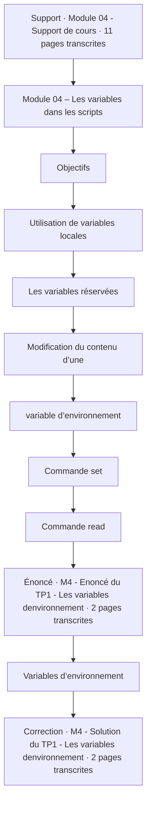
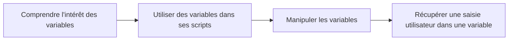
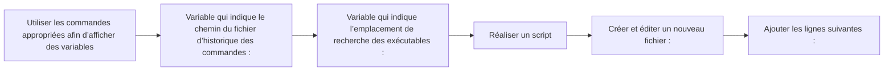

# Module 04 — Les variables dans les scripts

Les parties ci-dessous reprennent le cours original, dans le même ordre. Les encadrés et les schémas répètent ses formulations.

## Parcours de lecture

1. Support · Module 04 - Support de cours · 11 pages transcrites
2. Module 04 – Les variables dans les scripts
3. Objectifs
4. Utilisation de variables locales
5. Les variables réservées
6. Modification du contenu d’une
7. variable d’environnement
8. Commande set
9. Commande read
10. Énoncé · M4 - Enoncé du TP1 - Les variables denvironnement · 2 pages transcrites
11. Variables d’environnement
12. Correction · M4 - Solution du TP1 - Les variables denvironnement · 2 pages transcrites
13. Variables d’environnement

**Visuel externe**



SOURCE DRIVE · TRANSCRIPTION DU SUPPORT

Le contenu des documents du dossier TSSR est transcrit ci-dessous, page par page. Les textes et tableaux sont intégrés à la page Web. Aucun fichier PDF, aucune diapositive entière ni aucune reproduction de page n’est affiché. Seuls des croquis ou visuels isolés et vérifiés peuvent accompagner la transcription. Les versions et les consignes restent celles des supports de formation. Les compléments IA sont conservés dans leur onglet distinct.

## Support · Module 04 - Support de cours · 11 pages transcrites

!!! note "À retenir"
    Le texte, les tableaux et le code sont transcrits d’après le PDF de formation.

Le texte, les tableaux et le code sont transcrits d’après le PDF de formation. Les sauts de ligne suivent la présentation du support. Les exemples historiques sont commentés dans le cours optimisé.

## Page 1

## Module 04 – Les variables dans les scripts

## Objectifs

!!! note "À retenir"
    Comprendre l'intérêt des variables Utiliser des variables dans ses scripts Manipuler les variables Récupérer une saisie utilisateur dans une variable

**Visuel externe**



- Comprendre l'intérêt des variables
- Utiliser des variables dans ses scripts
- Manipuler les variables
- Récupérer une saisie utilisateur dans une variable

## Page 2

### Les variables dans les scripts

!!! note "À retenir"
    Les variables sont des éléments essentiels à la réalisation de scripts.

- Les variables sont des éléments essentiels à la réalisation de scripts.
- Elles permettent de stocker temporairement des informations au cours du déroulement du script.
- Ce contenu peut être affiché ou réutilisé par d’autres commandes.

Il est important de bien appréhender les mécanismes régissant les variables.

### Les variables dans les scripts

### rappel

### Fonctionnement d’une variable

!!! note "À retenir"
    Création de la variable avec le nom du premier utilisateur.

**Visuel externe**


1. Création de la variable avec le nom du premier utilisateur.
2. Lecture de la variable `prenom`. Valeur Romain.
3. Modification de la variable `prenom`. Valeur Sofia.
4. Lecture de la variable `prenom`. Valeur Sofia.
5. Libérer la mémoire une fois la variable inutile avec `unset prenom`.


Stockage de la valeur Sofia dans la variable prenom.

## Page 3

### Les variables dans les scripts

!!! note "À retenir"
    Les variables peuvent être classées en 4 catégories.

Les variables peuvent être classées en 4 catégories.

| Catégorie | Description |
| --- | --- |
| Les variables locales | Les noms doivent être en minuscule (utilisation de doubles quotes “ pour séparer les mots) |
| Les variables d’environnement | Variable système (comme HOME) ou variable exportée |
| Les variables réservées | Il est impossible d’utiliser leurs noms pour des variables locales ou d’environnement |
| Les constantes (variables en lecture seule) | Variable en lecture seule via declare –r <var>. Leurs noms doivent être en majuscule (utilisation de “_” pour séparer les mots |

### Les variables dans les scripts

!!! note "À retenir"
    Les principales actions Affectation d’un contenu réalisées sur les variables Utilisation de son contenu Exportation de la variable Réaffectation de son contenu

Les principales actions

Affectation d’un contenu

réalisées sur les variables

Utilisation de son contenu

Exportation de la variable

Réaffectation de son contenu

## Page 4

## Utilisation de variables locales

### Utilisation de variables locales

!!! note "À retenir"
    Une variable locale est utilisable dans l’environnement courant.

Une variable locale est utilisable dans l’environnement courant.

- Pour affecter un contenu à une variable : nom=valeur

```
errormsg="une erreur est survenue, contactez votre administrateur système"
logdir="/var/log/"
```

- Pour utiliser le contenu d’une variable, on préfixe son nom par le caractère dollar $ , généralement entouré de doubles quotes.

```
[...]
echo "$errormsg"
mkdir –p "$logdir" 2>/dev/null
```

## Page 5

## Les variables réservées

### Les variables réservées

!!! note "À retenir"
    Ce sont des variables dont le nom est réservé par le Shell qui en gère le contenu.

- Ce sont des variables

| Variable | Description |
| --- | --- |
| $$ | Numéro du processus en cours |
| $? | Code retour (0 si vrai, different de 0 si faux) exit 2 -> provoque la sortie avec le code retour “2” |
| $! | Numéro du dernier processus lancé en arrière-plan |
| $# | Nombre de paramètres reçus par le script |
| $1 à $9 | Paramètres de la commande (1 pour le premier, 2 pour le deuxième, etc.) |
| $0 | Nom de la commande ou du script |
| $@ ou $* | Valeurs des paramètres reçus encadrés par “ “ . Certaines versions Unix concatènent les valeurs avec *. |

dont le nom est réservé par le Shell qui en gère le contenu.

- Elles sont très utilisées dans les scripts et les enchaînements de commandes.

## Page 6

### Les variables réservées

### Exemple

```
$ ./monscript.sh  valun valdeux valtrois
```

#### Variables affectées

| Paramètre | Valeur |
| --- | --- |
| $# | 3 — Trois paramètres reçus |
| $0 | ./monscript.sh |
| $1 | valun |
| $2 | valdeux |
| $3 | valtrois |
| $@ | valun valdeux valtrois |

## Modification du contenu d’une

## variable d’environnement

## Page 7

### Modification du contenu d’une variable d’environnement

**Visuel externe**


Une variable d’environnement est une variable qui est héritée dans tous les sous-Shell.

- Pour créer une variable d’environnement, on peut :
- Soit exporter une variable locale

```
export NOMVAR
```

- Soit créer (ou modifier) et exporter directement une nouvelle variable

```
export NOMVAR=valeur
```

## Commande set

## Page 8

### Commande set

- La commande set permet notamment d’affecter des valeurs aux variables réservées 1, 2 ...

```
$ set "$LOGNAME" $(uname -n)
$ echo "$1 $2"
user20 serveur102
```

- Si aucun argument n’est donné, toutes les variables du Shell sont affichées.

## Commande read

## Page 9

### Commande read

- La commande read est utilisée pour affecter un contenu saisi par l’utilisateur à une variable.

Syntaxe

```
Read [options] <variable(s)>
```

- Cette commande génère l’attente de saisie clavier validée (par Entrée) et procède au stockage de cette saisie dans la (ou les) variable(s) spécifiée(s).

```
echo "Veuillez entrer votre nom : "
read nom
echo "Bonjour $nom"
```

### Commande read

- Il est possible de substituer la commande echo par l’option –p de read.

```
read –p "Veuillez entrer votre nom : " nom
```

## Page 10

### Commande read

- Si plusieurs paramètres séparés par des espaces sont fournis à read, alors chaque mot saisi est affecté à la variable correspondante. Les saisies en surnombre sont affectées au dernier nom de variable indiqué.

```
read –p " Saisissez votre nom et prénom : " nom prenom
       Thouin Frédéric dit penthium
echo "Nom saisi : $nom "
Nom saisi : Thouin
echo "Prénom saisi : $prenom "
Prénom saisi : Frédéric dit penthium
```

### Commande read

- Pour éviter ce type de désagrément, il est possible de déclarer une variable tampon non utilisée.

```
read –p " Saisissez votre nom et prénom : " nom prenom tampon
       Thouin frédéric dit penthium
[…]
echo "Prénom saisi : $prenom "
Prénom saisi : frédéric
```

- Il est éventuellement possible ultérieurement de détruire cette variable tampon

```
unset tampon
```

## Page 11

Les variables dans les scripts

Démo

Les variables

Référence du document : 1NrIuqu2jLuS2hrFnq8tEwDzbIkkSwN8j · SHA-256 fd8380b788cf35bf…

## Énoncé · M4 - Enoncé du TP1 - Les variables denvironnement · 2 pages transcrites

Le texte, les tableaux et le code sont transcrits d’après le PDF de formation. Les sauts de ligne suivent la présentation du support. Les exemples historiques sont commentés dans le cours optimisé.

## Page 1

## Variables d’environnement

### TP1 du Module 04 - Les variables dans les scripts

Avant de démarrer ce TP, il convient d’avoir suivi les modules 1 à 4.

Objectifs

Identifier et utiliser les variables d’environnement du système afin de répondre à un besoin donné.

Créer un script utilisant des variables à partir d’un algorithme.

Énoncé

1. Utiliser les commandes appropriées afin d’afficher des variables

De nombreuses variables sont paramétrées et manipulées par le système afin de faciliter l’accès à certaines données ou informations.

- L’une d’entre-elles précise le nom du fichier qui enregistre chacune de vos saisies de commande. On parle de fichier d’historique des commandes. Mais quel est le nom de cette variable ? (indice : traduire ‘historique’ en anglais)
- Une autre indique à quels emplacements le système Linux peut trouver les fichiers exécutables/binaires installés sur le système, comme ls par exemple. Comment se nomme-t ’elle ? (indice : a été abordée dans un module précédent l’arborescence des systèmes Linux et notamment les dossiers de binaires, servez-vous en !) 2. Réaliser un script

Créer un fichier de script ‘script_M4TP1.sh’ à partir du pseudo-code ci-dessous.

L’objectif est d’afficher les fichiers dans votre dossier courant comportant une certaine extension (.txt, .sh, .odt ou .docx par ex.). Puis, pour l’un d’entre eux, de visualiser une partie du contenu.

Début du script

rep  chemin du répertoire courant

extension  txt

## Page 2

Afficher "Répertoire de travail : rep"

Afficher "Fichiers pouvant être traités :"

Afficher la liste des fichiers de rep ayant pour extension extension

Afficher : Quel fichier voulez-vous traiter ?

fic  réponse à la question posée précédemment

nblign  nombre de lignes que contient fic

debut  2 premières lignes de fic

fin  2 dernières lignes de fic

Afficher "CARACTERISTIQUES de fic :"

Afficher "Nombre de lignes du fichier : nblign"

Afficher "Début du fichier :"

Afficher debut

Afficher "Fin du fichier :"

Afficher fin

Fin d’exécution du script

Sachant que :

- La variable extension porte le nom de l’extension de fichiers souhaitée
- La variable rep récupère la valeur de votre position actuelle dans l’arborescence, donc le résultat d’une commande
- La variable fic contient le nom du fichier saisi par l’utilisateur qui exécute le script (il doit donc être invité à saisir un nom de fichier existant)

Référence du document : 15KXSstg5Gyr3CKOsEJD3-HrlE2dl5rFz · SHA-256 14707555164a33cc…

## Correction · M4 - Solution du TP1 - Les variables denvironnement · 2 pages transcrites

Le texte, les tableaux et le code sont transcrits d’après le PDF de formation. Les sauts de ligne suivent la présentation du support. Les exemples historiques sont commentés dans le cours optimisé.

Correction originale : à consulter après avoir tenté l’exercice.

## Page 1

## Variables d’environnement

### Solutions – TP1 du Module 04 - Les variables dans les scripts

**Visuel externe**



1. Utiliser les commandes appropriées afin d’afficher des variables

- Variable qui indique le chemin du fichier d’historique des commandes :

```
set | grep history | grep /
```

ou bien :

```
set | grep HIST | grep /
```

On doit ainsi trouver la variable HISTFILE qui doit indiquer le fichier .bash_history

- Variable qui indique l’emplacement de recherche des exécutables :

A été étudié dans le module d’utilisation Linux, l’emplacement dans l’arborescence des binaires/exécutables tels ls, cp etc. Ils sont situés dans le dossier /bin.

On peut donc rechercher cette chaîne parmi les variables d’environnement du système :

```
set | grep /bin
```

Résultat :

```
localhost:~# set | grep /bin
PATH='/usr/local/sbin:/usr/local/bin:/usr/sbin:/usr/bin:/sbin:/bin'
```

La variable s’appelle donc PATH

2. Réaliser un script

Créer un fichier de script ‘script_M4TP1.sh’ qui contiendra les instructions nécessaires.

- Créer et éditer un nouveau fichier :

```
vim script_M4TP1.sh
```

- Ajouter les lignes suivantes :

```
#! /bin/bash
# M4 - Solution du TP1
```

## Page 2

```
# Définition des variables
rep=$(pwd) # Stocker le résultat de la commande ‘pwd’ dans la var ‘rep’
extension="txt" # Choix ici de travailler sur des fichiers de type ’txt’
```

```
# Corps du script
echo "Répertoire de travail : $rep " # Affiche du texte + contenu var ‘rep’
echo "Fichiers pouvant être traités: "
ls -l *.$extension # Affiche tous les fichiers terminant par extension
echo "" # Affiche simple ligne vide, pour la présentation
read -p "Quel fichier pouvez-vous traiter ? : " fic # Demande saisie fichier
```

```
# Utilisation de variables pour stocker les infos du fichier
nblign=$(cat $fic | wc -l ) # Variable stocke le nb de lignes du fichier
debut=$(cat $fic | head -n 2) # Variable stocke 2ères lignes du fichier
fin=$(cat $fic | tail -n 2 ) # Variable stocke 2 lignes fin du fichier
```

```
# Affichage final des informations à l’écran
# Les ‘\n’ utilisés ci-après sont des sauts de ligne pour la présentation
echo -e "\nCARACTERISTIQUES de $fic :\n" #
echo -e "Nombres de lignes du fichier : $nblign\n"
echo -e "\"Début du fichier : \n$debut\n"
echo -e "\"Fin du fichier : \n$fin\n"
```

- Rendre exécutable le fichier avec la commande chmod :

```
chmod u+x script_M4TP1.sh
```

- Ensuite, exécuter le script ./script_M4TP1.sh

Il faudra bien entendu disposer de fichiers avec l’extension mentionnée et contenant du texte pour obtenir des résultats !

Référence du document : 1DZKHCGwdV8WMX1tLpUzpzky0CMawEQZI · SHA-256 148e1e22b2dc0831…

## Fiche de synthèse

Les lignes reprennent les titres du cours et la première phrase de chaque partie.

| Partie | Repère du cours |
| --- | --- |
| Support · Module 04 - Support de cours · 11 pages transcrites | Le texte, les tableaux et le code sont transcrits d’après le PDF de formation. |
| Objectifs | Comprendre l'intérêt des variables Utiliser des variables dans ses scripts Manipuler les variables Récupérer une saisie utilisateur dans une variable |
| Énoncé · M4 - Enoncé du TP1 - Les variables denvironnement · 2 pages transcrites | Le texte, les tableaux et le code sont transcrits d’après le PDF de formation. |
| Correction · M4 - Solution du TP1 - Les variables denvironnement · 2 pages transcrites | Le texte, les tableaux et le code sont transcrits d’après le PDF de formation. |
