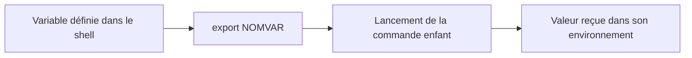

# Module 04 — Les variables dans les scripts

Une variable stocke une valeur pour la réutiliser, la remplacer ou la transmettre. Le module couvre aussi les valeurs que Bash fournit au script et les saisies récupérées avec `read`.

## Objectifs

- Définir une variable et protéger les limites de sa valeur.
- Distinguer les paramètres de Bash, la portée d’une variable et l’environnement transmis.
- Lire un chemin saisi et vérifier le résultat des commandes qui exploitent ce fichier.

## Affecter, lire et réaffecter

Écrivez `nom=valeur` sans espace autour du signe `=`. Les guillemets protègent une valeur composée de plusieurs mots. À la lecture, les guillemets doubles préservent un argument unique. Les accolades délimitent le nom quand un suffixe suit immédiatement.

```bash
prenom="Sofia"
printf 'Bonjour %s\n' "$prenom"
prenom="Romain"
printf 'Compte : %s\n' "$prenom"
unset prenom
```

| Catégorie du support | Exemple | Propriété |
| --- | --- | --- |
| Variable du shell courant | `logdir="/var/log/"` | Disponible dans le contexte où elle est définie |
| Variable d’environnement | `HOME`, `PATH`, `export NOMVAR` | Transmise aux commandes lancées ensuite |
| Paramètre spécial ou positionnel | `$?`, `$#`, `$1` | Valeur fournie par Bash |
| Variable en lecture seule | `declare -r MAX_LIGNES=42` | Une réaffectation échoue |

**Clarification pédagogique.** Le choix des majuscules et minuscules relève d’une convention. Dans une fonction, `local` restreint la portée de la variable à la fonction et à ses appels. L’export transmet une valeur vers les enfants. Un enfant qui modifie sa copie ne change pas la variable du parent.

```bash
NOMVAR=valeur
export NOMVAR
bash -c 'printf "%s\n" "$NOMVAR"'
export NOMVAR="nouvelle valeur"
declare -r MAX_LIGNES=42
```

## Lire les paramètres réservés

| Forme | Rôle |
| --- | --- |
| `$0` | Nom d’invocation du shell ou du script |
| `$1`, `$2` à `$9` | Arguments positionnels. Au-delà de 9, délimitez le numéro avec des accolades |
| `$#` | Nombre d’arguments |
| `"$@"` | Transmet chaque argument séparément |
| `"$*"` | Réunit les arguments dans une seule chaîne avec le premier caractère d’`IFS` |
| `$$` | Identifiant du processus du shell invoqué |
| `$!` | Identifiant du dernier travail lancé en arrière-plan |
| `$?` | Statut de la dernière commande ou du dernier pipeline synchrone |

Avec `./monscript.sh valun valdeux valtrois`, `$#` vaut 3, `$0` vaut `./monscript.sh` et les paramètres 1 à 3 reprennent les valeurs. `set` sans argument affiche les variables et fonctions du shell Bash. `set --` remplace les paramètres positionnels. Le `--` protège contre un premier argument qui commence par un tiret. [Paramètres spéciaux de Bash](https://www.gnu.org/software/bash/manual/html_node/Special-Parameters.html)

```bash
set -- "$LOGNAME" "$(uname -n)"
printf 'Utilisateur %s sur %s\n' "$1" "$2"
```

## Saisir des champs ou une ligne

`read` lit une ligne. Avec plusieurs noms de variables, la dernière reçoit le reste des champs. Le support emploie une variable tampon pour n’utiliser que le nom et le prénom. `-p` affiche une invite sur un terminal. `-r` conserve les antislashs.

```bash
read -r -p "Saisissez votre nom et votre prénom : " nom prenom tampon || exit 1
printf 'Nom : %s\nPrénom : %s\n' "$nom" "$prenom"
unset tampon
```

Avec `IFS= read -r chemin`, une variable reçoit la ligne entière et ses espaces. Un statut non nul signale notamment la fin de l’entrée. [Commande read](https://www.gnu.org/software/bash/manual/html_node/Bash-Builtins.html)

## TP 01 — Environnement et lecture d’un fichier

Repérez `HISTFILE` pour l’historique et `PATH` pour la recherche des commandes. Le support propose des filtres sur `set`. Une lecture directe comme `printf '%s\n' "$PATH"` identifie la variable voulue. Le script du TP liste les fichiers d’une extension du répertoire courant, puis demande un fichier et affiche son nombre de lignes, les deux premières et les deux dernières.

Contrôlez un fichier au nom composé, un chemin absent et un fichier d’une seule ligne. `wc -l` compte les caractères de fin de ligne. `head -n 2` et `tail -n 2` peuvent donc afficher les mêmes données sur un petit fichier.

### Construire le script de lecture

1. Relevez `HISTFILE` et `PATH`, puis expliquez le rôle de chacun. Une valeur non définie ne se confond pas avec un historique vide.
2. Préparez quelques fichiers de test et listez les correspondances avec l’extension choisie. Préservez les limites des noms contenant des espaces.
3. Lisez le chemin avec `IFS= read -r`. Validez qu’il désigne un fichier ordinaire lisible avant de l’exploiter.
4. Affichez le nombre de fins de ligne, le début et la fin du fichier. Vérifiez les statuts des commandes et renvoyez un message explicite en cas d’échec.

| Jeu d’essai | Résultat à relever |
| --- | --- |
| Fichier de trois lignes nommé `notes du TP.txt` | Nombre 3, lignes 1–2 au début et 2–3 à la fin |
| Fichier d’une ligne | La même ligne peut apparaître dans les deux extraits |
| Chemin absent | Diagnostic de lecture et statut non nul |

### Transmission de l’environnement — Complément pédagogique



## À retenir

Une affectation conserve une valeur dans le shell. L’export la rend disponible aux commandes enfants. Pour un chemin saisi ou une liste d’arguments, choisir les guillemets et la forme de lecture qui conservent les limites prévues.

## Mini-quiz

1. Quelle forme transmet séparément tous les arguments du script ?
2. Quelle commande rend une variable transmissible aux processus enfants ?
3. Où vont les champs supplémentaires d’un `read` avec deux variables ?
4. Quel contrôle faire avant de transmettre un chemin saisi à `wc` ?
5. Comment référencer le dixième argument ?

??? success "Réponses commentées"
    1. `"$@"` préserve les limites de chaque argument.
    2. `export`, pour les commandes lancées après l’export.
    3. Dans la dernière variable de la liste.
    4. Vérifier que le chemin est un fichier ordinaire lisible et le transmettre entre guillemets.
    5. Avec `${10}`. Les accolades délimitent le numéro complet.

## Appliquer ce module

- [TP 01 et correction](../../tp/11-initiation-scripting-bash/module-04/index.md)
- [Fiche de révision](../../revision/11-initiation-scripting-bash/module-04-les-variables-dans-les-scripts.md)
