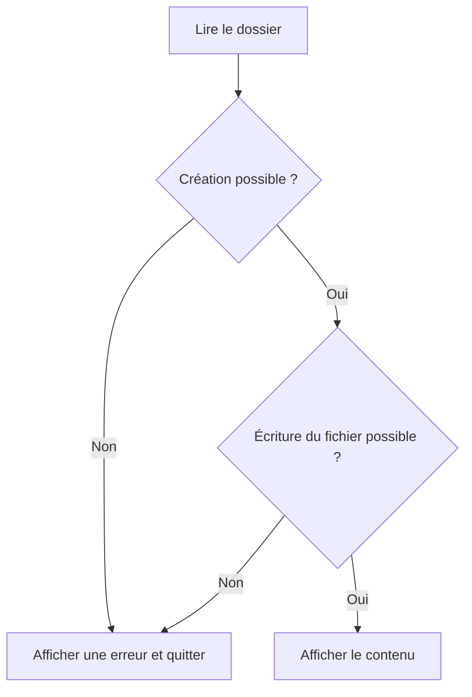

# Module 05 — Les caractères spéciaux du script

Ce module organise plusieurs commandes dans un même script. Il montre comment lier une action au succès d’une autre, partager une redirection et rendre une information visible par la couleur.

## Choisir la règle d’enchaînement

| Forme | Quand la deuxième commande est appelée | Statut de la liste |
| --- | --- | --- |
| `A ; B` | Après A, quel que soit son statut dans le déroulement ordinaire | Celui de B |
| `A && B` | Si A réussit, statut zéro | Celui de la dernière commande exécutée |
| `A \|\| B` | Si A a un statut non nul | Celui de la dernière commande exécutée |
| `A \| B` | Les processus communiquent par un tube | Celui de B par défaut |

Le support montre la création de `/data` puis d’un fichier dans ce dossier. Avec `;`, la seconde commande est tentée même si la première échoue. Pour que la création du fichier dépende de celle du répertoire, employez `&&`. Pour afficher un message si la création échoue, utilisez `||`. `2>/dev/null` cache la sortie d’erreur de la commande à laquelle il est attaché. Le code de retour reste disponible. [Listes de commandes](https://www.gnu.org/software/bash/manual/html_node/Lists.html)

```bash
mkdir ./data && touch ./data/file1
mkdir ./autre-data 2>/dev/null || printf '%s\n' "Création du répertoire impossible" >&2
ls -l ./data
```

**Complément pédagogique.** `A && B || C` appelle C si A échoue ou si B échoue. Pour sélectionner exactement une branche d’après A, utilisez `if`. Un tube transmet la sortie standard de A à l’entrée standard de B. Il ne propage pas automatiquement l’échec de A. Bash offre `set -o pipefail` pour obtenir le dernier statut non nul d’un pipeline en échec. [Pipelines Bash](https://www.gnu.org/software/bash/manual/html_node/Pipelines.html)

## Regrouper des commandes

Les parenthèses créent un sous-shell. Les accolades exécutent le groupe dans le shell courant dans une commande ordinaire. Le groupe entre accolades requiert les espaces et un séparateur avant `}`. Le support indique contradictoirement un environnement enfant pour les accolades. Une affectation de variable rend la distinction observable.

```bash
valeur=parent
( valeur=enfant; printf 'Dans le groupe : %s\n' "$valeur" )
printf 'Après les parenthèses : %s\n' "$valeur"
{ valeur=courant; printf 'Dans le groupe : %s\n' "$valeur"; }
printf 'Après les accolades : %s\n' "$valeur"
```

L’exemple affiche `enfant` dans les parenthèses, puis `parent` après. Les deux derniers affichages donnent `courant`. Une redirection placée après la fermeture peut s’appliquer à l’ensemble du groupe. Un tube peut modifier le contexte d’exécution du groupe. [Regroupement de commandes](https://www.gnu.org/software/bash/manual/html_node/Command-Grouping.html)

## Afficher des couleurs

Les codes de premier plan vont de 30 à 37 dans la table du support. Les arrière-plans correspondants vont de 40 à 47.

| Couleur | Texte | Fond |
| --- | --- | --- |
| Noir | 30 | 40 |
| Rouge | 31 | 41 |
| Vert | 32 | 42 |
| Jaune | 33 | 43 |
| Bleu | 34 | 44 |
| Magenta | 35 | 45 |
| Cyan | 36 | 46 |
| Gris clair | 37 | 47 |

Le support indique les attributs 0 pour réinitialiser, 1 pour le gras, 4 pour le souligné, 7 pour inverser, 8 pour masquer et 9 pour barrer. La séquence commence par `\033[` ou `\e[` et finit par `m`. Réinitialisez le style avec `\033[0m`. Le rendu dépend du terminal. Conservez un libellé qui reste lisible sans la couleur.

```bash
echo -e "voici du \033[1;32mvert\033[0m"
printf '\033[1;32m%s\033[0m\n' 'Fichier prêt'
```

## TP 01 — Créer un dossier et un fichier

Demandez le dossier, créez-le, créez `fic_M5TP1.txt`, écrivez le texte attendu et affichez son contenu. Le support distingue les messages du dossier et du fichier par couleur. Un chemin peut contenir des espaces. Protégez ses développements par des guillemets et arrêtez le traitement si une étape requise échoue. La redirection `>` remplace le contenu du fichier. Réalisez le TP dans un répertoire de travail réservé à l’exercice.

### Enchaînement du TP — Complément pédagogique



## Mini-quiz

1. Que fait `B` après `A && B` quand A échoue ?
2. Quelle forme laisse une affectation visible dans le shell courant ?
3. À quel flux correspond le descripteur `2` ?

**Réponses.** B est ignorée. Le groupe ordinaire entre accolades. La sortie d’erreur standard.

- [TP 01 et correction](../../tp/11-initiation-scripting-bash/module-05/index.md)
- [Fiche de révision](../../revision/11-initiation-scripting-bash/module-05-les-caracteres-speciaux-du-script.md)
