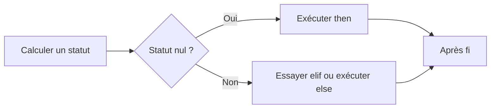

# Module 06 — Exécution conditionnelle

À partir d’un statut ou d’une expression, choisissez la branche à exécuter. Le module couvre `if`, les comparaisons, les motifs et `case`. Il prolonge l’exemple du nombre de résultats dans le script de connexion.

## Objectifs

- Utiliser un statut, un test de fichier ou une comparaison dans une condition.
- Choisir entre `if` et `case` et prévoir une branche pour les saisies invalides.
- Vérifier les codes de sortie du script d’accueil et les branches du menu de comptes.

## Exécuter une branche

`if` prend une commande ou une liste de commandes. `then` s’exécute quand le statut testé vaut zéro. `elif` teste un autre cas si la condition précédente a échoué. `else` traite les cas restants et `fi` ferme la structure. Les blocs peuvent être imbriqués.

```bash
if [[ $# -eq 1 ]]; then
    nb=$1
elif [[ $# -gt 1 ]]; then
    printf 'Usage : %s [nombre]\n' "$0" >&2
    exit 1
else
    nb=42
fi
printf '%s\n' "$nb"
```

Cet exemple traite le nombre d’arguments. Il reste à valider le contenu de `nb` selon le besoin. Le support teste aussi une commande directement, par exemple `if ls /tmp; then …; fi`. Tester directement le statut évite de perdre `$?` entre la commande et le test.

## Choisir le test selon la donnée

| Forme | Usage |
| --- | --- |
| `test CONDITION` ou `[ CONDITION ]` | Test standard. `[` est une commande et `]` doit constituer un argument distinct |
| `[[ CONDITION ]]` | Expression conditionnelle Bash. Développements sans découpage de mots ni expansion des noms de fichiers |
| `(( EXPRESSION ))` | Calcul entier. Statut zéro si la valeur de l’expression est non nulle |

**Clarification pédagogique.** Bash intègre `test` et `[`. Une commande externe peut aussi exister. Le support suggère `typeset -i` pour les entiers, mais une comparaison numérique ne requiert pas une déclaration préalable. Validez la saisie avant de l’interpréter en arithmétique. [Commandes intégrées et tests](https://www.gnu.org/software/bash/manual/html_node/Bourne-Shell-Builtins.html)

| Donnée | Opérateurs du support |
| --- | --- |
| Entier | `-eq` égal, `-ne` différent, `-gt` supérieur, `-ge` supérieur ou égal, `-lt` inférieur, `-le` inférieur ou égal |
| Chaîne | `=` égalité ou motif selon la forme, `!=` différence, `-n` non vide, `-z` vide |
| Chemin | `-d` répertoire, `-f` fichier ordinaire, `-r` lisible, `-w` modifiable, `-x` exécutable ou traversable, `-s` taille non nulle |
| Combinaison dans `[[ ]]` | `&&` et, `\|\|` ou, `!` négation, `( )` regroupement |

```bash
if [[ -f fic1 && ( -d rep1 || -d rep2 ) ]]; then
    printf '%s\n' "Fichier et au moins un répertoire présents"
fi
if [[ -z $prenom ]]; then
    printf '%s\n' "Saisissez votre prénom"
fi
```

Les tests de présence et d’accès précèdent une lecture, un affichage ou une copie. L’action peut encore échouer si l’état a changé. Vérifiez son propre statut.

## Reconnaître un motif et choisir avec case

| Motif | Correspondance |
| --- | --- |
| `*` | Zéro ou plusieurs caractères |
| `?` | Un caractère |
| `[abc]` | Un caractère de l’ensemble |
| `[!abc]` ou `[^abc]` | Un caractère hors de l’ensemble |
| `?(a\|b)` et `*(a\|b)` | Zéro ou une occurrence, puis zéro ou plusieurs |
| `+(a\|b)` et `@(a\|b)` | Une ou plusieurs occurrences, puis exactement une |
| `!(a\|b)` | Tout motif qui ne correspond à aucune des alternatives |

Dans `[[ $chaine = motif ]]`, un motif non cité peut contenir des opérateurs. Les caractères placés entre guillemets sont interprétés littéralement. Bash active le comportement des motifs étendus pour le membre droit de `=` et `!=` dans `[[ ]]`. Pour des usages hors de cette expression, le support montre `shopt -s extglob`, à activer avant l’analyse de la construction concernée. [Conditions et motifs Bash](https://www.gnu.org/software/bash/manual/html_node/Conditional-Constructs.html)

```bash
chaine=+123
if [[ "$chaine" = ?([+-])+([0-9]) ]]; then
    printf '%s\n' "$chaine a la forme d’un entier signé"
fi
```

`case` essaie les motifs dans l’ordre. `;;` termine une branche et `*` capte les valeurs restantes quand il figure à la fin. Le support illustre `foo`, `bar` et un retour 5 pour les autres valeurs. L’exemple présente une action de création pour `foo` et une action d’affichage pour `bar`.

```bash
case "$choix" in
    foo) printf 'Préparer la création de %s\n' "$fichier" ;;
    bar) printf '%s\n' "Afficher l’information" ;;
    *) printf '%s\n' "Choix inconnu" >&2; exit 5 ;;
esac
```

## Deux TP distincts

Le TP 01 exploite `$#` et `$1`. Il demande le nom quand aucun argument n’est fourni, refuse un nombre d’arguments supérieur à un, interdit `root` et salue les autres noms. Le TP 02 emploie `case` dans un menu de gestion de comptes. Les actions de création, changement du mot de passe et suppression demandent une machine virtuelle de laboratoire et les droits appropriés.

### TP 01 — Arguments et refus de `root`

1. Refusez plus d’un argument et rendez le statut `1`.
2. Avec un argument, reprenez sa valeur. Sans argument, lisez la saisie et contrôlez sa validité.
3. Avec `root`, affichez le refus et rendez le statut `2`. Pour une autre valeur valide, affichez l’accueil et relevez le statut de réussite.

### TP 02 — Menu de comptes dans la VM

1. Lisez un identifiant et validez sa forme. Traitez le choix avec `case`.
2. Pour V, vérifiez l’existence d’un compte local et comparez un compte présent à un nom absent.
3. Pour C, M ou S, utilisez un compte de test préfixé `tp_` dans la VM et les droits prévus. Vérifiez l’état avant et après chaque action. La correction sépare ces branches de la simple vérification.
4. Pour Q, quittez sans modifier de compte. Pour un choix inconnu, relevez le diagnostic et le statut.

| Cas de contrôle | Résultat prévu |
| --- | --- |
| TP 01, deux arguments | Usage et statut 1 |
| TP 01, argument `root` | Refus et statut 2 |
| TP 02, modification avec un nom hors préfixe | Refus avant toute commande de gestion de comptes |
| TP 02, V sur un compte présent | Confirmation de présence locale |

### Lecture d’une condition — Complément pédagogique



## À retenir

Le statut zéro sélectionne la branche de succès. Validez le type de donnée avant sa comparaison et placez le motif de secours à la fin de `case`. Pour une action sur un compte, contrôlez d’abord la cible et l’environnement.

## Mini-quiz

1. Quel test reconnaît un fichier ordinaire ?
2. Quand une branche située après `*` est-elle atteinte dans ce menu ?
3. Que change le guillemetage du motif à droite de `=` dans `[[ ]]` ?
4. Quel statut le TP 01 attend-il pour l’identifiant `root` ?
5. Quelles vérifications précèdent C, M ou S dans la correction du TP 02 ?

??? success "Réponses commentées"
    1. `-f`.
    2. Jamais si la branche `*` correspond déjà et se termine par `;;`.
    3. Les caractères cités sont traités littéralement, y compris un astérisque cité.
    4. Le statut 2, après un refus explicite.
    5. La cible est un compte `tp_` du laboratoire et les droits requis sont présents dans la VM.

## Appliquer ce module

- [TP 01 et TP 02](../../tp/11-initiation-scripting-bash/module-06/index.md)
- [Fiche de révision](../../revision/11-initiation-scripting-bash/module-06-execution-conditionnelle.md)
